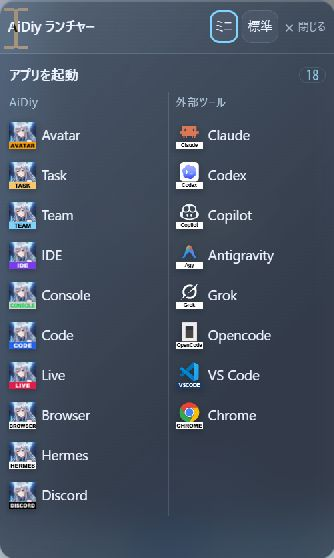

# アイコンメニュー

> 文書: `backend_diag,アイコンメニュー.md` | 実装: `backend_diag/起動/アイコンメニュー.cjs`, `backend_diag/起動/アイコンメニュー-preload.cjs`, `backend_diag/起動/アイコンメニュー.css`

## このメモを使う場面

- Diagアイコンの右クリックメニューを調整・確認するとき。

回転メニューを閉じた小さいアイコンの状態でも右クリックから使える。ミニサイズ・標準サイズ・閉じると、表示対象のアプリだけを並べるランチメニューを備える。右クリック時から一覧を展開し、表示操作とアプリ一覧を一体のパネルに収める。全体幅は264px。表示操作は上部の1行に集約し、アプリ行は32px。高さは表示件数から計算し、クリックしたモニターの作業領域内へ位置・サイズを補正する（タスクバーを避け、負座標のモニターにも対応）。画面が小さい場合は一覧内をスクロールする。左列はAvatar〜Discord（Browser・Hermesを含む）、右列はClaudeなどの外部ツール〜Chrome。項目が未表示でも列の所属は変えず、表示対象だけを載せる。多い場合は一覧内をスクロールする。Esc、外側クリック、フォーカス離脱で閉じる。

専用のsandbox付きElectron窓で表示する。起動キーは親から渡された一覧に限定し、送信元とmainFrameを照合する。閉じるは親の `window.close()` を呼び、既存のサーバー稼働時の終了確認を通す。表示変更は既存のmini／normalイベント、アプリ起動は既存のlaunchイベントへ渡す。

変更後はDiagを開き直す。Vueの変更がない場合はUIビルド不要。確認は `node --test backend_diag/checks/icon-menu.check.cjs backend_diag/checks/close-confirm.check.cjs`。下図は実装部品を18項目・2列で開いた確認画面。

## すりガラス表示

Windows 11 22H2以降ではElectronのbackgroundMaterial（acrylic）で背後の画面をぼかす。macOSはvibrancy（menu）を指定する。文字とアイコンは不透明のまま、濃紺の背景だけ半透明にする。未対応環境は従来の濃紺パネル。Windows実機で表示確認済み、macOS実機は未検証。

左上の見出しは「AiDiy ランチャー」とし、Aマークは表示しない。
