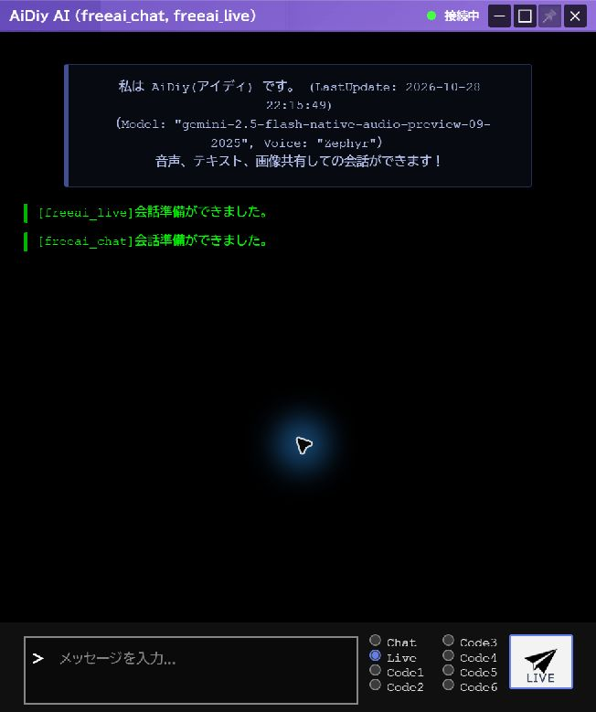
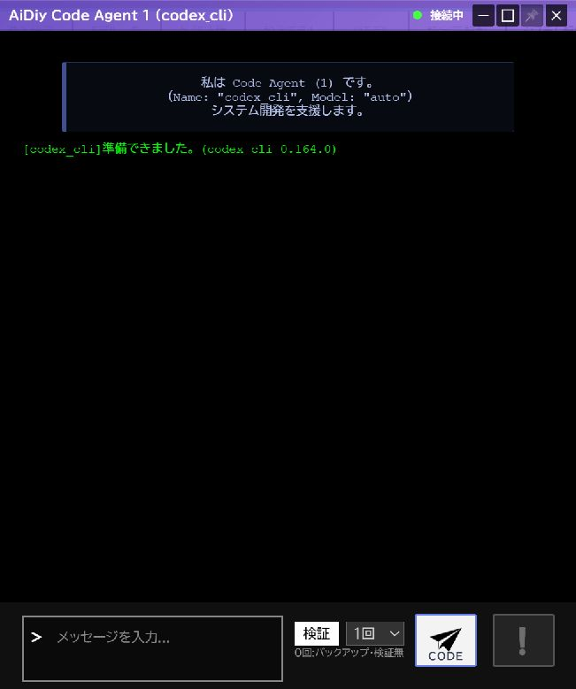
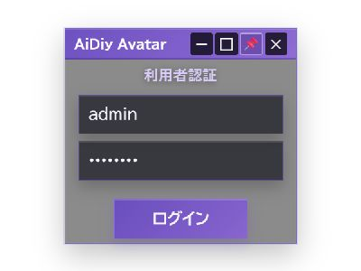
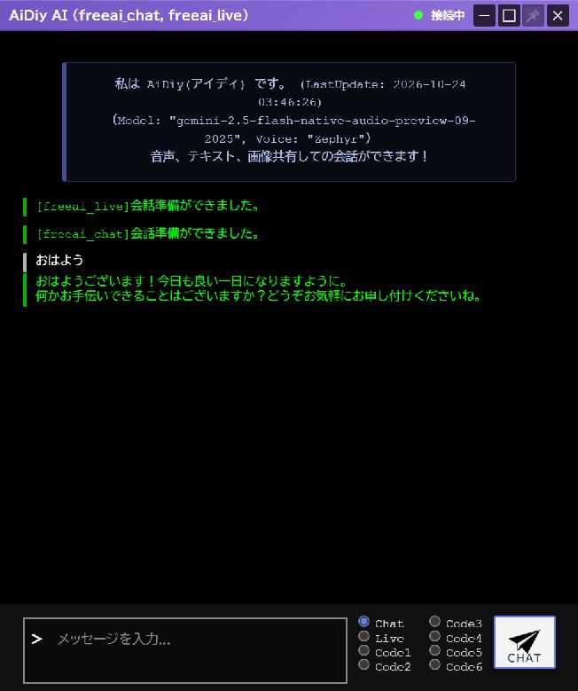
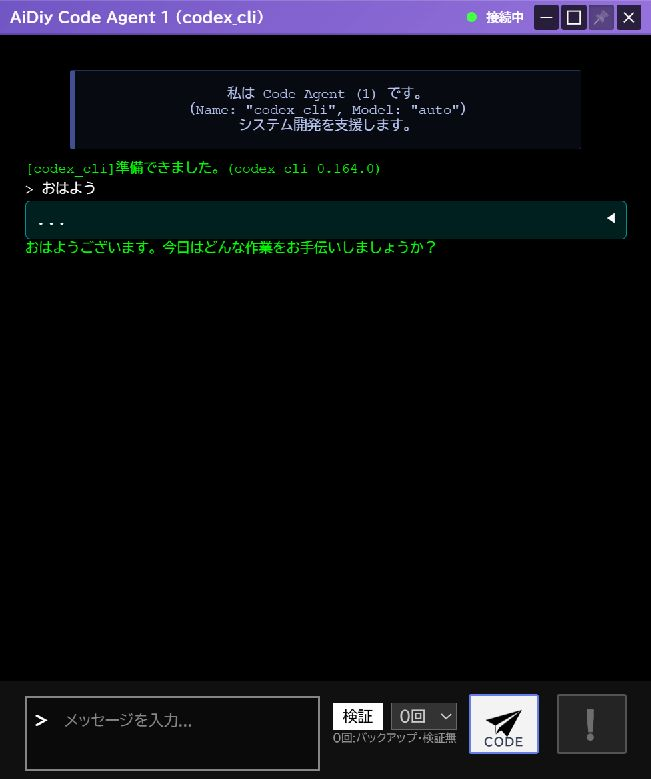
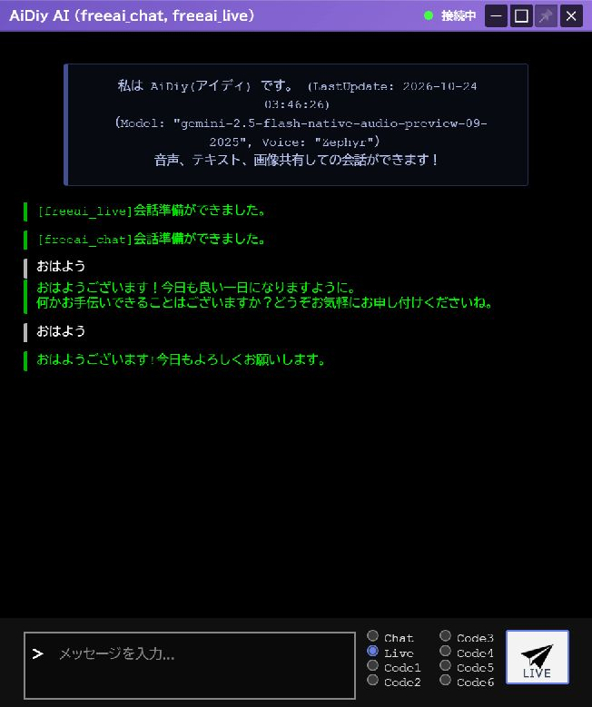
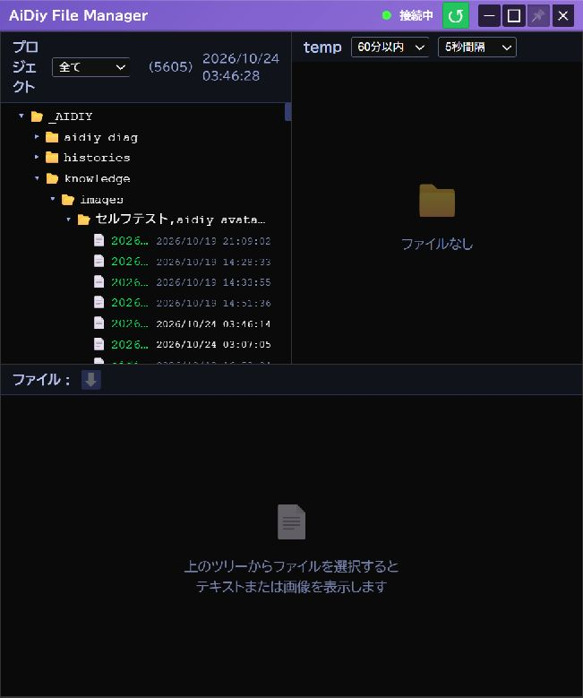
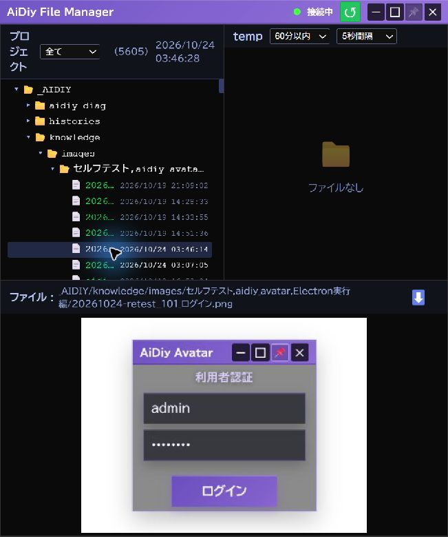
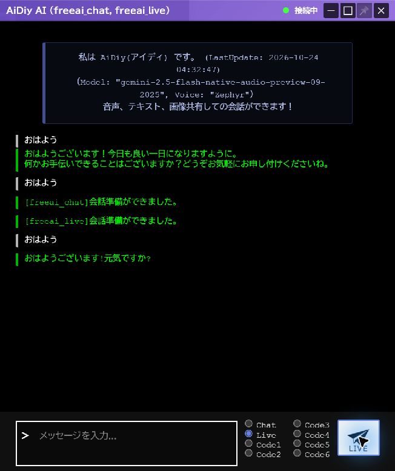

# aidiy_avatar Electron実行編 — 操作ガイドとセルフテスト

> 本書はセルフテスト結果を、操作説明・解説書としても読みやすく整理しています。再テスト後は結果・注意書き・エビデンスを更新し、章立て・操作手順・図解の配置などの様式を維持します。

> 文書: `セルフテスト,aidiy_avatar,Electron実行編.md` | 実装: `frontend_avatar/src/AiDiy.vue`, `frontend_avatar/src/components/`, `frontend_avatar/launch.mjs`

## 総合評価

再試験の実施順・変更後に確認する範囲は[共通の再試験準備](./セルフテスト,共通,確認結果.md#本日6時以降の更新に対する再試験準備)を参照します。以下の総合評価は記載した実施条件での結果です。画像番号は章と掲載順を表し、試験ケースIDとは区別します。

実画面の最終確認は2026年10月28日です。ログイン、VRM描画、Chat／Liveの選択、Code1表示と終了、Task／Team入口がない構成を確認しました。文字応答・再接続は10月24日の結果です。

**総合評価：✅ OK。2026年10月24日・Windowsで実画面で確認しました。ログイン、Chat・Code1・Code6・Liveの文字応答、Core再起動後の自動再接続は✅ OKです。** 

対象環境はWindowsです。Mac／Linux実機と長時間連続運転は **PASS（環境依存・判定対象外）** とし、今回は未実施です。実行成功とは区別し、NGには数えません。

マイク入力機器はブラウザの機器列挙で0台でした。実マイク入力は **PASS（環境依存・判定対象外）** とします。音声の聴取は⏸ 未実施です。本冊は簡易応答と画面操作の確認で、全機能・全プロバイダの合格を示すものではありません。

Task／TeamはAvatar内の機能ではありません。単独の [aidiy_task](./セルフテスト,aidiy_task,操作編.md)・[aidiy_team](./セルフテスト,aidiy_team,操作編.md) を使用します。掲載結果は記載した試験日時・条件の記録であり、現行版の全機能を再試験した結果ではありません。

## 始める前に

Web／Avatarのcleanup・依存復元、型チェック、起動制御、全終了と8092の解放を確認済みです。Task／Teamは独立コマンドを使います。直近の起動・表示試験ではAIへ依頼を送信していません。

移設後もChat／Liveの選択と接続表示を維持しています。

Code1を開いた画面です。入力欄と接続状態を確認し、この窓だけを閉じてもコア・Chat窓は残りました。

[システム起動編](./セルフテスト,aidiy_diag,システム起動編.md)に従って必要なシステムを起動し、Diagの「アプリ起動」でAvatarを起動します。試験用アカウントは[アプリ起動編](./セルフテスト,aidiy_diag,アプリ起動編.md#ローカル試験用の利用者)を参照します。

**8092はAvatar起動中だけ利用できます。** Web版を使っている間は、起動元のAvatarを終了しません。8090は通常Web用で、Avatar Webの接続先は `http://127.0.0.1:8092` です。

## 1. ログインして操作ボタンを表示する

1. DiagのランチャーでAvatarを押し、「利用者認証」の窓が開くまで待ちます。
2. 利用者IDとパスワードを入力して「ログイン」を押します。
3. アバターのコア窓とチャット窓が開いたら、コア窓にポインターを入れて操作ボタンを表示します。

**✅ OK（AE-101）**：ログイン後に2つの窓が開きました。「接続中」と操作ボタンを確認しています。起動所要時間は今回計測していません。

Avatar起動直後です。利用者認証を済ませて会話画面へ進みます。

コア窓の右側から、ファイル・チャット・番号別のCode窓を開けます。

現行のコア窓にはTask／Teamの起動ボタンはありません。操作ボタンの画面は現行版で再撮影し、AE-101の再確認と合わせて掲載します。

## 2. ChatとCodeで会話する

1. チャット窓の右下で「Chat」を選び、「おはよう」と入力して送信します。
2. コア窓の「1」「6」を押してCode1・Code6を開きます。
3. 挨拶だけの試験では「検証」を0回にし、それぞれ「おはよう」を入力して「CODE」を押します。
4. 進行表示が終わり、返答が表示されるまで待ちます。応答待ちの間は再送しません。

**✅ OK（AE-201〜203）**：Chat、Code1（codex_cli）、Code6（aidiy_hermes）がそれぞれ返答しました。Codeのモデルはautoです。異なる窓の返答を流用せず確認しました。

Chatを選んで送信した結果です。入力の下に返答が表示されています。

Code1の返答です。「今日はどんな作業をお手伝いしましょうか？」まで表示されています。

Code6の返答です。「今日は何をお手伝いしましょうか？」まで確認しました。

## 3. Liveで会話する

1. チャット窓の「Live」を選びます。
2. 「会話準備ができました。」を確認して、初回は15秒以上待ちます。
3. 「おはよう」を1回だけ送り、文字の返答を確認します。標準の観測枠は60秒です。

**✅ OK（AE-301）**：初回送信で「おはようございます!今日もよろしくお願いします。」と返答しました。※注意:15s以上待機後送信しました。初回の送信から応答までの厳密な時間は計測していません。Core再起動後の試験では、送信から19秒後の画面取得時に返答を確認しました。再送していません。

プロバイダはfreeai_live、画面に表示されたモデルはgemini-2.5-flash-native-audio-preview-09-2025、声はZephyrです。ここでは文字の応答を判定しています。

Liveでの初回応答です。ChatとLiveの入力は、それぞれ1回ずつです。

## 4. ファイルを探して中身を見る

1. コア窓のフォルダボタンを押し、File Managerを開きます。
2. 一覧から確認したいファイルを選びます。フォルダをたどって対象を絞れます。
3. 画像ファイルを選ぶとプレビューを確認できます。

**✅ OK（AE-401〜402）**：作業フォルダの一覧と、今回撮影したPNGのプレビューを確認しました。ファイルの編集・削除は行っていません。

File Managerの一覧です。作業フォルダ内のファイルを選んで閲覧します。

PNGを選択した結果です。撮影したログイン画面がプレビューに表示されています。

## 5. 接続が切れたときと終了

1. 送信を繰り返さず、Diagの「システム起動」でCoreの状態を確認します。
2. Coreが復帰したら、Avatarが自動で「接続中」に戻るまで待ちます。
3. 準備完了後に短い文を1回送り、新しい返答が出ることを確認します。

**✅ OK（AE-501）**：DiagからCoreを再起動し、Electronの接続復帰とLiveへの新しい返答を確認しました。Chatの履歴は重ねて追加されません。

Liveの会話文脈は、サーバー側で接続しているLive APIの同じセッションが保持します。画面への履歴の保存・再表示は不要で、復元されないことは不具合・残件ではありません。画面だけの再読み込みと、サーバー側のCore再起動は別の操作です。

Core再起動後です。接続中に戻り、新しいLiveの返答が1回表示されています。

終了するときは応答待ちの処理がないことを確認し、使用中の8092のブラウザタブを先に閉じます。その後Avatarを終了します。Avatar終了で8092も停止するため、Web版利用中は終了しません。

## 確認範囲と撮影方法

窓の移動・開始ズーム、表示選択、画像生成、設定保存、ファイル添付は、この冊子の今回の実画面試験には含めません。接続処理の回帰テスト10件とAvatarの型チェックは成功しました。

透明部分へ別アプリが映り込まないよう、撮影用の白い背景窓を背面に置いて撮影しました。画面の内容を合成・修正せず、掲載用には縦横比を保って長辺960px以下へ縮小しています。

[PDF版](./セルフテスト,aidiy_avatar,Electron実行編.pdf)
