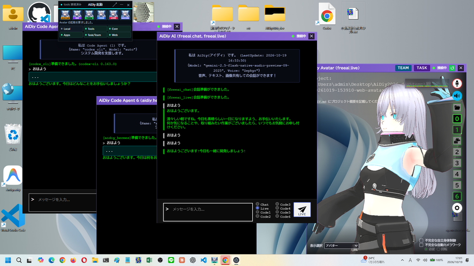
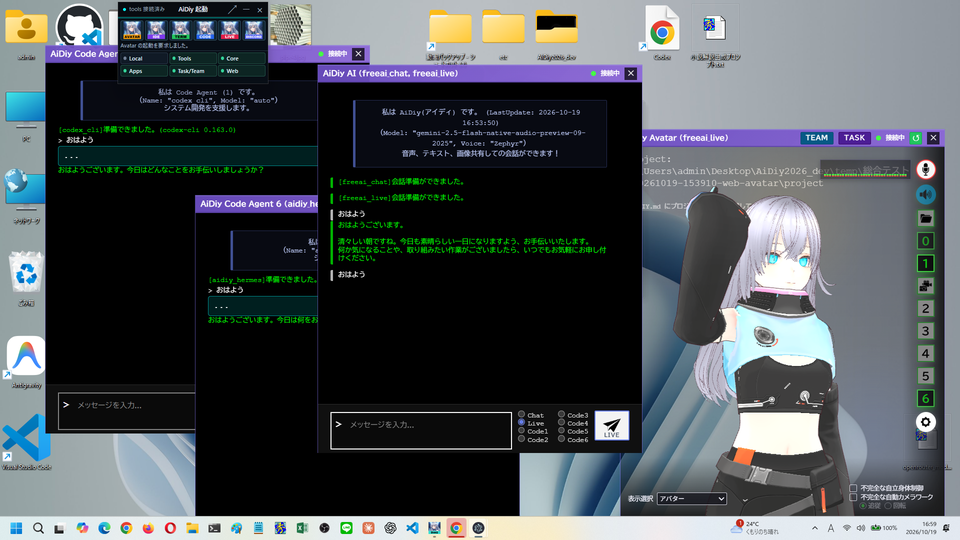
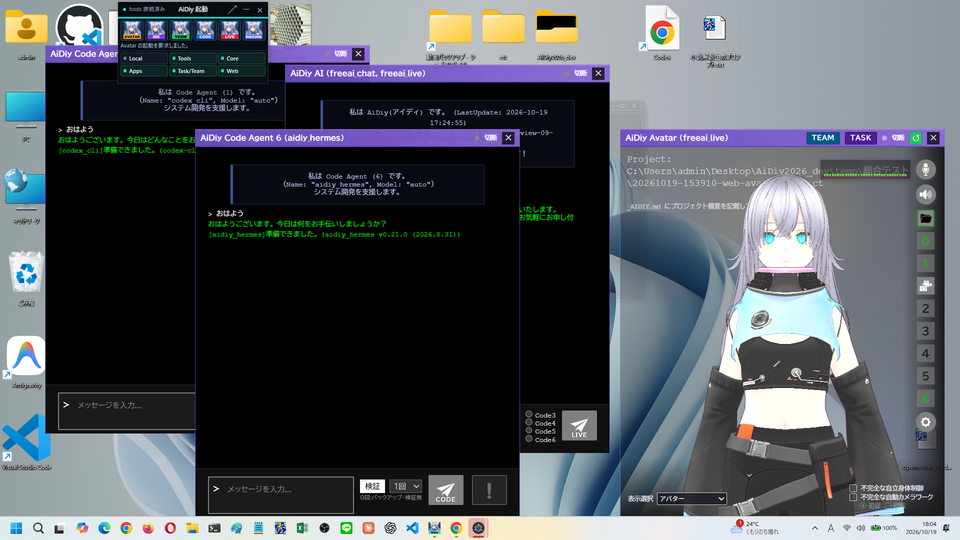

# aidiy_avatar Electron実行編 — 総合テストと操作手順書素材

> 文書: `セルフテスト,aidiy_avatar,Electron実行編.md` | 実装: `frontend_avatar/electron/`, `frontend_avatar/src/AiDiy.vue`, `frontend_avatar/src/components/`

## 総合評価

**総合評価：✅ OK (PASS 1件含む)。Diagのミニ表示から起動し、ログイン・コア窓とチャット窓の表示、チャット・Code1・Code6・Liveの「おはよう」への応答を確認しました。**（2026年10月19日・Windows）

デスクトップ用のAvatar（Electron版）を使う場合の冊子です。AIの性能や機能の網羅は別の試験で扱い、本冊は窓を開いて「おはよう」に応答があるかの簡易確認です。

| 知りたいこと | 現在の結果 |
|---|---|
| Diagから起動してログインできる？ | ✅ OK：ミニ表示のAvatarアイコンで起動し、ログイン後にコア窓とチャット窓が開きました。 |
| 窓とAIの応答は？ | ✅ OK：チャット窓のChatと、コア窓の「1」「6」で開いたCode1・Code6の窓が「おはよう」に返答しました。 |
| Liveは？ | ✅ OK（再試験）：最初の送信には返答がなく、15秒待って送り直すと返答しました。 |

**PASS (別途環境調整必要) は1件**です。マイク入力機器が0台のため、実マイクでの音声入力は確認していません。Web版の結果は流用していません。

試験中に見つけた窓の位置（Code6の窓のはみ出し、チャット窓とコア窓の重なり）と、Core再起動後に再接続しない問題は修正し、再試験で確認しました（[4章](#4-今回の範囲外と所見)）。[PDF版](../../output/pdf/セルフテスト,aidiy_avatar,Electron実行編.pdf)を作成しました。Mac／Linuxは別途実機確認を推奨し、今回の完了条件には含めません。

## この冊子の進め方

試験用アカウントは[アプリ起動編](./セルフテスト,aidiy_diag,アプリ起動編.md#ローカル試験用の利用者)、試験データと記録方法は[説明資料の書き方](./セルテスト,_説明資料の書き方.md#試験の準備と終了)を参照します。

[システム起動編](./セルフテスト,aidiy_diag,システム起動編.md)の手順で `aidiy_diag` から5機能を起動します。Diagの「アプリ起動」で作業フォルダを選び、ミニ表示に切り替えてから、Avatarのアイコンで起動します。

| 表示・用語 | 意味 |
|---|---|
| コア窓 | アバターを表示する窓です。右側のボタンで、チャット・Code・ファイル・イメージ・設定の窓を開きます。 |
| チャット窓 | AiDiy AIと会話する窓です。Chat・Live・Code1〜6を選んで送ります。 |
| Code窓 | コア窓の「1」〜「6」で開く窓です。番号ごとに別の窓になります。 |

**✅ OK** は確認済み、**⏸ 未実施** は未確認です。

## 1. Diagから起動してログインする

### 操作手順

1. Diagの通常画面で「アプリ起動」を押し、「フォルダ選択」で作業フォルダを選びます。
2. 右上の「ミニ表示」を押し、小さなパネルに切り替えます。
3. ミニ表示の左端のAvatarアイコンを押します。「Avatar の起動を要求しました。」と出て、「利用者認証」の小さな窓が開きます。
4. 利用者IDとパスワードを確認して「ログイン」を押します。「ログイン中...」の後、窓が切り替わるまで待ちます。

### 成功の見分け方

ログイン後に、アバターを表示するコア窓と、チャット窓の2つが開けば正常です。コア窓の右上に「TEAM」「TASK」「接続中」が表示されます。

### 今回の結果と画面

**✅ OK（AE-101）**：ミニ表示のAvatarアイコンで起動し、ログイン窓が開きました。「ログイン」を押すと、約20秒でコア窓とチャット窓が開きました。

フォルダを選んだ後のミニ表示です。6つのアイコンが押せる状態です。

Avatarを起動した直後のログイン窓です。

ログイン後の画面です。右がコア窓、中央がチャット窓です。後ろのChromeが、透明な部分から透けて見えています。

## 2. 窓を開いて「おはよう」と話しかける

### 操作手順

1. チャット窓の右下で「Chat」を選び、「おはよう」と入れて送信します。
2. コア窓の右側にある「1」を押してCode1の窓を、「6」を押してCode6の窓を開きます。
3. それぞれの窓に「おはよう」と入れて「CODE」を押します。

### 成功の見分け方

チャット窓に緑の文字で返答が出て、コア窓のアバターの下にも字幕が出れば正常です。Code窓では「...」の進行表示の後に返答が出ます。

### 今回の結果と画面

**✅ OK（AE-301）**：チャット窓のChatに「おはよう」と送ると、「おはようございます。清々しい朝ですね。…」と返答し、コア窓の字幕にも同じ文が出ました。

チャット窓が返答した画面です。右のコア窓に字幕が表示されています。

**✅ OK（AE-303）**：コア窓の「1」「6」で開いたCode1（codex_cli）とCode6（aidiy_hermes）の窓が、それぞれ「おはよう」に返答しました（約52秒以内）。

Code1とCode6の窓が返答した画面です。この画像は試験用のChromeを最小化して撮影しました。

## 3. Liveで話しかける

### 操作手順

1. チャット窓で「Live」を選びます。
2. 15秒程度待ってから「おはよう」と入れて送信し、最大60秒待ちます。
3. 返答がなければ、15秒待ってからもう一度送ります。

### 成功の見分け方

チャット窓に返答が出て、コア窓のアバターの下に字幕が出れば正常です。

### 今回の結果と画面

**✅ OK（AE-401、再試験）**：同じ窓から送り直すと、「おはようございます！今日も一緒に開発しましょう！」と返答しました。

Liveが返答した画面です。チャット窓の一番下に返答が出ています。

**❌ NG（AE-401の初回・再試験前）**：最初の送信には、60秒待っても返答も字幕も出ませんでした。サーバーの記録はLiveへの送信完了までです。Web版でも同じ傾向がありました（4章の所見）。

最初に送った後の画面です。「おはよう」の後に返答がありません。

**PASS (別途環境調整必要)**：マイク入力機器が0台のため、実マイクでの音声入力は確認していません。

試験担当者向け：実施方法

この回はComputer Useを利用できない環境でした。Electron版にはリモートデバッグの入口がないため、Windows UI Automationで窓のボタン・ラジオボタン・入力欄を操作し、画面全体を撮影して結果を確認しました。チャット窓の会話文はUI Automationの文字として読めないため、返答は撮影画像で確認しています。Code窓の返答は文字として読めました。

使った補助スクリプトは `scripts/checks/総合テスト補助/` の `diag画面操作.ps1`（Diagとログイン窓のボタン）、`electron窓一覧.ps1`（Avatarの窓とhwndの一覧）、`electron窓操作.ps1`（窓ごとの選択・入力・送信・文字の読み取り）、`窓撮影.ps1` です。使い方は[AiDiy編の実施記録と操作方法](./セルフテスト,frontend_web,AiDiy編.md#試験担当者向け実施記録と操作方法)にあります。

画像と台帳は[今回の保存先](./images/セルフテスト,aidiy_avatar,Electron実行編/)にあります。

## 4. 今回の範囲外と所見

AIの性能・機能の網羅（ファイルの添付、Codeでのファイル作成、画像生成、設定の保存、AIタスク・AIチームの実行）は、別の試験で扱います。表示選択（アバター・時計など）の切替、窓の0.5秒ドラッグと開始ズーム、ログアウト、Diag終了後の継続も、今回は確認していません。Diag終了後の継続は[アプリ起動編](./セルフテスト,aidiy_diag,アプリ起動編.md)で確認済みです。

| 所見 | 内容 | 対応 |
|---|---|---|
| Code6窓の位置 | Code窓は左上から48ずつずらして開くため、表示倍率125%ではCode6の窓の下側がタスクバーより下にはみ出し、入力欄が見えませんでした。 | ✅ 修正済み：初期位置を作業領域の中に収める（`electron/main.ts`）。Code6の窓は(390,258)に開き、下端が画面内に入りました。 |
| チャット窓とコア窓の重なり | ログイン直後、中央に開くチャット窓の右端が、右下のコア窓の左端に重なりました。 | ✅ 修正済み：中央を基本にしつつ、コア窓の左までに留める（`electron/main.ts`）。チャット窓は(570,129)に開き、右端1220がコア窓1240の左に収まりました。 |
| Core再起動後の再接続 | Coreが約30秒止まると、自動再接続（3秒間隔で5回）が尽きて「切断」のままになりました。見出しの「↺」は「再表示」ボタンで、再接続には使えません。 | ✅ 修正済み：回数で打ち切らず、最大15秒間隔で再接続を続ける（`src/api/websocket.ts`）。Coreの停止・復帰の13秒後に、全窓が自動で「接続中」に戻りました。Web版も同じ処理を使います。 |
| Liveの最初の送信 | 最初の送信に返答がなく、2回目で返答しました。Web版も同じです。 | 未解決：条件を特定できていません。返答がないときは15秒待って送り直します。 |
| 会話履歴の繰り返し表示 | 再接続の修正後、Web版のチャット欄で、同じチャンネルに2本の接続が残り、閉じ合いを繰り返しました（詳細は[Web実行編](./セルフテスト,aidiy_avatar,Web実行編.md)の4章）。 | ✅ 修正済み：Electron版も同じチャット処理と接続処理を使います。システム再起動後、実画面の入力でLiveが返答し、Core再起動後も自動で「接続中」へ戻りました。 |

修正後の窓の配置です。Code6の窓が画面内に収まり、チャット窓がコア窓と重なっていません。撮影時はCoreの再起動直後で、全窓が「切断」と表示されています。

再接続の修正後にCoreを再起動した画面です。利用者の操作なしで全窓が「接続中」に戻り、後から開いたCode窓も画面内に並んでいます。

会話履歴の繰り返しを直した後、システムを再起動して、実画面からLiveへ「おはよう」を送った画面です。返答は1回で、履歴は積み重なっていません。

続けてCoreを再起動した画面です。操作なしで「接続中」へ戻りました。

試験で開いた窓は、Diagの停止前に閉じます。PDFは[説明資料の書き方](./セルテスト,_説明資料の書き方.md#ファイル画像pdf)の手順で作成します。
