# Avatar Electron実行編 — 操作ガイドとセルフテスト

## 総合評価

**総合評価：✅ OK（記載した確認範囲）。** Windowsでログイン、VRM表示、Chat・Code1・Code6・Liveの文字応答、Core再起動後の自動再接続を確認しました。Mac／Linux実機・長時間連続運転は未実施です。入力機器が0台のため実マイク入力は環境制限で未テスト、人による音声聴取も未テストです。全機能・全プロバイダの合格を示すものではありません。

前半は起動から終了までの操作ガイド、最後の章は追加テストと確認範囲です。図番号は章番号と掲載順を表し、試験ケースIDとは区別します。

## 始める前に

[システム起動編](./セルフテスト,aidiy_diag,システム起動編.md)で必要なバックエンドを起動し、[ランチャー編](./セルフテスト,aidiy_diag,ランチャー編.md)からアプリを開きます。試験用アカウントは[ランチャー編](./セルフテスト,aidiy_diag,ランチャー編.md#ローカル試験用の利用者)を参照します。

**8092はAvatar起動中だけ利用できます。** Web版は `http://127.0.0.1:8092` へ接続し、利用中は起動元のAvatarを終了しません。Task／Teamは独立した[Task操作編](./セルフテスト,aidiy_task,操作編.md)・[Team操作編](./セルフテスト,aidiy_team,操作編.md)で扱います。

## 1. ログインして操作ボタンを表示する

1. DiagのランチャーでAvatarを押し、「利用者認証」の窓が開くまで待ちます。
2. 利用者IDとパスワードを入力して「ログイン」を押します。
3. アバターのコア窓とチャット窓が開いたら、コア窓にポインターを入れて操作ボタンを表示します。

**✅ OK（AE-101）**：ログイン後に2つの窓が開きました。「接続中」と操作ボタンを確認しています。起動所要時間は計測していません。

Avatar起動直後です。利用者認証を済ませて会話画面へ進みます。

**図101：ログイン**

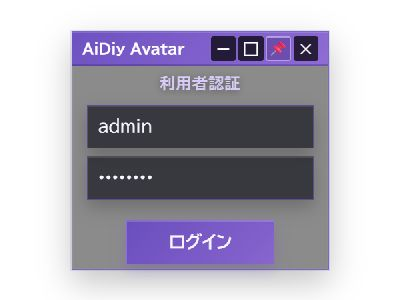

コア窓の右側から、ファイル・チャット・番号別のCode窓を開けます。

Task／Teamは独立アプリとして起動します。

認証後のAvatar本体とChat画面です。

**図102：Avatar認証後**

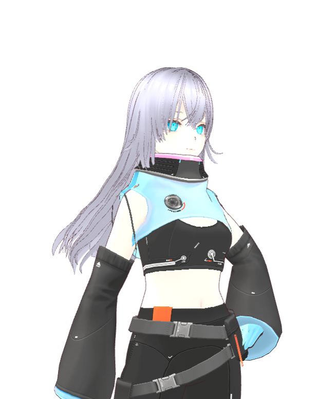

## 2. ChatとCodeで会話する

1. チャット窓の右下で「Chat」を選び、「おはよう」と入力して送信します。
2. コア窓の「1」「6」を押してCode1・Code6を開きます。
3. 挨拶だけの試験では「検証」を0回にし、それぞれ「おはよう」を入力して「CODE」を押します。
4. 進行表示が終わり、返答が表示されるまで待ちます。応答待ちの間は再送しません。

**✅ OK（AE-201〜203）**：Chat、Code1（codex_cli）、Code6（aidiy_hermes）がそれぞれ返答しました。Codeのモデルはautoです。異なる窓の返答を流用せず確認しました。

Chatを選んで送信した結果です。入力の下に返答が表示されています。

**図201：Chat応答**

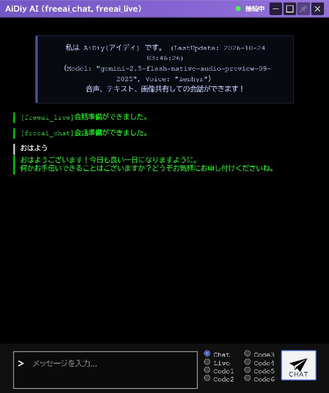

Code1の返答です。「今日はどんな作業をお手伝いしましょうか？」まで表示されています。

**図202：Code1応答**

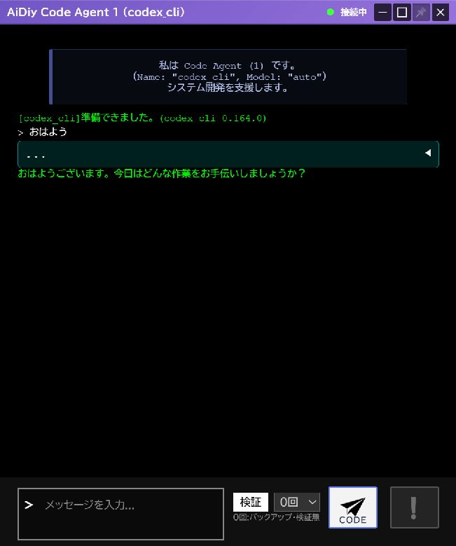

Code6の返答です。「今日は何をお手伝いしましょうか？」まで確認しました。

**図203：Code6応答**

ChatとLiveを選択できる画面です。

**図204：Chat表示**

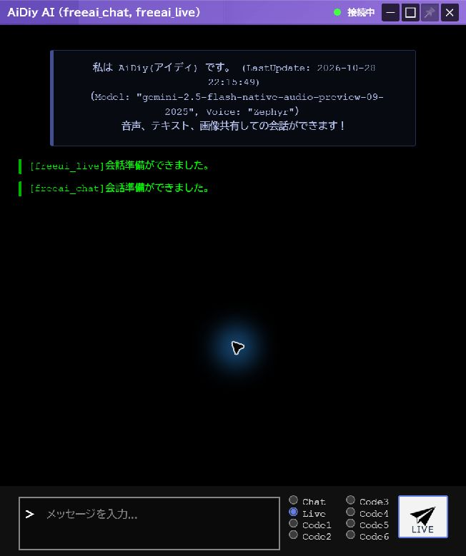

Code1の入力欄と接続状態です。この窓だけを閉じてもコア・Chat窓は残ります。

**図205：Code表示**

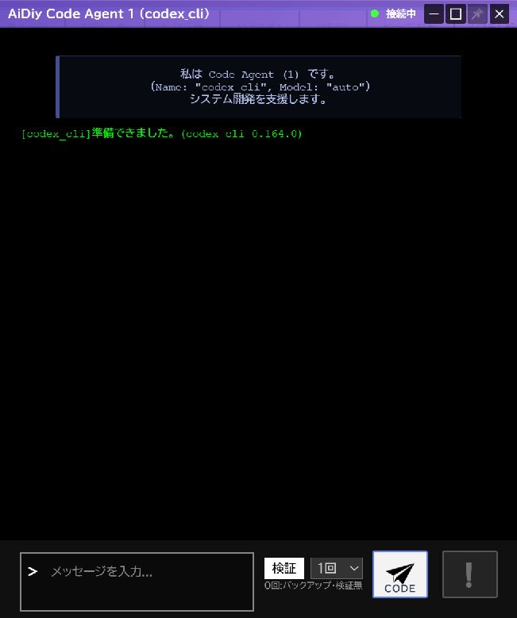

## 3. Liveで会話する

1. チャット窓の「Live」を選びます。
2. 「会話準備ができました。」を確認して、初回は15秒以上待ちます。
3. 「おはよう」を1回だけ送り、文字の返答を確認します。標準の観測枠は60秒です。

**✅ OK（AE-301）**：初回送信で「おはようございます!今日もよろしくお願いします。」と返答しました。※注意:15s以上待機後送信しました。初回の送信から応答までの厳密な時間は計測していません。Core再起動後の試験では、送信から19秒後の画面取得時に返答を確認しました。再送していません。

プロバイダはfreeai_live、画面に表示されたモデルはgemini-2.5-flash-native-audio-preview-09-2025、声はZephyrです。ここでは文字の応答を判定しています。

Liveでの初回応答です。ChatとLiveの入力は、それぞれ1回ずつです。

**図301：Live応答**

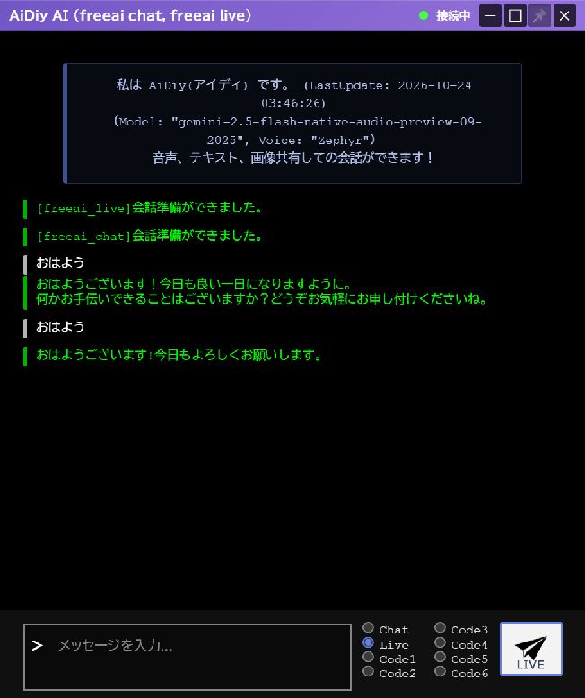

## 4. ファイルを探して中身を見る

1. コア窓のフォルダボタンを押し、File Managerを開きます。
2. 一覧から確認したいファイルを選びます。フォルダをたどって対象を絞れます。
3. 画像ファイルを選ぶとプレビューを確認できます。

**✅ OK（AE-401〜402）**：作業フォルダの一覧と、撮影したPNGのプレビューを確認しました。ファイルの編集・削除は行っていません。

File Managerの一覧です。作業フォルダ内のファイルを選んで閲覧します。

**図401：ファイル窓**

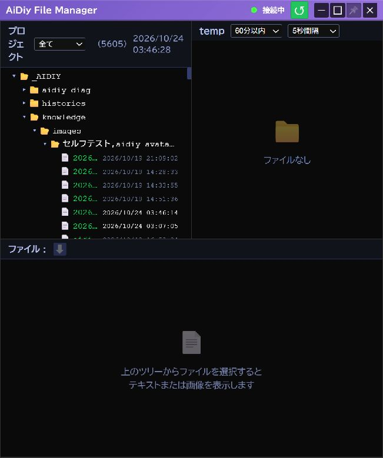

PNGを選択した結果です。撮影したログイン画面がプレビューに表示されています。

**図402：画像プレビュー**

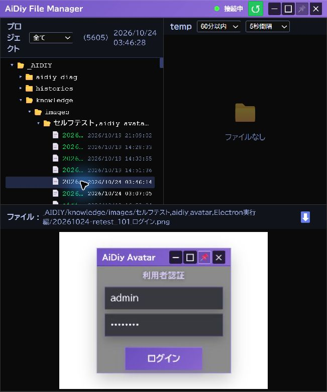

## 5. 接続が切れたときと終了

1. 送信を繰り返さず、Diagの「システム起動」でCoreの状態を確認します。
2. Coreが復帰したら、Avatarが自動で「接続中」に戻るまで待ちます。
3. 準備完了後に短い文を1回送り、新しい返答が出ることを確認します。

**✅ OK（AE-501）**：DiagからCoreを再起動し、Electronの接続復帰とLiveへの新しい返答を確認しました。Chatの履歴は重ねて追加されません。

Liveの会話文脈は、サーバー側で接続しているLive APIの同じセッションが保持します。画面への履歴の保存・再表示は不要で、復元されないことは不具合・残件ではありません。画面だけの再読み込みと、サーバー側のCore再起動は別の操作です。

Core再起動後です。接続中に戻り、新しいLiveの返答が1回表示されています。

**図501：再接続後Live応答**

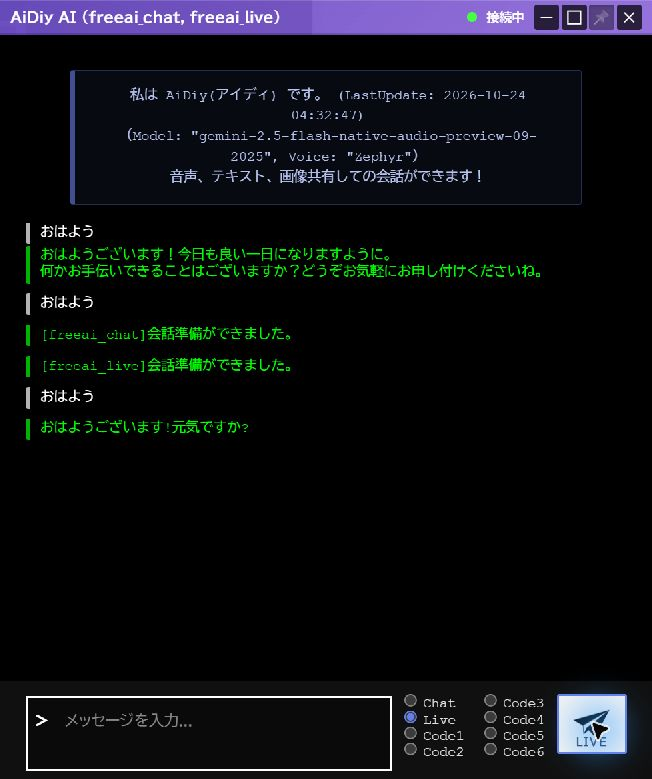

終了するときは応答待ちの処理がないことを確認し、使用中の8092のブラウザタブを先に閉じます。その後Avatarを終了します。Avatar終了で8092も停止するため、Web版利用中は終了しません。

## 6. 追加テストと確認範囲

### 準備完了後のChat応答

freeai_chatの準備完了を確認して送信し、「おはようございます、本日もよろしくお願いいたします。」という実回答を受信しました。画面内の準備前エラーは成功判定に含めず、準備完了後の回答を確認しています。音声の聴取成功とは区別します。

**図601：Avatar準備完了後応答**

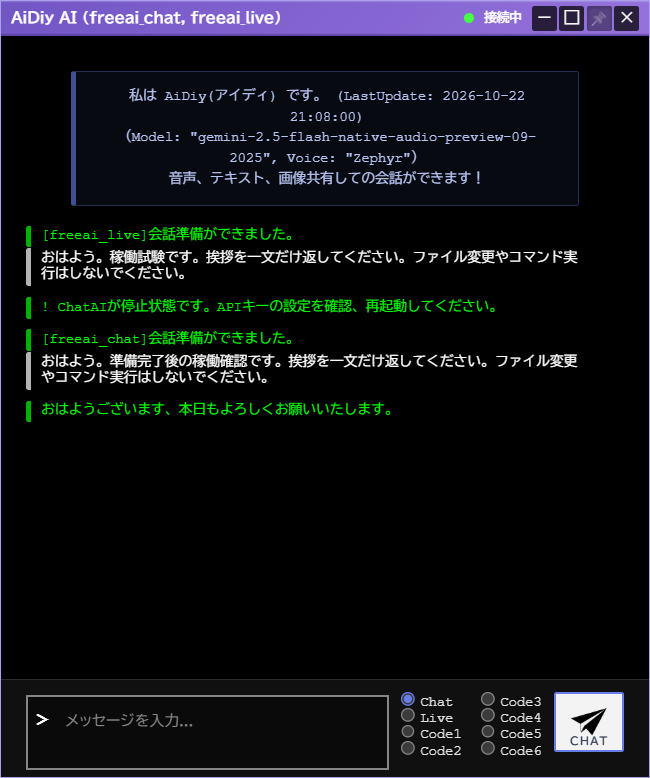

### 確認範囲

窓の移動・開始ズーム、表示選択、画像生成、設定保存、ファイル添付は、この冊子の実画面試験には含めません。接続処理の回帰テスト10件とAvatarの型チェックは成功しました。

透明部分へ別アプリが映り込まないよう、撮影用の白い背景窓を背面に置いて撮影しました。画面の内容を合成・修正せず、掲載用には縦横比を保って長辺960px以下へ縮小しています。

Web／Avatarのcleanup・依存復元、型チェック、起動制御、全終了と8092の解放を確認しました。起動・表示だけの確認を、AIの実応答確認とは区別します。
