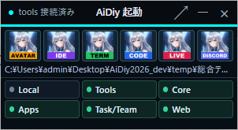
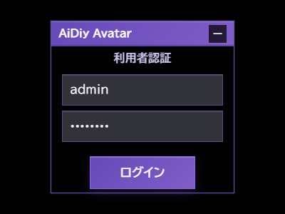
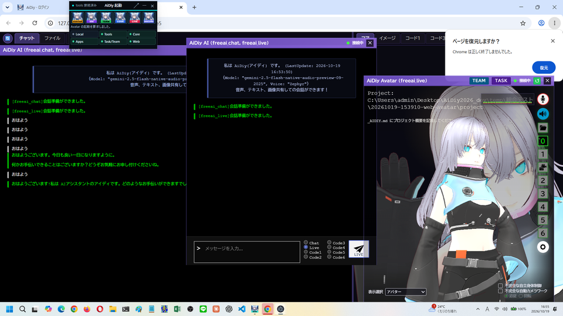
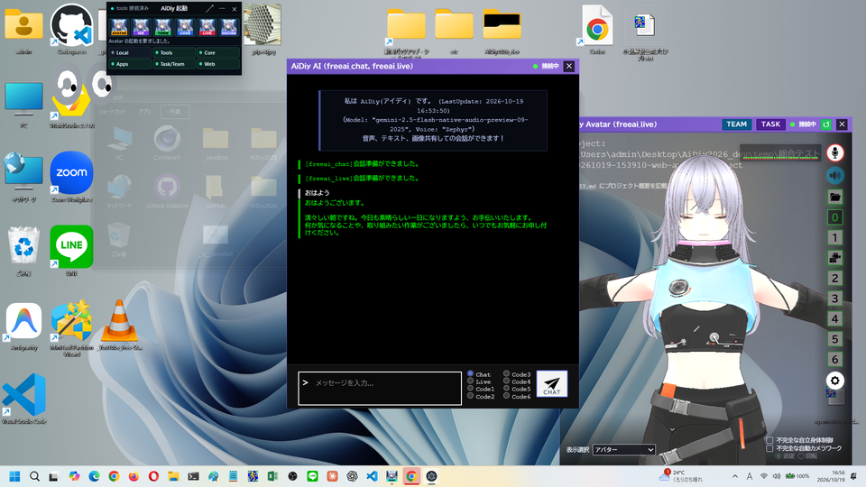
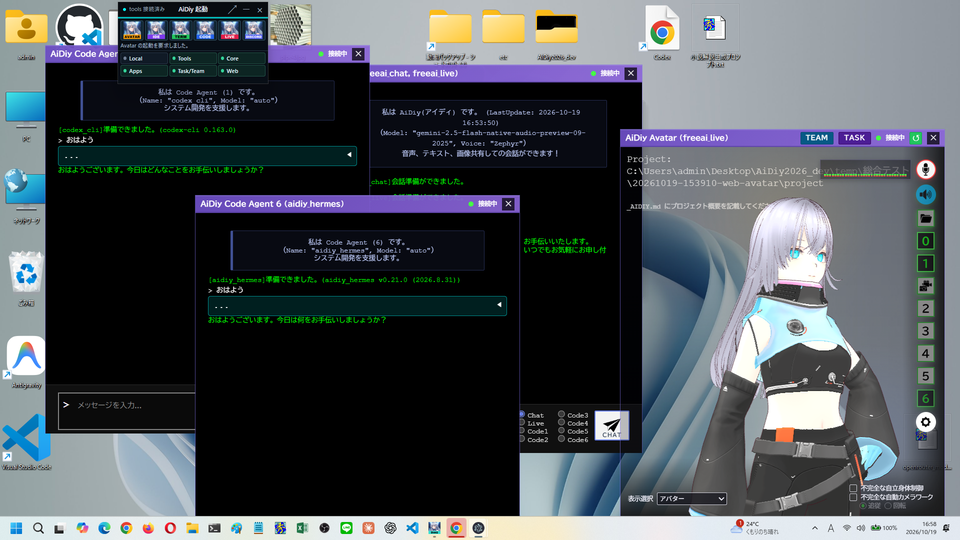
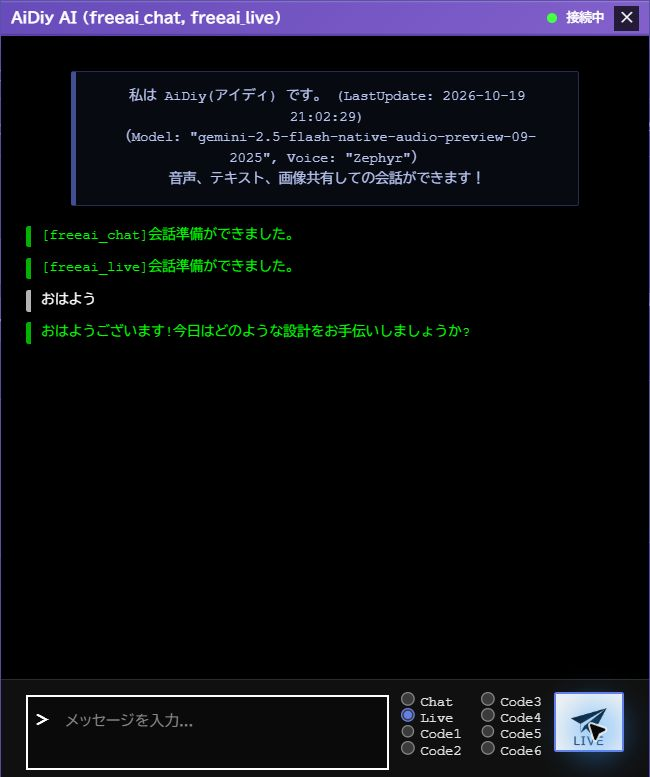
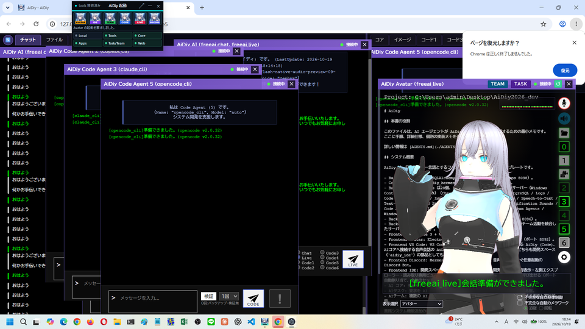
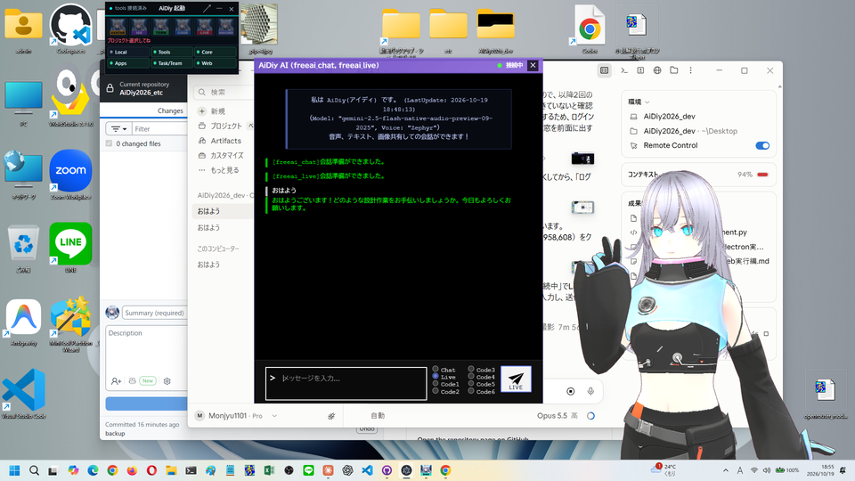
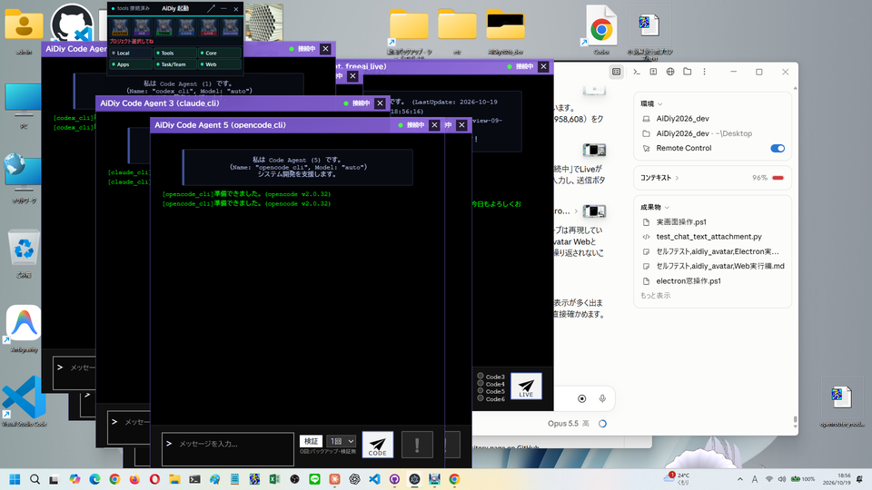

# aidiy_avatar Electron実行編 — 総合テストと操作手順書素材

> 文書: `セルフテスト,aidiy_avatar,Electron実行編.md` | 実装: `frontend_avatar/electron/`, `frontend_avatar/src/AiDiy.vue`, `frontend_avatar/src/components/`

## 総合評価

**総合評価：✅ OK (PASS 1件含む)。Diagのミニ表示から起動し、ログイン・コア窓とチャット窓の表示、チャット・Code1・Code6・Liveの「おはよう」への応答を確認しました。**（2026年10月19日・Windows）

デスクトップ用のAvatar（Electron版）を使う場合の冊子です。AIの性能や機能の網羅は別の試験で扱い、本冊は窓を開いて「おはよう」に応答があるかの簡易確認です。

| 知りたいこと | 現在の結果 |
|---|---|
| Diagから起動してログインできる？ | ✅ OK：ミニ表示のAvatarアイコンで起動し、ログイン後にコア窓とチャット窓が開きました。 |
| 窓とAIの応答は？ | ✅ OK：チャット窓のChatと、コア窓の「1」「6」で開いたCode1・Code6の窓が「おはよう」に返答しました。 |
| Liveは？ | ✅ OK（初回送信）：準備完了確認後15秒待機して送り、60秒以内に返答しました。再送は不要でした。 |

**PASS (別途環境調整必要) は1件**です。マイク入力機器が0台のため、実マイクでの音声入力は確認していません。Web版の結果は流用していません。

Liveの初回送信は、準備完了確認後15秒待機・送信後最大60秒の条件で初回の返答を確認しました（3章）。再送は不要でした。音声の再生・内容の聴取は、本冊では確認していません。

窓の配置とCore再起動後の自動再接続も確認しました（[4章](#4-今回の範囲外と所見)）。[PDF版](./セルフテスト,aidiy_avatar,Electron実行編.pdf)を作成しました。Mac／Linuxは別途実機確認を推奨し、今回の完了条件には含めません。

PDF版は本文に合わせて再生成し、全ページの日本語・表・画像・改ページを目視確認しました。

## この冊子の進め方

試験用の利用者IDは `admin`、パスワードは `********`（アスタリスク `*` を8文字）です。この開発PCの総合テスト用アカウントです。

試験用アカウントは[アプリ起動編](./セルフテスト,aidiy_diag,アプリ起動編.md#ローカル試験用の利用者)、試験データと記録方法は[説明資料の書き方](./セルテスト,_説明資料の書き方.md#試験の準備と終了)を参照します。

[システム起動編](./セルフテスト,aidiy_diag,システム起動編.md)の手順で `aidiy_diag` から5機能を起動します。Diagの「アプリ起動」で作業フォルダを選び、ミニ表示に切り替えてから、Avatarのアイコンで起動します。

| 表示・用語 | 意味 |
|---|---|
| コア窓 | アバターを表示する窓です。右側のボタンで、チャット・Code・ファイル・イメージ・設定の窓を開きます。 |
| チャット窓 | AiDiy AIと会話する窓です。Chat・Live・Code1〜6を選んで送ります。 |
| Code窓 | コア窓の「1」〜「6」で開く窓です。番号ごとに別の窓になります。 |

**✅ OK** は確認済み、**⏸ 未実施** は未確認です。

## 1. Diagから起動してログインする

### 操作手順

1. Diagの通常画面で「アプリ起動」を押し、「フォルダ選択」で作業フォルダを選びます。
2. 右上の「ミニ表示」を押し、小さなパネルに切り替えます。
3. ミニ表示の左端のAvatarアイコンを押します。「Avatar の起動を要求しました。」と出て、「利用者認証」の小さな窓が開きます。
4. 利用者IDとパスワードを確認して「ログイン」を押します。「ログイン中...」の後、窓が切り替わるまで待ちます。

### 成功の見分け方

ログイン後に、アバターを表示するコア窓と、チャット窓の2つが開けば正常です。コア窓の右上に「TEAM」「TASK」「接続中」が表示されます。

### 今回の結果と画面

**✅ OK（AE-101）**：ミニ表示のAvatarアイコンで起動し、ログイン窓が開きました。「ログイン」を押すと、約20秒でコア窓とチャット窓が開きました。

フォルダを選んだ後のミニ表示です。6つのアイコンが押せる状態です。

Avatarを起動した直後のログイン窓です。

ログイン後の画面です。右がコア窓、中央がチャット窓です。後ろのChromeが、透明な部分から透けて見えています。

## 2. 窓を開いて「おはよう」と話しかける

### 操作手順

1. チャット窓の右下で「Chat」を選び、「おはよう」と入れて送信します。
2. コア窓の右側にある「1」を押してCode1の窓を、「6」を押してCode6の窓を開きます。
3. それぞれの窓に「おはよう」と入れて「CODE」を押します。

### 成功の見分け方

チャット窓に緑の文字で返答が出て、コア窓のアバターの下にも字幕が出れば正常です。Code窓では「...」の進行表示の後に返答が出ます。

### 今回の結果と画面

**✅ OK（AE-301）**：チャット窓のChatに「おはよう」と送ると、「おはようございます。清々しい朝ですね。…」と返答し、コア窓の字幕にも同じ文が出ました。

チャット窓が返答した画面です。右のコア窓に字幕が表示されています。

**✅ OK（AE-303）**：コア窓の「1」「6」で開いたCode1（codex_cli）とCode6（aidiy_hermes）の窓が、それぞれ「おはよう」に返答しました（約52秒以内）。

Code1とCode6の窓が返答した画面です。この画像は試験用のChromeを最小化して撮影しました。

## 3. Liveで話しかける

### 操作手順

1. チャット窓で「Live」を選びます。
2. 会話の準備完了を確認して15秒程度待ち、「おはよう」と入れて送信し、最大60秒待ちます。
3. 60秒以内に返答が表示されることを確認します。

### 成功の見分け方

チャット窓にAIからの新しい返答が出れば、文字による応答は正常です。

### 最終結果と画面（2026年10月19日）

**✅ OK（AE-401-R2）**：新しく接続した会話で、準備完了表示を確認した後に15秒待機し、「おはよう」を1回だけ送信しました。送信後、約12秒以内に画面で返答を確認しました。観測上限は60秒で、再送はしていません。返答は「おはようございます!今日はどのような設計をお手伝いしましょうか?」でした。

※注意:15s待機後送信しました。

接続成立から準備完了表示を確認するまでの総経過時間は計測していません。上の時間は、送信から画面で確認できた時点までの観測値で、応答生成時間の厳密な測定ではありません。15秒待機・60秒観測の運用条件で通過した結果です。

Providerは `freeai_live`、モデルは `gemini-2.5-flash-native-audio-preview-09-2025`、声は `Zephyr` です。実施IDは `20261019-205900-web-avatar`。Computer UseでElectronの入力欄・送信ボタンを操作しました。今回は文字による初回返答を確認し、音声の聴取は行っていません。

初回の送信文とLiveの返答が表示された画面です。

**PASS (別途環境調整必要)**：マイク入力機器が0台のため、実マイクでの音声入力は確認していません。

## 4. 今回の範囲外と所見

AIの性能・機能の網羅（ファイルの添付、Codeでのファイル作成、画像生成、設定の保存、AIタスク・AIチームの実行）は、別の試験で扱います。表示選択（アバター・時計など）の切替、窓の0.5秒ドラッグと開始ズーム、ログアウト、Diag終了後の継続も、今回は確認していません。Diag終了後の継続は[アプリ起動編](./セルフテスト,aidiy_diag,アプリ起動編.md)で確認済みです。

| 確認項目 | 最終結果 |
|---|---|
| 窓の配置 | ✅ OK：Code6の窓は画面内に収まり、チャット窓はコア窓と重なりませんでした。 |
| Liveの初回送信 | ✅ OK：準備完了確認後15秒待機・送信後最大60秒で、初回の返答を確認しました。 |
| Core再起動後の再接続 | ✅ OK：Coreの復帰後、自動で「接続中」へ戻りました。 |
| 会話履歴の表示 | ✅ OK：Liveの返答は1回で履歴が積み重ならず、Core再起動後も自動で接続しました。 |

Coreを再起動した画面です。利用者の操作なしで全窓が「接続中」に戻り、後から開いたCode窓も画面内に並んでいます。

システム再起動後のLive画面です。返答は1回で、履歴は積み重なっていません。

続けてCoreを再起動した画面です。操作なしで「接続中」へ戻りました。

試験で開いた窓は、Diagの停止前に閉じます。PDFは[説明資料の書き方](./セルテスト,_説明資料の書き方.md#ファイル画像pdf)の手順で作成します。
