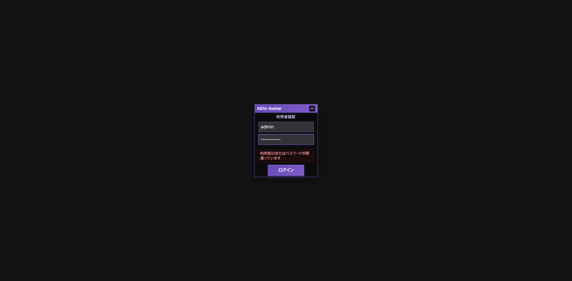
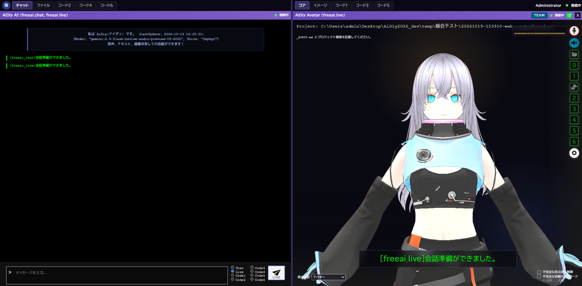
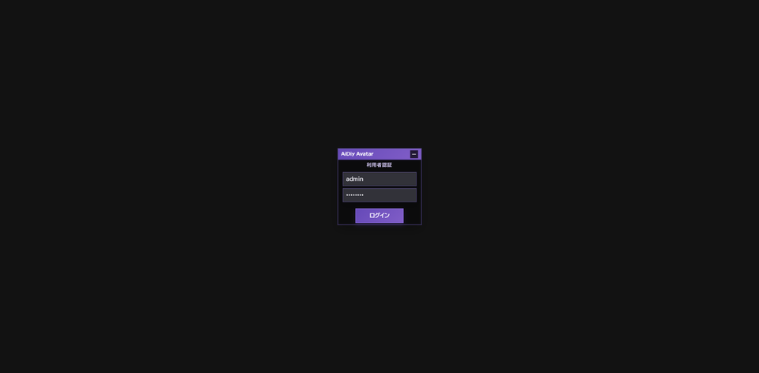
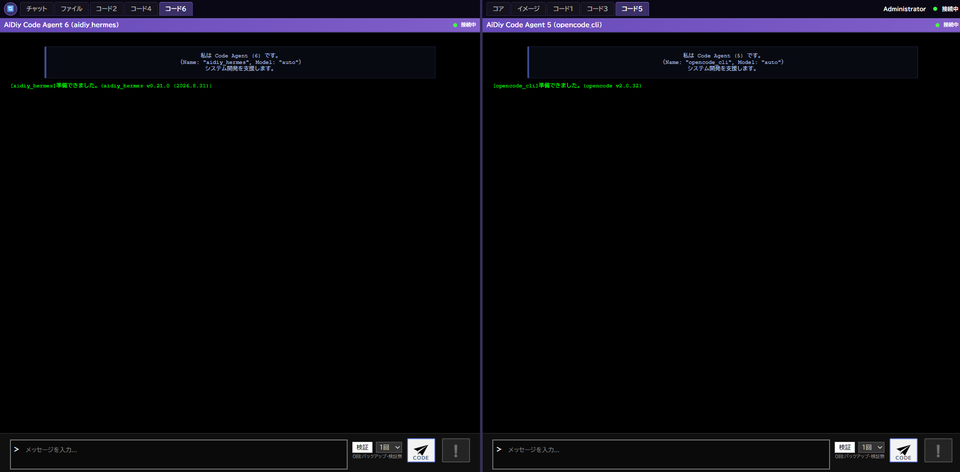
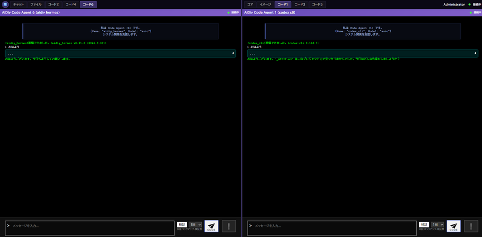
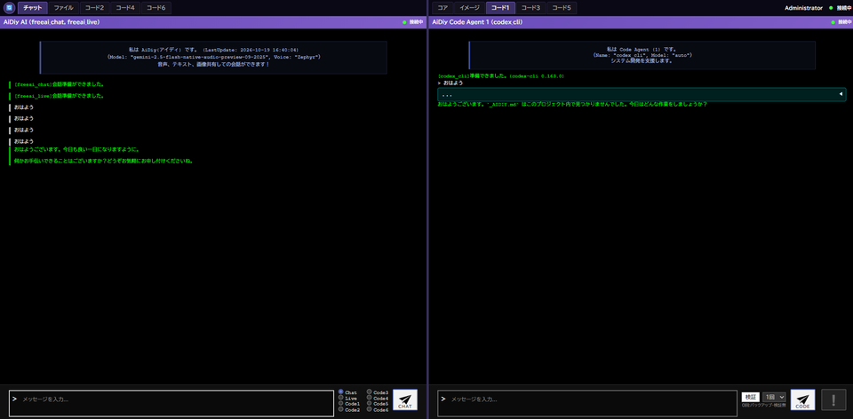
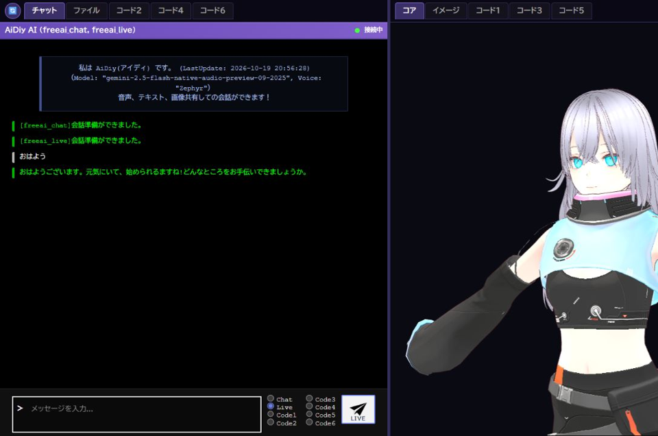
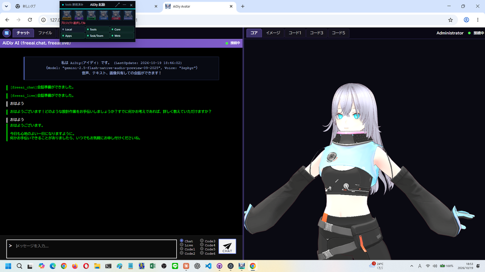

# aidiy_avatar Web実行編 — 総合テストと操作手順書素材

> 文書: `セルフテスト,aidiy_avatar,Web実行編.md` | 実装: `frontend_avatar/src/AiDiy.vue`, `frontend_avatar/src/components/`, `frontend_avatar/src/api/client.ts`

## 総合評価

**総合評価：✅ OK (PASS 1件含む)。ブラウザでのログイン・認証の保持・タブ切替と、チャット・コード1・コード6・Liveの「おはよう」への応答を確認しました。**（2026年10月19日・Windows）

通常のブラウザで `http://127.0.0.1:8092` を開き、Avatarを使う場合の冊子です。AIの性能や機能の網羅は別の試験で扱い、本冊は画面を開いて「おはよう」に応答があるかの簡易確認です。

| 知りたいこと | 現在の結果 |
|---|---|
| ブラウザでログインできる？ | ✅ OK：誤ったパスワードには案内が出て、正しいログイン後はアバターと各タブの画面へ進みました。 |
| 再読み込みや別タブではどうなる？ | ✅ OK：同じタブの再読み込みではログインを保ち、新しいタブではログインを求められました。 |
| タブとAIの応答は？ | ✅ OK：10個のタブを切り替えられ、チャット・コード1・コード6が「おはよう」に返答しました。 |
| Liveは？ | ✅ OK（初回送信）：準備完了確認後15秒待機して送り、60秒以内に返答しました。再送は不要でした。 |

**PASS (別途環境調整必要) は1件**です。マイク入力機器が0台のため、実マイクでの音声入力は確認していません。Electron版の結果は流用していません。[PDF版](./セルフテスト,aidiy_avatar,Web実行編.pdf)を作成しました。Mac／Linuxは別途実機確認を推奨し、今回の完了条件には含めません。

PDF版は本文に合わせて再生成し、全ページの日本語・表・画像・改ページを目視確認しました。

Liveの初回送信は、準備完了確認後15秒待機・送信後最大60秒の条件で初回の返答を確認しました（3章）。再送は不要でした。音声の再生・内容の聴取は、本冊では確認していません。自動再接続と、履歴が重複しないことも確認しました（4章）。

## この冊子の進め方

試験用の利用者IDは `admin`、パスワードは `********`（アスタリスク `*` を8文字）です。この開発PCの総合テスト用アカウントです。

試験用アカウントは[アプリ起動編](./セルフテスト,aidiy_diag,アプリ起動編.md#ローカル試験用の利用者)、試験データと記録方法は[説明資料の書き方](./セルテスト,_説明資料の書き方.md#試験の準備と終了)を参照します。

[システム起動編](./セルフテスト,aidiy_diag,システム起動編.md)の手順で `aidiy_diag` から5機能を起動し、Diagをミニ表示に切り替えます。8092の画面を表示するには、Diagの「アプリ起動」で作業フォルダを選び、Avatarを起動しておきます。Electron版の窓を閉じても、試験中は8092を止めません。

ブラウザで開くと、左にチャット側のタブ、右にアバターとコア側のタブが並ぶ2面の画面になります。Electron版にある `window.desktopApi` はありません。

| 表示・用語 | 意味 |
|---|---|
| 左のタブ | チャット・ファイル・コード2・コード4・コード6 を切り替えます。 |
| 右のタブ | コア（アバター表示）・イメージ・コード1・コード3・コード5 を切り替えます。 |
| 認証の保存場所 | ブラウザのタブごと（sessionStorage）です。別のタブでは、もう一度ログインします。 |

**✅ OK** は確認済み、**⏸ 未実施** は未確認です。

## 1. ブラウザでログインする

### 操作手順

1. ブラウザのアドレス欄に `http://127.0.0.1:8092` を入れて開きます。
2. 「利用者認証」の画面で、利用者IDとパスワードを入れて「ログイン」を押します。
3. ログイン後に同じタブで再読み込みし、ログインしたままか確認します。
4. 新しいタブで同じアドレスを開くと、もう一度ログインを求められます。

### 成功の見分け方

ログイン後に、右側へアバターが表示され、左右の上部にタブが並べば正常です。誤ったパスワードでは「利用者IDまたはパスワードが間違っています」と表示されます。

### 今回の結果と画面

**✅ OK（AV-101）**：誤ったパスワードを1回入れると案内が出ました。試験用アカウントでログインすると、左にチャット、右にアバターの画面へ進みました。

ブラウザで開いた直後のログイン画面です。

誤ったパスワードを入れた後です。理由が表示されています。

ログイン後の画面です。左にチャット、右にアバターと会話の準備完了が表示されています。

**✅ OK（AV-102）**：同じタブで再読み込みしてもログインしたままでした。新しいタブで開くと、ログイン画面が表示されました。

新しいタブで開いた画面です。ログインを求められています。

## 2. タブを切り替えて「おはよう」と話しかける

### 操作手順

1. 左の「チャット」「ファイル」「コード2」「コード4」「コード6」、右の「コア」「イメージ」「コード1」「コード3」「コード5」を順に押します。
2. 左の「チャット」で、入力欄の右にある「Chat」を選び、「おはよう」と入れて送信します。
3. 右の「コード1」、左の「コード6」で、それぞれ「おはよう」と入れて「CODE」を押します。

### 成功の見分け方

押したタブの画面に切り替わり、ブラウザのエラーが出なければ正常です。「おはよう」の後に緑の文字で返答が出れば、応答の確認ができます。

### 今回の結果と画面

**✅ OK（AV-201）**：10個のタブをすべて切り替えられました。ブラウザのエラー記録は0件で、Electron専用の機能がないことによる例外も出ませんでした。

切り替えを終えた画面です。左にコード6、右にコード5が表示されています。

**✅ OK（AV-301）**：チャット（10.2秒）、コード1（43.2秒）、コード6（45.7秒）が「おはよう」に返答しました。

コード1とコード6が返答した画面です。

チャットでChatを選んで送った画面です。返答が緑の文字で出ています。

## 3. Liveで話しかける

### 操作手順

1. 左の「チャット」で「Live」を選びます。
2. 「[freeai_live]会話準備ができました。」を確認してから、15秒程度待ちます。
3. 「おはよう」と入れて送信し、最大60秒待ちます。60秒以内に返答が表示されることを確認します。

### 成功の見分け方

チャット欄にAIからの新しい返答が出れば、文字による応答は正常です。

### 最終結果と画面（2026年10月19日）

**✅ OK（AV-401-R2）**：新しく接続した会話で、準備完了表示を確認した後に15秒待機し、「おはよう」を1回だけ送信しました。送信後、約34秒以内に画面で返答を確認しました。観測上限は60秒で、再送はしていません。返答は「おはようございます。」から始まる文でした。

※注意:15s待機後送信しました。

接続成立から準備完了表示を確認するまでの総経過時間は計測していません。上の時間は、送信から画面で確認できた時点までの観測値で、応答生成時間の厳密な測定ではありません。15秒待機・60秒観測の運用条件で通過した結果です。

Providerは `freeai_live`、モデルは `gemini-2.5-flash-native-audio-preview-09-2025`、声は `Zephyr` です。実施IDは `20261019-205900-web-avatar`。ブラウザの実画面で入力欄・送信ボタンを操作しました。今回は文字による初回返答を確認し、音声の聴取は行っていません。

初回の送信文とLiveの返答が表示された画面です。

**PASS (別途環境調整必要)**：マイク入力機器が0台のため、実マイクでの音声入力と、ブラウザのマイク許可の操作は確認していません。

## 4. 今回の範囲外と所見

AIの性能・機能の網羅（ファイルの添付と解除、Codeでのファイル作成、画像生成、AIタスク・AIチームの実行）は、別の試験で扱います。表示選択（アバター・時計・カレンダーなど）の切替、ログアウトと再読み込み後の保護も、今回は確認していません。

| 確認項目 | 最終結果 |
|---|---|
| Liveの初回送信 | ✅ OK：準備完了確認後15秒待機・送信後最大60秒で、初回の返答を確認しました。 |
| Core再起動後の再接続 | ✅ OK：Coreの復帰後、自動で「接続中」へ戻りました。 |
| 会話履歴の表示 | ✅ OK：LiveとChatの返答は1回ずつで、2分後も同じ履歴が積み重ならず、Core再起動後も接続の繰り返しは0件でした。 |

システム再起動後に、実画面からLiveとChatへ「おはよう」を送った画面です。返答は1回ずつで、2分たっても行は増えませんでした。

試験終了時は、使ったタブをDiagの停止前に閉じます。PDFは[説明資料の書き方](./セルテスト,_説明資料の書き方.md#ファイル画像pdf)の手順で作成します。
