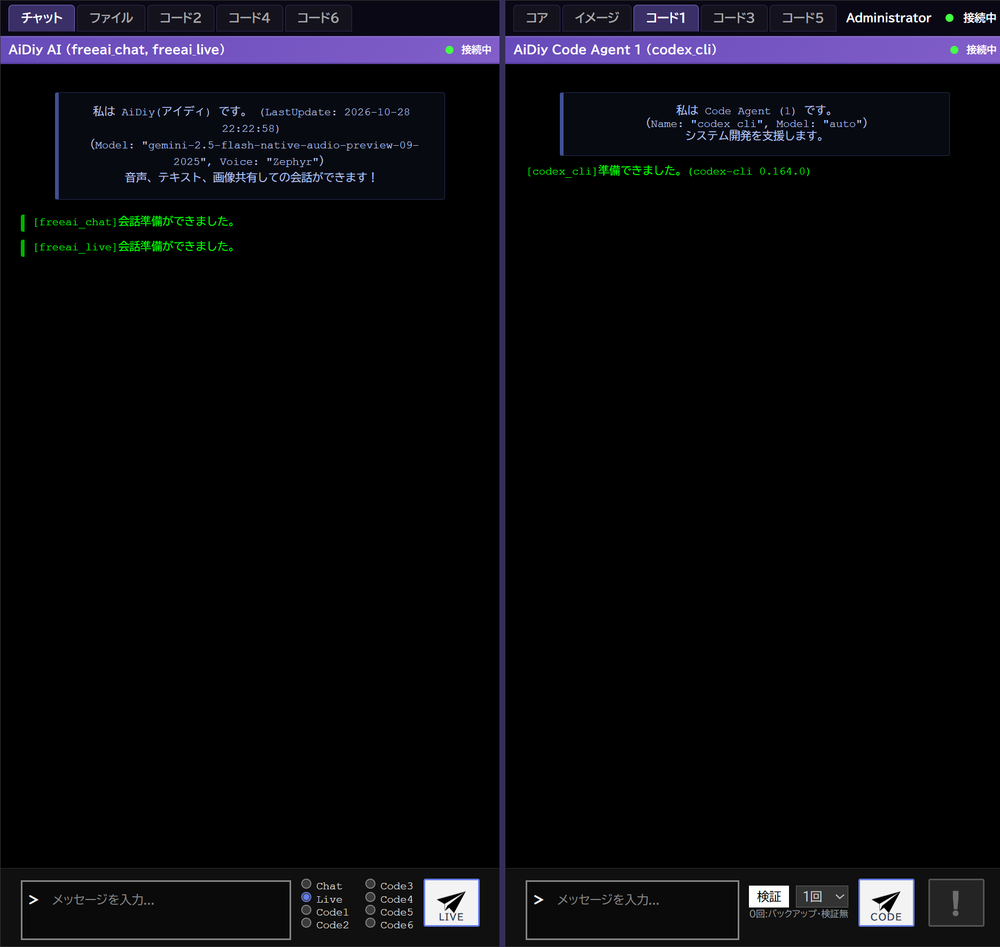
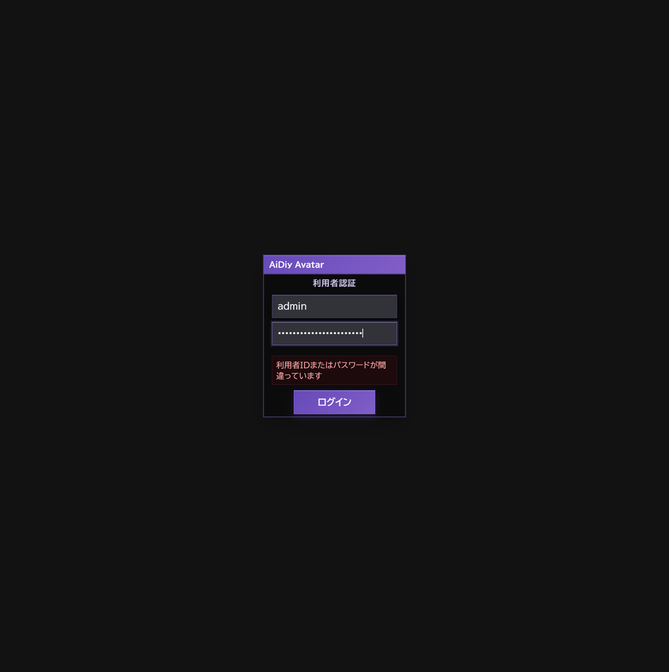
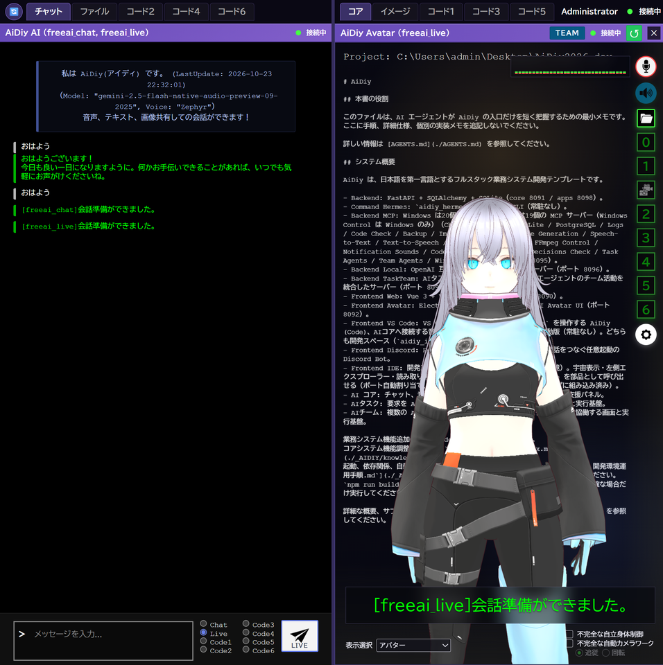
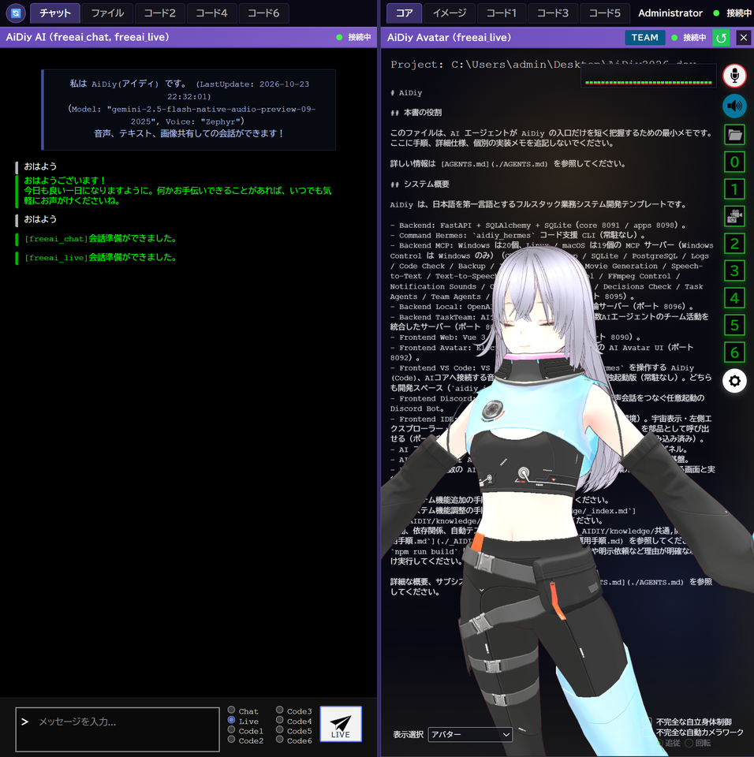
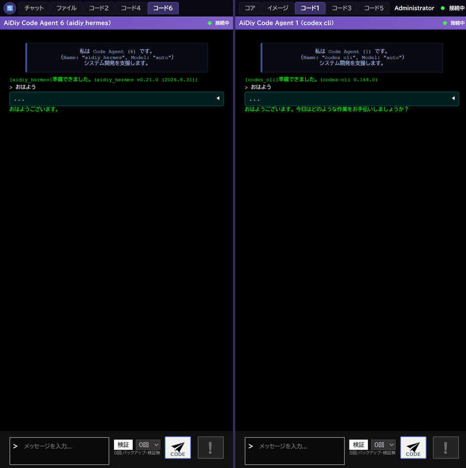

# aidiy_avatar Web実行編 — 操作ガイドとセルフテスト

> 本書はセルフテスト結果を、操作説明・解説書としても読みやすく整理しています。再テスト後は結果・注意書き・エビデンスを更新し、章立て・操作手順・図解の配置などの様式を維持します。

> 文書: `セルフテスト,aidiy_avatar,Web実行編.md` | 実装: `frontend_avatar/src/AiDiy.vue`, `frontend_avatar/src/components/`, `frontend_avatar/launch.mjs`

## 総合評価

再試験の実施順・変更後に確認する範囲は[共通の再試験準備](./セルフテスト,共通,確認結果.md#本日6時以降の更新に対する再試験準備)を参照します。以下の総合評価は記載した実施条件での結果です。画像番号は章と掲載順を表し、試験ケースIDとは区別します。

実画面の最終確認は2026年10月28日です。ログイン、VRM描画、Chat／Liveの選択、Code1表示と終了、Task／Team入口がない構成を確認しました。文字応答・再接続は10月24日の結果です。

**総合評価：✅ OK。2026年10月24日・Windowsで実画面で確認しました。ログイン、Chat・Code1・Code6・Liveの文字応答、Core再起動後の自動再接続は✅ OKです。** 

対象環境はWindowsです。Mac／Linux実機と長時間連続運転は **PASS（環境依存・判定対象外）** とし、今回は未実施です。実行成功とは区別し、NGには数えません。

マイク入力機器はブラウザの機器列挙で0台でした。実マイク入力は **PASS（環境依存・判定対象外）** とします。音声の聴取は⏸ 未実施です。本冊は簡易応答と画面操作の確認で、全機能・全プロバイダの合格を示すものではありません。

Task／TeamはAvatar内の機能ではありません。単独の [aidiy_task](./セルフテスト,aidiy_task,操作編.md)・[aidiy_team](./セルフテスト,aidiy_team,操作編.md) を使用します。掲載結果は記載した試験日時・条件の記録であり、現行版の全機能を再試験した結果ではありません。

## 始める前に

Task／Teamは独立コマンドを使います。直近の起動・表示試験ではAIへ依頼を送信していません。

移設後のWeb版です。左右のタブとCode1の入力画面を確認しました。

[システム起動編](./セルフテスト,aidiy_diag,システム起動編.md)に従って必要なシステムを起動し、Diagの「アプリ起動」でAvatarを起動します。試験用アカウントは[アプリ起動編](./セルフテスト,aidiy_diag,アプリ起動編.md#ローカル試験用の利用者)を参照します。

**8092はAvatar起動中だけ利用できます。** Web版を使っている間は、起動元のAvatarを終了しません。8090は通常Web用で、Avatar Webの接続先は `http://127.0.0.1:8092` です。

## 1. ブラウザでログインする

1. Avatarを起動した状態で `http://127.0.0.1:8092` を開きます。
2. 利用者IDとパスワードを入力して「ログイン」を押します。
3. 左のチャット側と右のコア側にタブが並び、「接続中」になれば正常です。

**✅ OK（AV-101〜102）**：正しい認証で画面へ進みました。同じタブの再読み込みでは認証を保持し、新規タブではログインが必要でした。誤ったパスワードには理由が表示されました。

8092のログイン画面です。通常Webの8090とは接続先が異なります。

新しいタブではログインが必要です。誤ったパスワードには案内が表示されます。

同じタブを再読み込みした結果です。再ログインせず会話画面へ戻りました。

## 2. タブを切り替えてChatとCodeを使う

左右のタブは独立して切り替えます。

| 場所 | 選べるタブ |
|---|---|
| 左 | チャット、ファイル、コード2、コード4、コード6 |
| 右 | コア、イメージ、コード1、コード3、コード5 |

1. 左の「チャット」で「Chat」を選び、「おはよう」と入力して送信します。
2. 右の「コード1」、左の「コード6」を選びます。
3. 挨拶の試験では検証を0回にし、各入力欄へ「おはよう」を入れて「CODE」を押します。

**✅ OK（AV-201〜203）**：10個のタブを順に選び、選択状態が切り替わることを確認しました。Chat、Code1（codex_cli）、Code6（aidiy_hermes）がそれぞれ返答しました。Codeのモデルはautoです。

左はコード6、右はコード5です。左右の表示は別々に選べます。

Chatの返答です。入力に続いて全文が表示されました。

Code1とCode6が返答した画面です。両方の処理が完了してから撮影しています。

## 3. Liveで会話する

1. 左の「チャット」を開いて「Live」を選びます。
2. 会話準備完了を確認し、初回は15秒以上待ちます。
3. 「おはよう」を1回送って返答を確認します。標準の観測枠は60秒です。

**✅ OK（AV-301）**：初回送信で「おはようございます!今日もよろしくお願いします。」と返答しました。※注意:15s以上待機後送信しました。Core再起動後の試験でも再送せず、送信から11秒後の画面取得時に返答を確認しました。初回試験の応答時間は今回厳密に計測していません。

プロバイダはfreeai_live、画面のモデルはgemini-2.5-flash-native-audio-preview-09-2025、声はZephyrです。文字の応答を判定し、音声の聴取は行っていません。

Liveの初回応答です。入力の下に新しい返答が表示されています。

## 4. 再接続と終了

1. 切断時は送信を連打せず、DiagでCoreの状態を確認します。
2. Coreが復帰すると、Avatarは自動で接続し直します。
3. 会話準備完了を確認してから新しい文を送ります。

**✅ OK（AV-401）**：DiagでCoreを再起動し、ログインを保ったまま自動で「接続中」に戻りました。Chat・Codeの会話履歴を置き換えて表示し、同じ履歴を重ねて追加しません。ChatとLiveへ送った新しい文にもそれぞれ返答しました。

Liveの会話文脈は、サーバー側で接続しているLive APIの同じセッションが保持します。画面への履歴の保存・再表示は不要です。Webをリフレッシュしても、サーバー側のLiveセッションが維持されていれば会話を続けられることが確認点です。上記のCore再起動後の新しい応答確認とは区別します。履歴が再表示されないことは不具合・残件に数えません。

Core再起動後に送信した結果です。ChatとLiveの新しい返答がそれぞれ表示されています。

終了するときは、応答待ちがないことを確認して8092のタブを閉じます。Web版をもう使わない場合は、起動元のAvatarも終了します。ブラウザタブを閉じる操作と、画面内のログアウトは別です。

## 確認範囲

画像生成、ファイル添付、設定保存、表示選択、ログアウトは今回の実画面試験に含めません。接続処理の回帰テスト10件とAvatarの型チェックは成功しました。掲載画像は縦横比を保ち、長辺960px以下に縮小しています。

[PDF版](./セルフテスト,aidiy_avatar,Web実行編.pdf)
