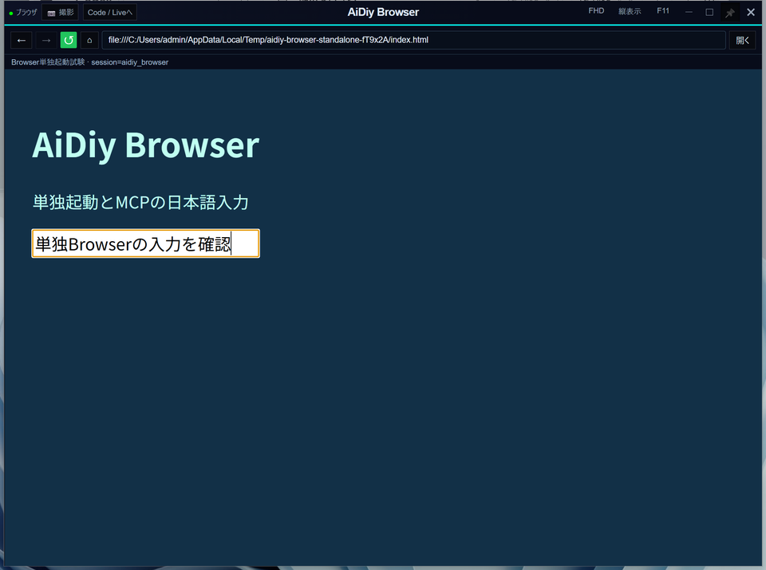
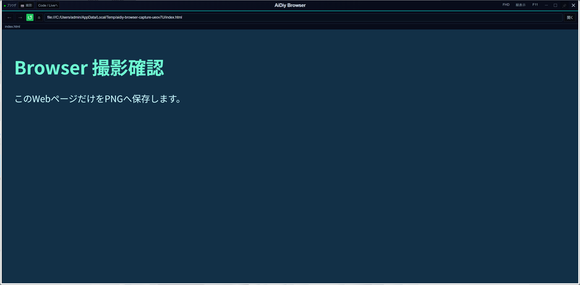
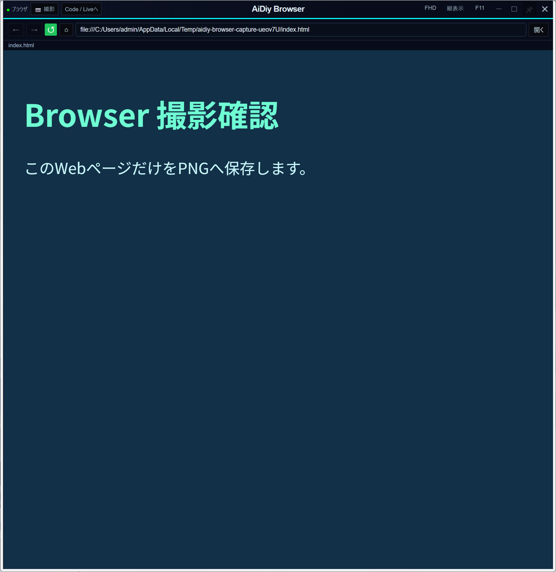
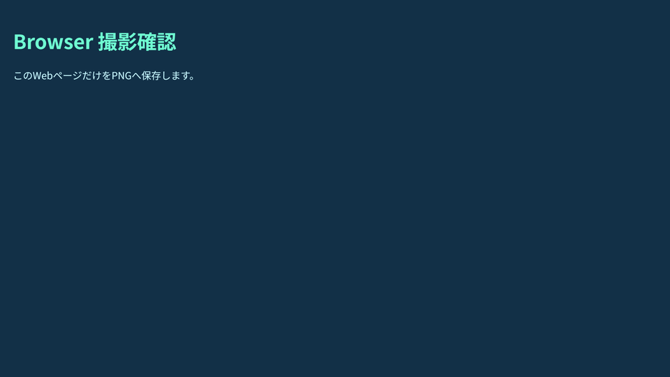
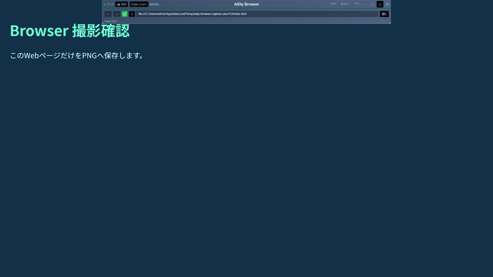
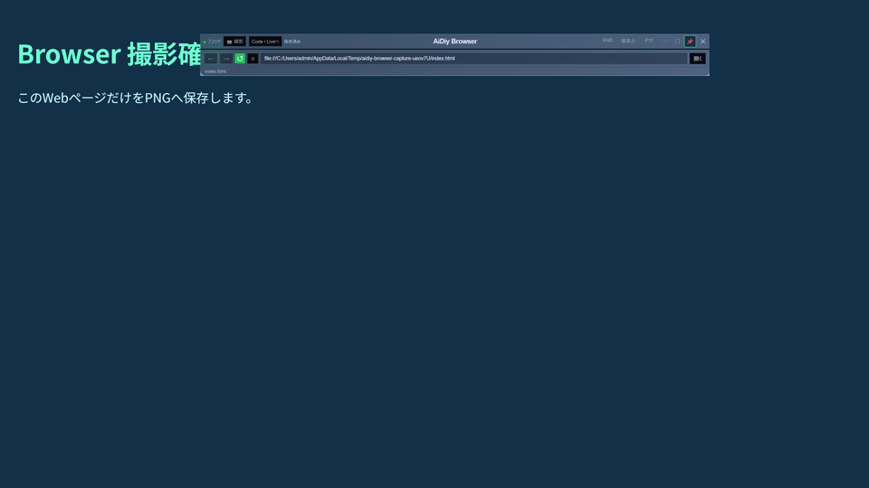
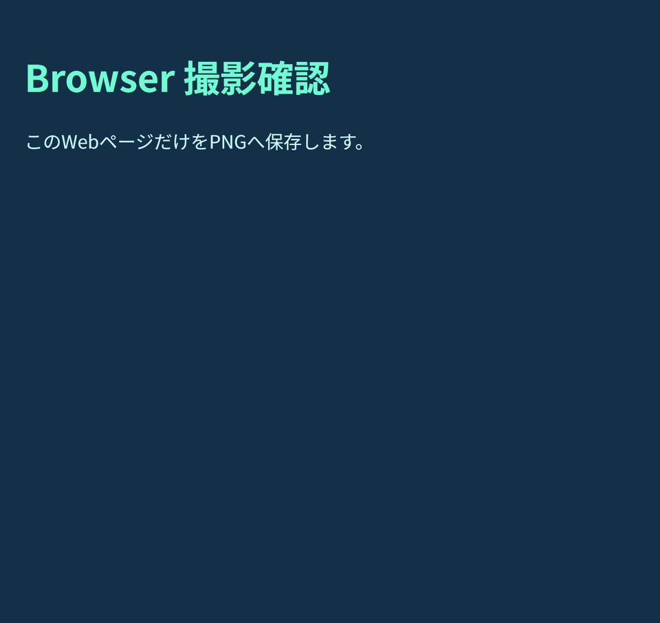
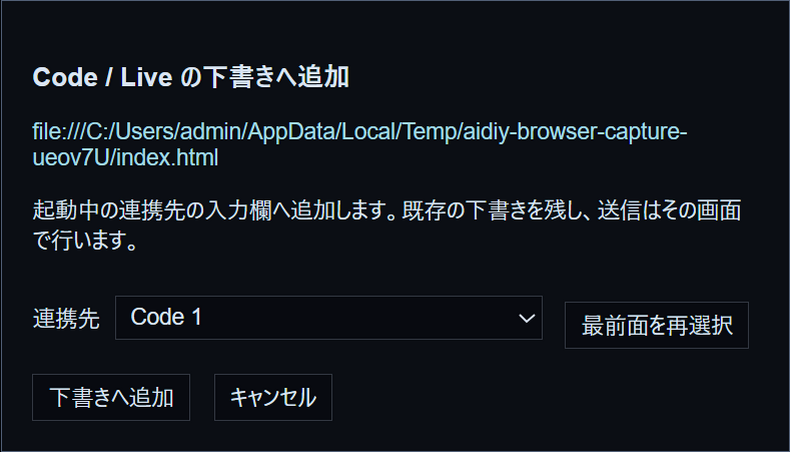

# AiDiy Browser 操作編 — 操作ガイドとセルフテスト

> 文書: `セルフテスト,aidiy_browser,操作編.md` | 実装: `frontend_ide/src/ブラウザ/`, `frontend_ide/デスクトップ/ブラウザ.cjs`, `frontend_ide/デスクトップ/ブラウザ撮影.cjs`, `frontend_ide/デスクトップ/下書き共有.cjs`

## 総合評価

**総合評価：✅ OK（記載した確認範囲）。実施日：2026年10月29日、Windows。** 単独起動、Web閲覧、MCP操作、サイズ切替、全画面、上端ヘッダー、撮影、Code／Liveへの下書き連携、終了を確認しました。

Browser・下書き連携・長押し移動の自動試験64件、MCPセッション登録のPython試験2件が成功しました。実Electronでは単独Browserの実Tools接続と、IDEから開くBrowserを確認しています。表示・撮影・連携の専用試験は隔離したプロジェクトで実施し、Code／Liveの入力欄には本番と同じ下書き受信部品を使いました。AIの実回答を要求する試験ではありません。

対象はWindowsの1ディスプレイです。Mac／Linux実機、物理的な縦置き・複数ディスプレイの全配置、全サイト、AIへの画像解釈・自動送信は対象外です。負座標・小画面・60秒の境界条件は自動試験で補完しています。

[PDF版](./セルフテスト,aidiy_browser,操作編.pdf)を同じ内容で提供します。

## 1. Browserを開く・Webページを操作する

Toolsを起動し、作業フォルダで `aidiy_browser` を実行します。IDEから使う場合は「＋ Browser」を押します。アドレス欄へURLまたは検索語を入力し、「開く」かEnterで移動します。戻る・進む・再読込・停止・ホームはアドレス欄の左側です。

URL欄は日本語を読みやすく表示し、未編集のEnterでは元のURLを使います。編集中にページ状態が更新されても、入力途中の内容を消しません。単独版は `session=aidiy_browser`、IDE側は `session=aidiy_ide` を基本とし、同時起動時は番号が付きます。

| ケース | 確認結果 |
|---|---|
| BR-101 単独起動 | ✅ OK：単独のElectron画面、実Tools接続、専用MCPセッションを確認 |
| BR-102 URL・検索・日本語表示 | ✅ OK：実ページの移動、日本語入力、URL表示・編集保護・Enterの自動試験に成功 |
| BR-103 履歴とローカルHTML | ✅ OK：実Electronで戻る・進む・再読込、HTML／HTM、相対CSS・リンク、登録ルート、特殊名ファイルを確認 |
| BR-104 接続と分離 | ✅ OK：Tools切断・復帰と同じセッションの維持を自動確認。実ページへNode・preload・IDEのAPI権限を公開しないことも確認 |

単独Browserの実画面です。MCPから入力した日本語をページ内の入力欄で確認しました。



## 2. FHD・縦表示・全画面を切り替える

タイトル右側の「FHD」は1920×945、「縦表示」は1080×1785を上限として、今いるディスプレイの作業領域の中央へ配置します。縦の高さは `1920-(1080-945)=1785` です。収まらない寸法は作業領域まで縮めます。

これはElectronのウィンドウ全体の論理寸法です。ヘッダーを除いたWebページの寸法や、Windowsの表示倍率を掛けた物理画素数とは区別します。今回の実画面ではFHDは1920×945、縦表示は画面に収まる1080×1114になりました。

「F11」ボタンまたはF11キーで、今いるディスプレイ全面・最前面へ切り替えます。ヘッダーと外周枠を隠し、Web本文を全面に表示します。マウスを上端へ動かすと、通常時と同じ内容のすりガラスの専用パネルが上から滑り降ります。パネルを重ねても、Webの表示領域は狭まりません。

専用パネルの📌をオンにすると常時表示します。背景やタイトルを0.5秒長押しするとパネルだけを移動でき、その時も自動で📌がオンになります。ピン留めは表示の継続で、位置の固定ではありません。ボタン・URL入力欄は通常どおり操作できます。

📌をオフにするとパネルを収納し、Webだけの全画面へ戻ります。マウスをいったん離してから上端へ合わせると再表示します。もう一度F11で解除すると、元の窓と通常時の最前面状態へ戻ります。

| ケース | 確認結果 |
|---|---|
| BR-201 サイズと配置 | ✅ OK：実窓のFHD／縦表示の寸法・画面内配置を実測。負座標・小画面は自動確認 |
| BR-202 全面と最前面 | ✅ OK：実窓の全画面状態・最前面、本文の上端0・全面の高さ、ヘッダーと外周枠の非表示を確認 |
| BR-203 上端の専用パネル | ✅ OK：上端位置を制御した実Electronで、すりガラスの展開・収納、Web領域の寸法が変わらないことを確認 |
| BR-204 F11と復帰 | ✅ OK：本文とホスト双方へキー入力し、解除・再全画面を確認。長押し反復は自動試験で除外を確認 |
| BR-205 常時表示と移動 | ✅ OK：📌オンで表示継続、オフで即収納を確認。400msでは移動せず、500msの長押しでパネルだけが移動して自動ピン留め。親窓・Web領域の寸法は維持 |

FHDボタンを押した状態です。ヘッダーを含む窓が現在のディスプレイ内へ配置されます。



縦表示は、現在の画面の高さに収まるよう調整されました。



全画面ではWeb本文だけを表示し、ヘッダー用の空白を残しません。



上端へマウスを移すと、タイトル・アドレス欄・撮影・連携の操作が重なって現れます。Web本文の位置と大きさは変わりません。



専用パネルを長押しで移動した状態です。📌が自動でオンになり、マウスを離しても表示を続けます。



## 3. 表示中のWeb画面を撮影する

接続表示の右にある「撮影」を押します。表示中のWebページだけをPNG化し、選択プロジェクトの `temp/input/browser-<UUID>.png` へ保存します。ヘッダー・アドレス欄・デスクトップ全体・スクロール外は含めません。

保存成功時は「保存済み」を表示し、ボタンへマウスを重ねると保存先を確認できます。AvatarのようにAIコアへ画像を送る経路ではなく、利用者指定のプロジェクト内保存です。

| ケース | 確認結果 |
|---|---|
| BR-301 撮影と保存 | ✅ OK：通常時・全画面専用パネルの実ボタンからPNGを保存し、Web本文だけの画像を目視確認 |
| BR-302 重複と失敗条件 | ✅ OK：撮影中の連打、切断、別画面からの要求を拒否。PNGの検証と重複しない保存を自動確認 |

撮影ボタンが保存した画像です。Browserの操作欄は含まれていません。



## 4. URLと画像パスをCode／Liveへ渡す

「撮影」の隣の「Code / Liveへ」を押し、同じプロジェクトで起動している渡し先を選び、「下書きへ追加」を押します。単独起動したCode／LiveとIDE内のCode／Liveを候補にできます。候補がなければ、同じフォルダで `aidiy_code` または `aidiy_live` を起動し、一覧を更新します。

通常は現在のURLを渡します。そのBrowserで撮影してから60秒以内なら、画像の絶対パスも改行して添えます。撮影がない場合や60秒を超えた場合はURLだけです。選択中に1分を超えた場合も、実際に渡す直前に画像の有効期間を判定します。

既存の下書きを残して追記します。AIへの送信は渡し先で行い、この操作だけではAIを実行しません。

| ケース | 確認結果 |
|---|---|
| BR-401 URLと画像 | ✅ OK：実BrowserのダイアログからCode受信部品へ、URLと撮影画像パスを同時に追記 |
| BR-402 1分の境界 | ✅ OK：実受信試験で時計を60001ms進めた後、Live受信部品にはURLだけを追記。0・59999・60000・60001msと未来時刻を自動確認 |
| BR-403 渡し先の照合 | ✅ OK：分離した共有サーバー間でCode／Liveを列挙し、別プロジェクト・古い会話を拒否。既存下書きの保持と受信ACKも確認 |
| BR-404 ダイアログ | ✅ OK：通常時・全画面専用パネルから選択画面を表示。表示中はWebContentsViewと専用パネルを隠し、終了後は本文を同じ寸法で再表示 |

渡し先を選択した状態です。複数候補がある場合は、対象の入力欄を明示して追加します。



Code／Liveの連携実画面試験は、隔離した入力欄と本番の下書き受信部品を使用しています。別プロセス相当の共有通信はHTTP試験で確認し、実AIの会話・推論結果とは区別します。

## 5. MCP操作と終了を確認する

`aidiy_chrome_devtools` にBrowserのセッション名を指定すると、ページの一覧・移動・クリック・入力・撮影・タブ作成／終了を操作できます。使い終わったら窓の×またはMCPの `close_session` で閉じます。

| ケース | 確認結果 |
|---|---|
| BR-501 MCP | ✅ OK：単独Browserの実セッションで日本語入力・撮影・終了。IDE側の実Browserでクリック・移動・撮影・新規タブ・タブ終了も確認 |
| BR-502 ドラッグとVR連携 | ✅ OK：IDE側で本文の長押し移動、リンク・入力欄の操作維持、実ディスプレイ1台のVRからの起動と利用終了を確認 |
| BR-601 窓の終了 | ✅ OK：実Browserの窓・本文・キー購読を解放。単独版の `close_session` 後にプロセスが正常終了し、IDE利用終了でも所有Browserを解放 |

試験用のBrowser・入力欄・IDE・MCPセッションは終了します。今回起動したToolsも試験終了後に停止し、既存の作業データを変更しません。

## 6. 再実施する

プロジェクト起点から実行します。配布画面を変更した場合は、試験前に共通Vueの配布物を更新します。

```powershell
node --test frontend_ide/checks/browser*.test.mjs frontend_ide/checks/standalone-browser*.test.mjs frontend_ide/checks/draft*.test.mjs frontend_ide/checks/*window-move*.test.mjs
backend_tools/.venv/Scripts/python.exe -m unittest discover -s frontend_ide/checks -p test_browser_sessions.py
node frontend_ide/scripts/check-browser-standalone.mjs
node frontend_ide/scripts/check-browser-window.mjs
node frontend_ide/scripts/check-browser.mjs
```

実画面試験にはToolsが必要です。単独起動試験は専用プロジェクト、表示・撮影・連携試験は専用プロファイルと受信部品を使います。作業用の画像・結果は `.aidiy_cache/selftest/aidiy_browser/`、IDE連携の作業結果は `temp/browser-check/` に出力します。正式資料には採用した画面だけを置き、旧版・未参照画像・途中のエラー画面は残しません。

試験後は本文・画像・[確認結果](./セルフテスト,共通,確認結果.md)を更新し、同名PDFを再生成して表示を確認します。
