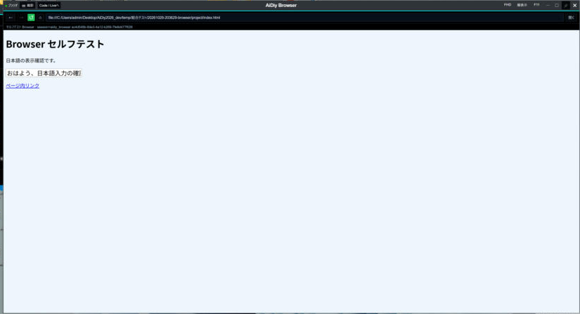
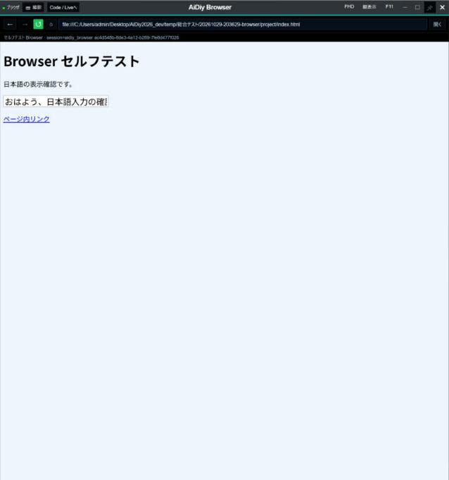
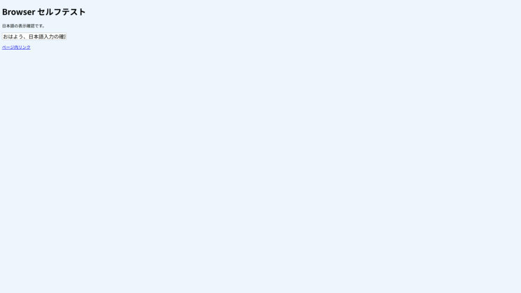
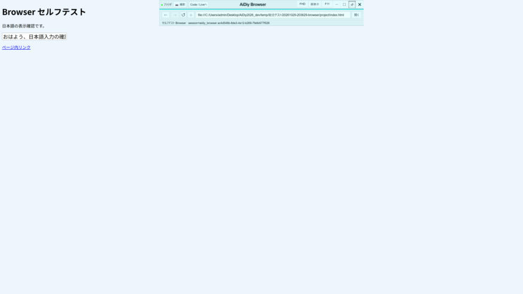
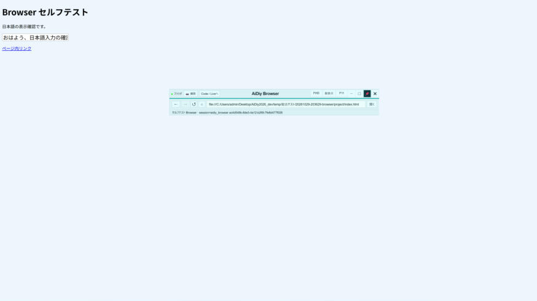
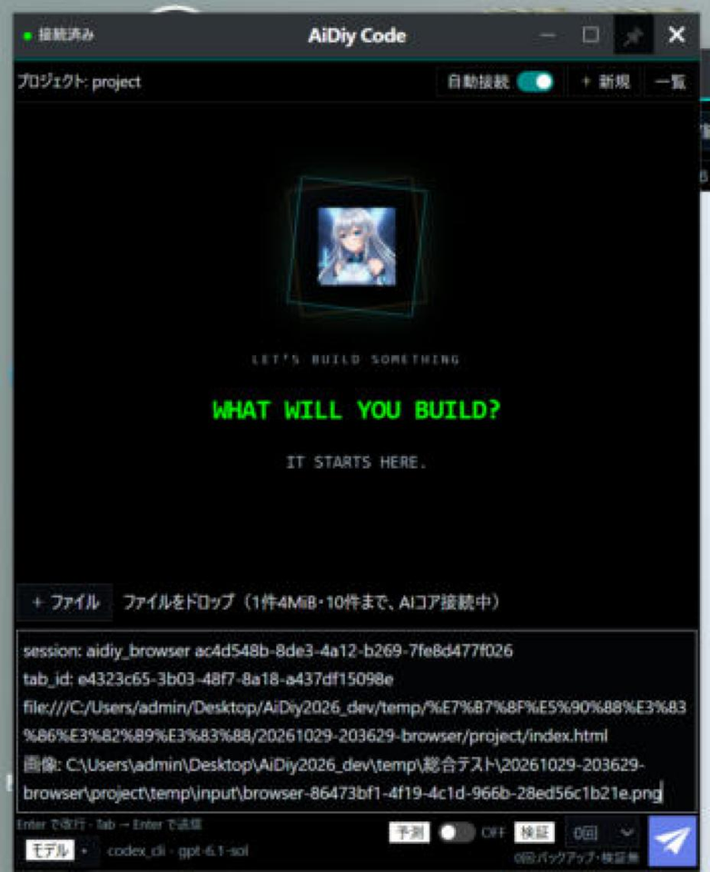
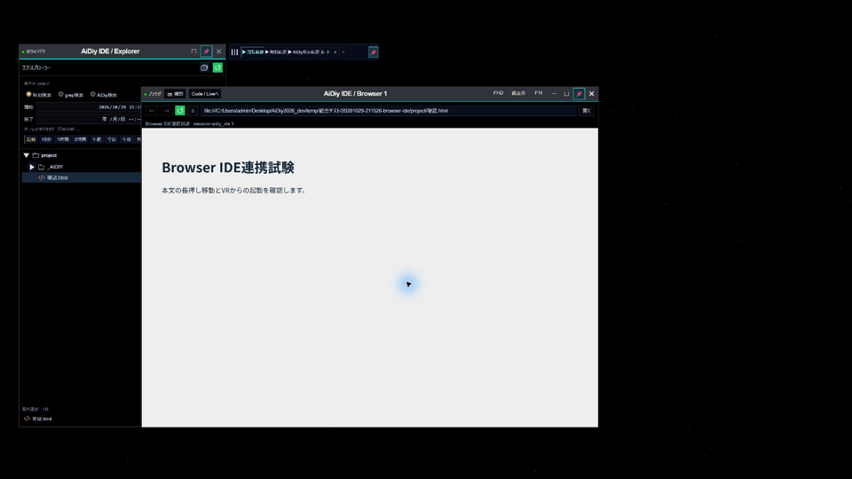

# AiDiy Browser 操作編 — 操作ガイドとセルフテスト

> 文書: `セルフテスト,aidiy_browser,操作編.md` | 実装: `frontend_ide/src/ブラウザ/`, `frontend_ide/デスクトップ/ブラウザ.cjs`, `frontend_ide/デスクトップ/ブラウザ撮影.cjs`, `frontend_ide/デスクトップ/下書き共有.cjs`

## 総合評価

再試験の実施順・変更後に確認する範囲は[共通の再試験準備](./セルフテスト,共通,確認結果.md#本日6時以降の更新に対する再試験準備)を参照します。以下の総合評価は記載した実施条件での結果です。画像番号は章と掲載順を表し、試験ケースIDとは区別します。


**総合評価：✅ OK（記載した確認範囲）。最終確認日：2026年10月30日、Windows。** 単独起動、Web閲覧、MCP操作、サイズ切替、全画面、上端の専用パネル、撮影、Codeへの下書き連携、終了を、Computer Useによる実画面操作で確認しました。

10月29日夕方までの変更（窓番号・セッションの引き継ぎ、本文寸法の維持、全画面の専用パネルを約800pxのすりガラスへ変更）を反映した再試験です。Browser・下書き連携・長押し移動の自動試験184件と、MCPセッション登録のPython試験7件が成功しました。実画面は試験用プロジェクトで単独のBrowserとCodeを起動して確認しました。AIの実回答を要求する試験ではありません。10月29日21時台にはBR-502も確認しました。IDEの通常・VR表示のHTMLビューアーからBrowserを開く操作はComputer Use、VR中のBrowser本文の長押し移動は利用者の実操作と成功報告による確認です。この追加確認で自動試験184件・7件を再実行したわけではありません。

対象はWindowsの1ディスプレイです。Mac／Linux実機、物理的な縦置き・複数ディスプレイの全配置、全サイト、AIへの画像解釈・自動送信は対象外です。負座標・小画面・60秒の境界条件は自動試験で補完しています。

[PDF版](./セルフテスト,aidiy_browser,操作編.pdf)を同じ内容で提供します。

### 2026年10月30日の再確認

**今回の確認範囲は合格です。** Browser関連184件とMCPセッション登録7件が成功しました。共通ピン処理の修正後に関連17件も成功しています（Browserの10件は184件と重複）。Windowsで最大化などの切替後に最前面ONが反映されない場合は、実状態がOFFであることを確認して一度だけ解除・再設定します。ピンの利用者選択とVR解除後の復元は維持します。

実Electronの窓試験でFHDの本文1920×945、縦表示1080×1785、最大化と復帰、F11と元の窓への復帰、全画面パネルの表示・収納・長押し移動・自動ピン、本文寸法の保持、本文だけのPNG撮影を確認しました。Codeへは画像付き、期限超過後のLiveへはURLのみの下書き追記を、実共有口と試験用受信画面で確認しました。既存下書きは保持し、AI送信は実行していません。

単独起動の実MCPによる日本語入力・撮影・close_session、IDEからのGoogle／ローカルHTML・相対CSS・特殊名・登録ルート・戻る／進む・新規パネル・利用終了連携も成功しました。長押し試験は実窓とElectron入力を使い、カーソル位置・フォーカス判定を模擬しています。実画面では指定プロジェクトで通常起動、灰色タイトルと枠、白寄りのピンOFF、F11でWeb本文だけの全画面、通常表示への復帰と×終了を目視しました。Windowsの別の実窓試験ではピンON／OFF・VR解除の10条件でOSの最前面属性と重なり順を照合しています。

試験専用窓は終了し、専用ポートの閉鎖、Diag・Tools・Coreの継続稼働を確認しました。以下の掲載画像は10月29日の実画面資料を維持しています。今回の条件を過去画像の撮影日へ読み替えません。複数物理ディスプレイ・Mac／Linux・長時間運転は未実施です。

## 1. Browserを開く・Webページを操作する

Toolsを起動し、作業フォルダで `aidiy_browser` を実行します。IDEから使う場合は「＋ Browser」を押します。アドレス欄へURLまたは検索語を入力し、「開く」かEnterで移動します。戻る・進む・再読込・停止・ホームはアドレス欄の左側です。

URL欄は日本語を読みやすく表示し、未編集のEnterでは元のURLを使います。編集中にページ状態が更新されても、入力途中の内容を消しません。単独版は `session=aidiy_browser`、IDE側は `session=aidiy_ide` を基本とし、同時起動時は番号が付きます。

| ケース | 確認結果 |
|---|---|
| BR-101 単独起動 | ✅ OK：単独のElectron画面、接続表示「ブラウザ」の点灯、専用MCPセッション（`session=aidiy_browser` と番号）を確認 |
| BR-102 URL・検索・日本語表示 | ✅ OK：アドレス欄に日本語を含むパスを入力して移動し、URL欄で日本語のまま読めることを確認。ページ内の入力欄へ画面から日本語を入力し、MCPで同じ値を読み取れました |
| BR-103 履歴とローカルHTML | ✅ OK：ローカルHTMLを開き、「戻る」で前のページ、「進む」で元のページへ戻ることを確認。相対CSS・特殊名ファイルなどは自動試験で確認 |
| BR-104 接続と分離 | ✅ OK：Tools切断・復帰と同じセッションの維持、実ページへNode・preload・IDEのAPI権限を公開しないことを自動試験で確認 |

単独Browserの実画面です。MCPから入力した日本語を、ページ内の入力欄で確認しました。


## 2. FHD・縦表示・全画面を切り替える

タイトル右側の「FHD」はWeb本文を1920×945、「縦表示」は1080×1785にします。縦の高さは `1920-(1080-945)=1785` です。寸法はヘッダー・アドレス欄を除いたWebページの表示領域（CSSピクセル、表示倍率100%）で、窓全体はその分だけ大きくなります。

画面に収まる場合は作業領域の中央へ配置します。収まらない場合も本文は縮めず、操作欄のある窓の左上を画面内に残します。今回の実画面（2560×1440、表示倍率150%）では、Web本文がFHDで1920×945、縦表示で1080×1785になったことをMCPで計測しました。縦表示は画面より高いため、窓の下側が画面の外へ出ます。

「F11」ボタンまたはF11キーで、今いるディスプレイ全面・最前面へ切り替えます。ヘッダーと外周枠を隠し、Web本文を全面に表示します。マウスを上端へ動かすと、通常時と同じ内容を持つ幅約800pxのすりガラスの専用パネルが、画面上部の中央へ滑り降ります。パネルを重ねても、Webの表示領域は狭まりません。

専用パネルの📌をオンにすると常時表示します。背景やタイトルを0.5秒長押しするとパネルだけを移動でき、その時も自動で📌がオンになります。ピン留めは表示の継続で、位置の固定ではありません。ボタン・URL入力欄は通常どおり操作できます。

📌をオフにするとパネルを収納し、Webだけの全画面へ戻ります。マウスをいったん離してから上端へ合わせると再表示します。もう一度F11で解除すると、元の窓と通常時の最前面状態へ戻ります。

| ケース | 確認結果 |
|---|---|
| BR-201 サイズと配置 | ✅ OK：実窓でFHD・縦表示を切り替え、Web本文の寸法（1920×945・1080×1785）と窓の配置をMCP・窓位置で計測。負座標・小画面は自動確認 |
| BR-202 全面と最前面 | ✅ OK：「F11」ボタンで画面全体（2560×1440）・最前面になり、Web本文が画面と同じ大きさで、ヘッダーと外周枠が隠れることを確認 |
| BR-203 上端の専用パネル | ✅ OK：マウスを上端へ移すと、幅約800pxのすりガラスのパネルが上部中央へ現れ、パネル表示中もWeb本文の寸法が変わらないことを確認 |
| BR-204 F11と復帰 | ✅ OK：本文を選んでF11キーを押し、全画面を解除して元のFHDの窓へ戻ることを確認。長押し反復は自動試験で除外を確認 |
| BR-205 常時表示と移動 | ✅ OK：パネルのタイトルを0.8秒長押ししてドラッグし、パネルだけが移動して📌が自動でオンになり、マウスを離しても表示が続くことを確認。400msでは移動しないことは自動試験で確認 |

FHDボタンを押した状態です。Web本文が1920×945になり、窓が画面中央に配置されました。



縦表示の状態です。Web本文は1080×1785のまま縮めず、操作欄のある窓の上端を画面内に残しています。



全画面ではWeb本文だけを表示し、ヘッダー用の空白を残しません。



上端へマウスを移すと、タイトル・アドレス欄・撮影・連携の操作を持つすりガラスのパネルが、上部中央へ重なって現れます。Web本文の位置と大きさは変わりません。



専用パネルを長押しで移動した状態です。📌が自動でオンになり、マウスを離しても表示を続けます。



## 3. 表示中のWeb画面を撮影する

接続表示の右にある「撮影」を押します。表示中のWebページだけをPNG化し、選択プロジェクトの `temp/input/browser-<UUID>.png` へ保存します。ヘッダー・アドレス欄・デスクトップ全体・スクロール外は含めません。

保存成功時は「保存済み」を表示し、ボタンへマウスを重ねると保存先を確認できます。AvatarのようにAIコアへ画像を送る経路ではなく、利用者指定のプロジェクト内保存です。

| ケース | 確認結果 |
|---|---|
| BR-301 撮影と保存 | ✅ OK：全画面の専用パネルの「撮影」で「保存済み」と表示され、プロジェクトの `temp/input/` にPNGが保存されました。画像はWeb本文だけで、パネル・操作欄が写っていないことを目視確認 |
| BR-302 重複と失敗条件 | ✅ OK：撮影中の連打、切断、別画面からの要求を拒否。PNGの検証と重複しない保存を自動確認 |

全画面の専用パネルから撮影し、保存された画像です。Browserの操作欄とパネルは含まれていません。


## 4. URLと画像パスをCode／Liveへ渡す

「撮影」の隣の「Code / Liveへ」を押し、同じプロジェクトで起動している渡し先を選び、「下書きへ追加」を押します。単独起動したCode／LiveとIDE内のCode／Liveを候補にできます。候補がなければ、同じフォルダで `aidiy_code` または `aidiy_live` を起動し、一覧を更新します。

渡す内容は、BrowserのMCPセッション名・タブID・現在のURLです。渡し先のAIが同じBrowserを `aidiy_chrome_devtools` で操作できるよう、セッション名とタブIDを添えます。そのBrowserで撮影してから60秒以内なら、画像の絶対パスも改行して添えます。撮影がない場合や60秒を超えた場合はURLだけです。選択中に1分を超えた場合も、実際に渡す直前に画像の有効期間を判定します。

既存の下書きを残して追記します。AIへの送信は渡し先で行い、この操作だけではAIを実行しません。

| ケース | 確認結果 |
|---|---|
| BR-401 URLと画像 | ✅ OK：同じ試験用プロジェクトで単独起動したCodeへ、全画面の専用パネルから渡しました。Codeの入力欄にセッション名・タブID・URL・撮影画像のパスが追記され、AIへは送信されないことを確認 |
| BR-402 1分の境界 | ✅ OK：自動試験で0・59999・60000・60001msと未来時刻を確認。60秒を超えた後はURLだけを追記します |
| BR-403 渡し先の照合 | ✅ OK：自動試験で、分離した共有サーバー間のCode／Liveの列挙、別プロジェクト・古い会話の拒否、既存下書きの保持と受信ACKを確認 |
| BR-404 ダイアログ | ✅ OK：全画面の専用パネルから選択画面を開くと、表示中はWeb本文とパネルが隠れ、閉じた後は本文が同じ寸法で再表示されました |

渡し先を選択した状態です。連携先に「Code 1」が選ばれています。複数候補がある場合は「最前面を再選択」で対象を選び直せます。


「下書きへ追加」を押した後のCodeです。入力欄の末尾に、セッション名・タブID・URL・画像のパスが追記されました。送信はCodeの画面で行います。



連携ダイアログのURLは、日本語部分が `%E7…` のように符号化された形で表示されます。URLとしては正しく、渡し先でも同じ形で追記されます。Liveへの受け渡しは、今回は自動試験で確認しました。

## 5. MCP操作と終了を確認する

`aidiy_chrome_devtools` にBrowserのセッション名を指定すると、ページの一覧・移動・クリック・入力・撮影・タブ作成／終了を操作できます。使い終わったら窓の×またはMCPの `close_session` で閉じます。

| ケース | 確認結果 |
|---|---|
| BR-501 MCP | ✅ OK：単独Browserの実セッションで、ページの寸法・入力値の読み取り、移動、リンクのクリック、日本語入力、撮影、新規タブ、タブ終了を確認 |
| BR-502 ドラッグとVR連携 | ✅ OK（記載した確認範囲）：10月29日21時台、通常・VR表示のHTMLビューアーから試験HTMLをBrowserで開き、タイトル・本文・sessionをComputer Useで確認。VR中のBrowser本文の長押しによる窓移動は利用者が実操作し「移動できた」と報告。長押し時間の実測、VR右上メニューからの起動、複数ディスプレイはこの追加確認に含めません |
| BR-601 窓の終了 | ✅ OK：単独版で `close_session` を実行すると窓が閉じ、Browserのプロセスとセッション登録が残らないことを確認。IDE利用終了時の解放は自動試験で確認 |

VR表示のIDEから開いたBrowserです。試験HTMLが表示され、利用者が本文の長押しで窓を移動した後の状態を撮影しました。静止画は表示状態の証跡で、押下時間の測定結果ではありません。



試験専用のBrowser・入力欄・IDE・MCPセッションは確認後に終了します。DiagとToolsは、利用者が起動と音声案内を希望した継続作業中は維持します。すべての試験を終える際は、今回起動したサービスだけを停止します。

## 6. 再実施する

プロジェクト起点から実行します。配布画面を変更した場合は、試験前に共通Vueの配布物を更新します。

```powershell
node --test frontend_ide/checks/browser*.test.mjs frontend_ide/checks/standalone-browser*.test.mjs frontend_ide/checks/draft*.test.mjs frontend_ide/checks/*window-move*.test.mjs
backend_tools/.venv/Scripts/python.exe -m unittest discover -s frontend_ide/checks -p test_browser_sessions.py
node frontend_ide/scripts/check-browser-standalone.mjs
node frontend_ide/scripts/check-browser-window.mjs
node frontend_ide/scripts/check-browser.mjs
```

実画面試験にはToolsが必要です。単独起動試験は専用プロジェクト、表示・撮影・連携試験は専用プロファイルと受信部品を使います。作業用の画像・結果は `.aidiy_cache/selftest/aidiy_browser/`、IDE連携の作業結果は `temp/browser-check/` に出力します。正式資料には採用した画面だけを置き、旧版・未参照画像・途中のエラー画面は残しません。

試験後は本文・画像・[確認結果](./セルフテスト,共通,確認結果.md)を更新し、同名PDFを再生成して表示を確認します。
