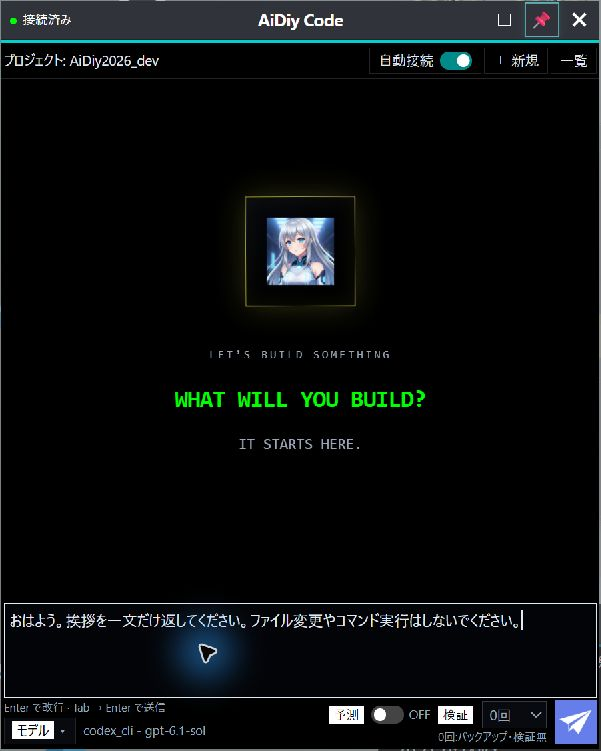
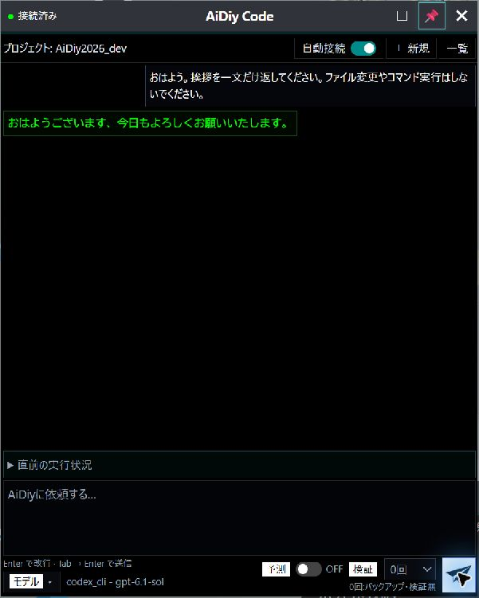
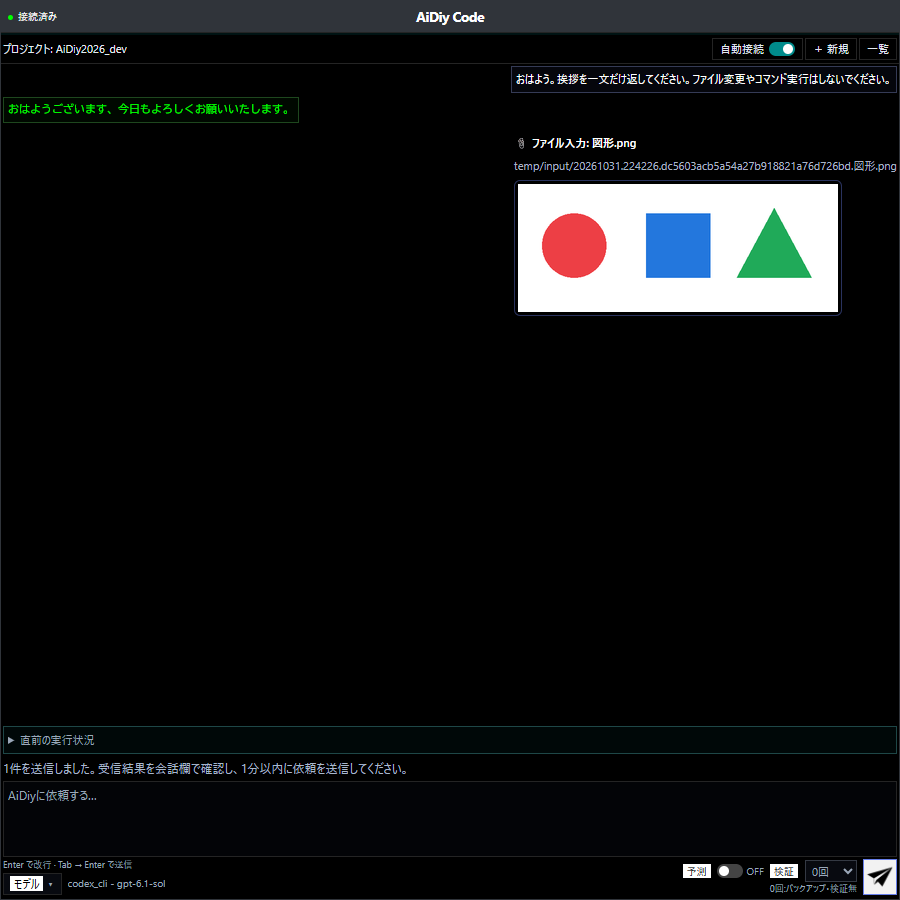
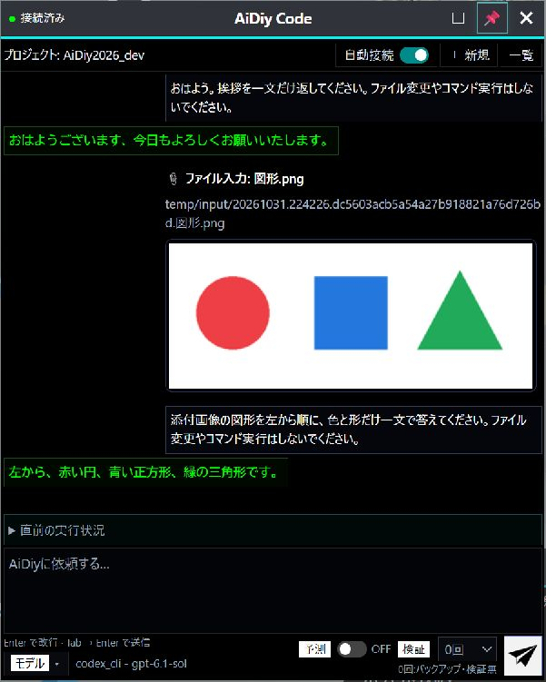
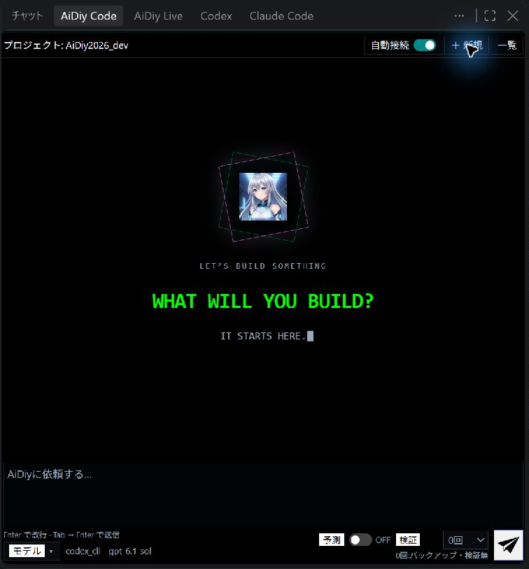

# Code 操作編 — 操作ガイドとセルフテスト

## 総合評価

**総合評価：✅ OK（記載した確認範囲）。** 挨拶への実回答、PNG添付の内容理解、単独Electronの外観・終了を確認しました。全形式・全プロバイダを網羅した判定ではありません。

前半は起動から終了までの操作ガイド、最後の章は追加テストと確認範囲です。図番号は章番号と掲載順を表し、試験ケースIDとは区別します。

## 始める前に

[システム起動編](./セルフテスト,aidiy_diag,システム起動編.md)で必要なバックエンドを起動し、[ランチャー編](./セルフテスト,aidiy_diag,ランチャー編.md)からアプリを開きます。単独起動コマンドは `aidiy_code` です。作業対象のプロジェクトと接続状態を確認します。

## 1. 起動して会話する

1. Diagまたは `aidiy_code` から起動し、プロジェクトと接続状態を確認します。
2. 入力欄に依頼を書き、送信します。動作を確かめる場合は「おはよう。挨拶を一文だけ返してください。ファイル変更やコマンド実行はしないでください。」と入力します。
3. 利用者の入力とは別に正式回答が表示されれば、会話の確認は完了です。

単独Electronで接続済み・プロジェクト名・入力欄を確認しました。検証回数は0回、予測はOFFです。

**図101：Code起動画面**

`codex_cli / gpt-6.1-sol` から「おはようございます、今日もよろしくお願いいたします。」という正式回答を確認しました。

**図102：Code挨拶応答画面**

## 2. 画像を添付する

1. 画像を入力欄へドラッグ＆ドロップします。
2. 会話欄の「ファイル入力」と画像プレビューを確認します。ドロップした時点でCoreへ送信されます。
3. 受信表示を確認し、1分以内に画像についての質問を入力して送信します。
4. 正式回答を画像の内容と照合します。

Web版の実画面でPNGのドロップイベントを使い、通常の添付処理からCoreへ送信しました。会話欄にファイル名と図形のプレビューが表示されています。OSの窓間ドラッグは確認範囲に含めません。

**図201：画像添付（Web版）**

「添付画像の図形を左から順に、色と形だけ一文で答えてください。」と依頼し、「左から、赤い円、青い正方形、緑の三角形です。」という回答を確認しました。同じ会話を表示する単独Electronにも、画像と正式回答が反映されています。

**図202：画像への実回答（単独Electron）**

## 3. VS Code拡張で使う

VS Codeでコマンドパレットを開き、「AiDiy Code: チャットを開く」を選びます。プロジェクト・入力欄・送信領域を確認します。右サイドバーの境界をドラッグすると幅を調整できます。

CodeとLiveを導入した構成のCode拡張です。新規会話の表示、外周枠、入力・送信領域を確認しました。この画面ではAIへ依頼を送信していません。

**図301：VSCodeCode**

IDEからの起動・下書き受け渡し・子窓の終了連携は[IDE操作編](./セルフテスト,aidiy_ide,操作編.md)を参照します。

## 4. 終了する

単独Electronでは作業を終えて窓を閉じます。Diagから起動した試験用の窓が閉じ、終了することを確認しました。VS Code拡張の構成確認と、単独版の終了確認は区別します。

## 5. 追加テストと確認範囲

| 対象 | 結果と条件 |
|---|---|
| 単独Electron | グレーのタイトル、外枠、透明なピン背景、入力・送信領域を目視確認し、終了を確認しました。 |
| 共通の添付処理 | Code／Live添付16件、共通添付9件、入力ファイル保存8件の成功結果を共用します。Liveと二重集計しません。 |
| VS Code | Codeのみ・Liveのみ・両方の3構成では、外周1px枠、二重枠がないこと、入力・送信領域が枠内に収まることを確認しています。図301は両拡張導入時の表示確認です。画像内容に合う実回答を全構成で確認した判定ではありません。 |

PNG以外の全形式、容量・個数上限、送信途中の切断、全プロバイダの実回答は実画面確認に含めません。

### 長押しドラッグの実機確認（2026-11-02）

Windows実機で `mouse_long_press_drag`（保持0.8秒、移動0.6秒。Browser全画面は移動0.8秒）を使用。直前の画面から対象を同定し、移動後の実画面とOSの窓位置を照合します。入力欄・ボタンの除外判定は下記の実施対象に限定します。位置は画面座標の (x,y) です。

標準窓 (3,10) → (603,50) の背景移動、入力欄・モデル選択ボタンでの移動抑止を実機確認。AIへの送信なし。

解放後にポインターを離して追従が残らないこと、通常UIが使えることを確認。Diag以外の今回起動した窓は通常UIで終了しました。1〜2pxの寸法丸めは補正を追加していません。全セルフテストの再実行や、未実施モードの合格を意味しません。
