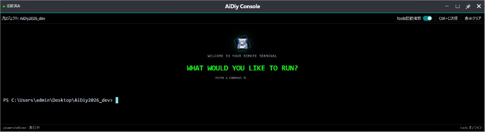
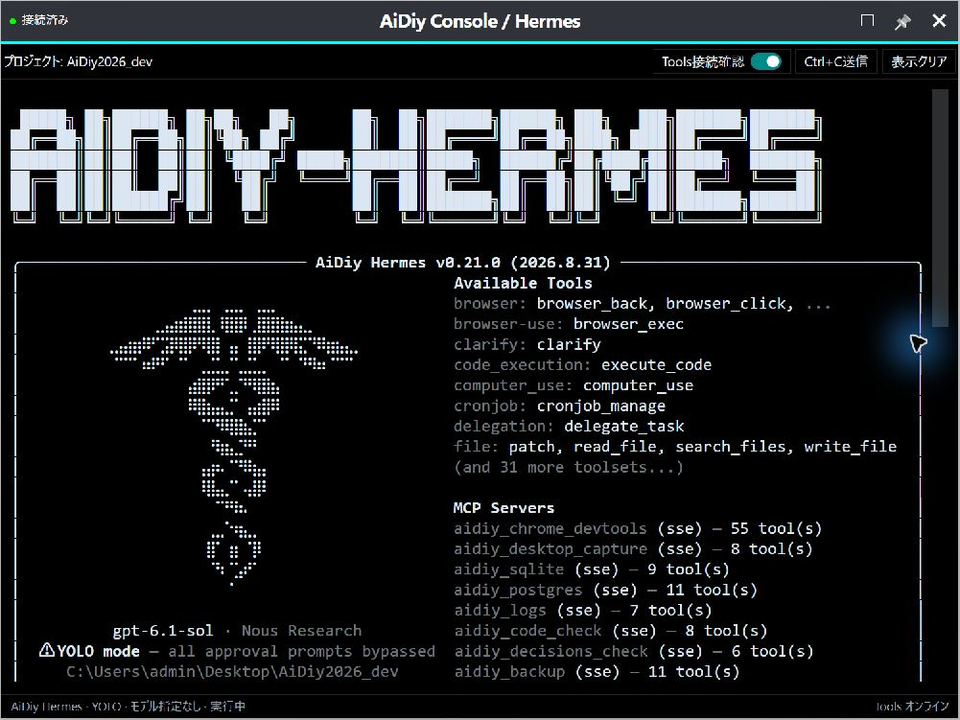

# AiDiy Console 操作編 — 操作ガイドとセルフテスト

## 総合評価

✅ OK（起動画面の確認範囲）。WindowsでDiagからConsoleとHermesを起動し、それぞれの画面表示を確認しています。Diagのランチャー編で撮影した2枚を掲載しています。CLIとの会話や個別機能の確認は、本書の判定に含めません。

[PDF版](./セルフテスト,aidiy_console,操作編.pdf)を参照できます。

## 始める前に

Diagで作業フォルダを選びます。起動ボタンの場所と表示切替は[ランチャー編](./セルフテスト,aidiy_diag,ランチャー編.md)を参照してください。起動先のConsoleでは、選んだプロジェクトのフォルダを使います。

## 1. Consoleを開く

1. Diagのランチャーで「Console」を押します。
2. 「AiDiy Console」が開いたら、上部のプロジェクト名と端末の作業パスを確認します。
3. プロンプトと入力カーソルが表示されれば、コマンドを入力できます。

Consoleが開き、選択した作業フォルダのPowerShellが入力待ちになりました。確認後、右上の「×」で閉じました。

**図101：Console起動画面**

## 2. DiagからCLIを開く（Hermesの例）

Diagは通常のConsoleに加え、CLIをConsole内で起動することもできます。ここではHermesを例にします。

1. Diagで作業フォルダを選び、「Hermes」を押します。
2. 「AiDiy Console / Hermes」が開き、Hermesの起動表示が出ることを確認します。
3. 起動情報が縦に長い場合は、端末を上へスクロールするとロゴと起動情報を確認できます。入力へ進むときは末尾へ戻します。

Hermesが選択プロジェクトのConsole内で起動しました。画面は先頭へスクロールした状態です。ロゴと起動情報を確認してから、右上の「×」で閉じました。

**図201：Hermes起動画面**

Hermesの会話・モデル・コマンドは[Hermes操作編](./セルフテスト,aidiy_hermes,操作編.md)で扱います。Mac／Linux実機と長時間連続運転は未実施・判定対象外です。
