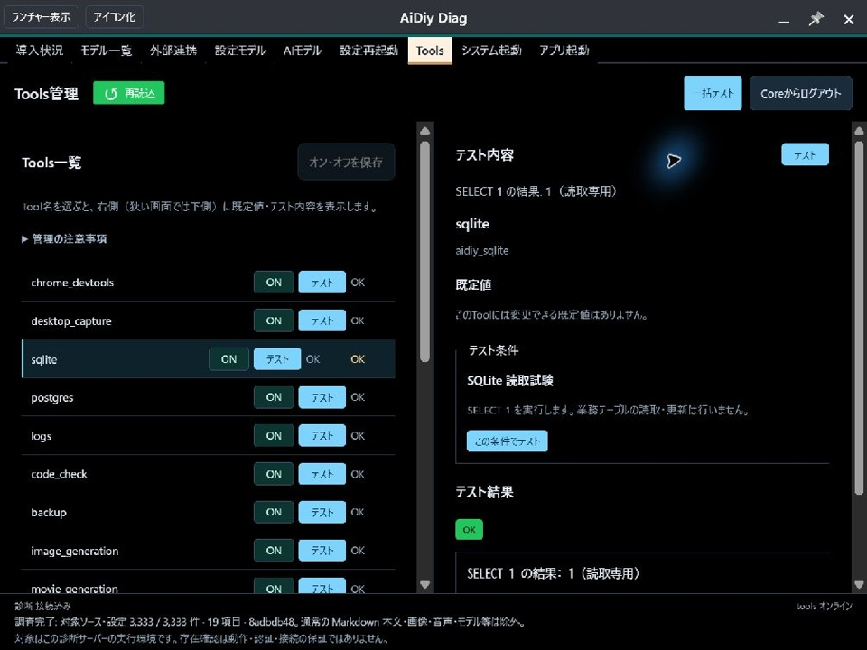
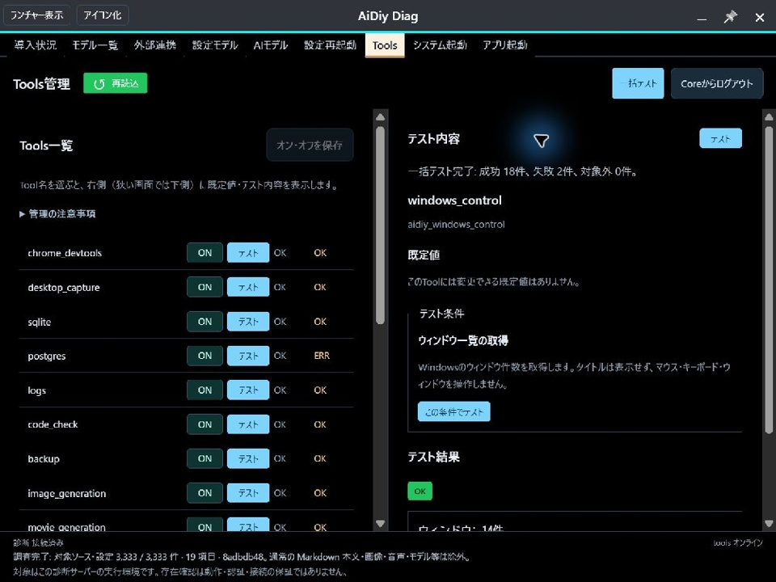
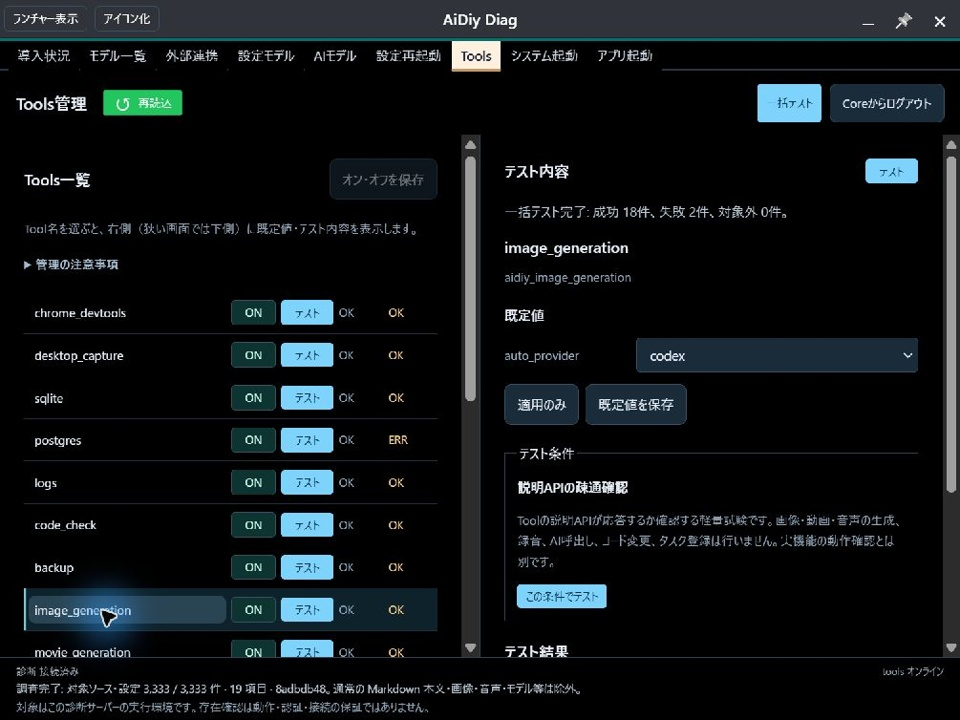

# aidiy_diag Tools編 — 操作ガイドとセルフテスト

> 文書: `セルフテスト,aidiy_diag,Tools編.md` | 実装: `backend_diag/ui/src/Tools/`, `backend_diag/Tools/代表試験.mjs`, `backend_diag/Tools/設定接続.mjs`

## 総合評価

**総合評価：OK（記載した確認範囲）。** 2026年10月31日04:30〜04:35（日本時間）、Windowsの開発PCでComputer Useによる実画面試験を実施しました。SQLiteの個別試験と20 Toolの一括実行・集計・失敗後の継続を確認しました。

一括テストの画面表示は**成功18件・失敗2件・対象外0件**です。失敗2件はPostgreSQLのDSN未設定とOBS接続拒否で、資料上はPASS（環境依存・判定対象外）とします。画面のERRを成功へ読み替えません。AI関連8件の成功は説明APIの疎通のみで、生成・認識・AI実行は未試験です。

隔離自動試験は81件成功しました。[PDF版](./セルフテスト,aidiy_diag,Tools編.pdf)を同じ内容で提供します。

## 1. 準備とログイン

[システム起動編](./セルフテスト,aidiy_diag,システム起動編.md)に従ってCore・Tools・Task / Teamを起動します。Diagの実装を更新した場合はDiagを再起動します。上部の「Tools」を開き、[共通の試験用アカウント](./セルフテスト,_説明資料の書き方.md#試験の準備と終了)でCoreへログインします。

一覧と右上の「一括テスト」が表示されれば準備完了です。認証欄やトークンは証跡に掲載しません。

| ケース | 確認すること | 結果 |
|---|---|---|
| DTOOLS-101 | ログイン後に登録済み20 Toolと一括テストを表示 | OK：実画面で確認 |

## 2. 個別に試験する

左の「sqlite」を選び、右の試験内容を確認して「この条件でテスト」を押します。今回の実施では同じ試験を呼ぶ左行の「テスト」を使用しました。結果がOKになり「SELECT 1 の結果: 1（読取専用）」と表示されれば成功です。

| ケース | 確認すること | 結果 |
|---|---|---|
| DTOOLS-201 | 個別のSQLite試験と結果表示 | OK：実画面で読取結果1を確認 |

SQLiteの個別試験後です。右側の試験結果と、左のsqlite行にOKが表示されています。

## 3. 一括テストする

右上の「一括テスト」を押します。有効で利用可能なToolを一覧順に試験し、個別に失敗しても次へ進みます。最後に成功・失敗・対象外件数が表示されます。左の状態はサービス状態と試験結果を別々に表示するため、サービスがOKでも試験がERRになることがあります。

| ケース | 確認すること | 結果 |
|---|---|---|
| DTOOLS-301 | 20 Toolの逐次実行と最終集計 | OK：18成功・2失敗・0対象外を表示 |
| DTOOLS-302 | 失敗しても後続を実行し、個別の理由を表示 | OK：PostgreSQL・OBSのERR後も最後まで実行。接続確認を促す案内を表示 |
| DTOOLS-303 | AI関連8 Toolは説明APIの疎通のみと明記 | OK：image_generationの実画面と8件の応答文で確認 |

Chromeは専用セッションを起動し、通知音の試験は短い音を再生します。生成・認識・AI実行は行いません。PostgreSQL・OBSなど任意サービスが未設定・未起動の場合は、画面の失敗を記録し、環境依存の対象外と実装不具合を分けて判定します。

### Toolごとの実施結果

以下は一括テストの最終結果です。ケースIDの枝番でToolごとの結果を分けます。PostgreSQL・OBSの理由は、既存APIの読み取り確認でも裏付けました。

| ケース | Tool | 確認内容 | 結果 |
|---|---|---|---|
| DTOOLS-301-01 | chrome_devtools | 専用Chromeの起動 | OK |
| DTOOLS-301-02 | desktop_capture | モニター情報 | OK |
| DTOOLS-301-03 | sqlite | 読取専用SELECT 1 | OK |
| DTOOLS-301-04 | postgres | 読取専用SELECT 1 | PASS（環境依存・判定対象外）：DSN未設定。画面はERR、実DB疎通は未確認 |
| DTOOLS-301-05 | logs | server/mcpのログ一覧件数 | OK |
| DTOOLS-301-06 | code_check | tools_main.pyの構文 | OK |
| DTOOLS-301-07 | backup | 差分スキャンのみ | OK |
| DTOOLS-301-08 | image_generation | 説明API | OK |
| DTOOLS-301-09 | movie_generation | 説明API | OK |
| DTOOLS-301-10 | speech_to_text | 説明API | OK |
| DTOOLS-301-11 | text_to_speech | 説明API | OK |
| DTOOLS-301-12 | obs_studio_control | シーン一覧 | PASS（環境依存・判定対象外）：OBS接続先が接続拒否。画面はERR、シーン取得は未確認 |
| DTOOLS-301-13 | ffmpeg_control | 0.1秒の無音処理 | OK |
| DTOOLS-301-14 | notification_sounds | legacy完了音の再生受付 | OK |
| DTOOLS-301-15 | code_agents | 説明API | OK |
| DTOOLS-301-16 | chat_llms | 説明API | OK |
| DTOOLS-301-17 | decisions_check | 説明API | OK |
| DTOOLS-301-18 | task_agents | 説明API | OK |
| DTOOLS-301-19 | team_agents | チーム要員一覧 | OK |
| DTOOLS-301-20 | windows_control | ウィンドウ一覧 | OK |

一括テスト完了後の画面です。成功18件・失敗2件の集計と、ログ一覧を含む各行の結果を確認できます。

画像生成の試験内容です。説明APIだけを確認し、生成やAI呼出しを行わないことが表示されています。

## 4. 中止・競合と片づけ

中止、二重実行、無効なToolの除外、認証期限切れ、ログアウト、切断、画面破棄は隔離自動試験で確認しました。ログ一覧のserver/mcp配列の合計と不正形式の拒否も確認しました。実画面で確認した範囲とは分けて記録します。試験後はChromeの項目で「専用ブラウザを終了」を押します。

| ケース | 確認すること | 結果 |
|---|---|---|
| DTOOLS-401 | 中止・除外・競合・認証・固定条件の回帰 | OK：隔離自動試験81件成功 |
| DTOOLS-402 | 試験専用Chromeセッションを終了 | OK：実画面で「専用ブラウザを終了しました。」を確認 |

Mac／Linux実機・長時間連続運転はPASS（環境依存・判定対象外）で未実施です。人による通知音の聴取、AI生成・認識・実タスク登録は判定対象外です。既定値・オンオフの保存は今回の試験範囲に含めません。
