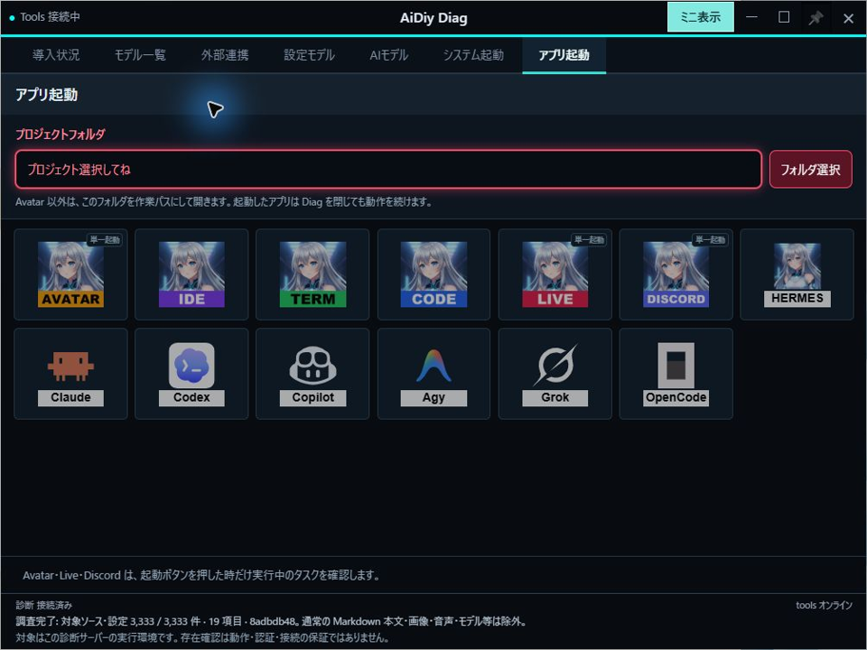
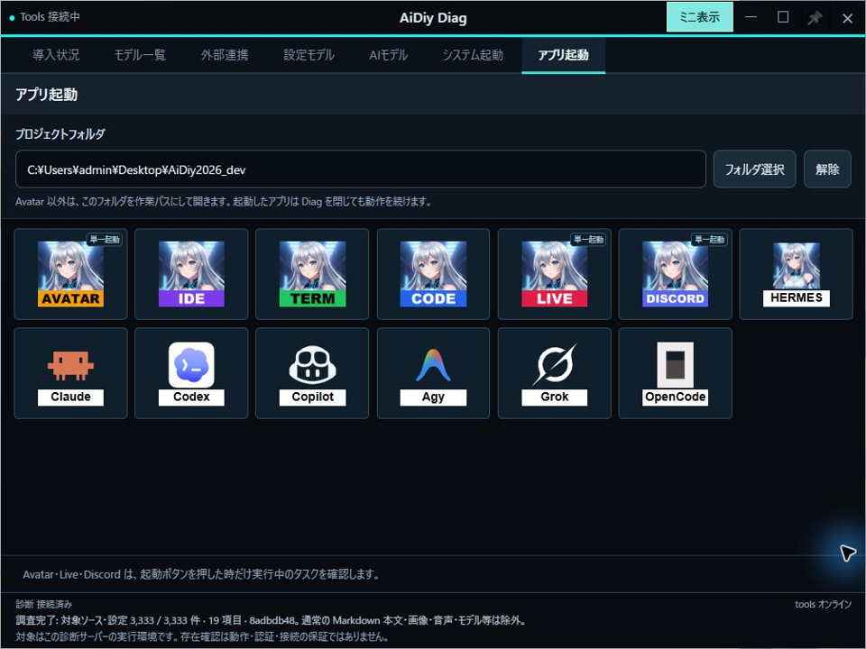
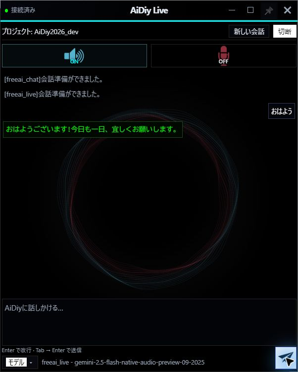

# aidiy_diag アプリ起動編 — 総合テストと操作手順書素材

> 文書: `セルフテスト,aidiy_diag,アプリ起動編.md` | 実装: `backend_diag/起動/アプリ起動.mjs`, `backend_diag/起動/CLI起動.mjs`, `backend_diag/ui/src/アプリ起動/`, `frontend_ide/aidiy_term/cli-launch.mjs`

## 総合評価

**総合評価：⏸ 一部実施・未実施あり。2026年10月20〜21日、Windowsの実フォームで確認し、本日の検証を終了しました。Code・Liveの短い挨拶への文字応答は成功しました。**

未実施・未測定のケースはそのまま残します。全件合格とはせず、PDFは未作成です。

| 確認範囲 | 現在の結果 |
|---|---|
| 通常運用の通し確認 | ルート選択、Avatar認証画面、IDE、Code、Live、Discordの実窓を確認。Code・Liveの文字応答はOK。Term・CLI・終了確認は残っています |
| 通し確認後の追加テスト | 合成自動試験を実施。実画面の重複起動・切断条件は未実施 |

過去のエビデンスはクリア済みです。以下は今回確認した結果だけを掲載します。未確認のケースは未実施のままとし、PDFは冊子全体の再試験通過後に作成します。対象はWindowsとし、Mac／Linuxの実機確認は別途推奨です。

## この冊子の進め方

**1〜5章が通常運用、6〜8章が追加テスト、9章が記録方法です。**

| 順番 | 操作の流れ |
|---|---|
| 1〜2章 | プロジェクトを選び、アプリを開く |
| 3章 | 接続したアプリで短い会話をする |
| 4〜5章 | ミニからアプリ・CLIを使い、使い終わった窓を閉じる |
| 6〜8章 | 選択の取消、表示条件、複数起動、切断、外部への投稿などを試す |

[システム起動編](./セルフテスト,aidiy_diag,システム起動編.md)で必要なサービスを起動しておきます。この冊子の通し確認中はDiagとサービスを動かしたままにします。アプリの独立動作を調べるためにDiagを先に閉じる試験は7章です。

今回のプロジェクトは、この作業コピーのルート `C:\Users\admin\Desktop\AiDiy2026_dev` を使用します（利用者指定）。プロジェクトとは、アプリへ渡す作業フォルダのことです。AI試験は「おはよう」程度の挨拶だけで、ファイル変更やコマンド実行は依頼しません。CLIボタンは確認ダイアログなしで自動承認モードのTermを開きます。CLI側のログイン・信頼確認は残る場合があります。

前半は章の順に操作し、各章の「成功の見分け方」で動作を確認します。取消・切断・連打・失敗条件の試験は後半にまとめています。通し確認中に予期しない問題が起きた場合は、その結果と先へ進めない範囲を記録します。環境不足を理由とする `PASS (別途環境調整必要)` と製品の不具合を分け、未実施を合格にはしません。

### ローカル試験用の利用者

この開発PCの既存試験用情報は、利用者ID `admin`、パスワード `********`（アスタリスク8文字）です。別の環境では、その環境の試験用アカウントを使用します。ログイン画面の入力値やJWTを画像・記録へ含めません。

Discordは接続パネルまでを基本範囲とします。メッセージ送信を試す場合は、今回の送信先と送信操作の許可を確認してから行います。過去の試験記録を今回の送信許可として扱いません。

## 1. プロジェクトを選ぶ

### 操作手順

1. Diagの上部にある「アプリ起動」を押します。未選択のプロジェクト欄は赤枠で、起動ボタンは無効です。
2. 「プロジェクトフォルダ」の右にある「フォルダ選択」を押します。
3. ElectronではOSのダイアログで作業フォルダを選び、確定します。Web表示では診断サーバー側のフォルダ一覧から選び、「このフォルダを選択」を押します。
4. Diagの欄に表示されたパスが、選んだ場所と一致することを確認します。

### 成功の見分け方

選択したパスが表示され、6アプリと導入済みCLIの起動ボタンが有効になれば完了です。通常画面には未導入も含めて7CLIを表示し、未導入のものは押せません。次は2章でアプリを開きます。

| ケース | 確認すること | 結果 |
|---|---|---|
| APP-101 | 未選択時の通常欄が赤枠になり、アプリ・CLIの起動が無効 | ✅ OK：赤枠・全起動ボタン無効を確認 |
| APP-102 | 通常画面は6アプリ＋7CLI。72pxのアイコン内に名称があり、別名ラベルを重ねない | ✅ OK：実フォームと合成UI試験で確認 |

未選択では欄が赤くなり、6アプリと7CLIの起動ボタンは押せません。

OSのフォルダ選択ダイアログで、利用者指定の作業コピールートを選びました。欄のパスが一致し、各起動ボタンが有効になりました。

## 2. アプリを開いて接続する

### 操作手順

1. 通常画面で、使いたいアプリのアイコンを1回押します。
2. 「起動確認中…」の間は待ち、対象の窓が実際に開いたことを確認します。起動受付や成功の通知は表示されません。
3. 下の表に沿って、開いた窓と作業フォルダ・接続状態を確認します。6アプリをそれぞれ一度ずつ開き、対象別に結果を記録します。

| アプリ | 開いた後に見るところ |
|---|---|
| Avatar | 認証画面。Avatarは選択フォルダではなくAiDiy本体を作業パスに使います |
| IDE | 選択プロジェクトの利用開始画面 |
| Term | 選択プロジェクトでコマンドを入力する端末の待機表示 |
| Code | 選択プロジェクトと接続状態 |
| Live | 選択プロジェクトと接続状態 |
| Discord | 選択プロジェクトと接続パネル |

### 成功の見分け方

各アプリの実窓が開き、対象のフォルダや接続が確認できれば起動確認は完了です。AIの回答は次の3章で確認します。Avatar・Live・Discordは単一起動ですが、重複を試す操作は7章で行います。

| ケース | 確認すること | 結果 |
|---|---|---|
| APP-201 | Avatarの実窓と認証画面、AiDiy本体の作業パス | ✅ OK：実認証フォームを確認。起動時の作業パスも照合 |
| APP-202 | IDEの実窓と選択プロジェクトの利用開始画面 | ✅ OK：ルートを引き継いだ利用開始画面を確認 |
| APP-203 | Termの実窓と選択プロジェクトの入力待ち | ⏸ 未実施 |
| APP-204 | Codeの実窓、選択プロジェクト、接続状態 | ✅ OK：AiDiy2026_dev・接続済みを確認 |
| APP-205 | Liveの実窓、選択プロジェクト、接続状態 | ✅ OK：AiDiy2026_dev・接続済み・会話準備完了を確認 |
| APP-206 | Discordの実窓、選択プロジェクト、接続状態 | ✅ OK：ルートを引き継いだ実窓と初期の未接続表示を確認 |

Avatarは利用者認証フォームまで開きました。認証送信後の確認は未実施です。

IDEは「プロジェクト: AiDiy2026_dev」を引き継いだ利用開始画面が開きました。

Codeはルートプロジェクトで自動接続し、検証回数0回の入力待ちになりました。

Liveも同じプロジェクトで開きました。接続後の準備完了と初回送信は次章で確認しています。

2026年10月21日、Discordも同じルートで開きました。プロジェクト名、未接続の初期状態、音声・コード設定の表示を確認しました。Discordへの接続操作・投稿は行っていません。

## 3. Code・Liveで短い会話をする

### 操作手順

1. Codeの準備完了を確認し、入力欄へ次の文を入れて送信します。

> おはよう。稼働試験です。挨拶を一文だけ返してください。ファイル変更やコマンド実行はしないでください。

2. 自分の送信文とは別に、AIから新しい返答が出るまで待ちます。プロバイダ・モデルと返答を記録します。
3. Liveでは接続・準備完了を確認して15秒待ち、「おはよう」を初めて送信します。送信後は最大60秒を観測します。この観測が終わるまで、別の確認処理へ移りません。
4. 準備完了・送信・返答確認の時刻を記録します。音声がある場合は、文字の返答と音声の再生・聴取を分けて記録します。

### 成功の見分け方

自分の入力とは別のAI回答が出れば応答確認ができます。空白だけ、`!`だけ、`!`で始まる回答は正常応答にしません。実際に15秒待った場合は `※注意:15s待機後送信しました。` と記録します。

単独Liveでは利用者が待ちます。Diagの設定モデル・AIモデルの試行は自動待機なので区別します。次は4章でミニ表示とCLIを使います。

| ケース | 確認すること | 結果 |
|---|---|---|
| APP-301 | Codeの短い挨拶に実回答が出る | ✅ OK：grok_cli / grok-4.7から短い挨拶を受信 |
| APP-302 | 単独Liveの新規接続で15秒待機後の初回送信に実回答が出る | ✅ OK：新規接続後15秒以上待ち、初回の「おはよう」に60秒以内の文字応答を確認 |

Codeには「おはよう。挨拶を一文だけ返してください。ファイル変更やコマンド実行はしないでください。」と送りました。`grok_cli / grok-4.7` から「おはようございます。今日もよい一日になりますように。」と返答が出ました。

Liveは `freeai_live / gemini-2.5-flash-native-audio-preview-09-2025` を使用しました。2026年10月21日04:37:38に接続済み・会話準備完了を記録し、04:38:01に初回の「おはよう」を送信しました。15秒の待機を実行し、操作時間を含む送信前の実測待機は約23秒です。送信後約30秒の確認で「おはようございます!今日も一日、宜しくお願いします。」と表示されました。最大60秒の観測枠内の文字応答はOKです。音声の聴取は未実施です。

※注意:15s待機後送信しました。

## 4. ミニ表示からアプリ・CLIを使う

### 操作手順

1. Diagへ戻り、タイトルバーの「ミニ表示」を押します。選択したプロジェクトのパスが引き継がれます。
2. 上段に6アプリと導入済みHermes、次の段に導入済みの外部CLIが並ぶことを確認します。アイコンにポインターを合わせると名前が分かります。
3. アプリの操作を終えて窓を閉じた対象を、ミニのアイコンから開きます。通常画面と同じ対象・プロジェクトで開けば確認できます。単一起動のアプリを重ねて起動する操作は7章で試します。
4. 導入済みのHermesまたは外部CLIを1回押します。選択プロジェクトのTermが開き、その中でCLIが始まるまで待ちます。
5. CLIの入力待ちを確認したら、その窓を閉じて次の導入済みCLIへ進みます。通常画面からの起動も同じように確認し、対象と起動元を分けて記録します。
6. ミニの↗を押し、元の通常画面へ戻ります。

### 成功の見分け方

選択したプロジェクトを引き継いで実窓が開き、CLI自身の入力待ちまで進めば確認できます。Termが開いたこととCLIの準備完了は別に見ます。モデルはCLIの既定設定を使います。

未導入のCLIは実起動成功に数えず、名前と環境条件を記録します。起動中もミニのパス表示が保たれ、通知行で高さが変わらないことを確認します。使い終わったら5章へ進みます。

| ケース | 確認すること | 結果 |
|---|---|---|
| APP-401 | ミニは導入済みCLIのみ。Hermesは上段、外部CLIは次の段に中央寄せ | ⏸ 未実施 |
| APP-402 | aidiy_hermes：通常・ミニの上段から起動 | ⏸ 未実施 |
| APP-403 | copilot：通常・ミニから起動 | ⏸ 未実施 |
| APP-404 | codex：通常・ミニから起動 | ⏸ 未実施 |
| APP-405 | claude：通常・ミニから起動 | ⏸ 未実施 |
| APP-406 | agy（Antigravity）：通常・ミニから起動 | ⏸ 未実施 |
| APP-407 | grok：通常・ミニから起動 | ⏸ 未実施 |
| APP-408 | opencode：通常・ミニから起動 | ⏸ 未実施 |

## 5. 使い終わったアプリを閉じる

### 操作手順

1. 開いたアプリの作業を保存し、それぞれの終了操作で窓を閉じます。
2. TermとCLIも窓ごとに閉じます。1つを閉じたことで、まだ使っている別の窓が終了していないことを確認します。
3. 試験で開いた窓が残っていないことを確認します。Diagとサービスはこの章では動かしたままです。
4. システムも使い終わった場合は[システム起動編6章](./セルフテスト,aidiy_diag,システム起動編.md#6-システムを停止してdiagを閉じる)で停止します。

### 成功の見分け方

選択・起動・簡単な利用・個別終了までできれば、アプリ起動の通常運用は完了です。6章以降は改めて必要な窓を開いて試します。

**通常運用の通し確認結果：⏸ 未実施。** 各アプリ・CLIの実施範囲と、確認できなかった環境条件をまとめます。

| ケース | 確認すること | 結果 |
|---|---|---|
| APP-501 | 個別終了で他の窓を止めず、対象の所有プロセスを回収する | ⏸ 未実施 |

## 6. 追加テスト：フォルダ選択・表示条件

1. プロジェクトの「解除」、フォルダ選択の「キャンセル」、選び直しを順に試します。通常・ミニでの共有、Diag再起動・再読込での未選択を確認します。
2. 日本語・空白・記号付きパスを選び、渡された作業パスを照合します。存在しないパスやファイル指定は隔離した入力条件で試します。
3. ミニの未選択案内「SELECT YOUR PROJECT ▸▸ READY FOR LAUNCH」を押し、通常のアプリ起動へ戻ることを確認します。
4. 外部CLIが0件・一部・全件の表示を合成一覧でも試し、幅384px、名称込み40pxアイコン、サービス6件の1行表示と内容高を確認します。
5. 表示・再接続だけで起動しないこと、↗とサービス名の戻り先、ピンの保持を確認します。

各条件を試した後は通常のプロジェクト選択へ戻します。窓の長押し移動と演出の詳細は[システム起動編8章](./セルフテスト,aidiy_diag,システム起動編.md#8-追加テスト窓操作表示アニメーション)で確認します。

| ケース | 確認すること | 結果 |
|---|---|---|
| APP-601 | Electron／Webの選択・取消・解除が働き、選んだ絶対パスが表示される | ⏸ 未実施 |
| APP-602 | 日本語・空白・記号付きパスが正しく渡る。共有CODE_BASE_PATHを変更しない | ⏸ 未実施 |
| APP-603 | 通常／ミニで選択共有。再起動・再読込で未選択になる | ⏸ 未実施 |
| APP-604 | 存在しないパス・ファイル指定を拒否し、起動しない | ⏸ 未実施 |
| APP-605 | ミニの名称込みアイコンが40px、サービス6件が1行。幅384pxで欠けず、内容高に追従 | ⏸ 未実施 |
| APP-606 | 未選択の英語案内からアプリ起動へ戻る。選択後はパスを表示 | ⏸ 未実施 |
| APP-607 | 表示・再接続は存在確認だけ。CLI起動やログイン、導入は自動実行しない | ⏸ 未実施 |
| APP-608 | ↗は元のタブへ、サービス名はログへ復帰。ピン初期OFFと選択保持 | ⏸ 未実施 |

## 7. 追加テスト：重複起動・並行動作・切断

1. Avatar・Live・Discordの起動ボタンを再度押し、同じ窓が増えないことを確認します。「起動済みです」という通知は表示されません。
2. IDE・Code・Termは同じプロジェクトで追加の窓を開きます。
3. 同じCLI・同じプロジェクトを、先の起動中にも押して複数のTermを開きます。別CLIとの同時起動も確認します。
4. 一方の終了・起動失敗・端末切断を試し、他の窓が継続することを確認します。失敗条件と30秒の接続待ち条件は隔離試験で作れます。
5. 最後にアプリを残してDiagを終了し、独立した窓が残ることを確認します。Coreなどの停止による接続断と、アプリ自身の終了を区別します。
6. 残した試験用の窓を個別に閉じ、対象の所有プロセスが回収されたことを確認します。

通常画面は処理中・エラーを確認する場所です。ミニでは一時通知を追加せず、起動中もプロジェクト表示を保ちます。エラーは通常へ戻って確認します。

| ケース | 確認すること | 結果 |
|---|---|---|
| APP-701 | Avatar・Live・Discordの単一起動。確認失敗時も追加起動しない | ⏸ 未実施 |
| APP-702 | IDE・Code・Termの同一プロジェクトでの別窓起動 | ⏸ 未実施 |
| APP-703 | 通常は処理中・エラーのみ、ミニは一時通知なし。起動確認ダイアログなし | ⏸ 未実施 |
| APP-704 | 同一CLI・同一プロジェクトの連続／同時起動で独立したTermが増える | ⏸ 未実施 |
| APP-705 | 別CLIの並行起動、一方の終了・起動失敗で他方に影響しない | ⏸ 未実施 |
| APP-706 | 再接続だけではCLIを再起動しない。未導入・未選択では起動要求を送らない | ⏸ 未実施 |
| APP-707 | 最後の有効端末接続から30秒の切断、または表示後30秒の初回接続なしで、そのTermの所有プロセスだけ終了 | ⏸ 未実施 |
| APP-708 | Diag終了後も6アプリとCLIのTermが独立して残る | ⏸ 一部確認：Avatar・IDE・Code・Liveの実窓が残存。Discord・Term・CLIは未確認 |

## 8. 追加テスト：Avatarの認証後操作・Discord投稿

1. Avatarの認証画面で試験用利用者としてログインし、3章と同じ短い挨拶を送ります。ElectronとWebのどちらで試したか記録します。
2. Discord投稿を試す場合は今回の送信先と送信操作の許可を確認し、指定したチャンネルで試験投稿と返答を照合します。
3. 自分の送信文、AIの回答、音声通話の成否を分けて記録します。接続パネルが開いただけでは投稿・会話の成功にしません。

Avatarの詳細は[Electron実行編](./セルフテスト,aidiy_avatar,Electron実行編.md)・[Web実行編](./セルフテスト,aidiy_avatar,Web実行編.md)、IDEを開いた後の操作は[IDE操作編](./セルフテスト,aidiy_ide,操作編.md)を参照します。

| ケース | 確認すること | 結果 |
|---|---|---|
| APP-801 | Avatarの認証後の簡易応答。Electron／Webを区別して記録 | ⏸ 未実施 |
| APP-802 | Discordへの試験投稿は送信先・許可がある場合のみ実施し、投稿・応答を照合 | ⏸ 未実施 |

## 9. 試験の記録方法

各章の操作を実施したら、操作直後の画面と実際の結果を記録します。前半の通常運用と後半の追加テストを別に集計し、先頭の総合評価も更新します。

ケース番号は今回の章番号に合わせて採番しています。複数の対象・条件は枝番で分け、一つの成功で全体を合格にしません。画像の先頭1桁も掲載する章番号に合わせます。撮影後に章を移した場合は、ファイル名・説明・参照も揃えます。

実施日時・対象・プロジェクト・操作・期待結果・実際の結果・判定を記録します。通常／ミニ、実機／合成、各アプリ／各CLIを枝番で分けます。起動要求の受付だけで成功にせず、実窓とCLI自身の状態を確認します。

画像は `_AIDIY/knowledge/images/セルフテスト,aidiy_diag,アプリ起動編/` に、`<実施ID>__aidiy_diag-アプリ起動_401_Hermes起動画面.png` の形式で保存します。画像の直前に説明を添えます。確認済み画像は本文に掲載し、PDFは冊子全体の通過前のため未作成です。

自動試験の入口は `backend_diag/checks/app-launch.check.mjs`、`app-launch-state.check.mjs`、`cli-launch.check.mjs`、`cli-launch-state.check.mjs`、`mini-cli-ui.check.cjs`、`full-launch-controls.check.cjs`、`frontend_ide/checks/project-instance.test.mjs` とCLI／端末の `cli-parallel-lifecycle.test.mjs` です。ブラウザの合成起動確認は `backend_diag/checks/app-launch-browser.mjs` を使います。実CLI・有料APIの結果へ置き換えません。

2026年10月21日、Discordの型検査と配布パネルの整合性確認が通過しました。ローカルREST・Gateway・音声WSS等の合成ネットワーク試験も単独再実行で通過しました。Discordへの投稿・実音声会話を行った結果ではありません。

記録・判定・PDF作成は[説明資料の書き方](./セルテスト,_説明資料の書き方.md)に従います。
