# aidiy_diag アプリ起動編 — 総合テストと操作手順書素材

> 文書: `セルフテスト,aidiy_diag,アプリ起動編.md` | 実装: `backend_diag/起動/アプリ起動.mjs`, `backend_diag/ui/src/アプリ起動/`

## 総合評価

**総合評価：✅ OK (PASS 0件含む)。6アプリの起動・簡易応答・独立動作を確認しました。**（2026年10月19日・Windows）

先にシステムを起動し、作業するフォルダを選んでから、使いたいアプリを開く流れです。

| 知りたいこと | 現在の結果 |
|---|---|
| フォルダを選んでアプリを開ける？ | ✅ OK：Avatar・IDE・Term・Code・Live・Discordの画面が開きました。フォルダ未選択では起動できないことも確認しました。 |
| 会話や二重起動の防止は？ | ✅ OK：Code・Liveから挨拶の返答がありました。Avatar・Live・Discordの重複起動も防げました。 |
| 追加確認は終わった？ | ✅ OK：Avatarはブラウザ経路で認証後の挨拶、Discordは実AI回答の投稿と再取得を確認しました。アプリ側のミニ表示と、Diag終了後の6アプリ継続も確認しました。 |

Liveは準備完了後、最初の送信まで15秒待ち、送信後は最大60秒待ちます。別冊のWeb／Avatarでは、この条件で初回の返答を確認しました。単独Liveの本冊の記録は、4章に示す約80秒待機の試験です。本冊は起動と簡単な稼働確認の試験です。AvatarのElectron内での認証・会話は、別途実施した[Electron実行編](./セルフテスト,aidiy_avatar,Electron実行編.md)を参照します。ブラウザでの確認は[Web実行編](./セルフテスト,aidiy_avatar,Web実行編.md)にあります。Discordの人の投稿を受けた自動返信・音声通話は、本冊では確認していません。[PDF版](./セルフテスト,aidiy_diag,アプリ起動編.pdf)を作成しました。Mac／Linuxの実機確認は別途推奨です。

PDF版は本文に合わせて再生成し、全ページの日本語・表・画像・改ページを目視確認しました。

### ローカル試験用の利用者

利用者IDは `admin`、パスワードは `********`（アスタリスク8文字）です。利用者の許可を受けた、この開発PCの試験用情報です。Avatarのログイン後に、短い挨拶で返答を確認します。Discordは、設定済みのクリエイター側の接続先へのテスト送信を利用者から許可されています。接続先を変える場合は、送信先と許可を改めて確認します。

## この冊子の進め方

この冊子では、作業するフォルダを選び、使いたいアプリを開いて簡単な返答まで確認します。先に[システム起動編](./セルフテスト,aidiy_diag,システム起動編.md)で5機能を起動してから始めます。起動手順は前の冊子にまとめています。

「プロジェクト」は作業フォルダです。画面には自分が選んだフォルダが表示されます。試験画像は[今回の保存先](./images/セルフテスト,aidiy_diag,アプリ起動編/)にあります。

| アプリ名 | 何に使うか |
|---|---|
| Avatar | アバターと会話する画面です。 |
| IDE | フォルダやファイルを見ながら、AIと作業する画面です。 |
| Term | 文字のコマンドを入力する端末です。この試験では起動した表示だけを確認します。 |
| Code | AIへコードに関する依頼を送る画面です。 |
| Live | AIと音声・文字で会話する画面です。 |
| Discord | DiscordのBot（自動応答するプログラム）を接続する画面です。 |

1章から順に進みます。**✅ OK** は確認済み、**⏸ 未実施** は未確認です。IDEを開いた後は[IDE操作編](./セルフテスト,aidiy_ide,操作編.md)へ進みます。

## 1. プロジェクトを選ぶ

### 操作手順

1. Diagの通常画面で、上部の「アプリ起動」を押します。
2. 「プロジェクトフォルダ」の右側にある「フォルダ選択」を押します。
3. 作業フォルダを選んで確定します。
4. Diagに表示された場所（パス）が、選んだフォルダと一致するか確認します。
5. 起動ボタンが有効になれば完了です。違っていれば「フォルダ選択」で選び直します。

赤字の英語「SELECT YOUR PROJECT ▸▸ READY FOR LAUNCH」が流れている間は、アプリを起動できません（2026年10月19日の画面変更前は「プロジェクト選択してね」の固定表示でした）。Diagを起動し直したときは、毎回フォルダを選びます。

### 成功の見分け方

選択後に6種類のボタンが有効になれば正常です。Avatar以外は選んだフォルダで開きます。

### 今回の結果と画面

**✅ OK**：システム起動後に「アプリ起動」を開きました。フォルダを選ぶ前は6ボタンを押せず、選んだ後は選択場所が表示され、ボタンを押せる状態になりました。

フォルダ選択前の画面です。6種類の起動ボタンは押せない状態です。

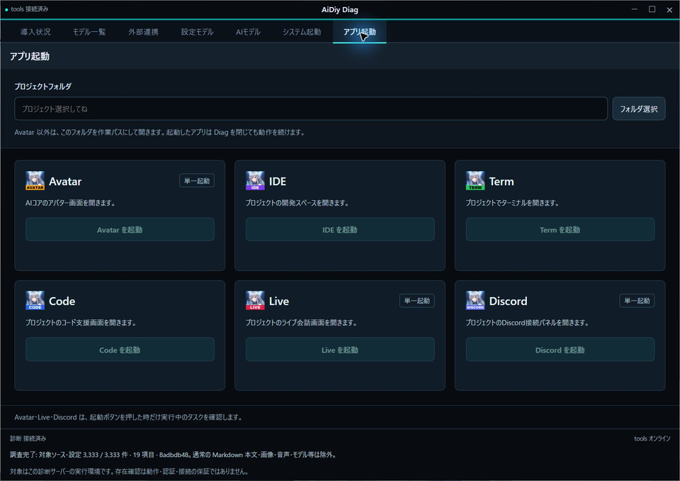

作業フォルダを指定している場面です。今回使うフォルダを選びます。

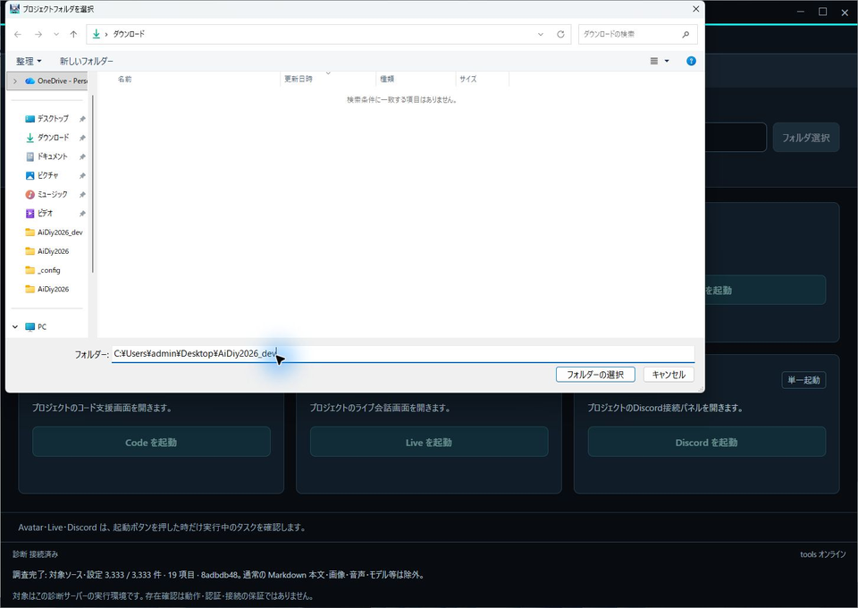

フォルダ選択後の画面です。選択したパスが表示され、起動ボタンが有効になりました。

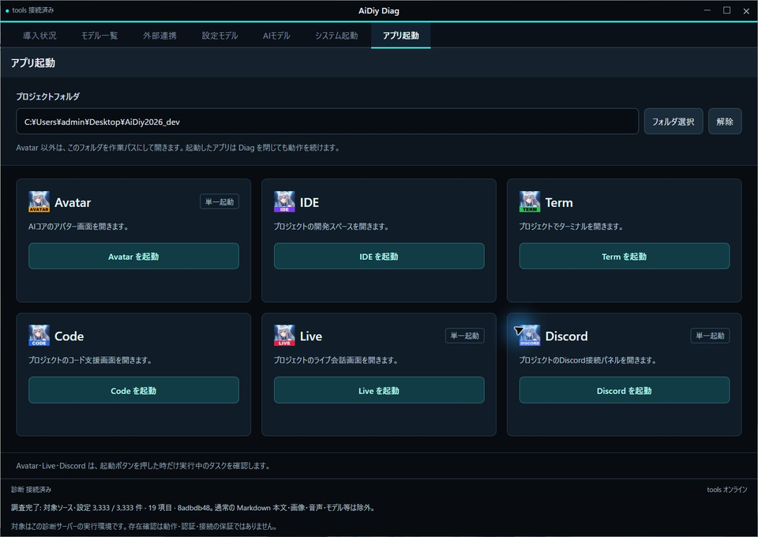

## 2. ミニパネルに切り替える

### 操作手順

1. 「アプリ起動」または「システム起動」の右上にある「ミニ表示」を押します。
2. 小さなウィンドウの上段に、6種類のアプリアイコンがあることを確認します。アイコンの上にマウスポインターを置くと、アプリ名を確認できます。
3. 使いたいアイコンを押すと、そのアプリが開きます。次章で1つずつ試します。
4. 元の大きな画面へ戻るには、タイトルバーの復帰ボタンを押します。下段の機能名を押した場合は、その機能のログ画面へ戻ります。

フォルダをまだ選んでいない場合は、赤字の英語「SELECT YOUR PROJECT ▸▸ READY FOR LAUNCH」が右から左へ流れ、アイコンを押せません。通常画面へ戻り、1章でフォルダを選んでください。

### 成功の見分け方

選んだフォルダを引き継いだ小さな表示になり、上段に6アイコン、下段にシステムの状態が出れば、表示切替の確認ができます。色の見方はシステム起動編3章を参照してください。

細かな動きの試験では、画面左上でほかのウィンドウより手前に出るか、表示開始時の拡大が滑らかか、0.5秒押したままにすると移動できるかも調べます。透明な領域を先に確保する仕組みも含め、動きや時間は画像1枚だけでは判定しません。

### 今回の結果と画面

**✅ OK（表示）**：選んだフォルダと6アイコンが、小型パネルにも表示されました。起動した5機能は緑、起動しなかったLocalは灰色でした。

選択後のミニ表示です。上段のアプリアイコンと、下段のシステム状態を確認しています。

**✅ OK（共通処理の追加試験）**：同じDiagのミニ表示を使い、0.5秒長押し、透明領域内での750 msの開始ズーム、約5秒のポート状態更新を確認しました。実Electronでの長押し検出は約530 ms、400 msでは移動しませんでした。ズーム中もウィンドウの領域は固定されていました。計測方法と画面は[システム起動編3章](./セルフテスト,aidiy_diag,システム起動編.md#3-ミニパネルでサーバー状態を見る)にまとめています。

### アプリ起動側のボタンも実画面で確認

**✅ OK**：アプリ起動からミニへ切り替え、タイトルバーの復帰ボタンで同じアプリ起動画面へ戻れました。サービス名からはシステム起動のログへ移ります。フォルダ選択の保持と6アイコンからの起動は、隔離ブラウザでも確認しました。

新しく追加した右上の「ミニ表示」です。アプリ起動画面から直接切り替えられます。

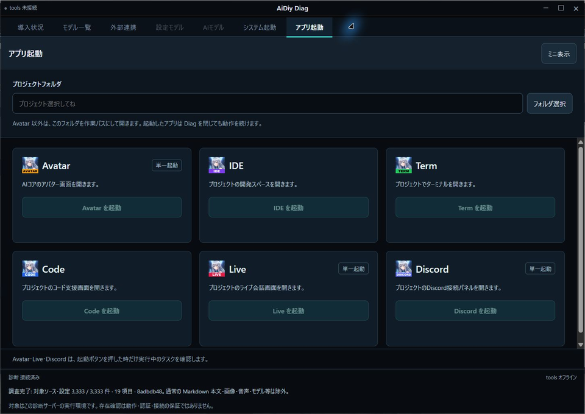

ミニ表示へ切り替えた画面です。フォルダ未選択なので、赤い案内と押せない6アイコンが出ています。

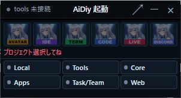

プロジェクトを選んだ後のミニ表示です。6アイコンが有効になり、下段に5サービスの稼働が緑で表示されました。

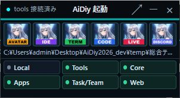

## 3. 各アプリを開く

### 操作手順

1. 6種類のアイコンを1つずつ押します。通常画面の「○○を起動」ボタンでも開けます。
2. 「起動を要求しました」の後、アプリのウィンドウが開くまで待ちます。
3. 開いたアプリ名と、表示される作業フォルダを確認します。
4. Avatar、Live、Discordは同じアイコンをもう一度押します。「起動済みです」となり、同じアプリが二重に増えなければ正常です。

AvatarはAiDiy本体、ほかの5種類は選択フォルダを使います。Avatarの起動確認はログイン画面まで、会話試験はログイン後に行います。

### 成功の見分け方

「起動を要求しました」の後に、対象アプリのウィンドウが実際に開くことが成功の目印です。Avatar・Live・Discordの重複確認は、起動ボタンを押したときに行います。開いたアプリはDiagを閉じても動き続けます。

### 今回の結果と画面

| 対象 | 最終結果 |
|---|---|
| Term | **✅ OK**: 選択したプロジェクトでウィンドウと、文字を入力できる待機表示を確認しました |
| Code | **✅ OK**: 配布ファイルを生成し直した後、ウィンドウと「接続済み」を確認しました |
| Avatar | **✅ OK（起動）**: ログイン画面が開きました。会話は4章のブラウザ経路で確認しました |
| Live | **✅ OK（起動・接続）**: ウィンドウ、選んだフォルダ、「接続済み」を確認しました |
| Discord | **✅ OK（起動・接続）**: 会話用の必要プログラムをそろえた後、ウィンドウと「接続済み」を確認しました。文字会話はON、音声会話はOFFでした |
| IDE | **✅ OK（起動）**: 同じプロジェクトの利用開始画面を表示。以後は別冊IDE操作編 |

起動したTermです。選んだフォルダで、端末の入力待ち表示が出ています。

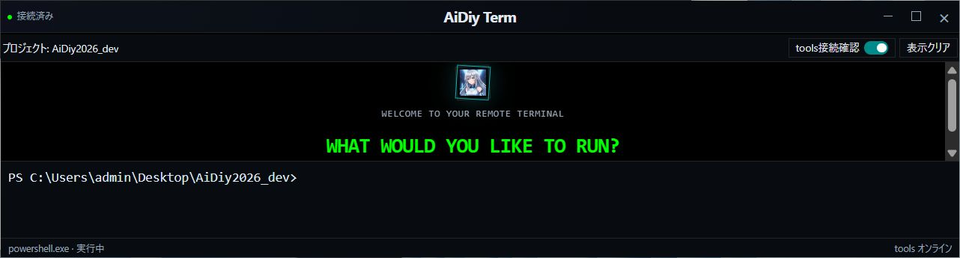

起動したCodeです。ウィンドウが開き、「接続済み」と表示されました。

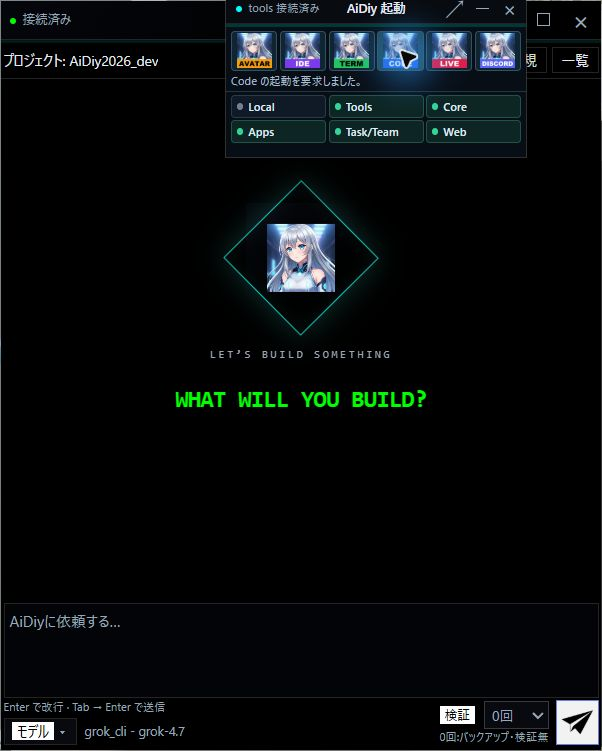

Avatarのログイン画面です。起動は確認できましたが、会話はログイン後に試します。

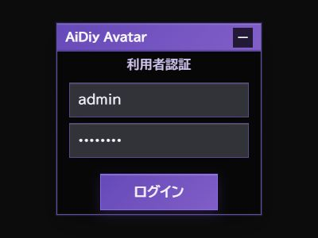

起動したLiveです。選択したプロジェクトと接続状態を確認しています。

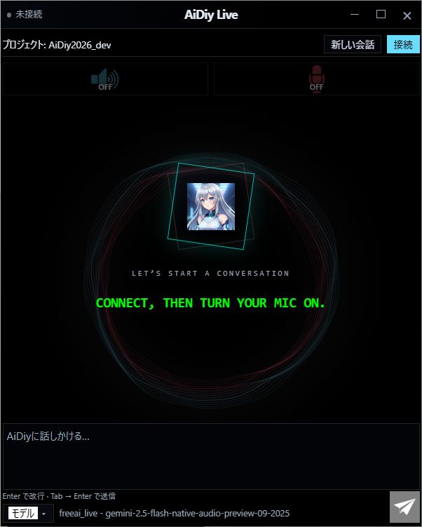

IDEの利用開始画面です。この後の操作は、別冊のIDE操作編に続きます。

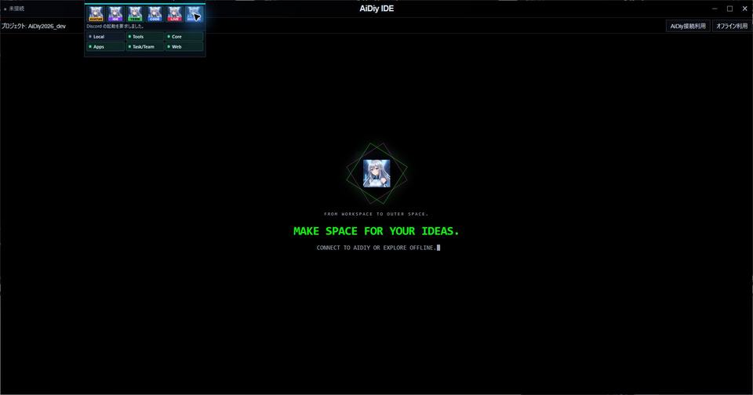

Discordの接続画面です。接続済みで、文字会話はON、音声会話はOFFです。

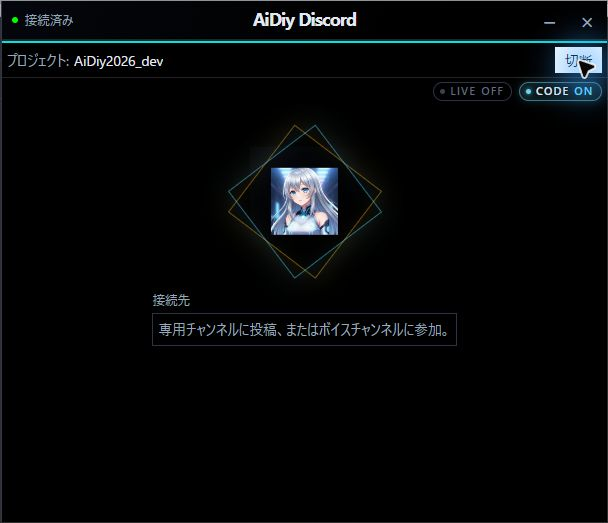

**✅ OK（二重起動の防止）**：Avatar・Live・Discordのアイコンをもう一度押すと、「起動済みです」と出ました。新しい同じ窓は増えず、すでに開いていた窓を使えました。

Avatarの起動ボタンを再度押した結果です。「起動済みです」となり、同じ窓は増えませんでした。

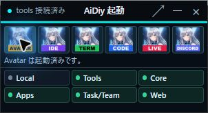

Liveの起動ボタンを再度押した結果です。既存のLiveを維持し、重複起動を防げました。

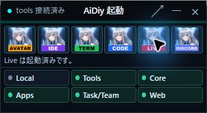

Discordの起動ボタンを再度押した結果です。同じDiscordの窓は増えませんでした。

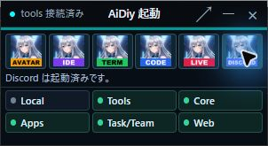

## 4. 簡単な挨拶で応答を確認する

### 操作手順

1. CodeまたはLiveのウィンドウを開き、「接続済み」などの準備完了表示を確認します。使うAIのモデル名（AIの種類）は、今回の設定をそのまま使います。
2. Liveでは準備完了後、最初の送信まで15秒程度待ちます。「新しい会話」や再接続をした場合も、最初の送信前に待ちます。同じ会話の2回目以降はこの待機は不要です。
3. 会話の入力欄に、次の文を入力して送信します。

> おはよう。稼働試験です。挨拶を一文だけ返してください。ファイル変更やコマンド実行はしないでください。

4. 自分の入力が表示されたことを確認し、続いてAIの返答を待ちます。長い返答は時間がかかるため、途中でボタンを連打せず、進行表示やエラーを見ながら待ちます。
5. 「おはようございます」など、AI側の新しい返答が出たら、画面と回答を記録します。自分の送信文が表示されただけでは、応答確認の合格にしません。
6. Liveでは準備完了・送信・返答確認の時刻も記録します。Avatarの会話はログイン後、Discordの投稿は送信先のチャンネルを決めてから、それぞれ別に試します。

単独Liveの文字による返答を確認しました。Diagの「設定モデル」「AIモデル」で試す場合の15秒待機は自動です。この章の単独アプリでは自分で待ちます。

### 成功の見分け方

自分の送信文とは別に、AIの返答が出ることが成功の目印です。返答が出なかった場合は、待った時間とエラーを記録し、条件を整えて再試験します。Termは端末なのでAIへの挨拶は送りません。ログインが必要な場合は人が操作し、その先を試せていなければ未実施と記録します。

### 今回の結果と画面

**✅ OK（Code）**：挨拶を送ると、AIから「おはようございます。稼働試験、問題なく応答できています。」と返答がありました。今回使った接続方法とモデルは `grok_cli / grok-4.7` です。

Codeに挨拶を送った結果です。入力文とは別に、AIからの返答が表示されています。

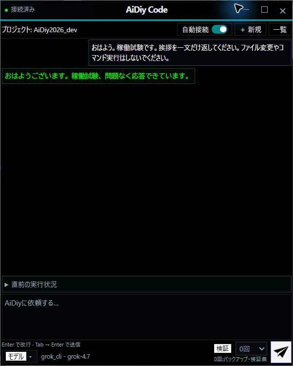

**✅ OK（Live）**：「新しい会話」で会話を作り直し、準備完了から約80秒待って挨拶を送りました。「おはようございます！」という返答がありました。今回はマイクをOFFにして、文字で試しています。

試験時刻は、準備完了10:19:29、送信10:20:49です。待機時間は80.424秒でした。

Liveで初回の待機後に挨拶を入力した画面です。この入力に対する返答を次の画面で確認します。

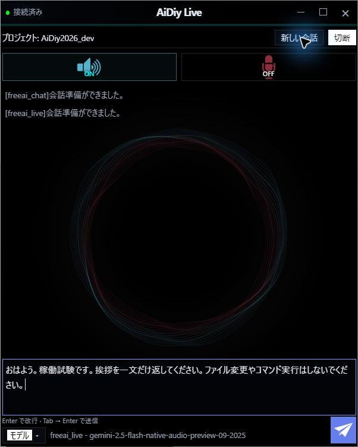

Liveから返答が出た画面です。「おはようございます！」という回答を確認しました。

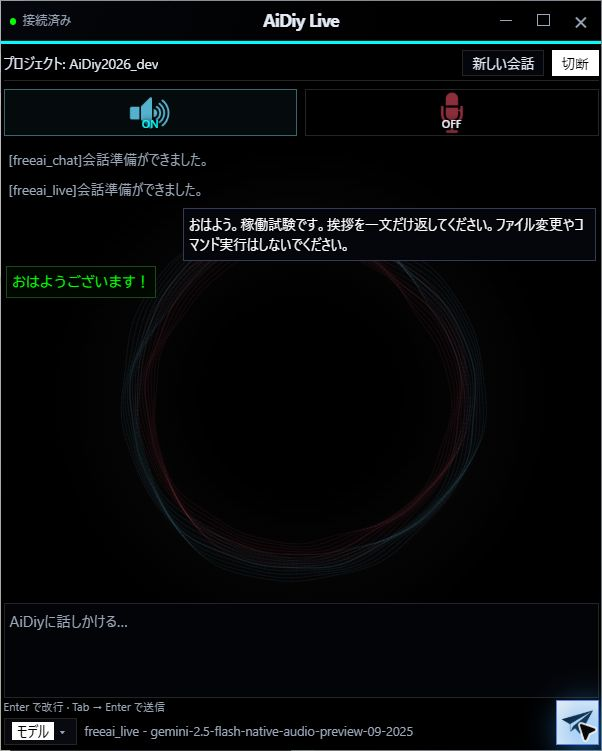

時刻は本文では日本時間です。回答確認時刻は画面で返答を確認した時刻であり、内部の生成完了時刻ではありません。

### AvatarとDiscordの最終結果

**✅ OK（Avatar）**：DiagからElectron版の起動を確認しました。会話の試験は同じAvatarのブラウザ画面で行い、試験用利用者でログイン後、「おはよう。一言で挨拶してください。」に「おはようございます。今日も良い一日をお過ごしください。」と返答がありました。Electron内の認証後の操作を確認した結果とは区別します。

ブラウザ版Avatarで認証後に挨拶した結果です。送信文とは別に、AIの新しい返答が表示されています。

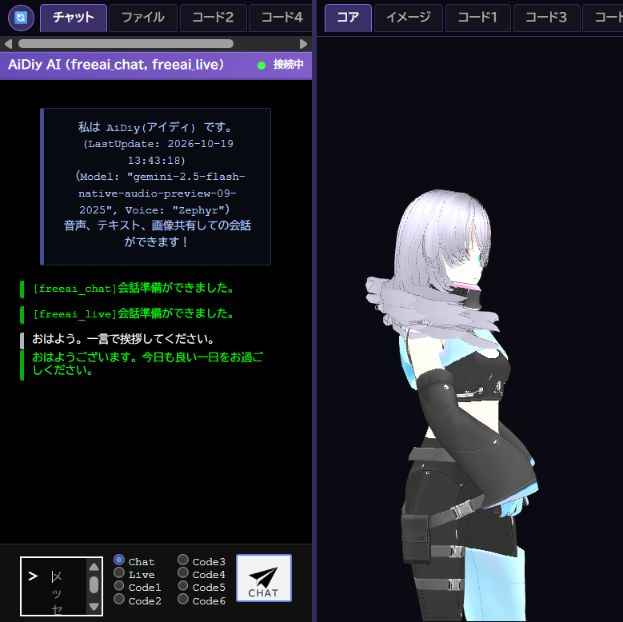

**✅ OK（Discord）**：Diagで開いたパネルが実サービスに接続しました。製品のHermes接続で「おはようございます！」という回答を作り、利用者が許可した設定済みチャンネルへ投稿しました。投稿を再取得し、本文の一致も確認しました。

Discordパネルの実接続後です。文字会話はON、音声会話はOFFです。投稿内容と再取得の結果は下の記録に残しています。

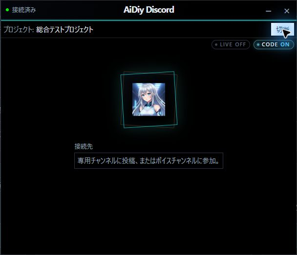

投稿した本文と再取得した本文は一致しました。自動返信の受信経路やボイス通話は本冊の範囲外です。再実行は `node frontend_channels/node_modules/tsx/dist/cli.mjs scripts/checks/Discord実接続試験.mts --send` です。実際に1件投稿するため、許可された試験チャンネルで実施します。

Termは起動表示だけが対象で、コマンド入力は行っていません。

## 5. aidiy_diag とアプリを終了する

### 操作手順

1. 使い終わったアプリは、そのアプリの終了ボタンや×で閉じます。
2. システムも使い終わったら、[システム起動編の5章](./セルフテスト,aidiy_diag,システム起動編.md)でDiagから停止します。
3. 独立して動くことを確かめる試験では、Termを1つ残してDiagを終了し、Termのウィンドウが閉じないことを確認します。

Diagの終了確認で止めるのは、Diagの「システム起動」で管理するプログラムです。「アプリ起動」から開いたアプリは、それぞれで終了します。

### 今回の結果と画面

**✅ OK（Termが動き続けること）**：Diagからシステムを停止して閉じた後も、Termのウィンドウは残りました。同じ作業フォルダと、文字を入力できる待機表示も維持されていました。

Diagを終了した後のTermです。同じフォルダと入力待ち表示が残っています。

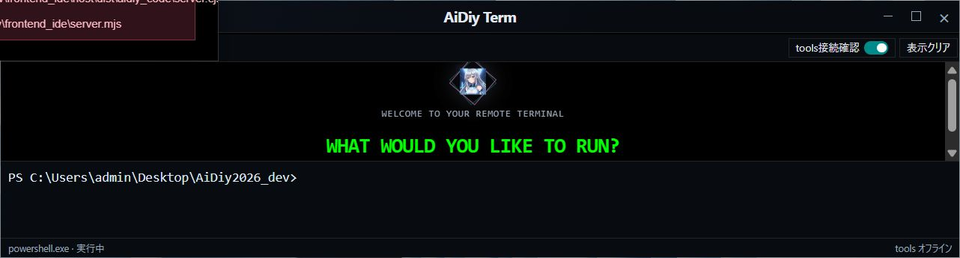

### 6アプリを残して終了する確認

**✅ OK**：実画面で「停止して閉じる」を選びました。DiagのHTTPと管理5ポートが閉じた後も、Avatar・IDE・Term・Code・Live・DiscordのElectronプロセスは6つとも同じPIDで継続しました。システムを止めると、接続が必要な機能はサーバー再起動まで未接続になります。

Diagを閉じて管理サーバーを止めた後のIDEです。未接続の案内は出ますが、検索結果とWordの表示は残っています。

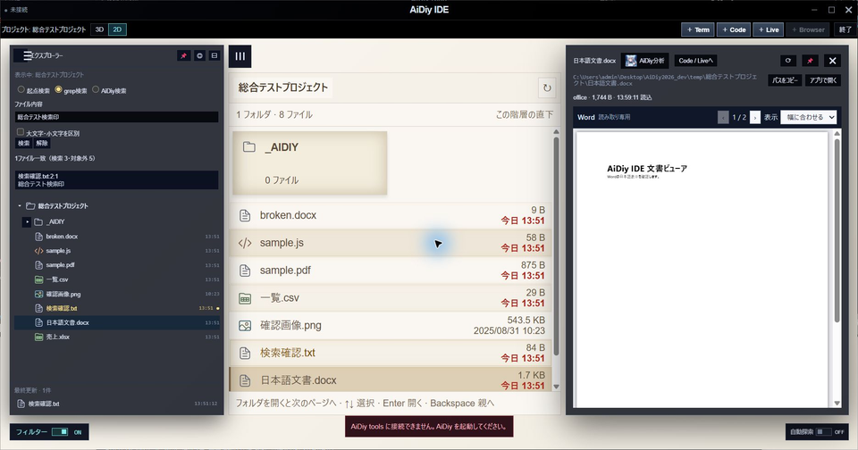

IDE・Discord・Avatar・Term・Code・Liveの6アプリは継続し、DiagのHTTPと管理中の5ポートは閉じました。確認後、Diagから5サービスを再始動しました。

## 6. 試験担当者向け：次回の記録方法

画像の名前・保存先・自動試験の記録方法を開く

各章の画像説明に、操作内容と確認結果を記載しています。

本書1〜5章を利用順に行います。画像は本書と同名の `images/セルフテスト,aidiy_diag,アプリ起動編/` に保存します。操作・期待結果・実際の結果・判定を本文へ記載し、画像の直前に確認内容を添えます。要求受付、実窓表示、AI回答は別々に判定します。今回の6種類の起動に加え、Code・Liveの返答、Avatarのブラウザ経路の会話、Discordの投稿・再取得を確認しました。アプリ起動と関連する自動テスト12件、終了確認5件、Avatarの子プロセス確認4件も通過しています。

