# aidiy_diag アプリ起動編 — 総合テストと操作手順書素材

> 文書: `セルフテスト,aidiy_diag,アプリ起動編.md` | 実装: `backend_diag/起動/アプリ起動.mjs`, `backend_diag/起動/CLI起動.mjs`, `backend_diag/ui/src/アプリ起動/`, `frontend_ide/aidiy_term/cli-launch.mjs`

## 総合評価

**10/24追補：VS Code追加後の現行構成は6アプリ＋7CLI＋VS Codeの計14項目です。表示・起動API・引数・失敗処理・円周配置の関連自動試験58件が成功しました。以下の10/22〜23の実機通過にはVS Codeを含めません。10/24に現行Electronの通常表示・ランチャー・14個展開・1個収納を実操作して再撮影しました。VS Code自体の実窓起動は未実施です。**

**総合評価：✅ 試験通過。2026年10月22〜23日、Windowsで起動・独立動作・終了・アイコン表示を確認しました。Liveは同じ処理を使うGeminiで代替試験を行い、OpenAIでも初回実回答を確認したため通過とします。FreeAI単独の応答未確認は参考結果として残し、今回の通過を妨げません。**

| 確認範囲 | 現在の結果 |
|---|---|
| アプリ起動 | Avatar認証画面、IDE、Term、Code、Live、Discordの実窓を確認。IDE・Code・Termは同一プロジェクトで各2窓を確認 |
| CLI起動 | 通常・ランチャー表示から7種類を実起動。Antigravityは未ログイン表示、Grokは信頼確認待ち。これらは環境条件として記録 |
| 自動確認 | ランチャー・Vue表示・CLI所有プロセス・並行動作の73件が通過。既存Chromeを使うWeb表示試験も通過 |
| アイコン化の追加試験 | 実Electronで有効数4パターン、画面端8か所、表示遷移9パターン、クリック開閉と10分タイマーを確認。実マウスで収納中・展開中のドラッグ、クリック開閉、ダブルクリック復帰、背景へのクリック透過、最前面維持も確認。関連回帰111件が通過 |
| Avatarの寿命 | 独立起動・重複起動・ログイン窓終了と8092解放を確認。実Electronの終了試験は2回通過 |
| Liveの応答 | ✅ 通過：実Live画面でGemini・OpenAIを選択し、15秒待機後の初回送信で実回答・音声データを受信。FreeAI失敗時は利用枠制限の可能性も考慮し、同じ処理のGeminiで代替試験する方針を適用 |
| 追加実機確認 | Diag終了後の6アプリとCodexの残存、ピン選択の保持、Avatar認証後のChat応答を確認。Discord投稿は今回の送信許可がないため対象外 |

[PDF版](./セルフテスト,aidiy_diag,アプリ起動編.pdf)も作成しています。対象はWindowsとし、Mac／Linuxの実機確認は別途推奨です。CLIのログイン・信頼確認待ち、Discordへの外部投稿対象外、音声の聴取未実施は本文に記載しています。画像の名前には撮影日とケース番号を付けています。実Electronの追加試験では、試験専用の観測処理から実画面のボタン押下・終了イベントとローカル待受を確認しました。フォルダダイアログは選択結果を注入し、OSダイアログそのものの操作とは区別します。異常系の起動・PTYは合成試験を併用しています。

メモリ制約があるため、通常試験は1アプリずつ開き、確認後に閉じます。並行試験は必要な2窓に限定します。Avatarの認証・Chat確認では必要なCoreのみを起動しました。試験終了時はアプリ・Diag・Coreを終了し、8091・8092の解放を確認しました。この通常試験では音声案内用Toolsだけを残しました。アイコン化の追加確認後は、利用者が確認できるDiagを1窓とToolsを残しています。

Avatarは `frontend_avatar/launch.mjs` に起動を統一しました。Electron表示中のみ8092を提供し、ログイン窓またはAvatarを終了するとWebも終了します。startの開始前・終了時、setup、cleanupはLiveと同じタイミングで停止し、IDE・Codeの全体停止はcleanupで行います。

## この冊子の進め方

**1〜5章が一連の操作、6〜9章が個別試験、10章が記録方法です。**

| 順番 | 操作の流れ |
|---|---|
| 1章 | Diag起動 → フォルダ設定 → ランチャー表示 → アイコン表示 |
| 2〜3章 | アプリを起動し、短い会話を確認する |
| 4〜5章 | ランチャーからアプリ・CLIを使い、使い終わった窓を閉じる |
| 6章 | フォルダ選択と表示条件を個別に確認する |
| 7章 | アイコン表示の開閉・移動・最前面・透過・自動収納を個別に確認する |
| 8〜9章 | 複数起動、切断、認証後操作、許可された外部投稿を確認する |

[システム起動編](./セルフテスト,aidiy_diag,システム起動編.md)で必要なサービスを起動しておきます。この冊子の通し確認中はDiagとサービスを動かしたままにします。アプリの独立動作を調べるためにDiagを先に閉じる試験は8章です。

今回のプロジェクトは、この作業コピーのルート `C:\Users\admin\Desktop\AiDiy2026_dev` を使用します（利用者指定）。プロジェクトとは、アプリへ渡す作業フォルダのことです。AI試験は「おはよう」程度の挨拶だけで、ファイル変更やコマンド実行は依頼しません。CLIボタンは確認ダイアログなしで自動承認モードのTermを開きます。CLI側のログイン・信頼確認は残る場合があります。

前半は章の順に操作し、各章の「成功の見分け方」で動作を確認します。取消・切断・連打・失敗条件の試験は後半にまとめています。通し確認中に予期しない問題が起きた場合は、その結果と先へ進めない範囲を記録します。環境不足を理由とする `PASS (別途環境調整必要)` と製品の不具合を分け、未実施を合格にはしません。

### ローカル試験用の利用者

この開発PCの既存試験用情報は、利用者ID `admin`、パスワード `********`（アスタリスク8文字）です。別の環境では、その環境の試験用アカウントを使用します。ログイン画面の入力値やJWTを画像・記録へ含めません。

Discordは接続パネルまでを基本範囲とします。メッセージ送信を試す場合は、今回の送信先と送信操作の許可を確認してから行います。過去の試験記録を今回の送信許可として扱いません。

## 1. Diag起動からアイコン表示まで

### 1-1. Diagを起動する

「aidiy_diag」を起動します。Toolsが起動中の場合は、小さなランチャー表示で始まります。「□」（元のサイズに戻す）を押すと通常画面になります。Toolsが起動していない場合は通常画面から始まります。

Tools稼働中はランチャー表示で起動します。掲載画像は10/24に作業フォルダを選択した現行ランチャーです。

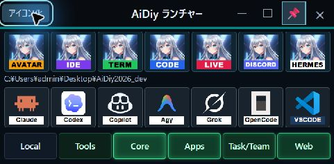

### 1-2. 作業フォルダを設定する

通常画面の「アプリ起動」を開き、「フォルダ選択」を押します。作業するフォルダを選んで確定し、表示されたパスを確認します。未選択の間はアプリ起動とアイコン化を選べません。

今回の作業フォルダは、この開発コピーのルートです。設定後はパスが表示され、利用可能なアプリとCLIのボタンが有効になります。

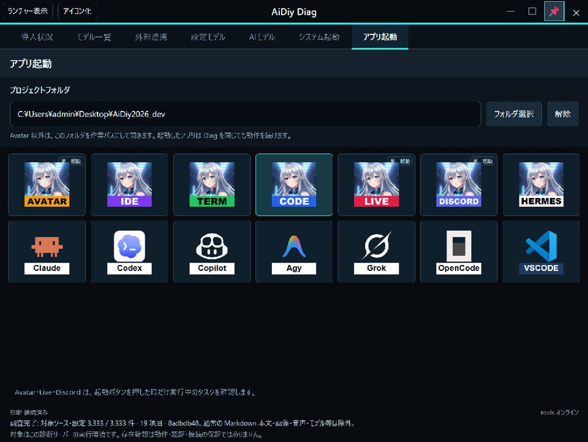

### 1-3. ランチャー表示へ切り替える

フォーム左上の「ランチャー表示」を押します。小さなフォームにアプリ、利用可能なCLI、サーバーの状態が並びます。選択した作業フォルダはそのまま引き継がれます。

フォームを移動しても、次の表示切替はそのフォームの左上を基準に行います。

### 1-4. アイコン表示へ切り替える

ランチャー左上の「アイコン化」を押します。小さなAiDiyアイコンと、回転する二重の四角が表示されます。通常画面の「アイコン化」からも同じ表示に切り替えられます。接続済みで作業フォルダが設定されていることが条件です。

アイコン表示中は常に最前面です。元のフォームの左上から表示を始め、中央を普通にドラッグすると移動できます。

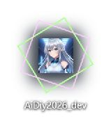

### 1-5. 中央をクリックして開く・閉じる

中央アイコンをクリックすると、起動できるアイコンが周囲へ展開します。もう一度中央をクリックすると閉じます。アイコン数に合わせて広がり方が変わり、画面端では画面内に収まる方向へ展開します。

周囲のアイコンはゆっくり回転し、押したいアイコンにマウスを重ねると止まります。中央付近にマウスがあっても回転は続きます。操作しない状態が10分続くと自動で閉じます。

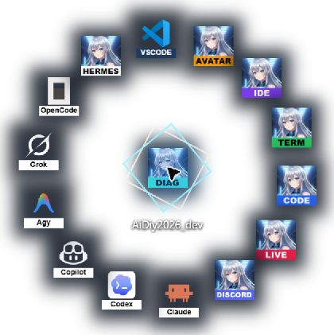

中央をダブルクリックするとランチャー表示へ戻ります。ランチャーの「□」で通常画面へ戻れます。どちらも、その時のフォーム左上を基準に切り替わります。Escは展開中なら収納、収納中なら通常画面への復帰です。

ここまでが起動からアイコン表示までの一連の操作です。アプリの起動は2章、アイコン表示の個別試験は7章で確認します。

## 2. アプリを開いて接続する

### 操作手順

1. 通常画面で、使いたいアプリのアイコンを1回押します。
2. 「起動確認中…」の間は待ち、対象の窓が実際に開いたことを確認します。起動受付や成功の通知は表示されません。
3. 下の表に沿って、開いた窓と作業フォルダ・接続状態を確認します。6アプリをそれぞれ一度ずつ開き、対象別に結果を記録します。

| アプリ | 開いた後に見るところ |
|---|---|
| Avatar | 認証画面。Avatarは選択フォルダではなくAiDiy本体を作業パスに使います |
| IDE | 選択プロジェクトの利用開始画面 |
| Term | 選択プロジェクトでコマンドを入力する端末の待機表示 |
| Code | 選択プロジェクトと接続状態 |
| Live | 選択プロジェクトと接続状態 |
| Discord | 選択プロジェクトと接続パネル |

### 成功の見分け方

各アプリの実窓が開き、対象のフォルダや接続が確認できれば起動確認は完了です。AIの回答は次の3章で確認します。Avatar・Live・Discordは単一起動ですが、重複を試す操作は8章で行います。

| ケース | 確認すること | 結果 |
|---|---|---|
| APP-201 | Avatarの実窓と認証画面、AiDiy本体の作業パス | ✅ OK：実認証フォームを確認。起動時の作業パスも照合 |
| APP-202 | IDEの実窓と選択プロジェクトの利用開始画面 | ✅ OK：ルートを引き継いだ利用開始画面を確認 |
| APP-203 | Termの実窓と選択プロジェクトの入力待ち | ✅ OK：選択ルートのPowerShell入力待ちを確認。Diag終了後の継続も確認 |
| APP-204 | Codeの実窓、選択プロジェクト、接続状態 | ✅ OK：AiDiy2026_dev・接続済みを確認 |
| APP-205 | Liveの実窓、選択プロジェクト、接続状態 | ✅ OK：AiDiy2026_dev・接続済み・会話準備完了を確認 |
| APP-206 | Discordの実窓、選択プロジェクト、接続状態 | ✅ OK：ルートを引き継いだ実窓と初期の未接続表示を確認 |

Avatarは利用者認証フォームが開きました。認証後の画面とChat応答は9章で確認しています。

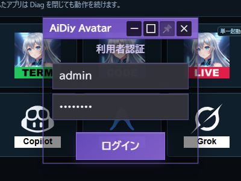

IDEは「プロジェクト: AiDiy2026_dev」を引き継いだ利用開始画面が開きました。

Codeはルートプロジェクトで自動接続し、検証回数0回の入力待ちになりました。

Liveも同じプロジェクトで開きました。接続後の準備完了と初回送信は次章で確認しています。

2026年10月21日、Discordも同じルートで開きました。プロジェクト名、未接続の初期状態、音声・コード設定の表示を確認しました。Discordへの接続操作・投稿は行っていません。

## 3. Code・Liveで短い会話をする

### 操作手順

1. Codeの準備完了を確認し、入力欄へ次の文を入れて送信します。

> おはよう。稼働試験です。挨拶を一文だけ返してください。ファイル変更やコマンド実行はしないでください。

2. 自分の送信文とは別に、AIから新しい返答が出るまで待ちます。プロバイダ・モデルと返答を記録します。
3. **Liveの標準条件は、接続済み・「会話準備ができました」を確認して15秒待機し、初回送信後は最大60秒観測です。** 返答を確認できたら、その時刻を記録します。応答がなければ「応答未確認」と記録します。プロバイダの状況も変わるため、アプリ側の時間設定変更や自動再送では補正しません。20秒・30秒待機は過去に実施した追加比較であり、標準手順には含めません。観測時間超過だけではランチャーの不具合やプロバイダ側の原因を断定しません。
4. 準備完了・送信・返答確認の時刻を記録します。音声がある場合は、文字の返答と音声の再生・聴取を分けて記録します。

### 成功の見分け方

自分の入力とは別のAI回答が出れば応答確認ができます。空白だけ、`!`だけ、`!`で始まる回答は正常応答にしません。実際に15秒待った場合は `※注意:15s待機後送信しました。` と記録します。

単独Liveでは利用者または試験操作が15秒待ちます。Diagの設定モデル・AIモデルの試行は自動待機なので区別します。応答待ちと実回答確認済みを区別し、再送した場合も初回送信の成功には数えません。次は4章でランチャー表示とCLIを使います。

**FreeAIはGeminiの無料枠を利用する方式です。FreeAIの試験で応答がない場合は、対応するGeminiへ切り替えて同等の処理を試験し、Geminiで正常応答を確認できれば、その試験全体をPASS（通過）とします。利用枠制限のエラーが確認できたことは、この代替通過判定の必須条件ではありません。**

Liveでは `freeai_live` と `gemini_live` が `AIライブ_gemini.py` を共用するため、画面のモデル選択でGeminiへ切り替え、標準の15秒待機・最大60秒観測で実回答を確認します。切替前後のプロバイダ・モデルと実測結果を残し、判定は「Geminiによる代替試験でPASS」と記録します。これはFreeAI自体が応答したことや、利用枠制限が原因であることの証明ではありません。今回のAPP-302全体もこの方針で通過とし、FreeAIの応答未確認は参考結果として保持します。通常動作の自動フォールバックを追加する指示ではなく、試験時の手動切替と判定方針です。

| ケース | 確認すること | 結果 |
|---|---|---|
| APP-301 | Codeの短い挨拶に実回答が出る | ✅ OK：grok_cli / grok-4.7から短い挨拶を受信 |
| APP-302 | Liveの短い挨拶に実回答が出る。FreeAI失敗時は同じ処理のGeminiで代替試験 | ✅ 通過：APP-302-Gの実回答で共通処理を確認。APP-302-Oも成功。FreeAI個別の無応答は未確認として記録 |
| APP-302-G | Live画面でGeminiを選択し、15秒待機後に初回送信 | ✅ OK：gemini_live / gemini-2.5-flash-native-audio-preview-12-2025。約2.5秒で挨拶を表示、音声データも受信 |
| APP-302-O | Live画面でOpenAIを選択し、15秒待機後に初回送信 | ✅ OK：openai_live / gpt-realtime-2.1-mini。約1.5秒で挨拶を表示、音声データも受信 |

Codeには「おはよう。挨拶を一文だけ返してください。ファイル変更やコマンド実行はしないでください。」と送りました。`grok_cli / grok-4.7` から「おはようございます。今日もよい一日になりますように。」と返答が出ました。

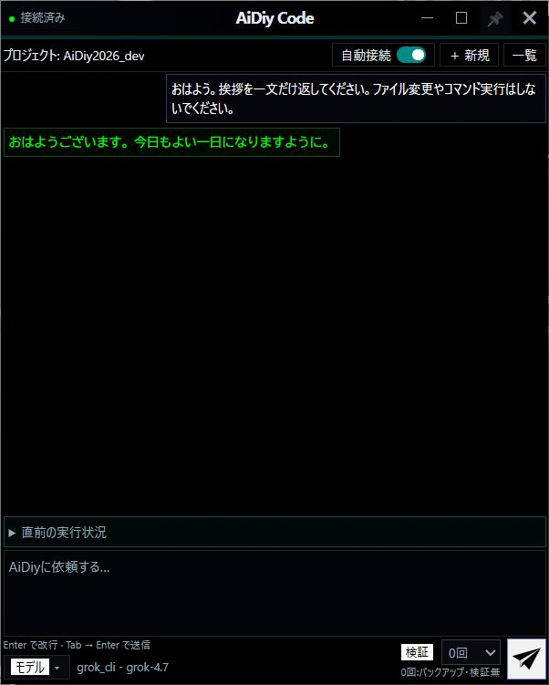

FreeAIでは接続・準備完了後も実回答を確認できませんでした。共通処理を使うGeminiとOpenAIでは、準備完了後15秒待機して初回送信し、文字の実回答と音声データを確認しました。FreeAI自体の応答成功とは区別します。

### Live画面からモデルを選ぶ個別試験（2026年10月23日）

1. Diagの「アプリ起動」でLiveを開き、プロジェクト名を確認します。
2. Live画面下部の「モデル」を押し、「ライブAI」「モデル」「音声」を選びます。未接続の状態で「選択する」を押します。
3. 「接続」を押して準備完了を確認し、15秒待ってから上記の挨拶を1回送ります。返答を最大60秒観測します。
4. 次のモデルを試すときは「切断」を押してから、2〜3の操作を繰り返します。今回は接続中の「変更して再接続」は試験対象にしていません。

実ElectronのLive画面で、試験用観測処理から選択・クリック・入力イベントを実行しました。Diagの「AIモデル」試行とは別経路です。作業フォルダはAiDiy2026_dev、スピーカーON・マイクOFFで、音声入力は試していません。

| ケース | モデル／音声 | 準備完了確認 → 初回送信 → 回答確認（日本時間） | 実際の返答 |
|---|---|---|---|
| APP-302-G | gemini_live / gemini-2.5-flash-native-audio-preview-12-2025 / Zephyr | 06:07:45.033 → 06:08:00.369 → 06:08:02.830 | おはようございます。 |
| APP-302-O | openai_live / gpt-realtime-2.1-mini / marin | 06:08:16.700 → 06:08:32.040 → 06:08:33.494 | おはようございます。今日も元気です。 |

※注意:15s待機後送信しました。画面操作の時間を含め、準備完了確認から送信操作開始までの実測は両方約15.34秒です。接続成立時刻そのものは採時していません。60秒以内に返答を確認したため、その約3秒後まで観測して終了しました。各モデル1回の初回送信で、再送はしていません。

Live画面への音声パケット受信はGeminiが7件、OpenAIが8件でした。Geminiのバックエンドでも字幕10文字・音声55,680バイト・ターン完了を確認しました。これは音声データ到達の確認であり、人が音を聴取した結果ではありません。OpenAIは返答が成立しましたが、バックエンドに `conversation.item.added` / `conversation.item.done` の未知イベント警告が残りました。

Geminiのモデル・音声を選択したフォームです。

Geminiから、利用者の入力とは別の挨拶が表示されました。

切断後、同じLive画面でOpenAIのモデル・音声を選択しました。

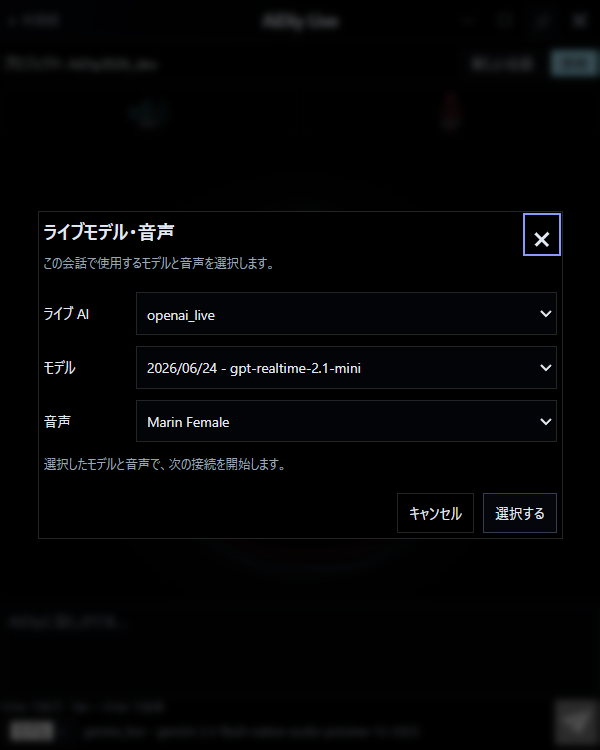

OpenAIからも挨拶が表示されました。画像はデスクトップ全体ではなく、各操作時のLiveフォームを撮影したものです。

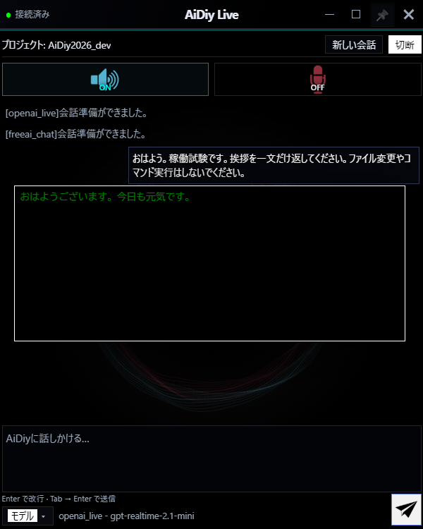

試験後はモデル選択を元の `freeai_live / gemini-2.5-flash-native-audio-preview-09-2025 / Zephyr` に戻し、試験用LiveとCoreを終了しました。Diagと音声案内用Toolsは残しています。FreeAI個別の実測結果はそのまま残し、Geminiによる代替試験の成功で共通Live機能は通過と判定しました。

## 4. ランチャー表示からアプリ・CLI・VS Codeを使う

### 操作手順

1. Diagへ戻り、タイトルバーの「ランチャー表示」を押します。選択したプロジェクトのパスが引き継がれます。
2. 上段に6アプリと導入済みHermes、次の段に導入済みの外部CLIとVS Codeが並ぶことを確認します。全対象を導入済みの場合は6アプリ＋7CLI＋VS Codeの計14項目です。アイコンにポインターを合わせると名前が分かります。
3. アプリの操作を終えて窓を閉じた対象を、ランチャーのアイコンから開きます。通常画面と同じ対象・プロジェクトで開けば確認できます。単一起動のアプリを重ねて起動する操作は8章で試します。
4. 導入済みのHermesまたは外部CLIを1回押します。選択プロジェクトのTermが開き、その中でCLIが始まるまで待ちます。
5. CLIの入力待ちを確認したら、その窓を閉じて次の導入済みCLIへ進みます。通常画面からの起動も同じように確認し、対象と起動元を分けて記録します。
6. VS Codeの青帯・白文字のアイコンを押し、選択プロジェクトをVS Codeの新しい窓で開きます。TermやCLIの自動承認を使う起動とは別です。通常画面・ランチャー・アイコン表示のそれぞれで同じフォルダを引き継ぐことを確認します。
7. ランチャーの「元のサイズに戻す（□）」を押し、元の通常画面へ戻ります。

### 成功の見分け方

選択したプロジェクトを引き継いで実窓が開き、CLI自身の入力待ちまで進めば確認できます。Termが開いたこととCLIの準備完了は別に見ます。モデルはCLIの既定設定を使います。

未導入のCLIは実起動成功に数えず、名前と環境条件を記録します。起動中もランチャーのパス表示が保たれ、通知行で高さが変わらないことを確認します。使い終わったら5章へ進みます。

| ケース | 確認すること | 結果 |
|---|---|---|
| APP-401 | ランチャーは導入済みCLI・VS Codeのみ。Hermesは上段、外部CLI・VS Codeは次の段に中央寄せ | ✅ OK（範囲別）：10/22〜23の実Electron確認は上段6アプリ＋Hermes、次段6外部CLI。10/24に現行Electronの上段7個・下段7個を実画面で確認。専用APIへの送信は合成Vueで確認。VS Code自体の実窓起動は未実施 |
| APP-402 | aidiy_hermes：通常・ランチャーの上段から起動 | ✅ OK：通常・ランチャー表示から実起動。ランチャー表示ではMCP初期化後のHermes入力待ちを確認 |
| APP-403 | copilot：通常・ランチャーから起動 | ✅ OK：通常・ランチャー表示からCopilot v1.0.102を表示。ランチャー表示で入力待ちを確認 |
| APP-404 | codex：通常・ランチャーから起動 | ✅ OK：通常・ランチャー表示からCodex v0.163.0を表示。入力待ちとYOLO表示を確認 |
| APP-405 | claude：通常・ランチャーから起動 | ✅ OK：通常・ランチャー表示からClaude Code v2.1.306を表示。入力待ちを確認 |
| APP-406 | agy（Antigravity）：通常・ランチャーから起動 | ✅ PASS（環境条件あり）：両表示からAntigravityを起動。未ログイン表示あり。外部ログインは未操作 |
| APP-407 | grok：通常・ランチャーから起動 | ✅ PASS（環境条件あり）：両表示からGrok Build 1.0.52を起動。フォルダ信頼確認待ち。承認操作は未実施 |
| APP-408 | opencode：通常・ランチャーから起動 | ✅ OK：両表示からOpenCodeを起動。通常表示は他CLI終了後の再試験で入力待ちを確認 |
| APP-409 | VS Codeで選択フォルダを開く。未導入・未選択・切断では起動不可。CLI用のモデル・自動承認引数を渡さない | ✅ OK（10/24、自動・合成試験）：通常／ランチャーのラベルとフォルダ送信、専用API認証、WindowsのCode.exe解決、日本語・空白を含む引数、起動失敗の検出、配布アイコンを確認。VS Codeの実窓・アイコン表示からの実クリックは未実施 |

次の画像は10/24の現行Electronで再撮影したランチャーです。6アプリ＋7CLI＋VS Codeの計14項目が並んでいます。

HermesはMCP初期化後に入力待ちへ進みました。起動直後の空白画面とは区別しています。

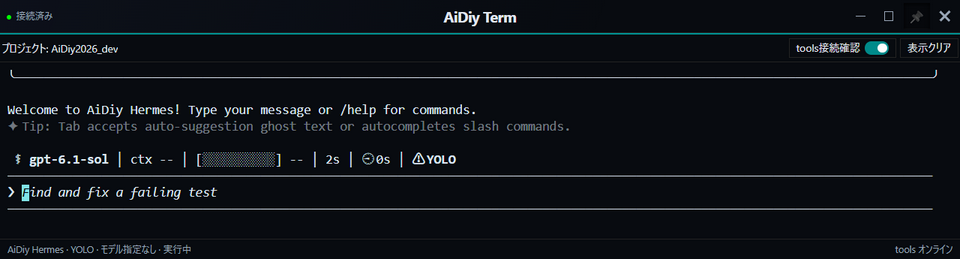

Codexは選択フォルダとYOLOモードを表示し、入力待ちになりました。

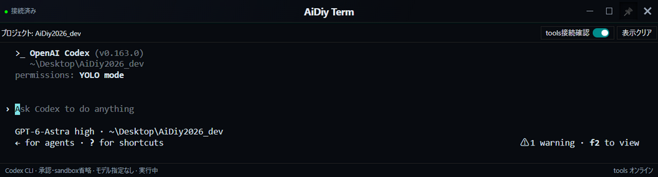

OpenCodeは通常画面からの再試験で入力欄を確認しました。

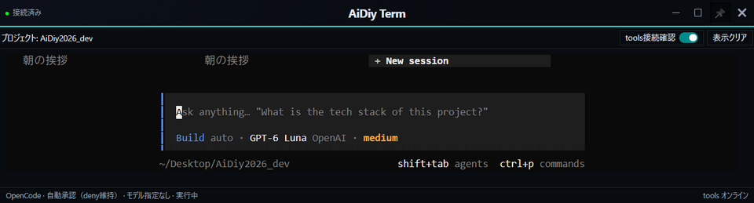

## 5. 使い終わったアプリを閉じる

### 操作手順

1. 開いたアプリの作業を保存し、それぞれの終了操作で窓を閉じます。
2. TermとCLIも窓ごとに閉じます。1つを閉じたことで、まだ使っている別の窓が終了していないことを確認します。
3. 試験で開いた窓が残っていないことを確認します。Diagとサービスはこの章では動かしたままです。
4. システムも使い終わった場合は[システム起動編6章](./セルフテスト,aidiy_diag,システム起動編.md#6-システムを停止してdiagを閉じる)で停止します。

### 成功の見分け方

選択・起動・簡単な利用・個別終了までできれば、アプリ起動の通常運用は完了です。6章以降は改めて必要な窓を開いて試します。

**通常運用の通し確認結果：CLI・個別終了まで実施。LiveはGemini・OpenAIの実回答を確認しました。FreeAIの無応答は参考記録として残し、成功には数えません。** 各アプリ・CLIの実施範囲と、確認できなかった環境条件をまとめます。

| ケース | 確認すること | 結果 |
|---|---|---|
| APP-501 | 個別終了で他の窓を止めず、対象の所有プロセスを回収する | ✅ OK：通常起動のHermes・Copilot・Codex・Claude・Antigravity・Grokは窓・所有サーバー終了とポート解放を確認。他CLIの6窓は残存。最終整理でOpenCode・IDE・Code・Term・Live・Discordも終了を確認 |

## 6. 個別試験：フォルダ選択・表示条件

1. プロジェクトの「解除」、フォルダ選択の「キャンセル」、選び直しを順に試します。通常・ランチャーでの共有、Diag再起動・再読込での未選択を確認します。
2. 日本語・空白・記号付きパスを選び、渡された作業パスを照合します。存在しないパスやファイル指定は隔離した入力条件で試します。
3. ランチャーの未選択案内「SELECT YOUR PROJECT ▸▸ READY FOR LAUNCH」を押し、通常のアプリ起動へ戻ることを確認します。
4. 外部CLIが0件・一部・全件の表示を合成一覧でも試し、幅384px、名称込み40pxアイコン、サービス6件の1行表示と内容高を確認します。
5. 表示・再接続だけで起動しないこと、□とサービス名の戻り先、ピンの保持を確認します。

各条件を試した後は通常のプロジェクト選択へ戻します。窓の長押し移動と演出の詳細は[システム起動編8章](./セルフテスト,aidiy_diag,システム起動編.md#8-追加テスト窓操作表示アニメーション)で確認します。

| ケース | 確認すること | 結果 |
|---|---|---|
| APP-601 | Electron／Webの選択・取消・解除が働き、選んだ絶対パスが表示される | ✅ OK：Web実ブラウザで選択・取消・解除。Electron実窓は選択結果の注入、取消は状態単体試験 |
| APP-602 | 日本語・空白・記号付きパスが正しく渡る。共有CODE_BASE_PATHを変更しない | ✅ OK（合成プロセス併用）：日本語・空白・記号付きパスを引数とcwdで照合。任意シェル文字列を生成しない |
| APP-603 | 通常／ランチャーで選択共有。再起動・再読込で未選択になる | ✅ OK：実Electronで通常／ランチャー表示の選択共有、Web実ブラウザで再読込後の未選択を確認 |
| APP-604 | 存在しないパス・ファイル指定を拒否し、起動しない | ✅ OK（隔離API試験）：存在しないパス・ファイル・相対パスで起動要求を拒否 |
| APP-605 | ランチャーの名称込みアイコンが40px、サービス6件が1行。幅384pxで欠けず、内容高に追従 | ✅ OK：Web実ブラウザで384px・内容高・40pxアイコン・サービス6件1行。実Electronのランチャー表示も撮影 |
| APP-606 | 未選択の英語案内からアプリ起動へ戻る。選択後はパスを表示 | ✅ OK：実ElectronとWebで案内からアプリ起動へ復帰。WebではEnter／Spaceも確認 |
| APP-607 | 表示・再接続は存在確認だけ。CLI起動やログイン、導入は自動実行しない | ✅ OK（合成プロセス併用）：表示と再接続で一覧確認のみ、起動要求なし |
| APP-608 | □は元のタブへ、サービス名はログへ復帰。ピン初期OFFと選択保持 | ✅ OK：通常表示・サービスログへの復帰はWebで確認。実Electronでピン初期OFF、ON選択後の通常／ランチャー表示往復での保持、OFFへの復帰を確認 |
| APP-609 | 未選択の通常欄は赤枠で、アプリ・CLIの起動が無効 | ✅ OK：実フォームと合成UIで確認 |
| APP-610 | 通常画面は6アプリ＋7CLI＋VS Codeの計14項目。画像内に名称がある | ✅ OK（10/24、実機・合成UI）：現行Electronの全14項目を再撮影。VS Codeの編集用ラベル、未導入・未選択・切断時の無効化は合成UIでも確認 |

10/22の試験ではピンの往復保持とOFFへの復帰を確認しました。次の画像は10/24の現行ランチャーをピンONで再撮影したものです。

## 7. アイコン表示の個別試験

1章の流れでフォルダを設定し、「アイコン化」まで進んでから確認します。一つずつ操作し、結果を確かめてから次へ進みます。

| ケース | 操作と確認すること | 今回の結果 |
|---|---|---|
| APP-701 | 未選択・未接続ではアイコン化できない。選択後は通常とランチャーの両方から切り替えられる | ✅ OK：条件と選択の共有を回帰試験、実フォームで確認 |
| APP-702 | 中央クリックで開閉する。VS Codeを含め最大14個、少ないときはコンパクトに並ぶ | ✅ OK（範囲別）：6・8・10・13個は従来の実フォームで確認。10/24にVS Codeを含む14個の実Vue描画・展開数の受け渡しと円周配置計算を自動確認。現行Electronで14個の展開と1個への収納を実操作・再撮影済み |
| APP-703 | 中央付近では回転を続け、外周アイコンへのマウスオーバーで止まる | ✅ OK：実フォームの回転状態を確認。自動確認ではhover状態を注入して比較 |
| APP-704 | 収納中・展開中に中央を普通にドラッグする。解放時に誤って開閉しない | ✅ OK：OSの実マウス入力で連続移動と展開中の移動を確認。長押し不要。解放後も元の開閉状態を保持 |
| APP-705 | ダブルクリックでランチャーへ戻り、通常画面も現在のフォーム左上から復帰する | ✅ OK：実マウスのダブルクリックと、移動後の表示切替9パターンを確認。途中の通常画面が見えない |
| APP-706 | 四隅・上下左右中央で展開し、収納すると元の位置へ戻る | ✅ OK：8か所で確認。各3回の追加往復でも位置ずれなし |
| APP-707 | 背後のフォームを操作しても最前面を維持する。通常・ランチャーへ戻すと元のピン設定になる | ✅ OK：背後フォームを実操作し、OS側の最前面状態も確認。復帰時の解除を確認 |
| APP-708 | アイコンのない透明部分から背後のフォームをクリックできる | ✅ OK：実マウスのクリックを背後の試験フォームが受信。アイコン表示は最前面のまま |
| APP-709 | 10分間操作がなければ収納し、操作すると待ち時間を延長する | ✅ OK（時刻条件の自動確認）：600秒の予約、操作後の予約更新、16秒経過しても展開維持、期限到達処理での収納を確認。10分の実時間待機は省略 |
| APP-710 | アイコンの形・文字・背景が揃い、不要な枠やマークがない | ✅ OK：全画像40px。Hermesの文字余白、中央と周囲の柔らかい黒背景、内側サーバー・下部マークなしを確認 |
| APP-711 | アイコンからアプリを起動できる。CLI用Termは中央の約800×600pxで開く | ✅ OK：Termの実起動と終了を確認。CLIの代表Copilotは中央の802×602px（DPI丸め込み）で起動確認。AI回答の成功とは区別 |

### 展開と移動の確認画面

10/24、最新デザインの1個収納状態を白い背景の上で再撮影しました。背後のデスクトップやツールチップは写し込んでいません。

中央をクリックして、VS Codeを含む14個の展開を実画面で確認しました。

6・8・10・13個の表示条件と画面端8か所の結果は10/22の試験記録です。10/24の撮影で全条件を再実施したものではありません。

CLI用のTermは中央に約800×600pxで表示します。

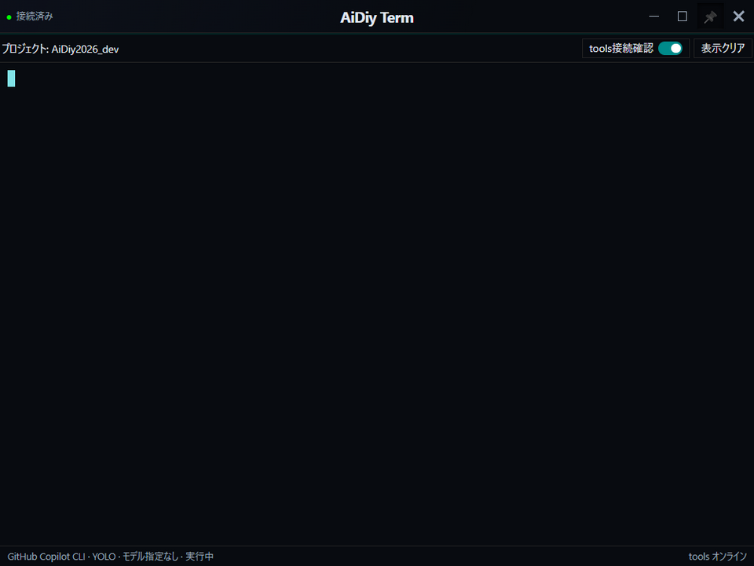

### 試験方法と範囲

Windowsの実Electronを使用しました。ドラッグ・中央クリック・ダブルクリック・背後へのクリックはOSの実入力で確認しました。有効数の変更は試験用の一覧応答で6・8・10・13個を作り、画面端と表示切替は実フォームのイベントと窓位置を制御して照合しました。フォルダ選択は試験用に選択結果を渡しており、OSのフォルダダイアログ操作そのものとは分けています。

10/24の再撮影では白い撮影専用ウィンドウを背面に表示し、実フォームの表示領域だけを保存しました。IDEと撮影用背景は終了済みです。再利用する撮影手順は[説明資料の書き方](./セルテスト,_説明資料の書き方.md)に記載しています。

10/22の正式な画像は実フォームの表示領域だけを撮影しています。デスクトップ、CLaunch、背後の試験用フォームは画像に写し込みません。今回はCLaunchを一時終了し、背景アイコンを試験用フォームで覆いました。試験後は背景フォームを閉じ、CLaunchを再起動して元の表示へ戻しました。Liveと試験用Coreも終了し、確認用Diagを1窓と音声案内用Toolsを残しています。

## 8. 個別試験：重複起動・並行動作・切断

1. Avatar・Live・Discordの起動ボタンを再度押し、同じ窓が増えないことを確認します。「起動済みです」という通知は表示されません。
2. IDE・Code・Termは同じプロジェクトで追加の窓を開きます。
3. 同じCLI・同じプロジェクトを、先の起動中にも押して複数のTermを開きます。別CLIとの同時起動も確認します。
4. 一方の終了・起動失敗・端末切断を試し、他の窓が継続することを確認します。失敗条件と30秒の接続待ち条件は隔離試験で作れます。
5. 最後にアプリを残してDiagを終了し、独立した窓が残ることを確認します。Coreなどの停止による接続断と、アプリ自身の終了を区別します。
6. 残した試験用の窓を個別に閉じ、対象の所有プロセスが回収されたことを確認します。

通常画面は処理中・エラーを確認する場所です。ランチャーでは一時通知を追加せず、起動中もプロジェクト表示を保ちます。エラーは通常へ戻って確認します。

| ケース | 確認すること | 結果 |
|---|---|---|
| APP-801 | Avatar・Live・Discordの単一起動。確認失敗時も追加起動しない | ✅ OK（実機・合成併用）：Avatar・Liveの実機重複防止。3対象の排他とタスク照会失敗時の拒否は合成試験 |
| APP-802 | IDE・Code・Termの同一プロジェクトでの別窓起動 | ✅ OK：実ElectronでIDE・Code・Termを同一プロジェクトから各2窓起動 |
| APP-803 | 通常は処理中・エラーのみ、ランチャーは一時通知なし。起動確認ダイアログなし | ✅ OK：実画面と合成Vueで通知・処理中表示を確認。失敗条件は合成試験 |
| APP-804 | 同一CLI・同一プロジェクトの連続／同時起動で独立したTermが増える | ✅ OK（実機・合成併用）：同じCLIを残して通常画面から追加起動。連打・同時要求は全7CLIの合成試験 |
| APP-805 | 別CLIの並行起動、一方の終了・起動失敗で他方に影響しない | ✅ OK（実機・合成併用）：別CLIを実起動し、通常窓の終了後も6CLIが残存。片側の起動失敗は合成試験 |
| APP-806 | 再接続だけではCLIを再起動しない。未導入・未選択では起動要求を送らない | ✅ OK（合成試験）：再接続・未導入・未選択から起動要求を送らない |
| APP-807 | 最後の有効端末接続から30秒の切断、または表示後30秒の初回接続なしで、そのTermの所有プロセスだけ終了 | ✅ OK（隔離試験）：実WebSocketと合成PTYで所有プロセスの分離・再接続・切断回収を確認。猶予時間を短縮した試験であり、実CLIの30秒実測ではない |
| APP-808 | Diag終了後も6アプリとCLIのTermが独立して残る | ✅ OK：Avatar・IDE・Code・Live・Discord・Termの実窓が残存。CLI代表のCodexも入力待ちを維持。Term／Codexは所有サーバーのHTTP応答も確認。個別終了後は所有プロセスを回収 |

Diagを終了しても、Termは選択ルートのPowerShell入力待ちを維持しました。Termを閉じると所有サーバーも終了しました。

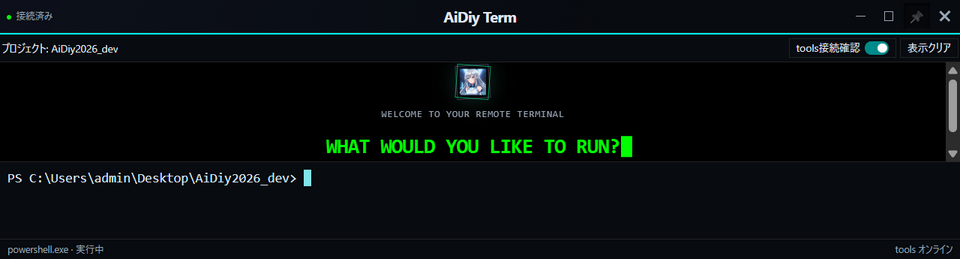

CodexもDiag終了後に入力待ちを維持しました。CLIの窓を閉じた後に所有プロセスと待受が終了することを確認しました。

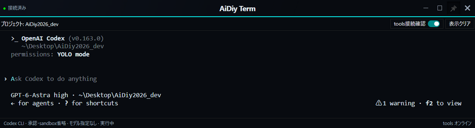

DiscordはDiag終了後も選択プロジェクトの接続パネルを表示しました。外部接続・投稿は行わず、確認後に窓を閉じました。

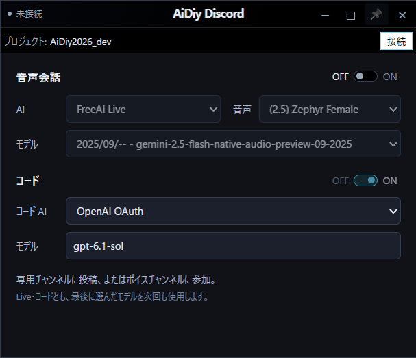

## 9. 個別試験：Avatarの認証後操作・Discord投稿

1. Avatarの認証画面で試験用利用者としてログインします。Chatを選び、Chatの「会話準備ができました」を確認してから3章と同じ短い挨拶を送ります。Liveだけの準備完了表示ではChat送信を始めません。ElectronとWebのどちらで試したか記録します。
2. Discord投稿を試す場合は今回の送信先と送信操作の許可を確認し、指定したチャンネルで試験投稿と返答を照合します。
3. 自分の送信文、AIの回答、音声通話の成否を分けて記録します。接続パネルが開いただけでは投稿・会話の成功にしません。

Avatarの詳細は[Electron実行編](./セルフテスト,aidiy_avatar,Electron実行編.md)・[Web実行編](./セルフテスト,aidiy_avatar,Web実行編.md)、IDEを開いた後の操作は[IDE操作編](./セルフテスト,aidiy_ide,操作編.md)を参照します。

| ケース | 確認すること | 結果 |
|---|---|---|
| APP-901 | Avatarの認証後の簡易応答。Electron／Webを区別して記録 | ✅ OK（Electron）：認証後のAvatar・Chat画面を確認。freeai_chatの準備完了後の再送で短い挨拶の実回答を受信。初回成功とは数えない。Web操作は別冊の対象 |
| APP-902 | Discordへの試験投稿は送信先・許可がある場合のみ実施し、投稿・応答を照合 | 対象外：今回の送信先・投稿許可は未指定。接続パネル表示を投稿成功とは扱わない |

Electronでログインし、Avatar本体とChat画面の表示を確認しました。終了時にはAvatarを閉じて8092も解放されました。

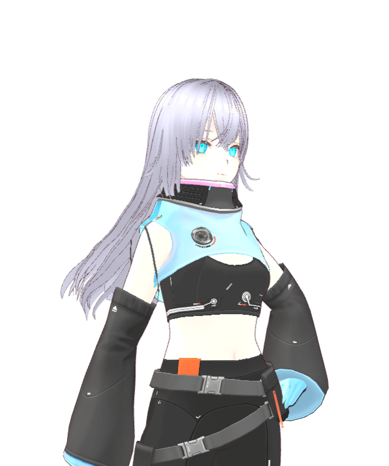

freeai_chatの準備完了を確認して送信し、「おはようございます、本日もよろしくお願いいたします。」という実回答を受信しました。画面には準備前の送信エラーも残っていますが、判定対象は準備完了後の再送です。音声の聴取成功とは区別します。

## 10. 試験の記録方法

各章の操作を実施したら、操作直後の画面と実際の結果を記録します。前半の通常運用と後半の追加テストを別に集計し、先頭の総合評価も更新します。

ケース番号は今回の章番号に合わせて採番しています。複数の対象・条件は枝番で分け、一つの成功で全体を合格にしません。画像の先頭1桁も掲載する章番号に合わせます。撮影後に章を移した場合は、ファイル名・説明・参照も揃えます。

実施日時・対象・プロジェクト・操作・期待結果・実際の結果・判定を記録します。通常／ランチャー／アイコン、実機／合成、各アプリ／各CLIを枝番で分けます。起動要求の受付だけで成功にせず、実窓とCLI自身の状態を確認します。

画像は `_AIDIY/knowledge/images/セルフテスト,aidiy_diag,アプリ起動編/` に、`<実施ID>__aidiy_diag-アプリ起動_401_Hermes起動画面.png` の形式で保存します。画像の直前に説明を添えます。確認済み画像は本文に掲載し、通過した本冊子と同名のPDFにも反映します。

自動試験の入口は `backend_diag/checks/app-launch.check.mjs`、`app-launch-state.check.mjs`、`cli-launch.check.mjs`、`cli-launch-state.check.mjs`、`mini-cli-ui.check.cjs`、`full-launch-controls.check.cjs`、`frontend_ide/checks/project-instance.test.mjs` とCLI／端末の `cli-parallel-lifecycle.test.mjs` です。ブラウザの合成起動確認は `backend_diag/checks/app-launch-browser.mjs` を使います。実CLI・有料APIの結果へ置き換えません。

2026年10月21日、Discordの型検査と配布パネルの整合性確認が通過しました。ローカルREST・Gateway・音声WSS等の合成ネットワーク試験も単独再実行で通過しました。Discordへの投稿・実音声会話を行った結果ではありません。

記録・判定・PDF作成は[説明資料の書き方](./セルテスト,_説明資料の書き方.md)に従います。

