# aidiy_diag アプリ起動編 — 操作ガイドとセルフテスト

> 本書はセルフテスト結果を、操作説明・解説書としても読みやすく整理しています。再テスト後は結果・注意書き・エビデンスを更新し、章立て・操作手順・図解の配置などの様式を維持します。

> 文書: `セルフテスト,aidiy_diag,アプリ起動編.md` | 実装: `backend_diag/起動/アプリ起動.mjs`, `backend_diag/起動/CLI起動.mjs`, `backend_diag/ui/src/アプリ起動/`, `frontend_ide/aidiy_console/cli-launch.mjs`

## 総合評価

**総合評価：✅ OK（記載した確認範囲）。Windowsで起動・独立動作・終了を確認しました。** 最終確認日は2026年10月29日です。AIの実回答は10月22〜23日、ランチャー・Browser・Task／Team・表示切替は10月27〜29日の結果です。全プロバイダを同日に再試験した判定ではありません。

| 確認範囲 | 結果 |
|---|---|
| アプリ起動 | Console・Code・Live・IDE・Task・Team・Avatar・Discordの独立窓、BrowserとChromeの起動経路を確認。Task／Teamは通常・ミニ・アイコン表示でも認証と終了を確認 |
| ミニ表示 | 全アイコンが画面内に収まり、外部アイコンは7個を超えると折返し。外周枠を含む高さ、スクロール残りなし、通常表示への復帰を実Electronで確認 |
| 円形表示 | 10個は一重円、11個以上は内外4：6に近い整数配分。18個の逆回転、順次展開・逆順収納、2回転の受付光、他アイコンの暗転・復帰を確認 |
| 右クリック | すりガラス・2列・表示中の対象だけの一覧、Task／Team起動、サイズ切替、サーバー稼働中の終了確認、画面端の配置を確認 |
| 起動制約 | TaskTeam停止時はTask／Teamを無効化。BrowserはTools、ChromeはToolsとWebの稼働が必要。受付時の再確認・競合・連打は自動試験でも確認 |
| Browser操作 | aidiy_chrome_devtoolsから日本語入力・クリック・結果取得・撮影が成功 |
| CLI・VS Code | 通常／ミニから各CLIの入力待ちを確認。VS Codeの実起動・フォルダ引継ぎを確認。Antigravityの未ログイン、Grokの信頼確認待ちは環境条件 |
| Live | GeminiとOpenAIで、準備完了後15秒待機した初回送信の実回答・音声データを確認。FreeAI個別の応答未確認は参考結果で、共通処理の代替確認と区別 |

対象環境はWindowsです。Mac／Linux実機と長時間連続運転は **PASS（環境依存・判定対象外）** とし、今回は未実施です。実行成功とは区別します。

Discordの外部投稿、人による音声聴取、60分間の実時間放置は合格範囲に含めません。通常試験は1アプリずつ開き、必要な並行試験だけ複数窓を使用しました。終了時は試験用アプリ・Diag・サービス・Chromeを停止し、待受ポートの解放を確認しています。

[PDF版](./セルフテスト,aidiy_diag,アプリ起動編.pdf)を同じ内容で提供します。

## この冊子の進め方

**1〜5章が一連の操作、6〜9章が個別試験、10章が記録方法です。**

| 順番 | 操作の流れ |
|---|---|
| 1章 | Diag起動 → フォルダ設定 → ランチャー表示 → アイコン表示 |
| 2〜3章 | アプリを起動し、短い会話を確認する |
| 4〜5章 | ランチャーからアプリ・CLIを使い、使い終わった窓を閉じる |
| 6章 | フォルダ選択と表示条件を個別に確認する |
| 7章 | アイコン表示の開閉・移動・最前面・透過・自動収納を個別に確認する |
| 8〜9章 | 複数起動、切断、認証後操作、許可された外部投稿を確認する |

[システム起動編](./セルフテスト,aidiy_diag,システム起動編.md)で必要なサービスを起動しておきます。この冊子の通し確認中はDiagとサービスを動かしたままにします。アプリの独立動作を調べるためにDiagを先に閉じる試験は8章です。

今回のプロジェクトは、この作業コピーのルート `C:\Users\admin\Desktop\AiDiy2026_dev` を使用します（利用者指定）。プロジェクトとは、アプリへ渡す作業フォルダのことです。AI試験は「おはよう」程度の挨拶だけで、ファイル変更やコマンド実行は依頼しません。CLIボタンは確認ダイアログなしで自動承認モードのConsoleを開きます。CLI側のログイン・信頼確認は残る場合があります。

前半は章の順に操作し、各章の「成功の見分け方」で動作を確認します。取消・切断・連打・失敗条件の試験は後半にまとめています。通し確認中に予期しない問題が起きた場合は、その結果と先へ進めない範囲を記録します。環境不足を理由とする `PASS（環境依存・判定対象外）` と製品の不具合を分け、未実施を合格にはしません。

### ローカル試験用の利用者

この開発PCの既存試験用情報は、利用者ID `admin`、パスワード `********`（アスタリスク8文字）です。別の環境では、その環境の試験用アカウントを使用します。ログイン画面の入力値やJWTを画像・記録へ含めません。

Discordは接続パネルまでを基本範囲とします。メッセージ送信を試す場合は、今回の送信先と送信操作の許可を確認してから行います。過去の試験記録を今回の送信許可として扱いません。

## 1. Diag起動からアイコン表示まで

### 1-1. Diagを起動する

「aidiy_diag」を起動します。Toolsが起動中の場合は、小さなランチャー表示で始まります。「□」（元のサイズに戻す）を押すと通常画面になります。Toolsが起動していない場合は通常画面から始まります。

Tools稼働中はランチャー表示で起動します。ランチャーの画面は1-3節で確認できます。

### 1-2. 作業フォルダを設定する

通常画面の「アプリ起動」を開き、「フォルダ選択」を押します。作業するフォルダを選んで確定し、表示されたパスを確認します。作業フォルダが必要なアプリは未選択の間、起動できません。ChromeはToolsとWebが稼働中ならフォルダ未選択でも開けます。

今回の作業フォルダは、この開発コピーのルートです。設定後はパスが表示され、利用可能なアプリとCLIのボタンが有効になります。

**図101：フォルダ設定後**

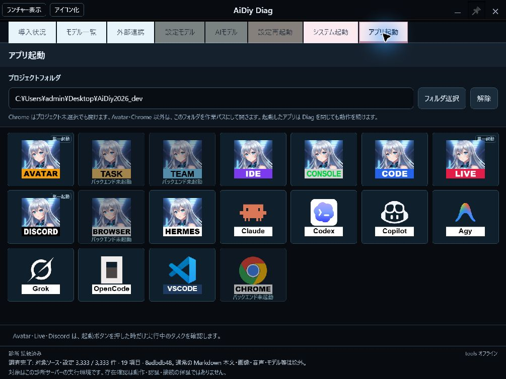

### 1-3. ランチャー表示へ切り替える

フォーム左上の「ランチャー表示」を押します。小さなフォームにアプリ、利用可能なCLI、サーバーの状態が並びます。選択した作業フォルダはそのまま引き継がれます。

フォームを移動しても、次の表示切替はそのフォームの左上を基準に行います。

**図102：ランチャー表示**

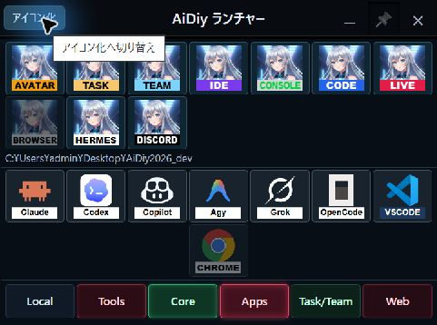

### 1-4. アイコン表示へ切り替える

ランチャー左上の「アイコン化」を押します。小さなAiDiyアイコンと、回転する二重の四角が表示されます。通常画面の「アイコン化」からも同じ表示に切り替えられます。診断画面の接続が必要です。各アプリの作業フォルダ・バックエンド条件は通常表示と共通です。

アイコン表示中は常に最前面です。元のフォームの左上から表示を始め、中央を普通にドラッグすると移動できます。

**図103：アイコン表示**

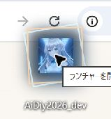

### 1-5. 中央をクリックして開く・閉じる

中央アイコンをクリックすると、起動できるアイコンが周囲へ展開します。もう一度中央をクリックすると閉じます。アイコン数に合わせて広がり方が変わり、画面端では画面内に収まる方向へ展開します。

周囲のアイコンはゆっくり回転し、押したいアイコンにマウスを重ねると止まります。中央付近にマウスがあっても回転は続きます。操作しない状態が60分続くと自動で閉じます。

**図104：アイコンを展開**

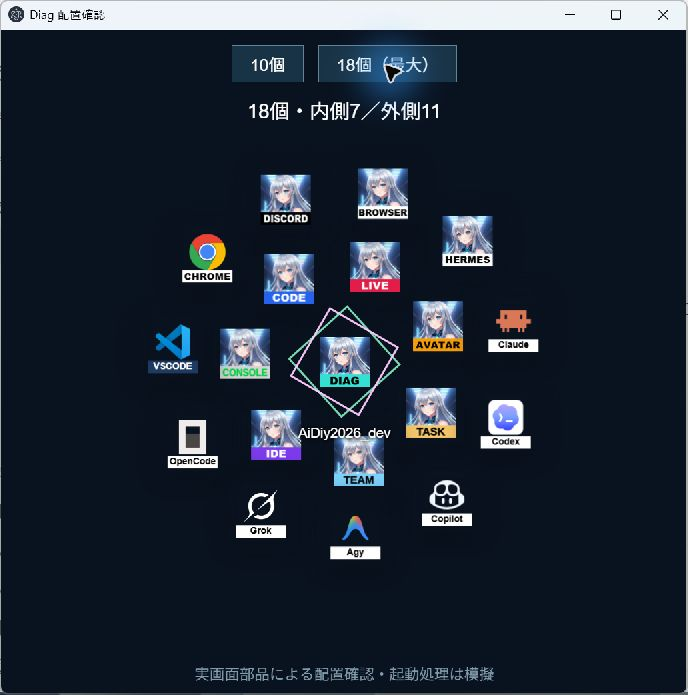

中央をダブルクリックするとランチャー表示へ戻ります。ランチャーの「□」で通常画面へ戻れます。どちらも、その時のフォーム左上を基準に切り替わります。Escは展開中なら収納、収納中なら通常画面への復帰です。

ここまでが起動からアイコン表示までの一連の操作です。アプリの起動は2章、アイコン表示の個別試験は7章で確認します。

### 1-6. 右クリックでアプリを選ぶ

小さいDiagアイコンを右クリックします。回転アイコンを展開する必要はありません。「AiDiy ランチャー」が開き、上部にミニ・標準・閉じる、下にアプリ一覧が最初から表示されます。

左列はAvatarからDiscordまで（Browser・Hermesを含む）、右列は外部CLI・VS Code・Chromeです。表示対象の項目だけが並びます。幅264pxのすりガラス表示で、アプリ名を押すと既存の起動処理へ進みます。画面端ではクリックしたモニターの作業領域内へ補正し、収まらない高さは一覧内でスクロールします。Escまたは外側クリックでも閉じられます。

「閉じる」はDiagの既存の終了確認を通ります。管理サービスが稼働中なら確認が出て、取消で継続します。停止操作の詳細はシステム起動編を参照してください。

Windowsの実装部品を使ったElectron確認窓で、最新の18項目・2列・見出し・半透明の表示を確認しました。画像は確認用の固定一覧です。各項目からの実アプリ起動や、四隅への実マウス移動を今回すべて再実施したものではありません。

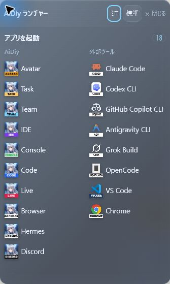

### 1-7. 終了確認・接続制約・画面端の配置

2026年10月28日、収納中の実Diagアイコンから右クリックでメニューを開き、Task起動、ミニサイズ、標準サイズを操作しました。通常画面へ展開する前でも起動先を選べます。Browser→Hermes→Discordの順とChromeの配置、表示中の対象だけが並ぶことを確認しました。

サーバー稼働中の「閉じる」では停止確認が出ます。キャンセル後もDiagと稼働中サービスを維持しました。左上の画面端ではアイコンが一部画面外でも、メニュー全体が画面内に収まりました。その他の端・負座標は自動配置試験の結果であり、今回の手操作は左上です。関連9ファイル51件の自動試験が成功しました。

サーバー稼働中の終了確認です。

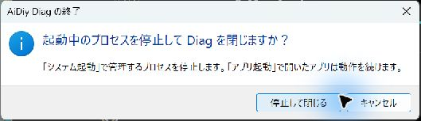

TaskTeam停止時はTask・Teamの起動が無効になり、再起動後に有効へ戻りました。

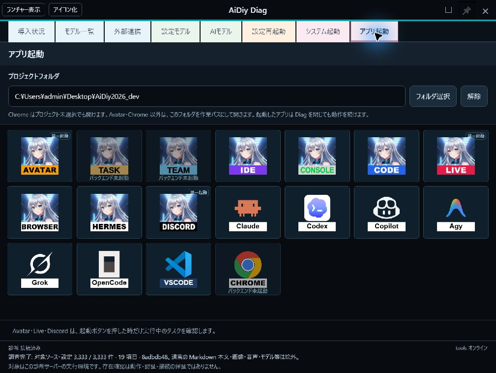

左上の画面端でメニュー全体が画面内に表示されました。

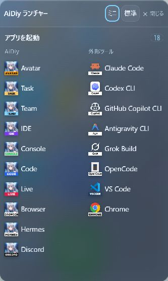

## 2. アプリを開いて接続する

### 操作手順

1. 通常画面で、使いたいアプリのアイコンを1回押します。
2. 「起動確認中…」の間は待ち、対象の窓が実際に開いたことを確認します。起動受付や成功の通知は表示されません。
3. 下の表に沿って、開いた窓と作業フォルダ・接続状態を確認します。使うアプリを1つずつ開き、対象別に結果を記録します。

| アプリ | 開いた後に見るところ |
|---|---|
| Avatar | 認証画面。Avatarは選択フォルダではなくAiDiy本体を作業パスに使います |
| Task / Team | TaskTeamを先に起動します。選択フォルダで要求・チーム画面を開きます |
| IDE | 選択プロジェクトの利用開始画面 |
| Console | 選択プロジェクトでコマンドを入力する端末の待機表示 |
| Code | 選択プロジェクトと接続状態 |
| Live | 選択プロジェクトと接続状態 |
| Discord | 選択プロジェクトと接続パネル |

### 成功の見分け方

各アプリの実窓が開き、対象のフォルダや接続が確認できれば起動確認は完了です。AIの回答は次の3章で確認します。Avatar・Live・Discordは単一起動ですが、重複を試す操作は8章で行います。

| ケース | 確認すること | 結果 |
|---|---|---|
| APP-201 | Avatarの実窓と認証画面、AiDiy本体の作業パス | ✅ OK：実認証フォームを確認。起動時の作業パスも照合 |
| APP-202 | IDEの実窓と選択プロジェクトの利用開始画面 | ✅ OK：ルートを引き継いだ利用開始画面を確認 |
| APP-203 | Consoleの実窓と選択プロジェクトの入力待ち | ✅ OK：選択ルートのPowerShell入力待ちを確認。Diag終了後の継続も確認 |
| APP-204 | Codeの実窓、選択プロジェクト、接続状態 | ✅ OK：AiDiy2026_dev・接続済みを確認 |
| APP-205 | Liveの実窓、選択プロジェクト、接続状態 | ✅ OK：AiDiy2026_dev・接続済み・会話準備完了を確認 |
| APP-206 | Discordの実窓、選択プロジェクト、接続状態 | ✅ OK：ルートを引き継いだ実窓と初期の未接続表示を確認 |

Avatarは利用者認証フォームが開きました。認証画面は[Avatar Electron実行編](./セルフテスト,aidiy_avatar,Electron実行編.md)、認証後の画面とChat応答は9章を参照します。

IDEは「プロジェクト: AiDiy2026_dev」を引き継いだ利用開始画面が開きました。

**図202：IDE利用開始フォーム**

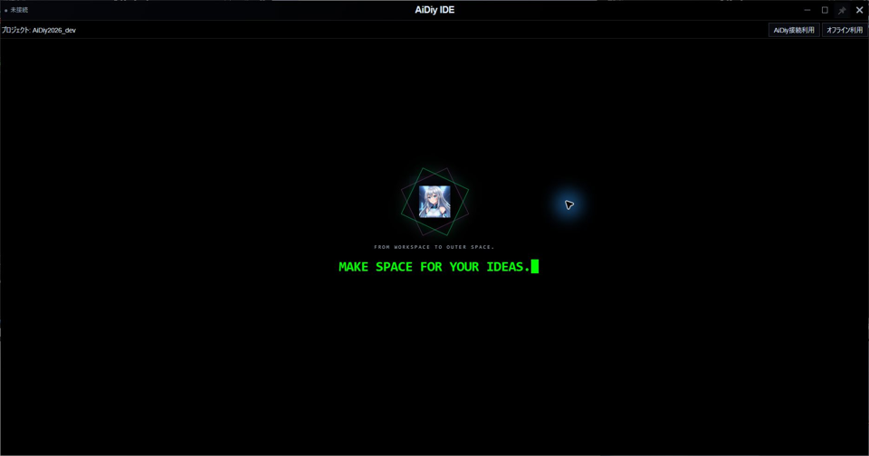

Codeはルートプロジェクトで自動接続し、検証回数0回の入力待ちになりました。

**図203：Code接続済みフォーム**

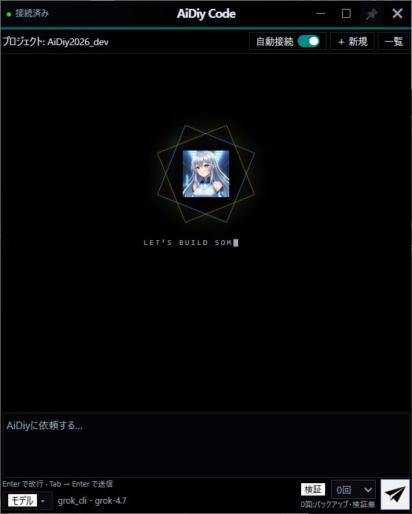

Liveも同じプロジェクトで開きました。接続後の準備完了と初回送信は次章で確認しています。

**図204：Live起動フォーム**

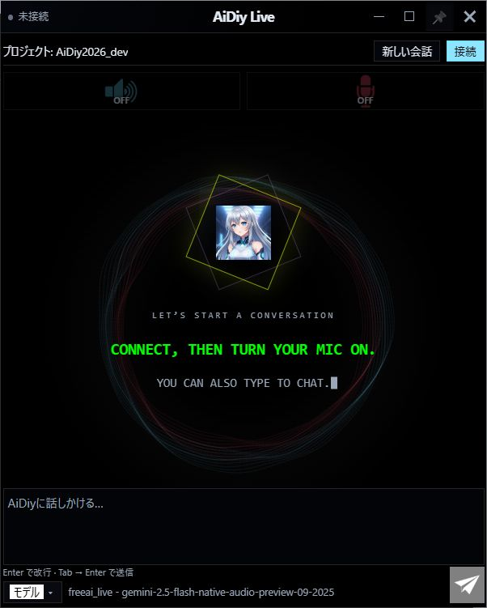

2026年10月21日、Discordも同じルートで開きました。プロジェクト名、未接続の初期状態、音声・コード設定の表示を確認しました。Discordへの接続操作・投稿は行っていません。

**図205：Discord初期表示フォーム**

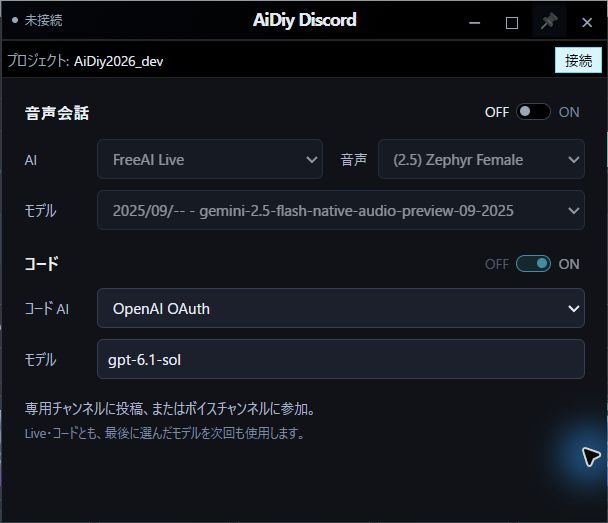

### Task・Teamを開く

1. 「システム起動」でCoreとTaskTeamを起動し、稼働状態を確認します。
2. 「アプリ起動」で作業フォルダを選び、「Task」を押します。ログイン画面が出たら、試験用アカウントでログインします。
3. 要求一覧と接続先8093の接続済み表示を確認します。要求を選ぶとフロー図・明細の別窓も開くため、終了時はそれらも閉じます。
4. 同様に「Team」を開いてログインし、チームの画面と接続済み表示を確認します。

| ケース | 確認すること | 結果 |
|---|---|---|
| APP-207 | Taskを起動・ログインし、要求一覧を表示 | ✅ OK（10/29、実機）：通常・ミニ・円形アイコンで起動。認証後の3窓・接続済み・全終了を確認 |
| APP-208 | Teamを起動・ログインし、チーム画面を表示 | ✅ OK（10/29、実機）：通常・ミニ・アイコンの右クリック一覧で起動。接続済み・3D画面・終了を確認 |

Taskのログイン後は要求一覧が表示されます。今回の確認は起動・ログイン・表示・終了までです。既存行の「完了」は保存済みの状態であり、今回タスクを実行した結果ではありません。

**図206：Taskログイン後の要求一覧**

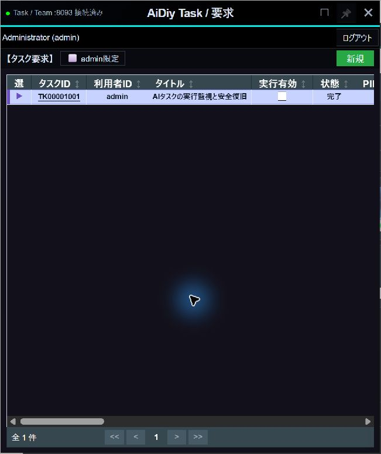

Teamのログイン後はチーム画面が表示されます。今回は新しい依頼の投入や自動実行の有効化を行わず、画面表示まで確認しました。

**図207：Teamログイン後のチーム画面**

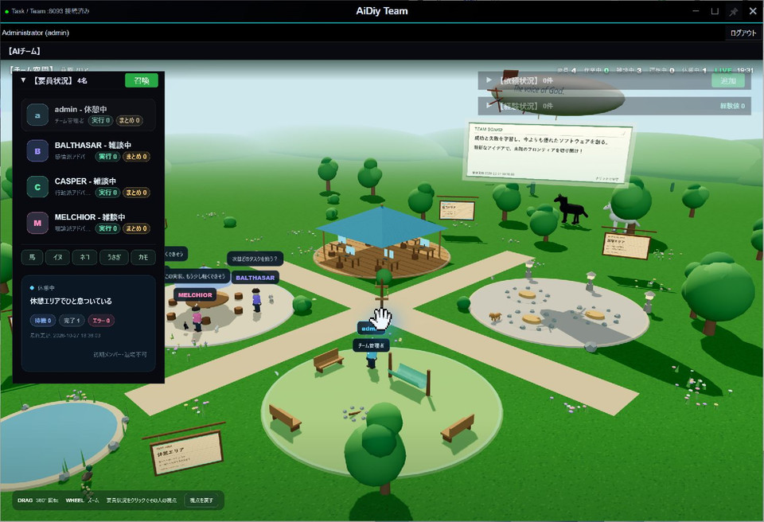

### ミニ表示・アイコン表示からのTask／Team起動

ミニ表示でもTaskとTeamは同じプロジェクトを引き継ぎます。確認後は各アプリの窓を閉じてから次のアプリへ進みました。AIへの新規依頼は送っていません。

ミニ表示から起動したTaskのフロー図です。要求・フロー図・明細の全3窓が接続済みになりました。

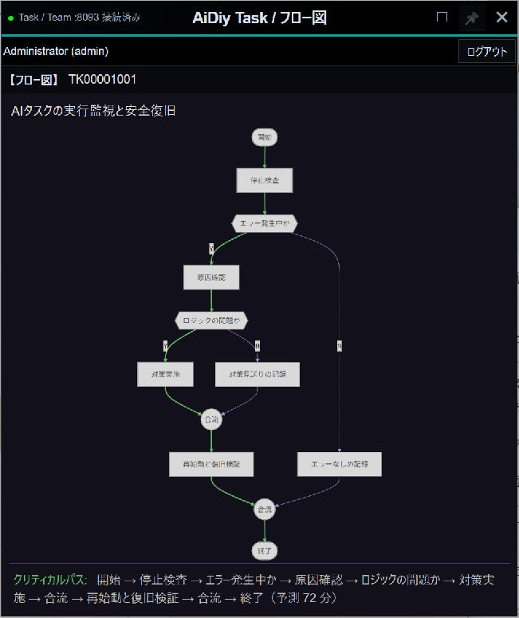

ミニ表示から起動したTeamです。ログイン後に3D画面と要員一覧を表示しました。

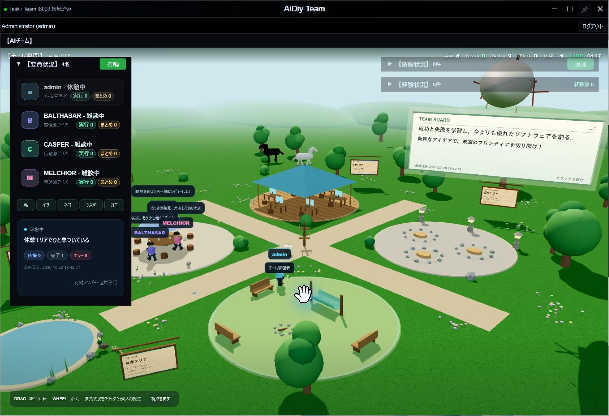

外部アイコンが7個を超える場合は、次の段へ折り返して全てを表示します。現在のミニ画面は1-3節の図102に掲載しています。

円形アイコンから起動したTaskも、同じフロー図を表示しました。

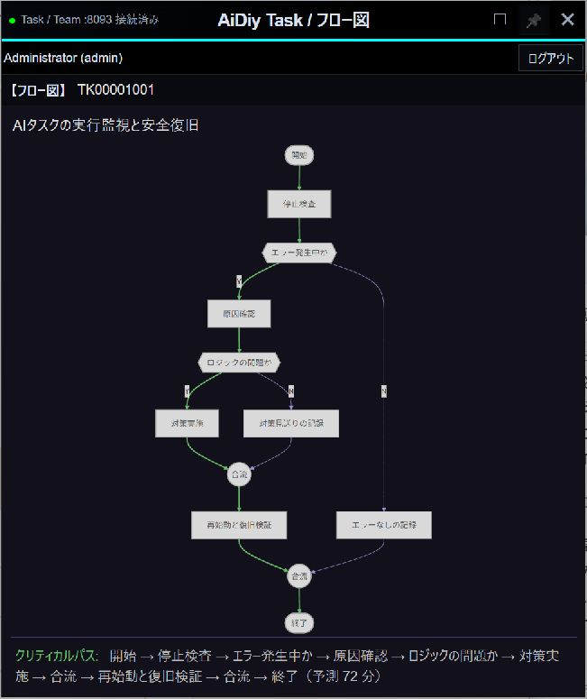

アイコンの右クリック一覧から選んだTeamでも、ログイン・接続済み・3D表示・終了を確認しました。

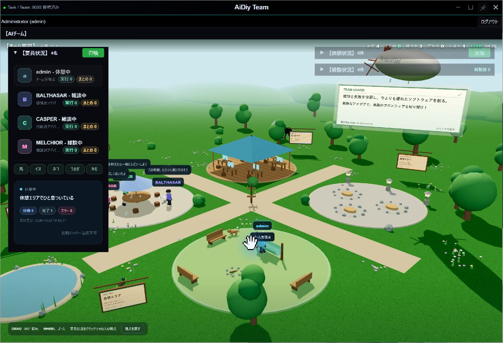

### BrowserをMCPから操作する

2026年10月28日、実DiagでToolsだけを起動し、Browserボタンから単独窓を開きました。`aidiy_chrome_devtools` のHTTPインターフェースへ `session="aidiy_browser"` を渡し、`list_tabs` でその窓を識別しました。同一の `tab_id` に対する `navigate`、`get_html`、`type_text`、`click`、`get_text`、`screenshot` が成功しました。ローカル試験ページへ日本語を入力してボタンを押し、「操作成功：日本語入力とクリック確認」が返ることを確認しています。

MCPのscreenshotで保存した操作結果です。

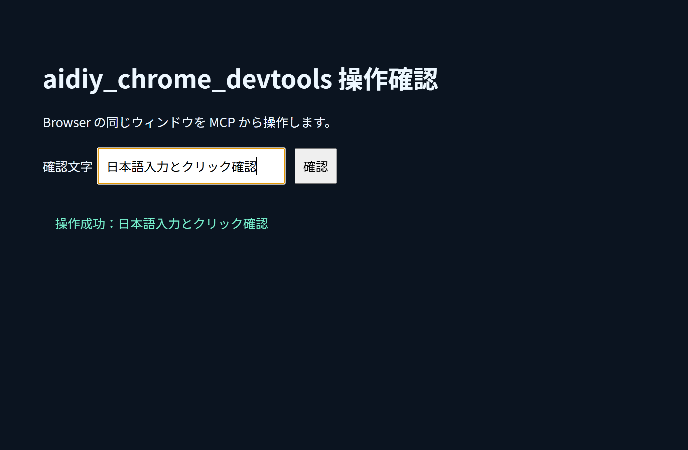

試験ページでの操作確認後にGoogleへ戻し、全試験の終了時にBrowserとToolsを停止しました。通常Chrome側のMCP操作とは分けて確認しています。

## 3. Code・Liveで短い会話をする

### 操作手順

1. Codeの準備完了を確認し、入力欄へ次の文を入れて送信します。

> おはよう。稼働試験です。挨拶を一文だけ返してください。ファイル変更やコマンド実行はしないでください。

2. 自分の送信文とは別に、AIから新しい返答が出るまで待ちます。プロバイダ・モデルと返答を記録します。
3. **Liveの標準条件は、接続済み・「会話準備ができました」を確認して15秒待機し、初回送信後は最大60秒観測です。** 返答を確認できたら、その時刻を記録します。応答がなければ「応答未確認」と記録します。プロバイダの状況も変わるため、アプリ側の時間設定変更や自動再送では補正しません。20秒・30秒待機は過去に実施した追加比較であり、標準手順には含めません。観測時間超過だけではランチャーの不具合やプロバイダ側の原因を断定しません。
4. 準備完了・送信・返答確認の時刻を記録します。音声がある場合は、文字の返答と音声の再生・聴取を分けて記録します。

### 成功の見分け方

自分の入力とは別のAI回答が出れば応答確認ができます。空白だけ、`!`だけ、`!`で始まる回答は正常応答にしません。実際に15秒待った場合は `※注意:15s待機後送信しました。` と記録します。

単独Liveでは利用者または試験操作が15秒待ちます。Diagの設定モデル・AIモデルの試行は自動待機なので区別します。応答待ちと実回答確認済みを区別し、再送した場合も初回送信の成功には数えません。次は4章でランチャー表示とCLIを使います。

**FreeAIはGeminiの無料枠を利用する方式です。FreeAIの試験で応答がない場合は、対応するGeminiへ切り替えて同等の処理を試験し、Geminiで正常応答を確認できれば、共通処理の試験を✅ OK（代替確認）とします。利用枠制限のエラーが確認できたことは、この代替通過判定の必須条件ではありません。**

Liveでは `freeai_live` と `gemini_live` が `AIライブ_gemini.py` を共用するため、画面のモデル選択でGeminiへ切り替え、標準の15秒待機・最大60秒観測で実回答を確認します。切替前後のプロバイダ・モデルと実測結果を残し、判定は「Geminiによる代替試験で✅ OK」と記録します。これはFreeAI自体が応答したことや、利用枠制限が原因であることの証明ではありません。今回のAPP-302全体もこの方針で通過とし、FreeAIの応答未確認は参考結果として保持します。通常動作の自動フォールバックを追加する指示ではなく、試験時の手動切替と判定方針です。

| ケース | 確認すること | 結果 |
|---|---|---|
| APP-301 | Codeの短い挨拶に実回答が出る | ✅ OK：grok_cli / grok-4.7から短い挨拶を受信 |
| APP-302 | Liveの短い挨拶に実回答が出る。FreeAI失敗時は同じ処理のGeminiで代替試験 | ✅ OK：APP-302-Gの実回答で共通処理を確認。APP-302-Oも成功。FreeAI個別の無応答は未確認として記録 |
| APP-302-G | Live画面でGeminiを選択し、15秒待機後に初回送信 | ✅ OK：gemini_live / gemini-2.5-flash-native-audio-preview-12-2025。約2.5秒で挨拶を表示、音声データも受信 |
| APP-302-O | Live画面でOpenAIを選択し、15秒待機後に初回送信 | ✅ OK：openai_live / gpt-realtime-2.1-mini。約1.5秒で挨拶を表示、音声データも受信 |

Codeには「おはよう。挨拶を一文だけ返してください。ファイル変更やコマンド実行はしないでください。」と送りました。`grok_cli / grok-4.7` から「おはようございます。今日もよい一日になりますように。」と返答が出ました。

**図301：Codeの挨拶応答**

FreeAIでは接続・準備完了後も実回答を確認できませんでした。共通処理を使うGeminiとOpenAIでは、準備完了後15秒待機して初回送信し、文字の実回答と音声データを確認しました。FreeAI自体の応答成功とは区別します。

### Live画面からモデルを選ぶ個別試験（2026年10月23日）

1. Diagの「アプリ起動」でLiveを開き、プロジェクト名を確認します。
2. Live画面下部の「モデル」を押し、「ライブAI」「モデル」「音声」を選びます。未接続の状態で「選択する」を押します。
3. 「接続」を押して準備完了を確認し、15秒待ってから上記の挨拶を1回送ります。返答を最大60秒観測します。
4. 次のモデルを試すときは「切断」を押してから、2〜3の操作を繰り返します。今回は接続中の「変更して再接続」は試験対象にしていません。

実ElectronのLive画面で、試験用観測処理から選択・クリック・入力イベントを実行しました。Diagの「AIモデル」試行とは別経路です。作業フォルダはAiDiy2026_dev、スピーカーON・マイクOFFで、音声入力は試していません。

| ケース | モデル／音声 | 準備完了確認 → 初回送信 → 回答確認（日本時間） | 実際の返答 |
|---|---|---|---|
| APP-302-G | gemini_live / gemini-2.5-flash-native-audio-preview-12-2025 / Zephyr | 06:07:45.033 → 06:08:00.369 → 06:08:02.830 | おはようございます。 |
| APP-302-O | openai_live / gpt-realtime-2.1-mini / marin | 06:08:16.700 → 06:08:32.040 → 06:08:33.494 | おはようございます。今日も元気です。 |

※注意:15s待機後送信しました。画面操作の時間を含め、準備完了確認から送信操作開始までの実測は両方約15.34秒です。接続成立時刻そのものは採時していません。60秒以内に返答を確認したため、その約3秒後まで観測して終了しました。各モデル1回の初回送信で、再送はしていません。

Live画面への音声パケット受信はGeminiが7件、OpenAIが8件でした。Geminiのバックエンドでも字幕10文字・音声55,680バイト・ターン完了を確認しました。これは音声データ到達の確認であり、人が音を聴取した結果ではありません。OpenAIは返答が成立しましたが、バックエンドに `conversation.item.added` / `conversation.item.done` の未知イベント警告が残りました。

Geminiのモデル・音声を選択したフォームです。

**図302：LiveでGeminiを選択**

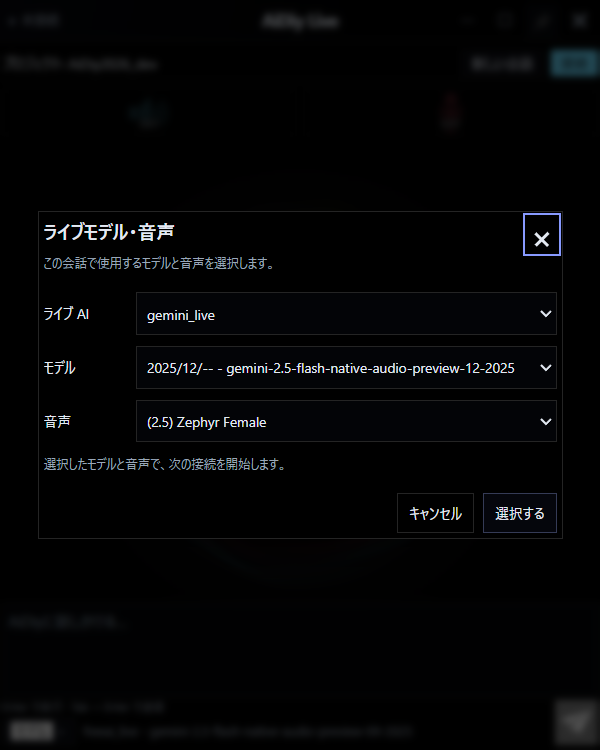

Geminiから、利用者の入力とは別の挨拶が表示されました。

**図303：Live Gemini初回応答**

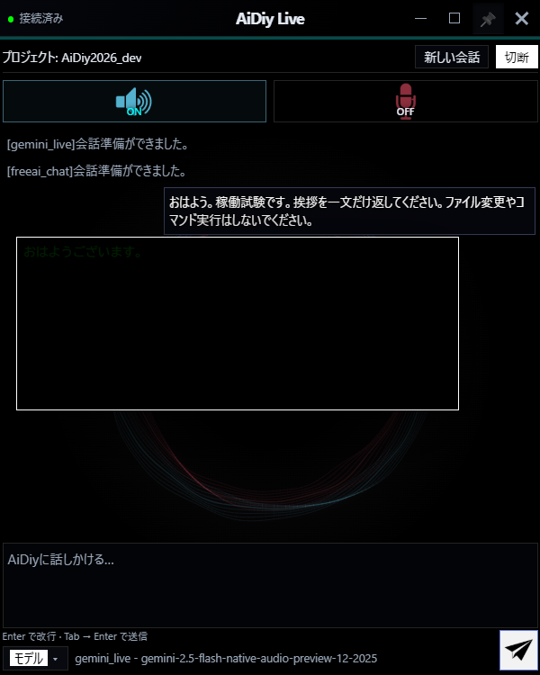

切断後、同じLive画面でOpenAIのモデル・音声を選択しました。

**図304：LiveでOpenAIを選択**

OpenAIからも挨拶が表示されました。画像はデスクトップ全体ではなく、各操作時のLiveフォームを撮影したものです。

**図305：Live OpenAI初回応答**

試験後はモデル選択を元の `freeai_live / gemini-2.5-flash-native-audio-preview-09-2025 / Zephyr` に戻し、試験用LiveとCoreを終了しました。Diagと音声案内用Toolsは残しています。FreeAI個別の実測結果はそのまま残し、Geminiによる代替試験の成功で共通Live機能は通過と判定しました。

## 4. ランチャー表示からアプリ・CLI・VS Codeを使う

### 操作手順

1. Diagへ戻り、タイトルバーの「ランチャー表示」を押します。選択したプロジェクトのパスが引き継がれます。
2. アプリ欄にTask・Team・Browser・Hermes・Discordと、導入済みの外部CLI・VS Code・Chromeが並ぶことを確認します。全対象を表示する場合はBrowser・Chromeを含む計18項目です。アイコンにポインターを合わせると名前が分かります。
3. アプリの操作を終えて窓を閉じた対象を、ランチャーのアイコンから開きます。通常画面と同じ対象・プロジェクトで開けば確認できます。単一起動のアプリを重ねて起動する操作は8章で試します。
4. 導入済みのHermesまたは外部CLIを1回押します。選択プロジェクトのConsoleが開き、その中でCLIが始まるまで待ちます。
5. CLIの入力待ちを確認したら、その窓を閉じて次の導入済みCLIへ進みます。通常画面からの起動も同じように確認し、対象と起動元を分けて記録します。
6. VS Codeの青帯・白文字のアイコンを押し、選択プロジェクトをVS Codeの新しい窓で開きます。ConsoleやCLIの自動承認を使う起動とは別です。通常画面・ランチャー・アイコン表示のそれぞれで同じフォルダを引き継ぐことを確認します。
7. ランチャーの「元のサイズに戻す（□）」を押し、元の通常画面へ戻ります。

### 成功の見分け方

選択したプロジェクトを引き継いで実窓が開き、CLI自身の入力待ちまで進めば確認できます。Consoleが開いたこととCLIの準備完了は別に見ます。モデルはCLIの既定設定を使います。

未導入のCLIは実起動成功に数えず、名前と環境条件を記録します。起動中もランチャーのパス表示が保たれ、通知行で高さが変わらないことを確認します。使い終わったら5章へ進みます。

| ケース | 確認すること | 結果 |
|---|---|---|
| APP-401 | 利用可能なCLI・VS CodeとChromeを表示し、外部アイコンは7個幅で折り返す | ✅ OK（実機・合成併用）：全アイコンの画面内配置とVS Codeの実窓起動を確認。専用APIへの送信は合成Vueで確認 |
| APP-402 | aidiy_hermes：通常・ランチャーの上段から起動 | ✅ OK：通常・ランチャー表示から実起動。ランチャー表示ではMCP初期化後のHermes入力待ちを確認 |
| APP-403 | copilot：通常・ランチャーから起動 | ✅ OK：通常・ランチャー表示からCopilot v1.0.102を表示。ランチャー表示で入力待ちを確認 |
| APP-404 | codex：通常・ランチャーから起動 | ✅ OK：通常・ランチャー表示からCodex v0.163.0を表示。入力待ちとYOLO表示を確認 |
| APP-405 | claude：通常・ランチャーから起動 | ✅ OK：通常・ランチャー表示からClaude Code v2.1.306を表示。入力待ちを確認 |
| APP-406 | agy（Antigravity）：通常・ランチャーから起動 | PASS（環境依存・判定対象外）：両表示からAntigravityを起動。未ログイン表示あり。外部ログインは未操作 |
| APP-407 | grok：通常・ランチャーから起動 | PASS（環境依存・判定対象外）：両表示からGrok Build 1.0.52を起動。フォルダ信頼確認待ち。承認操作は未実施 |
| APP-408 | opencode：通常・ランチャーから起動 | ✅ OK：両表示からOpenCodeを起動。通常表示は他CLIを終了した状態で入力待ちを確認 |
| APP-409 | VS Codeで選択フォルダを開く。未導入・未選択・切断では起動不可。CLI用のモデル・自動承認引数を渡さない | ✅ OK（10/24、自動・合成試験）：通常／ランチャーのラベルとフォルダ送信、専用API認証、WindowsのCode.exe解決、日本語・空白を含む引数、起動失敗の検出、配布アイコンを確認。10/25にComputer Useで通常・ランチャー・円形アイコン表示を実クリックし、各回で選択フォルダの実窓表示を確認。各確認後にVS Codeを閉じ、3窓を同時には保持していません。関連自動試験8件も成功 |

2026年10月25日、通常画面からVS Codeを起動しました。エクスプローラーに選択したAiDiy2026_devが表示されています。

ミニランチャーでも同じプロジェクトが開きました。起動確認後は窓を閉じ、次の試験へ進みました。

円形アイコン表示のVS Codeボタンからも実窓が開き、同じプロジェクトを確認しました。この確認はVS Codeのフォルダ起動を対象とし、表示された拡張の接続状態とは分けて判定しています。

VS Code拡張の現行画面と外周枠の実測結果は[IDE操作編](./セルフテスト,aidiy_ide,操作編.md)に掲載しています。1章のランチャー画像はBrowser・Chrome追加後の現行表示です。

ランチャーは図102、収納状態は図103、展開状態は図104を参照します。

HermesはMCP初期化後に入力待ちへ進みました。起動直後の空白画面とは区別しています。

Codexは選択フォルダとYOLOモードを表示し、入力待ちになりました。

OpenCodeは通常画面から起動し、入力欄を確認しました。注意：他のCLIを終了した状態で確認します。

## 5. 使い終わったアプリを閉じる

### 操作手順

1. 開いたアプリの作業を保存し、それぞれの終了操作で窓を閉じます。
2. ConsoleとCLIも窓ごとに閉じます。1つを閉じたことで、まだ使っている別の窓が終了していないことを確認します。
3. 試験で開いた窓が残っていないことを確認します。Diagとサービスはこの章では動かしたままです。
4. システムも使い終わった場合は[システム起動編6章](./セルフテスト,aidiy_diag,システム起動編.md#6-システムを停止してdiagを閉じる)で停止します。

### 成功の見分け方

選択・起動・簡単な利用・個別終了までできれば、アプリ起動の通常運用は完了です。6章以降は改めて必要な窓を開いて試します。

**通常運用の通し確認結果：CLI・個別終了まで実施。LiveはGemini・OpenAIの実回答を確認しました。FreeAIの無応答は参考記録として残し、成功には数えません。** 各アプリ・CLIの実施範囲と、確認できなかった環境条件をまとめます。

| ケース | 確認すること | 結果 |
|---|---|---|
| APP-501 | 個別終了で他の窓を止めず、対象の所有プロセスを回収する | ✅ OK：通常起動のHermes・Copilot・Codex・Claude・Antigravity・Grokは窓・所有サーバー終了とポート解放を確認。他CLIの6窓は残存。最終整理でOpenCode・IDE・Code・Console・Live・Discordも終了を確認 |

## 6. 個別試験：フォルダ選択・表示条件

1. プロジェクトの「解除」、フォルダ選択の「キャンセル」、選び直しを順に試します。通常・ランチャーでの共有、Diag再起動・再読込での未選択を確認します。
2. 日本語・空白・記号付きパスを選び、渡された作業パスを照合します。存在しないパスやファイル指定は隔離した入力条件で試します。
3. ランチャーの未選択案内「SELECT YOUR PROJECT ▸▸ READY FOR LAUNCH」を押し、通常のアプリ起動へ戻ることを確認します。
4. 外部CLIが0件・一部・全件の表示を合成一覧でも試し、幅384px、名称込み40pxアイコン、サービス6件の1行表示と内容高を確認します。
5. 表示・再接続だけで起動しないこと、□とサービス名の戻り先、ピンの保持を確認します。

各条件を試した後は通常のプロジェクト選択へ戻します。窓の長押し移動と演出の詳細は[システム起動編8章](./セルフテスト,aidiy_diag,システム起動編.md#8-追加テスト窓操作表示アニメーション)で確認します。

| ケース | 確認すること | 結果 |
|---|---|---|
| APP-601 | Electron／Webの選択・取消・解除が働き、選んだ絶対パスが表示される | ✅ OK：Web実ブラウザで選択・取消・解除。Electron実窓は選択結果の注入、取消は状態単体試験 |
| APP-602 | 日本語・空白・記号付きパスが正しく渡る。共有CODE_BASE_PATHを変更しない | ✅ OK（合成プロセス併用）：日本語・空白・記号付きパスを引数とcwdで照合。任意シェル文字列を生成しない |
| APP-603 | 通常／ランチャーで選択共有。再起動・再読込で未選択になる | ✅ OK：実Electronで通常／ランチャー表示の選択共有、Web実ブラウザで再読込後の未選択を確認 |
| APP-604 | 存在しないパス・ファイル指定を拒否し、起動しない | ✅ OK（隔離API試験）：存在しないパス・ファイル・相対パスで起動要求を拒否 |
| APP-605 | ランチャーの名称込みアイコンが40px、サービス6件が1行。幅384pxで欠けず、内容高に追従 | ✅ OK：Web実ブラウザで384px・内容高・40pxアイコン・サービス6件1行。実Electronのランチャー表示も撮影 |
| APP-606 | 未選択の英語案内からアプリ起動へ戻る。選択後はパスを表示 | ✅ OK：実ElectronとWebで案内からアプリ起動へ復帰。WebではEnter／Spaceも確認 |
| APP-607 | 表示・再接続は存在確認だけ。CLI起動やログイン、導入は自動実行しない | ✅ OK（合成プロセス併用）：表示と再接続で一覧確認のみ、起動要求なし |
| APP-608 | □は元のタブへ、サービス名はログへ復帰。ピン初期OFFと選択保持 | ✅ OK：通常表示・サービスログへの復帰はWebで確認。実Electronでピン初期OFF、ON選択後の通常／ランチャー表示往復での保持、OFFへの復帰を確認 |
| APP-609 | 未選択の通常欄は赤枠で、アプリ・CLIの起動が無効 | ✅ OK：実フォームと合成UIで確認 |
| APP-610 | Browser・Chromeを含む最大18項目。利用可能なCLIだけを表示 | ✅ OK：通常・ミニ・円形の現行表示を確認。右クリック一覧は表示対象だけを2列に分ける |

10/22の試験ではピンの往復保持とOFFへの復帰を確認しました。1章のランチャー画像は10/27にピンONで撮影したものです。

ランチャーは図102、収納状態は図103、展開状態は図104を参照します。

## 7. アイコン表示の個別試験

1章の流れでフォルダを設定し、「アイコン化」まで進んでから確認します。一つずつ操作し、結果を確かめてから次へ進みます。

| ケース | 操作と確認すること | 今回の結果 |
|---|---|---|
| APP-701 | 未選択・未接続ではアイコン化できない。選択後は通常とランチャーの両方から切り替えられる | ✅ OK：条件と選択の共有を回帰試験、実フォームで確認 |
| APP-702 | 中央クリックで開閉。10個までは一重円、11個以上は内外4：6に近い二重円 | ✅ OK：10個と18個の同じVue部品による実表示、18個の実Diag表示を確認。18個は内7・外11。円周配置の回帰試験も通過 |
| APP-703 | 中央付近では回転を続け、外周アイコンへのマウスオーバーで止まる | ✅ OK：実フォームの回転状態を確認。自動確認ではhover状態を注入して比較 |
| APP-704 | 収納中・展開中に中央を普通にドラッグする。解放時に誤って開閉しない | ✅ OK：OSの実マウス入力で連続移動と展開中の移動を確認。長押し不要。解放後も元の開閉状態を保持 |
| APP-705 | ダブルクリックでランチャーへ戻り、通常画面も現在のフォーム左上から復帰する | ✅ OK：実マウスのダブルクリックと、移動後の表示切替9パターンを確認。途中の通常画面が見えない |
| APP-706 | 四隅・上下左右中央で展開し、収納すると元の位置へ戻る | ✅ OK：8か所で確認。各3回の追加往復でも位置ずれなし |
| APP-707 | 背後のフォームを操作しても最前面を維持する。通常・ランチャーへ戻すと元のピン設定になる | ✅ OK：背後フォームを実操作し、OS側の最前面状態も確認。復帰時の解除を確認 |
| APP-708 | アイコンのない透明部分から背後のフォームをクリックできる | ✅ OK：実マウスのクリックを背後の試験フォームが受信。アイコン表示は最前面のまま |
| APP-709 | 60分間操作がなければ収納し、操作すると待ち時間を延長する | ✅ OK（設定・関連回帰）：現行ソースの60分設定と操作後の予約更新を確認。60分間の実時間放置は未実施 |
| APP-710 | アイコンの形・文字・背景が揃い、不要な枠やマークがない | ✅ OK：全画像40px。Hermesの文字余白、中央と周囲の柔らかい黒背景、内側サーバー・下部マークなしを確認 |
| APP-711 | アイコンからアプリを起動できる。CLI用Consoleは中央の約800×600pxで開く | ✅ OK：Consoleの実起動と終了を確認。CLIの代表Copilotは中央の802×602px（DPI丸め込み）で起動確認。AI回答の成功とは区別 |
| APP-712 | 収納中でも右クリック一覧を利用。常時展開・2列・すりガラス・左上の表記 | ✅ OK：現行Electron部品を18項目で確認・撮影。収納状態によらず同じ一覧を渡す実装を確認 |
| APP-713 | 画面端・別モニター・小画面でも画面内に収める | ✅ OK（合成座標）：四隅、負座標のモニター、小さい作業領域で全体が収まることを自動確認 |
| APP-714 | 表示対象以外の起動要求と別送信元を拒否 | ✅ OK（合成IPC）：表示項目の起動キーと送信元・mainFrameを照合 |
| APP-715 | ミニ・標準・閉じるが既存処理を使う | ✅ OK（合成IPC・終了確認）：サイズ変更イベント、親のclose処理、稼働中の確認・取消・承認を確認 |

### 展開と移動の確認画面

1個の収納状態（図103）と18個の二重円（図104）を確認しました。透明部分には背後のブラウザが見えています。画像は1章に掲載しています。

6・8・10・13個の表示条件と画面端8か所の結果は10/22の試験記録です。10/24の撮影で全条件を再実施したものではありません。

CLI用のConsoleは中央に約800×600pxで表示します。Consoleの現行画面と日本語入出力の確認は[IDE操作編](./セルフテスト,aidiy_ide,操作編.md)を参照します。

### 試験方法と範囲

Windowsの実Electronを使用しました。ドラッグ・中央クリック・ダブルクリック・背後へのクリックはOSの実入力で確認しました。有効数の変更は試験用の一覧応答で6・8・10・13個を作り、画面端と表示切替は実フォームのイベントと窓位置を制御して照合しました。フォルダ選択は試験用に選択結果を渡しており、OSのフォルダダイアログ操作そのものとは分けています。

10/24の再撮影では白い撮影専用ウィンドウを背面に表示し、実フォームの表示領域だけを保存しました。IDEと撮影用背景は終了済みです。再利用する撮影手順は[説明資料の書き方](./セルフテスト,_説明資料の書き方.md)に記載しています。

10/22の正式な画像は実フォームの表示領域だけを撮影しています。デスクトップ、CLaunch、背後の試験用フォームは画像に写し込みません。今回はCLaunchを一時終了し、背景アイコンを試験用フォームで覆いました。試験後は背景フォームを閉じ、CLaunchを再起動して元の表示へ戻しました。Liveと試験用Coreも終了し、確認用Diagを1窓と音声案内用Toolsを残しています。

### 一重円・二重円と起動モーション

10個では一重円です。同じVue部品に10項目を渡して確認しました。

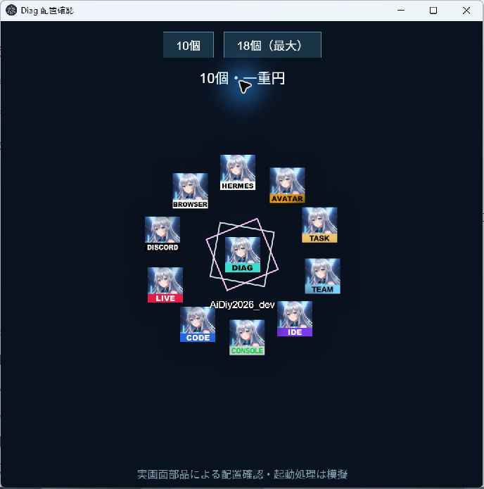

起動受付の光が回る間、他のアイコンが暗くなり、終了後に元の明るさへ戻ります。

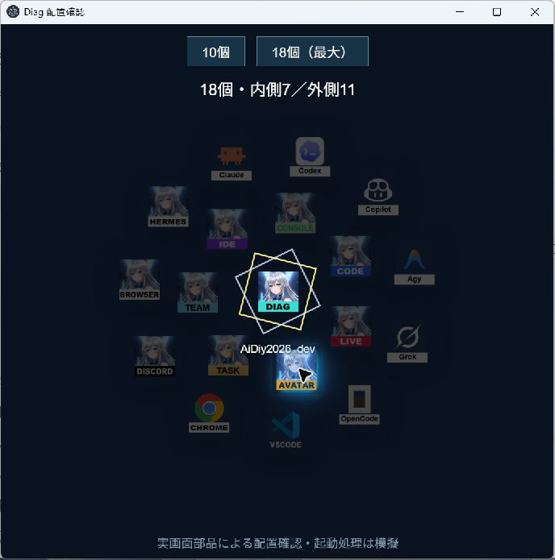

右クリックは、収納中でもアプリ一覧が最初から開きます。最新版の画面と操作は1-6節を参照してください。

起動受付は1.8秒で2回転し、起動要求と並行します。BrowserはTools必須、ChromeはToolsとWebの両方が必要です。関連自動試験45件が通過し、後続の右クリック・モーション変更後もVue関連8件・型検査・配布物一致を確認しました。

無操作で自動収納する時間は60分です。60分間の実時間放置は未実施であり、設定値の確認と区別します。Mac／Linux実機と長時間運転はPASS（環境依存・判定対象外）として未実施です。今回の再試験では各CLIのAI応答、Discord投稿、Live音声を確認していません。

同じVue部品の確認窓で、二重円が外側から順番に広がることを確認しました。外側の展開完了後に内側へ進みます。

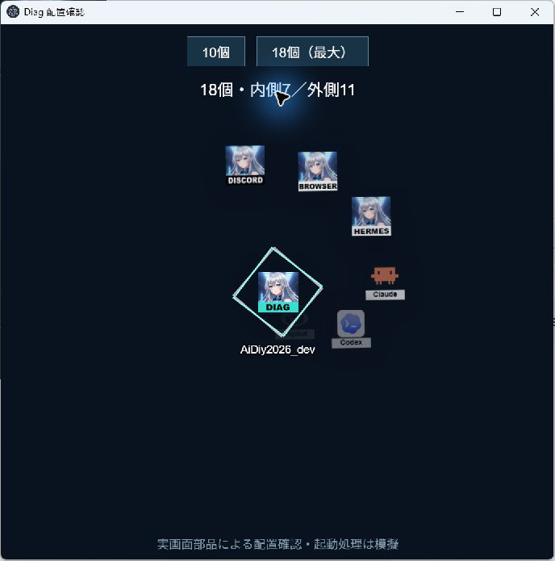

閉じる時は逆順で、内側が先に収納され、外側が後に残ります。全アイコンの収納が終わってから窓を縮めます。

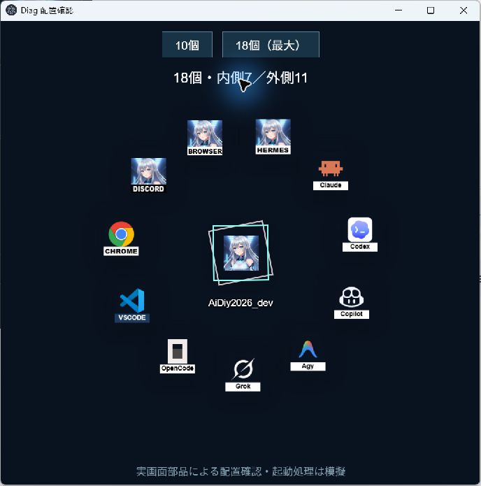

## 8. 個別試験：重複起動・並行動作・切断

1. Avatar・Live・Discordの起動ボタンを再度押し、同じ窓が増えないことを確認します。「起動済みです」という通知は表示されません。
2. IDE・Code・Consoleは同じプロジェクトで追加の窓を開きます。
3. 同じCLI・同じプロジェクトを、先の起動中にも押して複数のConsoleを開きます。別CLIとの同時起動も確認します。
4. 一方の終了・起動失敗・端末切断を試し、他の窓が継続することを確認します。失敗条件と30秒の接続待ち条件は隔離試験で作れます。
5. 最後にアプリを残してDiagを終了し、独立した窓が残ることを確認します。Coreなどの停止による接続断と、アプリ自身の終了を区別します。
6. 残した試験用の窓を個別に閉じ、対象の所有プロセスが回収されたことを確認します。

通常画面は処理中・エラーを確認する場所です。ランチャーでは一時通知を追加せず、起動中もプロジェクト表示を保ちます。エラーは通常へ戻って確認します。

| ケース | 確認すること | 結果 |
|---|---|---|
| APP-801 | Avatar・Live・Discordの単一起動。確認失敗時も追加起動しない | ✅ OK（実機・合成併用）：Avatar・Liveの実機重複防止。3対象の排他とタスク照会失敗時の拒否は合成試験 |
| APP-802 | IDE・Code・Consoleの同一プロジェクトでの別窓起動 | ✅ OK：実ElectronでIDE・Code・Consoleを同一プロジェクトから各2窓起動 |
| APP-803 | 通常は処理中・エラーのみ、ランチャーは一時通知なし。起動確認ダイアログなし | ✅ OK：実画面と合成Vueで通知・処理中表示を確認。失敗条件は合成試験 |
| APP-804 | 同一CLI・同一プロジェクトの連続／同時起動で独立したConsoleが増える | ✅ OK（実機・合成併用）：同じCLIを残して通常画面から追加起動。連打・同時要求は全7CLIの合成試験 |
| APP-805 | 別CLIの並行起動、一方の終了・起動失敗で他方に影響しない | ✅ OK（実機・合成併用）：別CLIを実起動し、通常窓の終了後も6CLIが残存。片側の起動失敗は合成試験 |
| APP-806 | 再接続だけではCLIを再起動しない。未導入・未選択では起動要求を送らない | ✅ OK（合成試験）：再接続・未導入・未選択から起動要求を送らない |
| APP-807 | 最後の有効端末接続から30秒の切断、または表示後30秒の初回接続なしで、そのConsoleの所有プロセスだけ終了 | ✅ OK（隔離試験）：実WebSocketと合成PTYで所有プロセスの分離・再接続・切断回収を確認。猶予時間を短縮した試験であり、実CLIの30秒実測ではない |
| APP-808 | Diag終了後も6アプリとCLIのConsoleが独立して残る | ✅ OK：Avatar・IDE・Code・Live・Discord・Consoleの実窓が残存。CLI代表のCodexも入力待ちを維持。Console／Codexは所有サーバーのHTTP応答も確認。個別終了後は所有プロセスを回収 |

Diagを終了しても、Consoleは選択ルートのPowerShell入力待ちを維持しました。Consoleを閉じると所有サーバーも終了しました。

CodexもDiag終了後に入力待ちを維持しました。CLIの窓を閉じた後に所有プロセスと待受が終了することを確認しました。

DiscordはDiag終了後も選択プロジェクトの接続パネルを表示しました。外部接続・投稿は行わず、確認後に窓を閉じました。

**図803：Diag終了後のDiscord**

## 9. 個別試験：Avatarの認証後操作・Discord投稿

1. Avatarの認証画面で試験用利用者としてログインします。Chatを選び、Chatの「会話準備ができました」を確認してから3章と同じ短い挨拶を送ります。Liveだけの準備完了表示ではChat送信を始めません。ElectronとWebのどちらで試したか記録します。
2. Discord投稿を試す場合は今回の送信先と送信操作の許可を確認し、指定したチャンネルで試験投稿と返答を照合します。
3. 自分の送信文、AIの回答、音声通話の成否を分けて記録します。接続パネルが開いただけでは投稿・会話の成功にしません。

Avatarの詳細は[Electron実行編](./セルフテスト,aidiy_avatar,Electron実行編.md)・[Web実行編](./セルフテスト,aidiy_avatar,Web実行編.md)、IDEを開いた後の操作は[IDE操作編](./セルフテスト,aidiy_ide,操作編.md)を参照します。

| ケース | 確認すること | 結果 |
|---|---|---|
| APP-901 | Avatarの認証後の簡易応答。Electron／Webを区別して記録 | ✅ OK（Electron）：認証後のAvatar・Chat画面を確認。freeai_chatの準備完了後の再送で短い挨拶の実回答を受信。初回成功とは数えない。Web操作は別冊の対象 |
| APP-902 | Discordへの試験投稿は送信先・許可がある場合のみ実施し、投稿・応答を照合 | 対象外：今回の送信先・投稿許可は未指定。接続パネル表示を投稿成功とは扱わない |

Electronでログインし、Avatar本体とChat画面の表示を確認しました。終了時にはAvatarを閉じて8092も解放されました。

**図901：Avatar認証後**

freeai_chatの準備完了を確認して送信し、「おはようございます、本日もよろしくお願いいたします。」という実回答を受信しました。画面には準備前の送信エラーも残っていますが、判定対象は準備完了後の再送です。音声の聴取成功とは区別します。

**図902：AvatarのChat実回答**

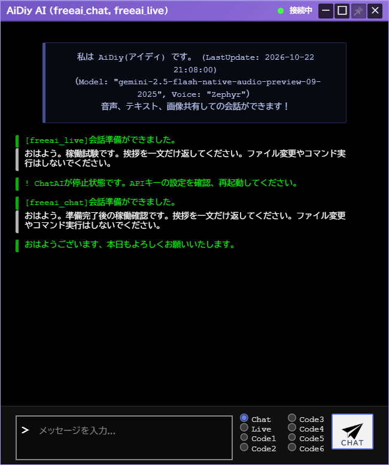

## 10. 試験の記録方法

各ケースに実施日・環境・操作・実際の結果・判定を記録し、先頭の総合評価も更新します。実機と合成試験、今回の結果と過去の結果を区別し、未実施を合格へ置き換えません。キーやJWTは記録しません。

ケースIDは過去の結果との照合用に維持します。図番号はケースIDとは別で、「章番号＋章内の掲載順」です。画像名・図番号・本文の参照先を合わせ、同じ画像は再掲せず図番号で案内します。

自動試験の入口は `backend_diag/checks/app-launch.check.mjs`、`app-launch-state.check.mjs`、`cli-launch.check.mjs`、`cli-launch-state.check.mjs`、`mini-cli-ui.check.cjs`、`full-launch-controls.check.cjs`、`frontend_ide/checks/project-instance.test.mjs` とCLI／端末の `cli-parallel-lifecycle.test.mjs` です。ブラウザの合成起動確認は `backend_diag/checks/app-launch-browser.mjs` を使います。実CLI・有料APIの結果へ置き換えません。

2026年10月21日、Discordの型検査と配布パネルの整合性確認が通過しました。ローカルREST・Gateway・音声WSS等の合成ネットワーク試験も単独再実行で通過しました。Discordへの投稿・実音声会話を行った結果ではありません。

画像とPDFの扱いは[説明資料の書き方](./セルフテスト,_説明資料の書き方.md)を参照します。本冊子はMarkdownと同名PDFを更新しています。
