# aidiy_diag システム起動編 — 総合テストと操作手順書素材

> 文書: `セルフテスト,aidiy_diag,システム起動編.md` | 実装: `backend_diag/起動/サービス管理.mjs`, `backend_diag/ui/src/起動/`, `backend_diag/起動/electron-main.cjs`

## 総合評価

**総合評価：✅ OK (PASS 1件含む)。設定起動・Webの手動表示・赤／緑の状態表示・停止・ログコピーを確認しました。**（2026年10月19日・Windows）

サーバーとは、各アプリを裏で動かすプログラムです。この冊子では、その起動と停止を確認します。

| 知りたいこと | 現在の結果 |
|---|---|
| システムを起動して使い始められる？ | ✅ OK：通常使う5機能が順番に起動し、Web画面が開くところまで確認しました。 |
| 状態を見たり、終了したりできる？ | ✅ OK：ミニ表示、終了確認、キャンセル、全体の停止を確認しました。 |
| 追加確認も終わった？ | ✅ OK：Task / Teamの手動停止・復帰、Webの手動表示、強制停止と設定起動の切り替え、選択ログのコピー、ミニ表示を確認しました。 |

**本冊のWindows試験は通過しました。** [PDF版の総合テスト実施記録](./セルフテスト,aidiy_diag,システム起動編.pdf)も作成しました。操作手順書はまだ作成しません。 Local（PC内で動かすAI）は起動環境を用意していないため **PASS (別途環境調整必要)** の1件です。Mac／Linuxは別途実機確認を推奨しますが、今回のWindows試験の完了条件には含めません。

PDF版は本文に合わせて再生成し、全ページの日本語・表・画像・改ページを目視確認しました。

操作の流れは、**1章：開く → 2章：設定起動 → 3章：Webを手動で開く → 4章：状態・ミニ表示 → 5章：ログ → 6章：停止・終了**です。実画面はWindowsのComputer Useで操作し、Web表示先はChrome MCPでも照合しました。今回の追加試験は2026年10月19日21時台に実施し、修正後の最終結果だけを掲載しています。

## この冊子の進め方

1章から順に、起動、Web表示、状態確認、ログ、停止を試します。各章の手順と結果を、画像と見比べてください。画像のフォルダ名や日時は環境により異なります。

### 始める前に

AiDiyのセットアップが必要です。今回のフォルダは `C:\Users\admin\Desktop\AiDiy2026_dev`。操作時は自分のAiDiyフォルダを使います。

起動操作は **1章から**、使い終わった後の停止操作は **6章** を見ます。起動後にアプリを開く場合は[アプリ起動編](./セルフテスト,aidiy_diag,アプリ起動編.md)へ進みます。

### 画面で使う言葉

| 表示・用語 | 意味 |
|---|---|
| タブ | 画面上部などに並ぶ、表示内容を切り替えるボタンです。 |
| コンソール／ログ | プログラムが現在の動きやエラーを文字で知らせる欄です。 |
| ポート | プログラムと通信するときの窓口の番号です。番号を覚える必要はありません。 |
| 稼働中 | そのプログラムが動いている状態です。 |
| ミニ表示 | 状態とアプリ起動アイコンを、小さなウィンドウにまとめた表示です。 |

今回の良好な結果は **✅ OK**、失敗した結果は **❌ NG**、まだ試していない項目は **⏸ 未実施**、時間などを測っていない項目は **⏸ 未測定** と記載します。

## 1. aidiy_diag を開く

### 操作手順

1. セットアップ後、ターミナル（文字でコマンドを入力するアプリ）を新しく開きます。
2. `aidiy_diag` と入力し、Enterキーを押します。
3. 「AiDiy Diag」のウィンドウが開くまで待ちます。システムが止まっていれば、最初は「システム起動」が表示されます。
4. 小さなミニパネルで開いた場合は、Toolsがすでに動いています。タイトルバー（一番上の帯）の復帰ボタンを押して、通常の大きな画面に戻します。

「コマンドが見つかりません」と出た場合は、そこで起動試験を止め、セットアップとコマンドの登録状態を確認します。詳細は[環境運用手順](./共通,開発環境運用手順.md)を参照してください。

### 成功の見分け方と今回の結果

**✅ OK**：システムがすべて止まっている状態から起動しました。「システム起動」が開き、起動前のToolsが未接続と表示されました。

起動直後の画面です。「システム起動」が開き、Toolsは未接続と表示されています。

## 2. 設定起動でシステムを起動する

### 操作手順

1. 6章の停止操作で全機能を止めてから、「システム起動」を開きます。1つでも稼働中なら右上は「強制停止」、全停止後は「設定起動」になります。
2. Tools / MCP、Core、Apps、Task / Team、Webの「起動対象」をオンにし、Localはオフにします。変更は自動保存されます。
3. Webの「ブラウザで開く」をオンにします。自動表示にもTools / MCPが必要です。
4. 「設定起動」を1回押します。通常表示のまま、Tools → Core → Apps → Task / Team → Webへタブとコンソールが追従します。
5. 「起動処理が完了しました」と5機能の緑の状態表示を確認します。WebはHTTP応答が20秒間安定してからChromeで開きます。
6. ミニ表示を使いたい場合だけ、自分で「ミニ表示」を押します。設定起動から自動でミニ表示へは変わりません。

| 機能 | 役割 | ポート（参考） | 起動対象 |
|---|---|---|---|
| Local | PC内のAIモデル | 8096 | オフ |
| Tools / MCP | AIやアプリの共通の道具 | 8095 | オン |
| Core | 認証・AI会話の共通処理 | 8091 | オン |
| Apps | 業務画面の処理 | 8098 | オン |
| Task / Team | AIへの作業依頼 | 8093 | オン |
| Web | ブラウザで使う画面 | 8090 | オン |

### 成功の見分け方と今回の結果

**✅ OK**：全停止から設定起動し、通常表示を維持したまま5機能が順番に起動しました。起動待ちの対象は赤く脈動し、ポートが開くと緑へ変わりました。Webの20秒間の安定確認とChromeでの表示、起動完了まで確認しました。Localの実起動は対象外です。

設定起動の直後です。通常表示のままToolsのコンソールへ移り、起動対象の未開放ポートは赤く表示されています。

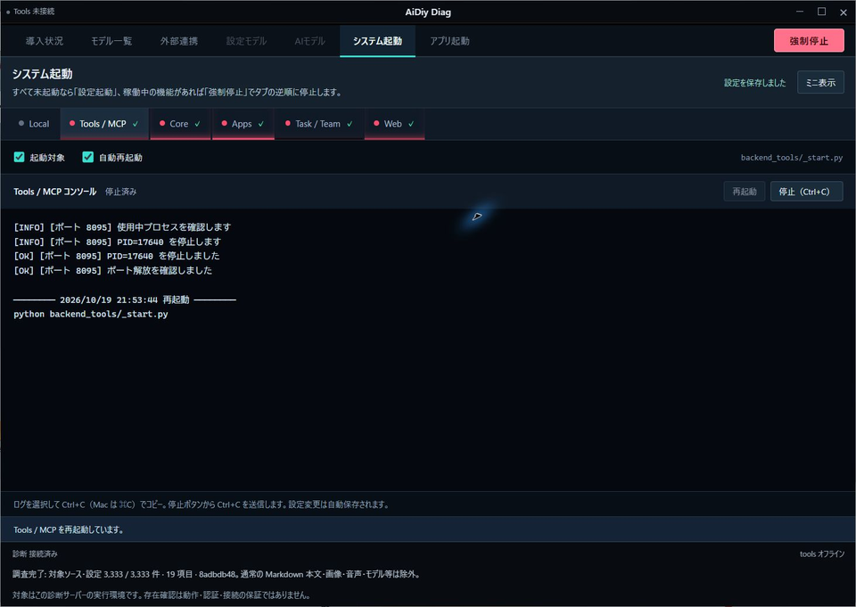

起動がWebまで進みました。タブがWebへ追従し、HTTP応答の20秒間の安定確認が行われています。

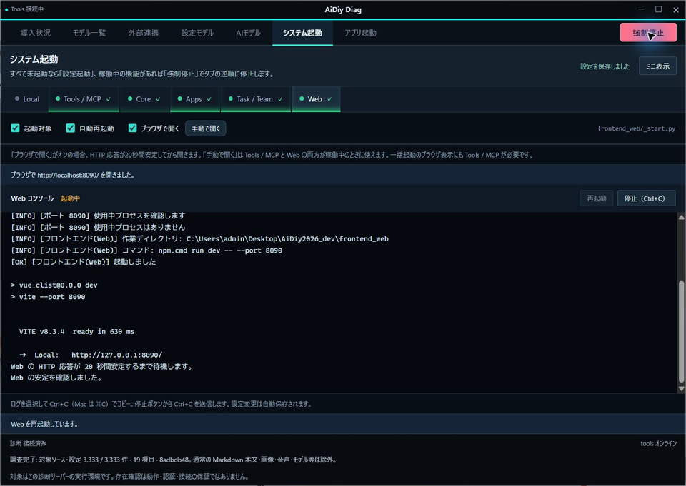

5機能が起動した最終画面です。Webは稼働中となり、画面下に起動完了が表示されています。

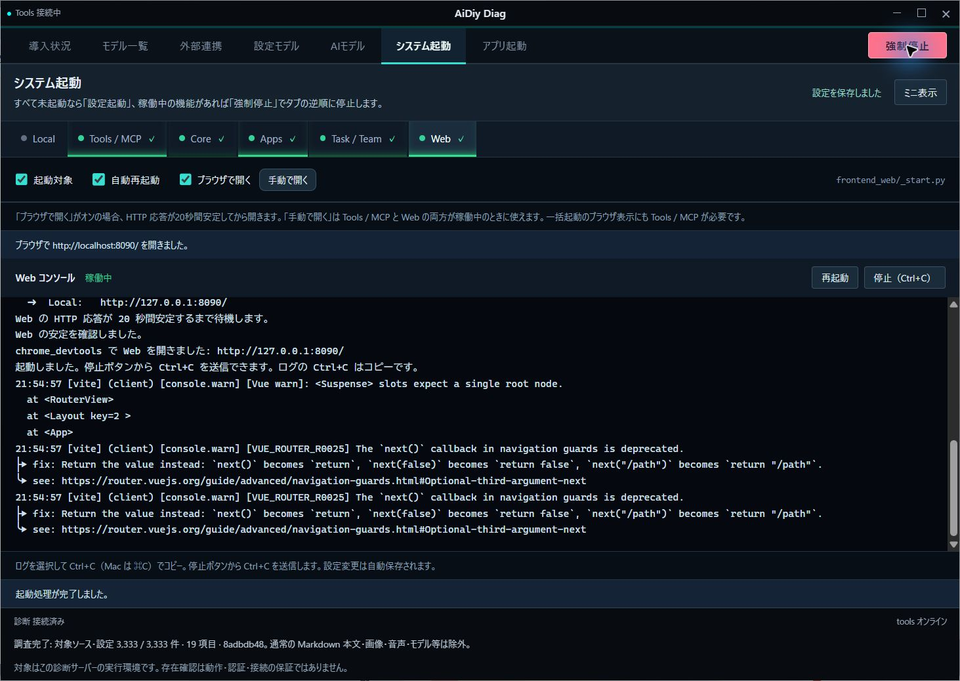

## 3. Webを手動で開く

### 操作手順

1. Tools / MCPとWebが起動していることを確認し、「Web」タブを選びます。
2. 「ブラウザで開く」のすぐ右にある「手動で開く」を押します。
3. 「ブラウザで http://localhost:8090/ を開きました。」を確認します。ChromeにWebの画面が開きます。

この操作はブラウザを開くだけです。サービスの起動・再起動は行いません。「ブラウザで開く」のチェックがオフでも使えます。Tools / MCPまたはWebが停止中・未確認なら、ボタンは押せません。

### 成功の見分け方と今回の結果

| ケース | 確認したこと | 結果 |
|---|---|---|
| WEB-01 | ボタンがチェック欄の右にある | ✅ OK：実Electronで確認しました。 |
| WEB-02 | 自動表示をオフにして手動で開く | ✅ OK：実操作で成功通知が出て、localhost:8090の新しいタブを確認しました。 |
| WEB-03 | 実際に開いたWeb画面 | ✅ OK：Chrome MCPで表示先とログイン画面を照合しました。ログインはこの試験の対象外です。 |
| WEB-04 | 停止中の押下を防ぐ | ✅ OK：実機の全停止時に無効でした。片方だけ停止・未確認の条件も合成サービスの自動試験で確認しました。 |

Webタブの設定欄です。「ブラウザで開く」の右に「手動で開く」があります。ToolsとWebのポートが開いているため有効です。

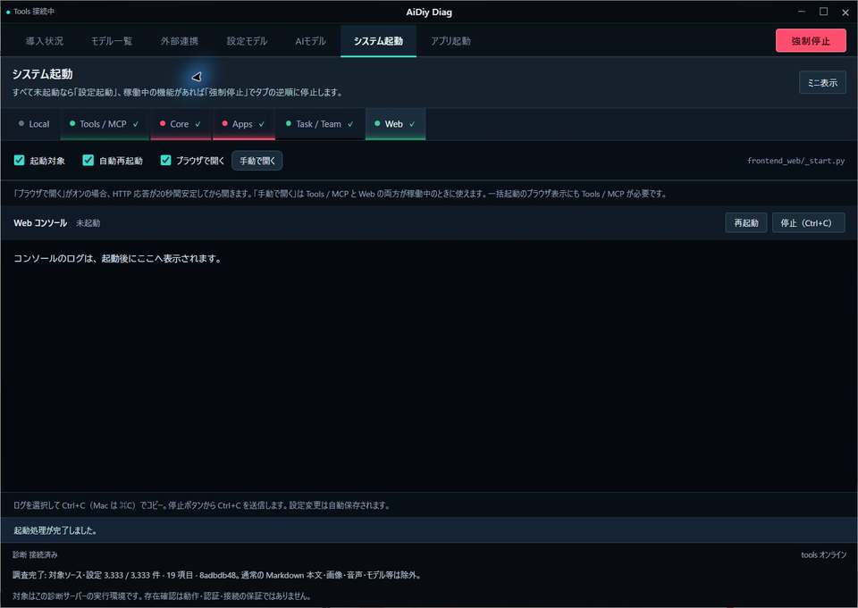

自動表示のチェックをオフにして手動ボタンを押しました。チェックがオフのまま、localhost:8090を開いた成功通知が出ています。

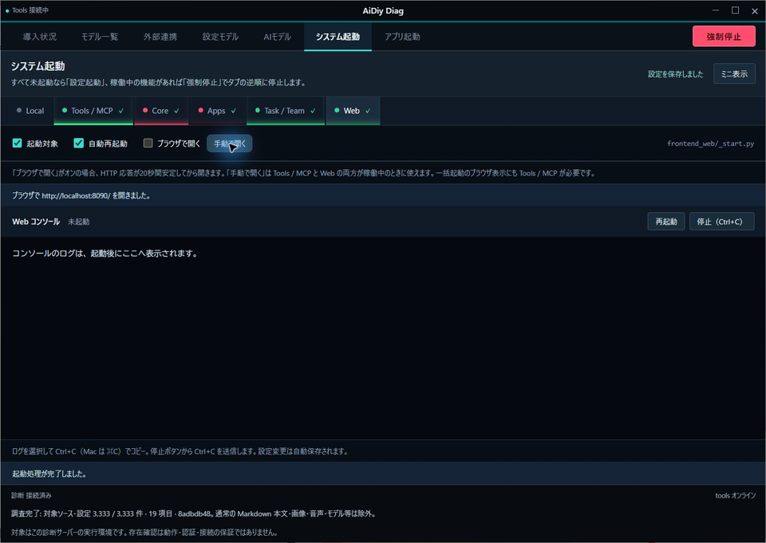

手動操作で新しく開いたWeb画面です。Chrome MCPでlocalhost:8090のタブと一致することを確認しました。

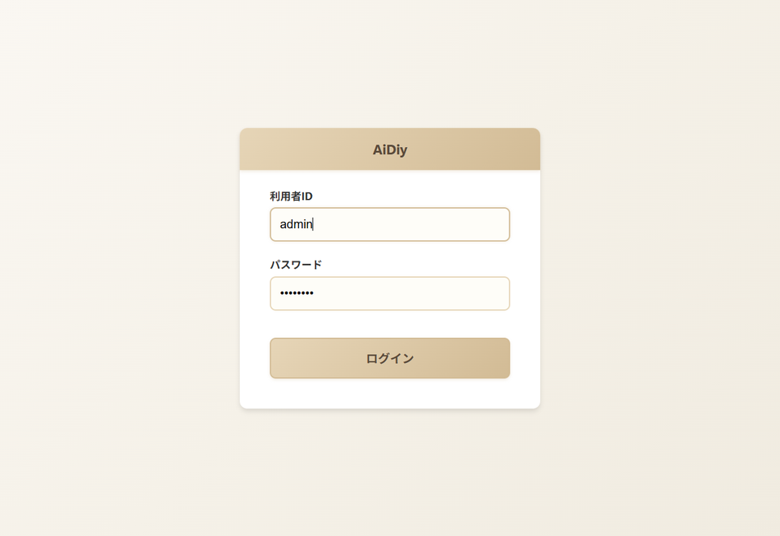

ToolsとWebを停止した画面です。「手動で開く」は無効になり、停止中のWebを起動する操作にはなりません。試験後、自動表示のチェックは元のオンへ戻しました。

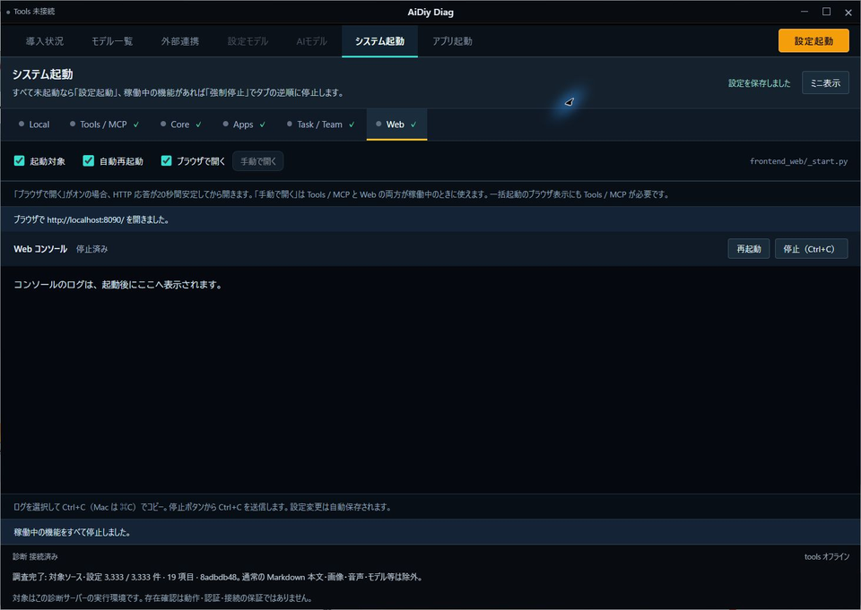

## 4. 状態とミニ表示を確認する

### 操作手順

1. 通常画面の「システム起動」を開き、見出し付近の「ミニ表示」を押します。
2. 小さなウィンドウの下段にある機能名と色を確認します。緑の脈動は通信窓口が開いている状態です。ほかが稼働中、または設定起動中に、起動対象の通信窓口が閉じていると赤く脈動します。起動対象外と、最初から未確認の項目は灰色です。全停止後は赤い脈動を止め、通常表示で選択した未起動タブの下線は注意色の橙色になります。
3. ログを読みたい機能名を押します。その機能のコンソールが通常画面に表示されます。タイトルバーの復帰ボタンからも通常画面へ戻れます。
4. アプリを開く場合は[アプリ起動編](./セルフテスト,aidiy_diag,アプリ起動編.md)へ進みます。

### 成功の見分け方と今回の結果

**✅ OK（表示）**：起動した5機能は緑、起動していないLocalは灰色でした。色は約5秒ごとに更新する仕組みで、Diag以外から起動した機能も調べます。緑色でも、AIから返答があるかどうかは会話試験で別に確認します。

ミニ表示の状態欄です。起動した5機能は緑、対象外のLocalは灰色です。

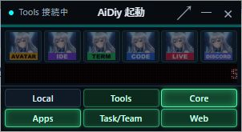

**✅ OK（追加確認）**：実ブラウザでは、状態確認の要求間隔が4.9秒以上となり、ポート状態の変化がミニ表示へ反映されました。この周期試験だけは合成サービスを使い、実サービスの試験と区別しています。

隔離した実Electronの初期ミニ表示です。左上・最前面で開き、通常表示への復帰もできました。

長押し中には移動の印が出ます。0.4秒時点では動かず、ミニは約530ms、通常は約518msで移動可能になりました。両方とも移動後のサイズと、解放時に誤クリックしないことを確認しました。入力は実Electronへ送り、カーソル位置とフォーカス判定は試験用に固定しています。

通常表示でも同じ長押し操作を確認しました。Escで移動を解除できました。

開始ズームは設定750ms、実アニメーションの観測値約785msでした。透明な領域を先に確保し、ズーム中に実ウィンドウの寸法が変わらないことも確認しました。状態は約5秒周期で更新され、サービス名から対応するログ画面へ戻れました。

### Task / Teamの手動停止と復帰

2026年10月19日・Windowsの実ElectronをComputer Useで操作しました。この個別試験ではTools / MCPとWebを稼働させ、Task / Teamの「起動対象」と「自動再起動」をオンにしました。Core・Apps・Localはこの個別試験の起動条件に含めていません。

1. Task / Teamを起動し、通常表示とミニ表示で緑を確認します。
2. 通常表示で「Task / Team」を選び、「停止（Ctrl+C）」を押します。
3. 「停止済み」と赤い下線を確認し、自分でミニ表示へ切り替えて赤い脈動を確認します。
4. 「Task / Team」からコンソールへ戻り、「再起動」を押します。ポートが開き、通常表示・ミニ表示が緑へ戻ることを確認します。

**✅ OK**：Task / Teamのポート8093が開放 → 未開放 → 開放へ変わり、両表示で緑 → 赤 → 緑になりました。明示停止後は自動再起動オンでも停止を維持しました。Tools / MCPとWebは稼働を維持しています。ミニ表示は約5秒ごとの確認に合わせて変わります。内部再起動の一時的なポート閉鎖も同じ表示判定です。

停止前の通常表示です。Task / Teamは稼働中で、起動対象にチェックが入り、緑の下線になっています。

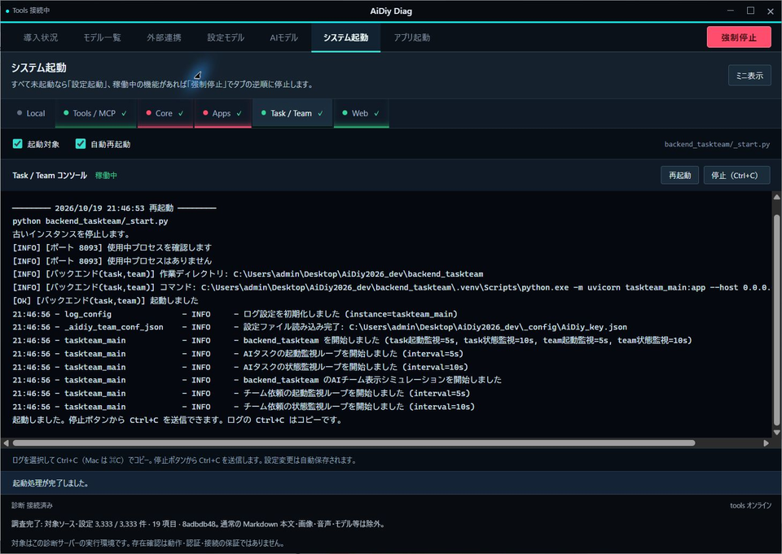

Task / Teamだけを手動停止しました。状態は停止済み、下線と丸印は赤です。ToolsとWebは緑のままです。

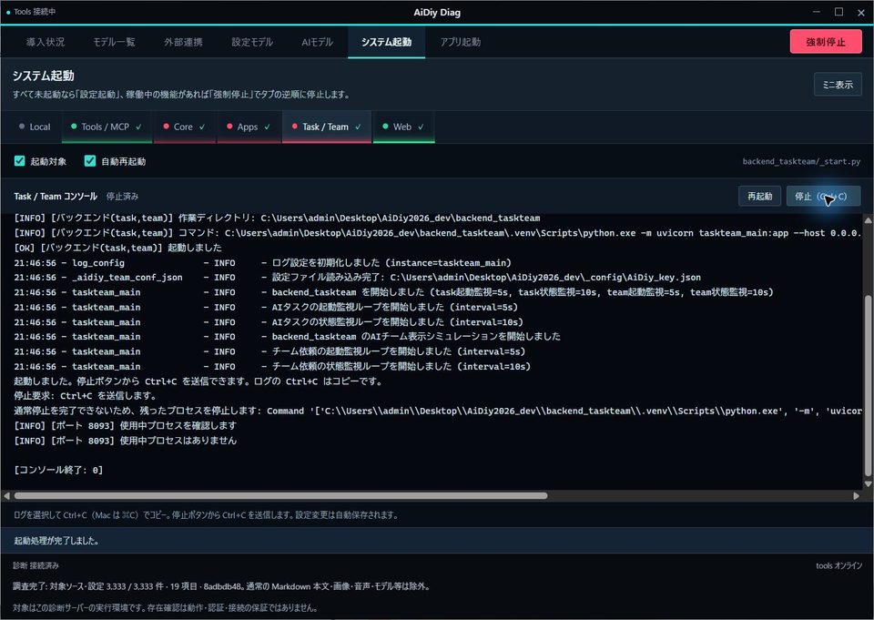

停止したままミニ表示へ切り替えた1時点目です。Task/Teamは赤で、ToolsとWebは緑です。

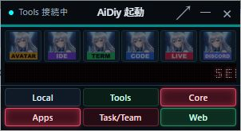

同じ停止状態を別時点で撮影しました。Task/Teamの明るさが変わり、赤い脈動が続いていることを確認しました。

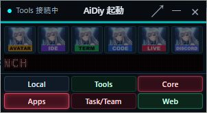

Task / Teamを再起動した最終画面です。稼働中となり、赤から緑の下線へ戻りました。

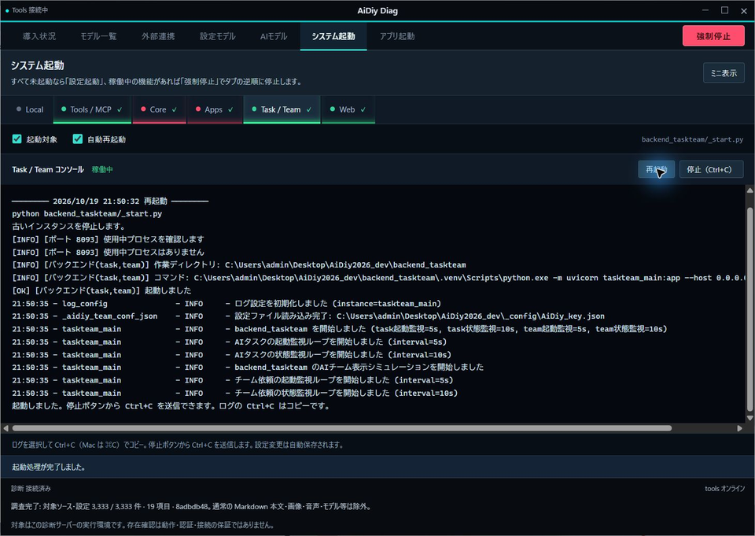

復帰後に自分でミニ表示へ切り替えました。Task/Teamは再び緑になっています。

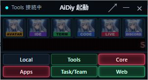

## 5. ログを読む・コピーする

### 操作手順

1. 「システム起動」で、ログを読みたい機能名を押します。
2. コンソールの一番下を見ます。新しいログが出ると、表示も一番下へ移動します。
3. 長い行が右側で切れている場合は、コンソール下側の横スクロールを動かします。行は折り返さず表示されます。
4. 文字を選び、Ctrl+C（Macは⌘C）でコピーします。メモ欄に貼り付け、元のログと比べます。
5. 1つの機能だけ起動し直す試験では、その機能を選んで「再起動」を押します。以前の表示が消え、新しいログが出て「稼働中」になるまで待ちます。

このコンソールでは、Ctrl+Cキーはコピーに使います。プログラムを止めるときは、次章の停止ボタンを使います。

### 成功の見分け方と今回の結果

**✅ OK（表示）**：新しいログに合わせて一番下へ移動すること、左右にスクロールできること、再起動で表示がクリアされ新しいログになることを確認しました。

**✅ OK（追加確認）**：実画面で `python backend_server/_start.py` の1行を選び、Ctrl+Cでコピーしました。OSのクリップボードを取得して比較し、末尾の改行を除いて完全一致しました。コピー後もAppsは稼働中です。

ログの1行を選んだ画面です。Ctrl+Cはコピーとして働き、停止にはなりませんでした。

## 6. 停止・終了する

### Diagを開いたまま一括停止する

1. 1つでも稼働中なら、右上の「強制停止」を押します。
2. 停止中はボタンが無効になります。稼働中の機能をWeb → Task / Team → Apps → Core → Tools / MCP → Localの逆順で停止し、停止済みは飛ばします。起動対象のチェックを外した機能でも、稼働中なら停止対象です。
3. 全停止後、「設定起動」へ戻ったことを確認します。必要なら2章から再び起動できます。

**✅ OK（実機）**：稼働中だったWeb → Task / Team → Tools / MCPの順に停止しました。停止済みのCore・Apps・Localは飛ばし、3ポートがこの順に閉じたことも照合しました。管理外で起動したWeb・Toolsも停止し、自動復活しませんでした。全停止後は「設定起動」が有効になり、選択中タブの下線が橙色へ戻りました。その後の5機能の設定起動も2章のとおり完了しました。

**✅ OK（合成サービス）**：6機能すべての逆順停止、起動途中の後続取り消し、連打防止、1件の停止失敗後も残りを続けることを自動試験で確認しました。関連試験はNode.js 36件・Python 3件が成功し、実ブラウザの画面試験も通過しました。Localの実起動成功を意味する結果ではありません。

Web・Task / Team・Toolsが稼働中の画面です。右上は起動操作ではなく「強制停止」になっています。

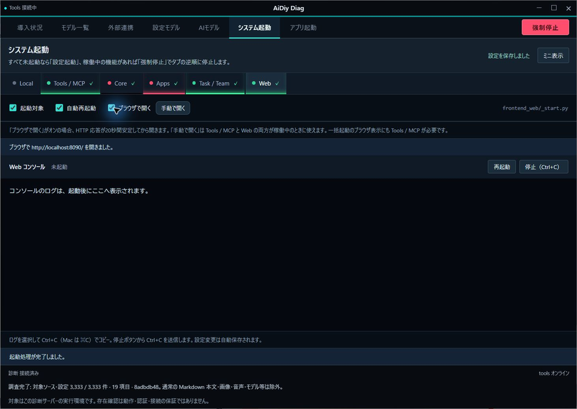

一括停止を受け付けた画面です。最初はWebのコンソールに移り、右上は停止中となって連打を防いでいます。

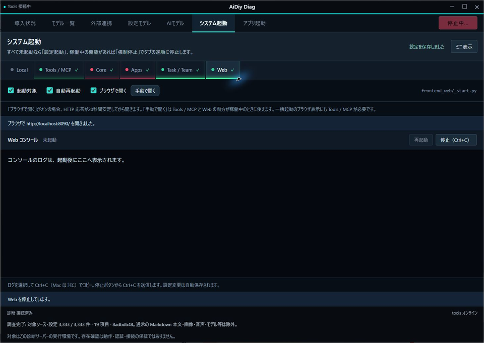

すべての停止が完了しました。「設定起動」が有効になり、選択中のToolsタブは橙色の下線になっています。

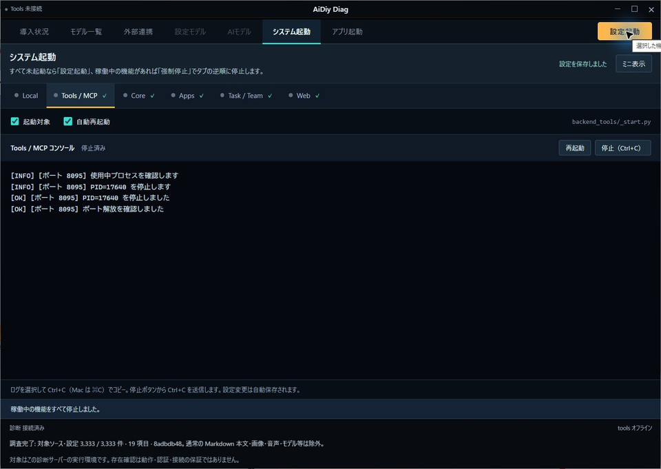

### 個別停止とDiag終了の操作手順

1. **1つの機能だけ止める場合**は、対象の機能名を選び、コンソール右側の「停止（Ctrl+C）」を押します。ボタンが停止信号を送ります。キーボードでCtrl+Cを押す操作ではありません。
2. **Diagと、Diagから起動したシステムをまとめて終了する場合**は、タイトルバー右上の×を押します。
3. 起動中のシステムがあると確認ダイアログが出ます。確認試験では、まず「キャンセル」を押し、動いていた機能がそのまま動いていることを確かめます。
4. もう一度×を押し、終了してよい場合だけ「停止して閉じる」を押します。Diagのウィンドウが閉じるまで待ちます。
5. 起動中のシステムがない場合は、確認なしでDiagが閉じます。

「アプリ起動」から開いたIDEやTermなどは別のアプリとして動きます。使い終わったものは、各アプリでも終了操作を行ってください。

### 成功の見分け方と今回の結果

**✅ OK（確認・取消・終了）**：ミニ表示の×でも終了確認が出ました。「キャンセル」後は5機能が動き続けました。「停止して閉じる」で終了し、再びDiagを開くと、全対象が停止を表す灰色でした。Termが別アプリとして残る結果は、アプリ起動編で確認できます。

稼働中に×を押した画面です。停止して閉じるか、キャンセルするかを選べます。

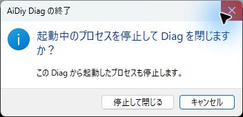

「キャンセル」後の画面です。起動していた5機能が動き続けています。

**✅ OK（個別停止・復帰）**：Appsだけを停止し、Core・Tools・Task / Team・Webが稼働を続けることを確認しました。ポート8098が閉じたことも確認しました。自動再起動ONでも明示停止後は再起動しませんでした。

Appsだけを停止した画面です。対象は「停止済み」、他の4機能は稼働しています。

続いてAppsの「再起動」を押すと復帰しました。古いログは消え、今回の起動時刻から表示されました。

### Electron起動時のコマンド画面も確認

**✅ OK（Windows）**：Diag・Avatar・IDE・Term・Code・Live・Discordの起動と、起動時の補助コマンドを確認しました。Pythonの起動・プロセス確認・停止などの補助処理も非表示で実行され、AvatarはVite・TypeScript監視・Electron監視を直接起動します。

実子プロセスではコンソールが作られず、起動ログは取得できました。Electron本体の画面は通常どおり表示します。停止ボタンのCtrl+C送信に使う専用コンソールは非表示のまま保持し、停止の回帰試験も通りました。Pythonの確認34件と、補助プロセス・GUIの追加確認9件が成功し、追加確認の失敗は0件でした。

## 7. 試験の記録方法

画像の名前・保存先・自動試験の記録方法を開く

今回の試験は、全システムを止めたところから始めました。起動前の状態と、その後の操作結果は各章の本文と画像に記載しています。

Computer Use で画面を観察し、1操作して直後に再取得する。前回のウィンドウID・座標・要素番号は再利用しません。端末へのコマンド入力、ログイン、権限許可は UI 自動操作へ含めません。コマンドによるアプリ起動は通常の実行ツールから行います。

証跡は `_AIDIY/knowledge/images/セルフテスト,aidiy_diag,システム起動編/` に保存します。新しい画像名は `<実施ID>__aidiy_diag-システム起動_201_…画面.png` とし、先頭1桁は本書の章番号、後ろ2桁は章内の連番です。操作説明に合わせて章を並べ替えた場合は、採用画像のファイル名・代替テキスト・本文の参照も一緒に更新します。取得済み画面は `scripts/checks/実画面試験記録.mjs` の `createEvidenceRecorder(実施ID, 'system', {toPng})` で保存できます。JPEGで返る実画面はPNGへ変換して保存します。解消した課題の経緯は掲載せず、本文と採用画像を修正後の最終結果へ更新します。

本文には操作・期待結果・実際の結果と説明付き画像を並べ、起動要求だけを起動成功としません。確認した事実と判定は本文へ記載します。全体 `_cleanup.py` が削除対象にする `_AIDIY/knowledge/temp/` は作業用に限定し、正式な画像は置きません。

