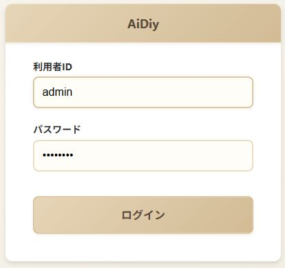
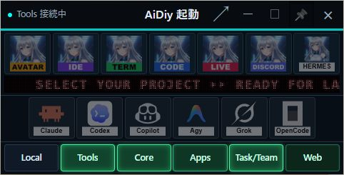
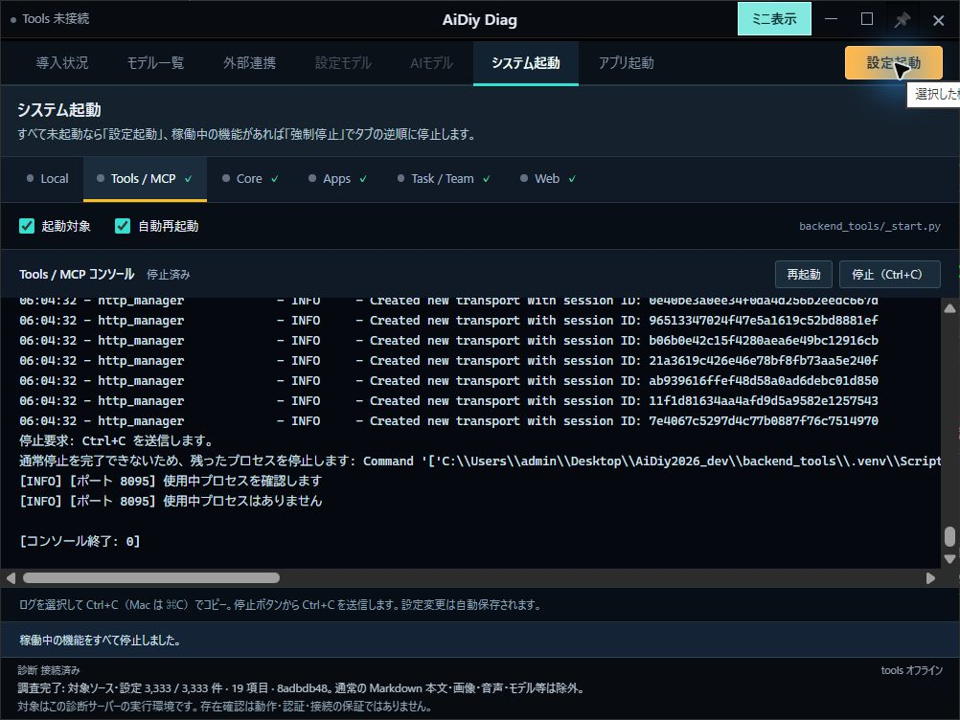

# aidiy_diag システム起動編 — 総合テストと操作手順書素材

> 文書: `セルフテスト,aidiy_diag,システム起動編.md` | 実装: `backend_diag/起動/サービス管理.mjs`, `backend_diag/ui/src/起動/`, `backend_diag/ui/src/ウィンドウ/ステータスバー.vue`, `backend_diag/起動/electron-main.cjs`, `backend_diag/起動/サイズ切替.cjs`

## 総合評価

**総合評価：⏸ 一部実施・未実施あり。2026年10月20〜21日、Windowsの実フォームで確認し、本日の検証を終了しました。**

未実施・未測定のケースはそのまま残します。全件合格とはせず、PDFは未作成です。

| 確認範囲 | 現在の結果 |
|---|---|
| 通常運用の通し確認 | Diag起動、5機能の順次起動、Web手動表示要求、ミニ表示、全停止・Diag終了を確認。ログコピーは未実施 |
| 通し確認後の追加テスト | 起動管理などの自動試験を実施。実画面での追加条件は未実施 |

過去のエビデンスはクリア済みです。以下は今回確認した結果だけを掲載します。未確認のケースは未実施のままとし、PDFは冊子全体の再試験通過後に作成します。対象はWindowsとし、Mac／Linuxの実機確認は別途推奨です。

## この冊子の進め方

**1〜6章が通常運用、7〜8章が追加テスト、9章が記録方法です。**

| 順番 | 操作の流れ |
|---|---|
| 1〜2章 | Diagを開き、必要なシステムを起動する |
| 3〜5章 | Webを開き、ミニ表示とログで稼働状態を見る |
| 6章 | 使い終わったシステムを停止し、Diagを閉じる |
| 7〜8章 | 起動条件、個別停止、取消、表示の細部を試す |

AiDiyのセットアップを済ませ、試験する作業コピーを確認します。通し確認は全6機能が停止した状態から始めます。現在使用中の処理がある場合は、その終了後に実施します。起動対象などの設定は変更前の値を控え、試験後に戻します。

今回の対象は `C:\Users\admin\Desktop\AiDiy2026_dev` です。アプリへ渡すプロジェクトも、利用者指定により同じルートを使用します。

アプリも使う場合は6章の停止前に[アプリ起動編](./セルフテスト,aidiy_diag,アプリ起動編.md)へ進めます。環境やAI応答の確認は[環境確認編](./セルフテスト,aidiy_diag,環境確認編.md)を参照します。

前半は章の順に操作し、各章の「成功の見分け方」で動作を確認します。取消・切断・連打・失敗条件の試験は後半にまとめています。通し確認中に予期しない問題が起きた場合は、その結果と先へ進めない範囲を記録します。環境不足を理由とする `PASS (別途環境調整必要)` と製品の不具合を分け、未実施を合格にはしません。

## 1. aidiy_diagを開く

### 操作手順

1. 新しいターミナルで `aidiy_diag` と入力し、Enterキーを押します。
2. 「AiDiy Diag」が開き、「システム起動」が表示されるまで待ちます。
3. 画面下の「診断 接続済み」を確認します。起動直後のピン（最前面への固定）はOFFです。

ミニ表示で開いた場合はToolsがすでに動いています。タイトルバーの↗で通常表示へ戻れますが、全停止から始める試験とは条件を分けて記録します。起動できない場合は[環境運用手順](./共通,開発環境運用手順.md)を確認します。

### 成功の見分け方

システム起動画面に6機能の名前が並び、診断への接続が完了すれば開く操作は完了です。次は2章で起動対象を選びます。

| ケース | 確認すること | 結果 |
|---|---|---|
| SYS-101 | Tools未起動で通常表示、診断接続、ピンOFF | ✅ OK：通常表示・診断接続・ピンOFFを確認 |

2026年10月20日、`aidiy_diag` から起動したフォームです。Tools未起動で通常のシステム起動画面が開きました。

## 2. 必要なシステムを起動する

### 操作手順

1. 「システム起動」で機能名を選び、Tools / MCP、Core、Apps、Task / Team、Webの「起動対象」をオンにします。通常の通し確認ではLocalはオフにします。
2. Webを選び、「ブラウザで開く」をオンにします。変更すると自動保存されるので、保存完了の表示を確認します。
3. 右上の「設定起動」が有効になったら、1回押します。
4. タブとコンソールがTools → Core → Apps → Task / Team → Webの順に移るのを見ながら待ちます。途中で別の操作は挟みません。
5. 起動完了の表示と、5機能が緑になったことを確認します。WebはHTTP応答が20秒間安定してからブラウザで開きます。

Toolsの初回起動は時間がかかる場合があり、待受開始まで最大180秒待ちます。処理が進んでいる間は再起動を連打せず、表示される結果を確認します。

| 機能 | 用途 | ポート（通信する窓口） |
|---|---|---|
| Local | PC内のAIモデル。環境を用意した場合に追加確認 | 8096 |
| Tools / MCP | AIやアプリが使う共通の道具 | 8095 |
| Core | 認証・AI会話 | 8091 |
| Apps | 業務画面の処理 | 8098 |
| Task / Team | AIへの作業依頼 | 8093 |
| Web | ブラウザで使う画面 | 8090 |

### 成功の見分け方

選んだ5機能が起動し、Webの画面が開けば完了です。緑色は通信窓口が開いている意味で、AIの回答成功とは別です。次は3章でWebを手動でも開きます。

| ケース | 確認すること | 結果 |
|---|---|---|
| SYS-201 | 選択した5機能が順に起動し、通常表示でタブ・ログが追従する | ✅ OK：Tools→Core→Apps→Task/Team→Webの起動と追従を確認 |
| SYS-202 | Webの安定確認後、固定のlocalhost:8090が開く | ⏸ 未実施 |

5機能が緑になり、「起動処理が完了しました。」を確認しました。WebのHTTP安定確認と自動表示要求はログでも確認しました。自動で開いたChromeの内容照合は未実施です。別のブラウザで同じWebへ接続した表示は3章に掲載します。

## 3. Webを手動で開く

### 操作手順

1. Diagに戻り、「システム起動」の「Web」を選びます。
2. 「ブラウザで開く」のすぐ右にある「手動で開く」を1回押します。
3. 開いたブラウザのアドレスが `http://localhost:8090/` であることを確認します。

この操作にはTools / MCPとWebの両方が必要です。「ブラウザで開く」は設定起動時の自動表示、「手動で開く」は今すぐ表示する操作です。

### 成功の見分け方

Diagの通知だけでなく、実際のWeb画面が表示されれば完了です。次は4章でDiagを小さく表示します。

| ケース | 確認すること | 結果 |
|---|---|---|
| SYS-301 | 両ポート開放時に手動表示が有効。通知と実際の表示先が一致 | ⏸ 未実施 |

「手動で開く」を押し、「ブラウザで http://localhost:8090/ を開きました。」を確認しました。別のブラウザ（Codex内蔵ブラウザ）で同じURLへ接続し、AiDiyの認証フォームを確認しました。ボタンが開いたChrome自体との内容照合は未実施のため、ケース全体は合格にしていません。

2026年10月21日、同じWebの認証フォームだけを撮影しました。ログインの送信は行っていません。

## 4. 状態を見ながらミニ表示を使う

### 操作手順

1. タイトルバーの「ミニ表示」を押します。
2. 小さなパネルのサービス名を見ます。起動した5機能は緑で明滅し、未起動のLocalは灰色です。状態は約5秒ごとに更新されます。
3. 通常画面へ戻るときはタイトルバーの↗を押します。
4. もう一度ミニ表示にし、今度は「Tools」などのサービス名を押します。その機能のコンソールへ戻ります。

↗は元のタブへ戻る操作、サービス名はその機能のログを開く操作です。ミニ表示への切替でサービスは停止しません。

### 成功の見分け方

小さな表示でも稼働状態を確認でき、選んだ戻り先が表示されれば完了です。次は5章でログを読みます。全タブからの切替や移動・ピンの細かな条件は8章で試します。

**この章の結果：一部確認済み。** ミニへ切り替わり、稼働中5機能が緑、Localが灰色になりました。プロジェクト未選択時はアプリ・CLIが無効です。サービス名からコンソールへ戻る操作は未実施です。

ミニ表示でも6機能の状態を読めます。アプリ起動欄へ戻る操作も確認しました。

## 5. ログを読む・コピーする

### 操作手順

1. 通常画面の「システム起動」で、ログを読みたい機能名を押します。コンソールは動きやエラーを文字で表示する欄です。
2. 新しいログが出たときに、表示が一番下へ追従することを確認します。
3. 長い行は下側の横スクロールで読みます。
4. 必要な文字を選び、Ctrl+Cでコピーし、メモ欄へ貼り付けて元の選択文字と比べます。

ここでのCtrl+Cキーはコピーです。プログラムの停止には「停止（Ctrl+C）」ボタンを使います。

### 成功の見分け方

ログを読めて、選択文字をコピーでき、サービスも動き続けていれば完了です。使い終わったら6章へ進みます。

| ケース | 確認すること | 結果 |
|---|---|---|
| SYS-501 | 最下部への追従と横スクロールができる | ⏸ 未実施 |
| SYS-502 | Ctrl+Cで選択文字をコピーでき、サービスは停止しない | ⏸ 未実施 |

## 6. システムを停止してDiagを閉じる

### 操作手順

1. 起動していたアプリで作業を保存し、使い終わったアプリを閉じます。
2. Diagの「システム起動」で、右上の「強制停止」を1回押します。
3. ボタンが「停止中…」の間は待ちます。Web → Task / Team → Apps → Core → Tools / MCP → Localの逆順で、稼働している機能を停止します。
4. 全停止後に右上が「設定起動」へ戻り、稼働を示す緑が消えたことを確認します。
5. 起動設定を試験前の値へ戻し、保存完了を待ってタイトルバーの×を押します。管理中サービスがなければ確認なしで閉じます。

### 成功の見分け方

システムが停止し、Diagの窓が閉じれば通常運用の通し確認は完了です。以後の追加テストはDiagを開き直し、各試験に必要な状態を作ってから実施します。

**通常運用の通し確認結果：⏸ 未実施。** 開始・利用・終了までの結果をまとめ、先へ進めなかった章があれば明記します。

| ケース | 確認すること | 結果 |
|---|---|---|
| SYS-601 | 強制停止は生存プロセス・開放ポートを再確認して逆順停止。停止済みはスキップ | ✅ OK：5機能を停止し、対象6ポートとDiagの待受が残らないことを照合 |

2026年10月21日、強制停止でWebからToolsまで停止し、全6機能が灰色になりました。「稼働中の機能をすべて停止しました。」と「設定起動」への復帰を確認しました。起動設定は試験前の値と一致しています。その後、×で確認なしにDiagが閉じ、診断の待受も終了しました。

全停止後のフォームです。追加の独立動作確認のため、Avatar・IDE・Code・Liveの窓は残した条件で停止しました。アプリの個別終了確認とは区別しています。

本日の検証終了時にも、利用者の指示によりDiagの「強制停止」でシステムを停止しました。全6機能が灰色となり、完了通知と「設定起動」への復帰を確認しました。8090・8091・8093・8095・8096・8098の全6ポートに待受がないことも照合済みです。Diagは停止結果を表示したまま残しています。

本日終了時の停止完了フォームです。残っている未実施項目の試験は行わず、ここで終了しています。

## 7. 追加テスト：起動条件・停止・復帰

通常運用を終えてから実施します。各条件を試した後は必要なサービスを復帰させ、次の条件と混ざらないようにします。

### 起動条件とWeb表示

1. Tools稼働中の起動、画面再読込、`aidiy_diag --browser` の順に通常の起動との違いを確認します。
2. 設定変更後の再読込、ミニ表示を選んだ状態での起動、稼働中の起動制限を確認します。
3. Webの自動表示をオフにして手動表示を試し、元に戻します。片方停止・未確認などの条件も分けて試します。
4. Localは環境を用意した場合に起動します。未準備なら環境条件と未確認範囲を記録します。

| ケース | 確認すること | 結果 |
|---|---|---|
| SYS-701 | Tools稼働時に左上のミニ表示、ピンOFF、通常表示へ復帰 | ⏸ 未実施 |
| SYS-702 | 初期確認不可・認証失敗・画面再読込では通常表示。初期条件の分岐は隔離試験も使用 | ⏸ 未実施 |
| SYS-703 | Web表示で診断接続。Electron専用ボタンなし | ⏸ 未実施 |
| SYS-704 | 設定が自動保存され、再読込後も一致する | ⏸ 未実施 |
| SYS-705 | 通常表示・ミニ表示は手動選択を維持する | ⏸ 未実施 |
| SYS-706 | 稼働中・ポート未確認では設定起動不可。起動途中の設定変更は次回へ適用する | ⏸ 未実施 |
| SYS-707 | Localの実起動。未準備の場合は環境条件と確認できない範囲を記録する | ⏸ 未実施 |
| SYS-708 | チェックがオフでも手動表示可能。サービス再起動や設定変更は発生しない | ⏸ 未実施 |
| SYS-709 | 片方停止・全停止・未確認では無効。押下時の再確認と連打防止が働く | ⏸ 未実施 |

### 個別停止・再起動・終了確認

1. 他のサービスを動かしたまま、1機能の「停止（Ctrl+C）」を押します。自動再起動をオンにしていても停止を保つことを確認します。
2. 通常とミニの赤い表示、対象ポートの閉鎖、他機能の継続を確認し、「再起動」で緑へ戻します。古いログが消えることも確認します。
3. 管理中サービスがある状態で×を押し、まず「キャンセル」、次に「停止して閉じる」を試します。
4. 起動途中の停止、連打、1件失敗後の続行は合成サービスで条件を作ります。管理外の稼働機能と独立アプリも分けて確認します。

停止後に復帰するケースと、停止を維持するケースを区別して記録します。通常は約800ms、ミニは約5秒の更新を待ち、未確認時の保持と全停止後の色も確認します。

| ケース | 確認すること | 結果 |
|---|---|---|
| SYS-710 | 稼働・停止・再起動で通常とミニの緑→赤→緑が一致する | ⏸ 未実施 |
| SYS-711 | 通常は約800ms、ミニは約5秒で状態更新。未確認時の表示保持と全停止後の色も正しい | ⏸ 未実施 |
| SYS-712 | 再起動でログをクリアし、新しい起動の表示へ切り替わる | ⏸ 未実施 |
| SYS-713 | 個別停止で対象だけ停止。自動再起動を抑止し、手動再起動で復帰 | ⏸ 未実施 |
| SYS-714 | 起動対象のチェックを外した稼働機能・管理外サービスも一括停止の対象になる | ⏸ 未実施 |
| SYS-715 | 起動途中の後続取消、停止中の連打防止、1件失敗後の残りの停止。失敗条件は合成サービスで確認 | ⏸ 未実施 |
| SYS-716 | 終了確認の取消で継続、停止して閉じるで管理サービスを停止。管理中サービスなしでは確認なしで終了 | ⏸ 未実施 |
| SYS-717 | アプリ・CLIはDiag終了後も独立して残る。アプリ起動編で個別終了も確認 | ⏸ 未実施 |
| SYS-718 | Windowsの補助コマンド画面が出ず、ログと停止処理は機能する | ⏸ 未実施 |

## 8. 追加テスト：窓操作・表示・アニメーション

1. 診断接続・Tools接続を整え、全7タブからミニへ切り替えます。↗で元のタブへ、サービス名でログへ戻ります。
2. ピンをON/OFFし、通常・ミニを往復して設定の保持を確認します。起動直後はOFFです。
3. 通常・ミニで同じ位置を0.5秒長押しして移動します。短押し、0.5秒前の移動、解放、Esc、フォーカス喪失も試します。最大化・全画面では移動を開始しません。
4. 開始ズーム750ms、通常／ミニと最大化／復元の切替380msを計測します。透明領域、白い縁、切替窓の残留、実窓の復元を確認します。
5. ミニ幅384pxと内容高、切替中の連打・再読込・撮影失敗からの復帰を確認します。

時間・移動・寸法は実測し、画像1枚だけで動作を判定しません。通常のログ選択やボタンの短押しが妨げられないことも確認します。

| ケース | 確認すること | 結果 |
|---|---|---|
| SYS-801 | ↗で元のタブ、サービス名で該当ログへ戻る。全7タブからのミニ切替を確認 | ⏸ 未実施 |
| SYS-802 | 起動時ピンOFF、切替中も手動選択を保持。通常復帰時に位置・寸法・最大化を復元 | ⏸ 未実施 |
| SYS-803 | 0.5秒長押しで移動。短押しと通常のログ選択を妨げず、移動後の誤クリックなし | ⏸ 未実施 |
| SYS-804 | 開始ズーム750ms、通常／ミニと最大化／復元の切替380ms。透明領域を確保し白い縁や窓の残留なし | ⏸ 未実施 |
| SYS-805 | ミニ幅384pxで内容高に追従。切替中の連打・再読込・撮影失敗でも実窓を復元 | ⏸ 未実施 |

## 9. 試験の記録方法

各章の操作を実施したら、操作直後の画面と実際の結果を記録します。前半の通常運用と後半の追加テストを別に集計し、先頭の総合評価も更新します。

ケース番号は今回の章番号に合わせて採番しています。複数の対象・条件は枝番で分け、一つの成功で全体を合格にしません。画像の先頭1桁も掲載する章番号に合わせます。撮影後に章を移した場合は、ファイル名・説明・参照も揃えます。

各ケースの結果を、実施日時・環境・操作・実際の結果・判定へ更新します。複数条件は枝番で分け、実機と合成サービスを明記します。`✅ OK`、`❌ NG`、`⏸ 未実施`、`⏸ 未測定`、環境不足による `PASS (別途環境調整必要)` を使います。未実施を合格へ置き換えません。

画像は `_AIDIY/knowledge/images/セルフテスト,aidiy_diag,システム起動編/` に、`<実施ID>__aidiy_diag-システム起動_101_起動直後画面.png` の形式で保存します。先頭の数字は章、後ろ2桁は章内連番です。画像の直前に説明を添え、実施した結果だけを本文へ記載します。認証キー・JWTを含めません。

自動試験の入口は `backend_diag/checks/start-manager.check.mjs`、`start-bulk-state.check.mjs`、`web-browser.check.mjs`、`start-mini.check.mjs`、`desktop.check.mjs`、`size-transition.check.cjs`、`mini-titlebar.check.cjs`、`mini-height.check.mjs`、`scripts/checks/test_diag_stop.py` です。画面確認は `start-browser.mjs`、隔離Electronは `initial-mini-desktop.mjs` を使います。自動試験の成功を実機試験へ転記しません。

2026年10月21日、`scripts/checks/test_diag_start.py` の20試験が通過しました。短い進捗ログを子プロセスの終了前に転送する確認と、既存の専用コンソール・通常停止・強制停止・Web安定待機を含みます。実サービスの停止とは分けた合成プロセスによる回帰です。

記録の体裁とPDF作成は[説明資料の書き方](./セルテスト,_説明資料の書き方.md)に従います。確認済み画像は本文に掲載しています。PDFは冊子全体の通過前のため未作成です。
