# aidiy_diag システム起動編 — 操作ガイドとセルフテスト

> 本書はセルフテスト結果を、操作説明・解説書としても読みやすく整理しています。再テスト後は結果・注意書き・エビデンスを更新し、章立て・操作手順・図解の配置などの様式を維持します。

> 文書: `セルフテスト,aidiy_diag,システム起動編.md` | 実装: `backend_diag/起動/サービス管理.mjs`, `backend_diag/ui/src/起動/`, `backend_diag/ui/src/ウィンドウ/ステータスバー.vue`, `backend_diag/起動/electron-main.cjs`, `backend_diag/起動/サイズ切替.cjs`

## 総合評価

**総合評価：✅ OK（記載した確認範囲）。Windowsの実Diagで起動・停止・再起動と表示切替を確認しました。** 実機確認は2026年10月22〜28日、ミニ表示の回帰確認は10月29日の結果です。

| 確認範囲 | 結果 |
|---|---|
| 一括起動・強制停止 | Tools・Core・Apps・TaskTeam・Webの起動とWebの安定待機を確認。Localを含む6サービスの実強制停止、進行中の別タブ操作・表示切替も確認 |
| ファイル再起動 | 5バックエンドの順次再起動と、残留する再起動指示8ファイルの起動前清掃を実確認 |
| 表示・操作 | ピンON／OFF、通常・ミニ・アイコン、復元、長押し移動、最大化、演出窓の回収を実Electronで確認 |
| 異常条件 | 連打、失敗、遅延、取消、状態競合、管理対象の分離は合成サービス・隔離ブラウザの自動試験で確認 |
| Web | アプリ本体のindex.htmlだけを依存探索し、空キャッシュからの探索・ログイン後の表示が成功 |

対象環境はWindowsです。Mac／Linux実機と長時間連続運転は **PASS（環境依存・判定対象外）** とし、今回は未実施です。実行成功とは区別します。

音声案内の再生処理は確認しましたが、人による音声聴取は合格範囲に含めません。試験終了時はアプリと管理サービスを停止し、待受ポートの解放を確認しました。詳細な試験日・方法は各ケースに記載しています。

[PDF版](./セルフテスト,aidiy_diag,システム起動編.pdf)を同じ内容で提供します。

## この冊子の進め方

**1〜6章が通常運用、7〜8章が個別試験、9章が記録方法です。**

| 順番 | 操作の流れ |
|---|---|
| 1〜2章 | Diagを開き、必要なシステムを起動する |
| 3〜5章 | Webを開き、ミニ表示とログで稼働状態を見る |
| 6章 | 使い終わったシステムを停止し、Diagを閉じる |
| 7〜8章 | 起動条件、個別停止、取消、表示の細部を試す |

AiDiyのセットアップを済ませ、試験する作業コピーを確認します。通し確認は全6機能が停止した状態から始めます。現在使用中の処理がある場合は、その終了後に実施します。起動対象などの設定は変更前の値を控え、試験後に戻します。

今回の対象は `C:\Users\admin\Desktop\AiDiy2026_dev` です。アプリへ渡すプロジェクトも、利用者指定により同じルートを使用します。

アプリも使う場合は6章の停止前に[アプリ起動編](./セルフテスト,aidiy_diag,アプリ起動編.md)へ進めます。環境やAI応答の確認は[環境確認編](./セルフテスト,aidiy_diag,環境確認編.md)を参照します。

前半は章の順に操作し、各章の「成功の見分け方」で動作を確認します。取消・切断・連打・失敗条件の試験は後半にまとめています。通し確認中に予期しない問題が起きた場合は、その結果と先へ進めない範囲を記録します。環境不足を理由とする `PASS（環境依存・判定対象外）` と製品の不具合を分け、未実施を合格にはしません。

## 1. aidiy_diagを開く

### 操作手順

1. 新しいターミナルで `aidiy_diag` と入力し、Enterキーを押します。
2. 「AiDiy Diag」が開き、「システム起動」が表示されるまで待ちます。
3. 画面下の「診断 接続済み」を確認します。起動直後のピン（最前面への固定）はOFFです。

ミニ表示で開いた場合はToolsがすでに動いています。タイトルバーの「元のサイズに戻す」で通常表示へ戻れますが、全停止から始める試験とは条件を分けて記録します。起動できない場合は[環境運用手順](./共通,開発環境運用手順.md)を確認します。

### 成功の見分け方

システム起動画面に6機能の名前が並び、診断への接続が完了すれば開く操作は完了です。次は2章で起動対象を選びます。

| ケース | 確認すること | 結果 |
|---|---|---|
| SYS-101 | Tools未起動で通常表示、診断接続、ピンOFF | ✅ OK：実フォーム・実サービスで確認（2026-10-22〜23） |

2026年10月20日、`aidiy_diag` から起動したフォームです。Tools未起動で通常のシステム起動画面が開きました。

**図101：起動直後のDiag**

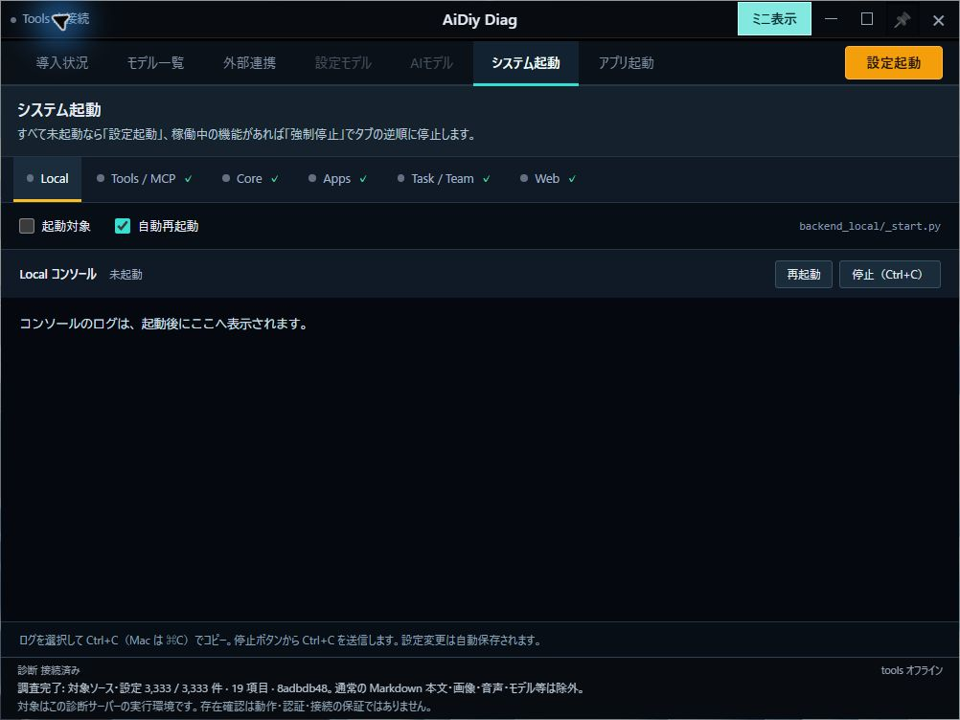

## 2. 必要なシステムを起動する

### 操作手順

1. 「システム起動」で機能名を選び、Tools / MCP、Core、Apps、Task / Team、Webの「起動対象」をオンにします。通常の通し確認ではLocalはオフにします。
2. Webを選び、「ブラウザで開く」をオンにします。変更すると自動保存されるので、保存完了の表示を確認します。
3. 右上の「一括起動」が有効になったら、1回押します。
4. タブとコンソールがTools → Core → Apps → Task / Team → Webの順に移るのを見ながら待ちます。別タブへ切り替えても進捗表示と起動処理は続きます。
5. 起動完了の表示と、5機能が緑になったことを確認します。WebはHTTP応答が20秒間安定してからブラウザで開きます。

Toolsの初回起動は時間がかかる場合があり、待受開始まで最大180秒待ちます。処理が進んでいる間は再起動を連打せず、表示される結果を確認します。

| 機能 | 用途 | ポート（通信する窓口） |
|---|---|---|
| Local | PC内のAIモデル。環境を用意した場合に追加確認 | 8096 |
| Tools / MCP | AIやアプリが使う共通の道具 | 8095 |
| Core | 認証・AI会話 | 8091 |
| Apps | 業務画面の処理 | 8098 |
| Task / Team | AIへの作業依頼 | 8093 |
| Web | ブラウザで使う画面 | 8090 |

### 成功の見分け方

選んだ5機能が起動し、Webの画面が開けば完了です。緑色は通信窓口が開いている意味で、AIの回答成功とは別です。次は3章でWebを手動でも開きます。

| ケース | 確認すること | 結果 |
|---|---|---|
| SYS-201 | 選択した5機能が順に起動し、通常表示でタブ・ログが追従する | ✅ OK：15秒調整後の実フォーム・実サービスで再確認（2026-10-25） |
| SYS-202 | Webの安定確認後、固定のlocalhost:8090が開く | ✅ OK：15秒調整後、安定確認とブラウザ起動を再確認（2026-10-25） |

15秒調整後の一括起動完了画面です。選択した5機能が緑の稼働表示となり、Webコンソールにも安定確認とブラウザ起動が記録されています。

**図201：15秒調整後の一括起動**

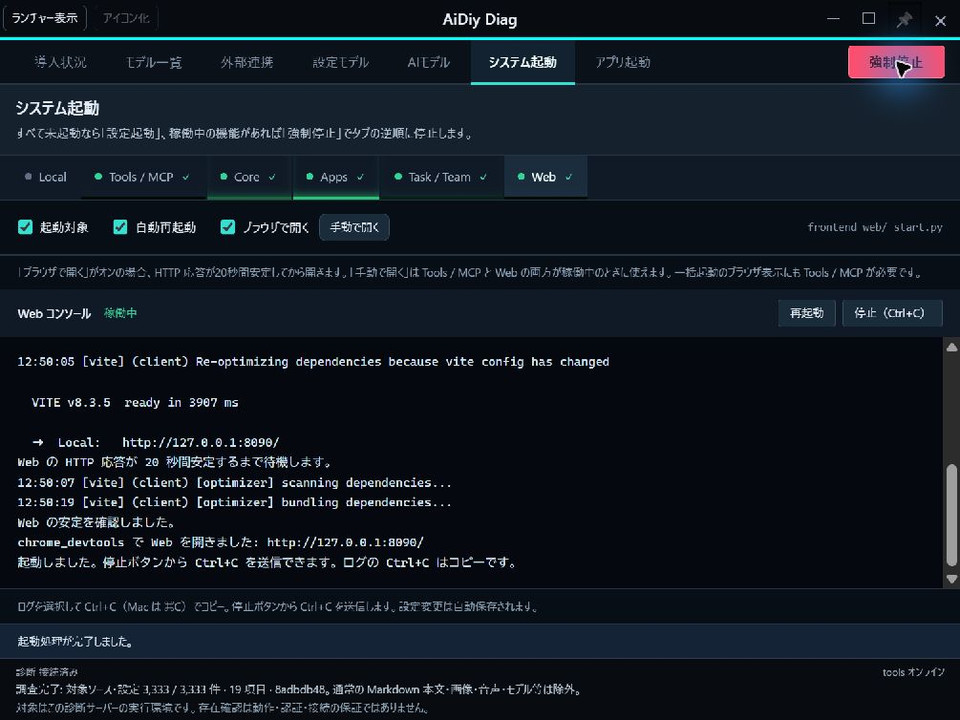

5機能が緑になり、「起動処理が完了しました。」を確認しました。WebのHTTP安定確認と自動表示要求はログでも確認しました。自動で開いたChromeのログイン画面も照合済みです。

**図202：5機能の起動完了**

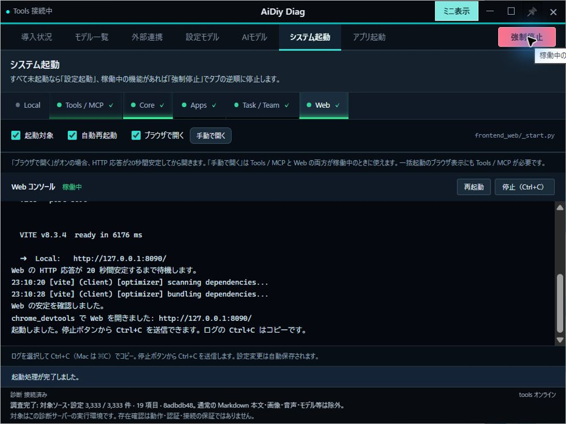

### 起動中の進捗と、起動前の自動清掃

「一括起動」は、すべて未起動であることを確認してから残留する再起動要求を除去し、選択した機能を順に起動します。通常の操作でファイルを手動削除する必要はありません。削除に失敗した場合は起動を中止し、理由を表示します。

2026年10月27日、手動起動と `--auto` 起動、別タブでの進捗表示を実Electronで確認しました。Task/Teamは停止中に起動できず、バックエンド復帰後に再び選べました。

アプリ起動タブを開いても、一括起動の進み具合を確認できます。

**図203：別タブでの起動進捗**

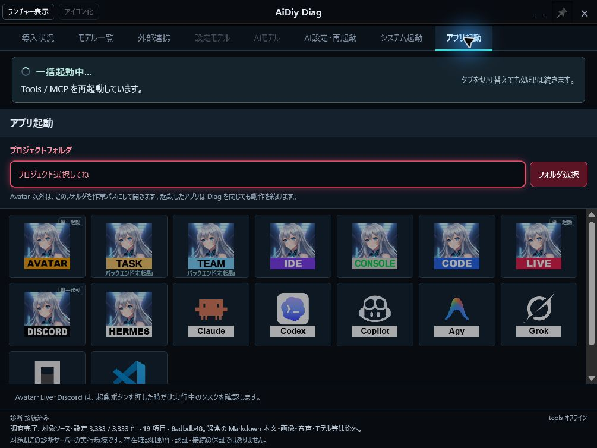

全停止後に8個の試験用再起動ファイルを置き、`--auto` を実行しました。起動対象外のLocalも含めて全件が消え、Tools・Core・Apps・TaskTeam・Webの起動が完了しました。対象ファイルと検証条件は7章に記載します。

**図204：残留ファイル清掃後の起動完了**

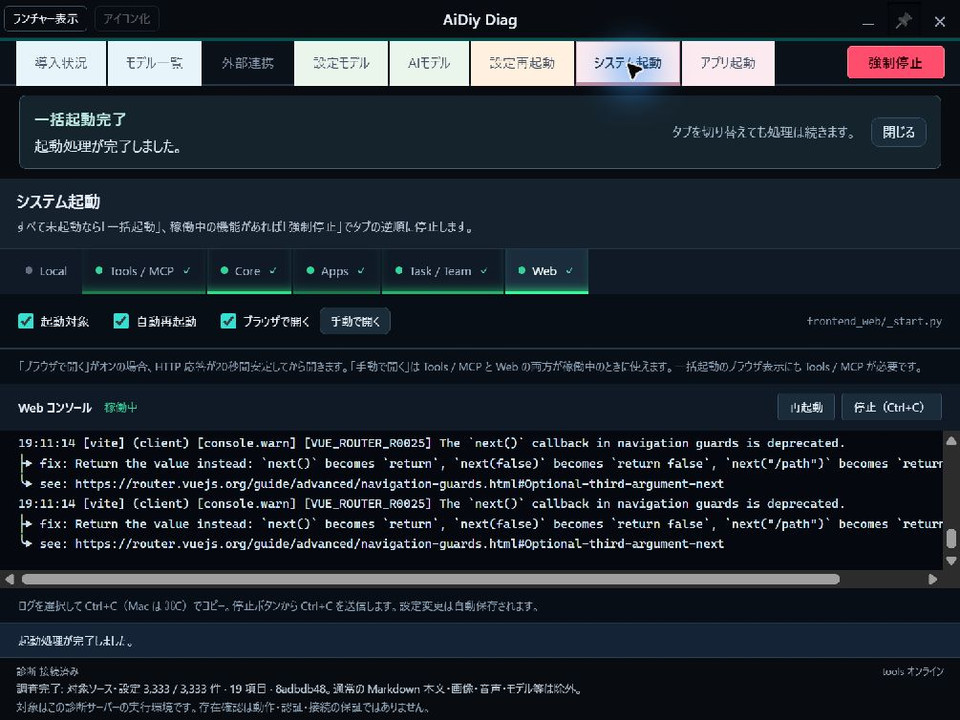

## 3. Webを手動で開く

### 操作手順

1. Diagに戻り、「システム起動」の「Web」を選びます。
2. 「ブラウザで開く」のすぐ右にある「手動で開く」を1回押します。
3. 開いたブラウザのアドレスが `http://localhost:8090/` であることを確認します。

この操作にはTools / MCPとWebの両方が必要です。「ブラウザで開く」は一括起動時の自動表示、「手動で開く」は今すぐ表示する操作です。

### 成功の見分け方

Diagの通知だけでなく、実際のWeb画面が表示されれば完了です。次は4章でDiagを小さく表示します。

| ケース | 確認すること | 結果 |
|---|---|---|
| SYS-301 | 両ポート開放時に手動表示が有効。通知と実際の表示先が一致 | ✅ OK：実フォーム・実サービスで確認（2026-10-22〜23） |

「手動で開く」の完了通知と、実際に開いたChromeのURL・AiDiyログインフォームを照合しました。自動表示のチェックがオフでも手動表示が動作し、確認後は元のオンへ戻しました。

**図301：Web手動表示の完了通知**

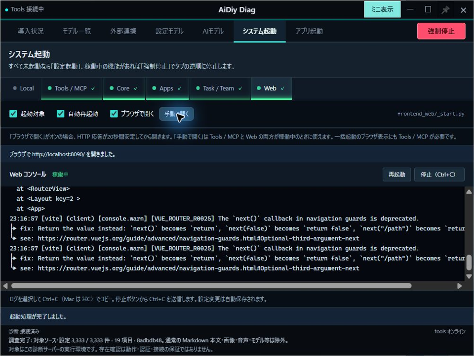

2026年10月21日、同じWebの認証フォームだけを撮影しました。ログインの送信は行っていません。

**図302：Web認証フォーム**

## 4. 状態を見ながらミニ表示を使う

### 操作手順

1. タイトルバーの「ランチャー表示」を押します。
2. 小さなパネルのサービス名を見ます。起動した5機能は緑で明滅し、未起動のLocalは灰色です。状態は約5秒ごとに更新されます。
3. 通常画面へ戻るときはタイトルバーの「元のサイズに戻す」を押します。
4. もう一度ミニ表示にし、今度は「Tools」などのサービス名を押します。その機能のコンソールへ戻ります。

「元のサイズに戻す」は元のタブへ戻る操作、サービス名はその機能のログを開く操作です。ミニ表示への切替でサービスは停止しません。

### 成功の見分け方

小さな表示でも稼働状態を確認でき、選んだ戻り先が表示されれば完了です。次は5章でログを読みます。全タブからの切替や移動・ピンの細かな条件は8章で試します。

**この章の結果：✅ OK。** 稼働中5機能は緑、Localは灰色です。サービス名から対象コンソールへ戻り、通常復帰では元のタブへ戻ることを確認しました。

ミニ表示でも6機能の状態を読めます。掲載画像は10/27に撮影した現行Electronです。Task・Team・VS Codeを含む16項目が並び、下段で各サービスの状態を確認できます。Localは停止、Tools・Core・Apps・TaskTeam・Webは稼働中です。

**図401：ミニ表示のサービス状態**

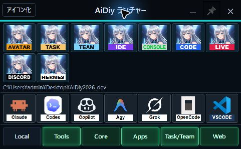

## 5. ログを読む・コピーする

### 操作手順

1. 通常画面の「システム起動」で、ログを読みたい機能名を押します。コンソールは動きやエラーを文字で表示する欄です。
2. 新しいログが出たときに、表示が一番下へ追従することを確認します。
3. 長い行は下側の横スクロールで読みます。
4. 必要な文字を選び、Ctrl+Cでコピーし、メモ欄へ貼り付けて元の選択文字と比べます。

ここでのCtrl+Cキーはコピーです。プログラムの停止には「停止（Ctrl+C）」ボタンを使います。

### 成功の見分け方

ログを読めて、選択文字をコピーでき、サービスも動き続けていれば完了です。使い終わったら6章へ進みます。

| ケース | 確認すること | 結果 |
|---|---|---|
| SYS-501 | 最下部への追従と横スクロールができる | ✅ OK：実フォーム・実サービスで確認（2026-10-22〜23） |
| SYS-502 | Ctrl+Cで選択文字をコピーでき、サービスは停止しない | ✅ OK：実フォーム・実サービスで確認（2026-10-22〜23） |

機能名を選んだコンソールの例です。下部のログを読み、停止するときは右上の「停止（Ctrl+C）」を押します。キーボードのCtrl+Cは選択文字のコピーです。

**図501：機能別のログ表示**

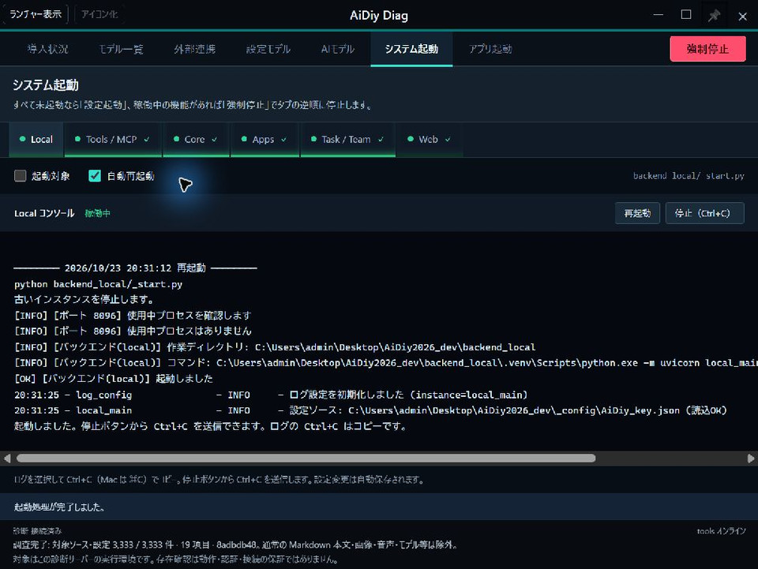

## 6. システムを停止してDiagを閉じる

### 操作手順

1. 起動していたアプリで作業を保存し、使い終わったアプリを閉じます。
2. Diagの「システム起動」で、右上の「強制停止」を1回押します。
3. ボタンが「停止中…」の間は待ちます。Web → Task / Team → Apps → Core → Tools / MCP → Localの逆順で、稼働している機能を停止します。
4. 全停止後に右上が「一括起動」へ戻り、稼働を示す緑が消えたことを確認します。
5. 起動設定を試験前の値へ戻し、保存完了を待ってタイトルバーの×を押します。管理中サービスがなければ確認なしで閉じます。

### 成功の見分け方

システムが停止し、Diagの窓が閉じれば通常運用の通し確認は完了です。以後の追加テストはDiagを開き直し、各試験に必要な状態を作ってから実施します。

**確認結果：✅ OK。** 起動・ログ閲覧・停止の各操作を実フォームと実サービスで確認しました。独立アプリの終了はアプリ起動編で扱います。

| ケース | 確認すること | 結果 |
|---|---|---|
| SYS-601 | 強制停止は生存プロセス・開放ポートを再確認して逆順停止。停止済みはスキップ | ✅ OK：実フォーム・実サービスで確認（2026-10-22〜23） |

2026年10月21日、強制停止でWebからToolsまで停止し、全6機能が灰色になりました。「稼働中の機能をすべて停止しました。」と「一括起動」への復帰を確認しました。起動設定は試験前の値と一致しています。その後、×で確認なしにDiagが閉じ、診断の待受も終了しました。

全停止後のフォームです。追加の独立動作確認のため、Avatar・IDE・Code・Liveの窓は残した条件で停止しました。アプリの個別終了確認とは区別しています。

**図601：全機能の停止完了**

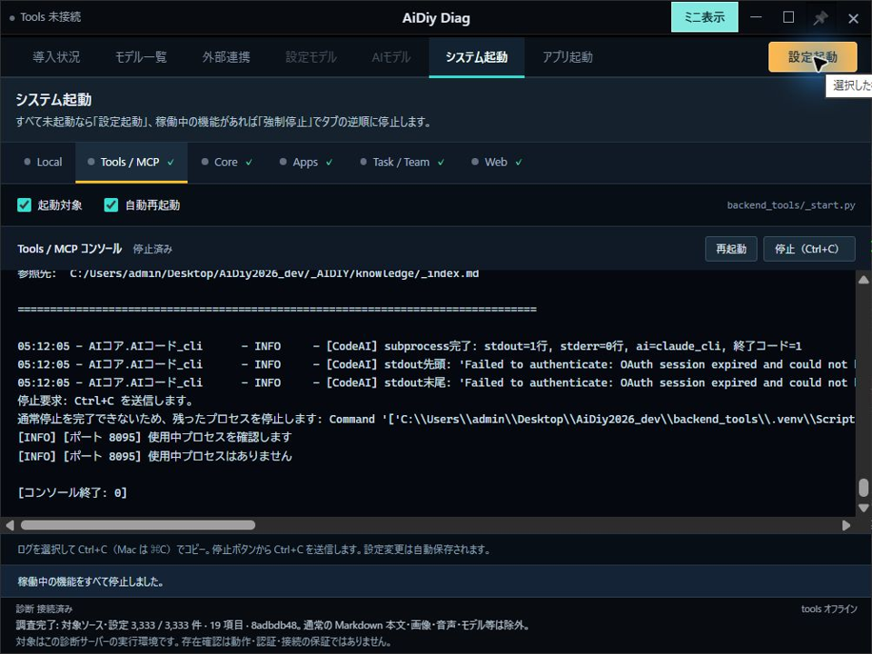

### 停止中も別のタブへ切り替える

「強制停止」を押した後も別タブへ移れます。停止完了まで進捗を確認し、「強制停止完了」と「一括起動」への復帰を目印にします。2026年10月27日に実Electronで確認しました。

別タブでも停止処理の進行状況を確認できました。

**図602：別タブでの停止進捗**

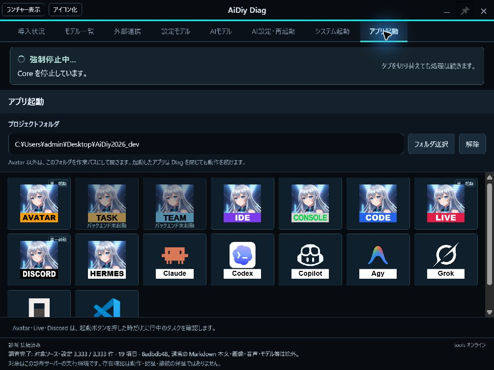

全サービスの停止が完了した画面です。再度起動する場合は「一括起動」を押します。

**図603：全停止完了**

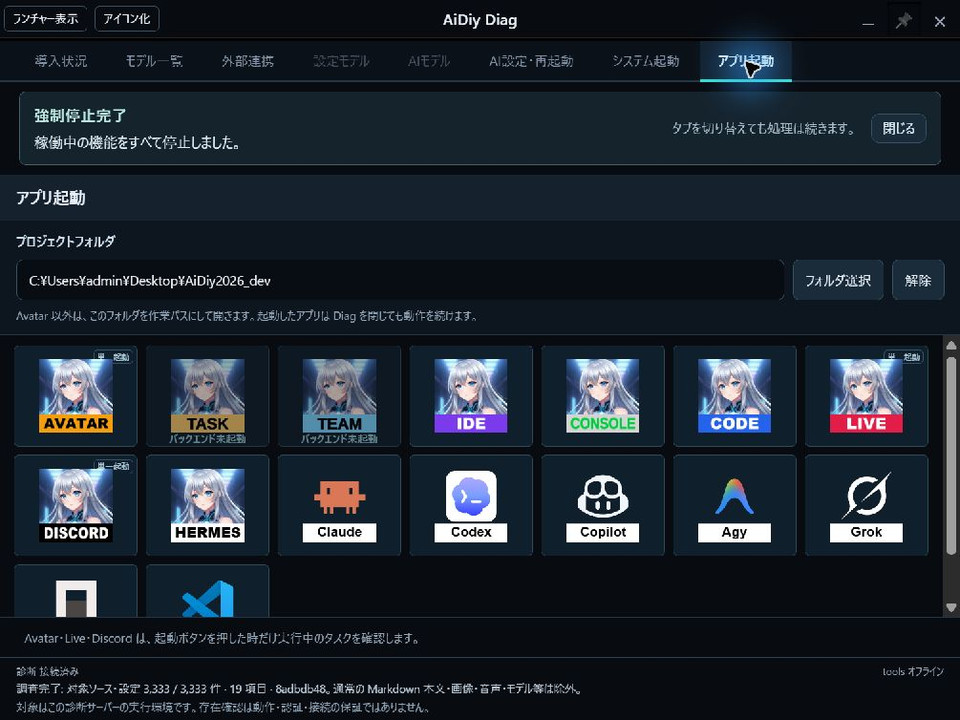

### 一括起動・全停止の実画面

Windowsの実画面を操作しました。一括起動でTools・Core・Apps・Task/Team・Webが稼働し、Webのログイン画面が開きました。Localは対象外です。進行表示はタブ切替中も残り、完了後は消えました。強制停止後は全サービスが停止し、設定再起動タブも無効に戻りました。

起動中に別タブへ移動しても進行表示を確認できます。

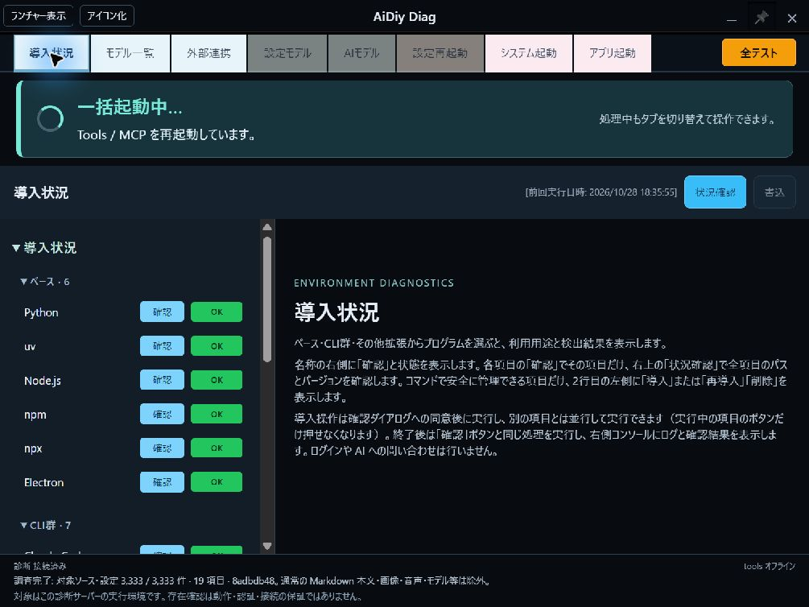

5機能が稼働し、一括起動が完了した画面です。

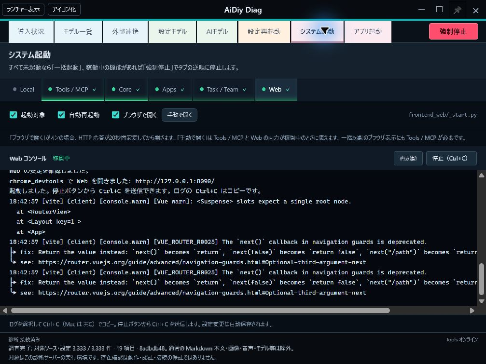

強制停止の進行表示を確認しました。

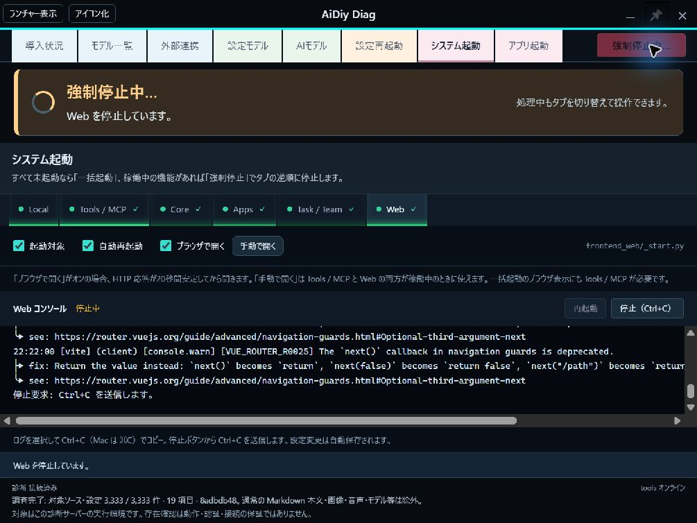

全停止後、各機能が未起動になりました。

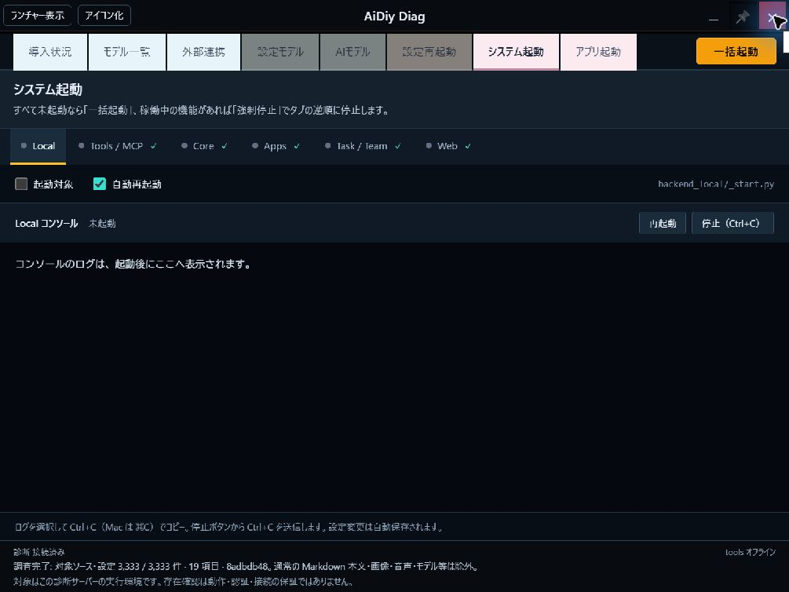

追加でLocalも起動し、Web・Core・Apps・Tools・Local・TaskTeamの6サービスを実際に強制停止しました。停止中の別タブ操作とミニ表示への切替、完了後のアイコン表示への切替を確認しました。独立起動したAvatarは維持され、試験後に個別終了しました。

停止中にアプリ起動タブへ移動しても進行状態を確認できます。

Webの依存探索はアプリ本体のindex.htmlに限定しました。public内の独立HTMLは各ページのimportmapを使います。空のキャッシュから依存探索が成功し、ログイン後のAiDiyと配車／生産一覧の読取表示も確認しました。DB再作成や認証設定変更は行っていません。

## 7. 個別試験：起動条件・停止・復帰

通常運用を終えてから実施します。各条件を試した後は必要なサービスを復帰させ、次の条件と混ざらないようにします。

### 起動条件とWeb表示

1. Tools稼働中の起動、画面再読込、`aidiy_diag --browser` の順に通常の起動との違いを確認します。
2. 設定変更後の再読込、ミニ表示を選んだ状態での起動、稼働中の起動制限を確認します。
3. Webの自動表示をオフにして手動表示を試し、元に戻します。片方停止・未確認などの条件も分けて試します。
4. Localは環境を用意した場合に起動します。未準備なら環境条件と未確認範囲を記録します。

| ケース | 確認すること | 結果 |
|---|---|---|
| SYS-701 | Tools稼働時に左上のミニ表示、ピンOFF、通常表示へ復帰 | ✅ OK：実Electronと関連回帰で確認（2026-10-23） |
| SYS-702 | 初期確認不可・認証失敗・画面再読込では通常表示。初期条件の分岐は隔離試験も使用 | ✅ OK：合成サービス・認証／状態遷移の自動試験で確認（2026-10-23） |
| SYS-703 | Web表示で診断接続。Electron専用ボタンなし | ✅ OK：隔離ブラウザで確認（2026-10-23） |
| SYS-704 | 設定が自動保存され、再読込後も一致する | ✅ OK：隔離ブラウザで確認（2026-10-23） |
| SYS-705 | 通常表示・ミニ表示は手動選択を維持する | ✅ OK：隔離ブラウザで確認（2026-10-23） |
| SYS-706 | 稼働中・ポート未確認では一括起動不可。起動途中の設定変更は次回へ適用する | ✅ OK：合成サービス・認証／状態遷移の自動試験で確認（2026-10-23） |
| SYS-707 | Localの実起動。未準備の場合は環境条件と確認できない範囲を記録する | ✅ OK：実フォーム・実サービスで確認（2026-10-22〜23） |
| SYS-708 | チェックがオフでも手動表示可能。サービス再起動や設定変更は発生しない | ✅ OK：実フォーム・実サービスで確認（2026-10-22〜23） |
| SYS-709 | 片方停止・全停止・未確認では無効。押下時の再確認と連打防止が働く | ✅ OK：合成サービス・認証／状態遷移の自動試験で確認（2026-10-23） |

### 個別停止・再起動・終了確認

アイコンの右クリックメニューにある「閉じる」も同じ終了確認へ進みます。現行メニューの親close呼出しと、稼働中の確認・取消・承認・状態不明時の確認は2026年10月28日に合成テストで再確認しました。今回、この経路から実サービスを停止する試験は行っていません。

1. 他のサービスを動かしたまま、1機能の「停止（Ctrl+C）」を押します。自動再起動をオンにしていても停止を保つことを確認します。
2. 通常とミニの赤い表示、対象ポートの閉鎖、他機能の継続を確認し、「再起動」で緑へ戻します。古いログが消えることも確認します。
3. 管理中サービスがある状態で×を押し、まず「キャンセル」、次に「停止して閉じる」を試します。
4. 起動途中の停止、連打、1件失敗後の続行は合成サービスで条件を作ります。管理外の稼働機能と独立アプリも分けて確認します。

停止後に復帰するケースと、停止を維持するケースを区別して記録します。通常は約800ms、ミニは約5秒の更新を待ち、未確認時の保持と全停止後の色も確認します。

| ケース | 確認すること | 結果 |
|---|---|---|
| SYS-710 | 稼働・停止・再起動で通常とミニの緑→赤→緑が一致する | ✅ OK：実フォーム・実サービスで確認（2026-10-22〜23） |
| SYS-711 | 通常は約800ms、ミニは約5秒で状態更新。未確認時の表示保持と全停止後の色も正しい | ✅ OK：合成サービス・認証／状態遷移の自動試験で確認（2026-10-23） |
| SYS-712 | 再起動でログをクリアし、新しい起動の表示へ切り替わる | ✅ OK：実フォーム・実サービスで確認（2026-10-22〜23） |
| SYS-713 | 個別停止で対象だけ停止。自動再起動を抑止し、手動再起動で復帰 | ✅ OK：実フォーム・実サービスで確認（2026-10-22〜23） |
| SYS-714 | 起動対象のチェックを外した稼働機能・管理外サービスも一括停止の対象になる | ✅ OK：合成サービス・認証／状態遷移の自動試験で確認（2026-10-23） |
| SYS-715 | 起動途中の後続取消、停止中の連打防止、1件失敗後の残りの停止。失敗条件は合成サービスで確認 | ✅ OK：合成サービス・認証／状態遷移の自動試験で確認（2026-10-23） |
| SYS-716 | 終了確認の取消で継続、停止して閉じるで管理サービスを停止。管理中サービスなしでは確認なしで終了 | ✅ OK：実フォーム・実サービスで確認（2026-10-22〜23） |
| SYS-717 | アプリ・CLIはDiag終了後も独立して残る。アプリ起動編で個別終了も確認 | ✅ OK：実フォーム・実サービスで確認（2026-10-22〜23） |
| SYS-718 | Windowsの補助コマンド画面が出ず、ログと停止処理は機能する | ✅ OK：実フォーム・実サービスで確認（2026-10-22〜23） |

### 再起動ファイルによる復帰を検証する（2026年10月27日）

通常の設定変更は環境確認編7章の「設定再起動」を使います。以下は、各バックエンドの監視処理に抜けがないか調べる検証用の操作です。

現行バックエンドは5プロセスです。各ファイルを1つずつ書き込み、消費・PID交代・HTTP応答の復帰を確認してから次へ進みました。設定ファイルはダンプしていません。

| 順番 | バックエンド | 再起動ファイル | 結果 |
|---|---|---|---|
| 1 | Local | backend_local/temp/reboot_local.txt | PASS：プロセス交代・ファイル消費・HTTP 200 |
| 2 | Tools | backend_tools/temp/reboot_tools.txt | PASS：プロセス交代・ファイル消費・HTTP 200 |
| 3 | Core | backend_server/temp/reboot_core.txt | PASS：プロセス交代・ファイル消費・HTTP 200 |
| 4 | Apps | backend_server/temp/reboot_apps.txt | PASS：プロセス交代・ファイル消費・HTTP 200 |
| 5 | TaskTeam | backend_taskteam/temp/reboot_taskteam.txt | PASS：プロセス交代・ファイル消費・HTTP 200 |

Webはこのファイル方式の対象外です。Task/Teamは統合された1バックエンドです。互換入力 `reboot_task.txt`、`reboot_team.txt` と Appsの補助 `reboot_apps_code_base_path.txt` も含め、清掃対象は8ファイルです。互換2名の個別実機再起動は今回未実施で、清掃とソース照合を確認しました。

一括起動前の清掃は、現行5ファイルに互換2ファイルと補助1ファイルを加えた計8件が対象です。全停止してから8ファイルを配置し、最初のプロセス起動前に削除されることを確認します。通常の一時ファイルや設定ファイルは対象外です。

自動テスト32件が通過しました。手動・自動起動の清掃順序、清掃失敗時の起動中止、個別再起動で他サービスの要求を保持すること、バックエンド実装とのファイル名照合を含みます。設定・アプリ起動・進捗の29件と合わせて関連61件が通過しています。

## 8. 個別試験：窓操作・表示・アニメーション

1. 診断接続・Tools接続を整え、確認した各タブからミニへ切り替えます。「元のサイズに戻す」で元のタブへ、サービス名でログへ戻ります。
2. ピンをON/OFFし、通常・ミニを往復して設定の保持を確認します。起動直後はOFFです。
3. 通常・ミニで同じ位置を0.5秒長押しして移動します。短押し、0.5秒前の移動、解放、Esc、フォーカス喪失も試します。最大化・全画面では移動を開始しません。
4. 開始ズーム750ms、通常／ミニと最大化／復元の切替380msを計測します。透明領域、白い縁、切替窓の残留、実窓の復元を確認します。
5. ミニ幅384pxと内容高、切替中の連打・再読込・撮影失敗からの復帰を確認します。

時間・移動・寸法は実測し、画像1枚だけで動作を判定しません。通常のログ選択やボタンの短押しが妨げられないことも確認します。

| ケース | 確認すること | 結果 |
|---|---|---|
| SYS-801 | 「元のサイズに戻す」で元のタブ、サービス名で該当ログへ戻る。確認した各タブからのミニ切替を確認 | ✅ OK：隔離ブラウザで確認（2026-10-23） |
| SYS-802 | 起動時ピンOFF、切替中も手動選択を保持。通常復帰時に現在の左肩で通常寸法へ復元し、最大化／復元も動作 | ✅ OK：実Electronと関連回帰で確認（2026-10-23） |
| SYS-803 | 0.5秒長押しで移動。短押しと通常のログ選択を妨げず、移動後の誤クリックなし | ✅ OK：実Electronと関連回帰で確認（2026-10-23） |
| SYS-804 | 開始ズーム750ms、通常／ミニと最大化／復元の切替380ms。透明領域を確保し白い縁や窓の残留なし | ✅ OK：実Electronと関連回帰で確認（2026-10-23） |
| SYS-805 | ミニ幅384pxで内容高に追従。切替中の連打・再読込・撮影失敗でも実窓を復元 | ✅ OK：実Electronと関連回帰で確認（2026-10-23） |

### 表示確認の画面

隔離ブラウザで起動パネルの配置を確認した画面です。合成データによる表示試験で、実サービスの起動成功とは区別します。

**図801：隔離ブラウザの起動パネル**

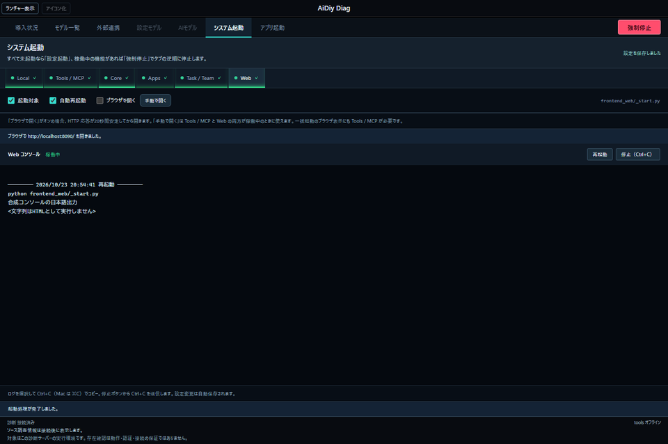

## 9. 試験の記録方法

各ケースに実施日・環境・操作・実際の結果・判定を記録し、先頭の総合評価も更新します。実機と合成試験、今回の結果と過去の結果を区別し、未実施を合格へ置き換えません。キーやJWTは記録しません。

ケースIDは過去の結果との照合用に維持します。図番号はケースIDとは別で、「章番号＋章内の掲載順」です。画像名・図番号・本文の参照先を合わせ、同じ画像は再掲せず図番号で案内します。

自動試験の入口は `backend_diag/checks/start-manager.check.mjs`、`start-bulk-state.check.mjs`、`web-browser.check.mjs`、`start-mini.check.mjs`、`desktop.check.mjs`、`size-transition.check.cjs`、`mini-titlebar.check.cjs`、`mini-height.check.mjs`、`scripts/checks/test_diag_stop.py` です。画面確認は `start-browser.mjs`、隔離Electronは `initial-mini-desktop.mjs` を使います。自動試験の成功を実機試験へ転記しません。

2026年10月21日、`scripts/checks/test_diag_start.py` の20試験が通過しました。短い進捗ログを子プロセスの終了前に転送する確認と、既存の専用コンソール・通常停止・強制停止・Web安定待機を含みます。実サービスの停止とは分けた合成プロセスによる回帰です。

画像とPDFの扱いは[説明資料の書き方](./セルフテスト,_説明資料の書き方.md)を参照します。本冊子はMarkdownと同名PDFを更新しています。
