# aidiy_diag システム起動編 — 総合テストと操作手順書素材

> 文書: `セルフテスト,aidiy_diag,システム起動編.md` | 実装: `backend_diag/起動/サービス管理.mjs`, `backend_diag/ui/src/起動/`, `backend_diag/起動/electron-main.cjs`

## 総合評価

**総合評価：✅ OK (PASS 1件含む)。起動・停止・ログコピー・ミニ表示を確認しました。**（2026年10月19日・Windows）

サーバーとは、各アプリを裏で動かすプログラムです。この冊子では、その起動と停止を確認します。

| 知りたいこと | 現在の結果 |
|---|---|
| システムを起動して使い始められる？ | ✅ OK：通常使う5機能が順番に起動し、Web画面が開くところまで確認しました。 |
| 状態を見たり、終了したりできる？ | ✅ OK：ミニ表示、終了確認、キャンセル、全体の停止を確認しました。 |
| 追加確認も終わった？ | ✅ OK：個別停止と復帰、選択ログとクリップボードの一致、約5秒更新、通常・ミニの長押し移動、透明領域内の開始ズームを確認しました。 |

**本冊のWindows試験は通過しました。** [PDF版の総合テスト実施記録](../../output/pdf/セルフテスト,aidiy_diag,システム起動編.pdf)も作成しました。操作手順書はまだ作成しません。 Local（PC内で動かすAI）は起動環境を用意していないため **PASS (別途環境調整必要)** の1件です。Mac／Linuxは別途実機確認を推奨しますが、今回のWindows試験の完了条件には含めません。

## この冊子の進め方

1章から順に起動・状態確認・停止を試します。各章の手順と結果を、画像と見比べてください。画像のフォルダ名や日時は環境により異なります。

### 始める前に

AiDiyのセットアップが必要です。今回のフォルダは `C:\Users\admin\Desktop\AiDiy2026_dev`。操作時は自分のAiDiyフォルダを使います。

起動操作は **1章から**、使い終わった後の停止操作は **5章** を見ます。起動後にアプリを開く場合は[アプリ起動編](./セルフテスト,aidiy_diag,アプリ起動編.md)へ進みます。

### 画面で使う言葉

| 表示・用語 | 意味 |
|---|---|
| タブ | 画面上部などに並ぶ、表示内容を切り替えるボタンです。 |
| コンソール／ログ | プログラムが現在の動きやエラーを文字で知らせる欄です。 |
| ポート | プログラムと通信するときの窓口の番号です。番号を覚える必要はありません。 |
| 稼働中 | そのプログラムが動いている状態です。 |
| ミニ表示 | 状態とアプリ起動アイコンを、小さなウィンドウにまとめた表示です。 |

今回の良好な結果は **✅ OK**、失敗した結果は **❌ NG**、まだ試していない項目は **⏸ 未実施**、時間などを測っていない項目は **⏸ 未測定** と記載します。

## 1. aidiy_diag を開く

### 操作手順

1. セットアップ後、ターミナル（文字でコマンドを入力するアプリ）を新しく開きます。
2. `aidiy_diag` と入力し、Enterキーを押します。
3. 「AiDiy Diag」のウィンドウが開くまで待ちます。システムが止まっていれば、最初は「システム起動」が表示されます。
4. 小さなミニパネルで開いた場合は、Toolsがすでに動いています。タイトルバー（一番上の帯）の復帰ボタンを押して、通常の大きな画面に戻します。

「コマンドが見つかりません」と出た場合は、そこで起動試験を止め、セットアップとコマンドの登録状態を確認します。詳細は[環境運用手順](./共通,開発環境運用手順.md)を参照してください。

### 成功の見分け方と今回の結果

**✅ OK**：システムがすべて止まっている状態から起動しました。「システム起動」が開き、起動前のToolsが未接続と表示されました。

起動直後の画面です。「システム起動」が開き、Toolsは未接続と表示されています。

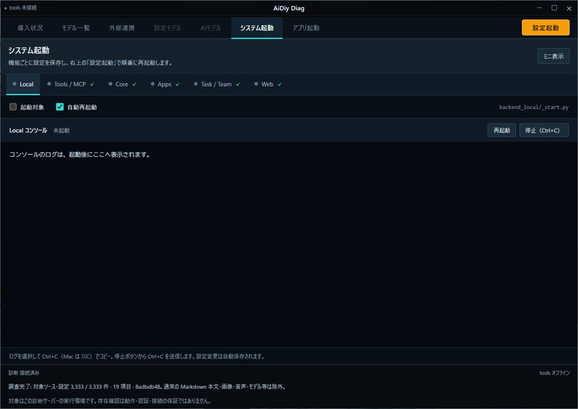

## 2. システムを起動する

### 操作手順

1. 画面上部の「システム起動」を選びます。
2. 各機能の「起動対象」を確認します。下表の5機能をオン、Localをオフにします。「自動再起動」は既存の設定を使います。変更は自動保存されます。
3. 「Web」の「ブラウザで開く」をオンにします。Webの準備後、自動操作用のChromeが開きます。
4. 右上の「設定起動」を1回押して待ちます。起動済みの対象は、停止してから起動し直します。
5. Tools → Core → Apps → Task / Team → Webの順に画面が切り替わることを確認します。
6. 5機能の「稼働中」と「起動処理が完了しました」を確認します。Webは20秒間の安定確認後にブラウザが開きます。

| 機能名 | 主な役割 | 通信窓口の番号（参考） | 今回の設定 |
|---|---|---|---|
| Local | PC内のAIモデルを動かします。 | 8096 | オフ |
| Tools / MCP | AIやアプリで共有する道具を動かします。 | 8095 | オン |
| Core | ログインやAI会話などの共通機能を動かします。 | 8091 | オン |
| Apps | 業務画面の処理を動かします。 | 8098 | オン |
| Task / Team | AIへの作業依頼を管理します。 | 8093 | オン |
| Web | ブラウザで使う画面を動かします。 | 8090 | オン |

エラー時は対象のログ末尾を開き、エラー文と時刻を記録します。

### 成功の見分け方と今回の結果

**✅ OK**：5機能が順番に起動し、最後に起動完了を確認しました。Webでは20秒間の安定を待った記録が出て、Chromeにログイン画面が開きました。ここではログイン後のWeb操作までは試していません。

「設定起動」を押した後の画面です。最初にToolsの事前診断が進みます。

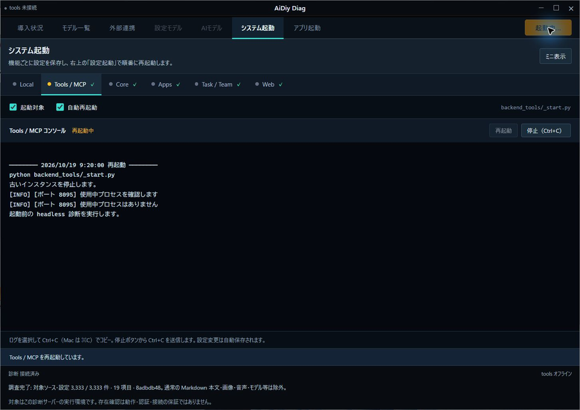

起動処理がWebまで進んだ画面です。処理中の機能へ表示が切り替わっています。

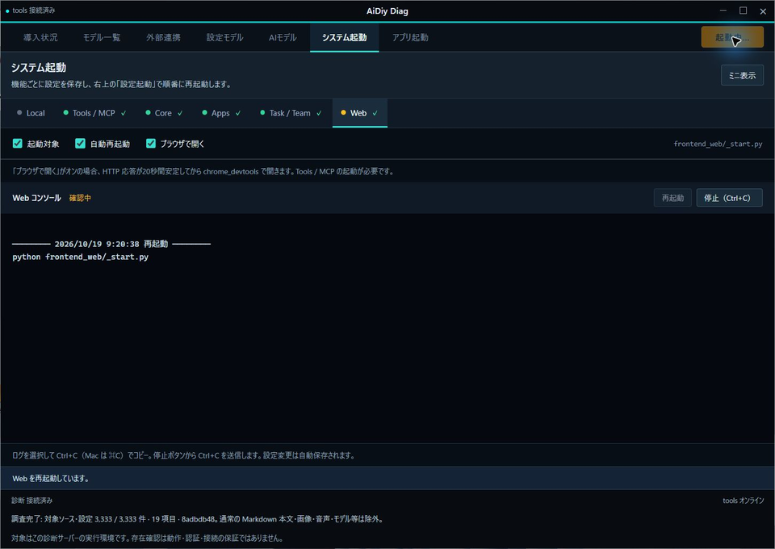

5機能の起動が完了した画面です。稼働状態と完了メッセージを確認しています。

試験中、DiagとAvatarが同じ保存先を使って起動を妨げる問題を見つけ、保存先を分けて修正しました。修正後の起動も **✅ OK** でした。内部処理を調べる自動テスト22件も成功しています。

修正を反映して起動し直した結果です。再起動後も5機能の起動が完了しました。

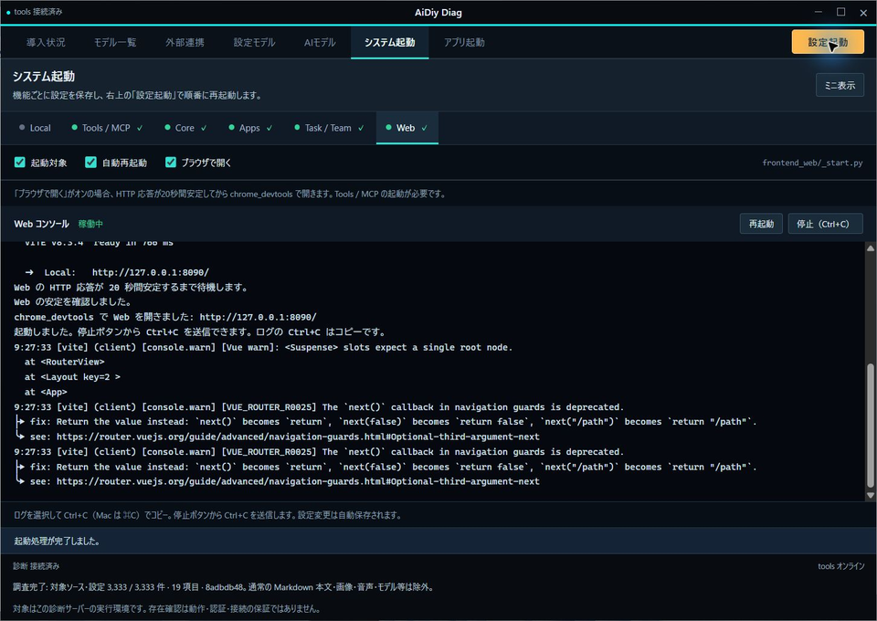

## 3. ミニパネルでサーバー状態を見る

### 操作手順

1. 通常画面の「システム起動」を開き、見出し付近の「ミニ表示」を押します。
2. 小さなウィンドウの下段にある機能名と色を確認します。緑は通信窓口が開いている状態、灰色は閉じているか、確認できない状態です。
3. ログを読みたい機能名を押します。その機能のコンソールが通常画面に表示されます。タイトルバーの復帰ボタンからも通常画面へ戻れます。
4. アプリを開く場合は[アプリ起動編](./セルフテスト,aidiy_diag,アプリ起動編.md)へ進みます。

### 成功の見分け方と今回の結果

**✅ OK（表示）**：起動した5機能は緑、起動していないLocalは灰色でした。色は約5秒ごとに更新する仕組みで、Diag以外から起動した機能も調べます。緑色でも、AIから返答があるかどうかは会話試験で別に確認します。

ミニ表示の状態欄です。起動した5機能は緑、対象外のLocalは灰色です。

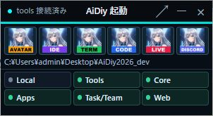

**✅ OK（追加確認）**：実ブラウザでは、状態確認の要求間隔が4.9秒以上となり、ポート状態の変化がミニ表示へ反映されました。この周期試験だけは合成サービスを使い、実サービスの試験と区別しています。

隔離した実Electronの初期ミニ表示です。左上・最前面で開き、通常表示への復帰もできました。

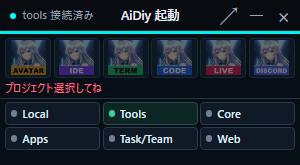

長押し中には移動の印が出ます。0.4秒時点では動かず、ミニは約530ms、通常は約518msで移動可能になりました。両方とも移動後のサイズと、解放時に誤クリックしないことを確認しました。入力は実Electronへ送り、カーソル位置とフォーカス判定は試験用に固定しています。

通常表示でも同じ長押し操作を確認しました。Escで移動を解除できました。

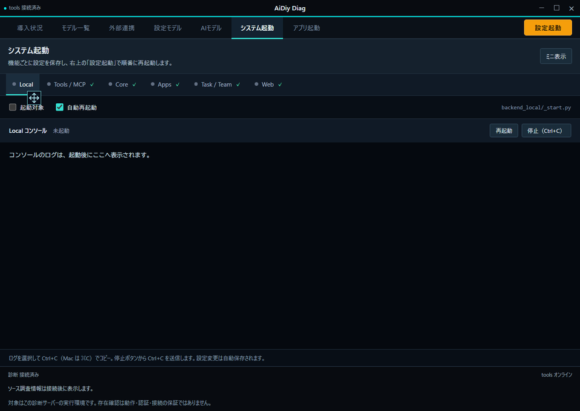

開始ズームは設定750ms、実アニメーションの観測値約785msでした。透明な領域を先に確保し、ズーム中に実ウィンドウの寸法が変わらないことも確認しました。状態は約5秒周期で更新され、サービス名から対応するログ画面へ戻れました。

## 4. ログを読む・コピーする

### 操作手順

1. 「システム起動」で、ログを読みたい機能名を押します。
2. コンソールの一番下を見ます。新しいログが出ると、表示も一番下へ移動します。
3. 長い行が右側で切れている場合は、コンソール下側の横スクロールを動かします。行は折り返さず表示されます。
4. 文字を選び、Ctrl+C（Macは⌘C）でコピーします。メモ欄に貼り付け、元のログと比べます。
5. 1つの機能だけ起動し直す試験では、その機能を選んで「再起動」を押します。以前の表示が消え、新しいログが出て「稼働中」になるまで待ちます。

このコンソールでは、Ctrl+Cキーはコピーに使います。プログラムを止めるときは、次章の停止ボタンを使います。

### 成功の見分け方と今回の結果

**✅ OK（表示）**：新しいログに合わせて一番下へ移動すること、左右にスクロールできること、再起動で表示がクリアされ新しいログになることを確認しました。

**✅ OK（追加確認）**：実画面で `python backend_server/_start.py` の1行を選び、Ctrl+Cでコピーしました。OSのクリップボードを取得して比較し、末尾の改行を除いて完全一致しました。コピー後もAppsは稼働中です。

ログの1行を選んだ画面です。Ctrl+Cはコピーとして働き、停止にはなりませんでした。

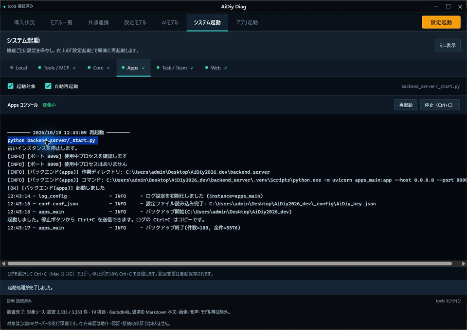

## 5. 停止・終了する

### 操作手順

1. **1つの機能だけ止める場合**は、対象の機能名を選び、コンソール右側の「停止（Ctrl+C）」を押します。ボタンが停止信号を送ります。キーボードでCtrl+Cを押す操作ではありません。
2. **Diagと、Diagから起動したシステムをまとめて終了する場合**は、タイトルバー右上の×を押します。
3. 起動中のシステムがあると確認ダイアログが出ます。確認試験では、まず「キャンセル」を押し、動いていた機能がそのまま動いていることを確かめます。
4. もう一度×を押し、終了してよい場合だけ「停止して閉じる」を押します。Diagのウィンドウが閉じるまで待ちます。
5. 起動中のシステムがない場合は、確認なしでDiagが閉じます。

「アプリ起動」から開いたIDEやTermなどは別のアプリとして動きます。使い終わったものは、各アプリでも終了操作を行ってください。

### 成功の見分け方と今回の結果

**✅ OK（確認・取消・終了）**：ミニ表示の×でも終了確認が出ました。「キャンセル」後は5機能が動き続けました。「停止して閉じる」で終了し、再びDiagを開くと、全対象が停止を表す灰色でした。Termが別アプリとして残る結果は、アプリ起動編で確認できます。

稼働中に×を押した画面です。停止して閉じるか、キャンセルするかを選べます。

「キャンセル」後の画面です。起動していた5機能が動き続けています。

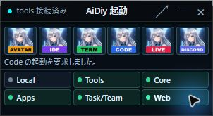

**✅ OK（個別停止・復帰）**：Appsだけを停止し、Core・Tools・Task / Team・Webが稼働を続けることを確認しました。停止要求から5秒で通常終了しなかったため、既定の残存プロセス回収へ進み、ポート8098は閉じました。自動再起動ONでも明示停止後は再起動しませんでした。

Appsだけを停止した画面です。対象は「停止済み」、他の4機能は稼働しています。

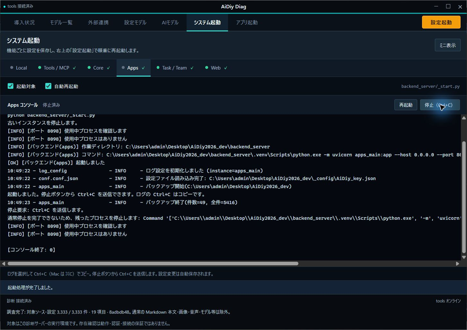

続いてAppsの「再起動」を押すと復帰しました。古いログは消え、今回の起動時刻から表示されました。

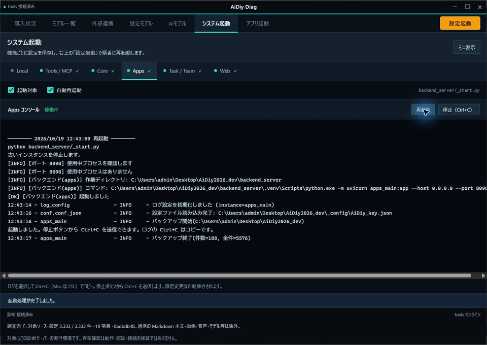

### 全停止からの再始動も確認

**✅ OK**：管理ポートが閉じたことを確認してDiagを開き、設定起動を実行しました。Tools → Core → Apps → Task／Team → Webの順に起動し、WebはHTTP応答が20秒安定した後にChrome DevTools経由で開きました。

全停止後のDiagです。通常のシステム起動画面から開始しました。

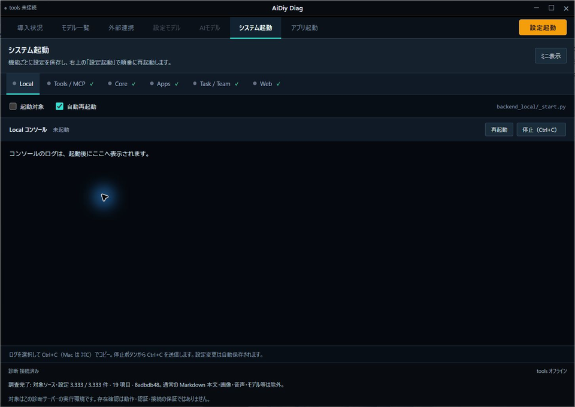

5サービスの順次起動が完了した画面です。Localは起動対象から外しています。

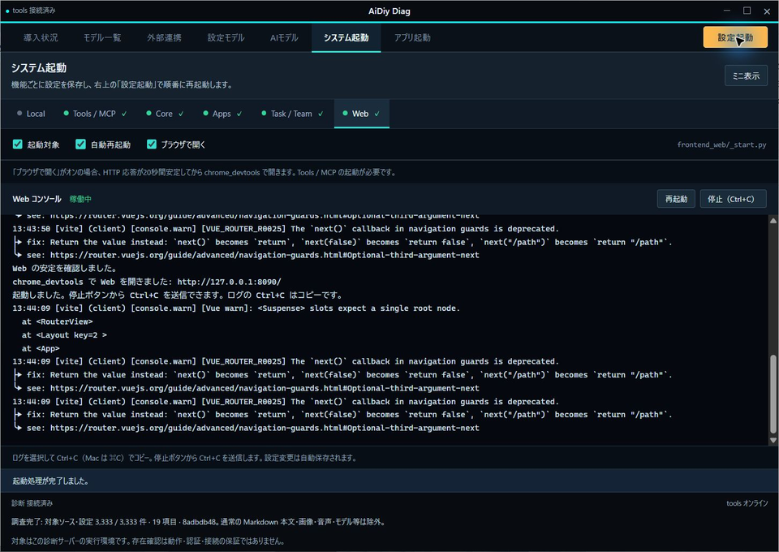

### Electron起動時のコマンド画面も確認

**✅ OK（Windows）**：Diag・Avatar・IDE・Term・Code・Live・Discordの起動と、起動時の補助コマンドを確認しました。非表示指定が抜けていたPython起動・プロセス確認・停止処理を修正しています。Avatarはnpm配下でコマンドが増える経路を避け、Vite・TypeScript監視・Electron監視を直接起動します。

実子プロセスではコンソールが作られず、起動ログは取得できました。Electron本体の画面は通常どおり表示します。停止ボタンのCtrl+C送信に使う専用コンソールは非表示のまま保持し、停止の回帰試験も通りました。Pythonの確認34件と、補助プロセス・GUIの追加確認9件が成功し、追加確認の失敗は0件でした。

## 6. 試験担当者向け：次回の記録方法

画像の名前・保存先・自動試験の記録方法を開く

今回の試験は、全システムを止めたところから始めました。起動前の状態と、その後の操作結果は各章の本文と画像に記載しています。

Computer Use で画面を観察し、1操作して直後に再取得する。前回のウィンドウID・座標・要素番号は再利用しません。端末へのコマンド入力、ログイン、権限許可は UI 自動操作へ含めません。コマンドによるアプリ起動は通常の実行ツールから行います。

証跡は `_AIDIY/knowledge/images/セルフテスト,aidiy_diag,システム起動編/` に保存します。`aidiy_diag-システム起動_201_…画面.png` の先頭1桁は本書の章番号、後ろ2桁は章内の連番。取得済み画面は `scripts/checks/実画面試験記録.mjs` の `createEvidenceRecorder(実施ID, 'system', {toPng})` で保存できます。JPEGで返る実画面はPNGへ変換して保存します。失敗画像は上書きせず、再試験の画像を追加します。

本文には操作・期待結果・実結果と画像を並べ、起動要求だけを起動成功としません。正式な証跡は `knowledge/images` に保存します。全体 `_cleanup.py` が削除対象にする `knowledge/temp` は作業用に限定し、正式な画像や台帳を置きません。

