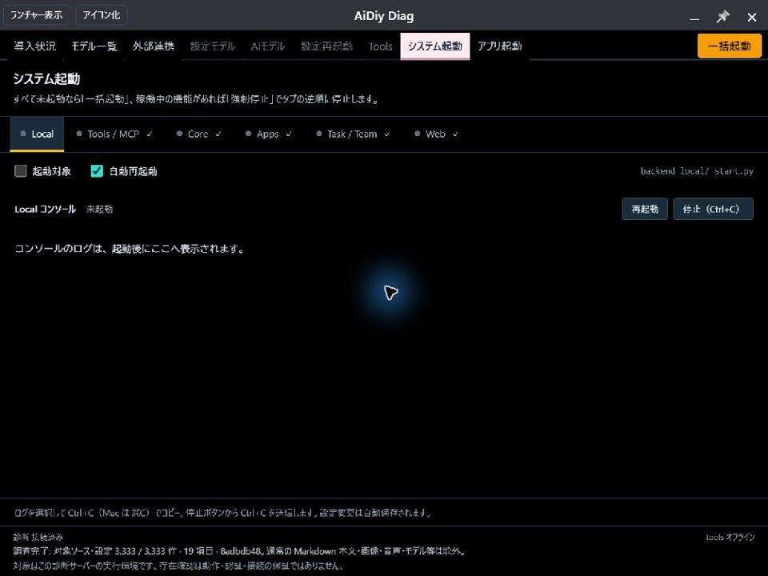
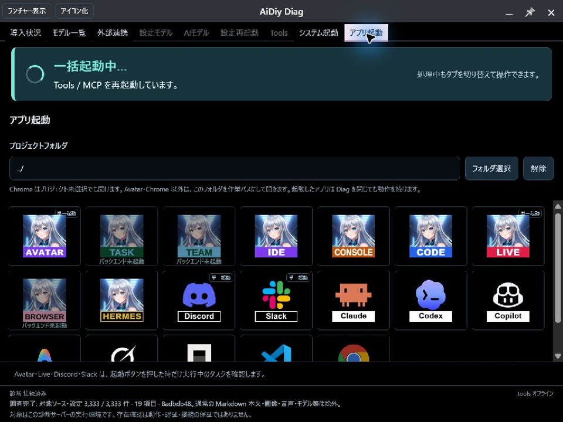
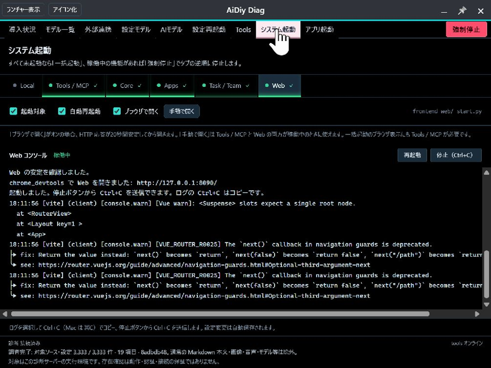
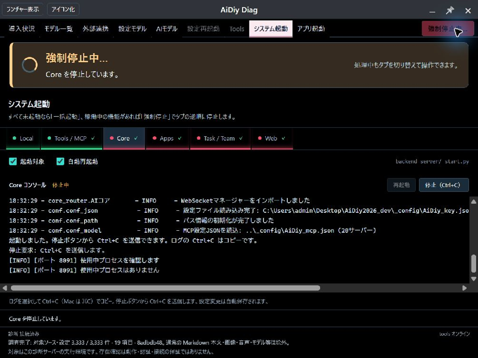
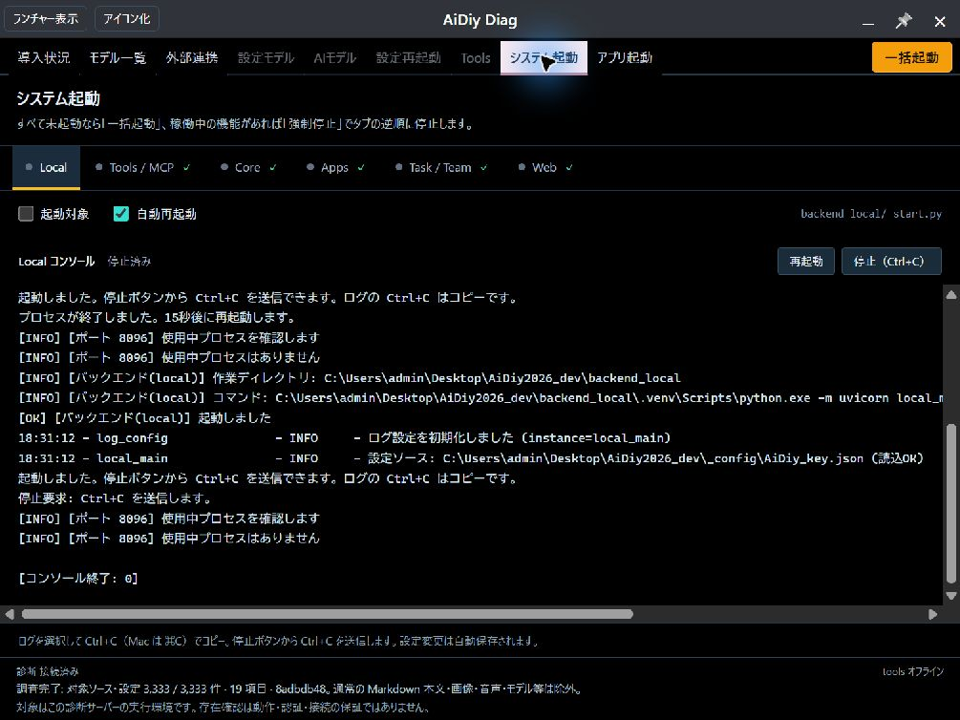
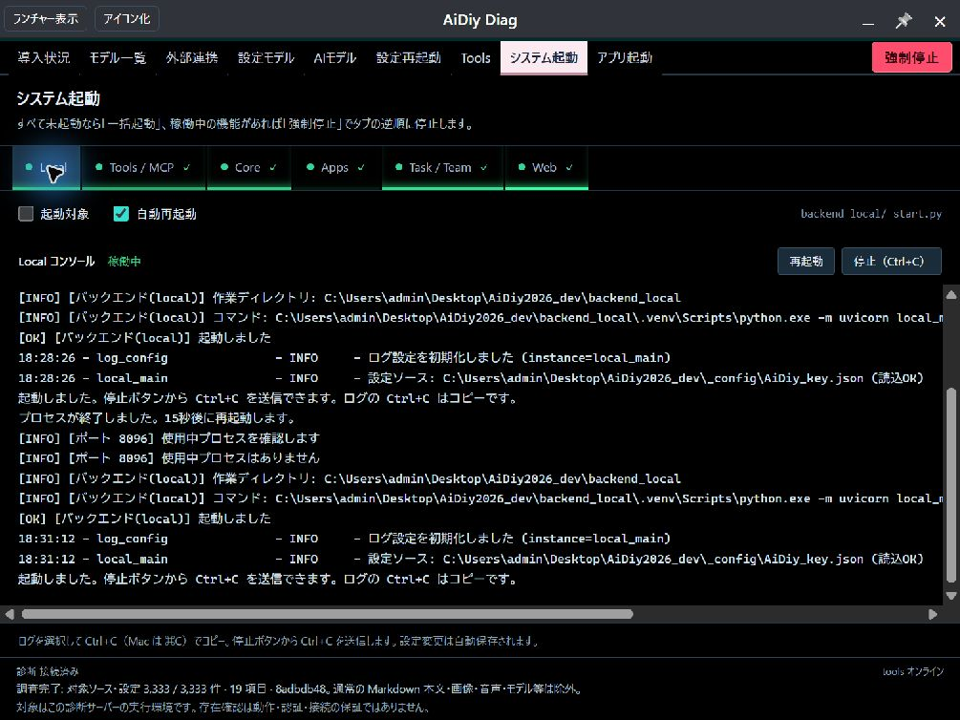
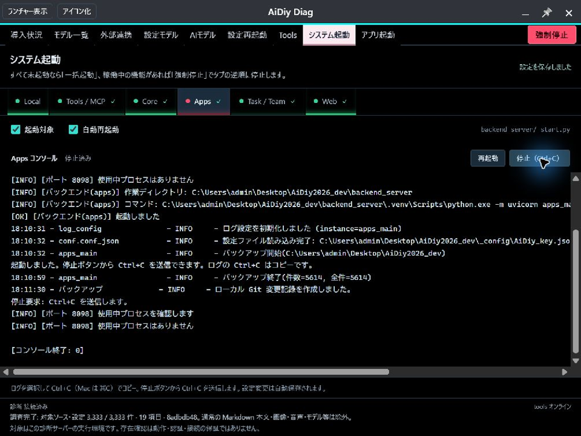
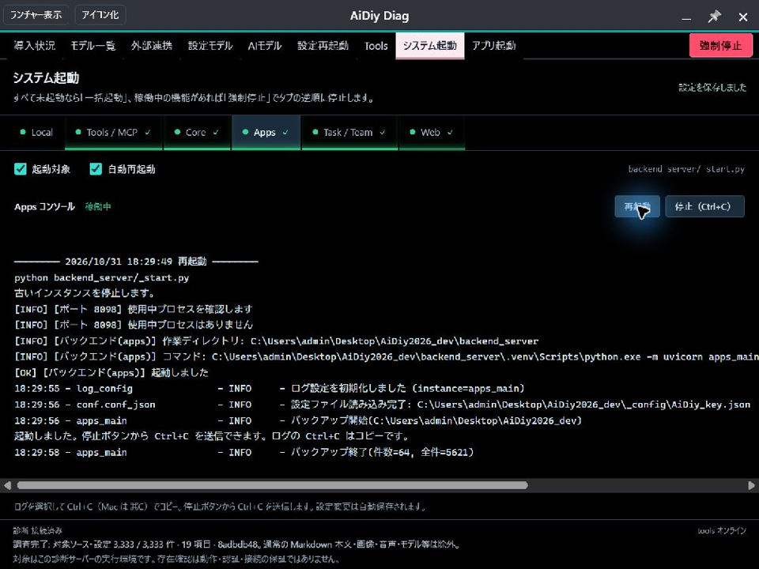
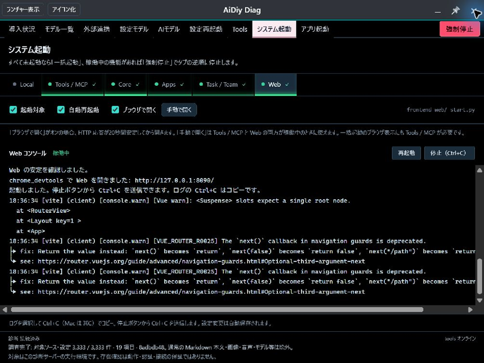
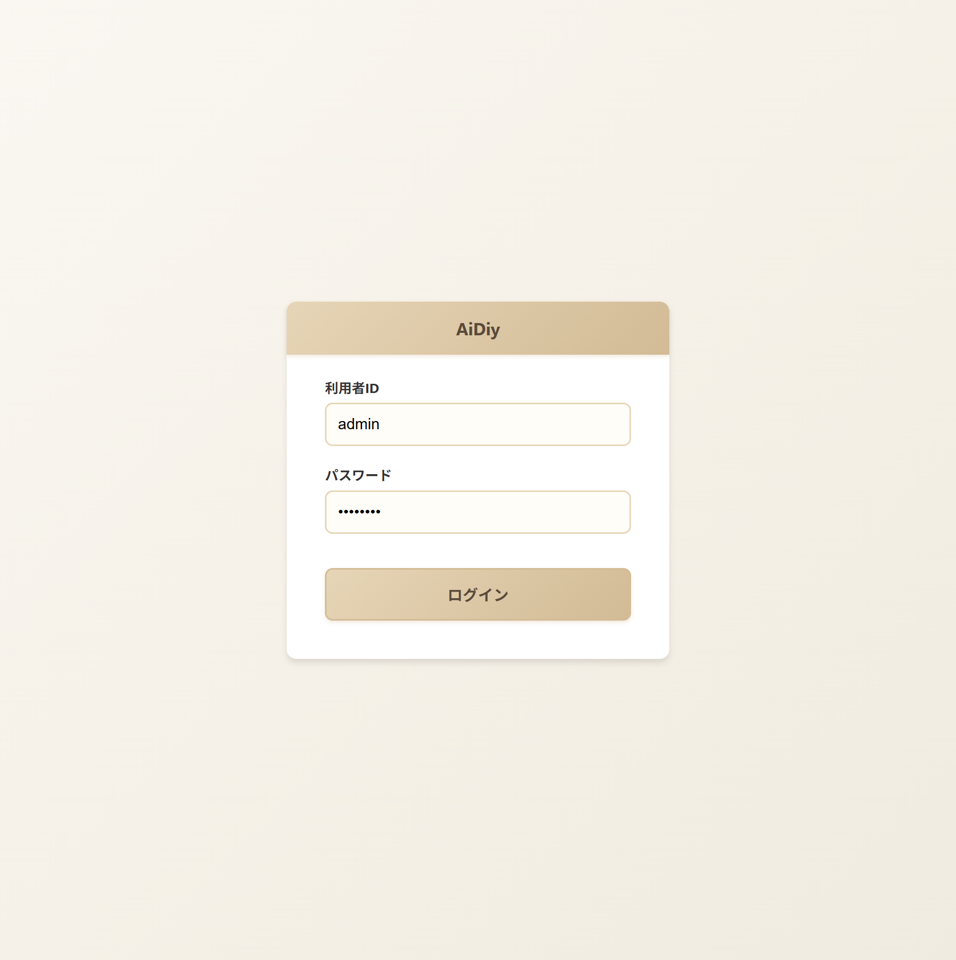

# aidiy_diag システム起動編 — 操作ガイドとセルフテスト

本書の1〜4章は操作ガイドです。一括起動・強制停止・個別起動・個別停止と、Web画面を開く方法を、手順と画面で説明します。基本の使い方は前半だけで確認できます。5章に追加テストの条件と結果をまとめています。

## 総合評価

**✅ OK（記載した確認範囲）。** Windowsの実Diagで5つの操作を確認しました。画面の表示だけでなく、対象サービスの起動・停止とWebのログイン画面を照合しています。

## この冊子の読み方

| 目的 | 読む章 |
|---|---|
| まとめて起動する | 1章：一括起動 |
| すべて止める | 2章：強制停止 |
| 1つだけ起動・停止する | 3章：個別起動・個別停止 |
| 一括起動後にWebを表示する | 4章：Web表示のチェック |
| 確認条件や例外時の動作を調べる | 5章：追加テスト |

## 始める前に

セットアップ済みの環境で `aidiy_diag` を起動し、「システム起動」を開きます。ミニ表示で開いた場合は「元のサイズに戻す」で通常画面へ戻します。アイコン表示・ミニ表示・ランチャー画面は[ランチャー編](./セルフテスト,aidiy_diag,ランチャー編.md)で扱います。

各機能名を押すと、その機能の設定とログが表示されます。「起動対象」は一括起動に含める指定です。「自動再起動」はプロセスが終了したときに起動し直す指定で、手動の停止操作では停止を維持します。

## 1. 一括起動する

1. 機能名を順に押し、まとめて起動する機能の「起動対象」をONにします。通常はTools / MCP・Core・Apps・Task / Team・WebをON、LocalをOFFにします。
2. 全機能が停止していることを確認し、右上の「一括起動」を1回押します。
3. 上部の進捗を見ながら待ちます。Tools → Core → Apps → Task / Team → Webの順に起動します。
4. 選んだ5機能が緑になれば起動完了です。Web画面の自動表示は4章で説明します。

起動前の画面です。6機能が灰色で、右上に「一括起動」が表示されています。Diagを開いただけではサービスは起動しません。

**図101：一括起動前の画面**

起動中は上部に処理中の機能が表示されます。別タブへ移っても起動処理と進捗表示は続きます。

**図102：一括起動の進捗**

起動完了後の画面です。選択した5機能が緑、対象外のLocalが灰色になっています。

**図103：一括起動の完了**

**完了の目印：** 対象の機能が緑になり、コンソールに「稼働中」が表示されます。緑はサービスが接続を受け付けている状態です。

起動には時間がかかるため、処理中はボタンを連打せずに待ちます。

## 2. 強制停止する

1. システムを使うアプリで作業を保存し、利用を終了します。
2. 「システム起動」の右上にある「強制停止」を1回押します。
3. 進捗表示が消えるまで待ちます。Web → Task / Team → Apps → Core → Tools / MCP → Localの逆順で停止します。
4. 全機能が灰色になり、右上が「一括起動」に戻ったことを確認します。

停止途中の画面です。Web・Task / Team・Appsが停止し、Coreの停止処理が進んでいます。

**図201：強制停止の進捗**

全停止した画面です。一括起動の対象から外していたLocalも、動いていれば停止対象になります。

**図202：強制停止の完了**

**完了の目印：** 全機能が灰色になり、「一括起動」が表示されます。その後はタイトルバーの×でDiagを閉じられます。

起動設定は停止しても保持されます。

## 3. 個別に起動・停止する

### 個別起動

1. 起動したい機能名を押します。
2. コンソール右側の「再起動」を押します。停止中の機能を起動する場合も、このボタンを使います。
3. 対象が緑になり、「稼働中」と表示されるまで待ちます。

Localを個別起動した画面です。「起動対象」はOFFでも個別に起動できます。「起動対象」をONにしない限り、次の一括起動には含まれません。

**図301：Localの個別起動**

### 個別停止

1. 停止したい機能名を押します。
2. コンソール右側の「停止（Ctrl+C）」を押します。
3. 対象に「停止済み」と表示され、他の機能が動き続けていることを確認します。

Appsだけを停止した画面です。Appsは赤い表示になり、他の5機能は緑のままです。「自動再起動」がONでも、手動で停止した機能は停止を維持します。

**図302：Appsの個別停止**

再び使うときは「再起動」を押します。新しい起動ログへ切り替わり、Appsが緑に戻りました。

**図303：個別停止からの起動**

**完了の目印：** 起動は緑・「稼働中」、個別停止は「停止済み」で判断します。他の機能の状態も合わせて確認します。

Localのサーバー起動とAIモデルの推論は別の処理です。

コンソールの文字を選択して押すキーボードのCtrl+Cはコピーです。停止には画面の「停止（Ctrl+C）」ボタンを使います。

## 4. チェックを付けてWeb画面を開く

1. 一括起動する前に「Web」を選びます。
2. 「起動対象」と「ブラウザで開く」をONにします。設定は自動保存されます。
3. Tools / MCPも起動対象に含め、「一括起動」を押します。
4. Webの起動後、ブラウザにAiDiyのログイン画面が表示されるまで待ちます。

Webの設定と起動完了の画面です。「ブラウザで開く」にチェックがあり、コンソールには安定確認とWebを開いた結果が表示されています。

**図401：Webを開くチェック**

Webは接続への応答が20秒間安定してから開きます。チェックを付けただけで即座に開く機能ではなく、一括起動時の自動表示を指定します。

Chromeに表示されたAiDiyのログイン画面です。この冊子では表示までを確認します。

**図402：Webのログイン画面**

**完了の目印：** Diagの通知だけでなく、実際にWebのログイン画面が表示されます。

すでに起動しているWebを開き直す場合は、隣の「手動で開く」を使えます。

## 5. 追加テスト

ここからは確認条件と結果をまとめます。基本操作を行う場合は1〜4章を参照してください。実サービスでの確認と、合成プロセスを使う隔離試験を分けて記載します。

### 基本操作の確認結果

| 操作 | 確認結果 |
|---|---|
| 一括起動 | 選択した5機能が順に起動し、緑の稼働表示になる |
| 強制停止 | 個別起動したLocalを含む6機能が停止し、灰色に戻る |
| 個別起動 | 「再起動」ボタンで対象だけを起動できる |
| 個別停止 | 対象だけが停止し、他の機能は動き続ける |
| Web表示 | 「ブラウザで開く」がONなら、一括起動後にWebのログイン画面が開く |

### 自動起動・設定保持

| 確認項目 | 条件と結果 |
|---|---|
| 保存済み設定での自動起動 | `aidiy_diag --auto` でTools・Core・Apps・Task / Team・Webを起動。5機能のHTTP応答とWeb表示を確認。✅ OK |
| 起動前の残留指示清掃 | 全停止後に検証用の再起動指示8ファイルを配置。自動起動で全件が消え、対象の5機能が起動。✅ OK |
| 設定の保存・復元 | Webの自動表示をOFFにして保存し、ONへ戻した保存内容も照合。終了後はLocalの起動対象OFF、他5機能ON、全機能の自動再起動ON、Web自動表示ON。✅ OK |
| 自動表示OFFでの手動表示 | ToolsとWebが稼働中に「手動で開く」を押し、実ChromeのURLとログイン画面を確認。✅ OK |

### 個別停止・自動復帰

| 確認項目 | 条件と結果 |
|---|---|
| 手動停止の維持 | 自動再起動ONのAppsを画面から停止。Appsのポートが閉じ、他の5機能は継続。手動で「再起動」を押すと復帰。✅ OK |
| ログの切替 | 個別の「再起動」で新しい起動ログへ切り替わることを実画面で確認。✅ OK |
| 再起動指示による復帰 | Local・Tools・Core・Apps・Task / Teamの5バックエンドを1つずつ確認。指示ファイルの消費、PID交代、HTTP 200への復帰が一致。✅ OK |

検証に使った指示ファイルは、各バックエンドの `temp` にある `reboot_local.txt`、`reboot_tools.txt`、`reboot_core.txt`、`reboot_apps.txt`、`reboot_taskteam.txt` です。一括起動前の清掃では、互換入力の `reboot_task.txt`・`reboot_team.txt` と補助ファイル `reboot_apps_code_base_path.txt` も含めた8件を確認しています。互換入力2件それぞれによる実再起動は未実施です。通常の利用で、これらのファイルを手動操作する必要はありません。

### 停止・終了確認

| 確認項目 | 条件と結果 |
|---|---|
| 一括起動対象外の停止 | 個別起動したLocalを含め、強制停止で6機能すべてが停止。6ポートの閉鎖を確認。✅ OK |
| 終了確認の取消 | 稼働中にDiagの×を押し、「キャンセル」で窓と6機能が継続。✅ OK |
| 停止して閉じる | 稼働中の終了確認で「停止して閉じる」を選択。管理サービスとDiagが終了し、サービス・診断のポートが閉鎖。✅ OK |
| 停止済みでの終了 | 全停止後の×操作では確認なしでDiagが終了。✅ OK |

### 隔離した条件での確認

| 検証 | 結果と範囲 |
|---|---|
| Node自動試験 | 106件成功。起動管理、進捗、状態更新、競合・取消・起動／停止失敗、Web表示、終了処理 |
| Python起動基盤 | 23件成功。起動入口、進捗転送、通常／強制停止、Web安定待機など |
| Python停止基盤 | 3件成功。管理対象を限定する停止処理 |
| 隔離ブラウザ | 起動タブ追従、ログ末尾、手動選択保持、コピーと停止、384／390／1280px表示の確認に成功 |

自動試験は計132件です。実画面の操作件数と合算しません。ログ上のCtrl+Cによるコピー、状態未確認・連打などの条件は隔離試験の結果であり、実サービスへ同じ障害を起こした結果とは区別します。

### 対象外と確認上の注意

Mac／Linux実機、長時間連続運転、LocalのAIモデル推論、人による音声聴取は未実施です。認証後のWeb操作、AI会話、アプリ内部操作は各アプリの冊子で扱います。

Webの起動ログにはVueの警告が出ていますが、起動とログイン画面表示は成功しています。試験後はDiagと6機能を停止し、起動設定を元に戻しました。

[PDF版](./セルフテスト,aidiy_diag,システム起動編.pdf)を参照できます。
