# aidiy_diag 環境確認編 — 操作ガイドとセルフテスト

## 総合評価

✅ OK（記載した確認範囲）。Windowsの実Diagで「導入状況・モデル一覧・外部連携」の個別操作、確認・書込、3タブの全テストを確認しました。導入19項目と外部連携4項目はすべてOKです。モデル一覧は7件OK・1件PASS・1件NGで、Ollamaの接続不可は環境依存として区別しています。

1〜4章が操作ガイド、5章が追加テストです。実画面19点を掲載し、自動・隔離試験は157件成功、Windowsで対象外の1件をスキップしました。[PDF版](./セルフテスト,aidiy_diag,環境確認編.pdf)を参照できます。

AIの実応答は[AIモデル・Tools編](./セルフテスト,aidiy_diag,AIモデル・Tools編.md)、設定の保存と再起動は[設定再起動編](./セルフテスト,aidiy_diag,設定再起動編.md)、サービスの起動は[システム起動編](./セルフテスト,aidiy_diag,システム起動編.md)を参照します。

## 始める前に

`aidiy_diag`を開き、ミニ表示なら標準画面へ戻します。下部の「診断 接続済み」を確認します。この3タブの確認には、CoreやToolsの起動は不要です。外部サービスの確認には設定済みの認証情報とネットワーク接続を使います。

初期表示には保存済みの結果が出る場合があります。「設定済」は設定の有無、「OK」はその行の確認結果です。モデル候補が存在しても、AI生成や課金状態まで確認できたことにはなりません。

## 1. 導入状況を調べて保存する

1. 「導入状況」を選び、右上の「状況確認」を押します。
2. 「確認中…」が終わるまで待ちます。確認が終わった項目から状態が表示されます。
3. 左の項目名を選び、右の用途・検出パス・バージョン・判定理由を読みます。
4. 「書込」を押します。「書込済」が保存完了の目印です。

「未検出」は実行ファイルが見つからない状態です。「Web」は公式サイトを開きます。「導入・再導入・削除」は環境を変更する別操作です。

導入状況の画面です。右上の「状況確認」から全項目の確認を始めます。

**図101：導入状況の初期画面**

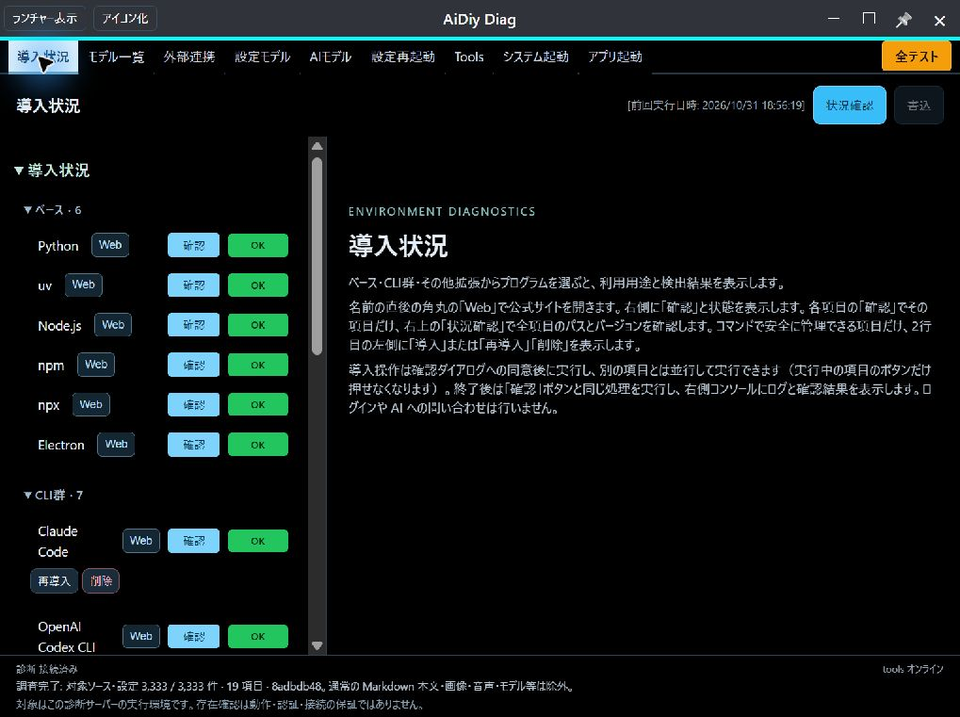

確認後はPythonが選択され、検出パスとバージョンが表示されました。保存前は「書込」が有効です。

**図102：導入確認結果**

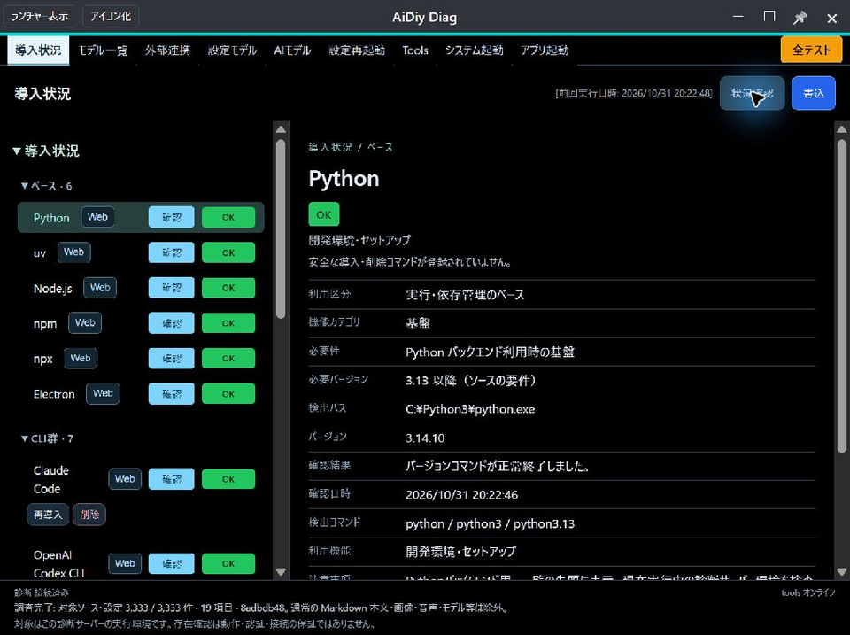

「書込済」になりました。保存ファイルの19項目はすべてOKで、画面の結果と一致しました。

**図103：導入結果書込済**

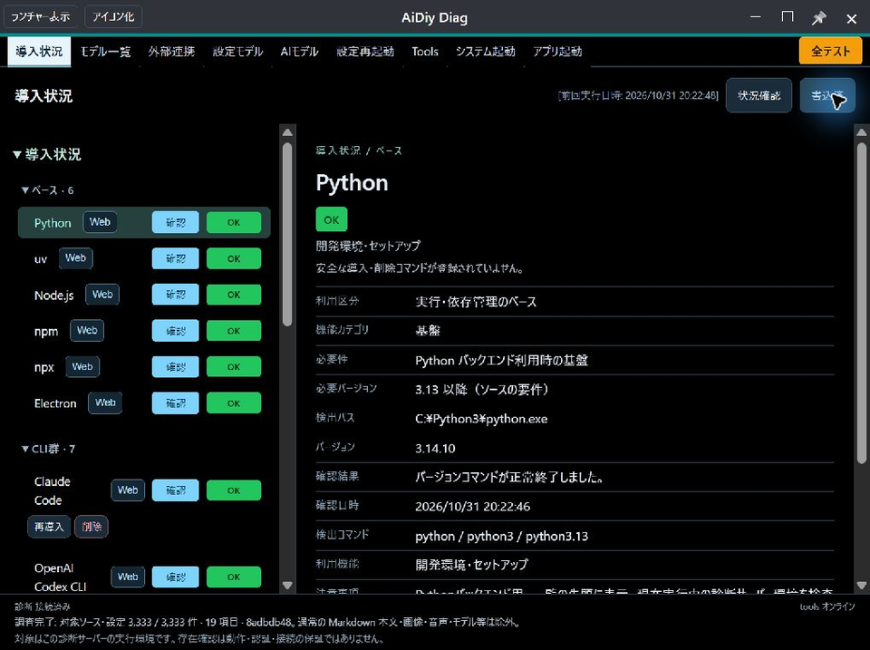

導入19項目は、ベース6項目・CLI群7項目・その他拡張6項目です。Pythonは3.14.10を検出しました。存在だけを確認する項目は、その実行・認証・接続まで成功した意味ではありません。

## 2. モデル一覧を取得して保存する

1. 「モデル一覧」を選び、「一括取得」を押します。
2. 取得中・待機中の表示が終わるまで待ちます。
3. サービス名を選び、右の取得範囲・判定理由・モデル候補を読みます。
4. 「書込」を押し、「書込済」を確認します。

行の「テスト」はそのサービスだけを確認します。公開一覧・同梱キャッシュ・固定候補と、認証済みAPIの結果を区別して読みます。

モデル一覧を開いた画面です。「一括取得」で設定に応じた一覧を取得します。

**図201：モデル一覧の初期画面**

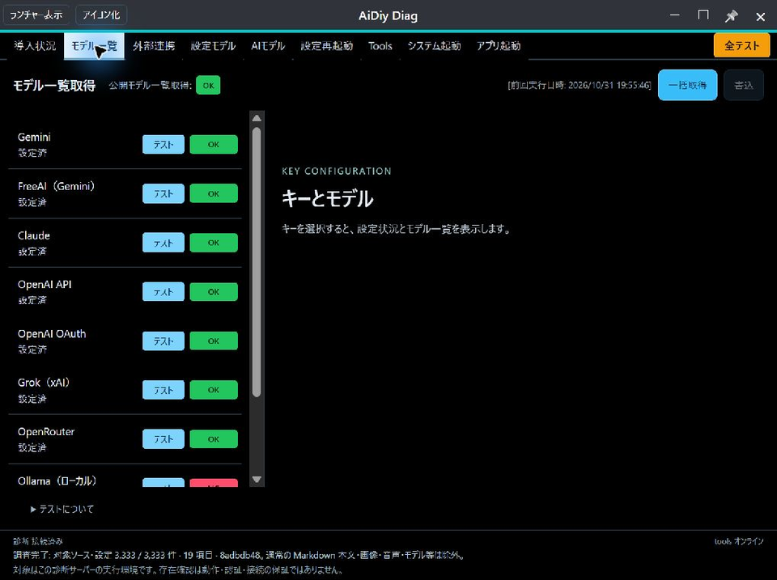

Geminiの取得結果です。モデル一覧APIの成功と、候補の取得範囲を確認できます。

**図202：モデル取得結果**

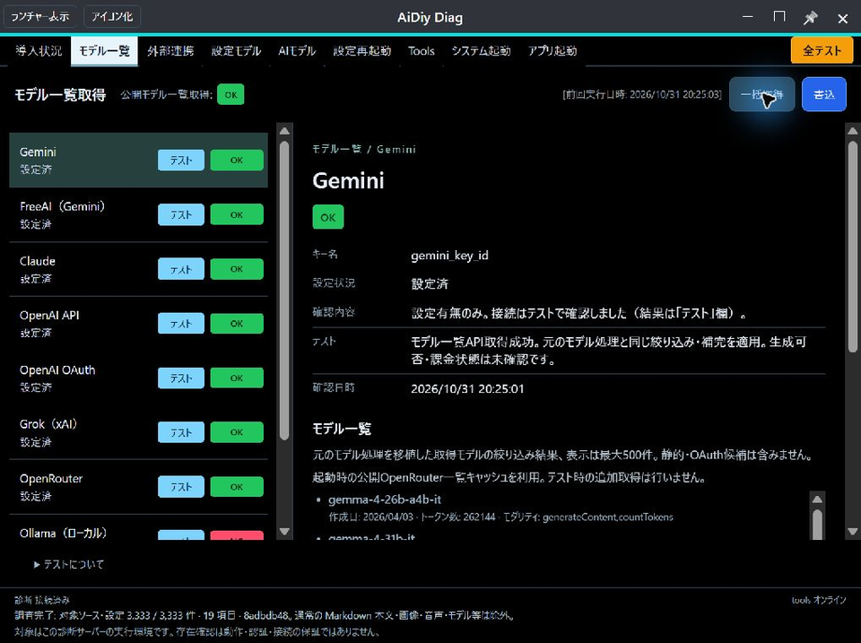

取得後に「書込済」となりました。プロバイダ別の情報、Chat・Live・Code・Prediction・Decisionsの合成情報、音声候補を保存し、JSONの読込を確認しました。

**図203：モデル一覧書込済**

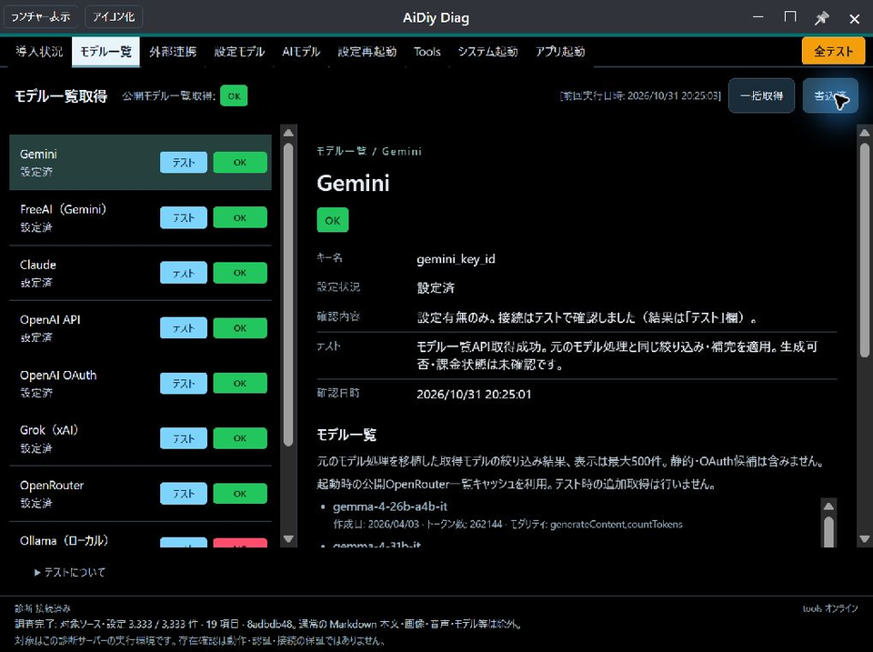

OllamaはNGです。実行ファイルは検出されていますが、ローカルサービスへ接続できず、モデル一覧を取得できませんでした。

**図204：Ollama接続不可**

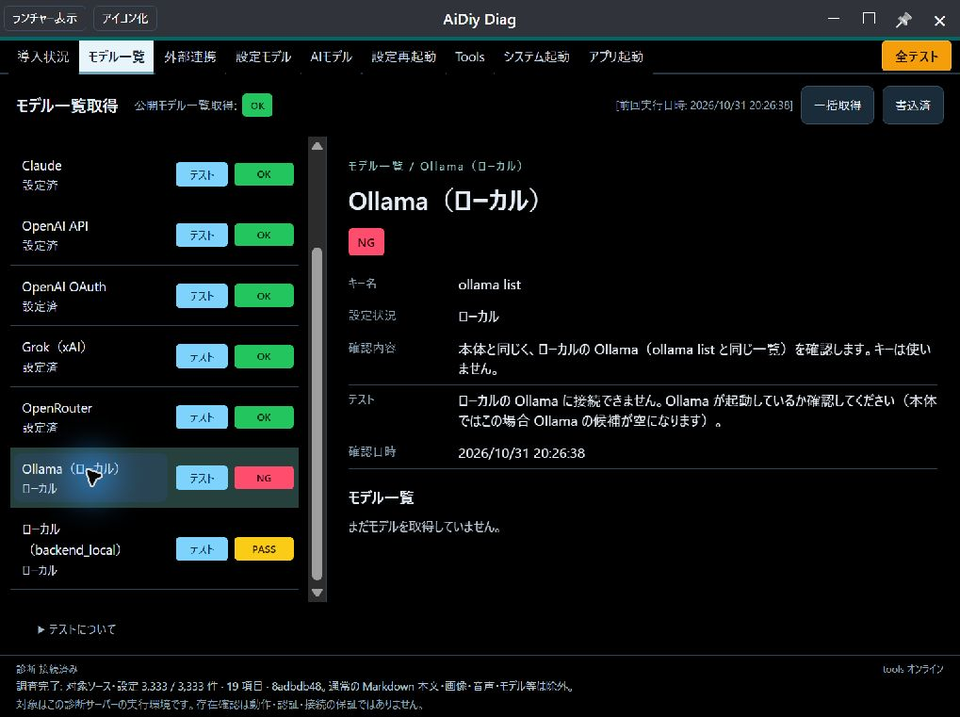

LocalはPASSです。固定候補を表示する仕様で、APIからモデル一覧を取得した結果ではありません。

**図205：Local固定候補**

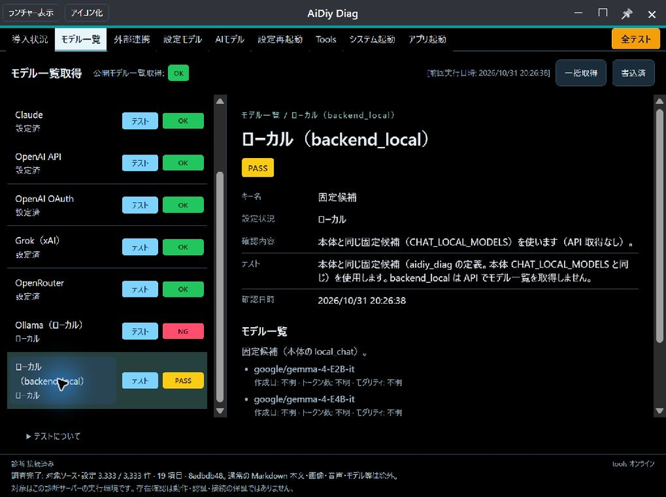

| 対象 | 結果 | 確認範囲 |
|---|---|---|
| Gemini・FreeAI・Claude・OpenAI API・OpenAI OAuth・Grok・OpenRouter | OK：7件 | 各行の一覧取得・認証等の判定を保存 |
| Ollama | NG：1件 | 接続不可。モデル一覧取得は未達 |
| Local | PASS：1件 | 固定候補の表示・保存 |

Ollamaの実接続はPASS（環境依存・判定対象外）として扱います。NG表示を取得成功へ読み替えません。この章ではAIへの会話・生成は試しません。

## 3. 外部連携を確認して保存する

1. 「外部連携」を選びます。
2. Hugging Face読取・書込、Discord、Slackの設定状態を確認し、「状況確認」を押します。
3. 完了後、各行を選んで認証・権限の結果と説明を読みます。
4. 「書込」を押し、「書込済」を確認します。

ここで行うのは読み取り専用の認証確認です。Hugging Faceの「書込」行も、実際にファイルを書き込まずトークンの権限を確認します。

4項目を表示した画面です。右上の「状況確認」が一括操作です。

**図301：外部連携の初期画面**

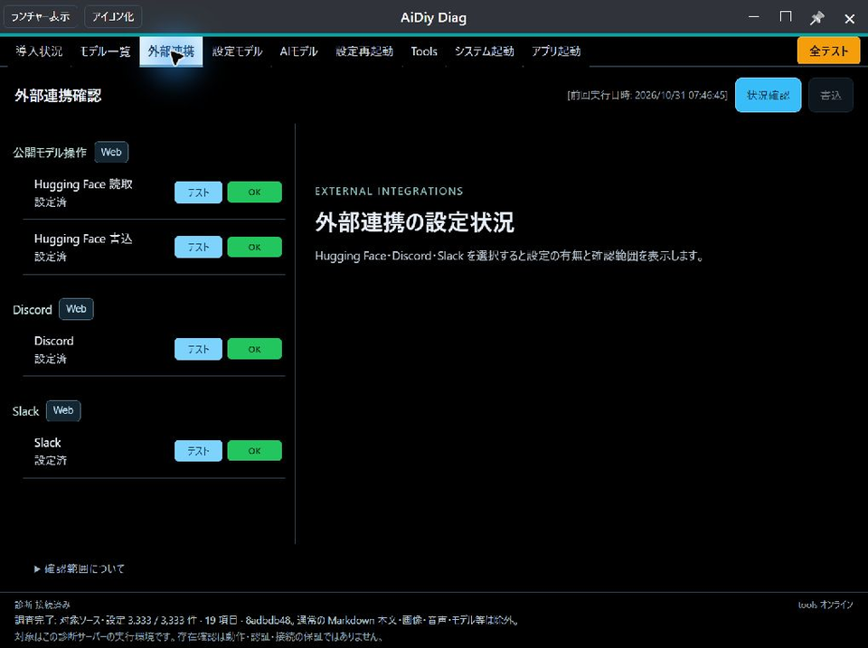

Hugging Face読取・書込、Discord、Slackの全4件がOKになりました。選択した行の詳細に認証の説明が表示されます。

**図302：外部連携4件の結果**

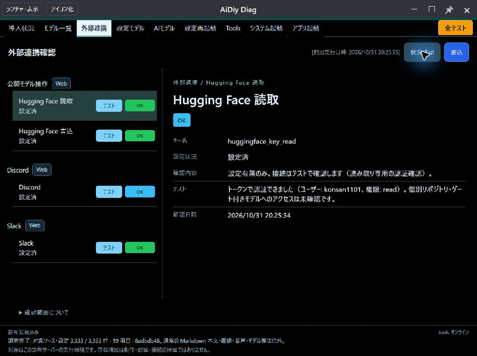

「書込済」になりました。保存ファイルも4件すべてOKで、画面と一致しました。

**図303：外部連携書込済**

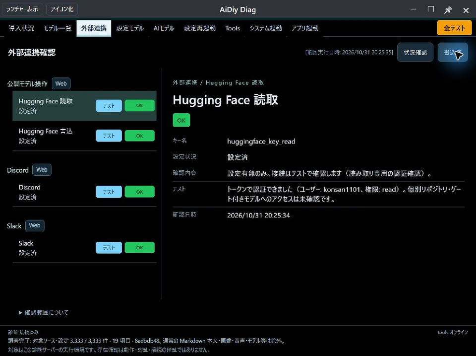

Slack Botトークンの認証はOKです。Appトークン・Socket Mode・チャンネル権限・メッセージ送信は、この確認の対象外と表示されます。

**図304：Slack認証詳細**

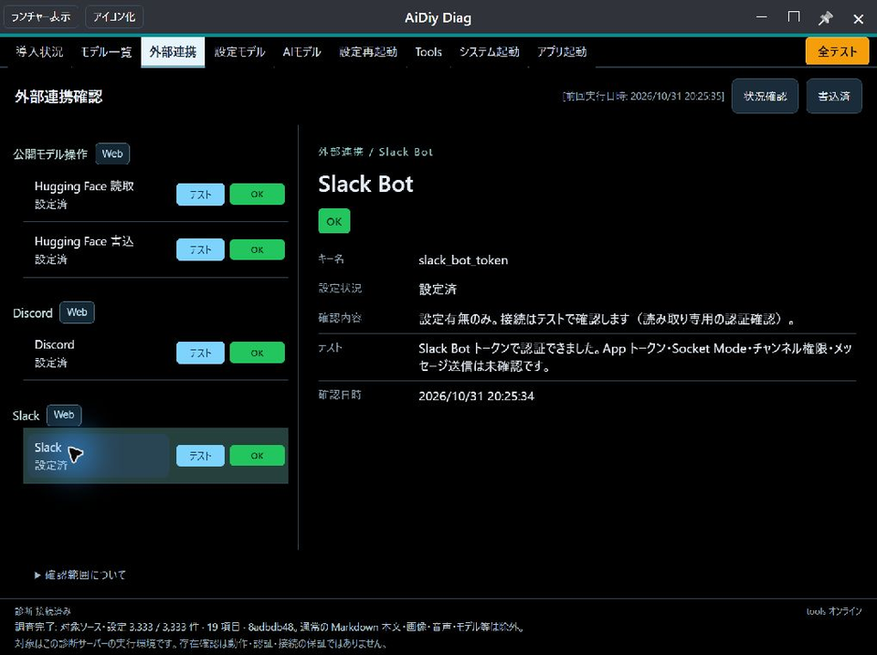

Hugging Faceの個別リポジトリ・ゲート付きモデルへのアクセス、DiscordやSlackの実投稿は対象外です。未設定の行を認証成功とは扱いません。

## 4. 3タブをまとめて確認する

1. 最初の3タブのいずれかで、画面右上の「全テスト」を押します。
2. 導入確認・書込 → モデル一覧取得・書込 → 外部連携確認・書込の順に進みます。
3. 導入状況へ戻り、右上が「全テスト」に戻れば処理は終了です。
4. 各タブへ移り、結果と「書込済」を確認します。

実行中は重複した一括操作を行わずに待ちます。全テストにはAI応答、導入・削除、システム起動は含まれません。

全テストから導入状況の確認が始まりました。右上は「確認中…」となり、管理操作も無効です。

**図401：全テスト実行中**

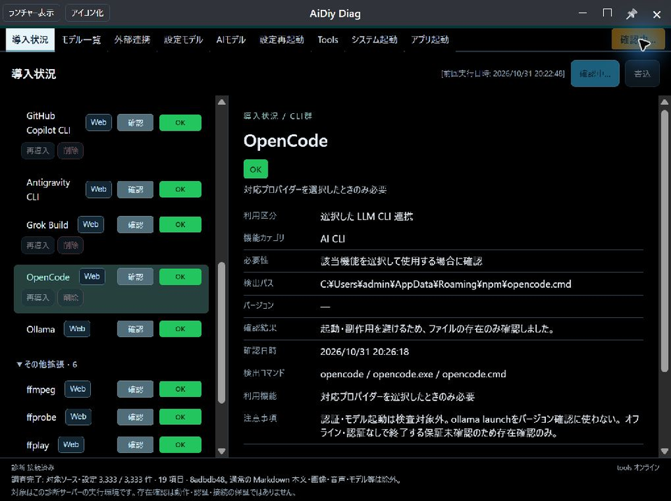

自動でモデル一覧へ移り、取得に続いて「書込中…」となりました。

**図402：全テストのモデル書込**

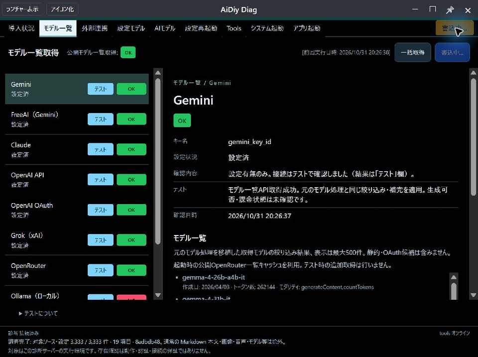

導入状況へ戻り、「全テスト」と「書込済」が表示されました。導入結果は19項目OKです。

**図403：全テスト完了**

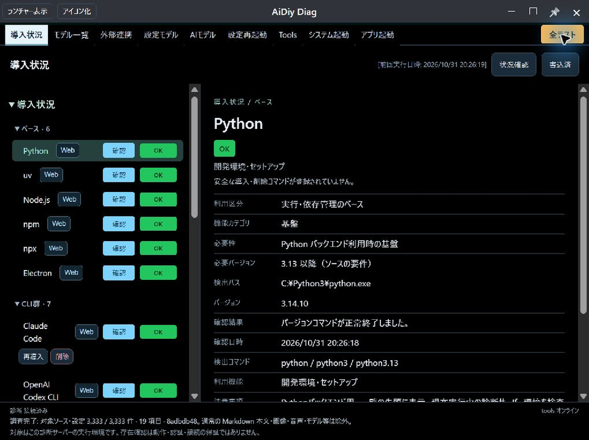

モデル一覧へ移っても「書込済」が保持されています。7件OK・LocalのPASS・OllamaのNGを保存しました。

**図404：全テスト後モデル書込済**

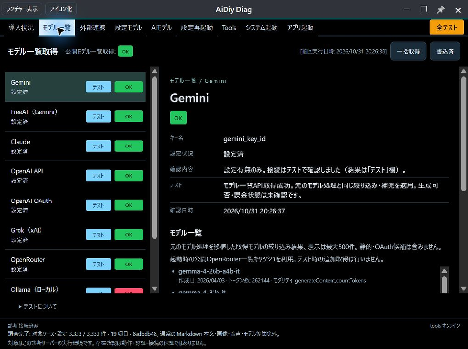

外部連携も4件OK・「書込済」です。3タブの結果が互いに消えず、保存ファイルと一致しました。

**図405：全テスト後外部連携書込済**

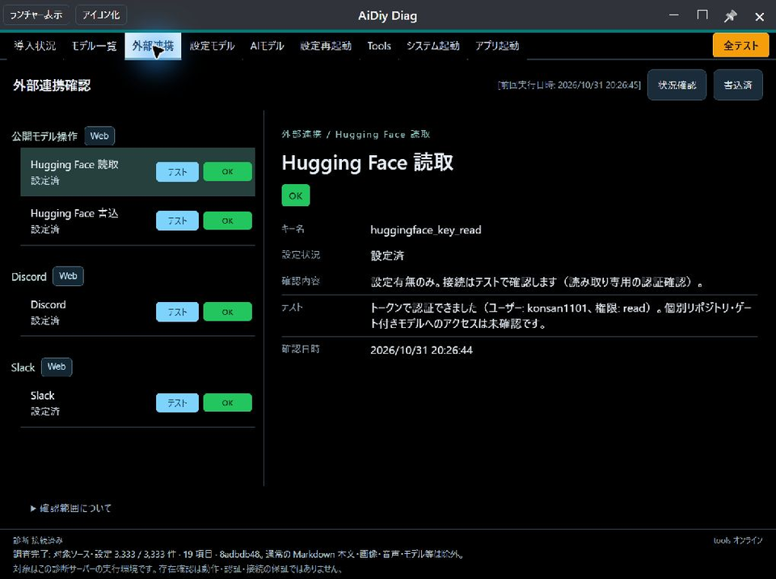

## 5. 追加テスト

### 個別確認

導入状況の各行の「確認」、モデル一覧・外部連携の各行の「テスト」は、選んだ対象だけを確認します。個別確認後は「書込済」が解除されるため、結果を残すときは再び「書込」を押します。

Python行の「確認」を実行しました。Pythonの確認時刻と結果が更新され、他18項目の状態は保持されました。続けて書込も完了しました。

**図501：Python個別確認**

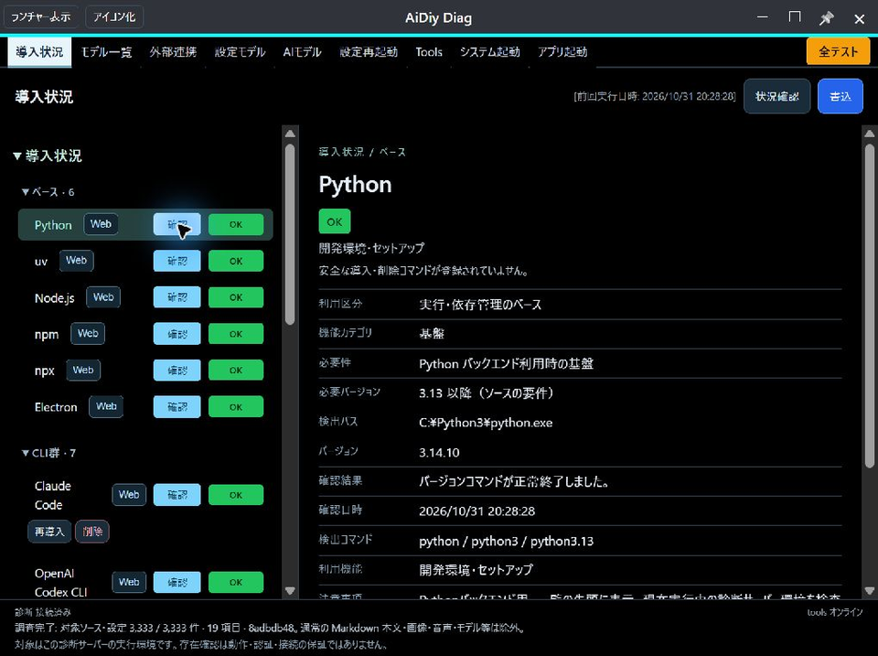

Slack行の「テスト」を実行しました。Slackの認証OKを確認し、他3行の結果を保持したまま書込を完了しました。

**図502：Slack個別確認**

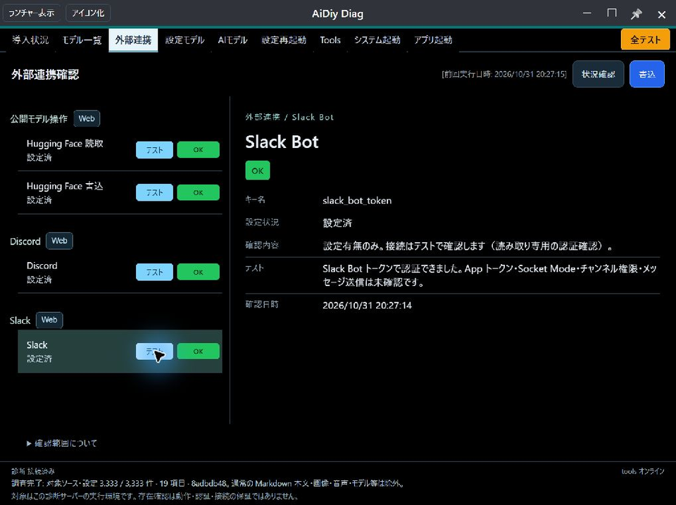

### 自動・隔離試験

外部通信・設定読取・保存先・失敗条件を固定した試験を含みます。実サービスへの認証成功は3章の実画面結果で判定します。

| 対象 | 確認した内容 | 結果 |
|---|---|---|
| 導入・個別確認 | 固定対象、存在・バージョン、1行だけの反映、失敗時の保持 | OK |
| headless・保存・前回結果 | 成功時の保存、保存失敗時の保持、前回結果との区別、画面・待受を作らない | OK |
| モデル・認証 | 設定済／未設定、OAuth・固定候補、機密値の非表示、入力上限、期限・中止 | OK |
| 一括・待機・並行操作 | 実行中／待機中の区別、対象行の排他、別行操作、3タブの結果と保存状態の保持 | OK |
| 外部連携・Slack | 読取専用の認証、権限の判定、未設定・通信失敗、トークンの非表示 | OK |

関連する自動・隔離試験は157件成功、Windowsの継承パイプ条件1件をスキップしました。重複実行した13件は件数に加算していません。

### 判定に含めない範囲

導入・再導入・削除による環境変更、幅390pxのブラウザ配置、Mac／Linux実機、長時間連続運転は未実施です。Ollamaの実接続、Localの推論、各モデルでの生成・課金可否、外部連携の実投稿もこの冊子の合格範囲に含めません。

### 終了時の状態

キー設定ファイルは実行前と一致し、パッケージ・モデル設定の変更はありません。DiagとTools・Core・Apps・TaskTeam・Webを継続稼働し、Localは停止状態を維持しました。試験画像はアプリ画面だけを保存しています。
