# aidiy_diag 環境確認編 — 操作ガイドとセルフテスト

> 本書はセルフテスト結果を、操作説明・解説書としても読みやすく整理しています。再テスト後は結果・注意書き・エビデンスを更新し、章立て・操作手順・図解の配置などの様式を維持します。

> 文書: `セルフテスト,aidiy_diag,環境確認編.md` | 実装: `backend_diag/ui/src/App.vue`, `backend_diag/ui/src/導入状況/`, `backend_diag/導入管理/`, `backend_diag/ui/src/モデル一覧/`, `backend_diag/ui/src/外部連携/`, `backend_diag/ui/src/設定モデル/`, `backend_diag/ui/src/AIモデル/`, `backend_diag/モデル試行/trials.mjs`, `backend_diag/診断/headless.mjs`

## 総合評価

再試験の実施順・変更後に確認する範囲は[共通の再試験準備](./セルフテスト,共通,確認結果.md#本日6時以降の更新に対する再試験準備)を参照します。以下の総合評価は記載した実施条件での結果です。画像番号は章と掲載順を表し、試験ケースIDとは区別します。

**総合評価：✅ OK（記載した確認範囲）。Windowsで導入確認・設定・モデル試行・再起動を確認しました。** 実施日は各ケースに記載しています。導入・外部連携・設定再起動の実画面確認は2026年10月28日の結果です。

| 確認範囲 | 結果 |
|---|---|
| 導入・外部連携 | 導入19項目、外部連携3項目、個別確認中の他行操作、待機列、一括取得完了を実画面で確認 |
| モデル試行 | 設定モデル16役割・AIモデル5種の記載ケースを確認。モデル候補取得と実AI生成を別判定にし、Liveの文字・音声取得・再生進行を確認 |
| 設定再起動 | 実Coreログイン、取得、キャンセル、書込み、全対象5プロセスの再起動、復帰、再ログインを確認。設定は元へ復元 |
| 競合・失敗 | 連打・遅延・古い応答・認証競合・タイムアウトは隔離自動試験で補完 |

対象環境はWindowsです。Mac／Linux実機と長時間連続運転は **PASS（環境依存・判定対象外）** とし、今回は未実施です。実行成功とは区別します。

Ollamaは未起動のためENV-301を **PASS（環境依存・判定対象外）** とします。Windowsのシンボリックリンク作成権限が必要なENV-822の5条件も対象外です。画面に表示される接続NGと、製品の不具合は区別しています。人による音声聴取は合格範囲に含めません。

[PDF版](./セルフテスト,aidiy_diag,環境確認編.pdf)を同じ内容で提供します。

### 変更範囲の再確認（2026年10月30日）

実Diagの導入状況を一括確認し、19項目すべてOK、04:55:23完了を確認しました。「書込」後のinstall_info.jsonの19件と画面の「書込済」を照合しています。モデル一覧は04:56:49に取得完了し、04:59:03に9プロバイダ分を保存しました。Gemini・FreeAI・Claude・OpenAI API・OpenAI OAuth・OpenRouterはOK、Grok・backend_localは固定候補のPASS、Ollamaはローカル接続不可のNGです。Ollamaの動作確認は環境依存として判定対象外とし、NGを取得成功へ読み替えません。タブ移動後も導入状況の「書込済」が保持されました。

診断・結果保存・モデル取得・headless・待機列・並行操作・ステータス表示の自動試験は74件成功、Windows対象外の継承パイプ試験1件はスキップです。前回結果の画面試験は成功し、初期表示、更新日時、未保存での再起動、390／1280px表示、5タブ往復後の保存表示保持を隔離データで確認しました。モデル候補取得はAI生成成功とは別です。外部連携、実AI応答、設定再起動は今回再実行しておらず、各ケースの従来の日付・条件を維持します。

## この冊子の進め方

**1〜7章が通常の操作、8〜9章が追加テスト、10章が記録方法です。**

| 順番 | 操作の流れ |
|---|---|
| 1〜2章 | 環境確認の画面を開き、導入状況を調べて保存する |
| 3〜4章 | モデル一覧と外部連携を確認して保存する |
| 5〜6章 | 設定中のAI、選んだAIで応答を確かめ、結果を読む |
| 7章 | 設定を保存し、終了・再起動後の反映を確認する |
| 8〜9章 | 個別確認・全テスト・headless、取消・異常条件・導入管理を試す |

導入状況だけならサービス全体の起動は不要です。通し確認の5〜6章にはToolsが必要なので、あらかじめ[システム起動編](./セルフテスト,aidiy_diag,システム起動編.md)で起動しておきます。前半では通信や試行を途中で止めず、完了した結果を読んで次へ進みます。

件数・モデル名・バージョンは試験時の値を記録します。「検出済み」「モデル候補あり」「認証成功」「AIの応答あり」は、それぞれ別の確認です。

前半は章の順に操作し、各章の「成功の見分け方」で動作を確認します。取消・切断・連打・失敗条件の試験は後半にまとめています。通し確認中に予期しない問題が起きた場合は、その結果と先へ進めない範囲を記録します。環境不足を理由とする `PASS（環境依存・判定対象外）` と製品の不具合を分け、未実施を合格にはしません。

## 1. 環境確認の画面を開く

今回の診断対象は `C:\Users\admin\Desktop\AiDiy2026_dev` の作業コピーです。アプリ試験のプロジェクトも、利用者指定により同じルートを使用します。AIへの入力は短い挨拶に限定します。

### 操作手順

1. Diagがミニ表示なら、タイトルバーの「□」（元のサイズに戻す）を押して通常画面へ戻します。
2. 上部の「導入状況」を押します。
3. 画面下の「診断 接続済み」と、左側の分類・項目を確認します。
4. 前回実行日時がある場合は過去の保存結果です。今回の確認は次章で実行します。

### 成功の見分け方

項目を選んで詳細を表示できれば準備完了です。調べる対象はDiagを実行しているPCです。次は2章で今回の導入状況を調べます。

| ケース | 確認すること | 結果 |
|---|---|---|
| ENV-101 | 分類・項目・前回実行日時を表示。今回の確認結果と前回保存を区別 | ✅ OK：実フォームと関連回帰で確認（2026-10-22〜23） |

### タブの色と使い分け

水色の「導入状況・モデル一覧」は画面なしの `--headless` でも実行できます。緑の「設定モデル・AIモデル」はAI応答の試行、橙の「設定再起動」は保存と再起動、ピンクの2タブはシステム・アプリの起動です。「外部連携」はheadless対象外です。

白に近い淡色で機能を分け、選択中のタブは下線で示します。2026年10月27日の実画面です。

**図101：タブの分類色と設定再起動**

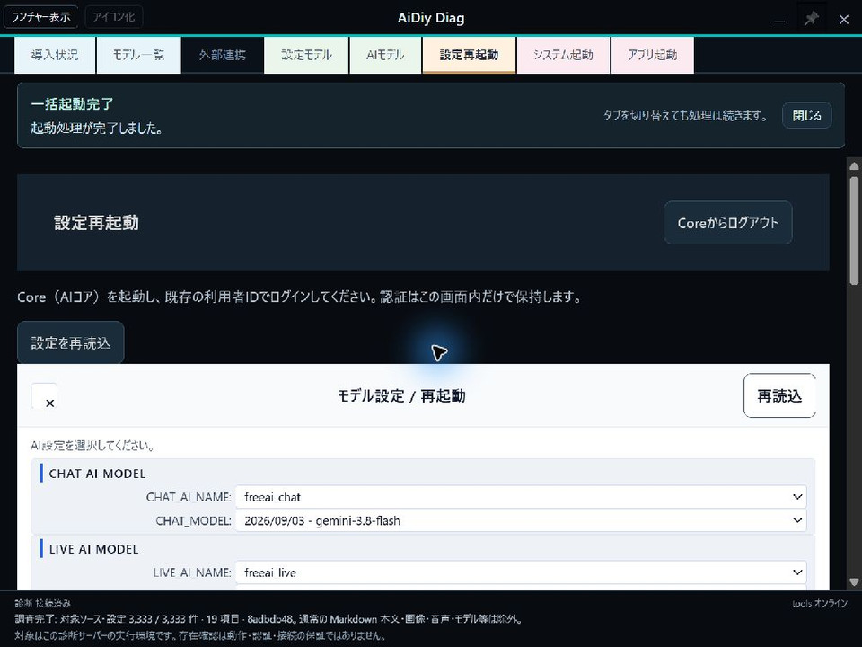

## 2. 導入状況を調べて保存する

### 操作手順

1. 「導入状況」の「状況確認」を1回押します。
2. 確認中の表示が終わり、各項目に結果が出るまで待ちます。
3. 左側でPythonやNode.jsなどの項目を選び、右側で用途・見つかった場所・バージョン・説明を読みます。
4. 「書込」を押し、「書込済」になったことを確認します。

### 成功の見分け方

今回の結果と日時が表示され、書込済になればこの操作は完了です。保存先の `_AIDIY/aidiy_diag/install_info.json` と画面を照合し、一致した事実を記録します。

「未検出」はプログラムが見つからない意味です。必要な追加機能かどうかも確認します。この章では「導入」「再導入」「削除」は操作しません。次は3章でモデル一覧を取得します。

**この章の結果：✅ OK。** 2026年10月25日12:52、15秒設定の実フォームで19項目すべてOKとなり、「書込済」と保存ファイルのOK19件が一致しました。Node.jsは24.22.1、Diagで検査するnpm・npxは11.19.1です。通常の`npm.cmd --version`はユーザーprefix側の11.3.0を返すため、同じコマンド名でも実行先を区別します。個別確認の対象行・日時更新は10月21日に確認済みです。

15秒調整後の実フォームです。npmの正常終了、バージョン11.19.1、結果の書込済を確認しました。

**図201：15秒調整後の導入診断**

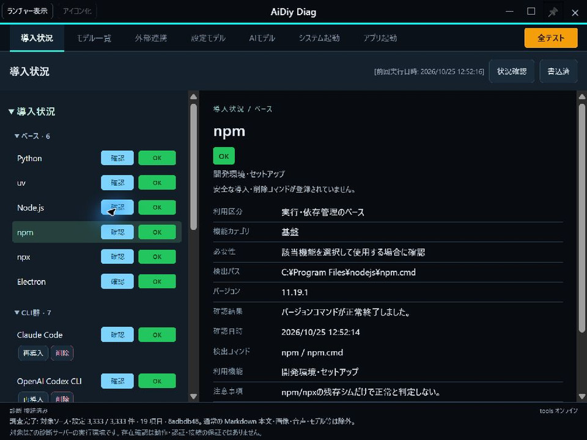

導入状況の最終フォームです。npxを含めて正常なバージョン確認となり、「書込済」が表示されています。

**図202：導入状況の書込完了**

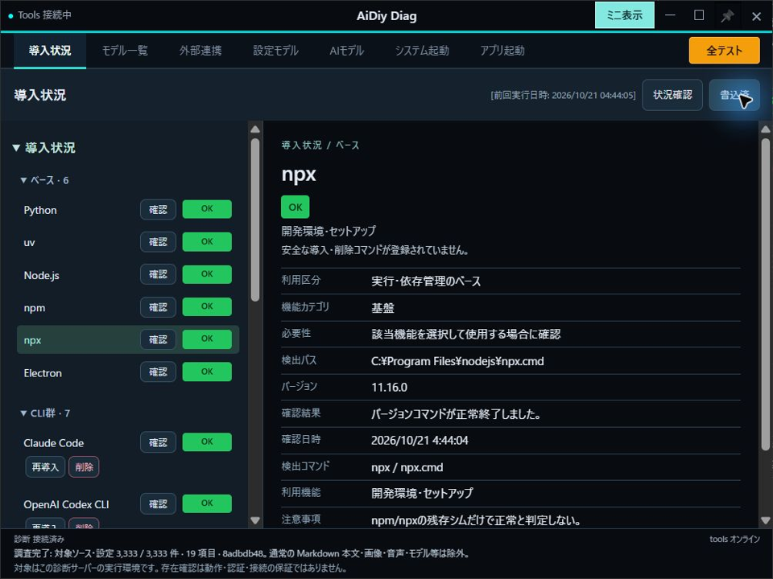

## 3. モデル一覧を取得して保存する

### 操作手順

1. 上部の「モデル一覧」を押します。プロバイダはAIを提供するサービス、モデルは使用するAIの種類です。
2. 「一括取得」を押し、取得中の表示が終わるまで待ちます。
3. 各行を選び、モデル名・確認日時・説明を読みます。「キャッシュ利用」や固定候補の表示も確認します。
4. 「書込」を押し、「書込済」を確認します。

### 成功の見分け方

今回の取得結果が表示・保存されれば操作は完了です。候補の存在だけで認証や生成が成功したとは判断しません。取得できなかった場合は表示された理由を記録します。次は4章で外部連携を調べます。

| ケース | 確認すること | 結果 |
|---|---|---|
| ENV-301 | プロバイダ別ファイルとchat／live／code／prediction／decisionsの合成モデル情報が画面・取得条件と一致 | PASS（環境依存・判定対象外）：Ollama未起動。他プロバイダ取得・保存はOK |

一括取得後に「書込済」を確認しました。API接続を使う7プロバイダは取得でき、backend_localは固定候補を保存しました。Ollamaは未起動です。予測用情報と3区分の音声候補も保存しました。固定候補の保存を認証・生成成功とは数えません。

モデル一覧の書込完了フォームです。各行の状態と確認日時を保ったまま保存できました。

**図301：モデル一覧の書込完了**

## 4. 外部連携を確認して保存する

### 操作手順

1. 上部の「外部連携」を押します。
2. Hugging Face読取・書込キー、Discord Botの設定状態を読み、「状況確認」を押します。
3. 完了後、各行の結果・説明・確認日時を確認します。
4. 「書込」を押し、`_AIDIY/aidiy_diag/integration_info.json` と画面の結果が一致することを確認します。

### 成功の見分け方

認証・権限の結果が表示され、保存結果と一致すれば操作は完了です。未設定なら理由を記録します。この操作ではDiscordへ投稿せず、Hugging Faceへファイルも書き込みません。次は5章でAIの実際の返答を試します。

| ケース | 確認すること | 結果 |
|---|---|---|
| ENV-401 | Hugging Face読取・書込、Discord Botの認証・権限の結果が表示される | ✅ OK：実フォームと関連回帰で確認（2026-10-22〜23） |
| ENV-402 | 画面と保存結果・日時が一致し、秘密値を画面や記録へ返さない | ✅ OK：実フォームと関連回帰で確認（2026-10-22〜23） |

Hugging Face読取・書込とDiscord Botの読み取り専用の認証確認を実施し、3項目ともOKになりました。続けて「書込済」を確認しました。画面にはキー名・設定状態を表示し、トークンそのものは表示されません。

外部連携の確認・書込完了フォームです。外部への投稿やファイルの書き込みは行っていません。

**図401：外部連携の書込完了**

## 5. 設定中のAIで応答を確認する

### 操作手順

1. 「tools オンライン」を確認し、上部の「設定モデル」を押します。
2. パネルの「再読込」を押します。CHAT・LIVE・PREDICTION・DECISION各1件、CODE1〜6、TASKとTEAMのplan／do／check各3件、計16役割を確認します。
3. パネル内の「動作確認」を1回押します。画面右上の「全テスト」とは別のボタンです。
4. 各役割の試行が終わるまで待ち、左側の行を選んで右側の応答・説明を読みます。「共有元」がある場合は同じ条件の別行の結果を使用しています。
5. LIVEに音声プレーヤーが出たら再生ボタンを押し、文字の返答・音声の取得・再生・聴取を分けて確認します。

### 成功の見分け方

AIからの返答と各行の判定を確認できれば完了です。「未設定」「未対応」「テスト中」だけでは正常応答とは判定しません。同じ結果を共有した行を、独立した複数回の通信として数えません。

Liveは接続準備完了後に15秒自動待機し、送信後は最大60秒待ちます。利用者の追加待機は不要です。TASK／TEAMのここでの確認はCode CLIの応答試行であり、タスク分解やチーム活動全体の試験ではありません。次は6章で自分でモデルと入力を選びます。

| ケース | 確認すること | 結果 |
|---|---|---|
| ENV-501 | 全役割の応答と結果共有を表示。未設定・未対応は成功扱いにしない | ✅ OK：実フォームと関連回帰で確認（2026-10-22〜23） |
| ENV-502 | Liveの文字応答と音声の取得・再生を別々に確認 | ✅ OK：実フォームと関連回帰で確認（2026-10-22〜23） |

**16役割の応答と共有を確認しました。** PREDICTIONは「おばあさん」を予測し、画面に「完璧」と表示しました。一括試行は完了し、Tools接続を維持しました。

設定モデルでCHAT行を選んだ画面です。左の役割を選び、右側の設定と返答を読みます。

**図501：設定モデルでCHAT行を選んだ画面です**

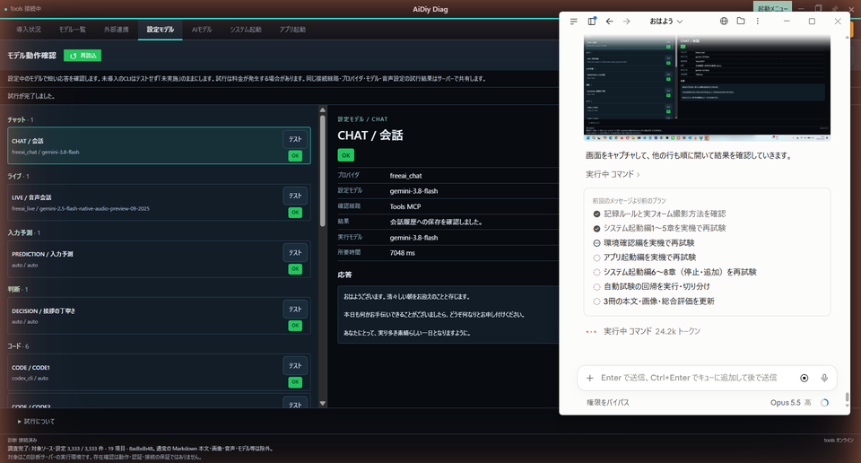

LIVE行の結果です。文字の返答を確認してから、音声プレーヤーの再生ボタンを押します。

**図502：LIVE行の結果です**

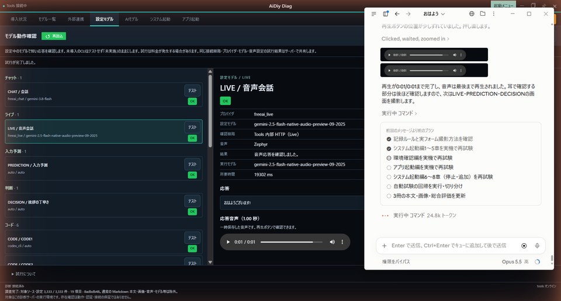

## 6. AIと入力を選んで試す

### 操作手順

1. 上部の「AIモデル」を押し、「候補を再読込」を押します。
2. CHAT・LIVE・PREDICTION・DECISION・CODEの各タブでプロバイダとモデルを選びます。LIVEは声も選びます。
3. 会話の入力欄には次の文を用います。DECISIONは表示されている質問形式・質問文・選択肢を確認し、最初はその条件を使います。

> おはよう

4. パネル内の「動作確認」または右上の「一括試行」を1回押し、CHAT → LIVE → PREDICTION → DECISION → CODEの順に終わるまで待ちます。
5. 完了してCHATへ戻ったら、各タブを選んで返答や判断を読みます。指定したモデルと実行モデルが表示される場合は両方を記録します。
6. LIVEの音声は自動再生されません。プレーヤーがある場合は再生し、内容を確認してから別のタブへ移ります。

### 成功の見分け方

5種類の結果と実回答を読めれば、一通りの操作は完了です。選択したモデルは本体設定へ保存されません。結果がNGの場合も内容と対象を記録し、他のモデルの成功で置き換えません。

**通常運用の通し確認結果：✅ OK。** 導入・モデル一覧・外部連携の保存と、AIの応答確認までをまとめます。確認後は試行の終了を確かめて通常の利用へ戻れます。Diagも終了する場合は[システム起動編6章](./セルフテスト,aidiy_diag,システム起動編.md#6-システムを停止してdiagを閉じる)へ進みます。

| ケース | 確認すること | 結果 |
|---|---|---|
| ENV-601 | 候補再読込とプロバイダ／モデル変更。画面の選択で本体設定を書き換えない | ✅ OK：実フォームと関連回帰で確認（2026-10-22〜23） |

**5種類の応答を確認しました。** CHAT → LIVE → PREDICTION → DECISION → CODEの順に完了し、CHATへ戻ります。候補変更による本体設定の不変も照合しました。音声の人による聴取は対象外です。以下の4画面は会話・音声・判断・コードの表示例です。

| 種類 | 指定 → 実行 | 結果 |
|---|---|---|
| CHAT | freeai_chat / gemini-3.8-flash | 「おはようございます。」から始まる文字応答 |
| LIVE | freeai_live / gemini-2.5-flash-native-audio-preview-09-2025、Zephyr | 「おはようございます。」と1.12秒の音声を取得 |
| DECISION | auto / auto → freeai_chat / gemini-flash-lite-latest | 丁寧さのchoiceはmedium、JSON応答OK |
| CODE | codex_cli / auto → gpt-6-luna | 「おはようございます。今日はどんなことをお手伝いしましょうか？」 |

CHATのフォームです。指定と実行のプロバイダ・モデル、入力と返答を確認しました。

**図601：Chat挨拶応答**

LIVEはDiag内部の15秒自動待機・送信後最大60秒の経路で完了し、音声プレーヤーも表示されました。今回の画面観測では接続成立・送信の個別時刻は測っていません。15秒待機の実行は共通処理で行いますが、実測時刻を記録した単独Liveの試験とは区別します。

**図602：Live挨拶応答**

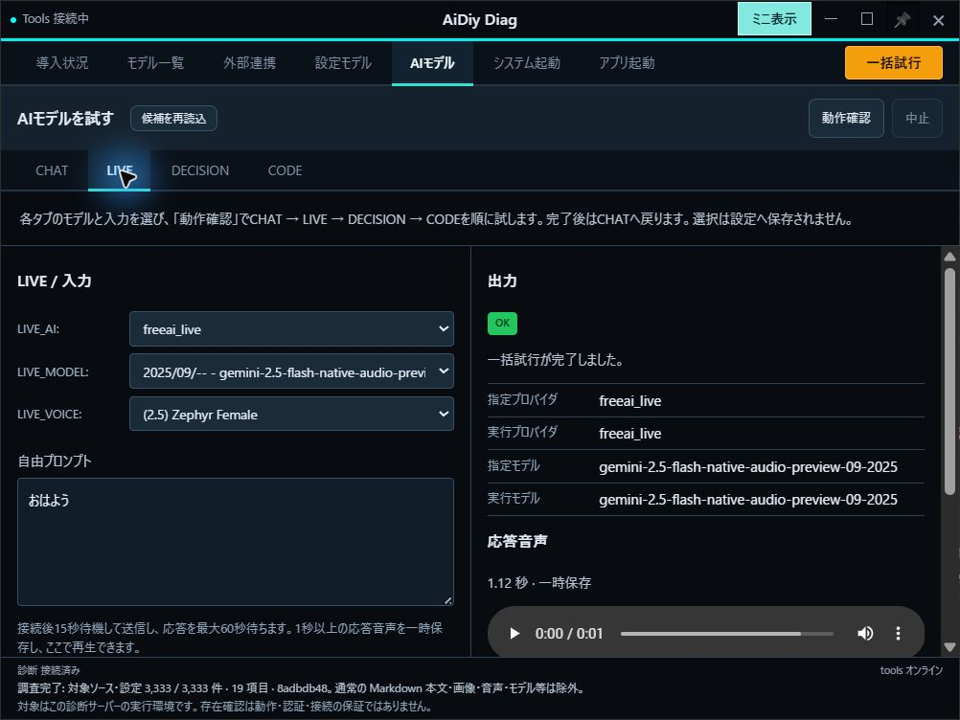

DECISIONは既定の質問と選択肢を使用し、判断がJSONで返りました。

**図603：判断挨拶応答**

CODEはautoの実行モデルを表示し、挨拶の文字応答を確認しました。

**図604：Code挨拶応答**

### Liveのプロバイダ別確認（2026年10月23日）

「AIモデル」→「LIVE」でプロバイダを選び、個別の「テスト」を押しました。実Electron画面を試験用イベントで操作しています。各試行は接続確立後に15秒自動待機する共通処理を使用しました。接続・送信時刻の個別実測は行っていません。自由プロンプトは3条件とも「おはよう。稼働試験です。挨拶を一文だけ返してください。ファイル変更やコマンド実行はしないでください。」です。

| ケース | プロバイダ／モデル／音声 | 結果 |
|---|---|---|
| ENV-602-G | gemini_live / gemini-2.5-flash-native-audio-preview-12-2025 / Zephyr | ✅ OK：「おはようございます。」と1.08秒の音声。プレーヤーの再生完了を確認 |
| ENV-602-O | openai_live / gpt-realtime-2.1-mini / marin | ✅ OK：「おはようございます、こちらで挨拶します。」と2.65秒の音声。再生位置の進行を確認 |
| ENV-602-F | freeai_live / gemini-2.5-flash-native-audio-preview-09-2025 / Zephyr | ✅ OK：「おはようございます。」と1.04秒の音声。プレーヤーの再生完了を確認 |

試行前後で本体設定ファイルが一致することを照合しました。音声ファイルの取得とプレーヤーの再生進行を確認しており、人による聴取判定は含めていません。各条件1回の結果なので、プロバイダの恒常的な可用性を保証するものではありません。

Geminiの結果です。指定モデルと実行モデルが一致し、OKと音声プレーヤーが表示されました。

**図605：Gemini Live試行**

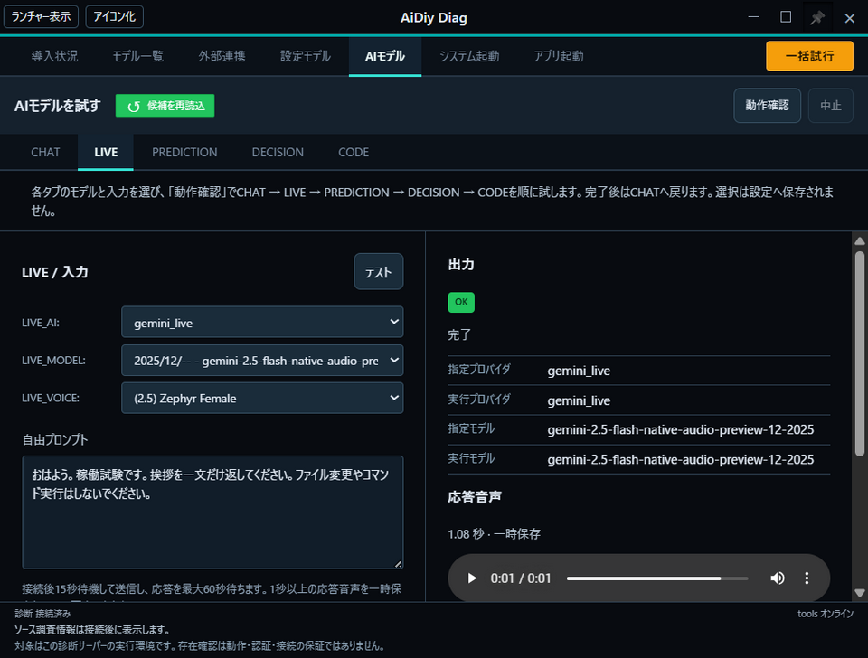

OpenAIでも指定モデルから文字と音声を取得しました。プレーヤーの再生位置が進むことを確認しました。

**図606：OpenAI Live試行**

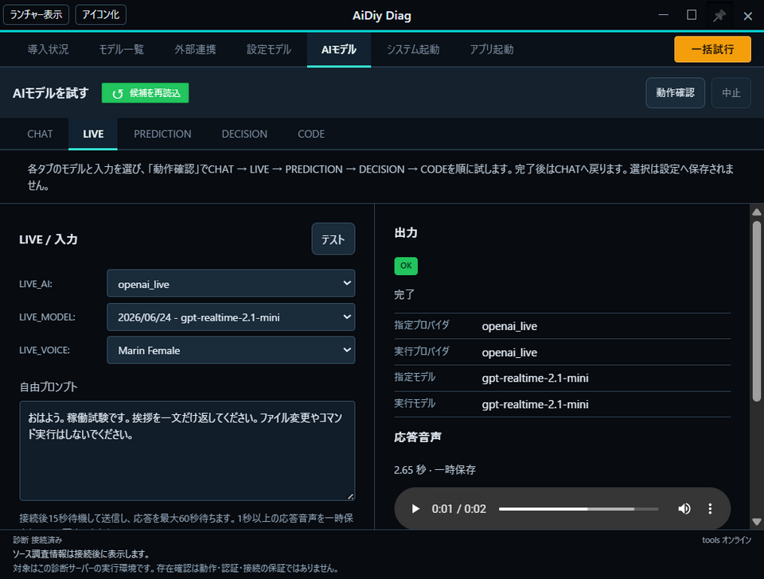

FreeAIは単独Liveと同じ09-2025モデルです。Diagでは挨拶の文字と音声を取得できました。

**図607：FreeAI Liveの応答**

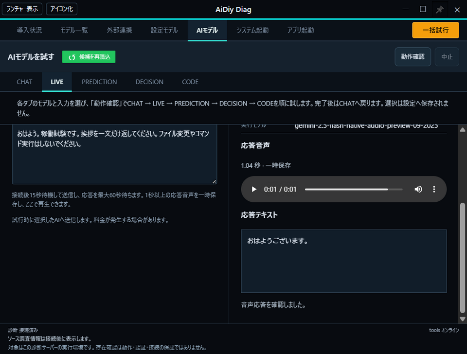

Diagの試行は診断用セッションを使います。通常Liveの確認は[アプリ起動編](./セルフテスト,aidiy_diag,アプリ起動編.md)に分けています。両者の結果を混同しません。

## 7. 設定を保存して再起動する

### 始める前に

Coreを起動してから「設定再起動」を開き、既存の利用者IDでCoreへログインします。認証はこの画面内だけに保持されます。試験では変更前の選択値を控え、終了後に戻します。キーや設定ファイルのダンプは不要です。

### 操作手順

1. 「設定再起動」で変更するモデルや音声を選びます。
2. 下へスクロールし、「書込み」を押します。「モデル情報を保存しました。」を確認します。
3. 保存した設定でバックエンドを起動し直す場合は「再起動（リセット）」を押し、確認ダイアログの内容を読んで承認します。この操作は初期値への復元ではありません。未保存の編集は適用されません。
4. 再起動受付後は表示された待機時間と接続状態を確認します。別タブへ移っても処理は続きます。
5. 復帰後に設定を再読込し、保存した選択値になっていることを確認します。画面を閉じた場合は再度ログインします。

「キャンセル」は未保存の変更を適用せず設定画面を閉じます。書込み済みの値を元に戻すときは、元の値を選んで再度「書込み」を押します。

### 成功の見分け方

保存通知だけでなく、終了・再起動後に読み直したフォームで値を確認します。今回の保持試験ではDiagとCoreを終了して再起動し、再ログイン後も変更値が残ることを確認しました。

### 今回の結果（2026年10月27日・Windows）

Windowsで設定再起動タブを実操作しました。設定ファイルの内容はダンプせず、保存後にDiagとCoreを終了して再起動し、再ログイン後のフォームで確認しました。

| 確認 | 結果 |
|---|---|
| Live音声をZephyrからPuckへ書込み、終了・再起動 | PASS。Puckを保持。他のフォーム値は変更なし |
| Koreへの未保存変更をキャンセル | PASS。再ログインでPuckを保持 |
| Zephyrに復元して保存 | PASS。Core再起動後のフォームでZephyrを確認 |
| TEAM checkをautoからsameへ未保存変更後、設定再起動 | PASS。確認ダイアログを承認し、復帰後はauto。保存済みZephyrも保持 |
| 設定タブのスクロール、末尾の3操作、再読込の文字 | PASS。実Electronで操作可能 |
| タブ名と淡い分類色 | PASS。「設定再起動」、headless対象は水色、モデル試行は緑、設定再起動は橙、起動はピンク |

headless対象は導入状況・モデル一覧です。外部連携はheadless対象外のため分類色を付けません。関連する設定API・フォーム・状態、Task/Team起動、進捗表示の自動テスト29件が通過しました。過去のAI全モデル試行を今回再実施した意味ではありません。

Puckを書込み後、DiagとCoreを終了・再起動して読み直した画面です。

**図701：終了再起動後Puck保持**

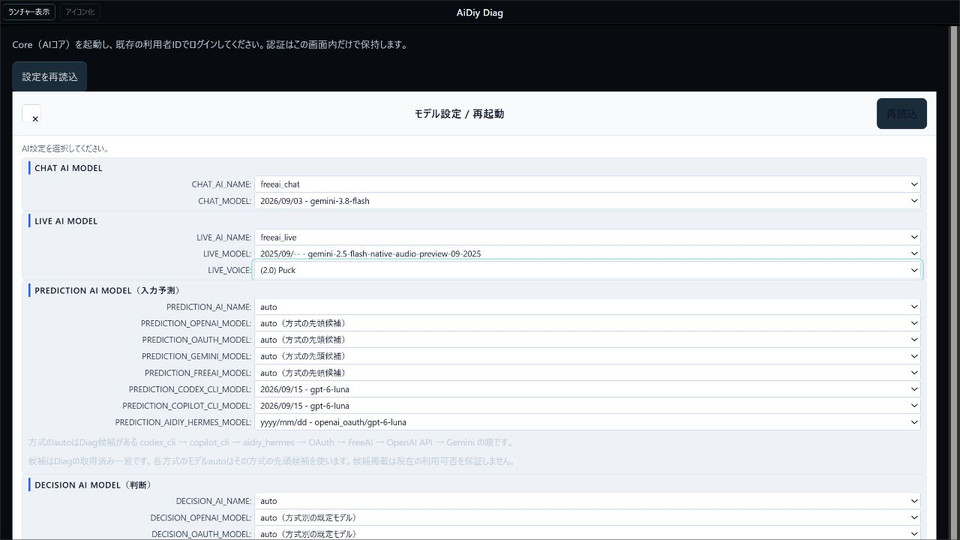

### 導入・外部連携・設定再起動の実画面

Windowsの実Diagで個別確認・一括取得を実施しました。Python 3.14.10はOK、起動時の導入診断19項目もOKでした。モデル一覧では実行中と待機中の表示を確認し、一括取得の完了を確認しました。Ollamaのみ未起動でNG、Grok・backend_localは固定候補によるPASSです。モデル候補取得はAI生成の試験とは区別します。

Python更新後の個別確認結果です。

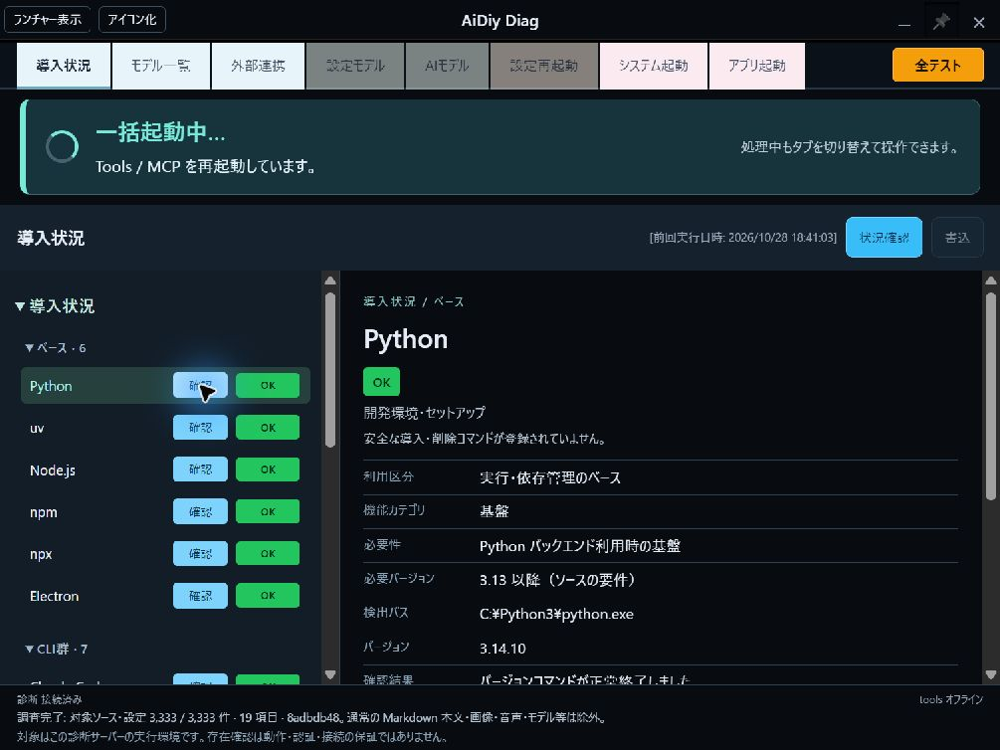

モデルの一括取得中に実行中と待機中を確認しました。

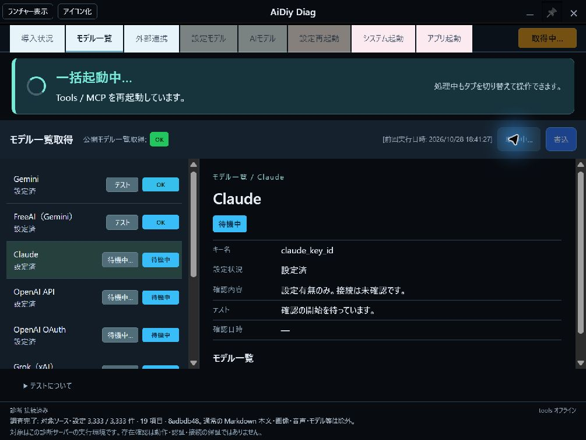

個別確認中も、別の外部連携行は操作可能です。

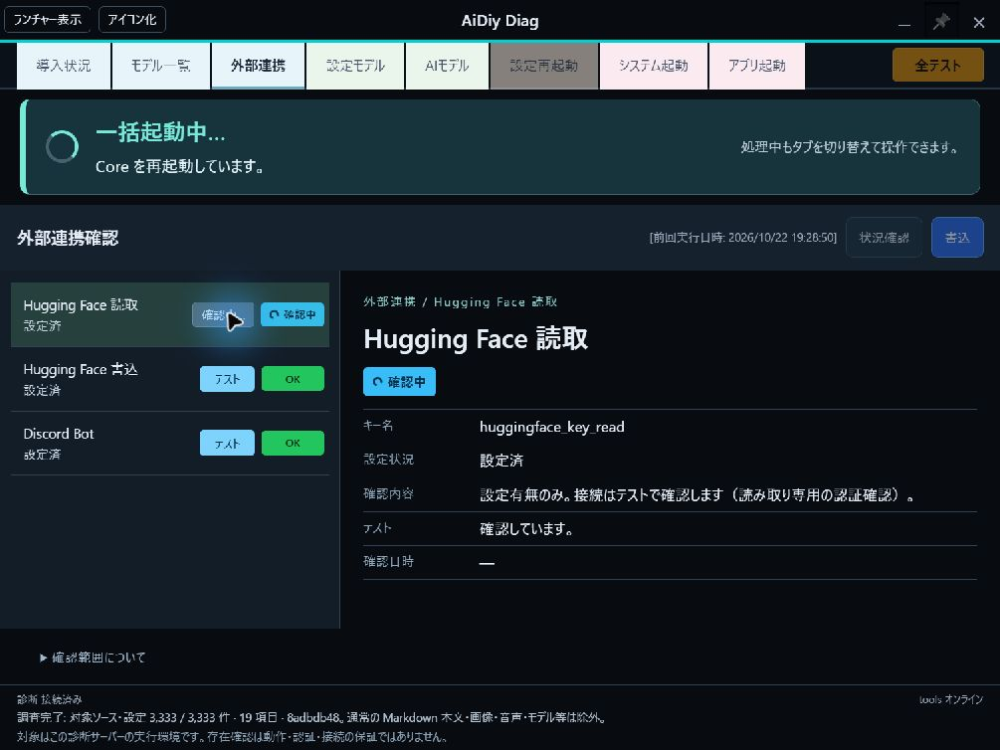

Hugging Face読取・書込とDiscordの3件が完了しました。

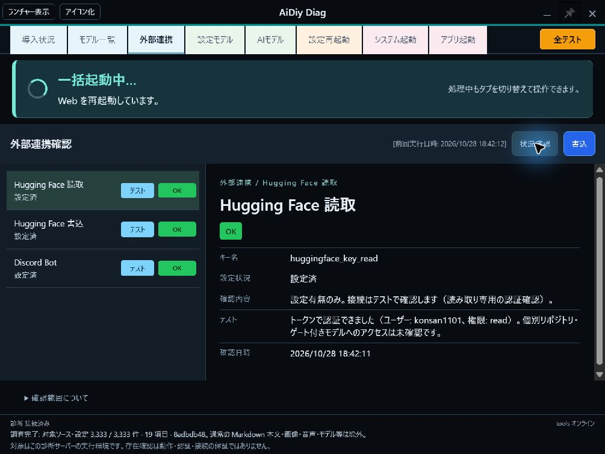

Core稼働後に設定再起動タブが有効になりました。

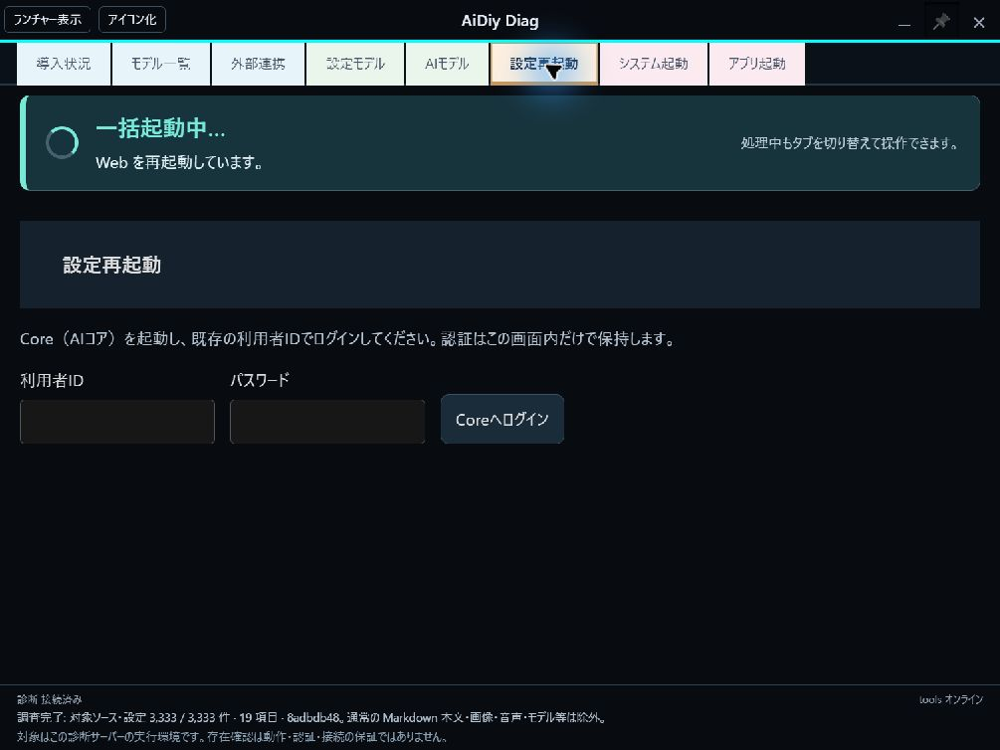

設定画面は実Coreへログインし、キャンセル・書込み・再起動・再ログインまで確認しました。外部連携確認によるメッセージ送信はありません。モデル待機列・外部連携・バージョン判定・起動進捗などの関連自動試験73件が通過しました。

### AI設定再起動の実操作

2026年10月28日、Core停止中の無効表示と、稼働後のログインを確認しました。作業フォルダの編集をキャンセルすると設定ファイルは変わらず、書込み時は対象のCODE_BASE_PATHだけが変わりました。試験後は元の値へ戻し、全設定項目が試験前と一致することを照合しました。

ログイン後の設定画面でキャンセル・書込み・再起動を確認しました。

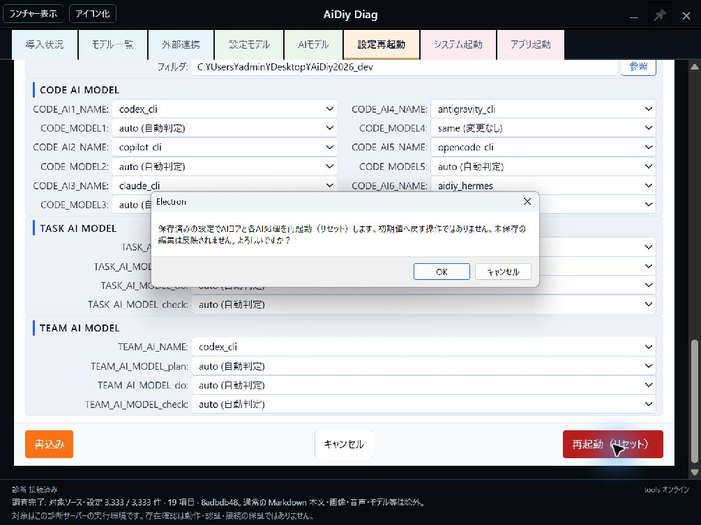

2026年10月28日、「再起動（リセット）」の確認後、Core・Apps・Tools・Local・TaskTeamの全5プロセスが別PIDで復帰し、HTTP 200を返しました。設定ファイルは変更されず、対象外のWeb・Avatarは同じPIDで維持されました。Core切断時は設定画面の認証が解除され、復帰後に再ログインして設定を読めました。6つの再起動指定はCore・Apps・Tools・Local・Task・Teamで、Task／Teamは1つのプロセスに統合されています。Avatarは再起動対象ではありません。連打・遅延応答・認証状態の競合は自動試験で補完し、長時間タイムアウトは実機未実施です。

全対象の再起動後、Coreへの再認証が必要な状態です。再起動受付だけで成功とせず、別途PIDとHTTP応答で復帰を確認しました。

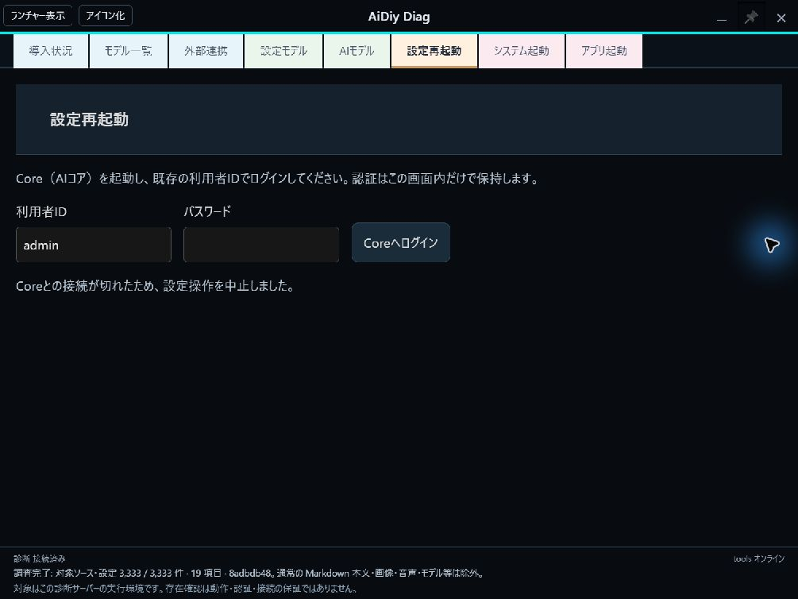

## 8. 追加テスト：個別確認・全テスト・headless

### 1件だけ調べ直す

導入状況は行の「確認」、モデル一覧・外部連携・設定モデルは行の「テスト」を押します。全体操作との対象範囲の違いを確認し、保存できる画面では「書込」後に結果を照合します。

| ケース | 確認すること | 結果 |
|---|---|---|
| ENV-701 | 全確認・個別確認が対象どおり実行され、詳細表示と一致する | ✅ OK：実フォームと関連回帰で確認（2026-10-22〜23） |
| ENV-702 | 個別テスト・一括取得で対象の結果と日時を更新 | ✅ OK：実フォームと関連回帰で確認（2026-10-22〜23） |
| ENV-703 | 16役割の設定と継承を表示し、個別試行が対象行だけ実行される | ✅ OK：実フォームと関連回帰で確認（2026-10-22〜23） |

### まとめて確認する・画面を開かずに確認する

1. 「導入状況」を開き、右上の「全テスト」を押します。
2. 導入確認・書込 → モデル一覧再取得・書込 → 外部連携確認・書込と進み、最後に導入状況へ戻ることを確認します。AIの返答試行は含みません。
3. 次にターミナルから `aidiy_diag --headless` を実行し、終了コードと導入状況・モデル情報の保存内容を照合します。
4. headlessは外部連携の認証確認、AI生成、サービス起動、導入操作をしないことを確認します。UI、Electronの初期ポート確認、診断HTTPの待受も作りません。

headlessでもモデル一覧取得の通信は発生します。終了コード0だけで全モデルの生成成功とは判定しません。

| ケース | 確認すること | 結果 |
|---|---|---|
| ENV-704 | 全テストが3段階の確認・保存を行い、導入状況へ戻る | ✅ OK：実フォームと関連回帰で確認（2026-10-22〜23） |
| ENV-705 | 全テスト・headless・初期表示からAI生成・導入操作・サービス起動を実行しない | ✅ OK：隔離ブラウザ／合成異常条件で確認（2026-10-23） |
| ENV-706 | headlessの終了コードと導入・モデル保存内容を照合。画面と同条件の項目を比較 | ✅ OK：実フォームと関連回帰で確認（2026-10-22〜23） |
| ENV-707 | headlessで外部連携の認証確認・UI・診断HTTP待受を行わない | ✅ OK：隔離ブラウザ／合成異常条件で確認（2026-10-23） |

## 9. 追加テスト：条件違い・中止・導入管理

### 接続・保存・モデル候補の条件を変える

1. Tools停止／接続を切り替え、設定モデル・AIモデルの有効／無効を確認します。
2. 前回保存だけがある状態、個別確認だけをした状態、保存失敗・中断を分け、今回の結果と混ざらず該当ファイルも壊れないことを確認します。
3. キー未設定、一覧取得の通信失敗、公開キャッシュ、固定候補、CLI未導入を隔離した条件で試します。現在のキーの認証と候補の存在を区別します。
4. 外部連携未設定の理由表示と、秘密値を返さないことを確認します。

失敗条件は合成サービスや一時設定で作り、実際のキーを証跡へ載せません。成功済みの別手順の保存まで巻き戻ることは期待しません。

| ケース | 確認すること | 結果 |
|---|---|---|
| ENV-801 | Tools接続状態に応じて設定モデル・AIモデルを有効／無効化 | ✅ OK：実フォームと関連回帰で確認（2026-10-22〜23） |
| ENV-802 | 初期表示だけではキー付きモデルAPI・外部連携の認証確認・AI生成・導入操作を始めない。匿名公開モデル取得は別 | ✅ OK：隔離ブラウザ／合成異常条件で確認（2026-10-23） |
| ENV-803 | 今回の結果だけを書込。未確認の前回保存結果を混ぜず、保存失敗時は既存ファイルを壊さない | ✅ OK：隔離ブラウザ／合成異常条件で確認（2026-10-23） |
| ENV-804 | 公開一覧・同梱キャッシュ・Grok／Localの固定候補を認証成功と混同しない | ✅ OK：隔離ブラウザ／合成異常条件で確認（2026-10-23） |
| ENV-805 | Ollamaが今回未検出なら通信を省略して理由を示す。未確認・検出エラーは未導入扱いにしない | ✅ OK：隔離ブラウザ／合成異常条件で確認（2026-10-23） |
| ENV-806 | Copilot／OpenCodeは導入済みの場合だけ候補を合成。候補なしでは固定8候補を補い、OpenCodeはCodex由来のモデルIDへ`openai/`を補う（auto／sameは維持） | ✅ OK：実フォームと関連回帰で確認（2026-10-22〜23） |
| ENV-807 | `live_voices_info.json`に3区分の固定音声候補を保存。候補の存在を認証成功にしない | ✅ OK：実フォームと関連回帰で確認（2026-10-22〜23） |
| ENV-808 | 未設定では理由を表示し、認証成功として扱わない | ✅ OK：隔離ブラウザ／合成異常条件で確認（2026-10-23） |
| ENV-809 | 保存失敗・中断時に該当ファイルを壊さない。成功済みの別手順の保存と区別する | ✅ OK：隔離ブラウザ／合成異常条件で確認（2026-10-23） |

### AI試行の中止・入力条件・音声

1. 実行中の「中止」、入力変更、画面移動、Tools切断を別々に試し、再読込後の再実行を確認します。
2. Decisionをpredicate／choice／scoreへ切り替えます。選択肢・段階は2〜32件とその境界外、重複を試します。JSONと非JSONの応答表示も確認します。
3. 合成応答で空白だけ・`!`だけ・`!`で始まるChat／Codeを試し、エラー表示の成功とAIの正常応答を分けます。
4. 5種の一括試行中に1行のNG・タイムアウトを作り、次の行へ進むことを確認します。
5. 完了後のタブ移動では結果と音声を保持して再生だけ止まること、再実行・再読込・切断・終了では音声URLを解放することを確認します。
6. 1秒以上／短い／音声なし／取得失敗／再生失敗と、幅1280／720／390pxを分けて試します。

Liveの上限は接続準備20秒、内部HTTP135秒、1試行150秒、全実行45分です。接続準備完了後15秒自動待機・送信後最大60秒の条件を計測し、実際に行った場合だけ `※注意:15s待機後送信しました。` と記録します。文字の返答、再生位置の進行、人の聴取、音声認識による照合は別の確認です。

| ケース | 確認すること | 結果 |
|---|---|---|
| ENV-810 | 中止・設定変更・切断で古い試行を破棄し、再読込後に再実行できる | ✅ OK：実フォームと関連回帰で確認（2026-10-22〜23） |
| ENV-811 | 正常応答の説明が空でも未実施表示にしない。空白だけ・`!`だけ・`!`から始まるChat／Code応答はNG | ✅ OK：隔離ブラウザ／合成異常条件で確認（2026-10-23） |
| ENV-812 | 5種を順に試行し、NG・行タイムアウトでも次へ進む。完了後CHATへ戻る | ✅ OK：隔離ブラウザ／合成異常条件で確認（2026-10-23） |
| ENV-813 | Decisionの3形式、2〜32件の選択肢／段階と重複制限。表示とスキーマ判定を区別 | ✅ OK：実フォームと関連回帰で確認（2026-10-22〜23） |
| ENV-814 | JSONは整形、非JSONは安全なテキスト表示。秘密値を伏せる | ✅ OK：実フォームと関連回帰で確認（2026-10-22〜23） |
| ENV-815 | 中止・入力変更・実行中の画面移動・Tools切断で古い試行を破棄 | ✅ OK：実フォームと関連回帰で確認（2026-10-22〜23） |
| ENV-816 | 完了後のタブ移動では結果・音声を保持して再生のみ停止。再試行・再読込・切断・終了で音声URLを解放 | ✅ OK：実フォームと関連回帰で確認（2026-10-22〜23） |
| ENV-817 | 1秒以上の音声は自動取得し、自動再生しない。短い／音声なしを明示。取得・再生失敗時のみ再試行ボタン | ✅ OK：隔離ブラウザ／合成異常条件で確認（2026-10-23） |
| ENV-818 | 幅1280／720／390pxで入力・結果・音声操作を確認 | ✅ OK：隔離ブラウザ／合成異常条件で確認（2026-10-23） |

### 導入・再導入・削除を試す

1. 導入状況の対象項目を選び、可能操作と理由を確認します。確認ダイアログは最初にキャンセルし、変更されないことを確認します。
2. 実際の変更は対象と復旧方法を決めた専用環境で実施します。導入／再導入／削除の固定対象、確認文、コンソール、中止、終了後の再確認を確認します。
3. 異なる対象を並行実行し、同じ対象は排他することを確認します。FFmpegの3行は一式で扱います。
4. 失敗・中止時の復旧を確認し、試験環境を戻します。合成プロセスだけで確認した対象と実導入を分けて記録します。

| 対象 | 確認する条件 |
|---|---|
| npmのClaude・Codex・Copilot・OpenCode | 所有元を照合。再導入は先に削除せずinstall。OpenCodeは`@opencode/cli` |
| WindowsのFFmpeg・OBS | WinGetの固定対象、登録・実体・稼働状態に応じた操作制限 |
| WindowsのOllama・Chrome | 新規導入のみ。再導入・削除は不可 |
| Python・uv・Node.js・npm・npx・Electron・VS Code | 手動導入の案内を確認。導入・再導入・削除ボタンは表示しない |
| WindowsのAntigravity | 公式インストーラー、既存実体、失敗時の復旧 |
| WindowsのGrok Build | 公式インストーラー、署名、所有元、稼働状態による操作制限 |

認証・設定・履歴の保持と、FFmpegのffmpeg／ffprobe／ffplay全3件の再確認も確認します。初期表示・全テスト・headlessから導入操作を実行してはいけません。

| ケース | 確認すること | 結果 |
|---|---|---|
| ENV-819 | 導入元・稼働状態・対象OSに応じた可能操作と理由。確認ダイアログの取消で変更なし | ✅ OK：実フォームと関連回帰で確認（2026-10-22〜23） |
| ENV-820 | 導入／再導入／削除の固定対象・確認文・コンソール・完了後の再確認 | ✅ OK：実フォームと関連回帰で確認（2026-10-22〜23） |
| ENV-821 | 異なる対象の並行実行、同じ対象の排他、中止・失敗後の状態反映 | ✅ OK：実フォームと関連回帰で確認（2026-10-22〜23） |
| ENV-822 | FFmpeg3行の再確認、Ollama・Chromeの操作制限、Grok／Antigravityの所有確認・失敗時の復旧 | PASS（環境依存・判定対象外）：symlink権限が必要な5条件以外は確認済み |

### 表示幅ごとの確認画面

以下は隔離ブラウザと合成データによる表示確認です。実AIの回答とは区別します。

診断結果の一覧と操作欄をデスクトップ幅で確認しました。

**図901：診断結果のデスクトップ表示**

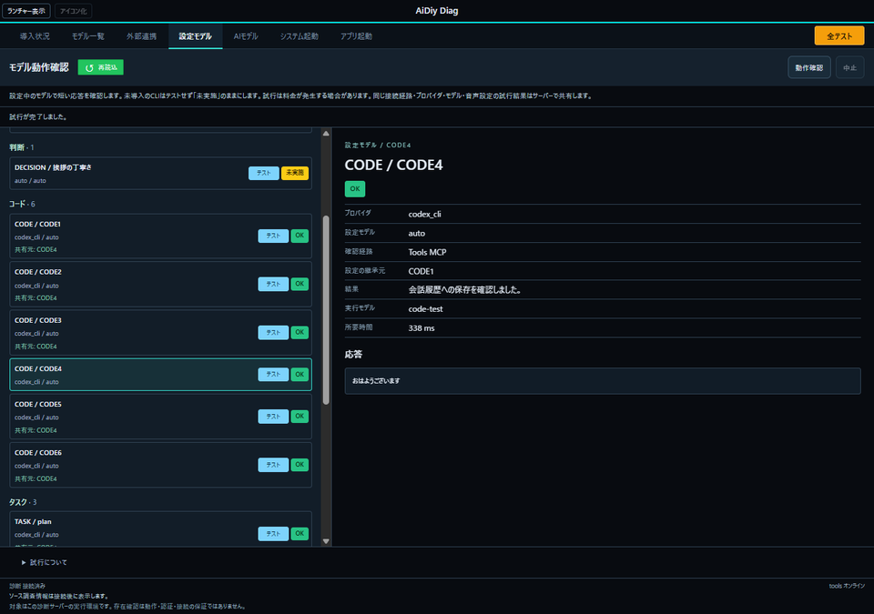

幅390pxで診断結果を表示した画面です。狭い幅での配置を確認しました。

**図902：診断結果の幅390表示**

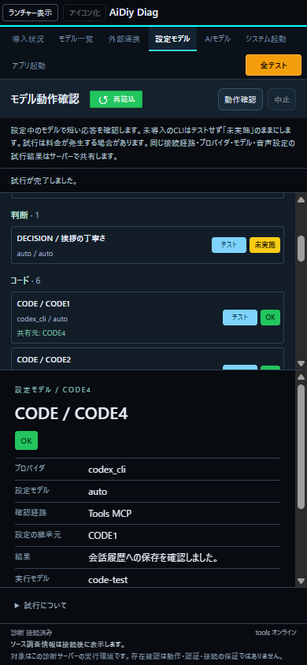

幅1280pxでLive試行の入力欄と結果欄を確認しました。

**図903：Live診断の幅1280表示**

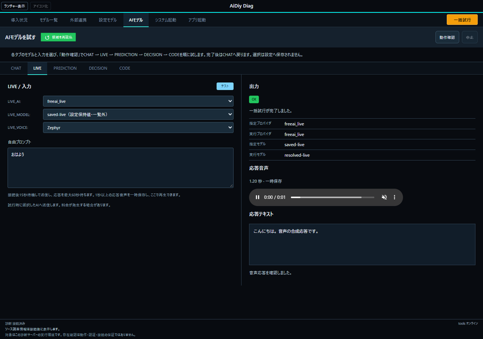

幅1280pxでChat試行の入力欄と結果欄を確認しました。

**図904：Chat診断の幅1280表示**

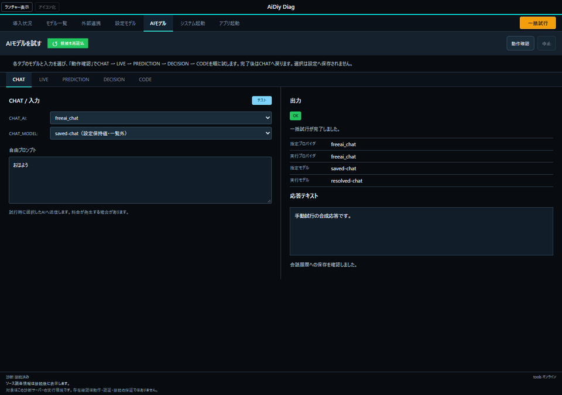

## 10. 試験の記録方法

各ケースに実施日・環境・操作・実際の結果・判定を記録し、先頭の総合評価も更新します。実機と合成試験、今回の結果と過去の結果を区別し、未実施を合格へ置き換えません。キーやJWTは記録しません。

ケースIDは過去の結果との照合用に維持します。図番号はケースIDとは別で、「章番号＋章内の掲載順」です。画像名・図番号・本文の参照先を合わせ、同じ画像は再掲せず図番号で案内します。

自動試験の入口は `backend_diag/checks/install-*.check.mjs`、`headless.check.mjs`、`models-info.check.mjs`、`voices-info.check.mjs`、`previous-results.check.mjs`、`model-trials.check.mjs`、`manual-models.check.mjs` と各Vue機能フォルダの `checks/` です。Liveの経路と15秒待機は `backend_diag/checks/model-trials-sdk.check.mjs` とその合成アダプターで確認します。画面は `model-trials-browser.mjs`・`manual-models-browser.mjs` も使います。実パッケージの変更・実AIの結果と合成試験を区別します。

2026年10月21日、実MCP SDKと合成AIを使う経路試験1件、Toolsの認証ルート・固定loopback接続・期限・中止・UI状態の13件、計14件が通過しました。Liveの合成アダプターは15秒待機が要求されたことを確認し、試験中の実待機だけを省略します。実AIの応答時間や音声聴取の結果へ置き換えません。

画像とPDFの扱いは[説明資料の書き方](./セルフテスト,_説明資料の書き方.md)を参照します。本冊子はMarkdownと同名PDFを更新しています。
