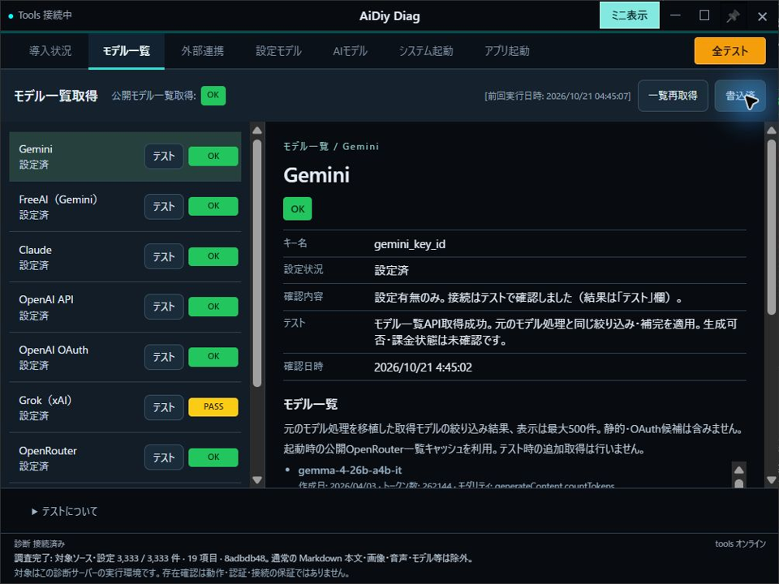
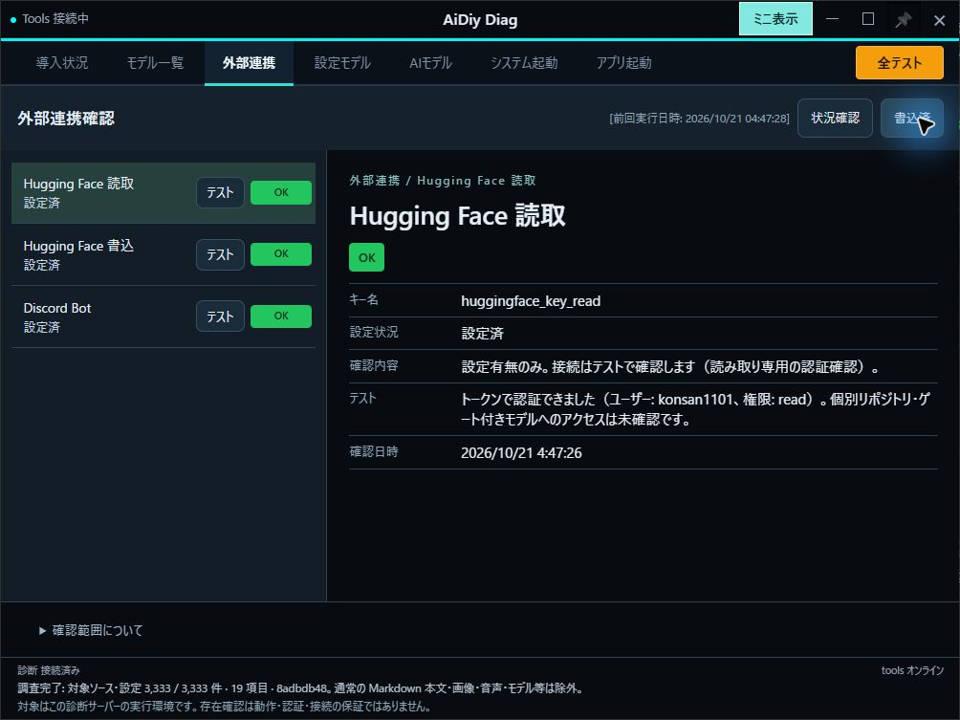
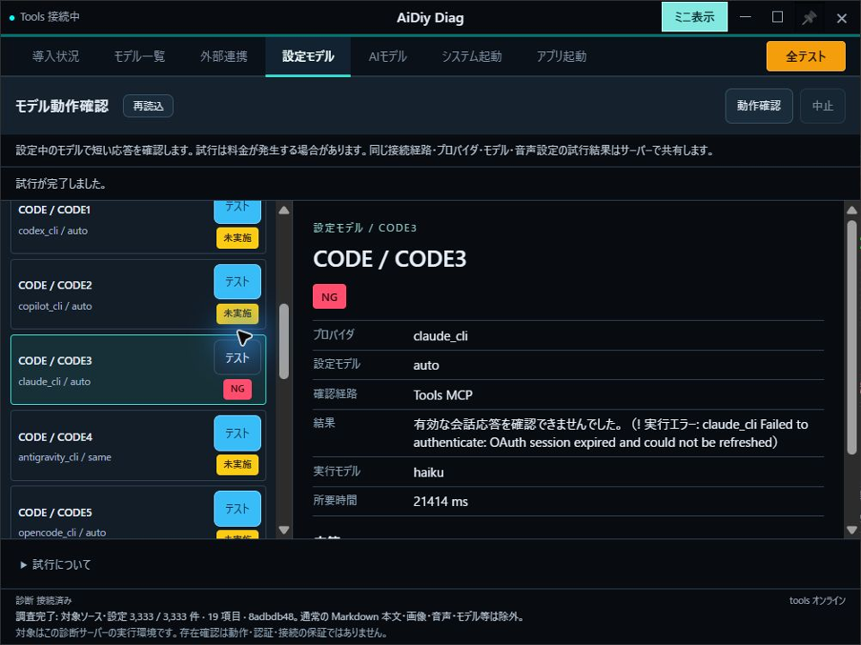
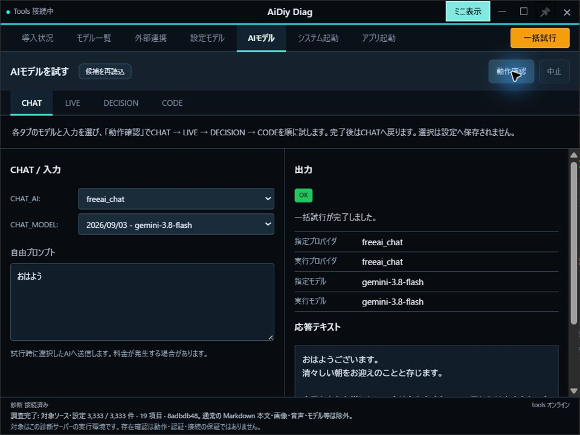
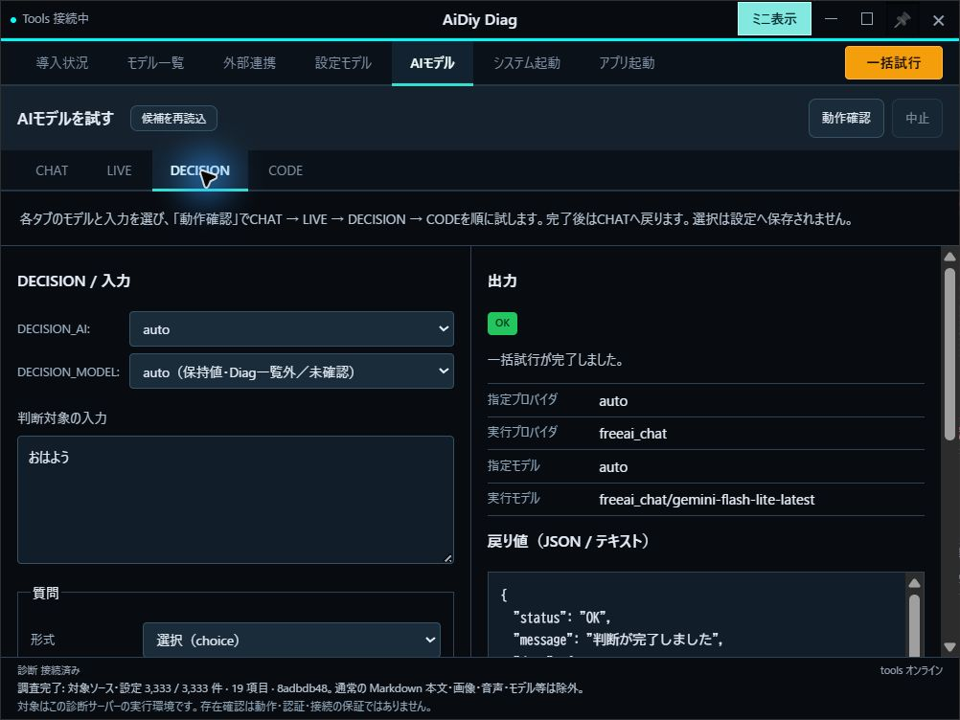
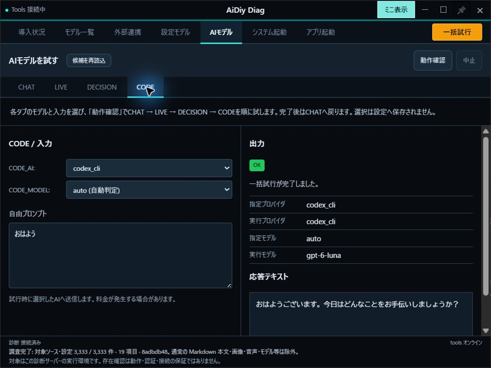

# aidiy_diag 環境確認編 — 総合テストと操作手順書素材

> 文書: `セルフテスト,aidiy_diag,環境確認編.md` | 実装: `backend_diag/ui/src/App.vue`, `backend_diag/ui/src/導入状況/`, `backend_diag/導入管理/`, `backend_diag/ui/src/モデル一覧/`, `backend_diag/ui/src/外部連携/`, `backend_diag/ui/src/設定モデル/`, `backend_diag/ui/src/AIモデル/`, `backend_diag/モデル試行/trials.mjs`, `backend_diag/診断/headless.mjs`

## 総合評価

**総合評価：⏸ 一部実施・未実施あり。2026年10月21日、Windowsの実フォームで導入状況・モデル一覧・外部連携の確認と保存を実施し、本日の検証を終了しました。**

未実施・未測定のケースはそのまま残します。全件合格とはせず、PDFは未作成です。設定モデル一括試行中のTools停止は未解消の課題として残します。

| 確認範囲 | 現在の結果 |
|---|---|
| 通常運用の通し確認 | 導入19件OK、モデル一覧取得・保存、外部連携3件OK・保存、AIモデル4種類の挨拶応答を確認。設定モデル15役割は一部未実施 |
| 通し確認後の追加テスト | 合成回帰を実施。Windowsのシンボリックリンク作成権限が必要な5条件は未確認 |

過去のエビデンスはクリア済みです。以下は今回確認した結果だけを掲載します。未確認のケースは未実施のままとし、PDFは冊子全体の再試験通過後に作成します。対象はWindowsとし、Mac／Linuxの実機確認は別途推奨です。

## この冊子の進め方

**1〜6章が通常運用、7〜8章が追加テスト、9章が記録方法です。**

| 順番 | 操作の流れ |
|---|---|
| 1〜2章 | 環境確認の画面を開き、導入状況を調べて保存する |
| 3〜4章 | モデル一覧と外部連携を確認して保存する |
| 5〜6章 | 設定中のAI、選んだAIで応答を確かめ、結果を読む |
| 7〜8章 | 個別確認・全テスト・headless、取消・異常条件・導入管理を試す |

導入状況だけならサービス全体の起動は不要です。通し確認の5〜6章にはToolsが必要なので、あらかじめ[システム起動編](./セルフテスト,aidiy_diag,システム起動編.md)で起動しておきます。前半では通信や試行を途中で止めず、完了した結果を読んで次へ進みます。

件数・モデル名・バージョンは試験時の値を記録します。「検出済み」「モデル候補あり」「認証成功」「AIの応答あり」は、それぞれ別の確認です。

前半は章の順に操作し、各章の「成功の見分け方」で動作を確認します。取消・切断・連打・失敗条件の試験は後半にまとめています。通し確認中に予期しない問題が起きた場合は、その結果と先へ進めない範囲を記録します。環境不足を理由とする `PASS (別途環境調整必要)` と製品の不具合を分け、未実施を合格にはしません。

## 1. 環境確認の画面を開く

今回の診断対象は `C:\Users\admin\Desktop\AiDiy2026_dev` の作業コピーです。アプリ試験のプロジェクトも、利用者指定により同じルートを使用します。AIへの入力は短い挨拶に限定します。

### 操作手順

1. Diagがミニ表示なら、タイトルバーの↗を押して通常画面へ戻します。
2. 上部の「導入状況」を押します。
3. 画面下の「診断 接続済み」と、左側の分類・項目を確認します。
4. 前回実行日時がある場合は過去の保存結果です。今回の確認は次章で実行します。

### 成功の見分け方

項目を選んで詳細を表示できれば準備完了です。調べる対象はDiagを実行しているPCです。次は2章で今回の導入状況を調べます。

| ケース | 確認すること | 結果 |
|---|---|---|
| ENV-101 | 分類・項目・前回実行日時を表示。今回の確認結果と前回保存を区別 | ✅ OK：前回日時と今回の確認・書込を実フォームで区別 |

## 2. 導入状況を調べて保存する

### 操作手順

1. 「導入状況」の「状況確認」を1回押します。
2. 確認中の表示が終わり、各項目に結果が出るまで待ちます。
3. 左側でPythonやNode.jsなどの項目を選び、右側で用途・見つかった場所・バージョン・説明を読みます。
4. 「書込」を押し、「書込済」になったことを確認します。

### 成功の見分け方

今回の結果と日時が表示され、書込済になればこの操作は完了です。保存先の `_AIDIY/aidiy_diag/install_info.json` と画面を照合し、一致した事実を記録します。

「未検出」はプログラムが見つからない意味です。必要な追加機能かどうかも確認します。この章では「導入」「再導入」「削除」は操作しません。次は3章でモデル一覧を取得します。

**この章の結果：✅ OK。** 2026年10月21日、状況確認とNode.js・npm・npxの個別確認を実施し、19項目すべてOKになりました。「書込済」と保存ファイルのOK19件・各項目の状態が一致しました。個別確認で対象行の結果・日時が更新されることも確認しました。

導入状況の最終フォームです。npxを含めて正常なバージョン確認となり、「書込済」が表示されています。

## 3. モデル一覧を取得して保存する

### 操作手順

1. 上部の「モデル一覧」を押します。プロバイダはAIを提供するサービス、モデルは使用するAIの種類です。
2. 「一覧再取得」を押し、取得中の表示が終わるまで待ちます。
3. 各行を選び、モデル名・確認日時・説明を読みます。「キャッシュ利用」や固定候補の表示も確認します。
4. 「書込」を押し、「書込済」を確認します。

### 成功の見分け方

今回の取得結果が表示・保存されれば操作は完了です。候補の存在だけで認証や生成が成功したとは判断しません。取得できなかった場合は表示された理由を記録します。次は4章で外部連携を調べます。

| ケース | 確認すること | 結果 |
|---|---|---|
| ENV-301 | プロバイダ別ファイルとchat／live／code／decisionsの合成モデル情報が画面・取得条件と一致 | ✅ OK：各ファイルの保存と画面の状態を照合 |

一覧再取得後に「書込済」を確認しました。Gemini・FreeAI・Claude・OpenAI API・OpenAI OAuth・OpenRouterはOK、Grokとbackend_localはPASS、OllamaはNGでした。プロバイダ別9ファイルとchat／live／code／decisionsの合成情報、3区分の音声候補が保存されています。PASSや候補の保存を、認証・生成成功として数えません。

モデル一覧の書込完了フォームです。各行の状態と確認日時を保ったまま保存できました。

## 4. 外部連携を確認して保存する

### 操作手順

1. 上部の「外部連携」を押します。
2. Hugging Face読取・書込キー、Discord Botの設定状態を読み、「状況確認」を押します。
3. 完了後、各行の結果・説明・確認日時を確認します。
4. 「書込」を押し、`_AIDIY/aidiy_diag/integration_info.json` と画面の結果が一致することを確認します。

### 成功の見分け方

認証・権限の結果が表示され、保存結果と一致すれば操作は完了です。未設定なら理由を記録します。この操作ではDiscordへ投稿せず、Hugging Faceへファイルも書き込みません。次は5章でAIの実際の返答を試します。

| ケース | 確認すること | 結果 |
|---|---|---|
| ENV-401 | Hugging Face読取・書込、Discord Botの認証・権限の結果が表示される | ✅ OK：3項目とも認証確認OKを表示 |
| ENV-402 | 画面と保存結果・日時が一致し、秘密値を画面や記録へ返さない | ✅ OK：3項目の状態・確認日時が保存内容と一致。トークン値の表示なし |

Hugging Face読取・書込とDiscord Botの読み取り専用の認証確認を実施し、3項目ともOKになりました。続けて「書込済」を確認しました。画面にはキー名・設定状態を表示し、トークンそのものは表示されません。

外部連携の確認・書込完了フォームです。外部への投稿やファイルの書き込みは行っていません。

## 5. 設定中のAIで応答を確認する

### 操作手順

1. 「tools オンライン」を確認し、上部の「設定モデル」を押します。
2. パネルの「再読込」を押します。CHAT・LIVE・DECISION各1件、CODE1〜6、TASKとTEAMのplan／do／check各3件、計15役割を確認します。
3. パネル内の「動作確認」を1回押します。画面右上の「全テスト」とは別のボタンです。
4. 各役割の試行が終わるまで待ち、左側の行を選んで右側の応答・説明を読みます。「共有元」がある場合は同じ条件の別行の結果を使用しています。
5. LIVEに音声プレーヤーが出たら再生ボタンを押し、文字の返答・音声の取得・再生・聴取を分けて確認します。

### 成功の見分け方

AIからの返答と各行の判定を確認できれば完了です。「未設定」「未対応」「テスト中」だけでは正常応答とは判定しません。同じ結果を共有した行を、独立した複数回の通信として数えません。

Liveは接続準備完了後に15秒自動待機し、送信後は最大60秒待ちます。利用者の追加待機は不要です。TASK／TEAMのここでの確認はCode CLIの応答試行であり、タスク分解やチーム活動全体の試験ではありません。次は6章で自分でモデルと入力を選びます。

| ケース | 確認すること | 結果 |
|---|---|---|
| ENV-501 | 全役割の応答と結果共有を表示。未設定・未対応は成功扱いにしない | ⏸ 未実施 |
| ENV-502 | Liveの文字応答と音声の取得・再生を別々に確認 | ⏸ 未実施 |

**この章は一部未実施です。** 今回の一括試行ではCHAT・LIVE・DECISION・CODE1・CODE2まで応答を確認しましたが、途中でToolsの待受が閉じ、表示結果も失われました。全15役割の完了は未確認です。Toolsを再起動した後のCODE3個別試行は、約21秒でClaudeのOAuthセッション期限切れをNG表示し、Toolsの接続を維持しました。個別試行では停止が再現していないため、一括時の停止を解消扱いにはしていません。

2026年10月21日、CODE3の個別結果をフォームで撮影しました。これは認証の環境調整が必要な結果で、AIの正常応答ではありません。

## 6. AIと入力を選んで試す

### 操作手順

1. 上部の「AIモデル」を押し、「候補を再読込」を押します。
2. CHAT・LIVE・DECISION・CODEの各タブでプロバイダとモデルを選びます。LIVEは声も選びます。
3. 会話の入力欄には次の文を用います。DECISIONは表示されている質問形式・質問文・選択肢を確認し、最初はその条件を使います。

> おはよう

4. パネル内の「動作確認」または右上の「一括試行」を1回押し、CHAT → LIVE → DECISION → CODEの順に終わるまで待ちます。
5. 完了してCHATへ戻ったら、各タブを選んで返答や判断を読みます。指定したモデルと実行モデルが表示される場合は両方を記録します。
6. LIVEの音声は自動再生されません。プレーヤーがある場合は再生し、内容を確認してから別のタブへ移ります。

### 成功の見分け方

4種類の結果と実回答を読めれば、一通りの操作は完了です。選択したモデルは本体設定へ保存されません。結果がNGの場合も内容と対象を記録し、他のモデルの成功で置き換えません。

**通常運用の通し確認結果：⏸ 未実施。** 導入・モデル一覧・外部連携の保存と、AIの応答確認までをまとめます。確認後は試行の終了を確かめて通常の利用へ戻れます。Diagも終了する場合は[システム起動編6章](./セルフテスト,aidiy_diag,システム起動編.md#6-システムを停止してdiagを閉じる)へ進みます。

| ケース | 確認すること | 結果 |
|---|---|---|
| ENV-601 | 候補再読込とプロバイダ／モデル変更。画面の選択で本体設定を書き換えない | ⏸ 未実施 |

**応答確認は4種類ともOKです。** 2026年10月21日05:47〜05:48、既定の選択と入力「おはよう」で一括試行しました。CHAT → LIVE → DECISION → CODEと進み、開始から約58秒の観測で完了・CHATへの復帰を確認しました。その後のタブ移動でも結果を保持しています。候補再読込・選択変更と本体設定の不変照合は未実施のため、ENV-601全体は未実施のままです。音声の人による聴取も未実施です。

| 種類 | 指定 → 実行 | 結果 |
|---|---|---|
| CHAT | freeai_chat / gemini-3.8-flash | 「おはようございます。」から始まる文字応答 |
| LIVE | freeai_live / gemini-2.5-flash-native-audio-preview-09-2025、Zephyr | 「おはようございます。」と1.12秒の音声を取得 |
| DECISION | auto / auto → freeai_chat / gemini-flash-lite-latest | 丁寧さのchoiceはmedium、JSON応答OK |
| CODE | codex_cli / auto → gpt-6-luna | 「おはようございます。今日はどんなことをお手伝いしましょうか？」 |

CHATのフォームです。指定と実行のプロバイダ・モデル、入力と返答を確認しました。

LIVEはDiag内部の15秒自動待機・送信後最大60秒の経路で完了し、音声プレーヤーも表示されました。今回の画面観測では接続成立・送信の個別時刻は測っていません。15秒待機の実行は共通処理で行いますが、実測時刻を記録した単独Liveの試験とは区別します。

DECISIONは既定の質問と選択肢を使用し、判断がJSONで返りました。

CODEはautoの実行モデルを表示し、挨拶の文字応答を確認しました。

## 7. 追加テスト：個別確認・全テスト・headless

### 1件だけ調べ直す

導入状況は行の「確認」、モデル一覧・外部連携・設定モデルは行の「テスト」を押します。全体操作との対象範囲の違いを確認し、保存できる画面では「書込」後に結果を照合します。

| ケース | 確認すること | 結果 |
|---|---|---|
| ENV-701 | 全確認・個別確認が対象どおり実行され、詳細表示と一致する | ⏸ 未実施 |
| ENV-702 | 個別テスト・一覧再取得で対象の結果と日時を更新 | ⏸ 未実施 |
| ENV-703 | 15役割の設定と継承を表示し、個別試行が対象行だけ実行される | ⏸ 未実施 |

### まとめて確認する・画面を開かずに確認する

1. 「導入状況」を開き、右上の「全テスト」を押します。
2. 導入確認・書込 → モデル一覧再取得・書込 → 外部連携確認・書込と進み、最後に導入状況へ戻ることを確認します。AIの返答試行は含みません。
3. 次にターミナルから `aidiy_diag --headless` を実行し、終了コードと導入状況・モデル情報の保存内容を照合します。
4. headlessは外部連携の認証確認、AI生成、サービス起動、導入操作をしないことを確認します。UI、Electronの初期ポート確認、診断HTTPの待受も作りません。

headlessでもモデル一覧取得の通信は発生します。終了コード0だけで全モデルの生成成功とは判定しません。

| ケース | 確認すること | 結果 |
|---|---|---|
| ENV-704 | 全テストが3段階の確認・保存を行い、導入状況へ戻る | ⏸ 未実施 |
| ENV-705 | 全テスト・headless・初期表示からAI生成・導入操作・サービス起動を実行しない | ⏸ 未実施 |
| ENV-706 | headlessの終了コードと導入・モデル保存内容を照合。画面と同条件の項目を比較 | ⏸ 未実施 |
| ENV-707 | headlessで外部連携の認証確認・UI・診断HTTP待受を行わない | ⏸ 未実施 |

## 8. 追加テスト：条件違い・中止・導入管理

### 接続・保存・モデル候補の条件を変える

1. Tools停止／接続を切り替え、設定モデル・AIモデルの有効／無効を確認します。
2. 前回保存だけがある状態、個別確認だけをした状態、保存失敗・中断を分け、今回の結果と混ざらず該当ファイルも壊れないことを確認します。
3. キー未設定、一覧取得の通信失敗、公開キャッシュ、固定候補、CLI未導入を隔離した条件で試します。現在のキーの認証と候補の存在を区別します。
4. 外部連携未設定の理由表示と、秘密値を返さないことを確認します。

失敗条件は合成サービスや一時設定で作り、実際のキーを証跡へ載せません。成功済みの別手順の保存まで巻き戻ることは期待しません。

| ケース | 確認すること | 結果 |
|---|---|---|
| ENV-801 | Tools接続状態に応じて設定モデル・AIモデルを有効／無効化 | ⏸ 未実施 |
| ENV-802 | 初期表示だけではキー付きモデルAPI・外部連携の認証確認・AI生成・導入操作を始めない。匿名公開モデル取得は別 | ⏸ 未実施 |
| ENV-803 | 今回の結果だけを書込。未確認の前回保存結果を混ぜず、保存失敗時は既存ファイルを壊さない | ⏸ 未実施 |
| ENV-804 | 公開一覧・同梱キャッシュ・Grok／Localの固定候補を認証成功と混同しない | ⏸ 未実施 |
| ENV-805 | Ollamaが今回未検出なら通信を省略して理由を示す。未確認・検出エラーは未導入扱いにしない | ⏸ 未実施 |
| ENV-806 | Copilot／OpenCodeは導入済みの場合だけ候補を合成。候補なしでは固定8候補を補い、OpenCodeはCodex由来のモデルIDへ`openai/`を補う（auto／sameは維持） | ⏸ 未実施 |
| ENV-807 | `live_voices_info.json`に3区分の固定音声候補を保存。候補の存在を認証成功にしない | ⏸ 未実施 |
| ENV-808 | 未設定では理由を表示し、認証成功として扱わない | ⏸ 未実施 |
| ENV-809 | 保存失敗・中断時に該当ファイルを壊さない。成功済みの別手順の保存と区別する | ⏸ 未実施 |

### AI試行の中止・入力条件・音声

1. 実行中の「中止」、入力変更、画面移動、Tools切断を別々に試し、再読込後の再実行を確認します。
2. Decisionをpredicate／choice／scoreへ切り替えます。選択肢・段階は2〜32件とその境界外、重複を試します。JSONと非JSONの応答表示も確認します。
3. 合成応答で空白だけ・`!`だけ・`!`で始まるChat／Codeを試し、エラー表示の成功とAIの正常応答を分けます。
4. 4種の一括試行中に1行のNG・タイムアウトを作り、次の行へ進むことを確認します。
5. 完了後のタブ移動では結果と音声を保持して再生だけ止まること、再実行・再読込・切断・終了では音声URLを解放することを確認します。
6. 1秒以上／短い／音声なし／取得失敗／再生失敗と、幅1280／720／390pxを分けて試します。

Liveの上限は接続準備20秒、内部HTTP135秒、1試行150秒、全実行45分です。接続準備完了後15秒自動待機・送信後最大60秒の条件を計測し、実際に行った場合だけ `※注意:15s待機後送信しました。` と記録します。文字の返答、再生位置の進行、人の聴取、音声認識による照合は別の確認です。

| ケース | 確認すること | 結果 |
|---|---|---|
| ENV-810 | 中止・設定変更・切断で古い試行を破棄し、再読込後に再実行できる | ⏸ 未実施 |
| ENV-811 | 正常応答の説明が空でも未実施表示にしない。空白だけ・`!`だけ・`!`から始まるChat／Code応答はNG | ⏸ 未実施 |
| ENV-812 | 4種を順に試行し、NG・行タイムアウトでも次へ進む。完了後CHATへ戻る | ⏸ 未実施 |
| ENV-813 | Decisionの3形式、2〜32件の選択肢／段階と重複制限。表示とスキーマ判定を区別 | ⏸ 未実施 |
| ENV-814 | JSONは整形、非JSONは安全なテキスト表示。秘密値を伏せる | ⏸ 未実施 |
| ENV-815 | 中止・入力変更・実行中の画面移動・Tools切断で古い試行を破棄 | ⏸ 未実施 |
| ENV-816 | 完了後のタブ移動では結果・音声を保持して再生のみ停止。再試行・再読込・切断・終了で音声URLを解放 | ⏸ 未実施 |
| ENV-817 | 1秒以上の音声は自動取得し、自動再生しない。短い／音声なしを明示。取得・再生失敗時のみ再試行ボタン | ⏸ 未実施 |
| ENV-818 | 幅1280／720／390pxで入力・結果・音声操作を確認 | ⏸ 未実施 |

### 導入・再導入・削除を試す

1. 導入状況の対象項目を選び、可能操作と理由を確認します。確認ダイアログは最初にキャンセルし、変更されないことを確認します。
2. 実際の変更は対象と復旧方法を決めた専用環境で実施します。導入／再導入／削除の固定対象、確認文、コンソール、中止、終了後の再確認を確認します。
3. 異なる対象を並行実行し、同じ対象は排他することを確認します。FFmpegの3行は一式で扱います。
4. 失敗・中止時の復旧を確認し、試験環境を戻します。合成プロセスだけで確認した対象と実導入を分けて記録します。

| 対象 | 確認する条件 |
|---|---|
| npmのClaude・Codex・Copilot・OpenCode | 所有元を照合。再導入は先に削除せずinstall。OpenCodeは`@opencode/cli` |
| WindowsのFFmpeg・OBS | WinGetの固定対象、登録・実体・稼働状態に応じた操作制限 |
| WindowsのOllama・Chrome | 新規導入のみ。再導入・削除は不可 |
| Python・uv・Node.js・npm・npx・Electron・VS Code | 手動導入の案内を確認。導入・再導入・削除ボタンは表示しない |
| WindowsのAntigravity | 公式インストーラー、既存実体、失敗時の復旧 |
| WindowsのGrok Build | 公式インストーラー、署名、所有元、稼働状態による操作制限 |

認証・設定・履歴の保持と、FFmpegのffmpeg／ffprobe／ffplay全3件の再確認も確認します。初期表示・全テスト・headlessから導入操作を実行してはいけません。

| ケース | 確認すること | 結果 |
|---|---|---|
| ENV-819 | 導入元・稼働状態・対象OSに応じた可能操作と理由。確認ダイアログの取消で変更なし | ⏸ 未実施 |
| ENV-820 | 導入／再導入／削除の固定対象・確認文・コンソール・完了後の再確認 | ⏸ 未実施 |
| ENV-821 | 異なる対象の並行実行、同じ対象の排他、中止・失敗後の状態反映 | ⏸ 未実施 |
| ENV-822 | FFmpeg3行の再確認、Ollama・Chromeの操作制限、Grok／Antigravityの所有確認・失敗時の復旧 | ⏸ 未実施 |

## 9. 試験の記録方法

各章の操作を実施したら、操作直後の画面と実際の結果を記録します。前半の通常運用と後半の追加テストを別に集計し、先頭の総合評価も更新します。

ケース番号は今回の章番号に合わせて採番しています。複数の対象・条件は枝番で分け、一つの成功で全体を合格にしません。画像の先頭1桁も掲載する章番号に合わせます。撮影後に章を移した場合は、ファイル名・説明・参照も揃えます。

ケースごとに実施日時・環境・操作・期待結果・実際の結果・判定を記録します。複数対象は枝番にし、単体試験・合成画面・実環境の実画面を分けます。過去のテスト件数やモデル名を今回の結果へ引き継ぎません。

画像は `_AIDIY/knowledge/images/セルフテスト,aidiy_diag,環境確認編/` に、`<実施ID>__aidiy_diag-環境確認_501_設定モデル応答画面.png` の形式で保存し、直前に説明を添えます。確認済み画像は本文に掲載しています。音声の聴取は未実施、PDFは冊子全体の通過前のため未作成です。キーやJWTを記録へ含めません。

自動試験の入口は `backend_diag/checks/install-*.check.mjs`、`headless.check.mjs`、`models-info.check.mjs`、`voices-info.check.mjs`、`previous-results.check.mjs`、`model-trials.check.mjs`、`manual-models.check.mjs` と各Vue機能フォルダの `checks/` です。Liveの経路と15秒待機は `backend_diag/checks/model-trials-sdk.check.mjs` とその合成アダプターで確認します。画面は `model-trials-browser.mjs`・`manual-models-browser.mjs` も使います。実パッケージの変更・実AIの結果と合成試験を区別します。

2026年10月21日、実MCP SDKと合成AIを使う経路試験1件、Toolsの認証ルート・固定loopback接続・期限・中止・UI状態の13件、計14件が通過しました。Liveの合成アダプターは15秒待機が要求されたことを確認し、試験中の実待機だけを省略します。実AIの応答時間や音声聴取の結果へ置き換えません。

記録・判定・PDF作成は[説明資料の書き方](./セルテスト,_説明資料の書き方.md)に従います。
