# aidiy_diag 環境確認編 — 総合テストと操作手順書素材

> 文書: `セルフテスト,aidiy_diag,環境確認編.md` | 実装: `backend_diag/ui/src/App.vue`, `backend_diag/ui/src/導入状況/`, `backend_diag/ui/src/モデル一覧/`, `backend_diag/ui/src/外部連携/`, `backend_diag/ui/src/設定モデル/`, `backend_diag/ui/src/AIモデル/`, `backend_diag/診断/headless.mjs`

## 総合評価

**総合評価：✅ OK (PASS 2件含む)。導入・保存・headless・設定15役割の応答を確認しました。**（2026年10月19日・Windows）

プログラムの導入、AIや外部サービスへの接続、結果の保存を調べます。

| 知りたいこと | 現在の結果 |
|---|---|
| AIから実際に返答がある？ | ✅ OK：今回選んだモデルで、チャット・Liveの挨拶・判断・コード支援の返答を確認しました。すべてのモデルを試した結果ではありません。 |
| Liveはどの条件で通過した？ | ✅ OK：接続後15秒待って送信し、応答を最大60秒待つ設定で文字の返答を確認しました。この待機はDiagが自動で行います。 |
| 音声も確認できた？ | ✅ OK：追加試験で実音声を取得し、音声認識で「おはようございます」と照合しました。再生APIも正常です。人の耳での聴取とは区別します。 |

**PASS (別途環境調整必要) は2件**です。起動していないOllamaとLocalを、それぞれ1件と数えます。今回は設定済み7プロバイダを確認できています。今後キー未登録で試す場合もPASSとし、理由を添えます。設定済みの実接続と、音声の取得・認識照合は通過しました。すべてのモデルの動作保証ではありません。[PDF版の総合テスト実施記録](../../output/pdf/セルフテスト,aidiy_diag,環境確認編.pdf)も作成しました。Mac／Linuxの実機確認は別途推奨です。

## この冊子の進め方

必要なプログラムやAIへの接続を調べ、結果を保存する試験です。導入確認だけならシステム全体を起動する必要はありません。AIの返答を試す5〜6章では、先に[システム起動編](./セルフテスト,aidiy_diag,システム起動編.md)でToolsを起動してから始めます。アプリを開く手順は[アプリ起動編](./セルフテスト,aidiy_diag,アプリ起動編.md)にあります。

| 表示・用語 | 意味 |
|---|---|
| 導入状況 | 必要なプログラムが、このPCに入っているかを調べます。 |
| プロバイダ | AIを提供しているサービスです。 |
| モデル | そのサービスで使うAIの種類です。 |
| 外部連携 | Discordなど、AiDiy以外のサービスとの接続です。 |
| 書込 | 画面で確認した結果を、ファイルに保存する操作です。 |
| キャッシュ利用 | 今回新しく取得せず、以前に保存した情報を使った状態です。 |
| headless | ウィンドウを開かず、文字のコマンドで診断する方法です。 |

**✅ OK** は良好、**❌ NG** は不良、**⏸ 未実施** は未確認です。モデル一覧の取得と、AIからの返答は別に試します。

### Liveを試すときの待ち方（現在の設定）

Diagが**接続後15秒待って送信**し、**返答を最大60秒待ちます**。再試験も同じです。利用者の追加待機は不要です。

Gemini系Live（freeai_live経由を含む）は、接続直後の最初の送信で失敗する場合があります。今回は上記の設定で文字の返答を確認し、Live試験を **✅ OK** としました。文字の返答が出たことと、音声を再生して聞けたことは別に記録します。

「テスト中」は結果かエラーが出るまで待ちます。内部の待ち時間は、後半の試験担当者向け記録に掲載しています。

## 1. 環境確認の画面へ移る

### 操作手順

1. Diagがミニ表示の場合は、タイトルバーの復帰ボタンを押して通常画面に戻します。
2. 上部の「導入状況」を押します。
3. 画面下部に「診断 接続済み」と表示されていることを確認します。5〜6章を試す場合は「tools オンライン」も確認します。
4. 前回実行日時が表示されている場合は、以前の結果です。今回の試験では、次章の「状況確認」を実行してから結果を読みます。

### 成功の見分け方と記録すること

「導入状況」が選ばれ、診断項目が表示されれば画面の確認ができます。調べる対象は、Diagを動かしているPCです。Toolsが止まっていても導入確認はできますが、AIの返答を試す「設定モデル」「AIモデル」にはToolsが必要です。

**✅ OK**：通常表示から「導入状況」へ移り、分類・項目・前回実行日時を確認しました。

診断項目が並ぶ入口画面です。この後「状況確認」で今回の結果に更新します。

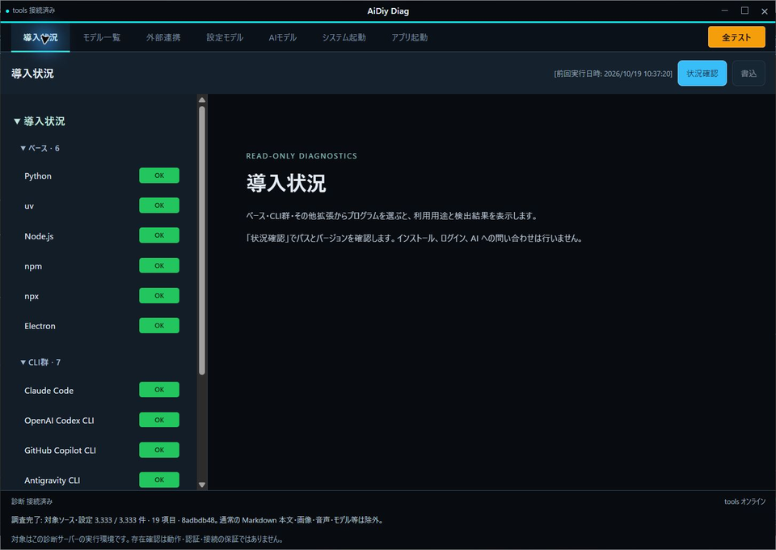

## 2. 導入状況を確認して保存する

### 操作手順

1. 「導入状況」画面で「状況確認」を押します。
2. 確認中の表示が終わり、項目ごとの結果が出るまで待ちます。
3. 左側の分類から、PythonやNode.jsなど、調べたいプログラムの名前を押します。
4. 右側で「何に使うか」「見つかった場所」「バージョン（プログラムの版）」を読みます。必要なら説明やソースの参照箇所も見ます。
5. 「書込」を押し、「書込済」となることを確認します。
6. 保存の試験では、保存ファイルを読み、今回の確認日時と結果が画面に合っていることを確かめます。保存先は下記の記録を参照します。

### 成功の見分け方と記録すること

右側に選んだ項目の詳細が出れば表示確認は完了です。保存先は `_AIDIY/aidiy_diag/install_info.json`。今回の結果・日時と一致するか比べます。

「未検出」はプログラムが見つからない状態です。使わない追加機能なら全体の故障とは限りません。「検出済み」でも、起動やログインは別に確認します。

**✅ OK（追加試験）**：「状況確認」で19項目すべてOKとなり、Pythonの詳細を表示して「書込」を押しました。Python 3.14.4・検出パス・確認日時と、保存内容が一致しました。

Pythonの詳細と診断済みの項目一覧です。「書込」により今回の結果を保存しました。

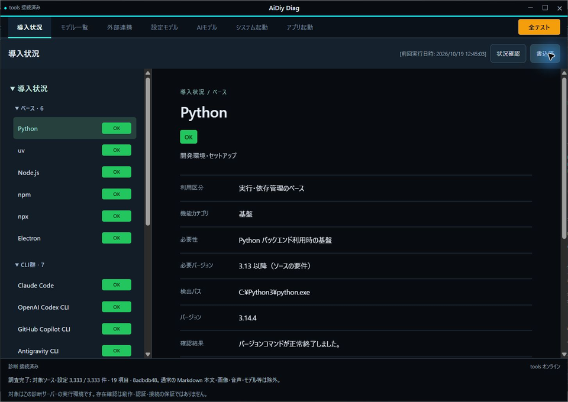

## 3. モデル一覧を取得して保存する

### 操作手順

1. 上部の「モデル一覧」を押します。
2. 調べたいAIサービス（プロバイダ）の行を選び、設定済みか、何を調べる試験かを読みます。
3. 1件だけなら行の「テスト」、まとめて取得するなら「一覧再取得」を押します。
4. 取得中の表示が終わるまで待ち、モデル名・確認日時・説明を読みます。
5. 「書込」を押し、「書込済」となることを確認します。保存の試験では、保存内容と画面のモデル名・日時を比べます。

「キャッシュ利用」は以前の一覧を使った状態です。今回インターネットから新しく取得できた場合とは分けて記録します。

### 成功の見分け方と記録すること

選んだサービスの結果と確認日時が更新され、モデル情報を `_AIDIY/aidiy_diag/` へ保存できれば、この章の確認ができます。取得できなかった場合は、設定がないのか、通信に失敗したのか、表示された理由を記録します。

モデル名が出た場合でも、公開情報やあらかじめ用意された候補を表示しただけの場合があります。接続に使うキーが有効か、実際に文章や音声を作れるかは、5〜6章で別に試します。

**✅ OK（取得・保存）**：Geminiの個別テストと「一覧再取得」を実施し、9プロバイダの結果を書き込みました。設定済み7プロバイダはOK、backend_localは固定候補を示すPASSです。Ollamaはサーバー停止中のため、画面と保存内容にはNGが残っています。今回の総合テストでは環境条件としてPASS (別途環境調整必要)に分類します。Localも未起動なので同じ分類です。いずれも会話成功とは判定しません。

一括取得と保存後のモデル一覧です。Geminiのモデル名2件と確認日時が保存内容に一致しました。

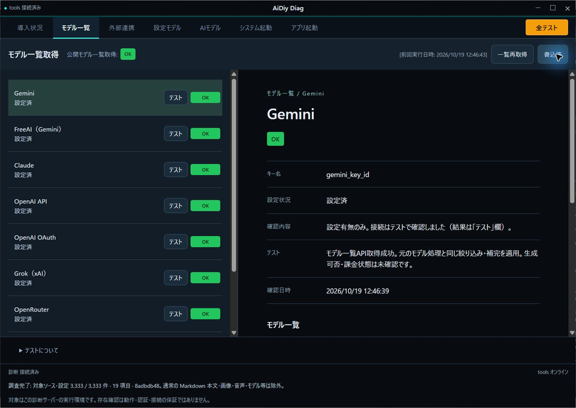

## 4. 外部連携を確認して保存する

### 操作手順

1. 上部の「外部連携」を押します。
2. Hugging FaceやDiscordなど、調べたいサービスの行を選びます。設定の有無と、何を確認するかの説明を読みます。
3. 1件だけなら行の「テスト」、まとめて調べるなら「状況確認」を押します。
4. 結果が出るまで待ち、結果・説明・確認日時を確認します。未設定なら、その理由も記録します。
5. 「書込」を押し、保存した結果と画面の内容を比べます。

この操作は接続に使う情報が有効かを調べます。Discordのチャンネルへメッセージを送る試験は、この章には含みません。

### 成功の見分け方と記録すること

設定済みのサービスを調べ、接続の確認結果が表示されることを確かめます。未設定の行は、試せない理由と一緒に **PASS (別途環境調整必要)** と記録します。保存先は `_AIDIY/aidiy_diag/integration_info.json` です。

Discordでは、Bot自身の情報が取得できるかを調べます。メッセージ投稿や音声会話まで成功したという結果ではありません。Hugging Faceでも、使う権限の確認と、ファイルを実際に書き込む操作は別に扱います。

**✅ OK（認証確認・保存）**：Hugging Face読取キーの個別テストと、外部連携の「状況確認」を実施しました。読取・書込キー、Discord Botの3件すべてOKで、「書込」後の保存内容と結果・確認日時が一致しました。投稿やリポジトリへの書込は試験範囲に含みません。

3件の認証確認が終わった画面です。表示は認証と権限の確認結果です。

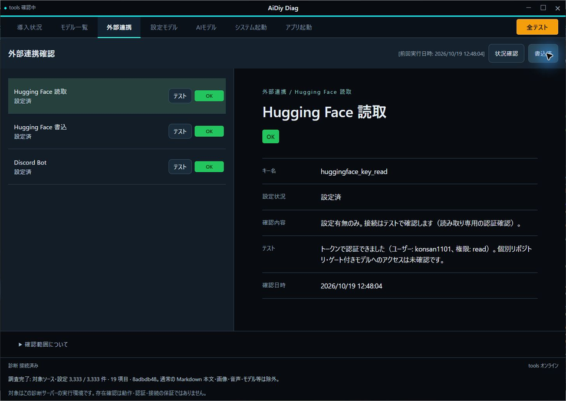

### 再始動後の設定モデルとエラー判定の追加試験

**✅ OK**：全サービスを止めて起動し直し、設定モデル15役割を再確認しました。14役割は初回に成功し、Antigravityは60秒の時間切れを検出しました。個別再試験では40.098秒で返答があり、最終的に15役割すべてを確認しました。TASK／TEAMの6役割は同じ設定のCODE1結果を共有しています。

再始動後の最終結果です。Antigravityの再試験が成功し、全15役割が正常応答になりました。

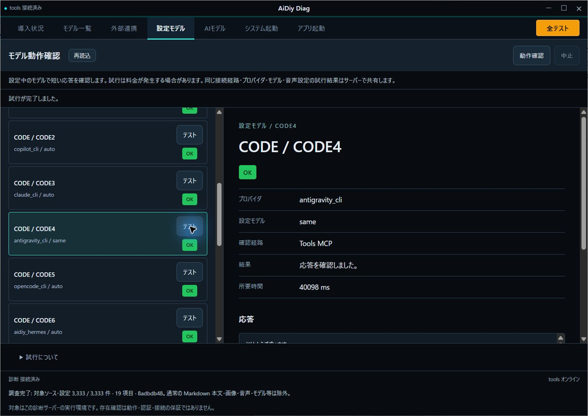

エラー応答は、空または空白だけなら `!`、説明があれば `! エラーメッセージ` へそろえます。Diagは空文字列と `!` で始まる応答をNGと判断します。時間切れも成功扱いにしません。

再試験前の時間切れです。「! 処理タイムアウト(60秒)が発生しました。」を正しくNGと判定しました。上の追加試験で再確認しています。

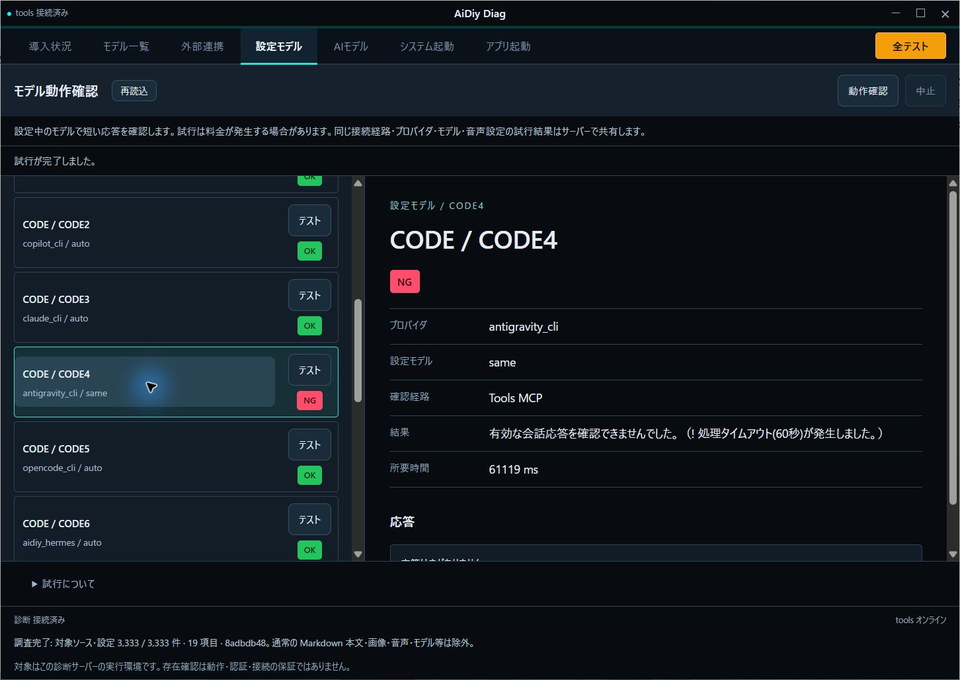

AIチャット・AIコード・MCP・Diagの関連93件の自動試験は成功しています。機器・キーがそろわないPASSと、試した結果のエラーNGを区別します。

## 5. 設定中のモデルで応答を確認する

### 追加試験：設定モデルの全役割と中止操作

全役割の試行では、CHAT・LIVE・DECISION、CODE1〜4、TASK／TEAMの計13役割がOKでした。同じ接続・モデルを使うTASK／TEAMは、CODE1の結果を共有する仕様です。中止操作でも、実行中のLiveが「中止」となり、再実行できる状態へ戻りました。

OpenCodeは初回に利用上限でNGとなりましたが、利用者がクレジット利用枠を調整した後、**同じ `opencode_cli / auto` のまま再試験して ✅ OK** になりました。実行モデルは `openai/gpt-6-luna`、所要時間は18.724秒で、「おはようございます！今日もよろしくお願いします。」と回答しました。

利用枠の調整後に成功したOpenCodeです。設定を別モデルへ切り替えず、元の経路で回答を確認しています。

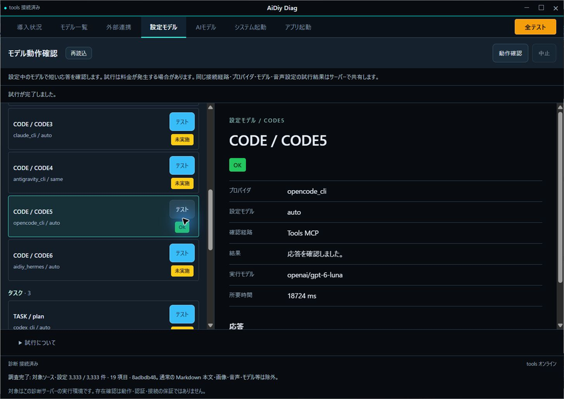

Hermesもランチャー未配置を修復した後、**同じ `aidiy_hermes / auto` で再試験して ✅ OK** となりました。実行モデルは `openai_oauth/gpt-6-luna`、所要時間は63.728秒で、「おはようございます。今日は何をお手伝いしましょうか？」と回答しました。

Hermesの成功画面です。OpenCodeとHermesの両方がOKになりました。他の13役割は前の一括試験で確認済みで、この再起動後の画面では未実施と表示されます。全15役割の判定は、各試験の記録を合わせた結果です。

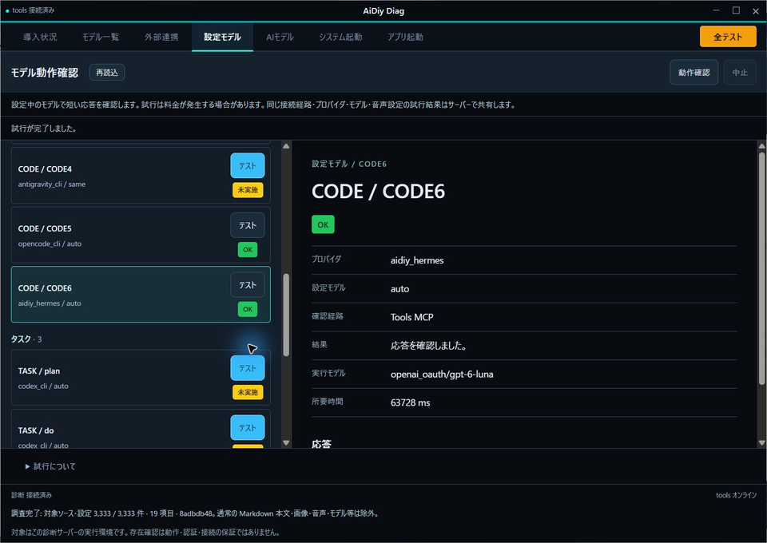

初回の時間切れと中止操作の画面は補助資料として保持しています。利用枠を調整した後の条件と結果は、本章の再試験結果と画像に記載しています。

### 操作手順

1. 画面下部の「tools オンライン」を確認し、上部の「設定モデル」を押します。押せない場合はToolsの起動状態を確認します。
2. パネル見出しの「再読込」を押し、現在設定されているAIを読み直します。
3. 左の一覧から、今回試す役割を選びます。CHATは文字会話、LIVEは音声会話、DECISIONは選択や判断、CODEはコード支援です。プロバイダとモデル名も控えます。
4. 1行だけ試す場合は、その行の「テスト」を押します。設定中のモデルを順番に試す場合は、パネル内の「動作確認」を押します。
5. テスト中の表示が終わるまで待ち、右側の「応答」にAIの返答が出たことを確認します。途中でやめる場合は「中止」を押します。
6. Liveの音声プレーヤーが出た場合は、再生ボタンを押して、再生位置が進むか確認します。実際に聞こえた内容は、文字の返答とは別に記録します。

画面の一番右上の「全テスト」は、AIの返答を試すボタンではありません。役割の違いは7章の表で確認できます。

### 成功の見分け方と記録すること

「応答」にAIの返答が出たことが成功の目印です。「テスト中」や「未設定」だけでは合格にしません。「共有元」がある行は、同じ接続条件で行った別の行の結果を使っています。その表示も記録します。AIサービスの利用条件によっては、試験にも料金がかかります。

### 今回の結果と画面（待機時間の調整前に行った個別試験）

**✅ OK（この個別試験の結果）**：Liveから文字の返答があり、保存された音声の再生位置が最後まで進みました。以下は調整前の記録です。現在の待機設定と最終再試験は6章を参照してください。

試験担当者向け：調整前の個別試験の条件・画面・再生記録

**✅ OK（Liveの個別再試験）**：「設定モデル」でLIVEのテストを押すと、「おはよう」に対して「おはようございます。」と返答があり、結果はOKでした。所要時間は約15.57秒（画面表示15570 ms）、保存された音声は1.32秒でした。再生を押すと一時停止ボタンへ変わり、再生位置が最後まで進みました。

今回使った接続方法は `freeai_live`、モデルは `gemini-2.5-flash-native-audio-preview-09-2025`、声の種類は `Zephyr` です。これらは同じ条件で試し直すための記録です。

最初の試行は「テスト中」の後、約22秒後の観測で一覧が未実施・CHAT選択に戻り、結果が残らなかった。その後、同じLive個別テストを再実行して上記の成功を確認しました。初回の表示は経過として保存し、Gemini系Liveの接続直後の失敗に注意する運用条件を明記したうえで、実回答を確認した再試験を **✅ OK** と判定します。

**追加試験済み**：全15役割をDiag画面から試行し、上記の追加結果を記録しました。Liveの中止操作も確認しています。音声内容の聴取は未確認です。

設定モデルのLIVEを試している画面です。選んだモデルとテスト中の表示を確認しています。

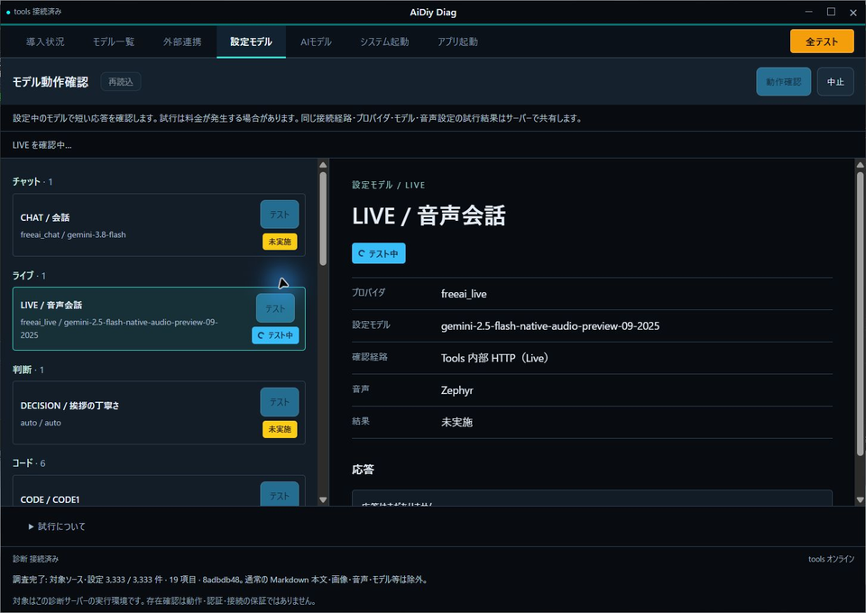

Liveの個別再試験が終わった画面です。結果のOKと所要時間が表示されています。

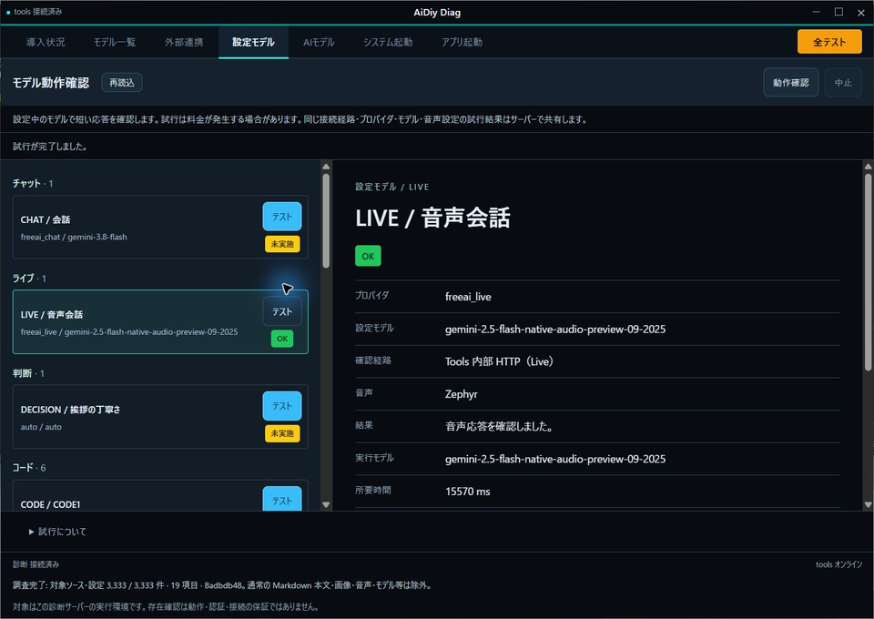

Liveの返答と音声プレーヤーです。文字の返答と、保存された音声の長さを確認しています。

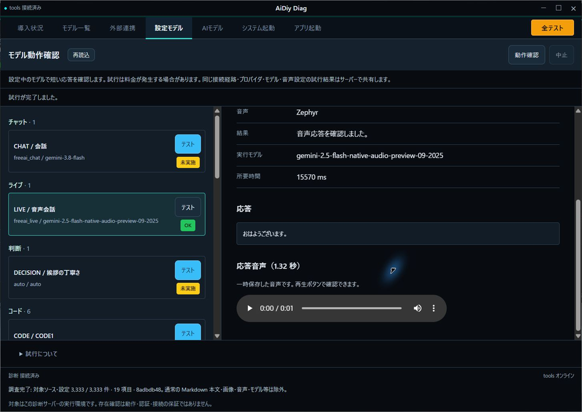

音声の再生ボタンを押した後です。ボタンが一時停止へ変わりました。

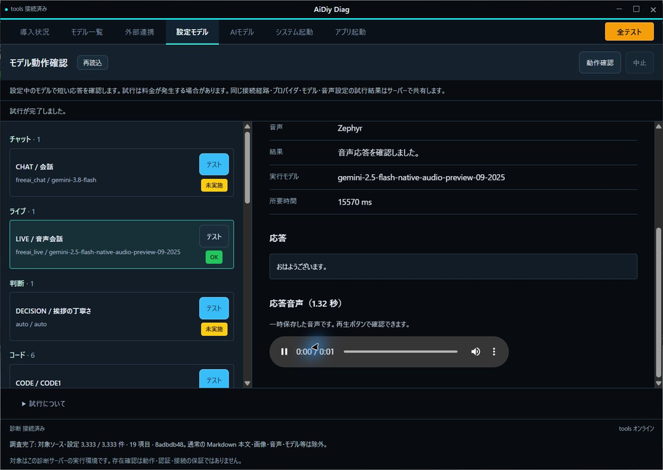

音声の再生位置が最後まで進んだ画面です。音声内容を聞く試験は別に残っています。

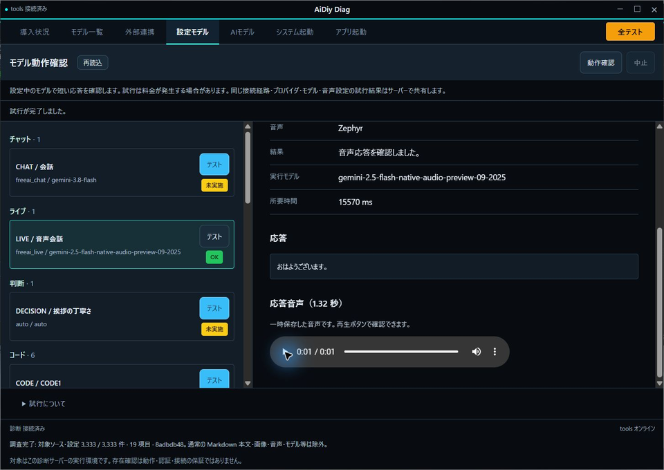

## 6. AIモデルと入力を選んで試す

### 操作手順

1. 「tools オンライン」を確認して、上部の「AIモデル」を押します。
2. パネル内の「候補を再読込」を押します。
3. CHAT・LIVE・DECISION・CODEのタブを1つずつ選び、使うプロバイダとモデルを確認します。LIVEでは音声の種類、DECISIONでは質問文や選択肢も確認します。
4. 会話の入力欄には、次の文を使います。

> おはよう。稼働試験です。挨拶を一文だけ返してください。ファイル変更やコマンド実行はしないでください。

5. 各タブの入力を用意したら、パネル内の「動作確認」または画面右上の「一括試行」を1回押します。CHAT → LIVE → DECISION → CODEの順に進みます。
6. 完了するとCHATへ戻ります。他の3つのタブも押し直し、結果と返答を確認します。AIが返した文章や判断が表示されていれば、返答の確認ができます。
7. 選んだモデル名、入力、実際の返答、結果を記録します。この画面でのモデル選択は、本体の設定を書き換えません。

### 成功の見分け方と記録すること

選んだモデルと、実際に返したモデルの情報が表示される場合は、両方を記録します。「auto」は自動選択という意味なので、結果に出たモデル名も確認します。文字の返答・判断結果と、音声の取得・再生を分けて記録できれば、この章の結果を読み比べられます。

### 今回の最終結果：接続後15秒・応答待ち最大60秒

**✅ OK（追加試験）**：「候補を再読込」後に候補が再表示され、CODEを `copilot_cli / same` へ変更できました。「動作確認」中の「中止」で実行を解除し、再び「動作確認」を押すと4種類の試行が終わり、CHATへ戻りました。本体のモデル設定は変更していません。

| 種類 | 選択した接続・モデル | 今回の結果 |
|---|---|---|
| CHAT | freeai_chat / gemini-3.8-flash | ✅ OK：「おはようございます。」から始まる実回答 |
| LIVE | freeai_live / gemini-2.5-flash-native-audio-preview-09-2025 / Zephyr | ✅ OK：「おはようございます。調子はいかがですか?」と返答。2.80秒の音声取得と再生位置の終端到達も確認 |
| DECISION | auto / auto → openai_oauth/gpt-6-luna | ✅ OK：挨拶の丁寧さをlowと判断。confidenceは0.95 |
| CODE | copilot_cli / same | ✅ OK：「おはようございます！」から始まる実回答。実行モデル名は応答に含まれず、推測していません。 |

モデル候補を切り替えた画面です。`copilot_cli` と `same（変更なし）` を選択できました。

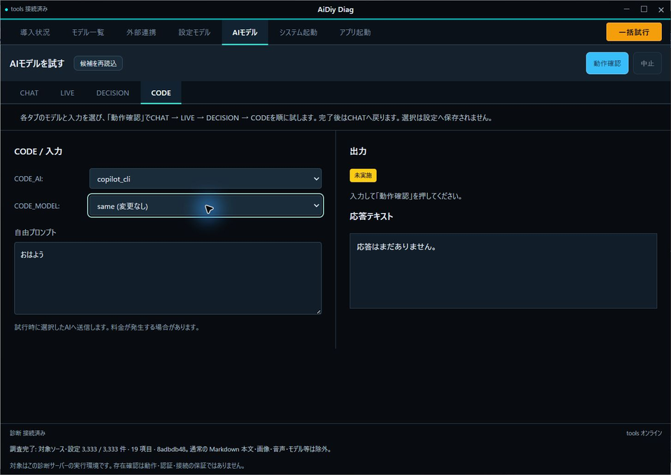

途中で「中止」を押した結果です。「試行を中止しました。」となり、「動作確認」を再び押せる状態に戻りました。

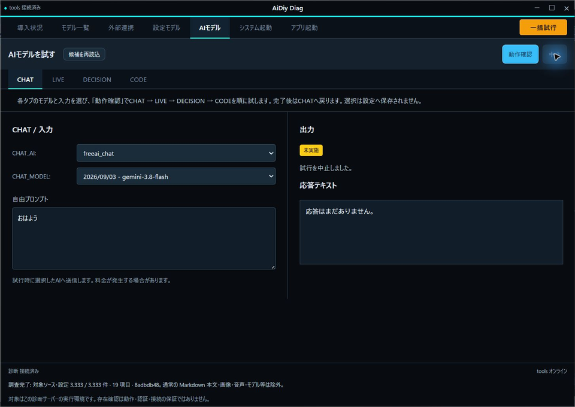

再実行後のLiveです。15秒・60秒の説明、文字の返答、2.80秒の音声と再生完了位置を確認しました。音声内容の聴取は未実施です。

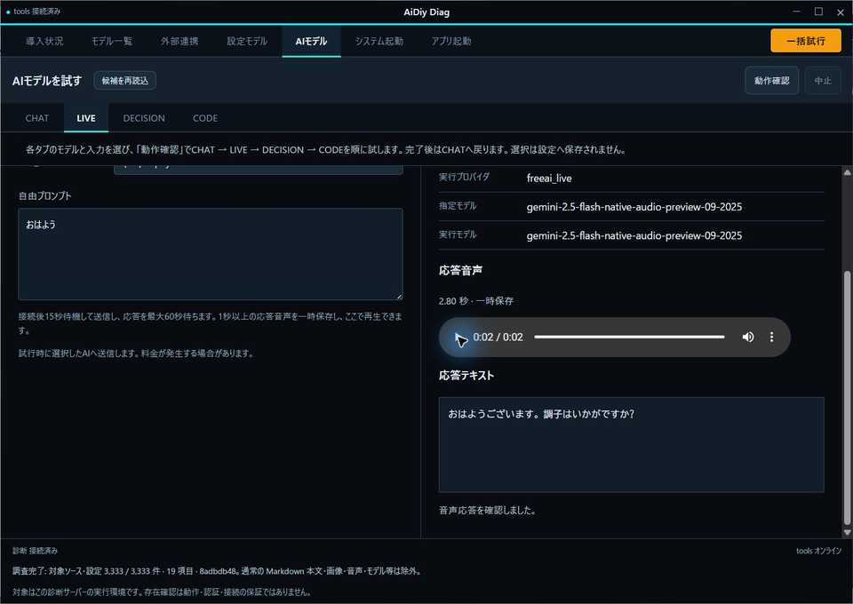

CODEの結果です。`copilot_cli / same` の挨拶への返答が表示されています。

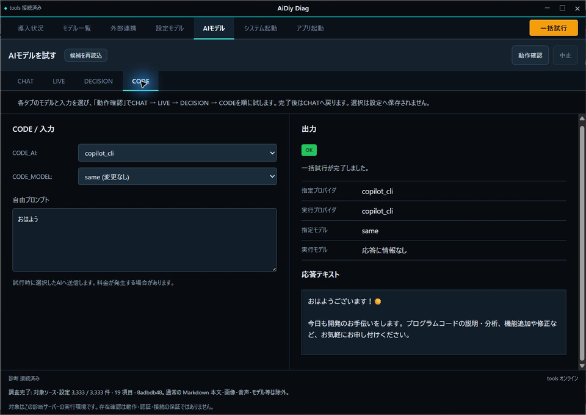

再読込・CHAT・判断の追加画面も補助資料として保持しています。各操作の判定は本章に記載した結果のとおりです。

### 同じ待機設定で行った長い試験文の確認

**✅ OK（現在の設定で再試験）**：接続後15秒・応答待ち最大60秒へ変更し、Diagと5機能を起動し直してから試験しました。モデル、声の種類、送信する試験文を前回とそろえ、「動作確認」を押しました。内部処理を確認する自動テスト51件と、配布する画面への変更反映も確認済みです。

AIから「おはようございます。」と返答があり、画面の結果もOKでした。今回のモデルは `freeai_live / gemini-2.5-flash-native-audio-preview-09-2025` です。現在の15秒・最大60秒の設定で、文字の返答の試験は通過しました。今回は保存できる長さの音声がないという表示だったため、音声再生まで成功した結果にはしていません。

現在の15秒・最大60秒の設定で、前回と同じ試験文を用意した画面です。

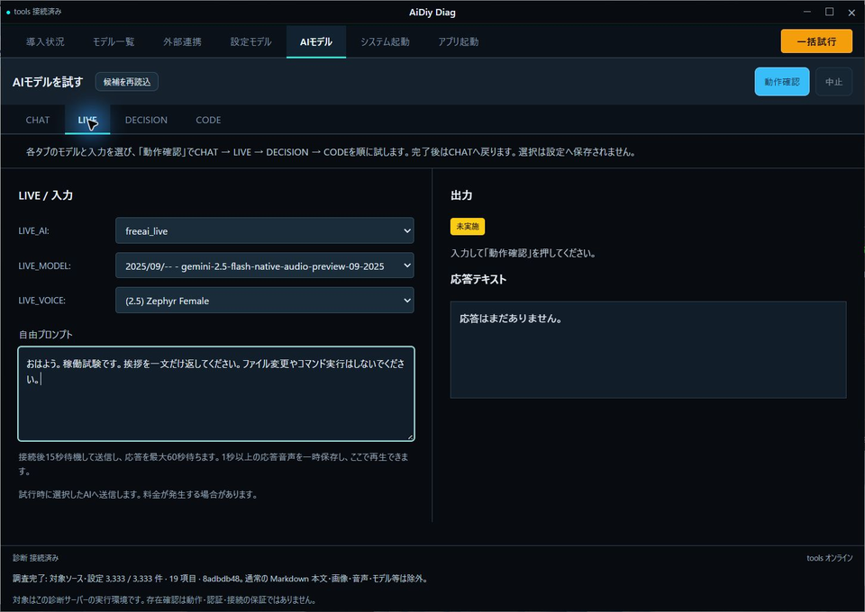

現在の設定での再試験結果です。LiveがOKとなり、「おはようございます。」と返答がありました。

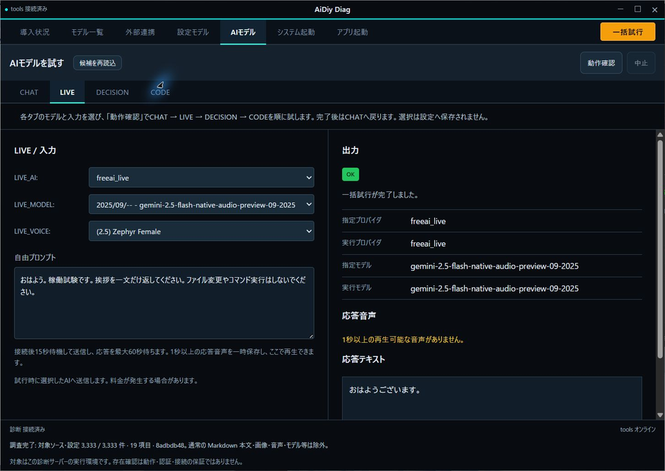

接続後15秒・応答待ち最大60秒の条件で、文字の返答を確認しました。この回は再生できる長さの音声がなく、音声再生の成功とは判定していません。以前の10秒・90秒の条件での結果は、下の経過記録に残しています。

### 試験担当者向けの補足

接続準備は最大20秒、接続準備・待機・終了処理を含む内部の通信は最大135秒、1回の試験全体は最大150秒にしています。画面にmsと出る場合はミリ秒で、1000 msが1秒です。以下の折りたたみ欄には、調整前の条件と画像を保存しています。

試験担当者向け：調整前の失敗・10秒待機・応答90秒の経過記録（現在は15秒・60秒）

### 今回の結果と画面（2026年10月19日・Windows実画面）

「AIモデル」のLIVEを開き、既存のfreeai_live / gemini-2.5-flash-native-audio-preview-09-2025 / Zephyrと、接続後10秒待機の説明を確認しました。上記の簡易試験文を入力して「動作確認」を押し、CHAT → LIVE → DECISION → CODEの順次実行と、完了後のCHATへの復帰を確認しました。

| 対象 | 実結果・判定 |
|---|---|
| CHAT | **✅ OK**: freeai_chat / gemini-3.8-flashで「おはようございます。」から始まる実回答 |
| LIVE・最初の試験文 | **❌ NG**: 応答テキスト・1秒以上の音声を取得できず、「有効な会話応答または1秒以上の音声応答を確認できませんでした。」と表示 |
| DECISION | **✅ OK**: autoからopenai_oauth/gpt-6-lunaへ解決。politeness=low、confidence=0.94、確率high=0.02・medium=0.13・low=0.85を表示 |
| CODE | **✅ OK**: codex_cli / autoからgpt-6-lunaへ解決。「おはようございます。今日は何をお手伝いしましょうか？」と回答 |
| LIVE・短文での再試験 | **✅ OK**: 他の選択値を維持し、入力を「おはよう」にして再実行。「おはようございます。お元気ですか?」と実回答、応答音声2.60秒を表示。再生操作後、再生位置が約2.60秒の終端へ到達 |

この表は待機時間を延長する前の経過。最初のNGは保存し、後述の同一入力による再試験と、接続後10秒・送信後最大90秒の待機条件で **✅ OK（Live試験通過）** とします。入力の長さだけが原因とは断定しません。入力を変えると以前の結果が未実施へ戻ることも確認しました。応答音声はプレーヤーの操作・進行を確認し、内容の聴取は未実施です。

調整前の試験開始画面です。当時は接続後10秒待機で、現在は15秒に変更しています。

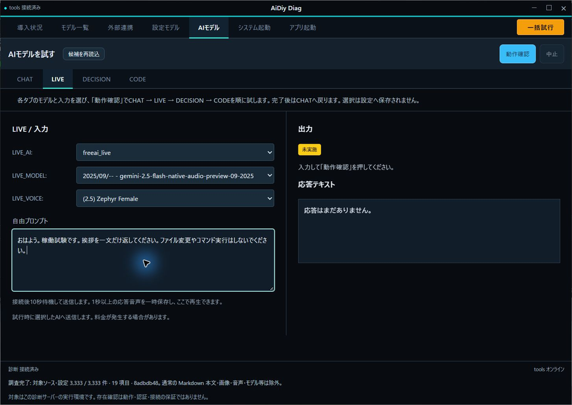

一括試行が終わり、CHATへ戻った画面です。チャットの返答が表示されています。

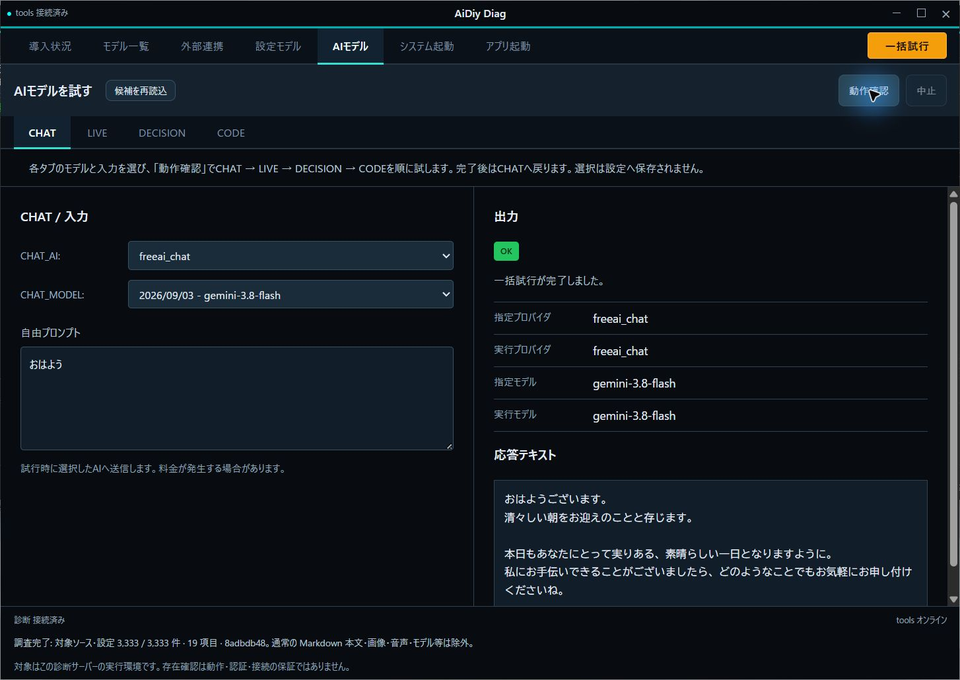

最初のLive試験の失敗画面です。この時点では、有効な文字や音声の応答を取得できませんでした。

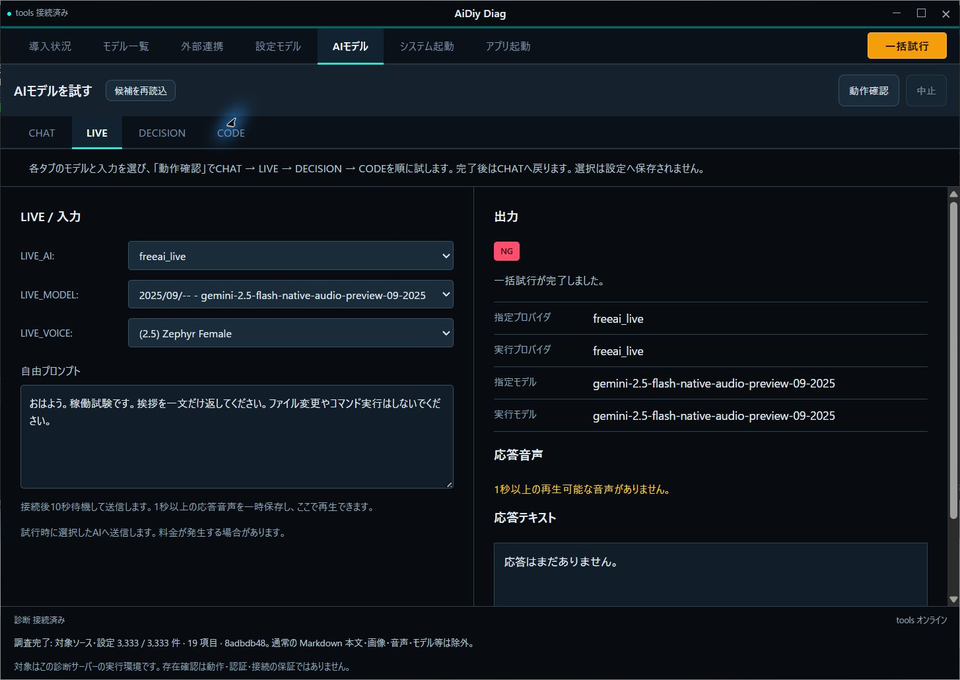

LiveのNG後に進んだDECISIONの結果です。判断結果はOKでした。

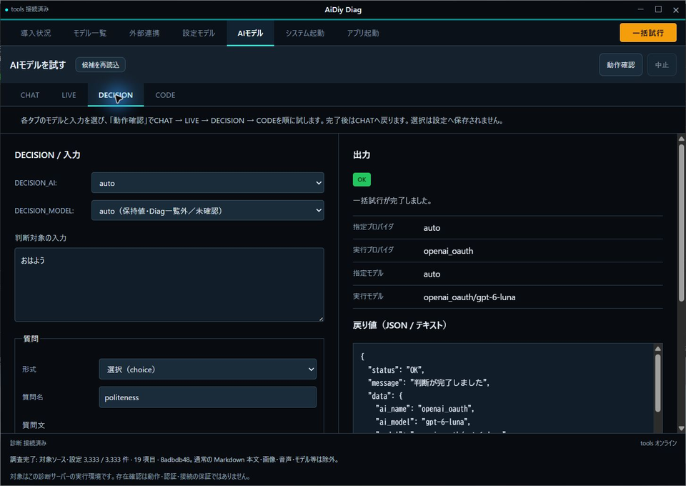

CODEの結果です。挨拶に対するAIの返答を確認しました。

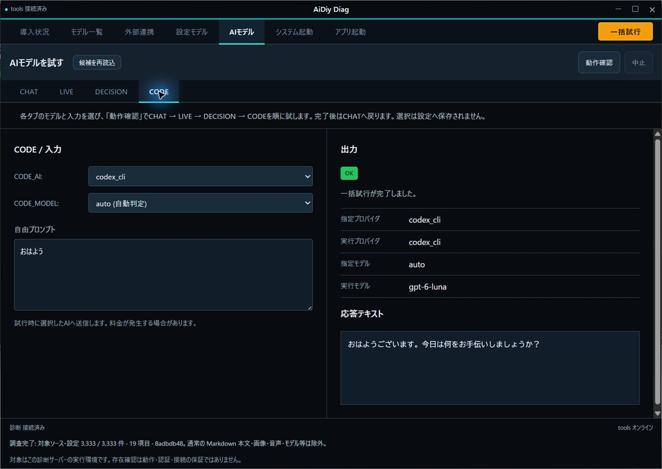

Liveの入力を短い「おはよう」に変えた画面です。この条件で再試験しました。

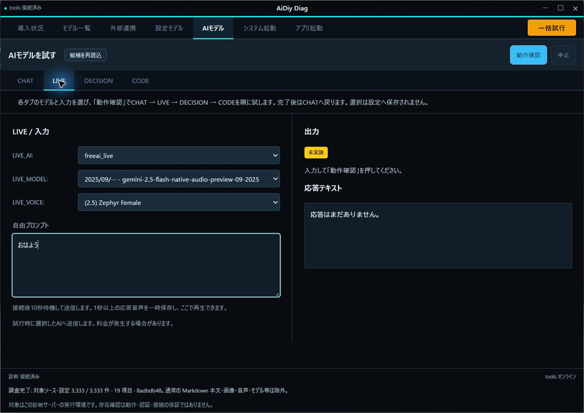

短い入力で再試験した結果です。LiveがOKとなりました。

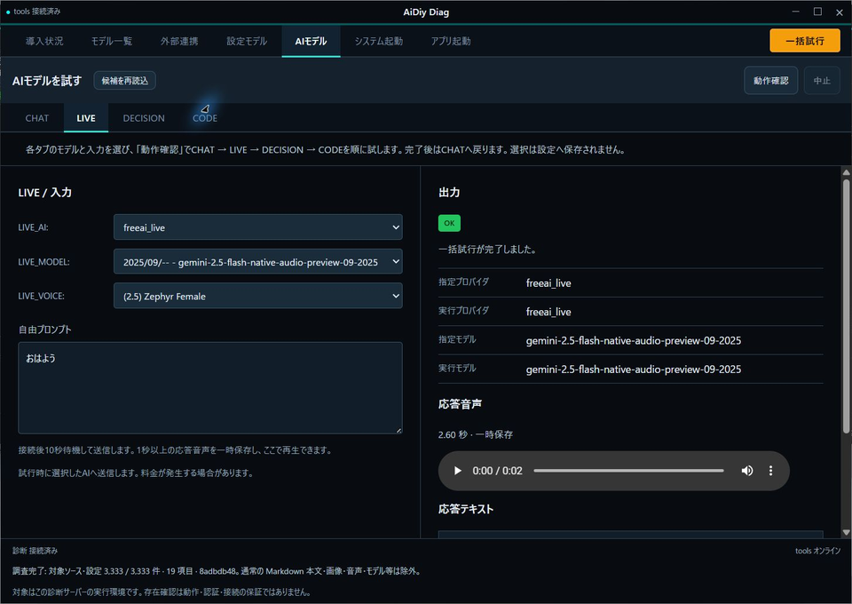

短い挨拶への返答と、2.60秒の保存音声が表示された画面です。

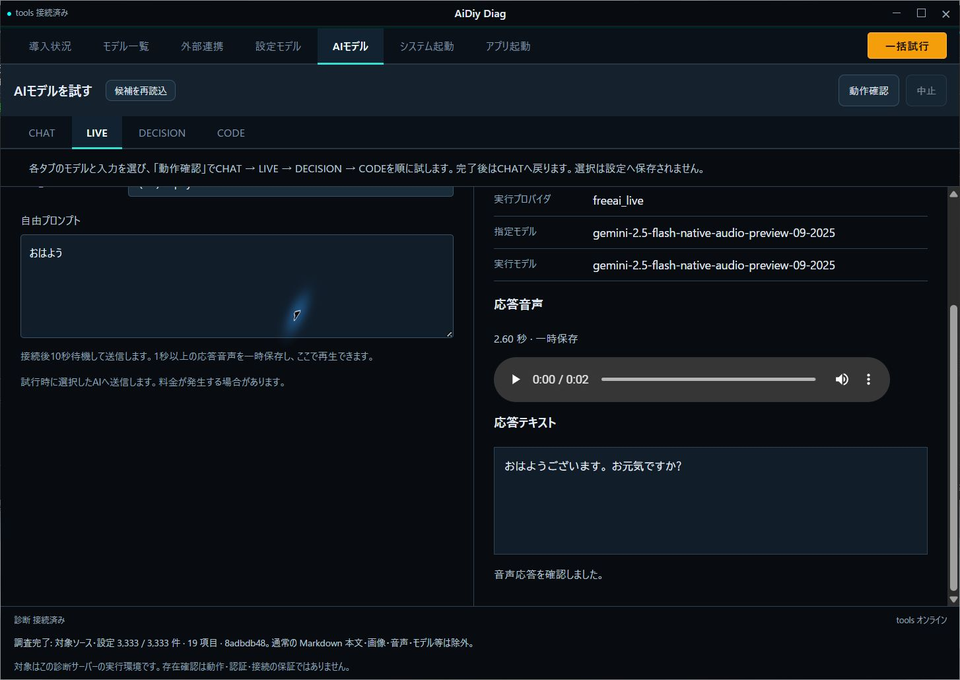

保存した音声を再生している場面です。再生ボタンと位置の変化を確認しています。

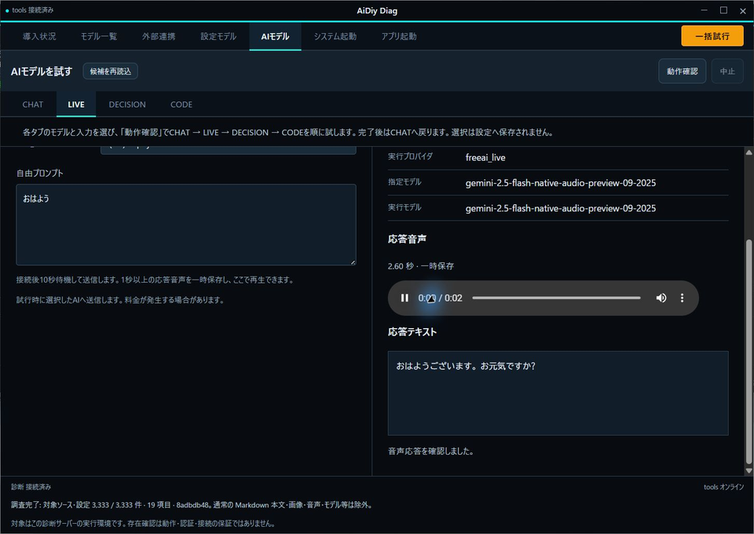

音声の再生完了画面です。再生位置が約2.60秒の終端に達しました。

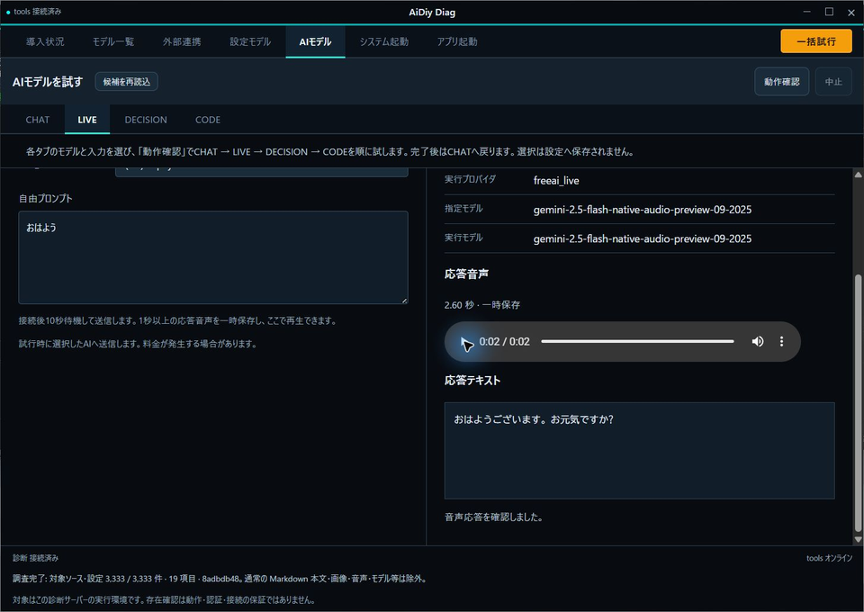

接続後の自動待機は画面説明と共通実装・単体検証でも確認していますが、実画面だけから内部の送信時刻を厳密に計測したものではありません。候補の切替・再読込・中止は、後の追加試験で確認しました。あらゆるモデル・通信条件での安定性まで保証する結果ではありません。

### 応答待ちを延長した後の再試験（旧設定: 接続後10秒・応答90秒）

長い返答の生成・音声ターン完了まで余裕を持たせるため、Liveの送信後の応答待ちを30秒から90秒へ延長しました。初回安定待機10秒は維持し、Diag側の内部HTTPを135秒、1行を150秒、全実行を45分にそろえた。音声保存の最大30秒制限は維持します。関連のPython 22件・Node.js 29件のテストは成功しました。

Diagと管理中のTools・Core・Apps・Task/Team・Webを再起動して反映し、5サービスの稼働復帰を確認しました。Localは未起動の設定を維持した。

**✅ OK（前回NGと同じ入力で再試験）**: freeai_live / gemini-2.5-flash-native-audio-preview-09-2025 / Zephyrを維持し、最初に失敗した長い試験文を再入力して画面の「動作確認」を実行しました。LIVEはOKとなり、「おはようございます。」という実回答と1.16秒の応答音声を確認しました。旧NGの証跡603は残します。今回は一文の回答を求めた試験であり、長い回答自体の負荷試験や、以前の原因が30秒の期限だったことの証明ではありません。

旧設定の応答待ち90秒で、最初に失敗した試験文を用意した画面です。現在の応答待ちは最大60秒です。

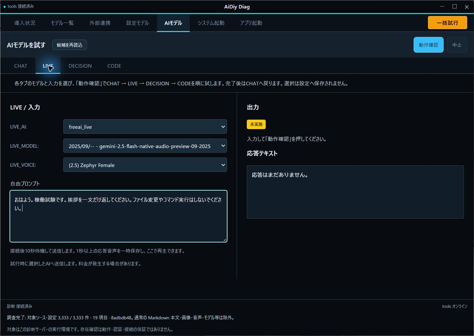

旧設定で同じ試験文を再試験した結果です。LiveがOKとなりました。

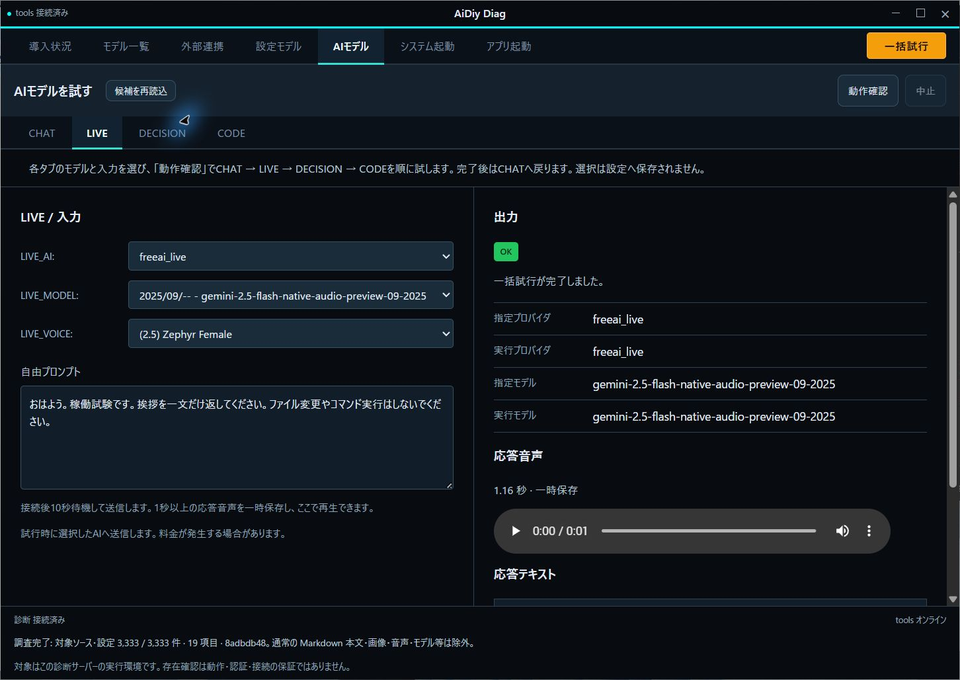

旧設定での返答と1.16秒の音声です。同じ試験文でも応答を得られたことを記録しています。

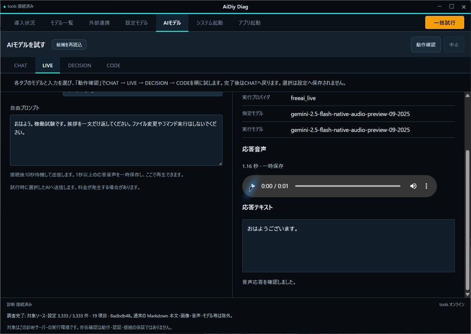

当時は接続後10秒・送信後最大90秒の設定で再試験し、Liveの返答を確認しました。Gemini系Liveの接続直後の失敗は注意事項として残しています。現在の15秒・60秒での結果とは分けて扱います。

旧設定の自動テストでは、設定モデル・AIモデルが共通の内部経路を使い、接続確立→10秒待機→送信の順になることを確認しました。Python 22件・Node.js 29件が成功しました。資格情報・ネットワークを使わない検証のため、実画面試験・実モデル応答の合格には転用しません。

### 追加確認：実音声の内容と再生

**✅ OK**：接続後15秒・応答待ち最大60秒で、1.32秒・24kHz・モノラルの音声を取得しました。別の音声認識で「おはようございます」となり、実際の返答文と一致しました。Windowsの再生APIも正常終了しました。人の耳での聴取・スピーカーからの再録音は行っていません。

1.32秒の[実音声WAV](./images/セルフテスト,aidiy_diag,環境確認編/live-response.wav)を保持しています。音声認識は返答文と一致し、Windowsの再生処理も正常終了しました。前の各画像にある「聴取未実施」は当時の記録で、人の耳での聴取はこの追加試験でも実施していません。

## 7. 全テストとheadlessを使い分ける

### 操作手順

同じ「まとめて実行」のように見えても、ボタンによって調べるものが違います。目的に合う行を選んでください。

| やりたいこと | 使う場所・操作 | 完了したときに確認するもの |
|---|---|---|
| 必要なプログラム・モデル一覧・外部接続をまとめて調べ、結果を保存する | Diagの通常画面で右上の「全テスト」 | 各結果と保存が完了し、最後に「導入状況」へ戻ったことを確認します。AIへの挨拶送信やシステム起動は含みません。 |
| AIに実際に入力して返答を試す | 「AIモデル」の右上「一括試行」 | CHAT・LIVE・DECISION・CODEの各タブで返答や判断結果を確認します。 |
| アプリに必要なシステムを起動する | 「システム起動」の右上「設定起動」 | 選んだ機能の「稼働中」と起動完了を確認します。詳しくはシステム起動編へ進みます。 |
| 画面を開かず診断結果だけ保存する | ターミナルで `aidiy_diag --headless` を実行 | コマンドの終了結果と、保存された導入状況・モデル情報を確認します。外部連携の認証確認、AIの返答、システム起動は含みません。 |

画面を開かない場合でも、モデル一覧の取得にはサービスへの通信が発生します。headlessの試験結果は、通常画面での試験と分けて記録します。

### 成功の見分け方と記録すること

「全テスト」は各段階の結果・書込・最後の表示タブを確認します。headlessは終了コード・出力・生成ファイルを照合します。終了コード0だけで、任意プログラムの未検出や全モデルの生成可否まで合格にしません。失敗した保存処理については前回結果を壊さないことも確認します。

**✅ OK（追加試験）**：画面右上の「全テスト」で、導入確認・保存、モデル一覧の再取得・保存、外部連携の確認・保存まで完了し、導入状況へ戻りました。3種類の保存ファイルが今回の日時に更新されていることも確認しました。

全テスト完了後の画面です。導入状況は19項目すべてOKで、書込済みです。

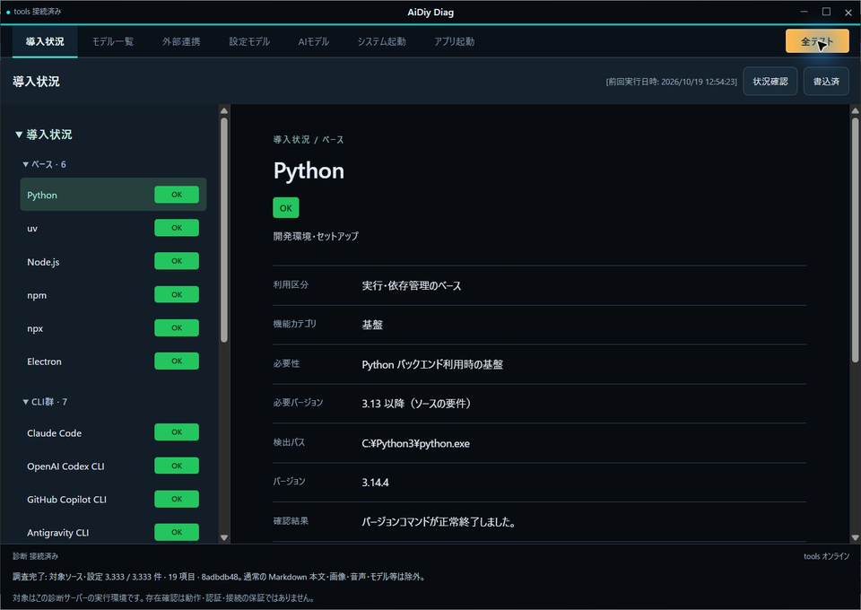

続いてコマンドからheadlessを実行し、終了コード0を確認しました。画面とheadlessの導入結果19件は、項目名・状態・パス・バージョンが完全一致しました。headlessは外部連携の認証確認を行いません。

## 8. 試験担当者向け：次回の記録方法

画像の名前・保存先・自動試験の記録方法を開く

本書1〜7章を順に実施します。Computer Useは画面の観察 → 1操作 → 再観察で進め、確認できた結果だけを判定します。システム起動編6章の記録方法と `scripts/checks/実画面試験記録.mjs` を共用する。単体テストや合成画面と、実環境の実画面試験を分けます。

保存先は `_AIDIY/knowledge/images/セルフテスト,aidiy_diag,環境確認編/`。画像名は本書の章番号を先頭1桁とし、章内で01から連番にする。別冊内の番号とは独立させる。

| 章 | ファイル名の例 | 残す画面 |
|---|---|---|
| 1 | `aidiy_diag-環境確認_101_導入状況表示画面.png` | 環境確認への切替と接続状態 |
| 2 | `aidiy_diag-環境確認_201_導入状況確認完了画面.png` | 結果・選択項目の詳細・書込済 |
| 3 | `aidiy_diag-環境確認_301_モデル一覧取得完了画面.png` | 取得結果・日時・保存状態 |
| 4 | `aidiy_diag-環境確認_401_外部連携確認完了画面.png` | 認証確認の結果・説明 |
| 5 | `aidiy_diag-環境確認_501_設定モデル応答画面.png` | 設定中モデルの実回答 |
| 6 | `aidiy_diag-環境確認_601_AIモデル応答画面.png` | 選択したモデル・入力・実回答 |
| 7 | `aidiy_diag-環境確認_701_全テスト完了画面.png` | 全処理後の導入状況表示 |

各章の「未実施」を、実施日時・操作・期待結果・実際の結果・判定と、説明付き画像へ置き換えます。エラー時は修復前の結果も残し、再試験の画像を次の連番で追加します。保存内容との照合やheadlessの結果は、比較した項目と一致・不一致を本文の表にまとめます。認証キーや秘密値を証跡へ含めません。

2026-10-19に1〜7章を実施しました。設定モデルは再試験を含む15役割、AIモデルは4種類の返答を確認しました。Liveは接続後15秒・応答待ち最大60秒で通過し、追加試験では2.80秒の音声再生も完了しました。音声内容の聴取は未実施です。上の画像名の表は次回の採番例で、取得済み画像は本文のインライン画像と各実施フォルダの台帳を参照します。

