# aidiy_diag 設定再起動編 — 操作ガイドとセルフテスト

## 総合評価

**✅ OK（Windowsで確認した範囲）。** Coreへのログイン、設定の書込み・再読込、未保存変更のキャンセル、保存済み設定での再起動、復帰後の再ログインを実画面で確認しました。Core・Apps・Tools・Local・TaskTeamの5バックエンドはプロセスが入れ替わり、HTTP 200で復帰しました。Webのプロセスは維持されました。

1〜4章は操作ガイド、5章は追加テストです。モデル候補の取得は[環境確認編](./セルフテスト,aidiy_diag,環境確認編.md)、サービス単位の起動・停止は[システム起動編](./セルフテスト,aidiy_diag,システム起動編.md)を参照します。

対象はWindowsです。Mac／Linux実機、長時間タイムアウトは未実施です。[PDF版](./セルフテスト,aidiy_diag,設定再起動編.pdf)を参照できます。

## 1. 設定画面を開く

1. Coreを起動し、Diagの「設定再起動」を選びます。Toolsの起動はこのタブの利用条件ではありません。
2. 既存の利用者IDとパスワードを入力し、「Coreへログイン」を押します。
3. モデル設定のフォームが表示されれば準備完了です。認証はこの画面内だけで保持します。

Core起動中のログイン画面です。入力前の状態を掲載しています。

**図101：ログイン画面**

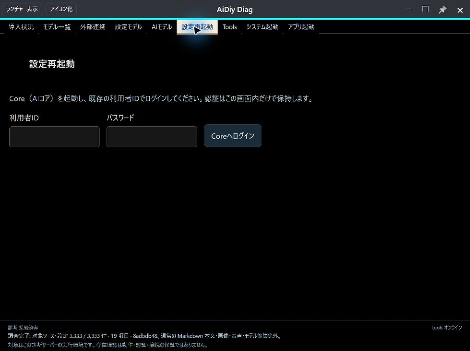

ログイン後の設定フォームです。CHAT・LIVE・PREDICTION・DECISION・CODE・TASK・TEAMの設定を読みます。

**図102：設定フォーム**

## 2. 設定を選んで書き込む

1. 変更する項目を選びます。例ではLIVEの音声をZephyrからPuckへ変更します。
2. 画面の末尾へスクロールし、「書込み」を押します。
3. 「モデル情報を保存しました。」を確認します。
4. 上部の「設定を再読込」を押し、保存した値が表示されることを確認します。フォーム内の「再読込」でも設定を読み直せます。

**完了の目印：** 保存通知だけでなく、読み直した設定が選択値と一致することを確認します。「書込み」だけではバックエンドを再起動しません。

LIVE_VOICEをPuckに選んだ状態です。選んだだけでは保存されません。

**図201：音声の選択**

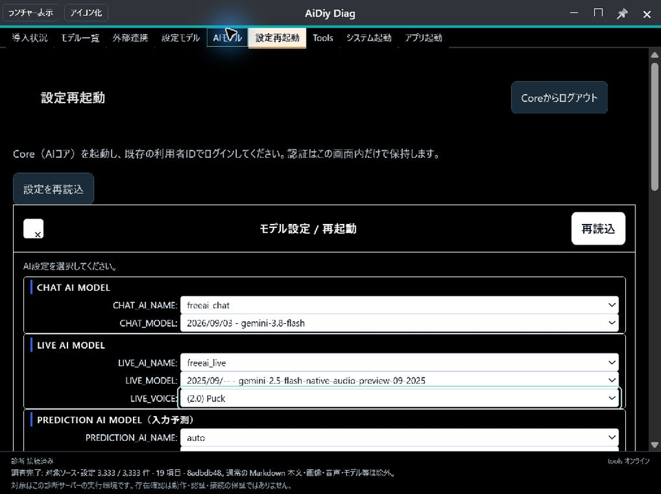

末尾の3操作です。左が「書込み」、中央が「キャンセル」、右が「再起動（リセット）」です。

**図202：末尾の操作ボタン**

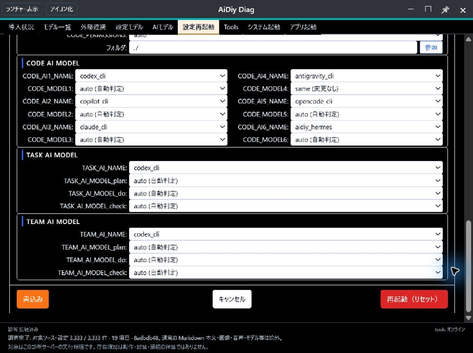

書込み完了の通知です。この例ではLIVE_FREEAI_VOICEだけが変わり、他の保存項目は一致しました。

**図203：書込み完了**

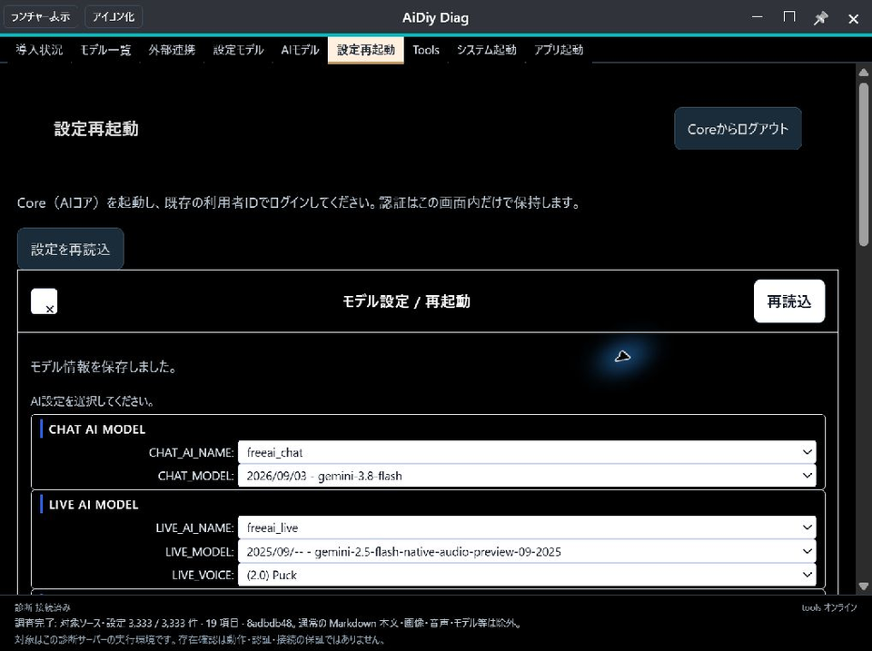

保存後の再読込です。LIVE_VOICEはPuckを保持しています。

**図204：保存値の再読込**

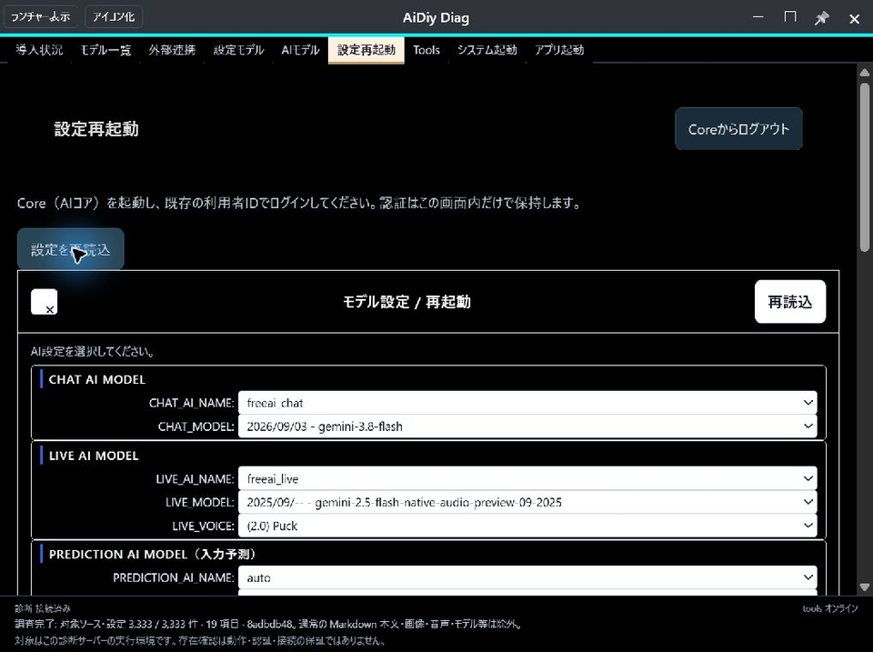

## 3. 未保存の変更をキャンセルする

1. 保存済みの値から別の値へ変更します。例ではPuckからKoreへ変更します。
2. 「書込み」を押さず、末尾の「キャンセル」を押します。
3. 設定フォームが閉じ、Coreへのログイン画面に戻ります。
4. 再度ログインして設定を読み、保存済みの値が保持されることを確認します。

Koreを選びましたが、保存していない状態です。

**図301：未保存の変更**

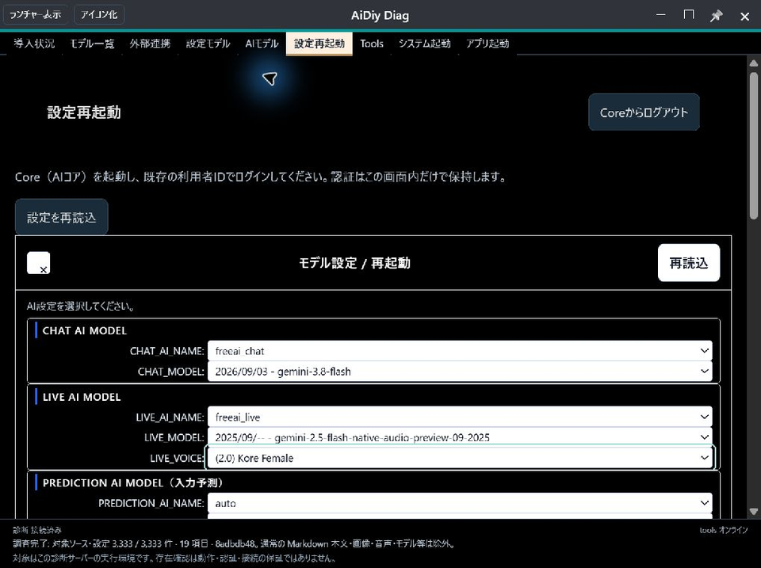

キャンセル後のログイン画面です。パスワード欄も空になります。

**図302：キャンセル後**

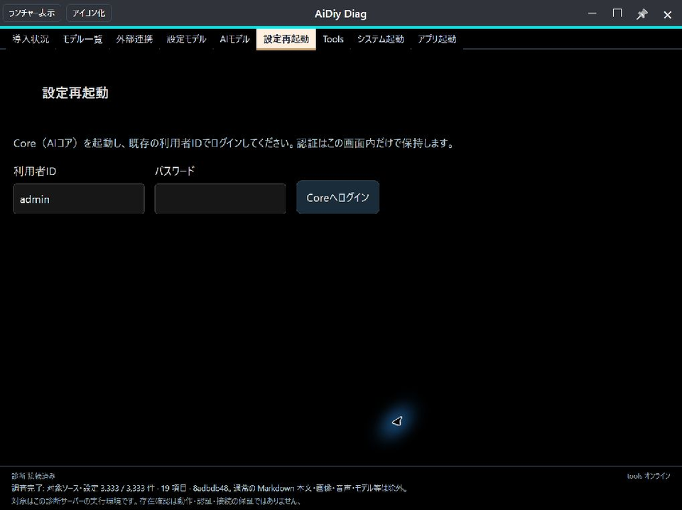

再ログイン後は保存済みのPuckです。キャンセル操作で保存ファイルが変わらないことも照合しました。

**図303：キャンセル後の保存値**

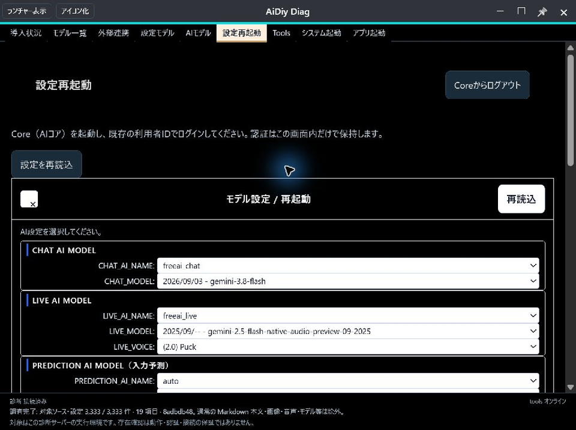

## 4. 保存済みの設定で再起動する

1. 適用したい変更があれば、先に「書込み」を済ませます。
2. 末尾の「再起動（リセット）」を押します。
3. 確認文を読み、実行する場合は「OK」、中止する場合は「キャンセル」を押します。
4. 再起動中は接続状態を確認します。表示される待機秒数は完了の保証ではありません。
5. Coreが復帰したら再度ログインし、設定を読み直します。

**完了の目印：** 再起動受付だけでなく、対象サービスの復帰と、再ログイン後の保存値を確認します。リセットは初期値への復元ではなく、保存済み設定での再起動です。未保存の編集は反映されません。

再起動の確認文です。最初にキャンセルできることを確認し、その後に実行しました。

**図401：再起動の確認**

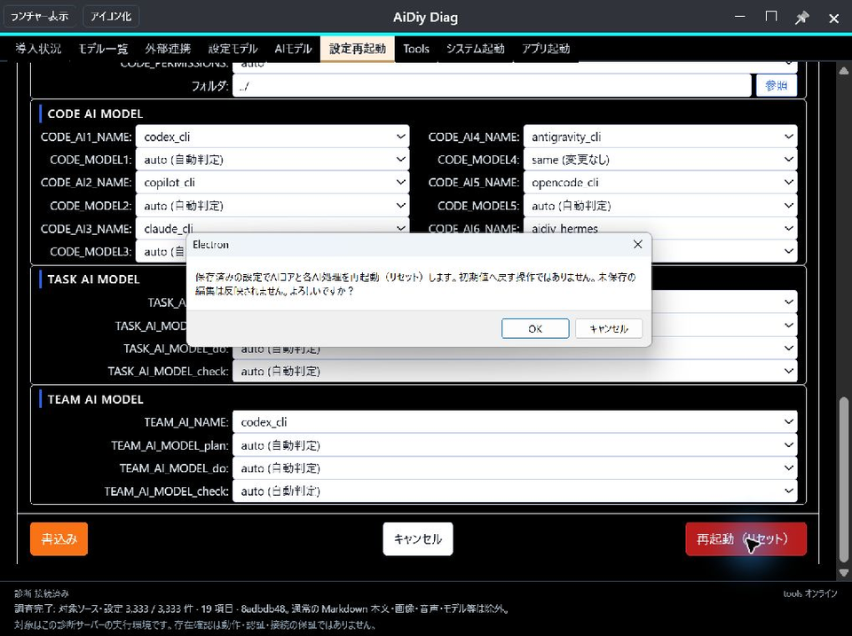

Core切断中の画面です。設定操作と認証が解除され、タブはCore稼働中だけ操作可能になります。

**図402：Core切断中**

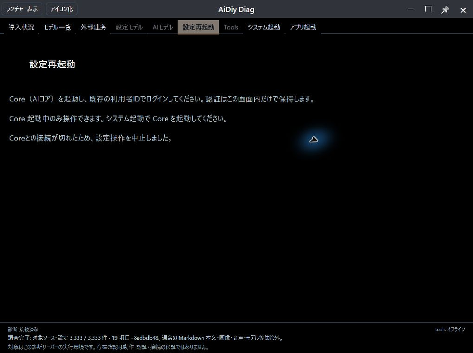

Core復帰後は再ログインが必要です。「接続が切れたため、設定操作を中止しました。」は再起動に伴う認証解除の表示です。

**図403：復帰後の再ログイン**

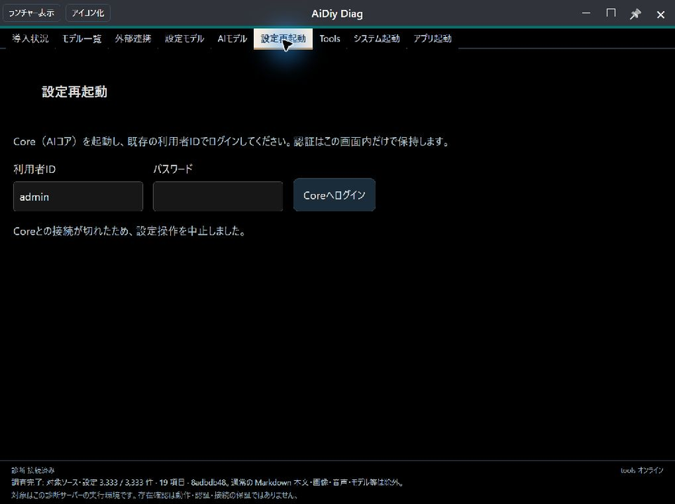

再ログイン後の保存値はPuckです。未保存のKoreは反映されず、再起動前後の保存内容も一致しました。

**図404：再起動後の保存値**

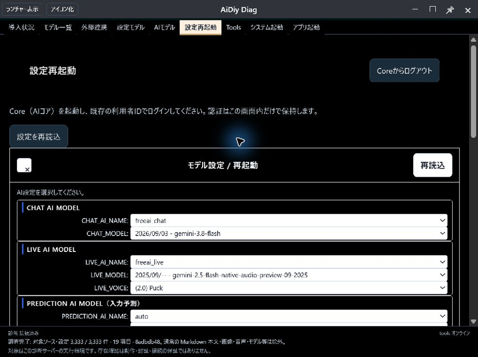

## 5. 追加テスト

| 確認 | 結果 |
|---|---|
| 保存と再読込 | ZephyrからPuckへ保存し、再読込でもPuckを保持。他の保存項目は不変 |
| 未保存変更のキャンセル | Koreを未保存でキャンセル。再ログインでPuckを保持し、保存内容は不変 |
| 再起動確認の取消 | キャンセルで設定フォームへ戻ることを実画面で確認。再起動APIを送らないことは自動試験で補完 |
| 未保存編集を含む再起動 | Koreを未保存のまま実行。復帰後は保存済みPuckで、保存内容は不変 |
| 再起動対象 | Core・Apps・Tools・Local・TaskTeamのプロセス入替とHTTP 200を確認 |
| 対象外のサービス | Webのプロセス維持を確認。Avatarは未起動のためプロセス維持は未確認 |
| Core切断・復帰 | 設定操作の中止、認証解除、復帰後の再ログインを確認（図402〜404） |
| 元設定の復元 | Zephyrへ戻して保存・再読込。保存項目全体が試験前の値と一致 |

Task・Teamの再起動指定は同じTaskTeamプロセスを対象にします。5バックエンドの確認時はLocalも起動し、確認後は元の停止状態へ戻しました。

元のZephyrへ戻して保存・再読込した画面です。

**図501：元設定の復元**

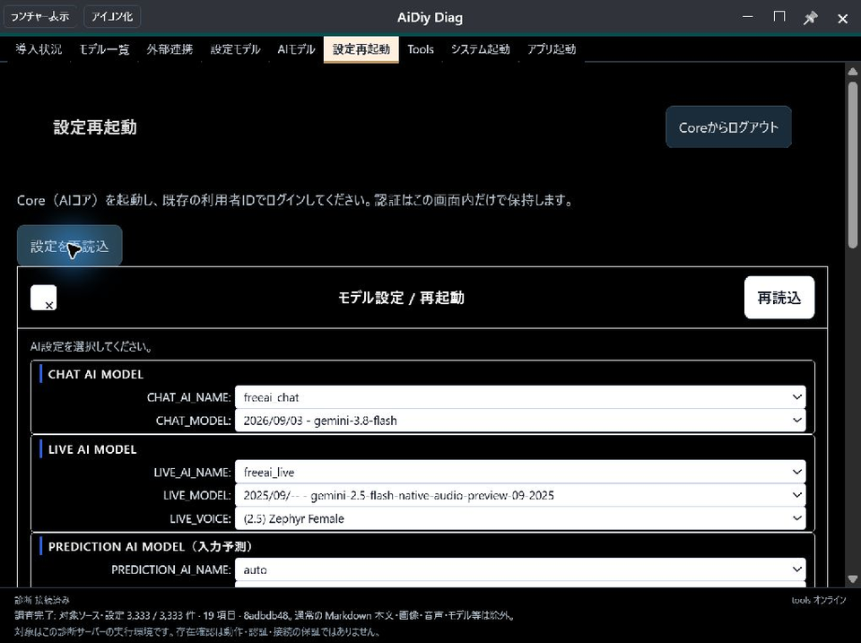

### 自動試験と確認の限界

設定API・フォーム・状態管理の19件が成功しました。保存と再起動の要求分離、確認の取消、二重操作の抑止、遅延応答・切断・認証期限切れの扱いを隔離条件で確認しています。実サービスの復帰結果とは別に判定します。

全項目それぞれのプロバイダ変更、フォルダ参照ダイアログ、全モデルでの応答生成、長時間タイムアウト、Mac／Linux実機は未実施です。設定の保存・再起動の成功を、AI応答や音声生成の成功とは扱いません。
