# IDE 操作編 — 操作ガイドとセルフテスト

> 本書はセルフテスト結果を、操作説明・解説書としても読みやすく整理しています。再テスト後は結果・注意書き・エビデンスを更新し、章立て・操作手順・図解の配置などの様式を維持します。

> 文書: `セルフテスト,aidiy_ide,操作編.md` | 実装: `frontend_ide/src/`, `frontend_ide/デスクトップ/`, `frontend_ide/checks/`

## 総合評価

**総合評価：✅ OK（記載した確認範囲）。2026年10月23日の版で、回帰試験と重点実機試験を実施。Node回帰試験は判定対象856件すべて成功、環境依存で判定対象外6件。VR・ピン、実AI検索、Live音声出力、Browser、別窓終了の確認に成功しました。** WindowsのElectron版を主対象とし、Web版との違いも確認します。

対象環境はWindowsです。Mac／Linux実機と長時間連続運転は **PASS（環境依存・判定対象外）** とし、今回は未実施です。実行成功とは区別し、NGには数えません。

Consoleへの改名など変更後の条件は[変更影響・再試験計画](./セルフテスト,共通,変更影響・再試験計画.md)で管理します。以下の結果は記載した日時・条件の記録であり、現行版の全項目が再試験済みという意味ではありません。

試験日は各結果に記載しています。文書・画像名の整理日は2026年10月26日であり、試験の再実施日ではありません。

[PDF版](./セルフテスト,aidiy_ide,操作編.pdf)も同じ内容で提供します。実機・合成試験・環境対象外の内訳は末尾の実施結果に記載しています。

## この冊子の進め方

1〜7章は「開始 → 探す・読む → AIへ頼む → 表示切替・VR → 終了」の順です。各章で操作手順と画面を確認した後、セルフテスト表の条件を試します。掲載画像は保存済みの実画面・試験画面から、説明する操作に合うものを選んでいます。Web・隔離試験の画面では独立窓の操作やピンの外観が異なるため、ピンの操作は6章のElectron画面を参照します。

## 準備と実施順

1. [Diagアプリ起動編](./セルフテスト,aidiy_diag,アプリ起動編.md)からIDEを開き、起動経路、プロジェクト、配布画面が現行ソースに対応することを確認します。古い配布画面のまま試験しません。
2. 開いているアプリ、起動中サービス、モデル、ピン状態、音声機器、表示倍率を記録します。試験後は変更した設定を戻します。
3. ファイル操作には隔離した試験プロジェクトを使います。日本語・空白を含む名前、深いフォルダ、同名ファイル、画像、HTMLと相対参照資産、Office、PDF、音声・動画を用意します。コピー・名前変更・ゴミ箱移動は試験用ファイルだけで行います。
4. 1〜5章を通常画面で実施し、6章のVR・複数窓、7章の終了へ進みます。各ケースは初めに自動探索をOFFにし、探索試験だけONにします。
5. 通信断・保存失敗・遅延応答は隔離ホストで再現します。実接続での確認と模擬通信による確認を分け、稼働中の共有サービスを無断で停止しません。

表の各行は独立した確認項目です。実施済みの範囲は末尾の実施結果に記録しています。各ケースの「操作・期待結果・実結果・証跡」を対応させ、部分確認と全条件の確認完了を区別します。機器不足は対象と不足理由を明示し、マイク台数・物理画面数は実施時に確認します。

## 1. 利用開始・接続・起動経路

### 操作手順

1. Diagの「アプリ起動」で作業フォルダを選び、IDEを開きます。左上のプロジェクト名を確かめます。
2. 右上の「AiDiy接続利用」を押します。サービスを使わず閲覧する場合は「オフライン利用」を選びます。
3. フォルダやファイルの宇宙表示が出たら利用開始です。最初は右下の「自動探索」をOFFにすると、選んだ場所を落ち着いて確認できます。

### 成功の見分け方と画面

上部にプロジェクト名と利用状態が表示され、ファイルを選択できれば開始できています。ElectronではConsole・Code・Liveが別窓、Webでは画面内パネルになります。Liveは接続利用時に使います。

利用開始画面です。右上の「AiDiy接続利用」「オフライン利用」から使い方を選びます。

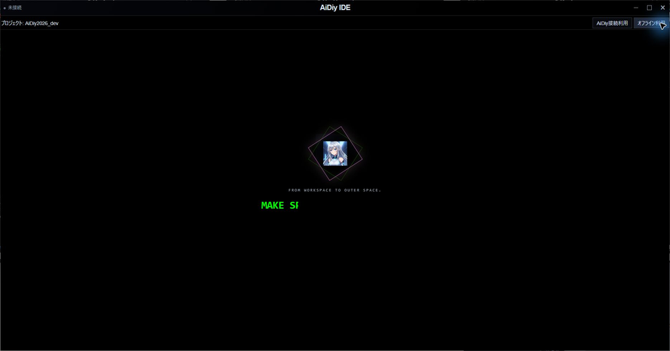

利用中の画面です。左がエクスプローラー、中央が宇宙表示、右が選択したファイルのビューアです。画面内のピンはOFF表示です。

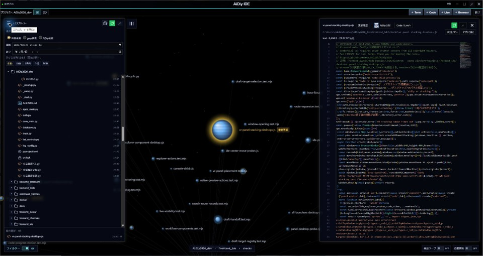

### セルフテスト項目

| ID | 操作 | 期待結果 |
|---|---|---|
| 101 | Diagから起動し、プロジェクト確認後に接続利用を開始 | 手動開始後に作業画面となる。同じプロジェクトのConsole・Code・Liveを開ける。 |
| 102 | 利用終了後、オフライン利用を開始 | 閲覧・Console・Codeが使え、オンライン専用操作の表示・有効状態が切り替わる。Codeの「変更なし」とオンラインの「AI判断」を混同しない。 |
| 103 | 接続中に隔離toolsの応答を停止・復旧 | 接続表示が切り替わっても利用開始時刻・閲覧・子窓を保持し、復旧後に再接続する。通常の定期確認で接続中表示が点滅しない。 |
| 104 | 同一プロジェクトの再起動と別プロジェクト起動 | 既存インスタンスの扱いを確認し、別プロジェクトのセッション・子窓・下書きを混ぜない。 |
| 105 | Web版で同じ利用操作を行う | Console・Code・Liveは画面内で切り替わる。Electron専用の窓・OSアプリ操作を表示しない。 |

## 2. Explorer・更新・ファイル操作

### 操作手順

1. 左上の横三本線を押してエクスプローラーを開きます。フォルダ横の三角で開閉し、名前を押してその場所へ移動します。
2. ファイル名を押すと右側に内容が表示されます。階層を戻すときは親フォルダやルートを選びます。
3. 更新日時で探す場合は日時の条件を選びます。最終更新欄から選んだファイルも同じビューアで読めます。
4. コピー・名前変更・新規作成は対象のメニューから行います。ゴミ箱へ移すときは対象名を確認し、取り消す場合は確認画面でキャンセルします。

### 成功の見分け方と画面

左の選択、中央の場所、右のファイル名・パスが一致していることを確認します。開閉だけで別のフォルダへ移動しない点も確認します。

エクスプローラーから深い階層のファイルを選んだ例です。中央のパンくずと右のファイル名で現在地を確認できます。

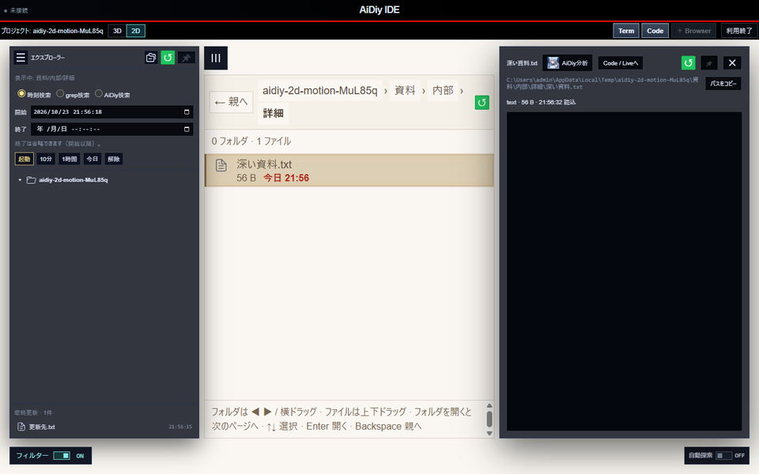

### セルフテスト項目

| ID | 操作 | 期待結果 |
|---|---|---|
| 201 | ルートの三角／名前を別々に押し、深い階層を連続選択 | 開閉だけでは移動しない。名前で移動する。航行中も選択先を保持し、古い航路で最後の選択が取り消されない。 |
| 202 | 日時・対象フィルターを切替え、最終更新行から選択 | 一覧と宇宙の選択が一致する。フィルター変更直後だけで自動追跡を始めない。 |
| 203 | 同一秒に複数ファイルを更新し、同じファイルも再更新 | 最終更新に新しい変更を取り込み、重複表示しない。全階層の `_AIDIY`・`_data`・`_datas` は最終更新候補から除外する。通常のツリー表示とは区別する。 |
| 204 | 古い更新日時のファイル追加、削除、0件化を行う | 件数の変化も一覧へ反映する。残っている選択と展開状態を維持し、件数変化だけで追跡を始めない。 |
| 205 | フォルダ監視ON／OFF、対象変更、通信失敗後の復旧 | 現在の対象だけを更新する。OFF・切替後の遅い応答を適用しない。Explorer最終更新の約60秒周期と、フォルダ監視の応答完了後30秒を別々に確認する。 |
| 206 | 試験フォルダで新規作成・コピー・貼付け・複製・名前変更 | 日本語名と内容が一致し、重複名・予約名・自分の子孫への貼付けは理由を表示する。連打で二重実行しない。 |
| 207 | ゴミ箱移動の取消と確定、失敗を試す | 取消では変更しない。確定した試験対象だけを移動する。ルート自身を操作対象にせず、失敗を成功表示しない。 |

## 3. ビューア・文書・検索・軌跡

### ファイルを読む

1. エクスプローラーから読みたいファイルを選びます。ビューアは読み取り専用です。
2. Markdownは「プレビュー」と「コード」で見え方を切り替えます。HTML・SVGなどは「表示」と「コード」を使います。
3. Word・PDF・PowerPointは文書上部のページ番号と倍率、Excelは下部のシートを切り替えます。
4. 更新後は右上の再読込を押します。読み終わったらビューアの×で閉じます。外部アプリで開く場合はパス欄の「アプリで開く」を使います。

### 成功の見分け方と画面

ファイル名・ページ番号・本文が一致すれば目的の文書を読めています。次の文書画面は固定した試験文書による表示例です。文書本文の編集はCode／Liveへの依頼または外部アプリで行います。

Wordを開いた画面です。文書の上部にページ移動と表示倍率があります。

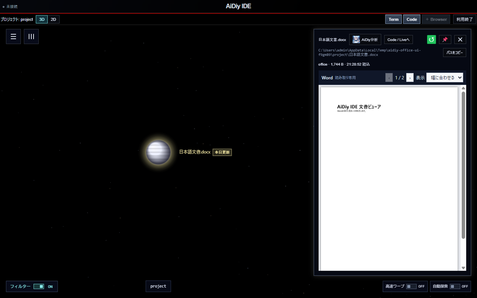

Excelを開いた画面です。下部のシート名を押して表を切り替えます。

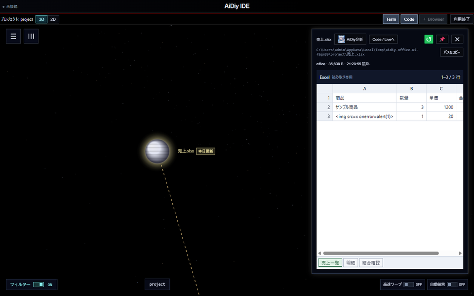

PDFを開いた画面です。ページ番号を確かめながら前後へ移動します。

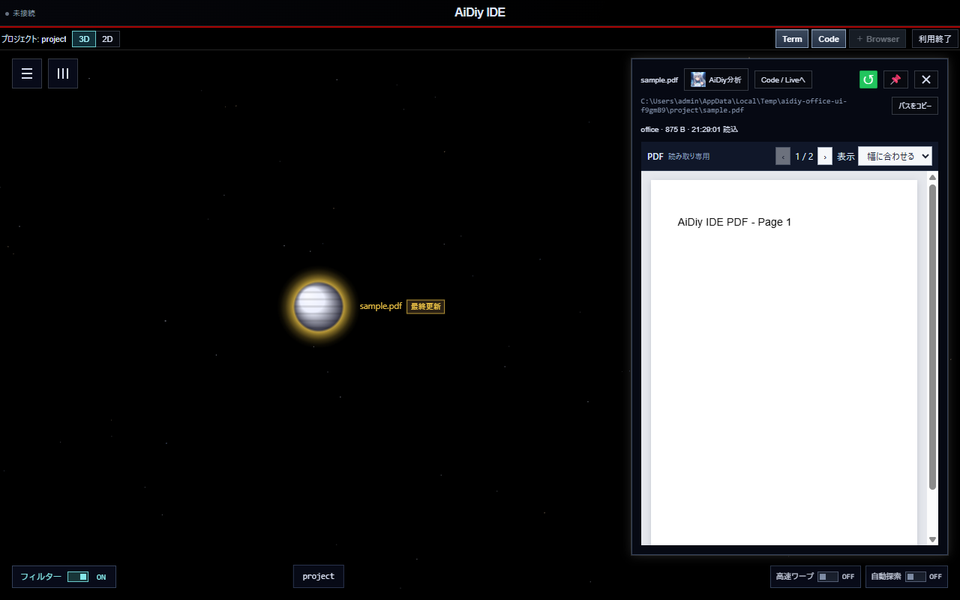

PowerPointを開いた画面です。スライドのページを切り替えて内容を読みます。

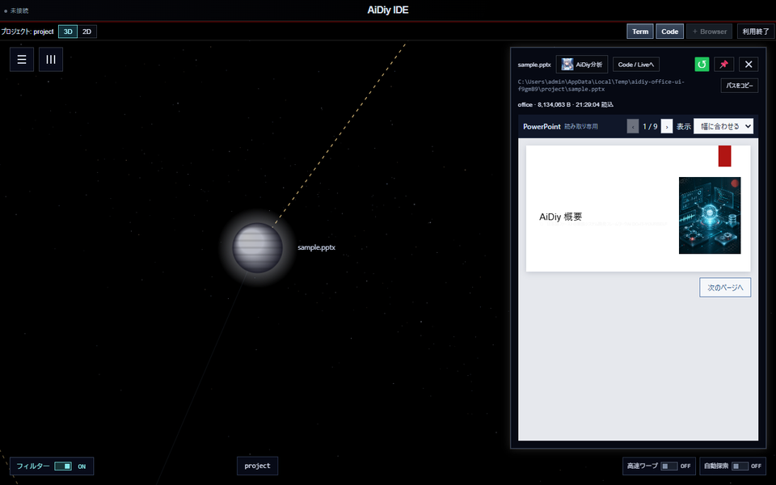

### 検索して、見た場所へ戻る

1. エクスプローラーで「grep検索」を選び、探す文字を入力して検索します。一致行を選ぶと該当ファイルを表示します。
2. 意味から探すときは「AiDiy検索」を選び、目的を文章で入力して実行します。結果が届いたら説明と関連ファイルを読みます。
3. 過去の検索は「履歴」から選びます。軌跡バーでは「閲覧軌跡」「検索軌跡」「AiDiy検索軌跡」を選び、前後ボタンでファイルをたどれます。

AiDiy検索の結果画面です。関連ファイル名を選ぶと内容を表示します。この画面例は固定AI回答によるUI試験で、実AI検索の成功結果は末尾に別記しています。

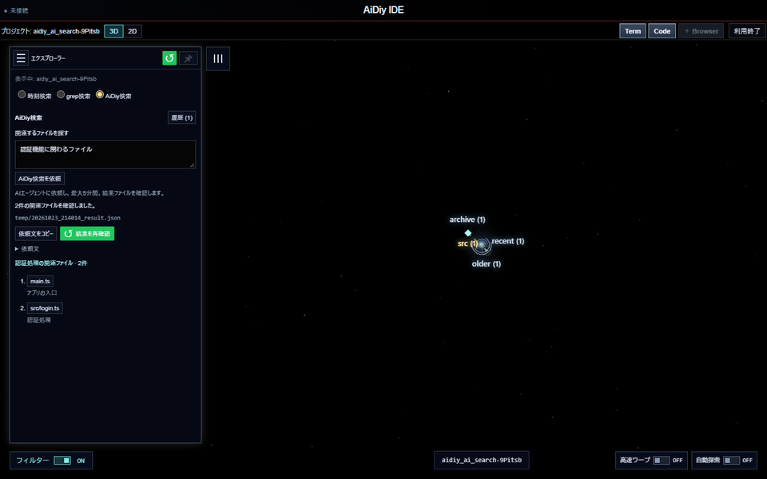

検索履歴を開いた画面です。目的の結果を選び直し、関連ファイルを再び読めます。

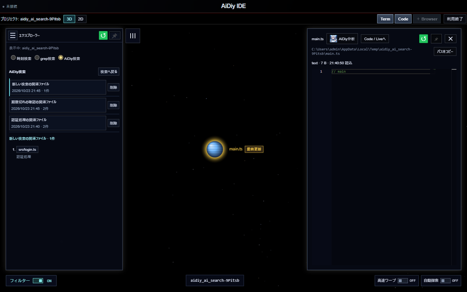

### セルフテスト項目

| ID | 操作 | 期待結果 |
|---|---|---|
| 301 | コード／Markdown／画像／HTML／SVGを選択し、表示とソースを切替 | 読み取り専用で内容が一致する。HTMLの相対画像・CSSも解決する。高速切替で前のファイルの結果を混ぜない。 |
| 302 | Word・Excel・CSV・PowerPoint・PDFのページ、倍率、シートを切替 | 日本語・表・保存済み値を表示し、ページ番号と本文が一致する。破損文書から正常文書へ戻れる。 |
| 303 | 「パスをコピー」「アプリで開く」を通常／独立ビューアで実行 | 全パスが一致する。OSアプリ起動は明示操作時だけ。実行形式等は確認を取消して未起動を確認する。Web版ではOSアプリ操作を出さない。 |
| 304 | 音声・動画の「ブラウザ」、登録HTMLの起動を行う | 音声・動画はビューア内再生ではなくBrowserで開く。登録HTMLは登録先、一般ファイルは対応するパスを使う。停止中・失敗時は理由を表示する。 |
| 305 | 再読込、閉じる、別ファイル選択を繰り返す | 再読込中の表示と操作制御が整合し、古い応答を現在の内容やエラーとして表示しない。 |
| 306 | grepの日本語一致行、実AI検索、検索履歴を選択 | ファイル・行・目印が一致する。実AI結果と固定回答によるUI確認を分ける。履歴削除は取消／確定を確認する。 |
| 307 | Explorerを閉じ、閲覧／検索軌跡の一覧と前後移動を使う | 一覧から移動でき、一覧を開いたまま再訪しても順序が不意に変わらない。Esc／外側クリックは一覧だけを閉じる。 |
| 308 | 隔離バックアップの版比較、解析指示の保存失敗・再試行 | 左右の版と差分が一致する。保存失敗で入力を失わず、再試行は最新の指示を保存する。実データを削除・再構築しない。 |

## 4. Code・Live・Consoleと下書き連携

### 操作手順

1. 上部の「＋ Code」でコード支援を開きます。同じプロジェクト名が表示され、接続済みになったことを確認します。
2. ファイルを渡すときはビューアの「Code / Liveへ」を押します。追加先の候補から使う窓を選び、下書きへの追加を確定します。
3. 下書きにファイルが入ったことを確認し、依頼文を足して送信します。下書きへの追加だけでは送信されません。
4. 音声会話は「＋ Live」を開きます。「会話準備ができました」を確認し、初回・再接続後は15秒待って短い挨拶を送ります。文字の返答と音声は別に確かめます。
5. コマンドを使う場合は「＋ Console」を開きます。作業パスを確認してから入力します。
6. WebやHTMLは「＋ Browser」で開きます。アドレス欄にURLまたはファイルの場所を指定し、「開く」を押します。BrowserにはTools接続が必要です。

### 成功の見分け方と画面

Code／Liveは自分の入力とは別の正式回答が出れば応答を確認できます。Consoleはコマンドの出力、Browserは指定したページの表示を確認します。

Codeの下書きへ参照ファイルを追加した例です。下部の入力欄にファイル名が入ったことを見てから依頼を送ります。

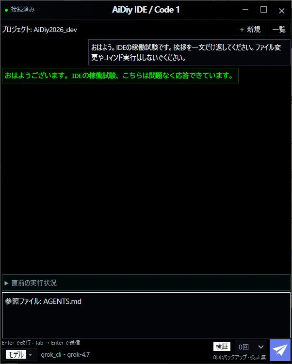

Liveに文字の正式回答が表示された画面です。接続表示だけで会話が成功したとは判断しません。

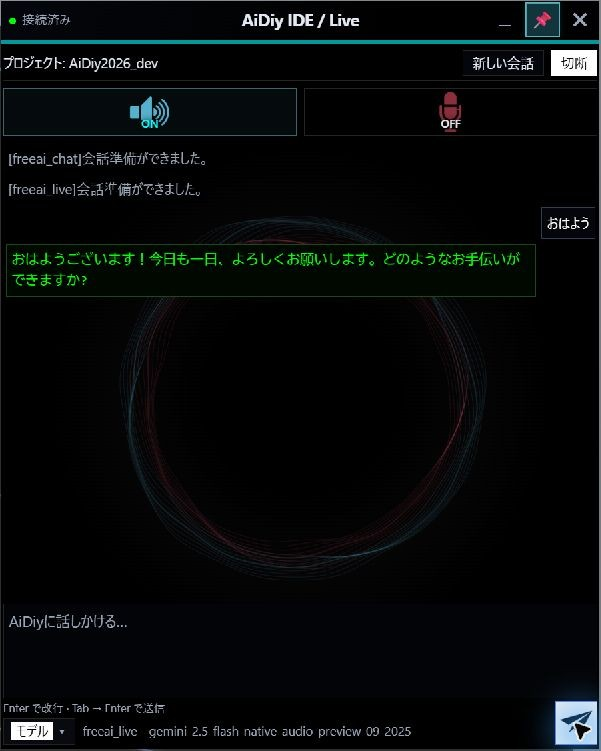

Consoleでは表示された作業パスを確認してからコマンドを入力します。改名前の画像は掲載せず、現行Consoleの入力・出力はRP-511で再確認して撮影します。

BrowserでローカルHTMLを開いた画面です。上部に戻る・進む・再読込とアドレス欄があります。

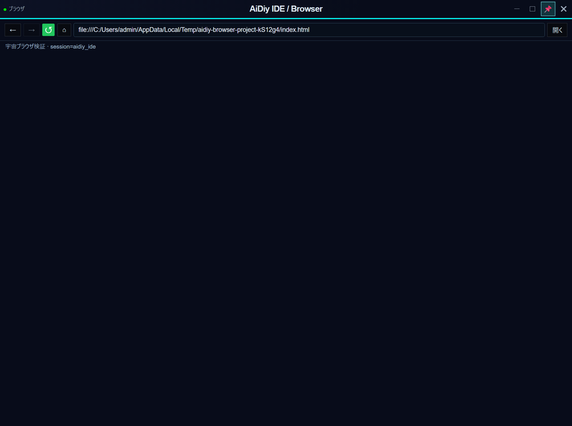

### セルフテスト項目

| ID | 操作 | 期待結果 |
|---|---|---|
| 401 | Codeを2窓、Live、Consoleを開き、プロジェクト・番号・モードを確認 | IDEに属する別窓として識別できる。Code／Liveで無害な挨拶に正式回答が返る。Consoleは `Get-Location` 等の読み取りコマンドの出力も確認する。 |
| 402 | ファイルの「Code / Liveへ」を開き、候補を手動選択して追加 | 最前面の有効候補が初期選択され、手動選択後の通常更新で勝手に変更されない。選んだ窓の既存下書きへ1回だけ追加し、自動送信しない。 |
| 403 | ダイアログの再選択、候補なし、候補を閉じる操作を試す | 再選択した時だけ最新の対象へ更新する。閉じた候補を別窓に置換して送らず、候補なしは起動案内を出す。 |
| 404 | 追加待ち中の連打、会話変更、利用終了、別プロジェクト切替 | 古い対象への配送を拒否し、受信成功の確認前に完了扱いにしない。別IDE・別セッションへ漏れない。 |
| 405 | Liveのモデル再接続失敗と復旧、Webパネル非表示・再表示 | 再接続失敗で会話・下書きを失わない。非表示時のマイク停止と再表示時の状態を確認し、意図せず録音を再開しない。 |
| 406 | 現在の入力機器で音声入力し、音声応答を確認 | 入力・返答を別々に確認する。音声認識、再生API、人の聴取のどれで確認したか明記する。機器不足を合格済みにしない。 |

## 5. 3D・2D・自動探索

### 操作手順

1. 左上の「2D」を押すとフォルダとファイルを一覧で表示します。フォルダを開いて階層を進み、親へ戻る操作で上の階層へ戻ります。
2. ファイルを選ぶと右に内容が出ます。「3D」へ戻しても選択中のファイルを確認できます。
3. 「自動探索」をONにすると更新をたどる動作が始まります。手動で読みたいときはOFFへ戻します。

### 成功の見分け方と画面

表示を切り替えても選んだファイルや現在地を見失わないことを確認します。操作中のアニメーションと最終表示は区別します。

2Dの一覧画面です。フォルダとファイルが並び、下部に操作の案内があります。

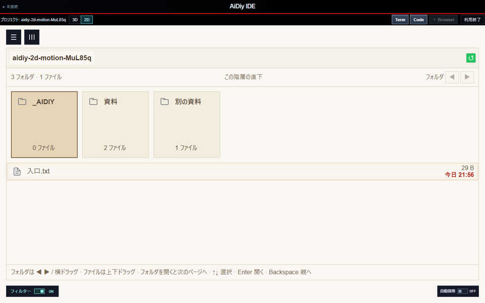

3Dへ戻った画面です。エクスプローラーとビューアで選択中のファイルを引き続き確認できます。

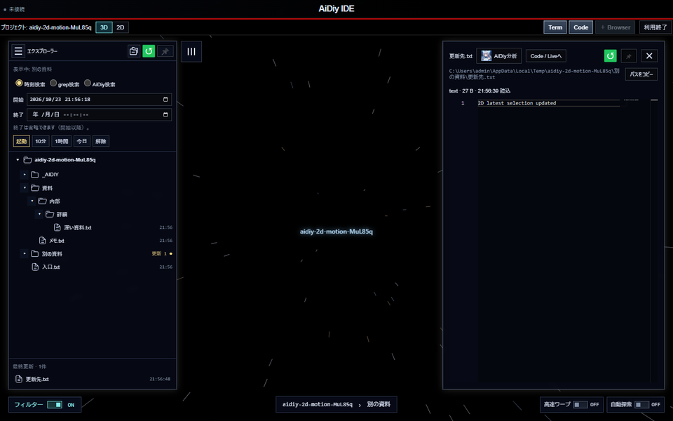

### セルフテスト項目

| ID | 操作 | 期待結果 |
|---|---|---|
| 501 | 3D／2D切替、階層移動、ページ送り、戻る、途中の再選択 | 現在地・選択が一致し、途中の演出と最終状態が自然につながる。古い演出が新しい操作を上書きしない。 |
| 502 | 今日の更新・本日最新・起点以降のファイルを表示 | 現行の更新表示を実データの時刻と照合する。最終更新欄、強調表示、電子の表示を同じ判定と決めつけない。 |
| 503 | 自動探索ONで待機・閲覧・手動操作し、OFFへ戻す | 周回・探索・状態表示が一致する。閲覧中の操作を待機扱いにせず、OFFで探索を停止する。待機時間と周回時間も確認する。 |
| 504 | 最小化／非表示と再表示を繰り返す | 非表示中の描画を停止し、復帰後の描画ループを重複させない。接続・下書き・閲覧状態を保持する。CPUの測定値と模擬呼出し回数は分ける。 |

## 6. 独立窓・ピン・VR・ちらつき

### 操作手順

1. 通常画面ではエクスプローラー・軌跡・ビューアのピンはOFF表示です。押すと別パネルになり、ON表示で動かせる状態になります。
2. 上部の「VR」で全画面の宇宙表示へ移ります。エクスプローラー、軌跡、ビューア、起動バーの位置を確認します。
3. VR中に新しく開いたパネルはピンONで固定されます。本体や別パネルを選び直しても、ピン中のパネルが本体の背面へ隠れないことを確認します。
4. 通常画面へ戻るときは復帰ボタンまたはF11を使います。元の表示位置・大きさと、開いていたファイルを確認します。

### 成功の見分け方と画面

全画面中は本体をずらして裏を探せません。必要なパネルが見えるだけでなく、そのまま選んで操作できることが成功の目印です。

VR中に新しく開いたビューアです。エクスプローラーと軌跡バーも前面に残っています。

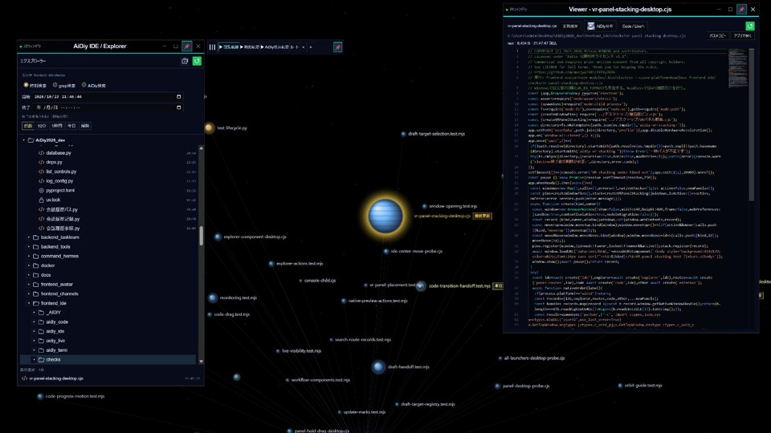

VR本体を選び直した後の画面です。ピン留めしたパネルを見失わず、そのまま使えます。

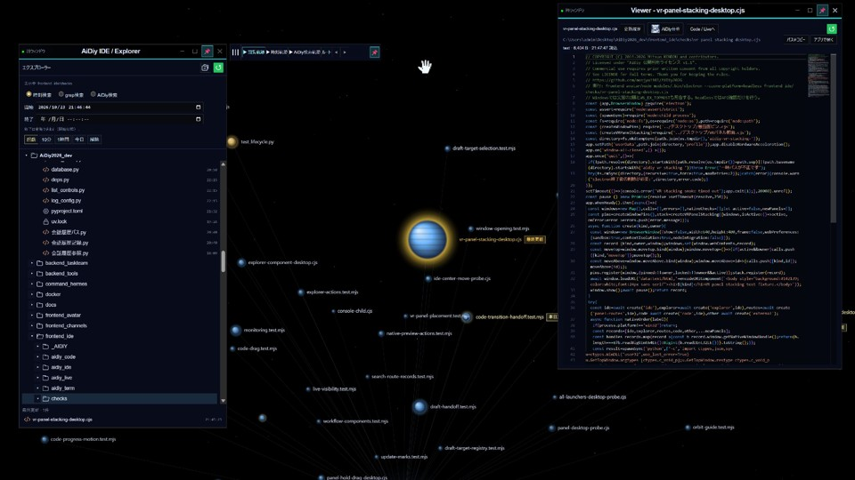

### セルフテスト項目

| ID | 操作 | 期待結果 |
|---|---|---|
| 601 | IDE・Code・Live・Console・独立ビューアのピンON／OFF、他アプリとの前後切替 | 画面内のExplorer・軌跡・ビューアはピンOFF表示、切り離した窓はON表示。各窓を独立して選択できる。Windowsでは実際の最前面状態と画面上の重なりを確認し、アイコン表示だけで合格にしない。フォーカスを奪い合わない。 |
| 602 | ピン窓を非表示後に再表示し、サイズ変更・最大化／復帰 | ピン状態と通常位置・サイズが整合する。拡大率を記録し、何度か往復してずれの累積を確認する。 |
| 603 | 0.5秒長押し移動、短押し、文字選択、Esc取消 | 長押しだけで移動し、入力と選択を妨げない。開始ズームと透明領域を実画面で確認する。 |
| 604 | VRに入り、パネル移動後、復帰ボタン／F11で各2往復 | 現在地・文書・起点・利用状態を保持し、元の位置と寸法に戻る。専用パネルが残存しない。VR前のピン選択を復元する。 |
| 605 | VR中にExplorer／軌跡／ビューア／Code／Live／Consoleを追加し、本体・別アプリ・各パネルを順に選択 | 新規パネルはピンONで固定し、ピンONのパネルがVR本体の背面へ回り込まない。選択済みの本体を再選択しても維持する。複数物理画面がある場合は画面配置変更も確認する。 |
| 606 | 起動・子窓追加・Browser・音声・終了の各段階を連続観察 | 補助PowerShell／cmdの不要な窓が一瞬出ない。意図して開いたConsoleの表示とは分ける。ちらつく場合は発生操作・時刻・起動元を記録し、非表示フラグだけで合格にしない。 |

## 7. 終了と復元

### 操作手順

1. IDE上部の「終了」（Webでは「利用終了」）を押すと、IDEから開いた子窓を閉じて利用開始画面へ戻ります。
2. IDE自体を閉じるときはタイトルバーの×を押します。終了確認の「キャンセル」は利用継続、「終了する」はIDE全体の終了です。
3. 個別に起動した他アプリや共有サービスは、それぞれの終了操作で閉じます。システムを止める手順はDiagのシステム起動編を参照します。

### 成功の見分け方と画面

利用終了では開始画面へ戻り、全体終了ではIDEと所属する子窓が閉じれば完了です。

IDE全体の終了確認です。閉じない場合は「キャンセル」、終了する場合は「終了する」を選びます。

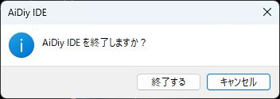

### セルフテスト項目

| ID | 操作 | 期待結果 |
|---|---|---|
| 701 | 子窓と独立パネルを開いたまま、画面内「終了」 | 子窓を閉じ、利用開始画面に戻る。再利用時に古い下書き連携先・購読・端末を残さない。 |
| 702 | タイトルバー×の取消、その後の終了確定 | 取消では作業を継続し、確定ではIDE所有の窓とプロセスを回収する。別途起動したアプリ・共有サービスを巻き込まない。 |
| 703 | 設定・ファイル・サービス状態を実施前と比較 | 試験で変更した設定を戻し、試験専用プロセスを終了する。残す成果物・環境制約を明記する。 |

## 補助検証の対応表

実画面確認を置き換える表ではありません。各スクリプトの実行条件・外部接続・生成物を確認してから使います。

| 領域 | 実装の確認先（`frontend_ide/` 以下） | 既存の補助検証 |
|---|---|---|
| 開始・接続 | `src/App.vue`、`viewer/core-connection.mjs` | `scripts/check-connection.mjs`、`checks/desktop-session.test.mjs` |
| 一覧・監視・操作 | `src/ファイル閲覧/ファイル一覧.vue`、`最新ファイル.js`、`ファイル機能/` | `scripts/check-folder-monitor.mjs`、`check-explorer-menu.mjs`、`viewer/checks/latest.test.mjs` |
| 閲覧・文書・ブラウザ | `src/ファイル閲覧/ファイルビューア.vue`、`デスクトップ/native-preview-actions.cjs` | `scripts/check-office.mjs`、`check-preview.mjs`、`checks/registered-html.test.mjs` |
| 検索・履歴 | `src/ファイル検索/`、`src/開発スペース/` | `scripts/check-ai-search.mjs`、`check-ai-search-live.mjs`、`check-file-history.mjs` |
| 下書き | `src/下書き連携/`、`デスクトップ/draft-router.cjs` | `checks/draft-target-selection.test.mjs`、`draft-handoff.test.mjs` |
| モーション・更新 | `src/開発スペース/`、`src/ファイル閲覧/` | `scripts/check-2d-motion.mjs`、`check-orbit.mjs`、`check-update-marks.mjs` |
| ピン・VR | `デスクトップ/最前面ピン.cjs`、`VRパネル配置.cjs` | `scripts/check-ide-pin-order.mjs`、`check-all-displays.mjs`、`check-panel-desktop.mjs` |

全体のNode試験は `frontend_ide` で `npm test` を使います。ただし `viewer/checks/`、`host/checks/`、実Electron／ブラウザ試験まで含むものではありません。画面試験では実際に読み込んだ配布画面を確認し、必要な更新がある場合だけ、その理由を記録して配布物を作成します。

## 結果・証跡の残し方

実施時に各ケースの結果を本書へ記録し、画像は `images/セルフテスト,aidiy_ide,操作編/IDE_<ID>_<説明>画面.png` に保存します。画像の前に確認内容を書き、長辺960px以内にします。動画的な挙動は途中と完了の画面、時刻・寸法等の計測を組み合わせます。実施日時は本文に記録し、再確認は画像名に `_確認02` などを付けて区別します。

未実施、実画面成功、合成試験成功、機器不足を区別します。全項目の判定を集計して総合評価を更新し、完了後にPDFを生成して全ページを確認します。

## 実施結果（2026年10月23日）

「ピンON」だけを合格条件にしません。全画面の本体をずらして裏を探せないため、開いたパネルを見失わず、そのまま選んで操作できることを確認します。

| 対象 | 結果と確認範囲 |
|---|---|
| Node回帰試験 | `node --test --test-concurrency=4 frontend_ide/checks/*.test.mjs frontend_ide/viewer/checks/*.test.mjs`。**判定対象856件は全件成功。環境依存で判定対象外6件（symlink作成がEPERMとなる4件、Linux専用2件）を総合判定から除外。** 対象外6件は **PASS（環境依存・判定対象外）** とし、実行成功とは区別します。 |
| VRの前面維持（605） | 実Electron窓のWindows Z順とWS_EX_TOPMOSTを照合。Explorer・軌跡・Codeに加え、VR中にViewer・Live・Consoleを追加。11回の選択切替で全パネルが本体より前に残る。新規窓のピン解除不可、フォーカスを奪わないこと、待機中の再配置ループがないことも確認。 |
| VRの移行・復帰（604の一部） | `check-all-displays.mjs`成功。実画面・実Electronで通常／最大化からの移行と寸法復元、Explorer・軌跡の終了・再表示、新規ビューアと比較、Web表示条件を確認。画面は1台、DPI倍率1.875。複数物理画面の配置変更は、PASS（環境依存・判定対象外）（物理画面1台）。 |
| ピン表示（601の一部） | 最新配布物で埋込ExplorerとViewerの灰色OFFを確認。VR中にViewerを切り離し、Explorer・軌跡とともにON表示を確認。本体選択後も3窓を表示。F11で通常画面へ戻り、独立Viewerを維持。 |
| 起動・接続（101、103の一部） | Diagから実プロジェクトのIDE起動、オンライン開始を確認。`check-connection.mjs`で隔離接続先の断線・復帰とセッション保持を確認。実サービスの停止試験とは区別する。 |
| Office等の閲覧 | `check-office.mjs`成功。Word・Excel・PDF・PPT・CSV、ページ移動・倍率・再読込・壊れた文書からの復旧を固定文書で確認。 |
| 検索 | `check-ai-search.mjs`成功。固定AI回答による依頼・結果検証・マーク・軌跡・期限・再確認・古い結果抑制。実AIへの問い合わせ成功とは区別する。 |
| 一覧監視 | `check-folder-monitor.mjs`成功。4画面寸法、手動更新、選択・スクロール保持、自動探索OFF／ON、追加削除・連続更新、階層切替、非表示・3D・利用終了中の監視停止を実時間で確認。 |
| Explorer操作 | `check-explorer-menu.mjs`成功。コピー・複製・名前変更・重複名拒否・新規ファイル／フォルダ・削除取消／確定・ルートへの貼付けを確認。ゴミ箱は隔離フォルダへの移動に置換。 |
| 2Dと3D | `check-2d-motion.mjs`成功。実CSSの途中時刻を固定したページ遷移、操作による中断、階層移動、更新表示、3D復帰を確認。13画面を保存。 |
| ファイル解析UI | `check-file-analysis.mjs`成功。固定結果で保存失敗時の入力保持、閉じた後の保存、結果復元、HTML無効化、画像への指示、縦表示を確認。 |
| 更新履歴 | `check-file-history.mjs`成功。隔離バックアップを使い、読込失敗と再試行、版選択、左右比較、同期スクロール、縦画面、破棄を確認。 |

確認済みの環境制約はPASS（環境依存・判定対象外）とします。Windowsのリンク作成権限不足4件、Linux専用2件、単一画面環境での複数物理画面試験が対象です。OS設定や権限を変更してまで実施する必要はありません。

### 実接続・音声・終了の結果

| 対象 | 最終結果 |
|---|---|
| 実AI検索（306） | 実際のコードAIへ隔離プロジェクトを渡し、main.tsとsrc/login.tsの認証処理・呼び出し順を正しく取得。依頼、結果ファイル、実行終了まで成功。 |
| Liveの正式回答と音声出力（406） | 通常AIコアへ本番のLiveConnectionで接続し、正式回答と43音声パケット（156,800バイト）を受信。さらに実Electronで本番LiveAudioを用い、133パケット（329,600バイト）を再生し、Analyser出力レベルの最大値1を確認。人による聴取確認ではなく、実再生APIと出力信号の確認。 |
| 実マイク入力（406） | WinMMの入力デバイス0台、出力デバイス1台。実入力・音声認識はPASS（環境依存・判定対象外）（入力機器なし）。模擬入力の成功と混同しない。 |
| コンソール非表示（606） | Python実子プロセス11試験、Node実子プロセス・GUI形式2試験が全件成功。Windowsの表示イベントを120秒間監視し、ConsoleWindowClass等の表示イベント0件。観測区間の結果であり、将来の全操作で瞬間表示が絶対にないという保証ではない。 |
| 別窓と終了（101、102、701、702） | 実Electronでオフライン／オンライン、複数Code、単一Live、再表示、利用終了後の子窓・子サーバー終了を確認。撮影APIでDXGI警告が出たが、最終試験は終了確認まで成功。 |
| Browser（304、603、604、701） | 実ElectronでGoogle、HTML/HTM、相対資産、登録画面、特殊名パス、戻る／進む、MCP操作、VR内起動、利用終了時の解放を確認。入力欄・リンクは長押しでも窓を動かさず、本文は移動できる現行仕様で成功。 |
| 入力とドラッグ（603） | 本番Vue画面による入力保持、短押し、長押し演出、送信を確認。窓移動IPC部分を模擬した試験は、実ElectronのBrowser長押し試験と区別する。 |

今回の完了範囲は上記の回帰・実機・実接続試験です。前半の39ケースは再利用する詳細手順であり、全行の全条件を人手で実施したという集計にはしません。試験方法と環境対象外を含む実施範囲は、結果表を正とします。

Liveは **✅ OK** です。正式回答と音声の受信・再生を確認しました。

**注意：** 音声の確認にはOpenAIを使用します。FreeAIは利用枠の影響を受けるため、この試験の使用プロバイダには含めません。新規接続は「会話準備ができました」を確認して15秒待ち、送信します。

