# IDE 操作編 — 総合テストと操作手順書素材

> 文書: `セルフテスト,aidiy_ide,操作編.md` | 実装: `frontend_ide/src/App.vue`, `frontend_ide/src/開発スペース/`, `frontend_ide/src/ファイル閲覧/`

## 総合評価

**総合評価：✅ OK (PASS 2件含む)。閲覧・検索・AI連携・VR復帰・表示モーションの試験を通過しました。**（2026年10月19日・Windows）

IDEは、プロジェクトのフォルダやファイルを見ながら、Code・Liveへ作業を頼む画面です。VRモードでは、その宇宙表示をディスプレイ全体に広げます。

| 知りたいこと | 現在の結果 |
|---|---|
| 基本の閲覧やAIとのやり取りはできる？ | ✅ OK：接続利用・オフライン利用、3D／2D切替、日本語文書の閲覧、Code・Liveの文字の返答、終了確認を確認しました。 |
| VRから元の画面へ戻れる？ | ✅ OK：右上の復帰ボタンとF11の両方で戻れました。幅が増える不具合は修正済みで、再試験では位置・サイズが完全一致しました。 |
| 巡回を待つ間も画面は動く？ | ✅ OK：自動探索ONでは、手動操作後の待機中も約3分で1周します。ボタン上で航行状態も確認できます。実ブラウザーと仮想時計で確認しました（6章）。 |
| 2Dのページ繰りも動く？ | ✅ OK：初期表示、最終更新欄・エクスプローラーからのファイル選択、戻る操作のページ切替を確認しました（6-3）。 |
| 追加試験は？ | ✅ OK：履歴・文字検索・実AI検索・画像・Office文書・VRパネルの保存位置・F11・長押しとズームを確認しました。音声は実応答WAVの内容を認識して照合しました。 |

**PASS (別途環境調整必要) は2件**です。マイク入力機器が0台のため実マイク入力、物理ディスプレイが1台のため複数画面配置を、この判定にしました。不具合を確認した結果ではありません。人の耳での聴取は行わず、音声ファイルの認識と再生APIで確認しています。

[PDF版](../../output/pdf/セルフテスト,aidiy_ide,操作編.pdf)を作成しました。Mac／Linuxは別途実機確認を推奨し、今回の完了条件には含めません。「動きを減らす」への専用対応は追加せず、既存の演出省略処理が混じっていないか点検しました（6-4）。

## この冊子の進め方

[システム起動編](./セルフテスト,aidiy_diag,システム起動編.md) → [アプリ起動編](./セルフテスト,aidiy_diag,アプリ起動編.md)でIDEを開いてから始めます。

1〜4章は「利用開始 → ファイル閲覧 → AIとの会話 → 終了」の機能試験です。銀河表示の周回・探索航行・状態表示は、末尾の6章でまとめて確認します。VRを使わない場合は、1章の追加操作を飛ばして2章へ進みます。

| 表示・用語 | 意味 |
|---|---|
| プロジェクト | 今回作業するフォルダです。 |
| 3D／2D | 宇宙のような立体表示／一覧の表示を切り替えます。初めてファイルを探すときは2Dが追いやすい表示です。 |
| エクスプローラー／Explorer | フォルダやファイルを一覧でたどるパネルです。 |
| ビューア | 選んだファイルの中身を読む欄です。ここでは編集できません。 |
| 軌跡 | これまで閲覧・検索した場所の履歴です。 |
| 子ウィンドウ | IDEの「＋ Code」などから開いた、IDEに属する別ウィンドウです。 |

画像の名前や日時は試験時のものです。自分が選んだフォルダと見比べてください。**✅ OK** は確認済み、**⏸ 未実施** は未確認です。

## 1. 利用を開始する

### 操作手順

1. 開いているIDEの開始画面で、表示されたプロジェクト名を確認します。
2. AIへ接続して使う場合は「AiDiy接続利用」を押します。通信せずにファイルを読む場合は「オフライン利用」を押します。
3. フォルダやファイルを宇宙のように表示する作業画面が出るまで待ちます。接続利用では、上部の「接続済み」も確認します。
4. 試験中に表示場所が自動で変わらないよう、右下の「自動探索」をOFFにします。
5. 上部の「3D」「2D」で表示を切り替えられます。ファイルを読む操作は2章へ進んでください。

### 成功の見分け方

接続利用ではTerm・Code・Live、オフラインではTerm・Codeを開けます。一時的に通信が切れても、作業画面や子ウィンドウは維持されます。

### 今回の結果と画面

**✅ OK（接続利用）**：「AiDiy接続利用」を押すと「接続済み」となり、選んだプロジェクトの3D画面が出ました。自動探索をOFFにして、その後の操作を試しました。2Dで読む試験は2章に掲載しています。

IDEの利用開始前です。プロジェクトを確認し、接続利用かオフライン利用を選びます。

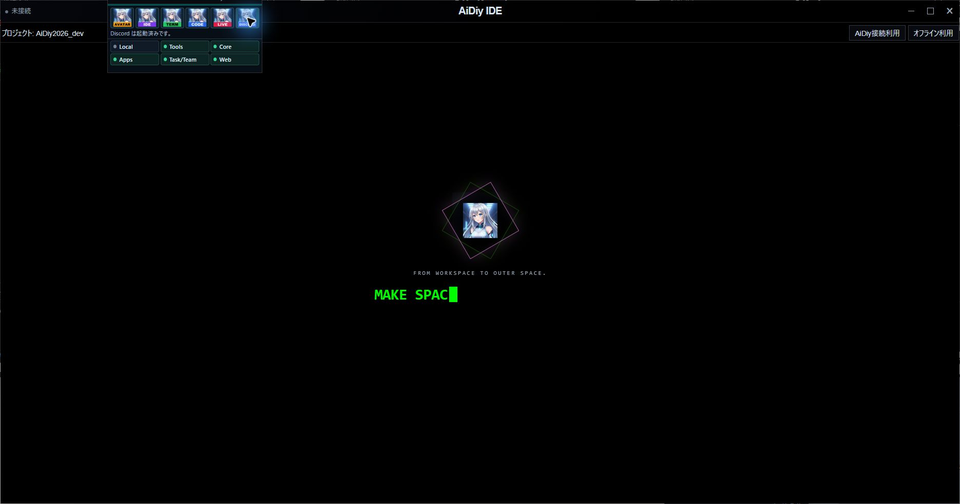

接続利用を開始した3D画面です。上部に「接続済み」と表示されています。

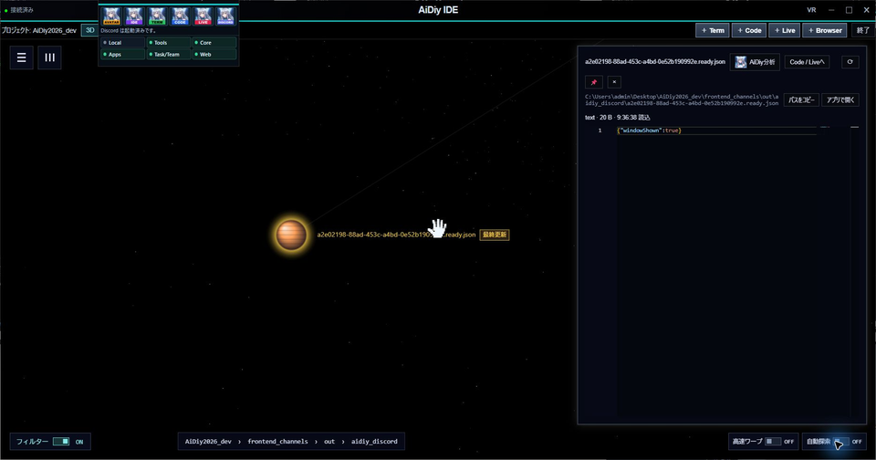

**✅ OK（オフライン利用）**：接続利用を終了してから「オフライン利用」を押すと、未接続のまま3D画面を使えました。Liveの起動ボタンは表示されず、Browser（別のブラウザ画面）のボタンは押せない状態でした。

オフライン利用の画面です。3D表示は使えますが、Liveは表示されず、Browserは無効です。

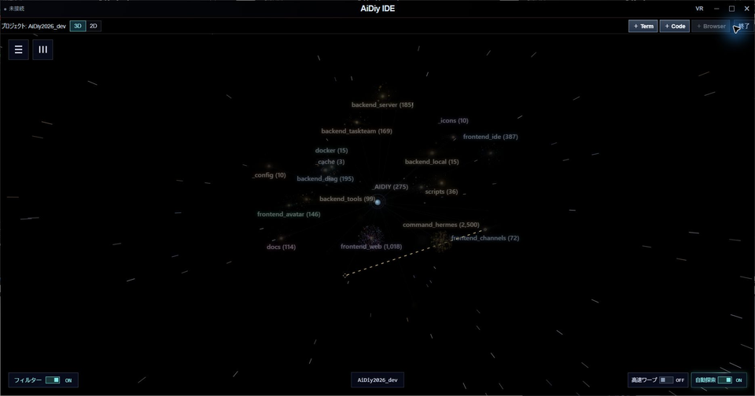

### VRモードへの移行と通常画面への復帰

デスクトップ版の3D画面で試します。VRは宇宙表示を画面全体へ広げる機能です。

**✅ OK**：復帰ボタンとF11で戻れます。幅が増える問題は修正済みです（再試験は1-D）。

#### 1-A. 通常画面を確認してVRへ移行する

1. 上部で「3D」を選び、右下の「自動探索」をOFFにします。表示中のフォルダ名を控えます。ファイル表示の保持も試す場合は、2章の手順で公開してよい文書を1つ開いておきます。
2. タイトルバー（一番上の帯）の右側にある「VR」を押します。
3. 「VR空間へ移行中…」が消えるまで待ちます。
4. 宇宙表示が画面全体に広がり、通常の上部操作バーが隠れ、Explorerと軌跡が別パネルで出れば移行完了です。

**✅ OK**：接続済みの3D画面でファイルを開いてから、VRへ移行しました。同じファイルを引き続き読めて、Explorerと軌跡の専用パネルも表示されました。VR中のこの2パネルには、閉じる×は出ません。今回開いていたファイルは `backend_diag/static/build-manifest.json` です。

VRへ移る前の通常画面です。表示中のファイルと、自動探索OFFを比較の基準にしています。

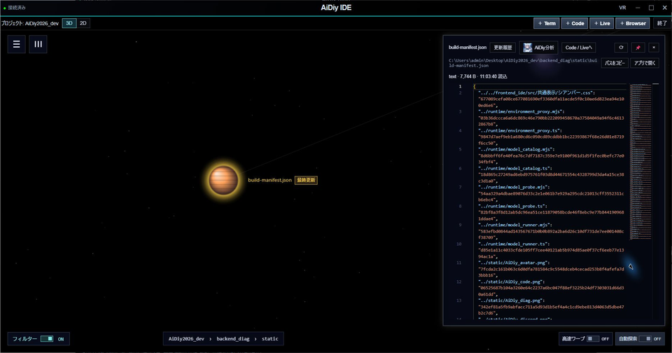

VRへ移行した画面です。宇宙表示が広がり、Explorerと軌跡が別パネルで出ています。

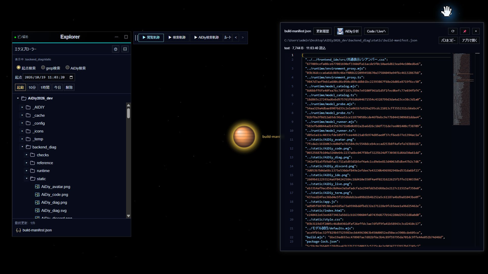

VR中のExplorerです。表示フォルダと、更新ファイルを探す基準日時「起点」を確認しています。

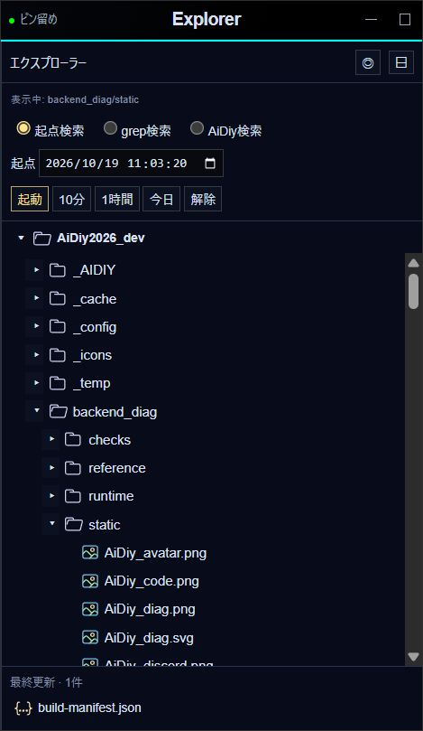

VR中の軌跡パネルです。閲覧・検索・AiDiy検索の履歴を切り替える入口が表示されています。

#### 1-B. 右上のボタンで通常画面へ戻る

1. 画面の一番右上へマウスポインターを移します。重なった四角の復帰ボタンが現れます。キーボードではTabで次、Shift+Tabで前のボタンへ移動し、復帰ボタンに枠が付くと表示されます。
2. 重なった四角のボタンを押します。
3. 通常のタイトルバーと操作バーが戻り、Explorerと軌跡の別パネルが閉じるまで待ちます。
4. 左上の☰（エクスプローラー）と、その隣の軌跡ボタンを押します。同じフォルダ・選択ファイルが残っているか確認します。「起点」は更新ファイルを探す基準日時なので、その値も比べます。

**✅ OK**：TabとShift+Tabで復帰ボタンを表示して押すと、通常画面へ戻りました。Explorerと軌跡の別パネルは閉じましたが、開いていたファイル、「接続済み」、自動探索OFFは変わりませんでした。

パネルを再表示すると、`backend_diag/static`の開き方、`build-manifest.json`の選択、起点の日時 `2026-10-19 11:03:20` も残っていました。

右上の復帰ボタンにキーボードで移動した画面です。重なった四角のボタンが表示されています。

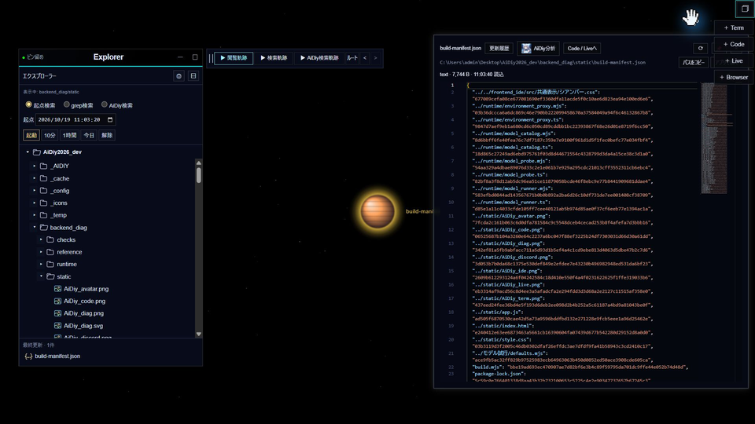

復帰ボタンで戻った通常画面です。上部の操作バーが戻り、同じファイルを表示しています。

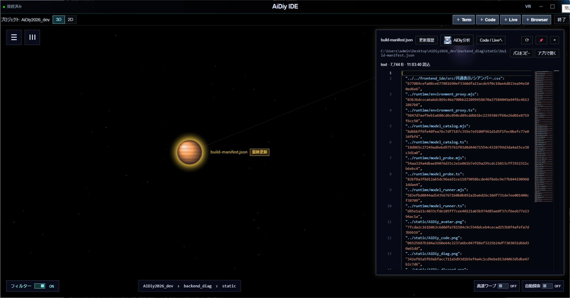

通常画面でExplorerと軌跡を開き直した状態です。フォルダの展開やファイル選択が残っています。

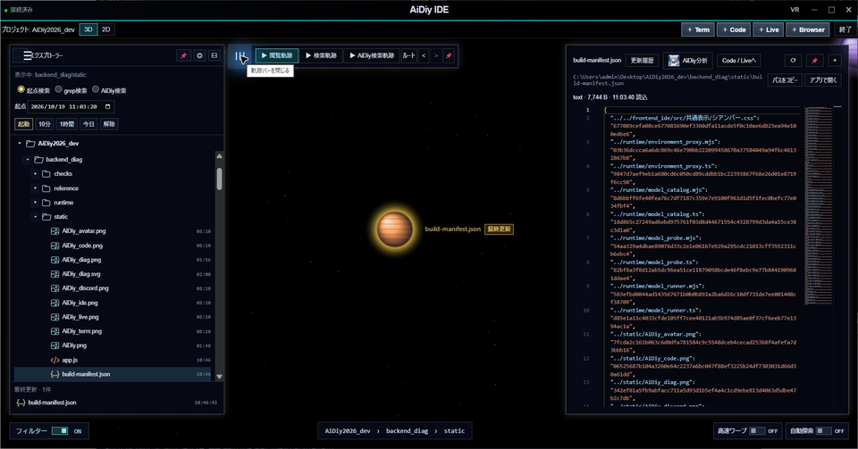

#### 1-C. 再度VRへ移行し、F11で戻る

1. 通常画面の「VR」をもう一度押し、移行中の表示が消えるまで待ちます。
2. IDEのメイン画面を操作している状態で、キーボードのF11を押します。
3. 通常のタイトルバーと操作バーが戻り、同じフォルダや開いていたファイルが残っていれば復帰成功です。

**✅ OK**：もう一度VRへ移行しても、専用パネルが表示されました。F11を押すと通常3Dへ戻り、現在地・開いていたファイル・接続状態も変わりませんでした。試験後は通常3DでIDEを開いたままにしました。

2回目のVR移行です。Explorerと軌跡の別パネルが再び表示されました。

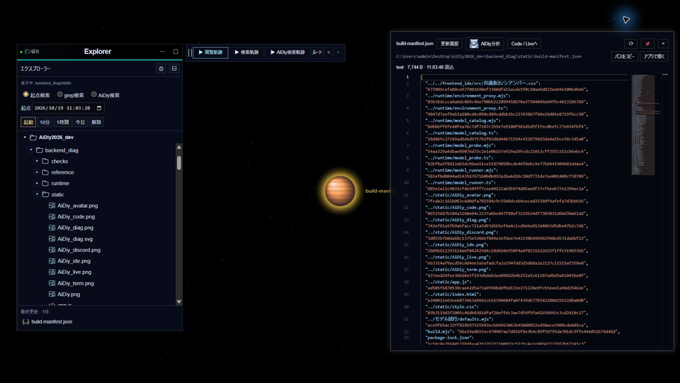

F11で戻った通常画面です。現在地とファイル表示、接続状態が保たれています。

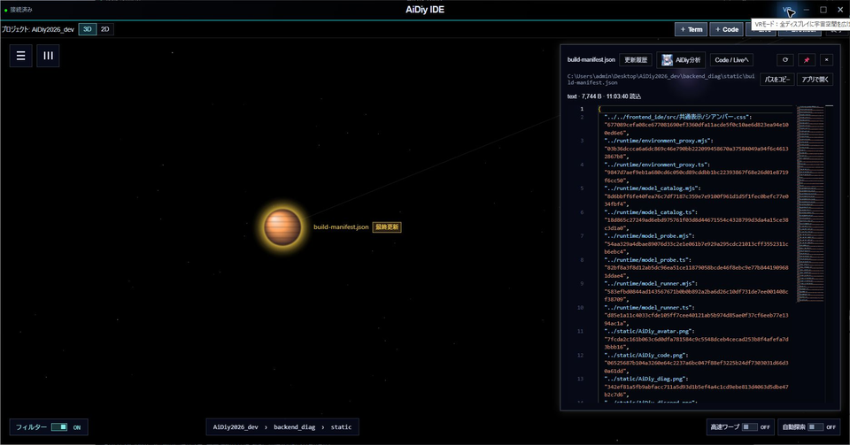

**修正前の記録（解消済み）**：最初の試験では、VRから戻るたびに画面の幅が少し増えました。Windowsの表示拡大率125%で寸法が丸められることが原因でした。実際の大きさを確認しながら補正するよう直した結果を、次項に示します。

#### 1-D. 修正後に位置・サイズが変わらないことを再試験する

1. IDEを終了し、Diagの「アプリ起動」から修正版を開き直します。接続利用を開始し、「自動探索」をOFFにします。
2. 通常3D画面を撮影し、幅・高さ・画面左上からの位置を記録します。
3. VRへ移行してF11で戻り、同じ方法で撮影して比べます。
4. もう一度VRへ移行します。今度は右上の復帰ボタンで戻り、同じ比較を行います。

**✅ OK（修正後）**：画面を実際に操作するComputer Useで2往復しました。撮影した画面は、幅・高さ・左上からの位置がすべて移行前と一致しました。接続と現在地も維持され、Explorer・軌跡の別パネルは復帰時に閉じました。幅が増える問題は解消済みです。下表のpxは、画像の大きさを数える単位です。

| 比較時点 | 撮影した画面の幅×高さ（px） | 画面左上からの位置（横,縦） | 判定 |
|---|---|---|---|
| 移行前 | 1870×981 | (26,26) | 基準 |
| F11による1回目の復帰 | 1870×981 | (26,26) | ✅ OK |
| 右上ボタンによる2回目の復帰 | 1870×981 | (26,26) | ✅ OK |

修正後の再試験を始める画面です。幅1870px・高さ981pxと、画面上の位置を基準にします。

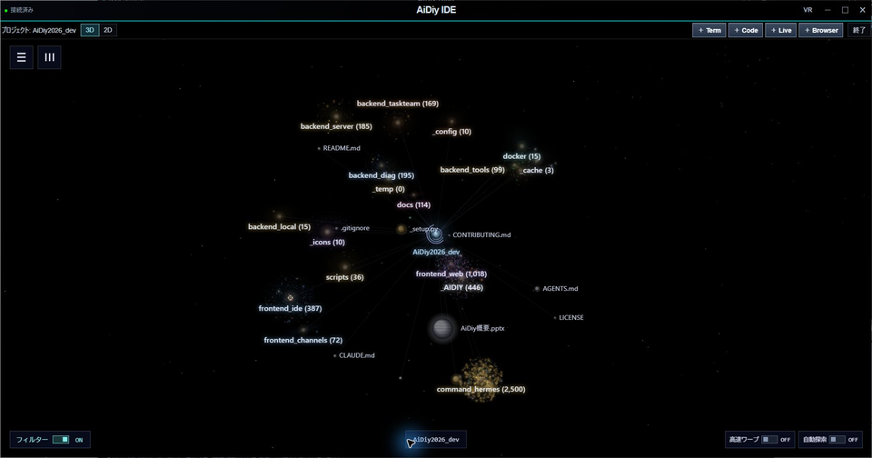

修正版でVRへ移行した画面です。全画面の表示と、専用パネルの表示を確認しています。

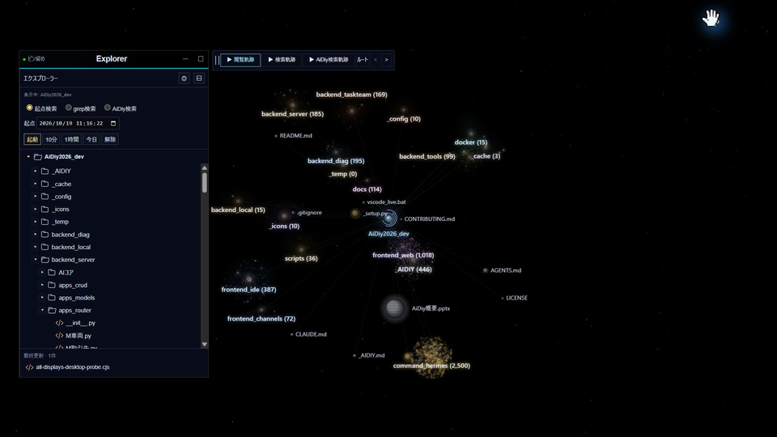

修正後にF11で戻った画面です。幅・高さ・位置が、移行前と完全に一致しました。

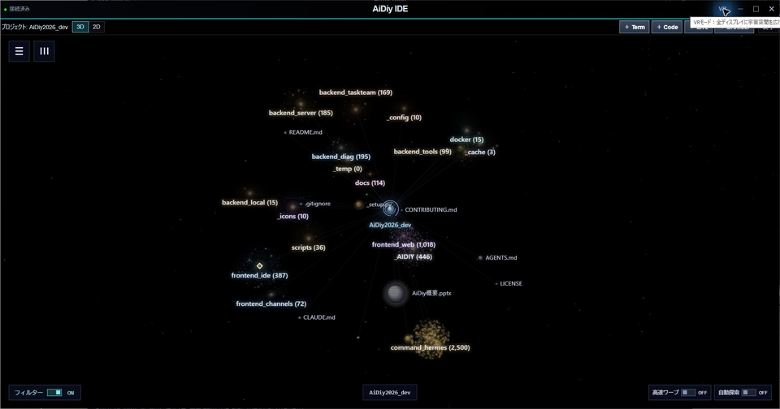

修正後の2回目のVR移行です。今度は右上の復帰ボタンで戻ります。

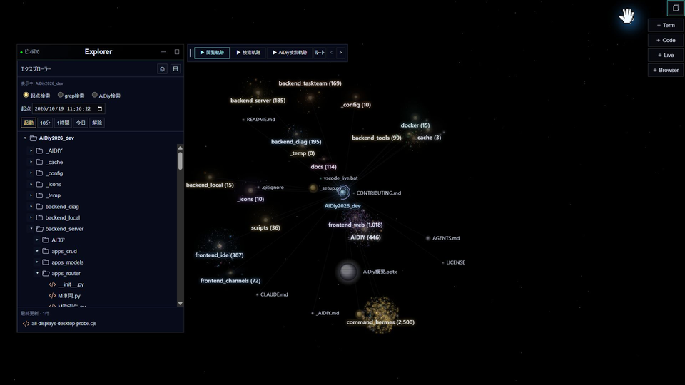

右上のボタンで戻った画面です。2回目も幅1870px・高さ981pxと元の位置を維持しました。

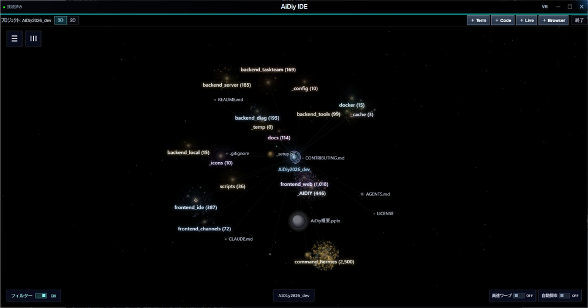

試験担当者向け：内部の寸法確認と再試験データ

Electronはデスクトップ画面を動かす仕組み、DIPは表示拡大率を考慮した寸法の単位です。回帰テストは、修正後も以前の機能が動くかを繰り返し確かめる試験です。

実Electronの隔離試験でも、5往復すべてで通常窓の位置・サイズは横21・縦21・幅1496・高さ786 DIPに一致しました。回帰テストは52件成功、失敗0件でした。

実Electronの補助試験で撮影したVR中の上端です。5往復の寸法結果は、直前の検証データに記録しています。

### 1-E. F11と移動したパネルの位置を追加確認する

**✅ OK**：実ElectronでIDE本体とExplorerの両方からF11を押し、元の位置・サイズへ戻りました。Explorerを動かした後、VRパネルを作り直しても保存位置へ戻り、移動し直した位置も反映されました。

VRパネルを再表示し、保存した位置へ移動している途中です。OSのウィンドウ座標でも到着を確認しました。

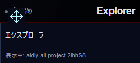

Explorer側からF11でVRを解除した後です。通常画面の位置と大きさが復元されました。

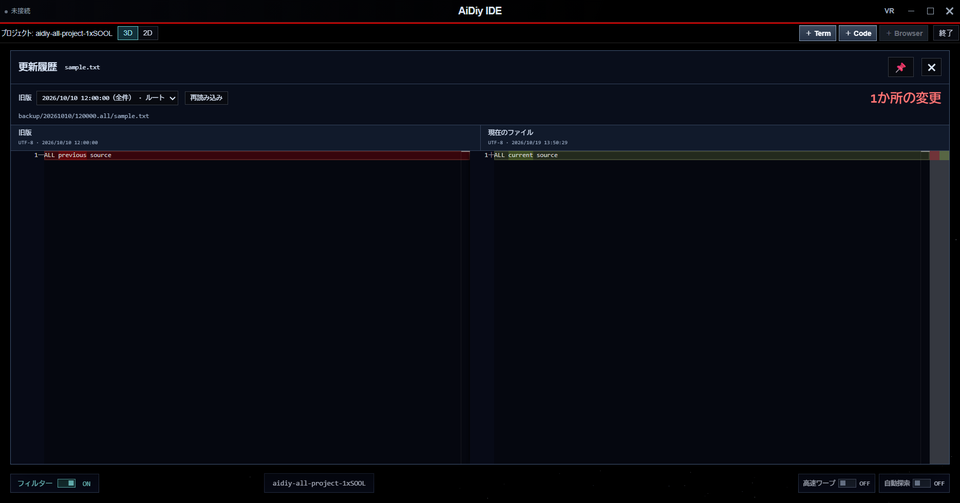

VR中のパネルは画面内に収まり、通常表示へ戻しても位置が累積してずれないことを確認しました。物理画面は1台なので、複数画面への配置は **PASS (別途環境調整必要)** です。

試験担当者向けの補足：VR中は画面の文字情報を自動で読み取れなかったため、撮影画像で確認しました。通常画面へ戻ると文字情報も読み取れました。

## 2. フォルダとファイルを読む

### 操作手順

1. 上部の「2D」を押して一覧表示にします。
2. 左上の☰（横線3本のボタン）を押し、エクスプローラーを開きます。
3. フォルダの左の三角を押すと、その中の一覧が開きます。見たいファイル名を押します。試験にはREADME.mdなど公開してよい文書を使います。
4. 右側のビューアに、選んだファイルの名前と中身が出ることを確認します。Markdownは見出しや文章を書ける文書形式で、「表示」では整えた見た目、「コード」では元の文字を読めます。
5. 表示している場所を戻す場合は、画面内のフォルダ名の並び（パンくず）を使います。プロジェクト名を押すと一番上のフォルダへ戻れます。
6. ビューア右上の×でファイル表示を閉じます。同じフォルダの一覧が残っていれば正常です。タイトルバーの×はIDE全体を閉じます。ファイル表示だけを閉じる場合は、ビューアの×を使います。
7. 閲覧履歴を試す場合は軌跡バーを開き、「閲覧軌跡」から直前のファイルを選びます。検索を試す場合は、エクスプローラーの「grep検索」（文字で探す）や「AiDiy検索」を使い、結果からファイルを開きます。検索結果からの移動と、履歴からの再表示を確認しました（2-3〜2-5）。

### 成功の見分け方

選んだファイル名とビューアの名前・内容が合っていることが成功の目印です。ビューアは読むための画面なので、ここでは編集入力を行いません。同じファイルを選び直したり表示を閉じたりしただけで、別のフォルダへ移動しないことも確認します。

### 今回の結果と画面

**✅ OK**：2Dでプロジェクトの一番上のフォルダへ戻り、`AGENTS.md` を開きました。日本語の文書を整えた見た目と、元の文字の両方で読めました。ビューアを閉じても同じフォルダの一覧が残りました。ファイルの編集はしていません。

2Dでプロジェクトの一番上を表示した画面です。フォルダとファイルを一覧で確認できます。

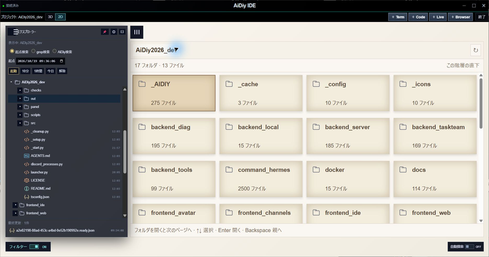

日本語文書を整えた見た目で表示しています。見出しや本文を読めることを確認しました。

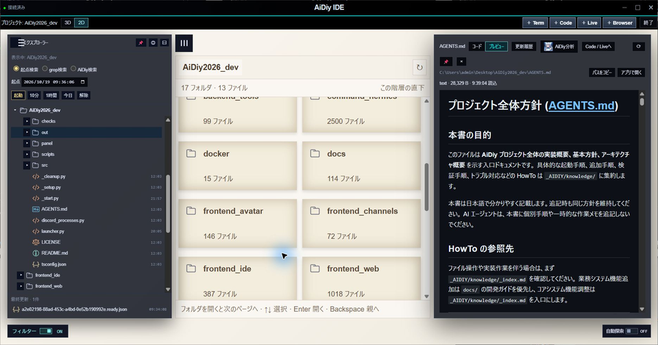

同じ文書をコード表示へ切り替えた画面です。元の文字を読み取れます。

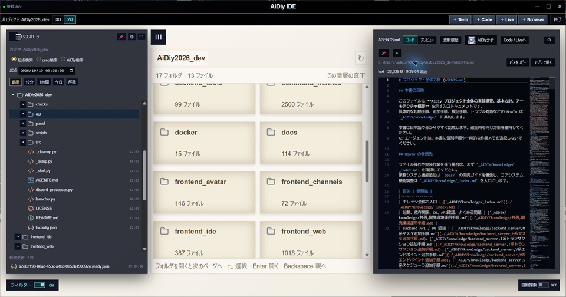

ビューアを閉じた後です。同じフォルダの一覧が残っています。

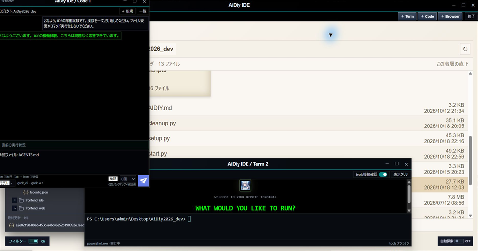

**✅ OK（追加試験）**：文字検索・AiDiy検索・履歴、画像・Word・Excel・PDF・PowerPoint、バックアップ版とのソース比較まで確認しました。詳しい操作と結果は2-3〜2-5です。

### 2-1. 横画面とVRのビューア配置を確認する

通常の横長画面では、ビューアとエクスプローラーの上端・下端をそろえます。VRでは中心星の横に表示し、右上の復帰・アプリ起動領域を避けます。

**✅ OK（2026年10月19日・Windows／実Electron）**：通常横画面の3サイズ、比較パネル、VR表示と復帰を確認しました。通常表示ではExplorerとの上下端の差は0、操作領域との重なりも0件でした。

1. 横長の画面でエクスプローラーとファイルを開き、左右のパネルの上下端を確認します。
2. VRへ切り替え、中心星の横にビューアがあり、右上の操作ボタンと重ならないことを確認します。
3. 通常表示へ戻り、再び左右の上下端がそろうことを確認します。

小さな横画面でも、左右のパネルの上端・下端がそろいます。ビューアだけに追加していた上下16pxの余白は取り除きました。

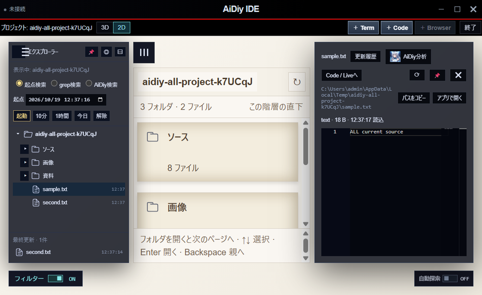

VRでは中心星の横という配置を維持します。右上の操作領域と下端には余白を残します。

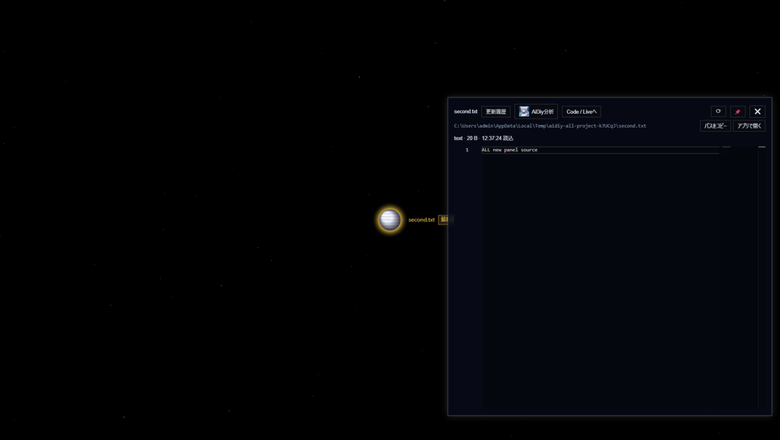

VRから戻った画面です。ファイル表示を維持し、Explorerと同じ上下端に戻っています。

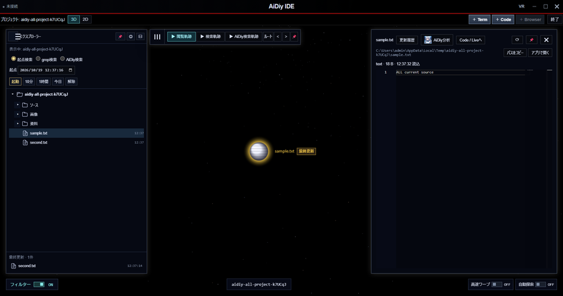

試験担当者向け：比較パネルと測定結果

通常表示のソース比較も、エクスプローラーと上下端をそろえます。

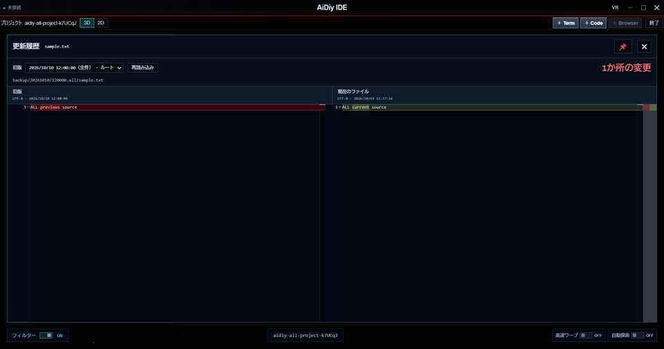

VRの比較パネルは、ビューアと同じく右上の操作領域を空けます。

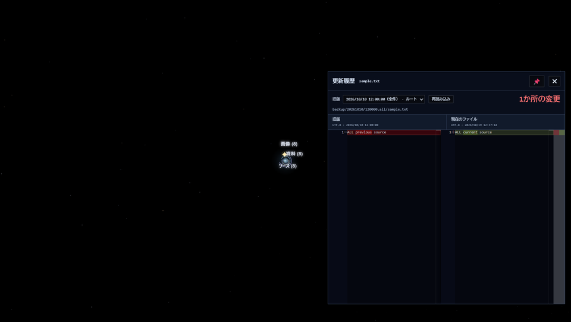

隔離した実ElectronをWindowsの1画面で実行しました。通常表示は約1495×784・900×552・1280×720で確認し、上端78・下端余白約60でした。Explorerとの差は上下とも0です。VRは表示領域1540×867で上端192・下端余白約48、中心星の右を基本に画面内へ収まりました。数値はCSS上の寸法です。複数画面は別途確認します。

通常表示3サイズ・比較パネル・VR復帰の測定結果は上記のとおりです。10枚の確認画像と、修正前の配置の記録も補助資料として保持しています。

### 2-2. 閉じる×を確認する

**結果：✅ OK（2026年10月19日・Windows／隔離Chrome）**

1. ファイルを開き、右上の×が見やすいことを確認します。
2. ×を押してビューアを閉じます。3D・2Dの両方で確認します。

3Dでは、ファイル名の右側にある×でビューアを閉じます。本文の小さな文字サイズに影響されず、線がはっきり表示されます。

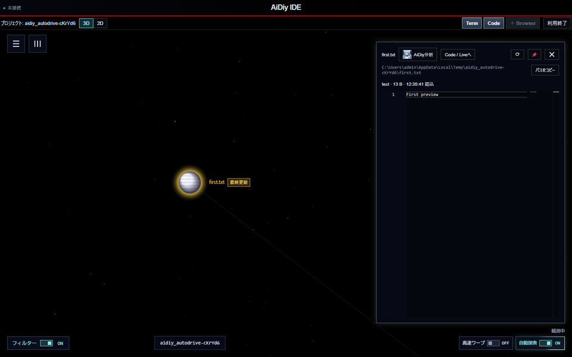

2Dでも同じ大きさ・太さです。どちらもクリックで閉じられることを確認しました。

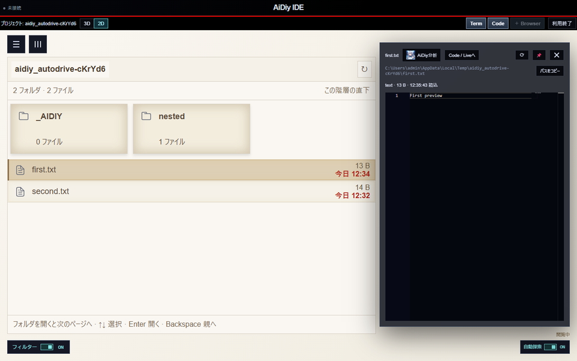

タイトルバー・履歴・分析・Liveのモデル選択・Web版のパネル・案内・Codeの添付解除も、同じ線の印を使います。これらはコード確認、ビューアは実画面と操作で確認しました。関連する既存テスト101件も通過しています。

### 2-3. 検索結果と履歴からファイルを開く

1. Explorerの「grep検索」を選び、ファイル内の文字を入力して「検索」を押します。
2. 結果を押し、ファイル名と行の位置が一致するか確認します。
3. 「AiDiy検索」では、探したい内容を文章で依頼します。結果の目印からファイルを開きます。
4. 軌跡の閲覧履歴やAiDiy検索の履歴から、以前のファイル・結果を選び直します。

**✅ OK**：実Electronで日本語の一致行を開けました。検索画面の自動試験では履歴の再選択・再読込後の保持・削除取消・期限切れからの再確認も通過しました。画面試験のAI回答は固定データですが、別の実接続試験でも2ファイルの認証処理を実AIが検索できました。

日本語の「総合テスト検索印」で検索した結果です。検索確認.txtの2行目に一致し、結果から同じ行を選択できました。

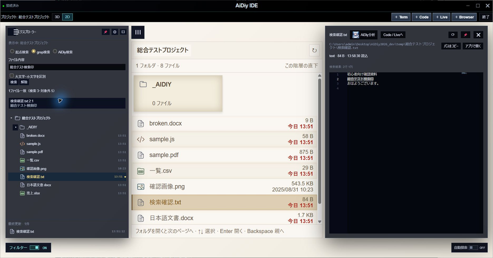

検索画面の自動試験です。受け取った2件の結果に目印を付け、結果を押したときだけファイルへ移動しました。

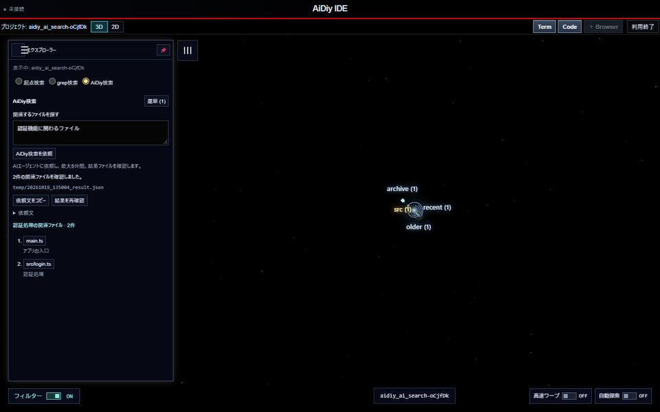

閲覧軌跡で以前のファイルを選び直した画面です。同じファイルを開き、通ったフォルダもツリーで表示しています。

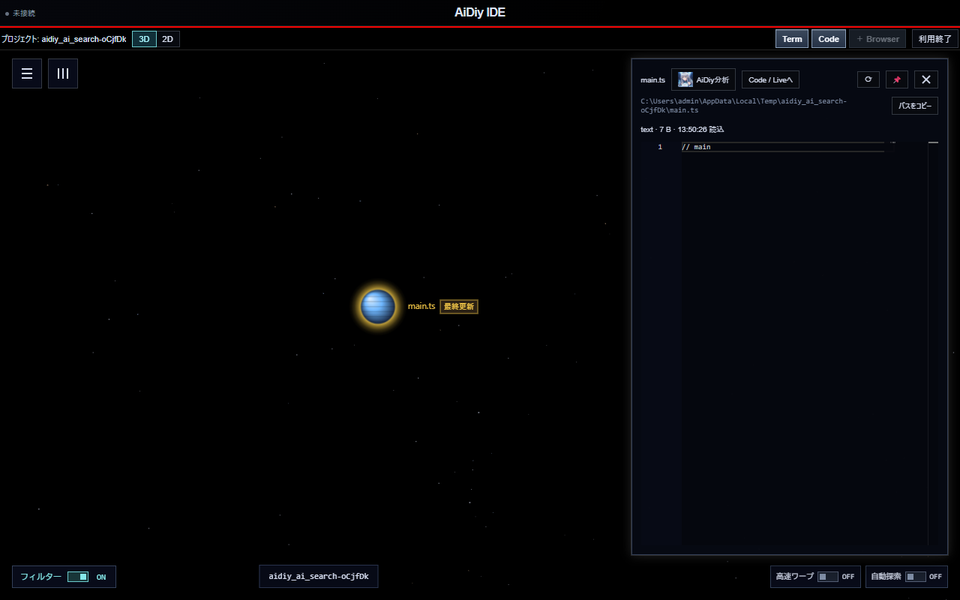

以前のAI検索結果を履歴から選んだ画面です。目印と軌跡が戻り、再読込後も選択を保ちました。

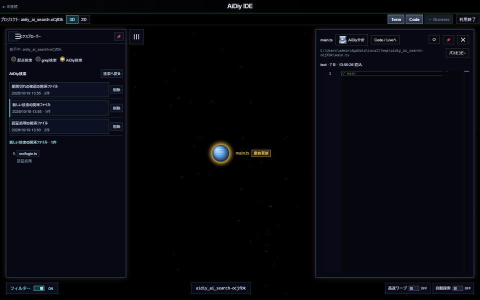

### 2-4. 画像とOffice文書を読む

1. Explorerから確認したいファイルを選びます。
2. 画像は表示内容、文書は日本語の本文を確認します。
3. 文書の「次へ」「前へ」でページを移り、倍率やシートも切り替えます。
4. 別ファイルを選び直し、正常に表示が切り替わるか確認します。

**✅ OK**：実ElectronでPNGと日本語Wordを表示しました。実ブラウザの追加試験では、Wordの2ページ、Excelの計算結果3600・結合セル・205行のページ送り・シート、CSV、PDF、PowerPointのページ送りと倍率を確認しました。文書用の不足パッケージは依存関係を再導入し、表示を再試験しました。

Explorerから選んだPNG画像です。右のビューアへ画像が表示されました。

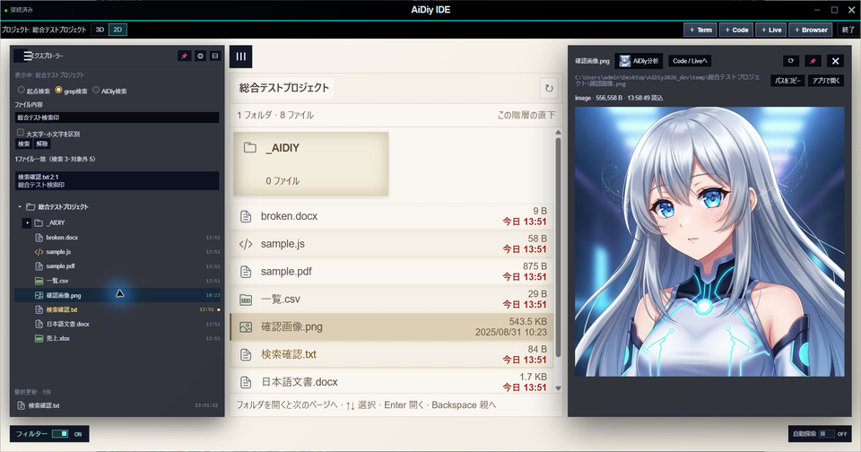

実際にDiagから起動したIDEでWordを開きました。日本語の見出しと「1 / 2」を確認できます。

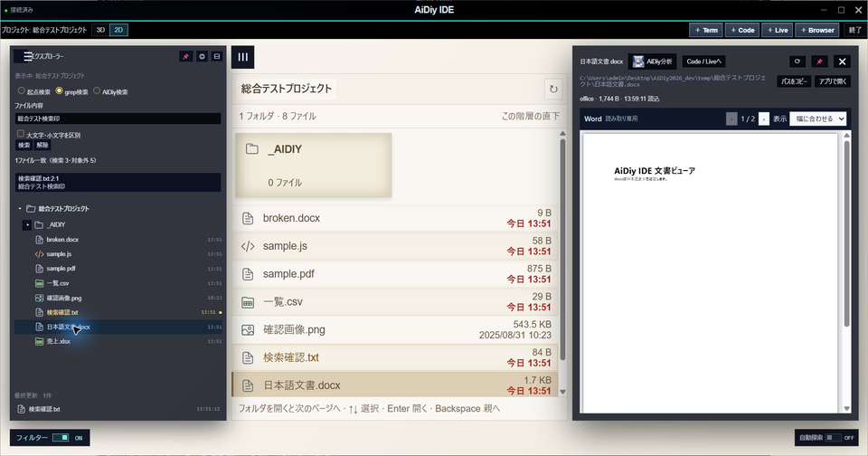

ページを送った自動試験の画面です。Wordの2ページ目の本文と「2 / 2」に変わりました。

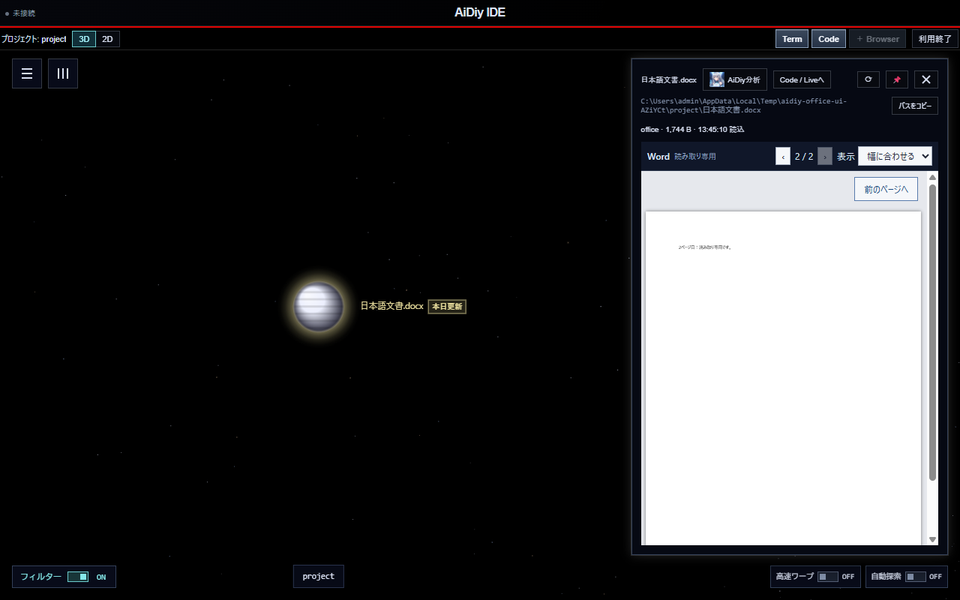

Excelの表を開いた画面です。保存済みの計算結果3600が表示され、シートとページも切り替えられました。

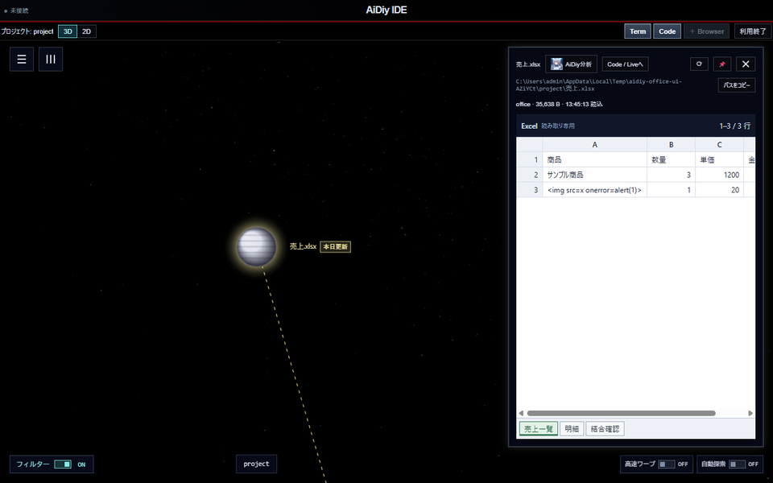

PDFの1ページ目を表示しています。次のページへ送ると内容が変わり、200%表示にも切り替えられました。

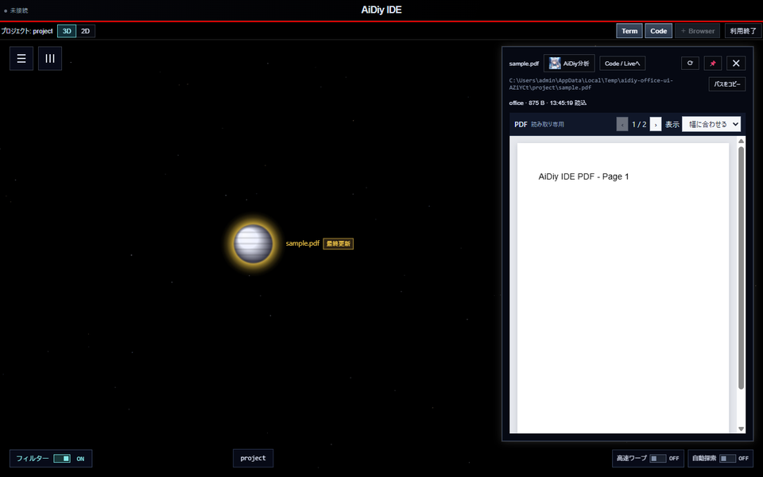

PowerPointのスライドです。次のスライドと150%表示への切替も通りました。

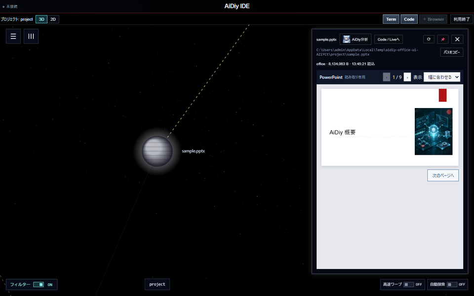

試験用に壊した文書を開くと、理由を表示しました。その後、正常なWordへ戻すと読める状態に復旧しました。

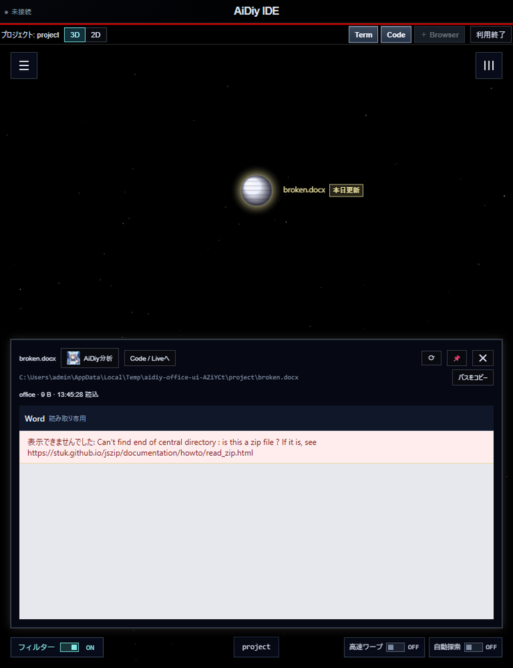

### 2-5. バックアップ版と現在のソースを比較する

ファイルの履歴で日時を選び、以前の内容と現在の内容を比べます。左が以前、右が現在です。比較欄は読み取り専用です。

**✅ OK**：日時の切替・同じ内容の版・履歴のないファイル・再取得を確認しました。左右の差分行とスクロールが対応し、縦画面でも比較できました。試験用の隔離バックアップを使い、実際の `backup/` は参照していません。

以前の版と現在のソースを左右に並べています。変更した行と、左右のスクロール位置を比較しました。

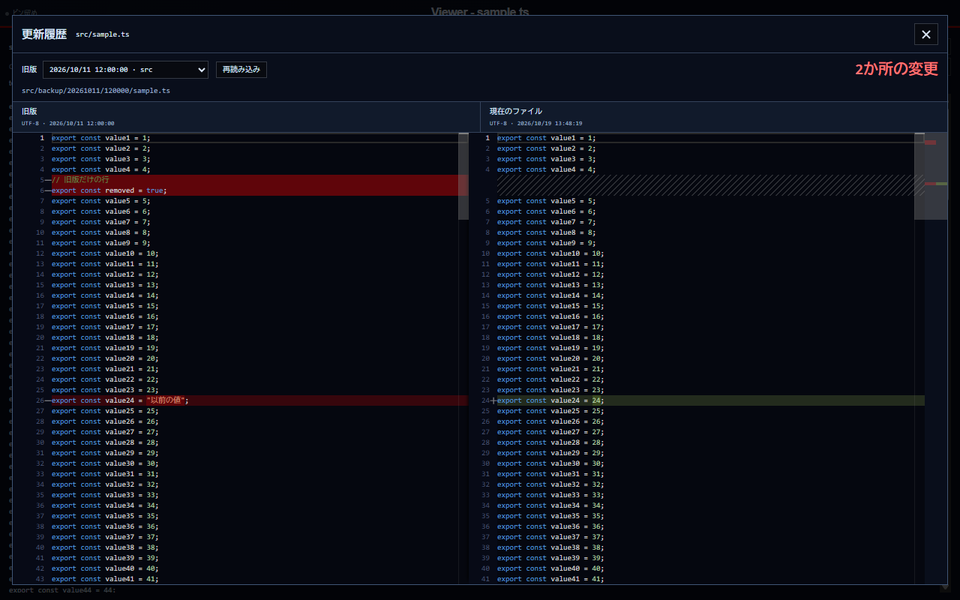

## 3. Code / Live / Term を使う

### 操作手順

1. 接続利用中のIDE上部で「＋ Code」を押します。開いた別ウィンドウが同じプロジェクトを使っていることを確認します。
2. 使うAIのモデル名を確認し、入力欄に次の文を入れて送信します。

> おはよう。稼働試験です。挨拶を一文だけ返してください。ファイル変更やコマンド実行はしないでください。

3. 自分の入力に続いて、AI側の新しい返答が出るまで待ちます。長い返答は時間がかかるため、進行表示を見ながら待ち、エラーが出たらその文を記録します。
4. IDEへ戻り、「＋ Live」を押します。「接続済み」と会話の準備完了を確認してから、初回だけ15秒程度待ち、同じ挨拶を文字で送ります。再接続や「新しい会話」の後も初回として待ちます。
5. Liveの文字の返答を記録します。マイクの入力や声の聞こえ方は別の確認項目です。
6. IDEへ戻り、「＋ Term」を押します。同じプロジェクトの端末が開き、文字を入力できる待機表示（プロンプト）が出ることを確認します。今回のComputer Use試験では、端末へコマンドは入力しません。
7. ファイルの連携を試す場合は、2章で文書を開き、ビューアの「Code / Liveへ」を押します。起動中のCodeを選び、入力欄の下書きに参照ファイルが追加されることを確認します。確認だけなら送信しません。

### 成功の見分け方

IDEから開いた別ウィンドウが、同じプロジェクトを使っているか確認します。CodeとLiveではAIの返答が出れば、文字会話の確認ができます。ログインなど、人の操作が必要な画面で止まった場合は、その先は未実施として記録します。

### 今回の結果と画面

**✅ OK（Code）**：「＋ Code」で同じプロジェクトの「AiDiy IDE / Code 1」が開きました。挨拶を送ると、「おはようございます。IDEの稼働試験、こちらは問題なく応答できています。」と返答がありました。今回使った接続方法とモデルは `grok_cli / grok-4.7` です。

IDEの「＋ Code」で開いた画面です。同じプロジェクトで接続済みになっています。

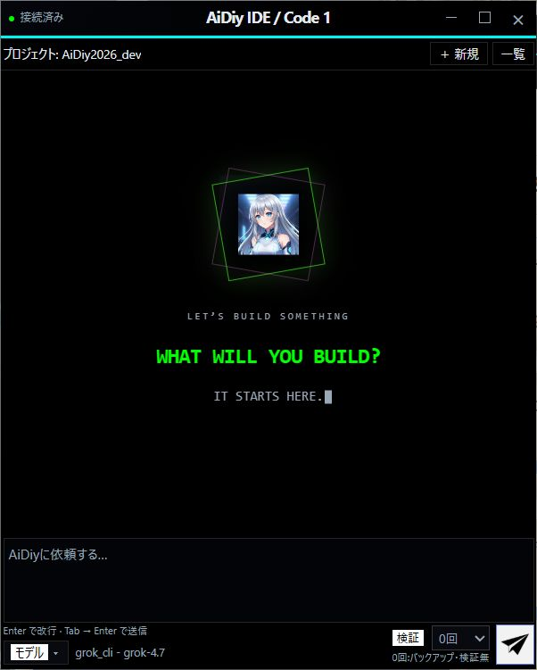

IDEから開いたCodeの返答です。挨拶への正式な回答を確認しました。

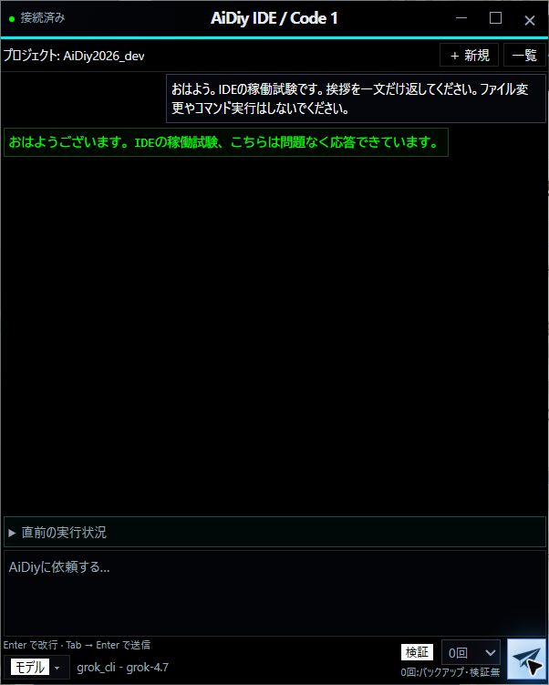

**✅ OK（Liveの文字応答）**: ＋Liveで同じプロジェクトの「AiDiy IDE / Live」が開き、接続・会話準備完了を確認しました。同じ挨拶に「おはようございます！」と返答がありました。回答は画面から取得した文字情報で確認しました。回答時は最小化していたため、下の画像は接続時のものです。後の追加試験で、実Live音声の内容を認識して照合しました。マイク入力は機器未接続のためPASSです。単独Liveの初回無応答とは別の実行結果です。

IDEから開いたLiveの接続完了画面です。返答前の画像で、回答の原文は本文のリンクに保存しています。

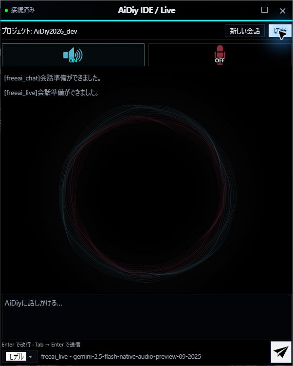

**✅ OK（Termの表示）**：「＋ Term」で同じプロジェクトの「AiDiy IDE / Term 2」が開きました。PowerShellという端末の待機表示と、toolsオンラインを確認しました。端末には入力していません。

IDEから開いたTermです。同じプロジェクトの端末に入力待ち表示が出ています。

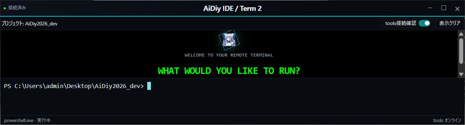

**✅ OK（ファイルを下書きへ渡す）**：ビューアの「Code / Liveへ」からCode 1を選ぶと、入力欄の下書きに「参照ファイル: AGENTS.md」が入りました。ファイルの情報は追加されましたが、その場でAIへ自動送信はされませんでした。

閲覧中の文書をCodeの下書きへ追加した画面です。「参照ファイル: AGENTS.md」が入り、自動送信はされていません。

### 3-1. 0.5秒ドラッグと開始ズームを確認する

パネル内を約0.5秒押したままにしてから動かすと、ウィンドウが移動します。短いクリックや文字選択は通常どおり使えます。表示開始時は透明な領域を先に確保し、その中で画面を拡大します。

**✅ OK**：実Electronの13条件で、400ms時点では移動せず、約524〜560msで長押しが成立しました。Code・Live・Termの単独／IDE起動、独立ビューア、入力欄、Esc・フォーカス喪失を確認しました。表示開始の最終確認は6-4にまとめています。

Codeパネルで長押しが成立した場面です。移動の目印が出て、窓を動かせました。入力欄の短押しや文字選択も試しています。

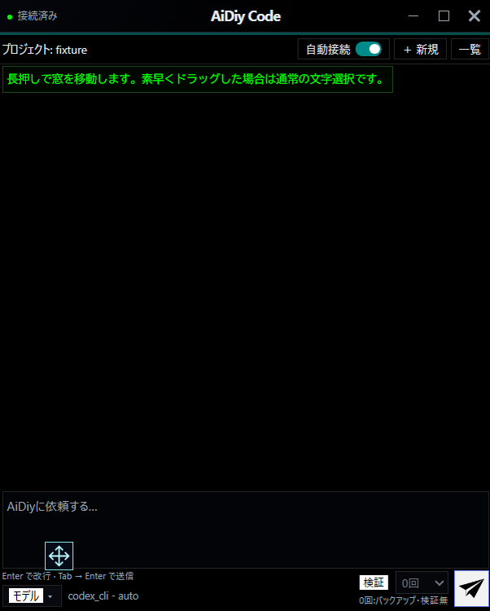

透明な外側と実画面の拡大は、6-4のWindows実表示と計測画像で確認できます。初期試験ではCode・Live・Termの単独／IDE起動と独立ファイルビューアを対象に、長押し13条件も確認しました。

### 3-2. Liveの音声とマイクの状態を確認する

**✅ OK（音声応答）**：実Live接続で15秒待って送信し、最大60秒待つ条件で「おはようございます。」と返答がありました。取得した1.32秒のWAVを音声認識にかけ、同じ挨拶と一致しました。Windowsの既定出力への再生APIも正常終了しました。これは人の耳で聞いた結果や、スピーカーから録音し直した結果とは区別します。

**PASS (別途環境調整必要)**：Windowsの入力機器数は0台でした。製品のマイク取得処理でも入力を開始できないことを確認しています。マイクを接続した環境で、初回15秒待ってから音声入力を再確認します。

[取得した音声](./images/セルフテスト,aidiy_ide,操作編/live-response.wav)は、別の音声認識で返答文と一致し、Windowsの再生処理も正常終了しました。マイク入力機器は0台のため、実マイク入力は未確認です。

## 4. 利用を終了する

### 操作手順

1. IDE上部の操作バーにある「終了」を押します。IDEから開いたCode・Live・Termが閉じ、最初の利用開始画面に戻れば、この操作は成功です。
2. IDE全体を閉じる確認を試すため、もう一度利用を開始します。
3. タイトルバー右上の×を押します。「AiDiy IDE を終了しますか？」という確認が出たら、まず「キャンセル」を押します。作業画面へ戻れれば取消の確認は成功です。
4. もう一度タイトルバーの×を押し、終了してよい場合は「終了する」を押します。IDEのウィンドウが閉じるまで待ちます。
5. システムも使い終わった場合は、Diagへ戻り、[システム起動編の5章](./セルフテスト,aidiy_diag,システム起動編.md)で停止します。

### 成功の見分け方

画面内の「終了」は、IDEの利用開始画面へ戻る操作です。一番上のタイトルバーの×は、IDE全体を閉じる操作です。どちらの操作でも、共通のシステムを止める場合はDiag側で別に停止します。

### 今回の結果と画面

**✅ OK（利用終了）**：画面内の「終了」で、最初の利用開始画面へ戻りました。IDEから開いたCode・Live・Termの別ウィンドウも閉じました。

画面内の「終了」を押した後です。子ウィンドウが閉じ、利用開始画面へ戻りました。

**✅ OK（×の確認・キャンセル）**：再びオフライン利用を開始してタイトルバーの×を押すと、終了確認が出ました。「キャンセル」で作業を続けられました。このときは自動探索がONだったため、画像ごとに表示場所は変わっています。

タイトルバーの×を押した画面です。IDE全体を終了するか、確認が表示されています。

終了確認をキャンセルした後です。IDEの作業画面で利用を続けられました。

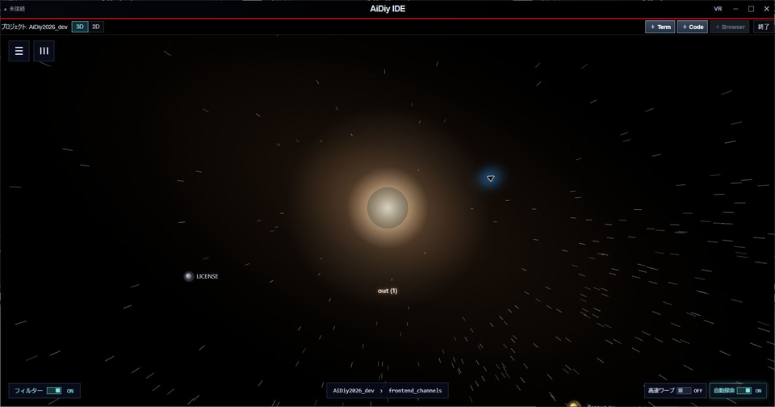

「終了する」を押して閉じる操作も確認しました。終了後のウィンドウ一覧から、IDEの窓が閉じたことを確認しました。

## 5. 試験担当者向け：次回の記録方法

画像の名前・保存先・自動試験の記録方法を開く

システム起動編とアプリ起動編を済ませ、本書1〜4章を利用順に実施します。銀河表示のモーション試験は、機能試験の後に6章で実施します。1章ではVRへの移行、復帰ボタン、パネル再表示、再移行とF11復帰も繰り返す。通常画面の位置・サイズを毎回記録し、幅の差が累積しないかも比較する。IDEの画像は `images/セルフテスト,aidiy_ide,操作編/ide-操作_1nn_…画面.png` とし、先頭1桁は本書の章番号を使います。6章の新しい画像は `ide-操作_6nn_…画面.png` とします。移動した既存画像は、撮影時の名前と台帳をそのまま保持しているため、6章にも `1nn` の画像があります。起動手順・画像は再掲載しません。操作→期待結果→実結果→画像の順で残し、Code/Liveの入力表示と実回答を区別する。今回の基本操作に加え、閲覧・検索・VR位置復元・音声応答・長押しと開始ズームも確認済みです。マイクと複数の物理画面はPASSとして残します。

追加の実ブラウザ試験は `check-office.mjs`、`check-file-history.mjs`、`check-ai-search.mjs`、実AI検索は `check-ai-search-live.mjs` です。いずれも `frontend_ide/scripts/` にあります。Electron試験は同フォルダの `check-module-move.mjs`、`check-panel-desktop.mjs`、`check-all-displays.mjs`（位置だけは `AIDIY_ALL_PANEL_POSITION_ONLY=1`、F11だけは `AIDIY_ALL_F11_ONLY=1`）で再実行できます。ホスト画面の `check-host.mjs` は通信を固定データで再現し、物理マイクの代わりにはしません。

各章には実接続で確認した結果と、固定データを使った結果を分けて記載しています。画像と詳細記録は、本書と同名の資料フォルダに保持しています。

## 6. 銀河表示のモーションを確認する

機能試験とは分けて、3Dの周回・航行と、2Dのページ繰りを最後に確認します。4章でIDEを終了している場合は、[アプリ起動編](./セルフテスト,aidiy_diag,アプリ起動編.md)からIDEを開き、1章の方法で利用を開始します。

### 操作手順

1. 上部の「3D」を選び、右下の「自動探索」をONにします。
2. 起動時の最終更新ファイルへの移動と、到着後の「観測中」を確認します。
3. ファイルを閉じ、ドラッグで視点を少し動かしてから離します。「周回軌道航行中」と表示され、ゆっくり回り続けることを確認します。
4. 最後の操作から60秒待ち、「軌道計算と姿勢制御中」を経て「探索軌道航行中」へ変わることを確認します。
5. 自動探索をOFFにし、自動の視点移動と状態表示が止まることを確認します。2Dへ切り替えた場合も、3Dの航行は止まります。

### 成功の見分け方

周回は中心星の周りを約3分で1周します。ドラッグや目的地への移動を優先し、操作後の待機から探索航行へ滑らかに戻れば正常です。ファイルの選択や内容は、周回だけでは変わりません。

以下に実施結果とエビデンスをまとめます。仮想時計とは、実際の待ち時間を短縮して、描画に渡す時刻を進める試験方法です。実時間で待つ操作試験とは区別します。

### 6-1. 周回と探索航行を確認する

右下の「自動探索」をONにすると、航行していない待機中も、現在の中心星の周りを約3分で1周します。ファイルの閲覧を閉じても同じ中心を保ちます。手動操作後は60秒間この回転で待ち、その後に通常航行へ戻ります。

起動時は最終更新ファイルが表示されます。表示されたファイル名と、右下の「自動探索」がONであることを確認します。

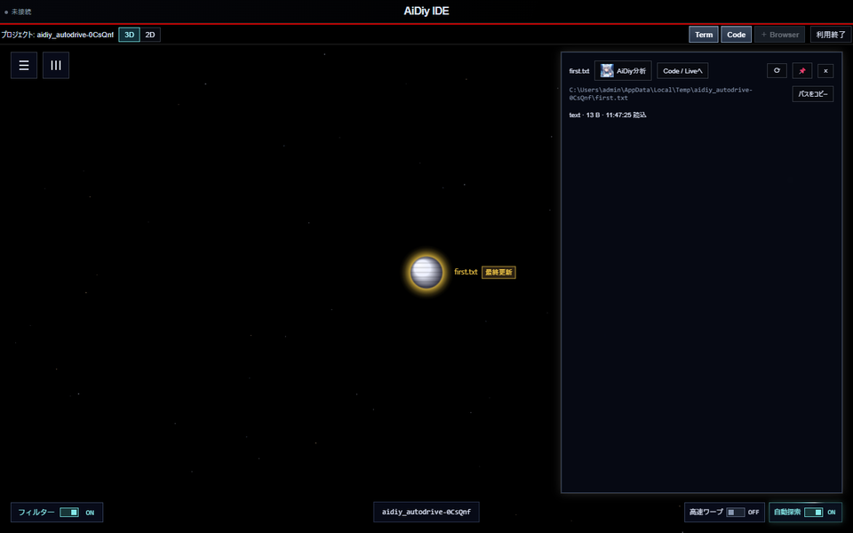

閲覧を閉じた直後の画面です。ファイルが未選択になっても、直前に見ていた星を中心に低速回転が続きます。

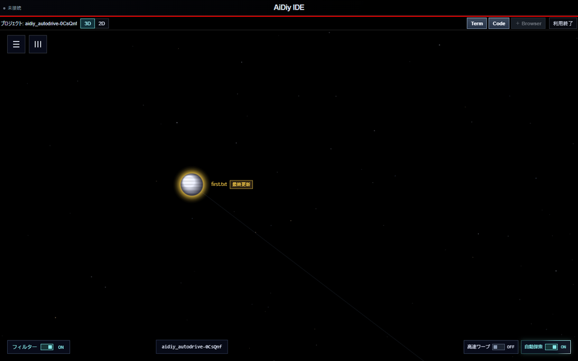

待機回転が半周した画面です。中心星の位置を保ち、その周囲の星々の見える方向が変わっています。

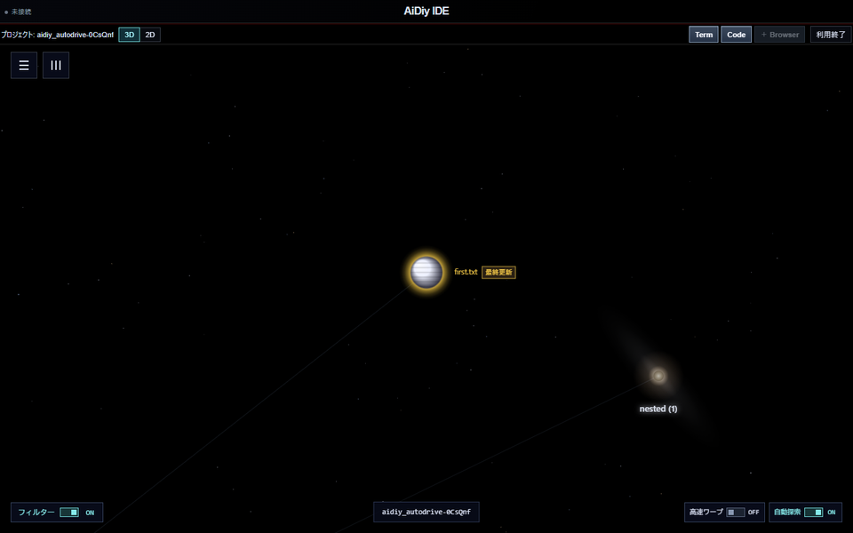

最後の手動操作から60秒が過ぎ、通常航行へ戻った画面です。低速回転から滑らかに姿勢を合わせ、軌道に沿って進みます。

**✅ OK**：待機中の一周・中心星との距離維持・通常航行への復帰を確認しました。起動後のファイル選択中も一周し、選択と閲覧表示を保ちました。ドラッグや移動中は操作を優先し、2D・画面非表示・自動探索OFFでは回転を止めます。

試験担当者向け：低速回転の検証条件

Windowsの隔離Chromeで実際のCanvasを描画し、仮想時計で時間を進めました。実時間で3分待つ操作試験とは区別します。待機回転は45秒ごとに手動操作の通知を入れて待機を延長し、180秒で1周することを測定しました。通知を止めると最後の通知から60秒で通常航行へ戻り、その開始時に船体位置が飛ばないことも確認しました。

関連テストは119件成功・失敗0件です。仮想時計で45秒・90秒・135秒・180秒の位置を確認し、180秒で開始位置へ戻りました。待機を解除すると通常航行へ復帰し、ブラウザのエラーは0件でした。再検証の指定は `frontend_ide,Vue共通画面変更手順.md` の低速回転の項を参照してください。

### 6-2. 航行状態の表示を確認する

航行状況は、透明背景・枠なしの文字だけで表示します。自動探索ボタンと同じくエクスプローラーやビューアより背面に置き、パネルが重なった部分は隠れます。

3Dの現在の表示です。右下の自動探索ボタンの上に、航行状況の文字だけが出ています。

2Dでも背景や枠は付けません。明るい一覧の背景に合わせ、文字色を変えています。

試験担当者向け：パネルとの重なりの確認

ビューアを下へ広げて重ねた画面です。航行状況と自動探索ボタンはビューアの背面に隠れ、操作もビューア側に届きました。

エクスプローラーを試験用に右下へ配置した画面です。同じく、航行状況とボタンを覆っています。

**✅ OK**：隔離Chromeで透明背景・枠なし・影なしと、2D／3Dの表示を確認しました。重なりの試験ではパネル位置だけを調整し、本番のCSSで確認しています。確認内容は上の画像説明に記載しています。

以下の状態切替の画像は、表示枠をなくす前の実施記録です。状態名と航行の動きは同じです。

自動探索がONの間は、右下のボタンのすぐ上に現在の状態が出ます。「周回軌道航行中」は、中心星の周りを約3分で1周する動きです。「探索軌道航行中」は、探索用の軌道を進む動きです。

ファイルを読んでいる間は「観測中」と表示されます。ファイル表示を保ちながら、その星の周囲を回ります。

ファイルを閉じると「周回軌道航行中」になります。手動操作後の待機中もこの表示で、周回を続けます。

最後の手動操作から60秒が過ぎると、「軌道計算と姿勢制御中」になります。位置を保ちながら、探索軌道と機体の向きを整えます。

準備が終わると「探索軌道航行中」に変わり、探索用の軌道を進みます。

自動探索をOFFにすると、ボタン上の状態表示は消えます。

移動時は、別の星系への移動を「目的地へワープ中」、同じ星系での移動を「目的地へ接近中」と表示します。ドラッグ中は「手動操縦中」、更新先の確認中は「航路確認中」です。

**✅ OK**：実ブラウザーと仮想時計で、周回・準備・探索航行・OFFの表示を確認しました。関連117件のテストでは、ボタン上の配置、手動操縦、接近とワープ、2Dの表示も確認しました。14枚の確認画像と測定記録を補助資料として保持しています。

### 6-3. 2Dのページ繰りを確認する

2Dには3Dのような周回・探索航行はありません。初期表示と、最終更新欄やエクスプローラーからファイルを選んだ時のページ繰りを中心に確認します。

#### 操作手順

1. 上部の「2D」を押し、一覧がそのまま表示されることを確認します。
2. 左上の☰からエクスプローラーを開き、別フォルダのファイルを選びます。ページが切り替わり、選んだファイルが右側に表示されることを確認します。
3. エクスプローラー下部の「最終更新」にある、別フォルダのファイルを選びます。同じようにページが切り替わり、そのファイルが開けば正常です。
4. 「親へ」で戻る操作と、ページ切替中のスクロールも試します。最後に3Dへ戻し、現在のフォルダと選択ファイルが維持されることを確認します。

#### 今回の結果

**✅ OK（Windows）**：実ブラウザーで以下の7項目を確認し、関連125件のテストもすべて通りました。

| 確認したこと | 結果 |
|---|---|
| 初期表示 | ✅ OK：不要なページめくりを挟まず、2D一覧を表示しました。 |
| 進む・戻る | ✅ OK：進む時は右から左、戻る時は左から右へ斜線が動きました。設定時間は800msです。 |
| 操作による中断 | ✅ OK：スクロールで演出だけを終え、移動先のフォルダを保ちました。 |
| エクスプローラーからの選択 | ✅ OK：深いファイルへ3ページを順に切り替え、ファイル名が一致しました。全体の設定時間は800msです。 |
| 一覧更新 | ✅ OK：上から下へ切り替わりました。設定時間は650msです。 |
| 最終更新欄からの選択 | ✅ OK：別フォルダへページが切り替わり、選んだ更新ファイルが開きました。 |
| 3Dとの切替 | ✅ OK：フォルダと選択ファイルを維持しました。2D中は3Dカメラが進みませんでした。 |

#### 初期表示とフォルダのページ繰り

2Dへ切り替えた最初の画面です。ページめくりを挟まず、フォルダとファイルの一覧が出ています。

子フォルダへ進む途中です。切替の25%の位置で、右側に斜線が現れています。

同じ切替の75%の位置です。斜線が左へ進み、移動先の一覧が見えてきます。

#### エクスプローラーからファイルを選ぶ

エクスプローラーで深いフォルダのファイルを選んだ途中です。経由するフォルダのページを順に表示します。

切替が完了した画面です。現在地が「資料／内部／詳細」になり、選んだ「深い資料.txt」が右側に開いています。

#### 最終更新欄からファイルを選ぶ

左下の最終更新欄に「更新先.txt」が出た画面です。このファイルを選びます。

最終更新欄から選んだ直後です。移動先の「別の資料」へページが切り替わっています。

切替完了後は、現在地の一覧と「更新先.txt」のビューアが表示されました。

試験担当者向け：戻る操作・中断・更新・3D復帰と検証条件

親へ戻る途中です。進む時と同じ斜線が、反対方向の左から右へ動きます。

切替中にスクロールした後です。古いページと斜線が消え、移動先だけが残りました。

一覧更新の途中です。横方向の移動とは異なり、上から下へ切り替わります。

3Dへ戻った後です。同じ「別の資料」フォルダと「更新先.txt」の選択を維持しています。

隔離Chromeと一時プロジェクトを使い、自動探索はOFFでページ繰りを確認しました。最終更新の通知データは試験用に指定し、クリックからページ・ツリー・ビューアへ届く処理は実物を使っています。CSSアニメーションの途中時刻を固定して撮影したため、800ms・650msはCSSの設定時間で、実時間の滑らかさやフレーム数の測定値ではありません。Computer Useによる手動操作試験とは区別します。

再実行は `node frontend_ide/scripts/check-2d-motion.mjs` です。8項目の確認はすべて成功し、進む・戻るのページ切替はともに設定800ms、ブラウザのエラーは0件でした。13枚の確認画像を保存し、関連する自動テスト125件も成功しました。

### 6-4. 共通パネルの透明表示を確認する

**✅ OK（Windows）**：Diag、Term、Code、Live、IDE、関連パネル、Avatarの17種類、Discordを順に確認しました。OSの「動きを減らす」による演出省略は、アプリ所有のソースから外しています。第三者ライブラリの内部処理は変更していません。

読み込み表示が消え、銀河とファイルの星が描画された後に、ズーム途中を静止してWindows上で撮影しました。内側には銀河とファイル名が表示され、外側には背後のCodeやLiveなどが透けています。準備中の画像は最終確認の根拠から外しました。

共通処理だけの計測画面です。文字を含む表示内容が広がり、外側4隅は完全に透明でした。拡大は実測745.5msで、実窓と透明パネルの位置・大きさは変わりませんでした。

試験用のクリック透過・1%不透明度が透明な演出窓にもかかり、白く見える条件がありました。演出窓をその設定から除外し、本番と同じ透明表示で再確認しました。画面を取得できない場合は色だけの代用面を出さず、通常表示へ進みます。

順次試験と追加9件の確認は成功しました。途中でビューアの開き直し待機が1回失敗しましたが、同じ試験の単独再実行と最後の順次試験では通過しています。初回の失敗記録も保持しています。

確認が終わったら、4章の手順で利用を終了します。
