# IDE 操作編 — 操作ガイドとセルフテスト

## 総合評価

**総合評価：✅ OK（記載した確認範囲）。** Windows ElectronとWebで、基本画面・検索・文書閲覧・比較・軌跡・アプリ起動・下書き連携・VR・終了を確認しました。環境による対象外と模擬条件は5章に記載します。

1〜4章は操作ガイド、5章は追加テストです。図番号は章番号＋章内の掲載順です。説明には専用プロジェクトを使用しています。第2章と第3章の個別画面は📌状態で掲載し、Webの操作例は本文で明記します。

## 始める前に

[システム起動編](./セルフテスト,aidiy_diag,システム起動編.md)で必要なサービスを起動し、[ランチャー編](./セルフテスト,aidiy_diag,ランチャー編.md)から作業フォルダを選んでIDEを開きます。単独起動コマンドは `aidiy_ide` です。

プロジェクト名を確認して「AiDiy接続利用」を押します。サービスを使わず閲覧する場合は「オフライン利用」を選びます。手動で読む間は右下の「自動探索」をOFFにします。

## 1. 基本画面とVR

### 3Dと2D

3Dではフォルダやファイルを宇宙の中から選びます。フォルダ名で階層を進み、パンくずから上の階層へ戻ります。ファイルを選ぶとビューアが開きます。

パネルを閉じた3Dの基本画面です。フォルダとファイルの配置を見渡せます。この図はWeb版です。

**図101：3D基本画面**

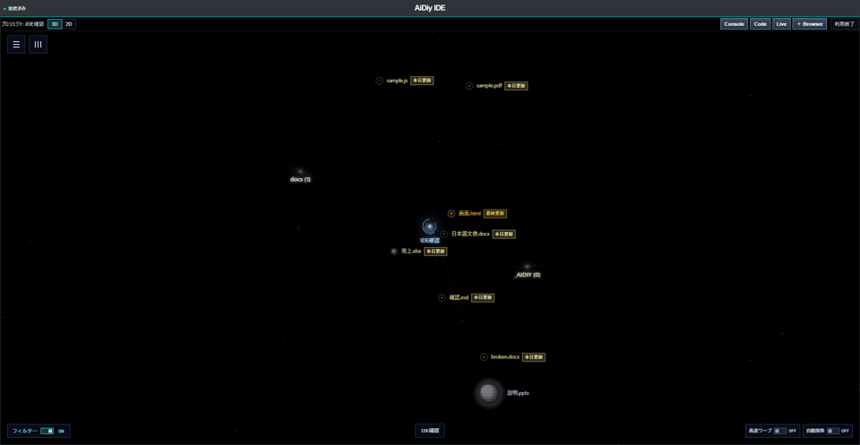

上部の「2D」で平面表示へ切り替えます。「3D」で戻れます。階層や選択を確認しながら、見やすい表示を選びます。

2Dの基本画面です。エクスプローラーとビューアを閉じ、ファイルとフォルダの一覧が見える状態にしています。

**図102：2D基本画面**

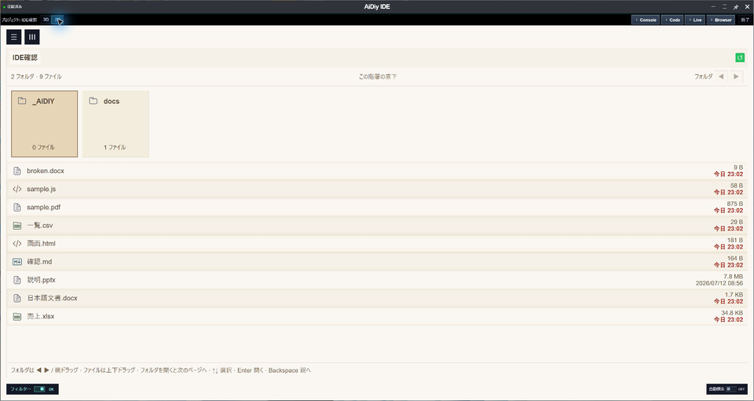

### VRで複数の画面を並べる

1. 必要なパネルやアプリを開きます。画面内のエクスプローラー・軌跡・ビューアは📌で独立窓にできます。
2. 本体上部の「VR」を押すと宇宙表示が全画面に広がります。独立窓を読みやすい位置に配置します。
3. ピンONの窓は、本体を選んでも手前に残ります。
4. F11または復帰操作で通常画面へ戻り、現在地と閲覧ファイルを確認します。

エクスプローラー、検索軌跡、Markdownビューアを一斉に表示した例です。探す場所・検索理由・本文を同時に確認できます。

**図103：VRで閲覧と検索**

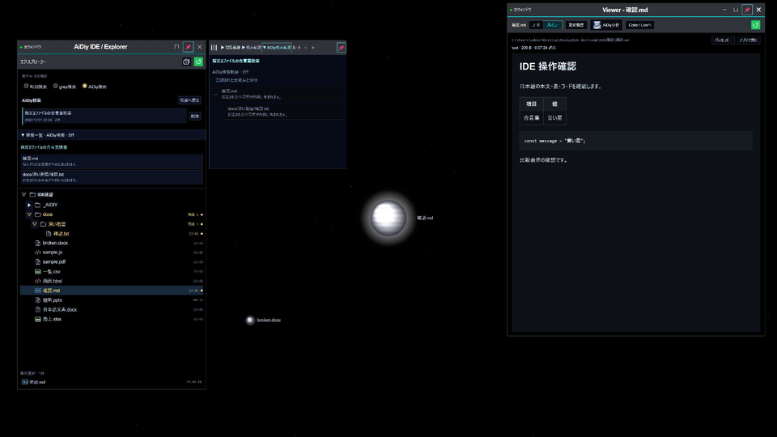

Code・Live・Consoleを並べた例です。同じプロジェクトの窓を使い、閲覧とAIへの依頼、端末操作を組み合わせられます。Liveは未接続で、マイクと音声出力はOFFです。

**図104：VRでCodeとLiveとConsole**

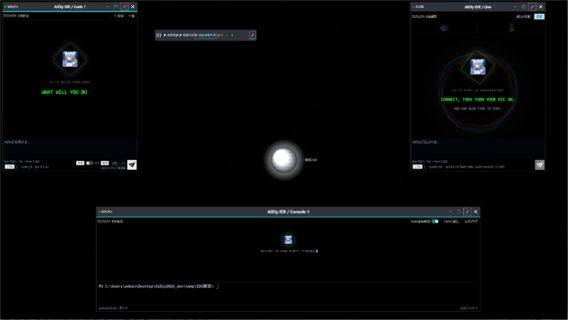

## 2. エクスプローラー

### ツリーを開いてファイルを選ぶ

1. 左上の横三本線でエクスプローラーを開き、📌で独立窓にします。
2. フォルダ横の三角で開閉し、名前を押してその場所へ移動します。
3. ファイル名を押してビューアを開きます。名前とパスが対象と一致すれば選択完了です。
4. 緑色の更新ボタンで一覧を取り込み、隣のボタンで展開したフォルダを閉じます。

ツリー内容の再取得・書き換えでは、選択中のファイルとビューアを保持します。選択の自動移動は、新しい最終更新を検知した時だけ、自動探索の条件に従って行います。同じ最終更新の再取得では移動を繰り返しません。更新した一覧に選択ファイルがない場合は新しい一覧で再確認し、削除が確認できた場合だけ表示を解除します。確認中の選び直し・手動の閉じる操作を優先し、取得失敗や走査上限では表示を保持します。

深い階層まで展開した独立窓です。検索欄とツリーを同じ窓で操作でき、タイトルバーのピンがONになっています。

**図201：エクスプローラー独立窓**

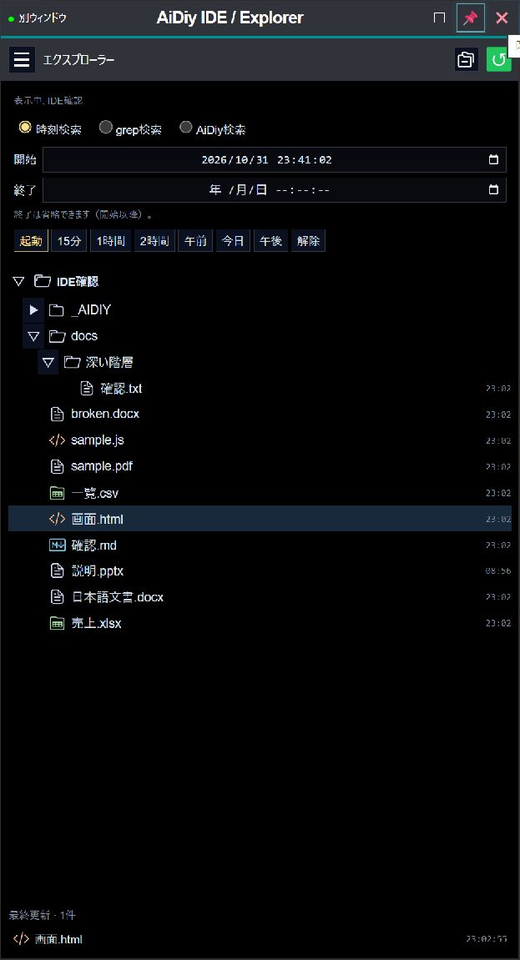

### 時刻検索

「時刻検索」を選び、起点や日時範囲を指定します。「今日」はその日の範囲を選ぶ例です。検索一覧の件数を確認し、行を選んで対象を読みます。

「今日」の範囲で9件を表示した例です。開始・終了時刻と検索一覧が同じ窓に表示されています。

**図202：時刻検索**

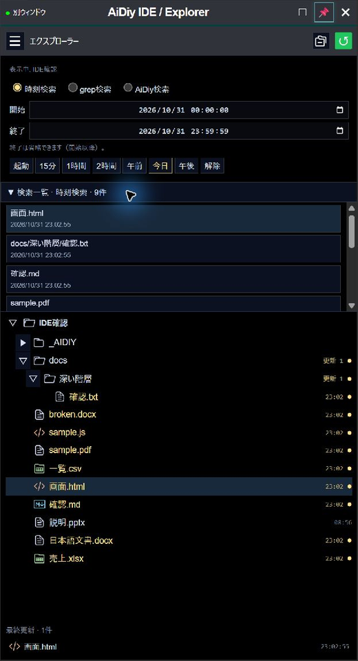

### grep検索

grep検索はファイル内の文字を探します。「grep検索」を選んで検索文字を入力し、検索を実行します。一覧にはファイル名と一致行が表示されます。見出しを押すと一覧を収納・展開できます。

「IDEの選択確認」で検索した例です。深い階層のテキストから、1ファイル・1件の一致が見つかっています。

**図203：grep検索**

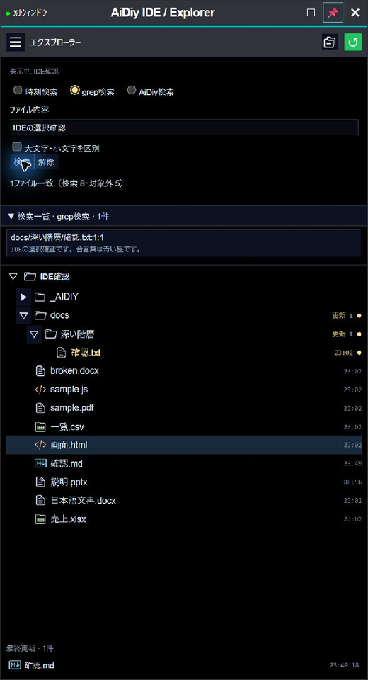

### AiDiy検索

意味や目的から探す場合は「AiDiy検索」を選び、探したい内容を書いて検索を依頼します。AiDiy接続利用が必要です。結果の理由を読み、関連ファイルを選びます。

実AIに指定2ファイルの合言葉「青い星」を探すよう依頼した結果です。保存した結果を表示し、Markdownと深い階層のテキストの2件を確認しています。ファイルを変更しない条件で依頼しました。

**図204：AiDiy検索**

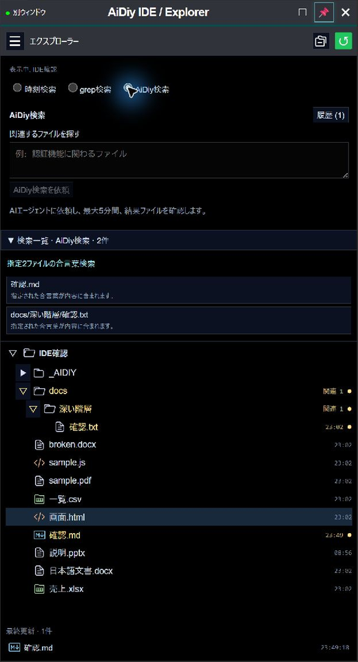

「履歴」を開いて保存された検索名を選ぶと、結果と理由を読み直せます。「検索へ戻る」で検索入力へ戻ります。

検索履歴から2件の結果を開いた例です。検索名と関連ファイルを照合できます。

**図205：検索履歴**

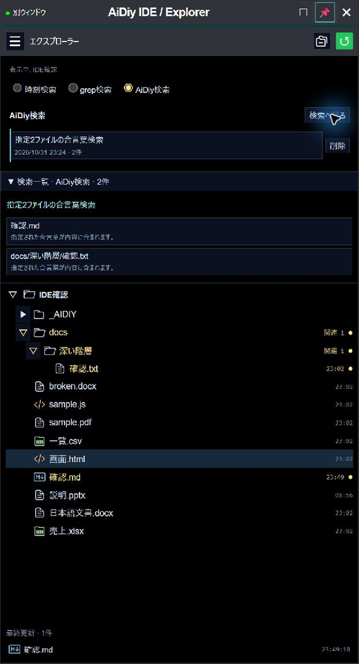

### ファイル操作

対象を右クリックし、作成・コピー・貼付け・複製・名前変更などを選びます。重複名のエラーでは名前と貼付け先を確認します。ゴミ箱へ移すときは確認画面の対象名を読み、取り消す場合はキャンセルします。

Markdownの「PDF化」は同じフォルダへ同名のPDFを作ります。既存PDFは確認なしで更新され、生成に失敗した場合は既存PDFを保持します。

Markdownを右クリックしたメニューです。「Code / Liveへ」から参照ファイルを下書きへ渡すこともできます。

**図206：ファイル操作メニュー**

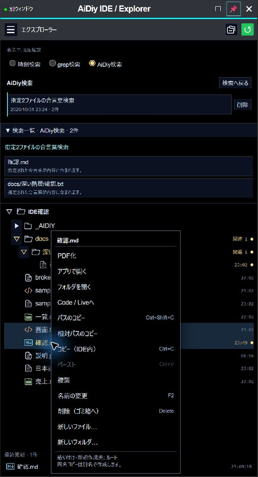

### チェックしてまとめて操作する

ファイル名の左のチェック欄で、操作する対象をまとめられます。最終選択は、宇宙とビューアに表示する場所です。チェック対象とは分けて操作できます。

| 操作 | 動作 |
|---|---|
| 通常の行クリック | その項目だけをチェックし、最終選択を移します。 |
| Ctrlを押しながら行クリック | 追加チェックして最終選択を移します。階層をまたいで追加できます。MacではCommandも使えます。 |
| Shiftを押しながら行クリック | 基点からの範囲をチェックします。同一階層の項目だけを対象にし、同じ基点から範囲を拡大・縮小できます。別階層ではクリックした項目だけに切り替えます。 |
| チェック欄を直接クリック | 最終選択を移さず、個別にチェックを付け外しします。階層をまたいで操作できます。 |
| Space | 一覧でカーソルのある項目のチェックを付け外しします。最終選択は移しません。 |
| Ctrl+A | カーソルと同じ階層の表示項目をチェックします。 |
| Esc／チェック解除 | Escは最終選択の1件を残して複数チェックを解除します。「チェック解除」は全チェックを外します。 |

2件以上をチェックしている間は、最終更新・一覧取得と自動追跡を停止します。取得中だった応答も反映せず、表示内容を維持します。1件以下に戻すと取得を再開します。コピーを完了しても、複数チェックを維持している間は一覧を更新しません。

`a.txt` と `b.txt` をチェックしたWeb別窓です。`b.txt` が最終選択で、2件のチェックと「取得を停止中」の表示を確認できます。

**図207：複数チェック**

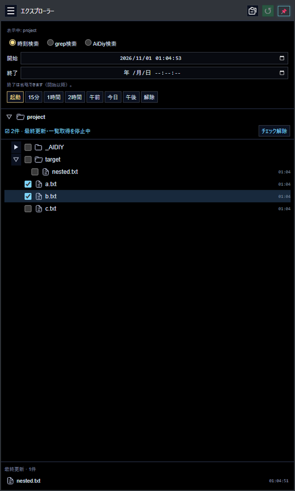

右クリックして、**「☑︎全てを」** が太字で付いた操作を押します。コピー・複製・パスコピー・削除などがチェック対象全件に適用されます。ファイルだけならCode / Liveへの参照追加、MarkdownだけならPDF化もまとめられます。太字の表示がない操作は右クリックした項目が対象です。

2件を対象にしたメニューです。「コピー（IDE内）」を選び、貼り付け先のフォルダを右クリックして「ペースト」を押します。同じ2件をもう一度コピーして貼り付けると、既存内容を上書きせず「コピー」を付けた別名になります。

**図208：一括操作メニュー**

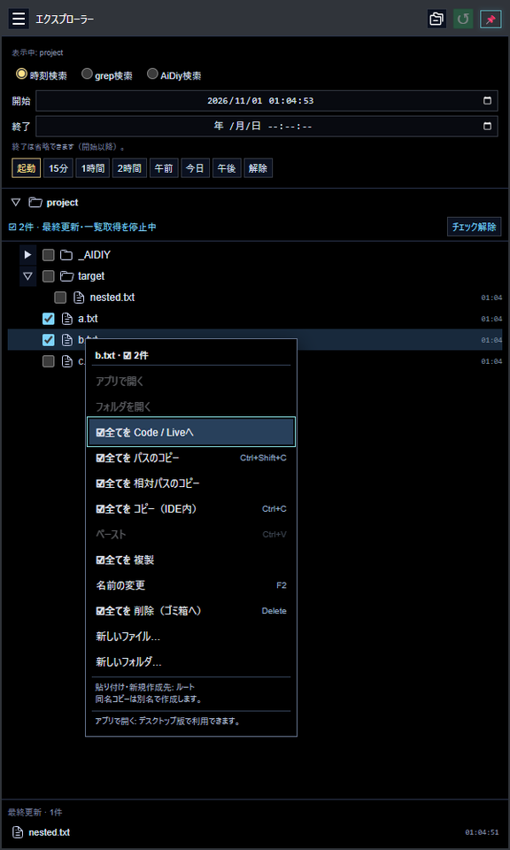

削除は確認画面の対象一覧を読んでから「ゴミ箱へ移動」を押します。キャンセルでは移動しません。フォルダは「フォルダ全体」と明示します。親フォルダとその配下の項目が同時に含まれる場合は一括操作を拒否し、どちらを対象にするかチェックの整理を案内します。

2ファイルの削除確認です。試験では専用の一時フォルダへの模擬移動を使い、取消では0件、確定ではこの2件だけが移動し、対象外ファイルとフォルダが残ることを確認しています。

**図209：一括削除確認**

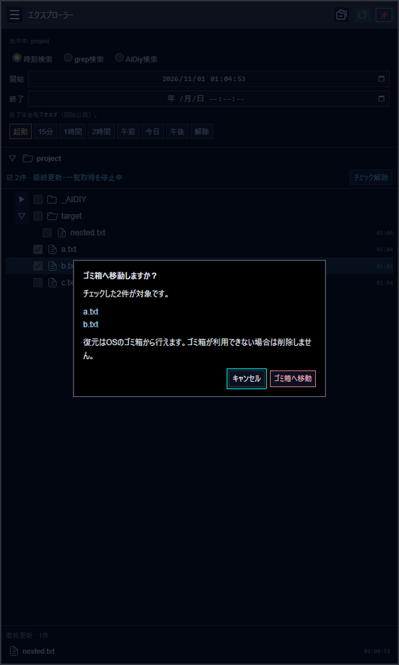

## 3. 各ウィンドウ

### ビューア

ファイルを選んで開いたビューアの📌を押すと、独立した窓になります。内容は読み取り専用です。独立ビューアは表示対象を固定して読めるので、別のファイルと並べて確認できます。

Markdownは「プレビュー」と「コード」、HTML・SVGは「表示」と「コード」で切り替えます。更新を反映する場合は再読込を押します。Electronの「アプリで開く」から外部アプリも利用できます。

日本語、表、コードを含むMarkdownの独立ビューアです。ファイル名とピンONを確認できます。

**図301：ビューア独立窓**

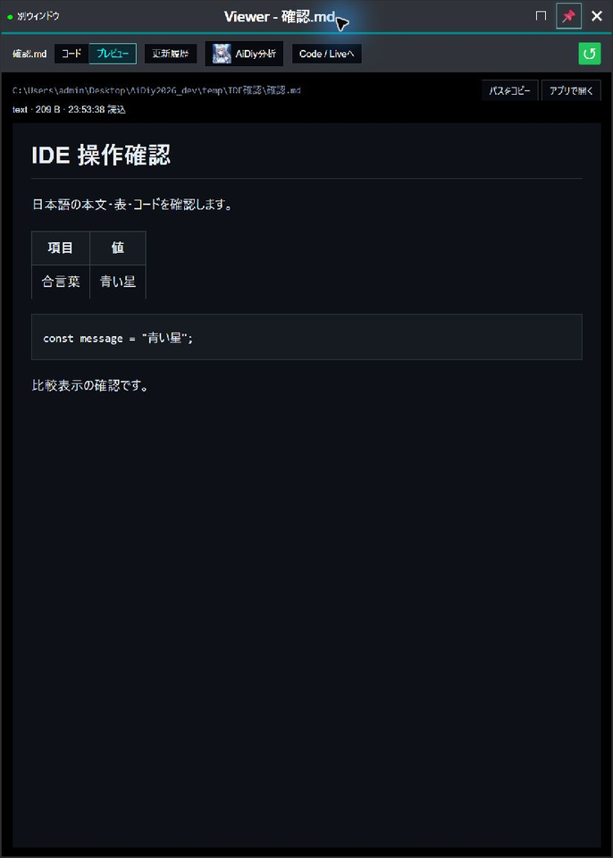

### 比較表示

ファイルの履歴から保存版を選び、現在の内容との比較を開きます。比較画面も📌で独立窓にできます。左右の版と変更箇所を確認し、同期スクロールで同じ位置を読みます。

左が保存版、右が現在の内容です。右に加わった「比較表示の確認です。」の1か所を差分として表示しています。比較画面も読み取り専用です。

**図302：比較表示独立窓**

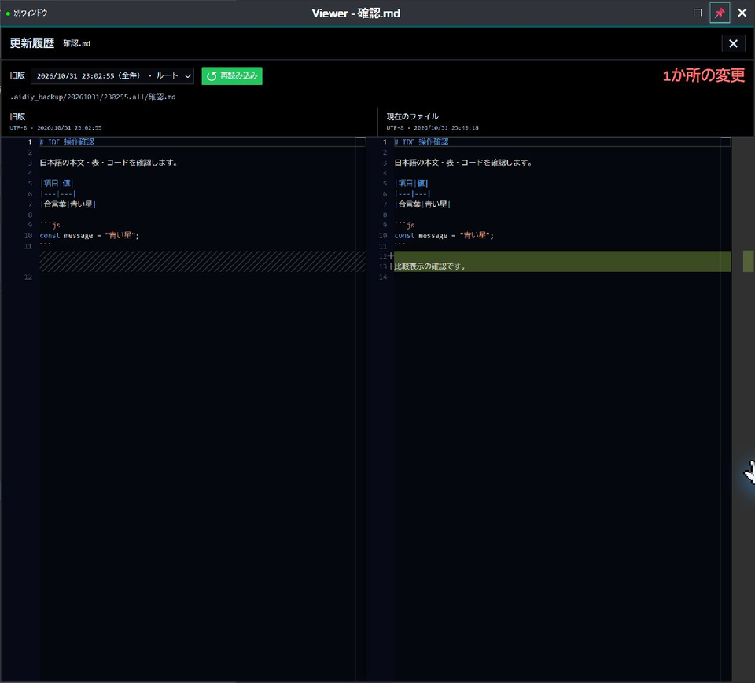

### 軌跡

左上の軌跡バーを開いて📌にし、「閲覧軌跡」「検索軌跡」「AiDiy検索軌跡」を選びます。各見出しで一覧を開き、項目または前後ボタンから対象へ戻ります。

閲覧したファイルの一覧です。HTML・Markdown・Wordの3件が表示されています。

**図303：閲覧軌跡**

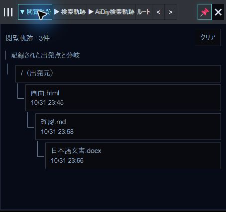

文字検索の軌跡です。検索文字と一致ファイルを確認して、検索した場所へ戻れます。

**図304：検索軌跡**

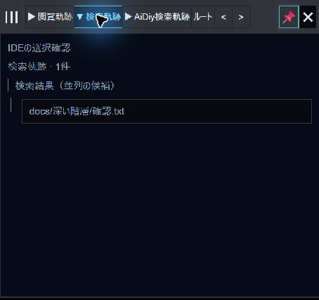

AiDiy検索の軌跡です。2件の関連ファイルと理由を一覧から確認できます。

**図305：AiDiy検索軌跡**

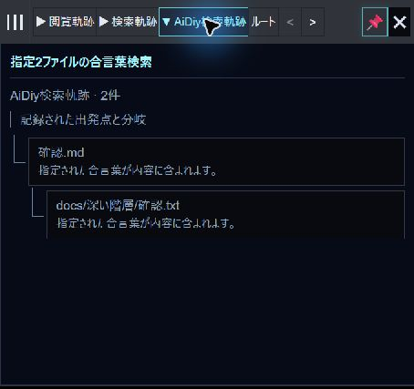

### Console

本体上部の「＋ Console」で開きます。タイトルの所属とプロジェクト名を確認します。端末は選んだ作業フォルダを起点に起動します。

実PowerShellのプロンプトと「Tools オンライン」が表示された独立窓です。この画面ではコマンド入力を行っていません。

**図306：Console独立窓**

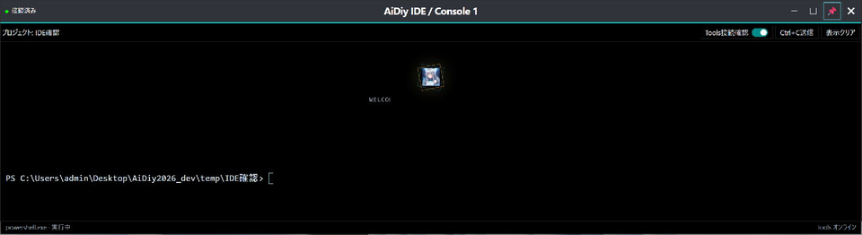

### Code

「＋ Code」で開きます。同じプロジェクトと接続状態を確認してから、モデルを選んで依頼を書きます。ファイルを渡す場合は、ビューアや右クリックメニューの「Code / Liveへ」で連携先を選び、「下書きへ追加」を押します。既存入力を保持して追加し、送信はCode側で行います。

IDE所属のCode 1を📌にした起動画面です。プロジェクト名、接続済み、選択モデルを確認しています。

**図307：Code独立窓**

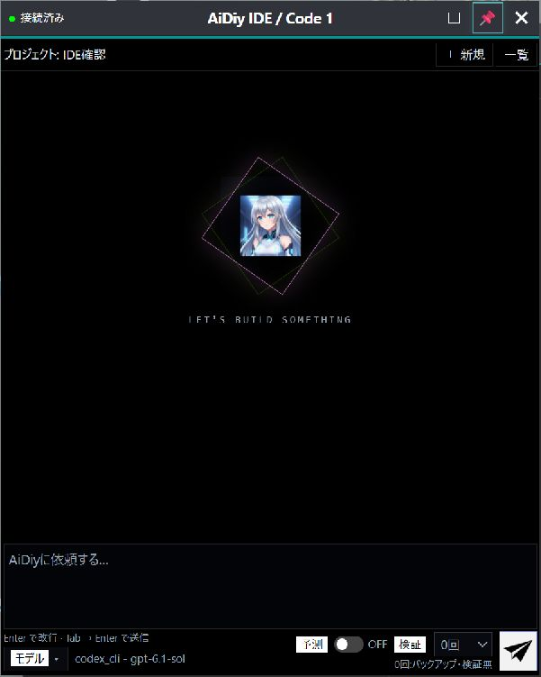

### Live

「＋ Live」で開きます。文字入力や参照ファイルの下書き連携ができます。会話や音声を使う場合はLive側で接続し、必要な音声操作を行います。

IDE所属のLiveを📌にした起動画面です。ここでは未接続で、音声出力・マイクはOFFです。本冊では音声入力を実施していません。

**図308：Live独立窓**

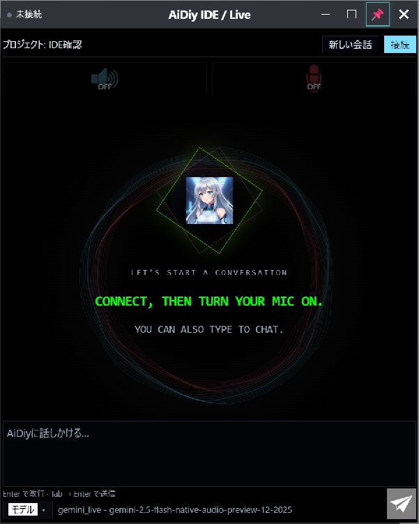

### Browser

「＋ Browser」で開き、表示するページへ移動します。タイトルでIDE所属の窓であることを確認できます。

Googleのページを表示したBrowserの独立窓です。ピンONの状態で、ページとアドレス欄が見えています。

**図309：Browser独立窓**

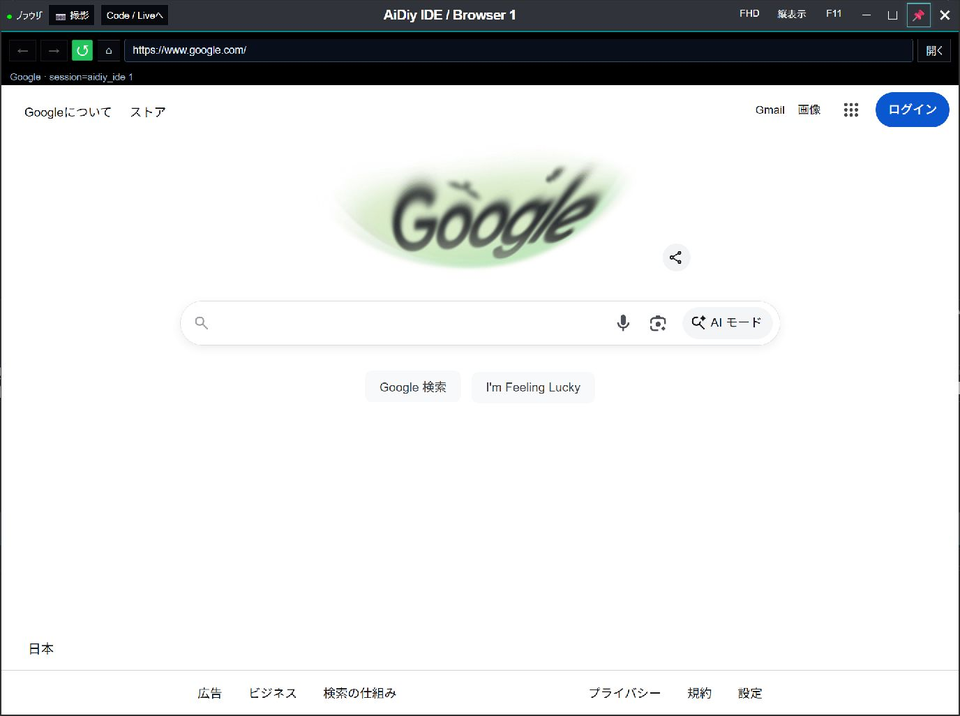

会話・音声・端末・ページの詳しい操作は、[Code操作編](./セルフテスト,aidiy_code,操作編.md)・[Live操作編](./セルフテスト,aidiy_live,操作編.md)・[Console操作編](./セルフテスト,aidiy_console,操作編.md)・[Browser操作編](./セルフテスト,aidiy_browser,操作編.md)を参照します。

### Office文書

Word・PDF・PowerPointは上部のページ番号と倍率、Excelは下部のシート名で切り替えます。Excelは保存済みの計算値を表示します。

日本語Word文書を独立ビューアで開いた例です。全2ページのうち1ページ目が表示されています。

**図310：Word独立窓**

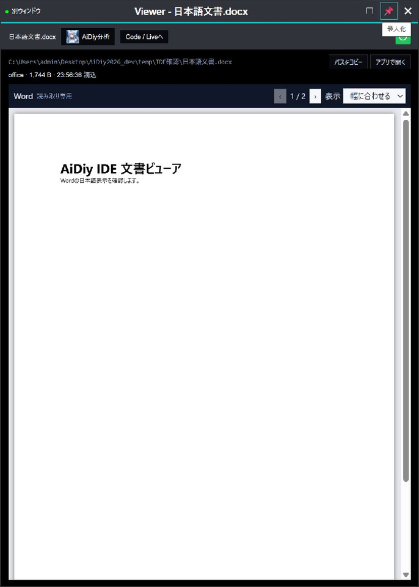

## 4. 終了

1. 画面内の「終了」（Webでは「利用終了」）を押すと、IDE所属の子窓を閉じて利用開始画面へ戻ります。
2. IDE本体を閉じる場合はタイトルバーの×を押します。確認画面の「キャンセル」で作業を続け、「終了する」でIDE全体を終了します。
3. システム全体の停止は[システム起動編](./セルフテスト,aidiy_diag,システム起動編.md)を参照します。

利用中の終了確認です。取消では作業を続けられます。利用終了ではIDE所属の子窓を回収し、共有サービスは稼働を続けます。

**図401：終了確認**

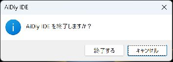

## 5. 追加テストと確認範囲

### 実施結果

| 対象 | 結果・確認方法 |
|---|---|
| Node自動試験 | `frontend_ide/checks/*.test.mjs` と `frontend_ide/viewer/checks/*.test.mjs` を実行。**1,161件成功、失敗0件、取消0件。** 列挙1,169件のうち8件はスキップ。別途リンク権限を要する9件を実行対象から除外しています。 |
| 環境による対象外 | リンク作成権限不足14件（除外9件＋スキップ5件）、Linux専用2件。実行成功には数えません。既定でスキップされた実Electron PDF描画1件は、下記の専用実行で確認しました。 |
| Markdown PDF | `AIDIY_TEST_PDF_RENDER=1` で `markdown-pdf.test.mjs` を実行し、9件成功。日本語・表・相対画像の実Electron描画、失敗時の既存PDF保持、同名フォルダ拒否を確認。全体試験と重複するため件数を合算しません。 |
| Office | `check-office.mjs` 成功。Wordの日本語・2ページ、Excelの保存済み値3600・3シート・結合セル・205行・CSV、PDF／PowerPointのページ・倍率・縦横、破損文書から正常文書への復帰を確認。 |
| HTML・SVG | `check-preview.mjs` 成功。相対画像・CSS・モジュール・外部SVG参照、IDEからの分離、コード切替、再読込を確認。 |
| ファイル操作 | `check-explorer-menu.mjs` 成功。作成・コピー・貼付け・複製・改名・重複名拒否・削除の取消と確定。ゴミ箱は専用一時フォルダへの移動で模擬しています。 |
| Explorer操作シナリオ | `check-explorer-multi.mjs` 成功。Web別窓で通常クリック、Ctrl追加、同一階層のShift範囲の拡大・縮小、親から下位ファイルへのShift、チェック欄・Spaceでの付け外し、チェック欄からのCtrl+C、取得停止と再開を確認。同じ2件を2回コピー・貼り付けし、別名と本文を照合。2件削除の取消と確定、対象外ファイルと親フォルダの保持、階層をまたぐCtrl追加とコピーも確認。ゴミ箱は専用一時フォルダへの模擬移動です。 |
| Explorer関連自動試験 | 操作・一覧・移動・更新監視・実Vue部品・窓の寿命・パス境界の関連試験214件成功、失敗0件。Linux専用2件は未実施。階層をまたぐ個別ファイルのコピー・削除、親子重複の拒否、部分成功時の結果表示、一括PDFと下書き参照も確認。全体試験とは件数を合算しません。 |
| 更新時の選択保持 | `space-mode`・`navigation-parity`・`explorer-navigation`・`folder-monitor` の関連試験129件成功。ツリー書換えによる追跡通知がなく、新しい最終更新だけを通知すること、同じ更新の重複通知がないことを確認。2D／3Dの一時欠落・削除確認、確認中の選び直し・閉じる、取得失敗、走査上限での保持も確認。全体試験と重複するため件数は合算しません。 |
| Web別窓 | `check-panel-pins.mjs` 成功。80件の検索結果、条件・スクロール・未送信入力を保持。窓を開けない場合の元表示保持、再読込・復帰・再分離、連打で1窓、親終了時の子窓終了を確認。 |
| 接続断・復帰 | `check-connection.mjs` 成功。隔離した接続先で10秒周期の確認、切断検出、セッションを保持した再接続を確認。共有サービスを停止した試験ではありません。 |
| 検索 | 時刻検索で9件を表示。grepは「IDEの選択確認」の1ファイル1件と、別条件の2ファイル3行を確認。実AIへの依頼から結果保存まで成功し、指定したMarkdownと深い階層のテキストを取得。検索一覧の収納・展開、検索履歴の表示も確認。 |
| 版比較 | `check-file-history.mjs` 成功。読込失敗からの再試行、版切替、左右差分、両方向の同期スクロール、縦長表示、読み取り専用、終了時の解放を確認。10分の保持期限は模擬時計で確認しています。 |
| 下書き連携 | 実WebのCodeとLiveで既存入力の保持と参照ファイルの追加に成功。AIへ自動送信しないことを確認。連携先選択・競合・配送拒否はNode試験に含みます。 |
| Electron起動・終了 | Code・Live・Console・BrowserをIDEから起動。プロジェクト、Consoleの実PowerShell、Browserのページ表示を確認。終了取消で作業継続、利用終了で子窓を回収、開始画面から本体終了を確認。 |
| VR・表示切替 | 実ElectronでExplorer・軌跡・Viewerの3窓、Code・Live・Consoleの3窓をVR中に表示。本体を選び直してもピンONの窓を手前に維持し、F11で復帰。Electronの2D基本画面、Webの3D基本画面と2D／3D切替・ファイル保持も確認。 |

### 対象外・未確認

必須対象はWindowsです。Mac／Linux実機と長時間連続運転は **PASS（環境依存・判定対象外）** とし、未実施です。自動試験の成功件数には含めません。

複数物理画面、全ファイル形式・全AIモデルは未確認です。音声入力は本冊の確認範囲外です。Liveの会話と音声の判定はLive操作編を参照します。
