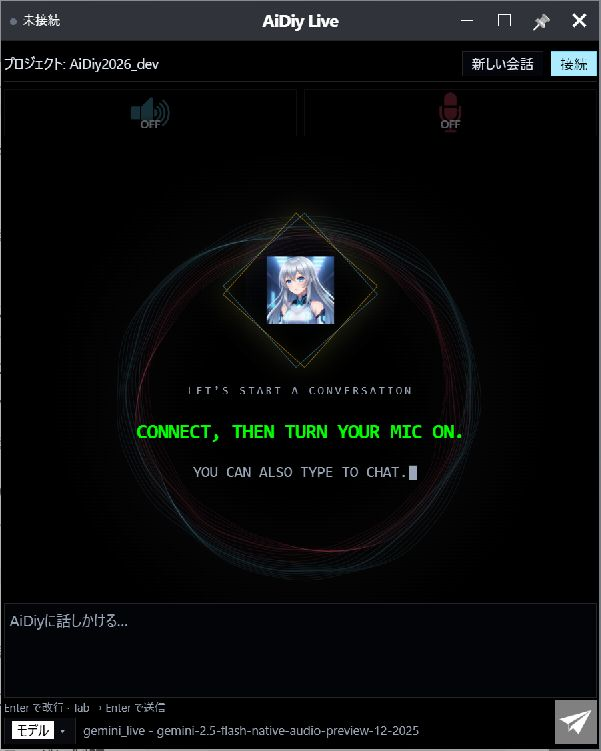
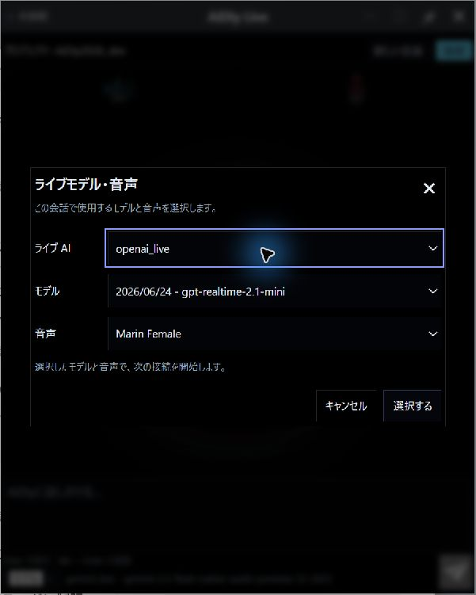
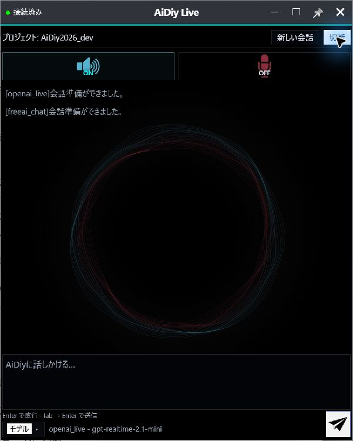
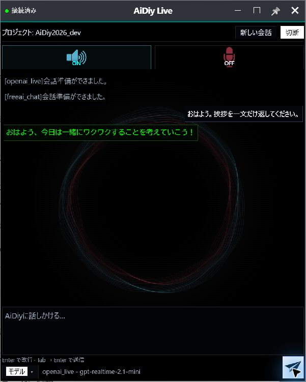
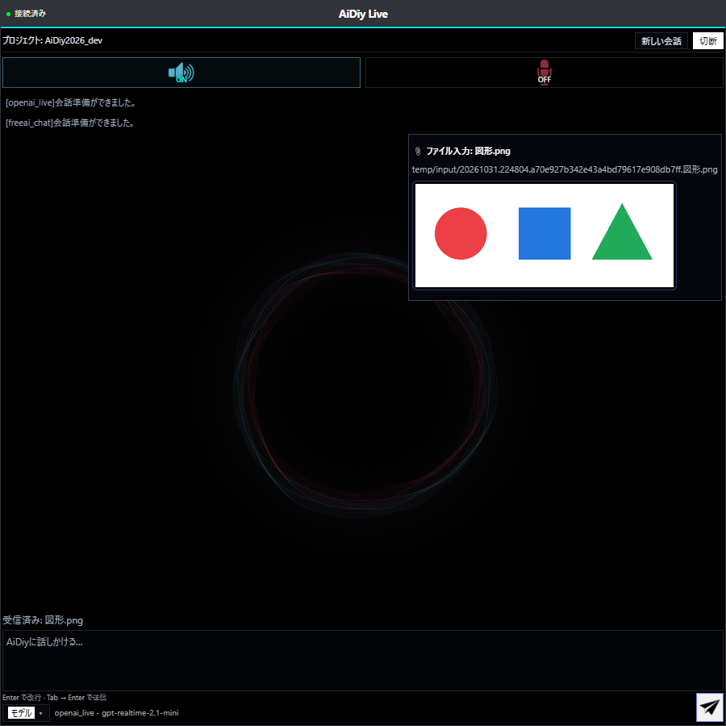
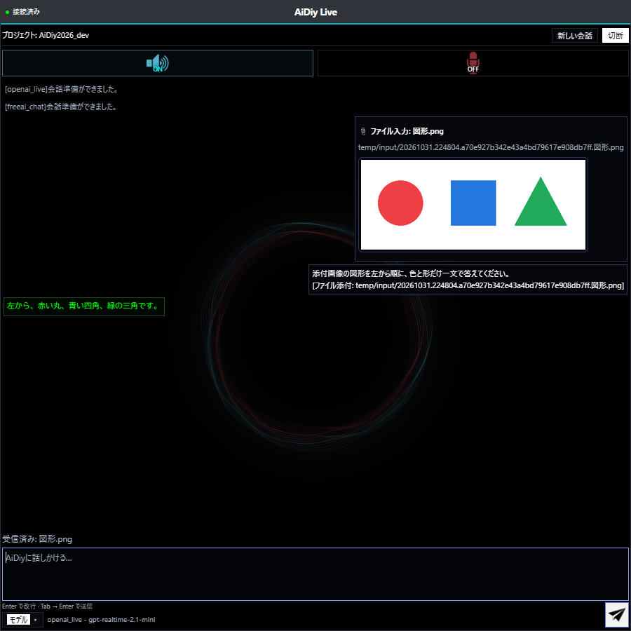
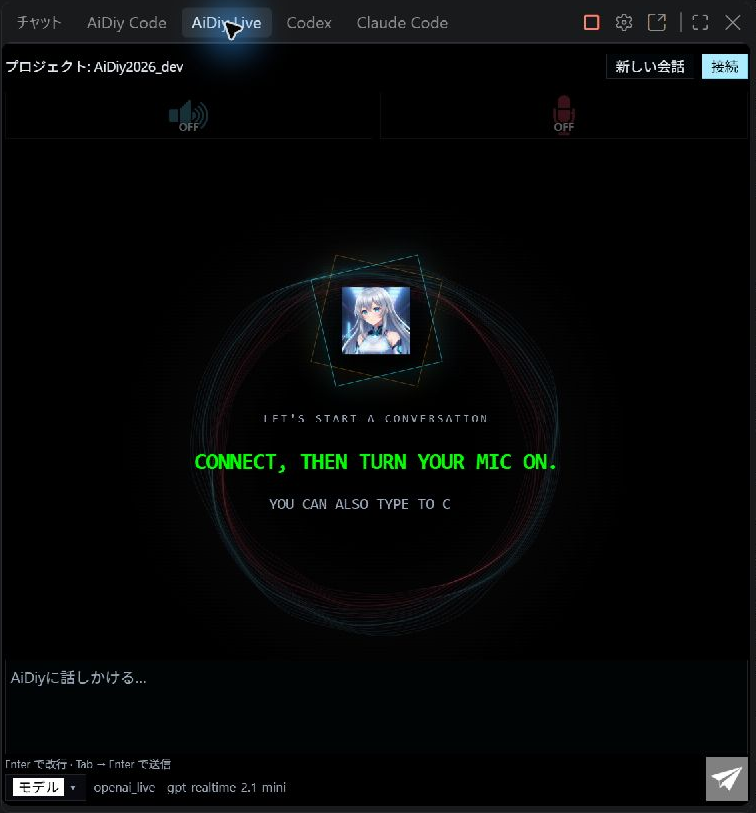
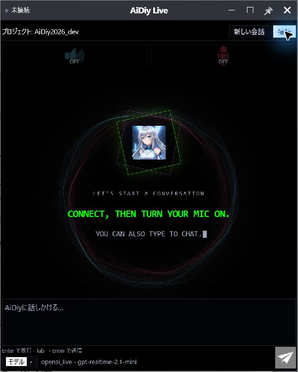

# Live 操作編 — 操作ガイドとセルフテスト

## 総合評価

**総合評価：✅ OK（記載した確認範囲）。** Gemini・OpenAIの挨拶への実回答と音声データ、OpenAIの画像添付を確認しました。FreeAIの実応答は未確認、Gemini／FreeAIの画像認識は調査保留です。実マイク入力と人による音声聴取は未テストです。

前半は起動から終了までの操作ガイド、最後の章は追加テストと確認範囲です。図番号は章番号と掲載順を表し、試験ケースIDとは区別します。

## 始める前に

[システム起動編](./セルフテスト,aidiy_diag,システム起動編.md)で必要なバックエンドを起動し、[ランチャー編](./セルフテスト,aidiy_diag,ランチャー編.md)からアプリを開きます。単独起動コマンドは `aidiy_live` です。接続先と作業フォルダを確認します。音声を使う場合は入力・出力機器も確認します。

## 1. 起動・モデル選択・会話

1. Diagの「アプリ起動」でLiveを開き、プロジェクト名を確認します。
2. 下部の「モデル」を押し、「ライブ AI」「モデル」「音声」を選びます。未接続の状態で「選択する」を押します。
3. 「接続」を押し、「会話準備ができました。」の表示を待ちます。
4. 準備完了から15秒待ち、「おはよう。挨拶を一文だけ返してください。」と入力して送信します。返答は最大60秒を目安に確認します。

単独Electronの起動画面です。接続前はマイク・スピーカーともOFFで、プロジェクト名と文字入力欄を確認できます。

接続前の画面確認では、左上の「未接続」、上部のプロジェクト名、スピーカー・マイクの「OFF」を読みます。下部の「モデル」から「ライブモデル・音声」を開くと、「ライブ AI」「モデル」「音声」の3項目を確認できます。変更しない場合は「キャンセル」で戻り、未接続と音声OFFが維持されていることを確認します。設定画面を開くことと、「接続」で会話を始めることは別の操作です。

短い会話の確認では「おはよう」だけでも送信できます。Enter単独は改行なので、右下の紙飛行機ボタン、または画面に表示されたTab → Enterで送信します。スピーカーON・マイクOFFを確認し、会話欄の自分の入力と実回答を見比べます。2026-11-01の実演では、既存のGemini Live接続で「おはよう」を1回送信し、挨拶とプロジェクトについての問いかけが返ることを実画面で確認しました。回答文は毎回同じとは限りません。ナレーションの段取りは[共通手順](./共通,セルフテスト解説・ナレーション方法.md)を参照します。

**図101：Live起動画面**

ライブ AIを `openai_live`、モデルを `gpt-realtime-2.1-mini`、音声を `marin` に選びました。

**図102：OpenAIモデル選択**

接続済みと準備完了の表示を確認しました。スピーカーON・マイクOFFで文字を送信します。

**図103：接続準備完了**

「おはよう、今日は一緒にワクワクすることを考えていこう！」という正式回答を確認しました。送信から60秒以内に回答を表示し、マイクはOFFのままです。

**図104：OpenAI初回応答**

## 2. 画像を添付する

1. OpenAIのLiveへ接続し、準備完了から15秒待ちます。
2. 画像を入力欄へドラッグ＆ドロップします。ドロップした時点でCoreへ送信されます。
3. 会話欄の「ファイル入力」、画像プレビューと「受信済み」の表示を確認します。
4. 画像の内容について質問し、正式回答を画像と照合します。

Web版で `openai_live / gpt-realtime-2.1-mini / marin` に接続し、PNGのドロップイベントから通常の添付処理を確認しました。OSの窓間ドラッグは確認範囲に含めません。

**図201：OpenAI画像添付（Web版）**

「添付画像の図形を左から順に、色と形だけ一文で答えてください。」と依頼し、「左から、赤い丸、青い四角、緑の三角です。」という回答を確認しました。画像の色と形が一致しています。

**図202：OpenAI画像への実回答（Web版）**

Gemini／FreeAIの画像認識は調査保留です。「未対応」とは断定しません。

## 3. VS Code拡張で使う

VS CodeのLiveビューを開き、プロジェクト・モデルと入力領域を確認します。CodeとLiveを導入した構成で表示を切り替え、実Webviewの外周枠と操作領域を確認しました。下の画面では未接続で、マイク・スピーカーをOFFにしています。拡張からの音声入力・AIの実回答を確認した画面ではありません。

Live拡張の入力・接続操作ができる画面です。

**図301：VSCodeLive**

## 4. 切断して終了する

会話を終えたら「切断」を押します。モデルを替える場合は切断後にモデルを選び直し、接続します。単独版では窓を閉じます。

単独ElectronとWeb版で切断を確認しました。切断後は「未接続」になり、接続ボタンへ戻ります。スピーカー・マイクともOFFです。切断では会話表示が初期画面へ戻るため、必要な回答は切断前に確認します。

**図401：切断後画面**

確認後はモデル・音声を試験前の選択に戻し、試験用のWeb画面・単独窓・VS Codeを終了しました。接続中の「変更して再接続」は確認対象に含めません。

## 5. 追加テストと確認範囲

### モデルと実行方式

| 対象 | 結果と条件 |
|---|---|
| OpenAI・単独Electron | モデル選択、接続、準備完了後15秒待機、文字による初回送信と正式回答、切断・終了を確認しました。 |
| OpenAI・Web版 | マイクOFFでPNGを送信し、図形の色と形に合う実回答を確認しました。 |
| Gemini・補助確認 | 実Electronで `gemini_live / gemini-2.5-flash-native-audio-preview-12-2025 / Zephyr` を選択し、準備完了から15秒待機して初回送信しました。「おはようございます。」の実回答と音声データを確認しています。 |
| FreeAI | Liveの実応答は未確認です。別のモデルの成功をFreeAIの成功へ読み替えません。 |
| VS Code | Liveのみ・Codeのみ・両方の3構成で外周枠と操作領域を確認しています。図301は両拡張導入時の未接続画面です。 |

OpenAIの応答経路には `conversation.item.added` / `conversation.item.done` の未知イベント警告が記録される条件があり、文字応答の成立と分けて確認する対象です。

### 音声データと再生

| 対象 | 結果と条件 |
|---|---|
| Liveの正式回答と音声出力（406） | 通常AIコアへ本番のLiveConnectionで接続し、正式回答と43音声パケット（156,800バイト）を受信。さらに実Electronで本番LiveAudioを用い、133パケット（329,600バイト）を再生し、Analyser出力レベルの最大値1を確認。人による聴取確認ではなく、実再生APIと出力信号の確認。 |
| 実マイク入力（406） | WinMMの入力デバイス0台、出力デバイス1台。実入力・音声認識は環境制限のため未テスト・判定対象外です。マイクOFFのまま文字入力で確認しています。模擬入力の成功と混同しません。 |

### 共通処理と未確認項目

Code／Live添付16件、共通添付9件、入力ファイル保存8件の成功結果を共用し、両冊子で二重集計しません。他形式・上限・送信途中切断・Web再表示時のマイク状態をすべて実画面で確認した判定ではありません。

次の表は確認条件と期待結果です。405全体の合格を示す表ではなく、406の実結果は上記の機器条件・再生結果に限ります。音声入力は環境制限のため未テストです。

### 接続・入力の確認項目

| ID | 操作 | 期待結果 |
|---|---|---|
| 405 | Liveのモデル再接続失敗と復旧、Webパネル非表示・再表示 | 再接続失敗で会話・下書きを失わない。非表示時のマイク停止と再表示時の状態を確認し、意図せず録音を再開しない。 |
| 406 | 現在の入力機器で音声入力し、音声応答を確認 | 入力・返答を別々に確認する。音声認識、再生API、人の聴取のどれで確認したか明記する。機器不足を合格済みにしない。 |

### 長押しドラッグの実機確認（2026-11-02）

Windows実機で `mouse_long_press_drag`（保持0.8秒、移動0.6秒。Browser全画面は移動0.8秒）を使用。直前の画面から対象を同定し、移動後の実画面とOSの窓位置を照合します。入力欄・ボタンの除外判定は下記の実施対象に限定します。位置は画面座標の (x,y) です。

未接続の標準窓 (1303,10) → (1103,50) の背景移動、入力欄での移動抑止を実機確認。マイク・音声接続・AIへの送信なし。接続後状態は今回未確認。

解放後にポインターを離して追従が残らないこと、通常UIが使えることを確認。Diag以外の今回起動した窓は通常UIで終了しました。1〜2pxの寸法丸めは補正を追加していません。全セルフテストの再実行や、未実施モードの合格を意味しません。
