# AiDiy Slack 操作編 — 操作ガイドとセルフテスト

> 文書: `セルフテスト,aidiy_slack,操作編.md` | 実装: `frontend_channels/slack/`（`panel/`、`src/接続/Bot接続.ts`、`src/接続パネル/パネル操作.ts`）、`backend_diag/起動/アプリ起動.mjs`

> 本書はセルフテスト結果を、操作説明・解説書としても読みやすく整理しています。再テスト後は結果・注意書き・エビデンスを更新し、章立て・操作手順・図解の配置などの様式を維持します。

## 総合評価

**総合評価：✅ OK（記載した確認範囲）。最終確認日：2026年10月31日、Windows。** Diagのミニ表示からの起動、自動接続、「おはよう」への応答、スレッドでの会話の継続、状態確認コマンド、接続中のモデル設定と再接続、切断、二重起動の防止、終了を、実画面で確認しました。

同日、コード欄を「aidiy_hermes」固定＋モデル選択に変え、保存を `~/.aidiy/aidiy_slack.json`（`code_name` / `code_model`）の1ファイルにまとめ、接続中の終了確認を加えました。変更後の実装で、保存値を消した初回起動（設定画面で停止）→「接続」で保存・接続→「おはよう」への応答→接続中の「×」で終了確認（キャンセルで継続・終了で全プロセス終了）→再起動で前回値の自動接続→切断中の「×」はそのまま終了、を実画面で確認しました。第3章の画像は変更前の画面（「コード AI」の選択欄）です。

AiDiyの各サービス（Tools／MCP・Core・Apps・Task／Team・Web）が稼働中の状態で実施しました。Slackへの投稿は、aidiy_chrome_devtoolsで開いたSlackの専用チャンネル `#aidiy` に入力しました。パネルとDiagの操作はaidiy_windows_controlによるマウス・キー操作、終了確認のダイアログはUI Automationでの読み取りと操作、撮影はaidiy_desktop_capture・aidiy_chrome_devtoolsです。モデルはHermesの既定（`auto`）で応答と継続を確認しました。

自動試験はSlack 62件、Python 14件、DiagのSlack起動7件がすべて成功しました。

| 範囲 | 判定 |
|---|---|
| 起動・自動接続・二重起動の防止・終了 | ✅ OK（実画面） |
| 「おはよう」への応答、スレッドでの継続、状態確認コマンド | ✅ OK（実画面、Hermes の既定モデル） |
| 接続中のモデル設定・適用して再接続・切断・再接続 | ✅ OK（実画面） |
| 初回起動はモデル設定画面から | ✅ OK（実画面。保存値を消して確認） |
| 接続中の終了確認・切断中はそのまま終了・再起動で自動接続 | ✅ OK（実画面） |
| VPN・社内プロキシ経由の接続、Mac／Linux実機、長時間連続運転 | PASS（環境依存・判定対象外）：未実施です。プロキシの経路選択と429再試行は自動試験で確認しています。 |

[PDF版](./セルフテスト,aidiy_slack,操作編.pdf)を同じ内容で提供します。

## 始める前に

- Slackアプリ（Bot）を作成し、Bot Token Scopesに `chat:write` と `channels:history` を付けます。専用チャンネル（例：`#aidiy`）にBotを追加します。
- `_config/AiDiy_key.json` に `slack_bot_token`（`xoxb-`で始まる）、`slack_team_id`、`slack_allowed_user_id`、`slack_text_channel_id` を設定します。トークンは画面やログに表示しません。
- `python frontend_channels/slack/_setup.py`（またはルートの `_setup.py`）で導入します。導入方法と設定の詳細は `frontend_channels/slack/README.md` を参照します。
- Diagの起動とプロジェクト選択は[システム起動編](./セルフテスト,aidiy_diag,システム起動編.md)と[アプリ起動編](./セルフテスト,aidiy_diag,アプリ起動編.md)を参照します。

## 1. Diagから起動して自動接続する

Diagの「ランチャー表示」を押してミニ表示にします。Discordの右隣にある「Slack」のアイコンを押すと、画面上部に小さなAiDiy Slackパネルが開きます。前回の設定が保存されていれば、そのまま自動で接続します。

成功の目印は、左上の「接続済み」（緑の点）、右上の「切断」ボタン、プロジェクト行の下の「CODE ON」、画面下部の「モデル ▾」と現在のモデル表示です。もう一度起動しても新しい画面は増えず、開いているパネルが前面に出ます。

| ケース | 確認結果 |
|---|---|
| SL-101 Diagミニ表示から起動 | ✅ OK：ミニ表示でDiscordの右隣にSlackのアイコンを確認し、押してパネルが開くことを確認 |
| SL-102 自動接続 | ✅ OK：保存済みの設定で自動接続し、「接続済み」・「CODE ON」・下部のモデル表示を確認 |
| SL-103 二重起動の防止 | ✅ OK：接続中に `aidiy_slack` をもう一度実行し、パネルが1つのままで、接続も増えないことを確認 |

Diagのミニ表示です。2段目にDiscordとSlackが並び、作業フォルダが表示されています。

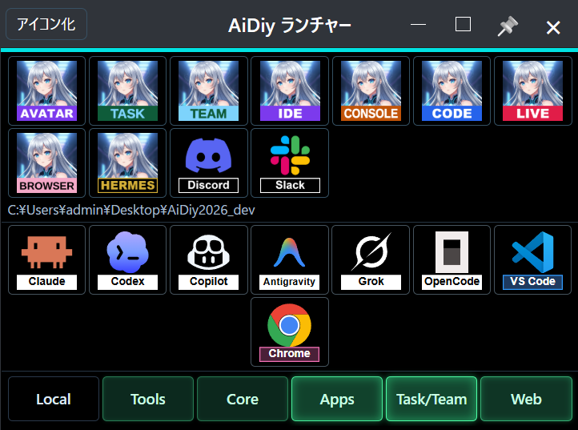

Slackを押した後のパネルです。前回の設定で自動接続し、「接続済み」と「CODE ON」が表示されました。

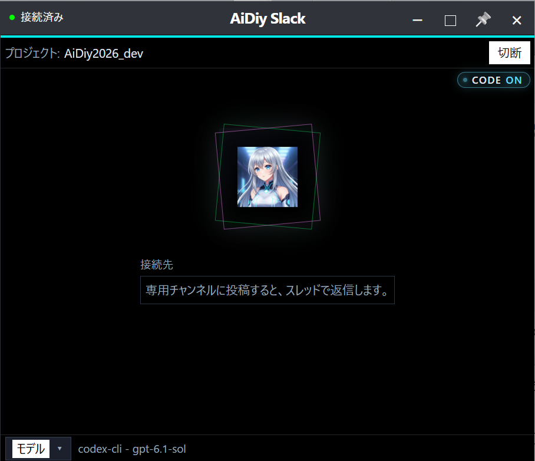

## 2. 専用チャンネルで話しかける

Slackの専用チャンネルに、そのまま投稿します。Botが投稿にスレッドで返信します。先に「考えています…」と返信し、回答ができるとその返信を書き換えます。スレッドの中で続けて返信すると、同じ会話として続きます。

パネルの中央には最後のやり取りを1件表示します。投稿は「あなた」、回答は「AiDiy」の名前で、1文字ずつ表示され、約1分で消えます。`!aidiy status` で状態、`!aidiy stop` で停止、`!aidiy new` で会話のやり直し、`!aidiy help` で使い方を表示します。

| ケース | 確認結果 |
|---|---|
| SL-201 「おはよう」への応答 | ✅ OK：投稿後すぐに「考えています…」が付き、「おはようございます。今日は何を進めましょうか？」に書き換わることを確認。パネルに「あなた」と「AiDiy」のやり取りを表示 |
| SL-202 スレッドでの継続 | ✅ OK：「slack総合試験開始します」の後、同じスレッドで「試験中ですか？」と尋ね、「はい、Slack総合試験の応答確認中です。このメッセージにも応答できています。」と、前の投稿を踏まえた回答を確認 |
| SL-203 状態確認コマンド | ✅ OK：スレッドで `!aidiy status` を送り、「Code: 待機中」が返ることを確認 |

「おはよう」を投稿した直後のパネルです。中央に「あなた」と投稿の内容が表示されました。

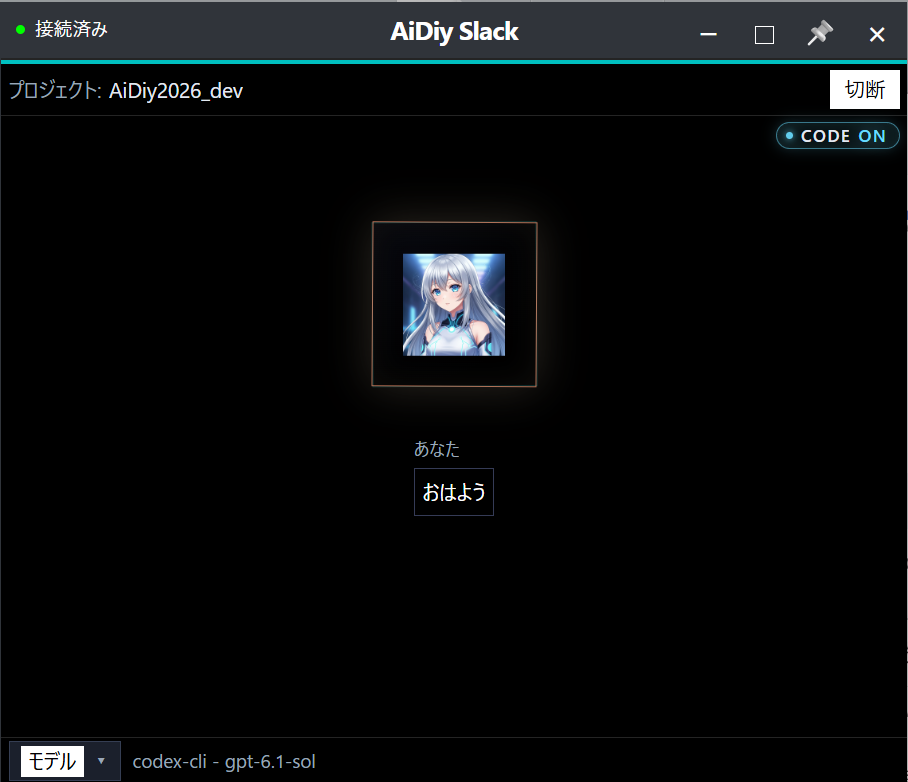

回答ができた後のパネルです。「AiDiy」の名前で回答が緑の文字で表示されました。

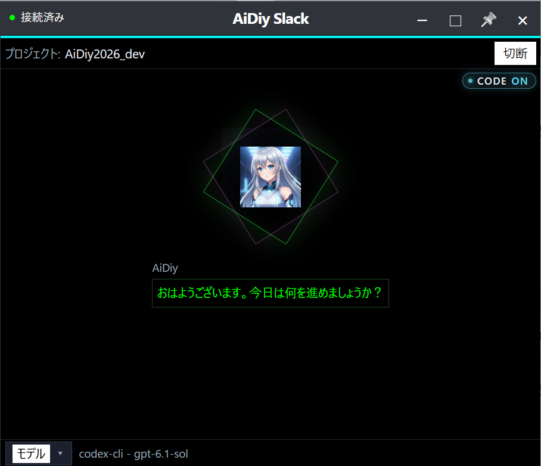

Slackの画面です。「おはよう」へのスレッドに、AiDiyアプリの回答が返っています。

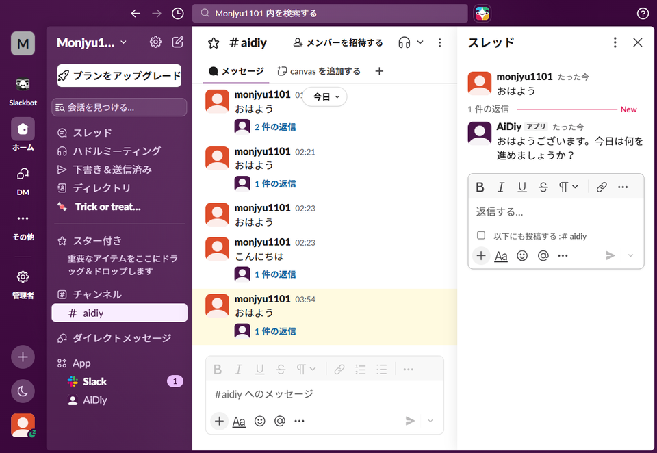

スレッドの続きに答えたときのパネルです。

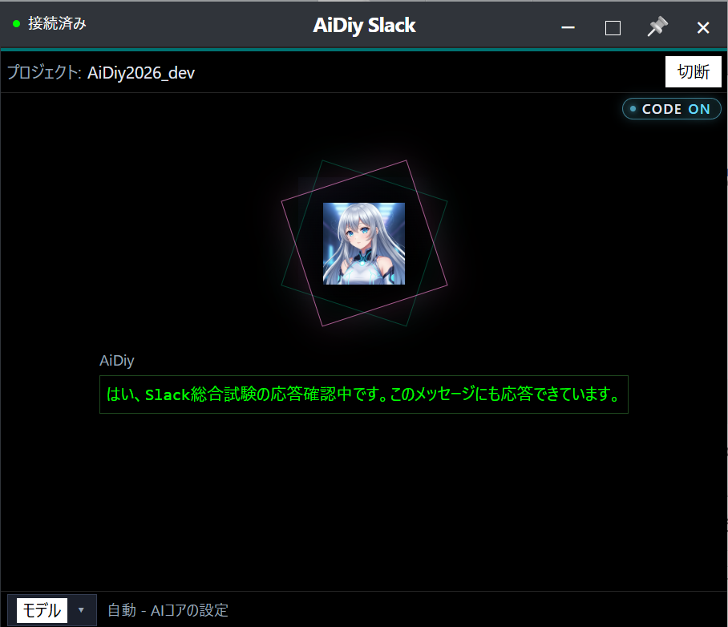

Slackの画面です。「slack総合試験開始します」のスレッドで、2回目の質問にも会話を引き継いで答えています。

同じスレッドで `!aidiy status` を送ると、「Code: 待機中」と返りました。

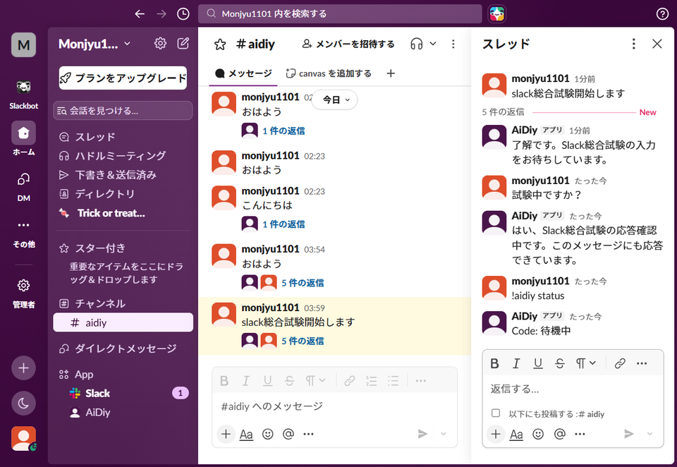

## 3. モデルを変える・切断する・終了する

画面下部の「モデル ▾」を押します。接続中は設定欄が開き、接続したままモデルを選べます。コードは「aidiy_hermes」の固定表示で、モデルは aidiy_code と同じ `auto`（自動判定）／`same`（変更なし）／`codex_cli/same` などの CLI 名付き／`openai_oauth/gpt-…` の一覧から選びます。「適用して再接続」を押すと、いったん切断して選択を保存し、再接続します。「キャンセル」を押すと変更を戻し、接続を続けます。未接続のときは、押すと設定欄へ移ります。

右上の「切断」を押すと「未接続」になり、モデル選択の画面に戻ります。「接続」で再接続します。右上の「×」でパネルを閉じると、Botと実行中のコード要求も終了します。接続中に「×」を押すと「Slack に接続中です。終了しますか？」と確認し、「キャンセル」なら接続を続けます。切断中はそのまま終了します。

| ケース | 確認結果 |
|---|---|
| SL-301 接続中のモデル設定 | ✅ OK：接続済みのまま設定欄と「キャンセル」「適用して再接続」が開くことを確認 |
| SL-302 適用して再接続 | ✅ OK：コードAIを「自動選択」に変えて「適用して再接続」を押し、再接続と選択の保存、下部の表示「自動 - AIコアの設定」を確認 |
| SL-303 切断と再接続 | ✅ OK：「切断」でモデル選択の画面に戻り、「接続」で再び接続済みになることを確認 |
| SL-304 終了 | ✅ OK：「×」でパネルを閉じ、パネル・Bot・子プロセスが残らないことを確認 |
| SL-305 接続中の終了確認 | ✅ OK：接続中の「×」で確認が出て、「キャンセル」で接続が続き、「終了」で全プロセスが終了することを確認。切断中の「×」は確認なしで終了 |

接続中に「モデル」を押した画面です。「接続済み」のまま設定欄が開きました。

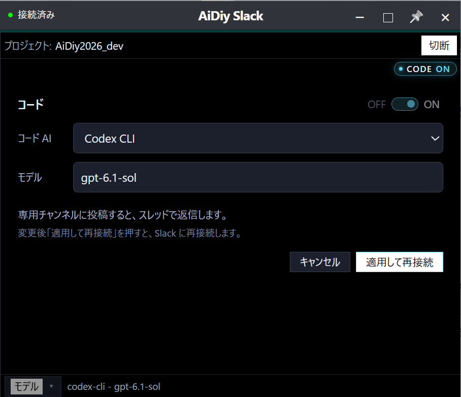

変更前の画面（「コード AI」の選択欄）で、コード AI を「自動選択」に変えたところです。現在はコード欄が「aidiy_hermes」の固定表示で、モデルだけを選びます。

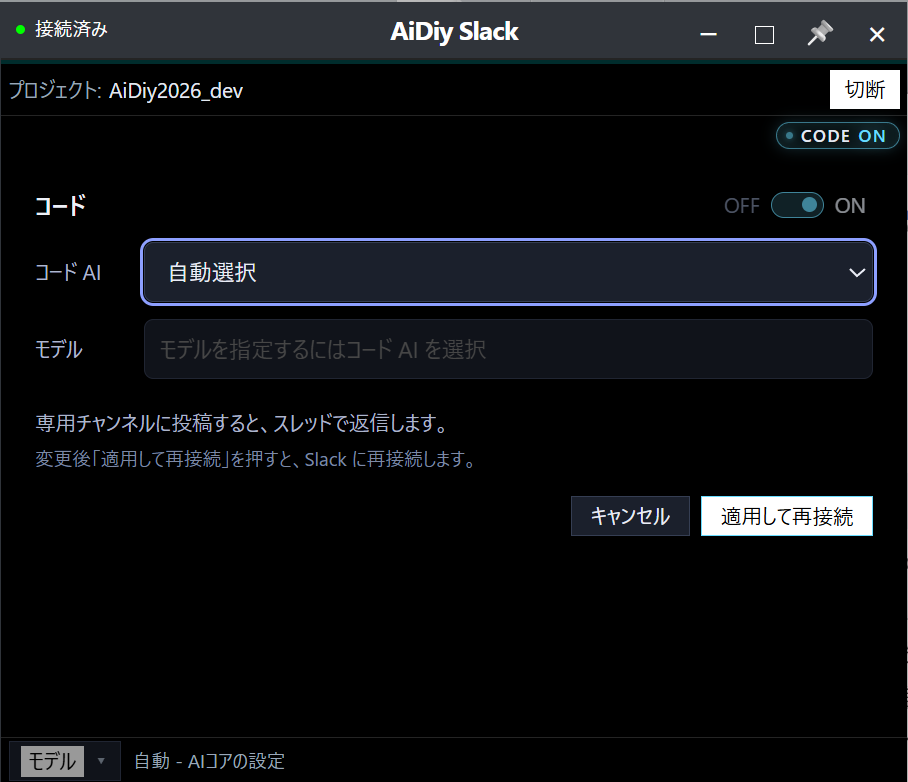

「適用して再接続」の後の画面です。再び「接続済み」になり、新しいモデルで動いています。

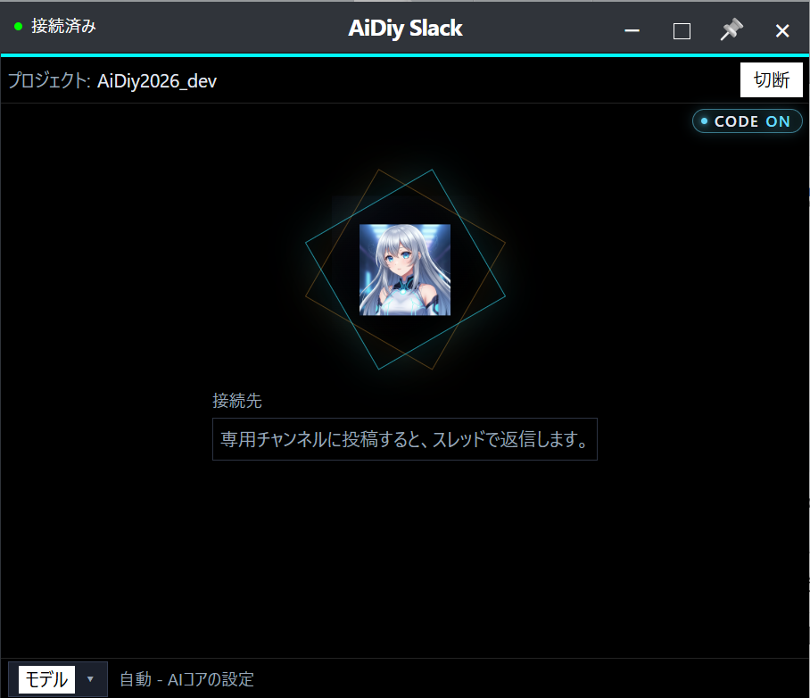

「切断」を押した後の画面です。「未接続」になり、モデル選択の画面に戻りました。

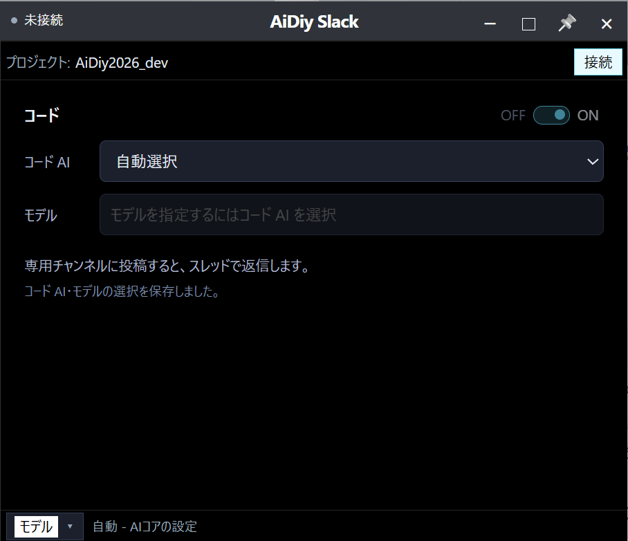

「接続」を押した後の画面です。再び「接続済み」になりました。

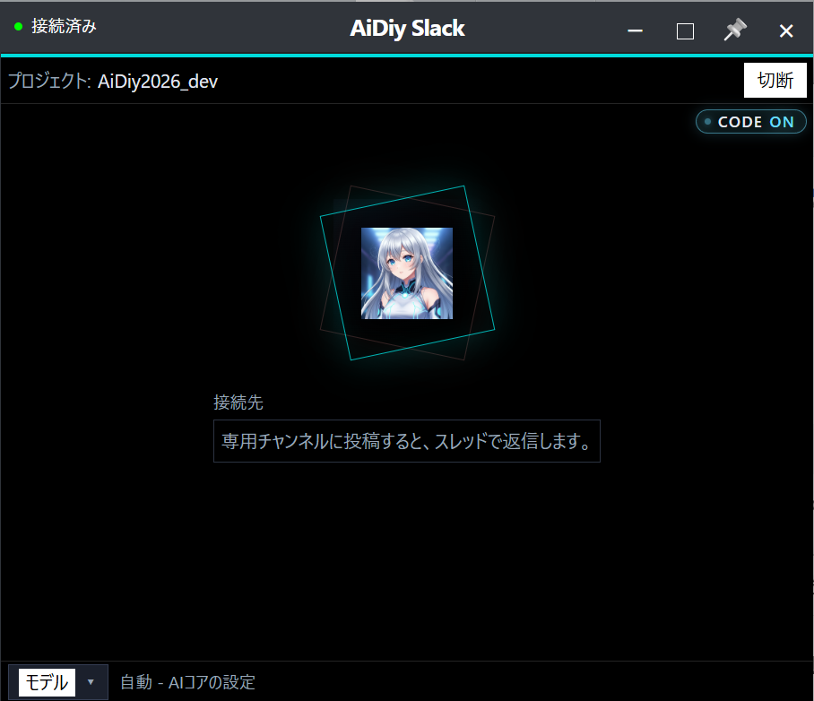

## 4. 初めて起動したとき

設定が一度も保存されていない場合は、自動接続せず、モデル設定の画面から始まります。「初回起動です。モデルを確認して『接続』を押してください。次回からは起動時に自動で接続します。」と表示され、「接続」ボタンが点滅します。「接続」を押すと選択が保存され、次回から起動時に自動で接続します。Discord版も同じ動きです。

| ケース | 確認結果 |
|---|---|
| SL-401 初回起動 | ✅ OK：保存値（`aidiy_slack.json`）を消して `aidiy_slack` を起動し、接続せずに設定画面（コード「aidiy_hermes」、モデル「auto（自動判定）」）と案内が表示され、保存ファイルも作られないことを確認 |
| SL-402 保存と再起動 | ✅ OK：「接続」で `aidiy_slack.json`（`code_name`: `aidiy_hermes`、`code_model`: `auto`）が保存されて接続し、終了後の再起動で前回値のまま自動接続することを確認 |

初回起動の画面です（変更前に隔離条件のブラウザ版で撮影。現在はコード欄が「aidiy_hermes」の固定表示です）。未接続のまま、案内と「接続」ボタンが表示されました。

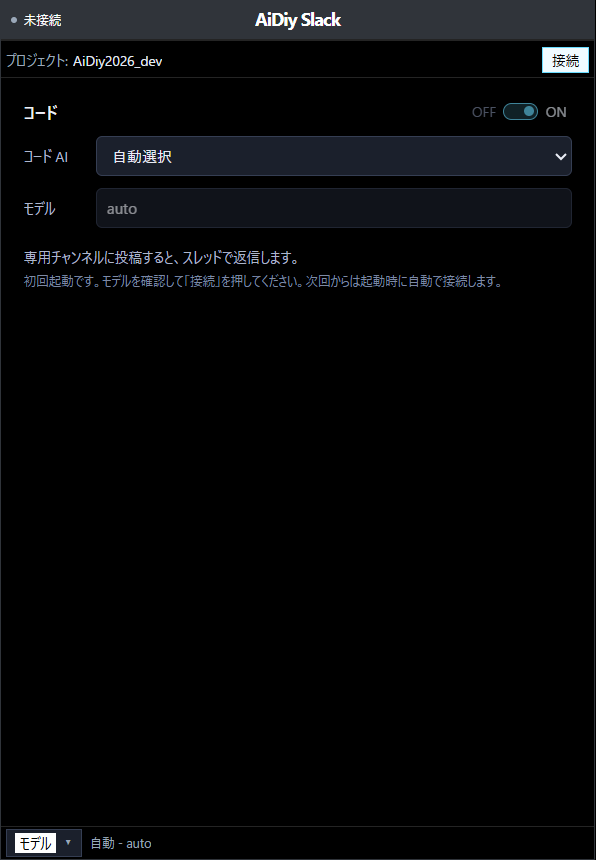

## 5. 自動試験

`frontend_channels/slack` で `npm test` と `npm run check` を実行し、Discord版と同じ観点の試験62件（画面・窓・終了確認・起動入口・Webサーバー・配置・配布物・通信・コマンド・設定・パネル操作・保存ファイルと旧形式からの移行・Hermesへの引数変換）が成功しました。Python側は `python -m unittest frontend_channels/slack/checks/test_lifecycle.py` の14件（セットアップ・起動・停止・プロセス照合・ランチャー）、Diagは `node --test backend_diag/checks/slack-launcher.check.mjs` の7件が成功しました。画面のソースと配布物の一致も確認しました。

## 補足

- モデルに `codex_cli/…`（Codex CLI 経由）を選ぶと、スレッドの続きで前の投稿を参照しない場合があります（参考結果）。Slack側は前回のセッションを指定して再開していますが、Codex CLI経由では会話の履歴が引き継がれませんでした。同じ確認でHermesの既定モデル（`auto`）は履歴を引き継ぎました。スレッドで会話を続ける用途には `auto` などHermes本体のモデルを使います。
- 保存は `~/.aidiy/aidiy_slack.json` の1ファイルです。`code_name` は将来の別スタンドアロンハーネス用の欄で、現在は `aidiy_hermes` だけを実行します。旧形式の `aidiy_slack_code_model.json` は初回の読込で移して削除します。
- 試験で投稿した内容は、専用チャンネル `#aidiy` の「おはよう」と「slack総合試験開始します」の2スレッドです。
- 受信は約3秒ごとの定期取得です。投稿から「考えています…」が付くまで数秒かかることがあります。回答までの時間は質問とモデルによります（今回は約10〜20秒）。
