# AiDiy Slack 操作編 — 操作ガイドとセルフテスト

## 総合評価

✅ OK（記載した確認範囲）。Windowsの実パネルとSlack専用チャンネルで、起動・自動接続、初回設定、投稿へのAI回答、会話継続、モデル設定の取消と再接続、切断・終了、状態確認等のコマンドを確認しました。会話の継続は同じスレッドで確認しています。

1〜4章が操作ガイド、5章が追加テストです。現行画面20点を掲載しています。Nodeの自動・隔離試験82件、Pythonの14件、DiagのSlack起動7件が成功し、型検査と配布画面の一致も確認しました。[PDF版](./セルフテスト,aidiy_slack,操作編.pdf)を参照できます。

## 始める前に

- `aidiy_slack`とHermesの導入・認証を済ませます。導入とサービス側の設定は[Slack README](../../frontend_channels/slack/README.md)を参照します。
- 専用チャンネルと許可利用者を設定します。Botトークンは画面や資料に載せません。
- Diagの起動と作業フォルダ選択は[システム起動編](./セルフテスト,aidiy_diag,システム起動編.md)と[ランチャー編](./セルフテスト,aidiy_diag,ランチャー編.md)を参照します。

SlackはHTTPSでポーリングし、新しい投稿へスレッドで返信します。通常は3秒間隔です。最後の会話から10分でアイドリングモードに入り、6秒間隔になります。新しい会話を受信すると3秒へ戻ります。Socket ModeやLive音声は使いません。

## 1. 起動して接続する

1. Diagで作業フォルダを選び、ミニランチャーの「Slack」を押します。端末からは`aidiy_slack`で起動できます。
2. 「プロジェクト」が選んだフォルダであることを確認します。
3. 初回は自動接続せず、モデル設定画面から始まります。コードは`aidiy_hermes`固定で、モデルを選んで「接続」を押します。
4. 保存済みの設定がある場合は、起動時に前回の設定で自動接続します。

**完了の目印：** 左上の「接続済み」と緑の点、右上の「切断」、「CODE ON」、下部の現在のモデル表示です。

ミニランチャーのSlackを押して、選んだプロジェクトのパネルを開きます。

**図101：ミニ表示**

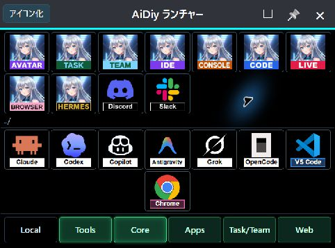

保存設定がない条件では、未接続の設定画面で停止しました。コードはaidiy_hermes、モデルはautoです。接続前に保存ファイルが作られないことも確認しました。

**図102：初回起動**

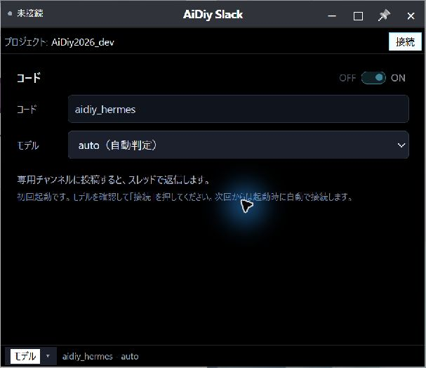

保存済みの設定で起動すると自動接続しました。初回画面の「接続」による保存も確認し、選択内容は元の設定と一致しました。

**図103：自動接続**

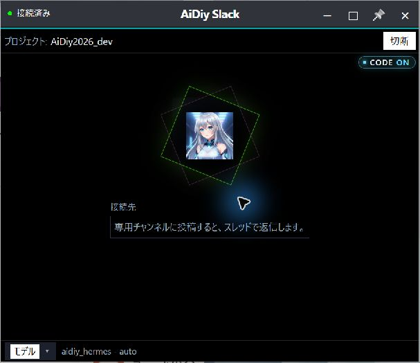

## 2. 専用チャンネルで話しかける

1. 許可した利用者で、設定した専用テキストチャンネルを開きます。
2. 短い文を普通に投稿します。メンションや接頭辞は不要です。
3. 投稿にAIの回答が返ることと、パネル中央に最後のやり取りが表示されることを確認します。
4. 同じスレッドへ続けて質問し、前の投稿を踏まえた回答かを読みます。

**完了の目印：** Slack上で回答を読めることです。パネル表示だけで、投稿先への回答成功とは判定しません。パネルには最後のやり取りを1件表示し、約1分で消します。

受信の3秒／6秒は、1回の取得処理が終わってから次の取得までの待ち時間です。投稿の検出とAIの回答生成は別の時間がかかります。新しい投稿には、まず「考えています…」と返信し、回答で書き換えます。

確認にはHermesの`auto`を使い、「おはよう。合言葉は『銀の雲』です。短く挨拶し、合言葉を確認してください。」と投稿しました。続けて「さっきの合言葉を一言で教えてください。」と尋ねています。

投稿を受け付け、パネルに利用者の本文を表示しました。投稿者は「あなた」と表示します。

**図201：投稿表示**

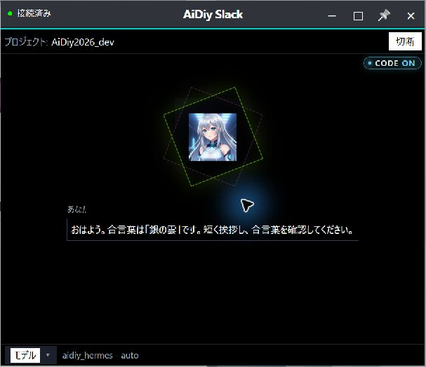

続きの質問に「銀の雲」と返したパネルです。空応答やエラーではなく、入力内容に合う回答を確認しています。

**図202：回答表示**

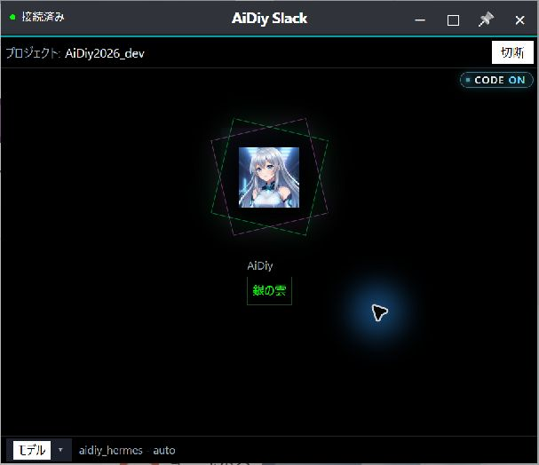

Slackの専用チャンネル「aidiy」の同じスレッドで、投稿・AI回答・続きの質問を確認できます。合言葉を質問に書き直さなくても「銀の雲」と返り、会話の文脈が引き継がれました。

**図203：スレッド返信**

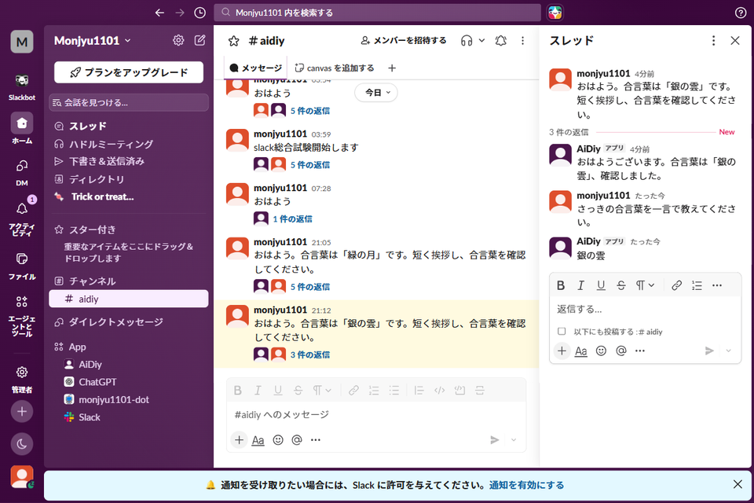

## 3. モデルを選び直す

1. 下部の「モデル ▾」を押します。接続中は、接続を続けたまま設定欄が開きます。
2. コードは`aidiy_hermes`の固定表示です。モデルを一覧から選びます。
3. 「キャンセル」は変更を戻し、接続を続けます。「適用して再接続」は切断・保存・再接続します。
4. 再び「接続済み」になり、下部のモデル表示が選択内容と一致することを確認します。

設定欄のボタンが見えない場合は、欄内を下へスクロールします。`auto`は自動判定、`same`は変更なし、`codex_cli/same`はCLI指定、`openai_oauth/…`はHermesのプロバイダとモデルの指定です。選択は`~/.aidiy/aidiy_slack.json`に保存します。

接続済みのまま「モデル」を開きました。固定のコード欄と、編集できるモデル欄が表示されます。

**図301：接続中のモデル設定**

モデルをsameへ変更したところです。「キャンセル」と「適用して再接続」を区別して操作します。

**図302：モデル選択例**

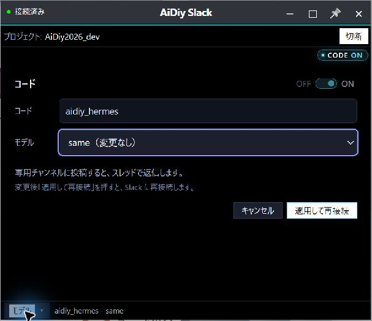

キャンセルするとautoの表示へ戻り、接続は継続しました。保存ファイルもautoのままでした。

**図303：取消後の接続継続**

設定欄を開き直し、元のautoで「適用して再接続」を押します。

**図304：適用して再接続**

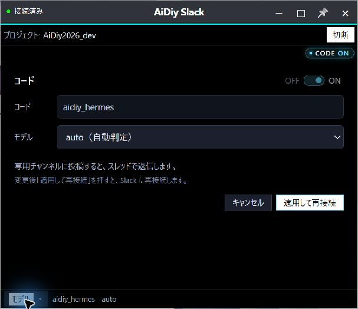

再び接続済みとなり、モデルはaidiy_hermes - autoです。保存値の一致も確認しました。

**図305：再接続完了**

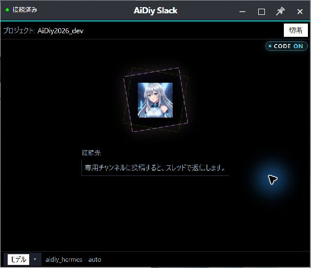

## 4. 切断・再接続・終了する

1. 右上の「切断」を押します。「未接続」のモデル設定画面に戻ります。
2. 再び使うときは設定を確認し、「接続」を押します。
3. 終了するときは右上の「×」を押します。接続中は終了確認が表示されます。
4. 「キャンセル」なら接続を続け、「終了」ならパネル・Bot・子プロセスを終了します。切断中は確認なしで終了します。

**完了の目印：** 切断は「未接続」と「接続」、再接続は「接続済み」、終了はパネルが閉じたことを確認します。停止の確認では、このアプリのBotや子プロセスも照合します。

「切断」で未接続の設定画面へ戻りました。

**図401：切断**

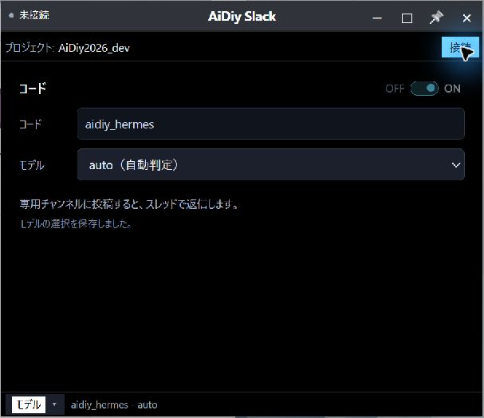

「接続」で再び接続済みとなりました。

**図402：再接続**

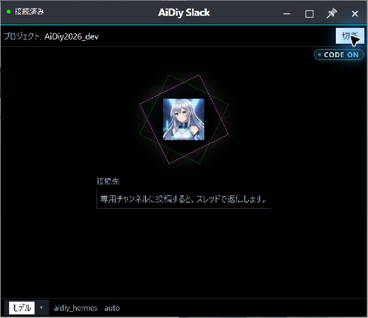

接続中に「×」を押すと、終了確認を表示します。

**図403：接続中の終了確認**

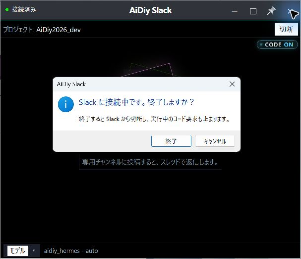

キャンセルすると確認が閉じ、接続を継続しました。確認を開き直した「終了」ではパネルが閉じました。切断中の「×」は確認なしで終了することも確認済みです。

**図404：終了取消で接続継続**

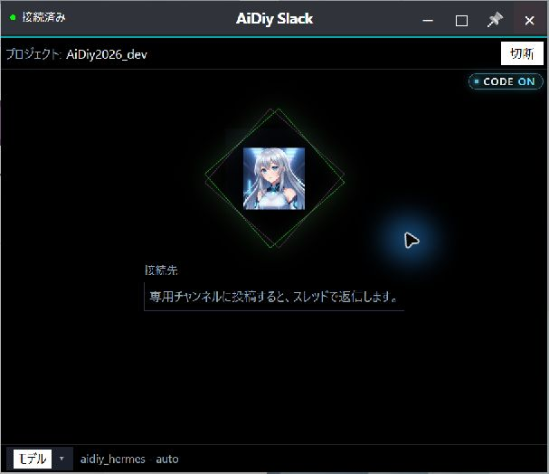

## 5. 追加テスト

### 状態確認と会話の操作

専用チャンネルの同じスレッドへ`!aidiy status`を送り、「Code: 待機中」が返りました。

**図501：状態コマンド**

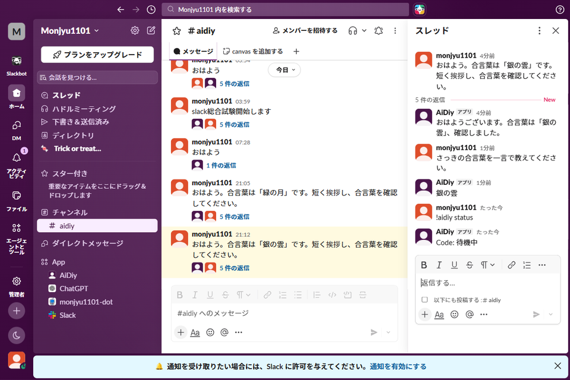

`!aidiy help`を送り、専用チャンネルへの話しかけ方が返りました。

**図502：ヘルプ表示**

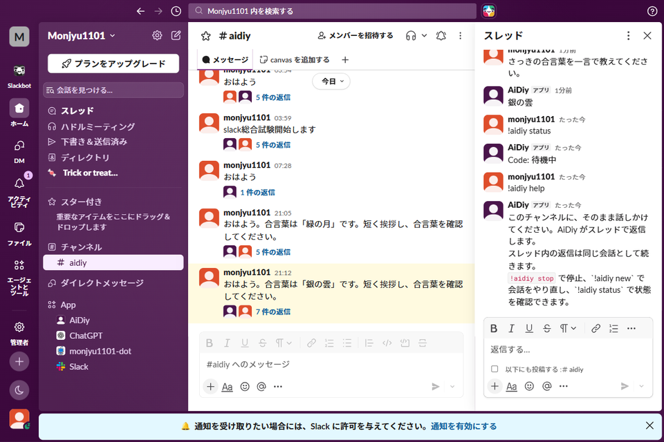

処理がない状態の`!aidiy stop`には「実行中のコード要求はありません。」が返りました。実行中の要求を中断した確認とは区別します。

**図503：待機中の停止**

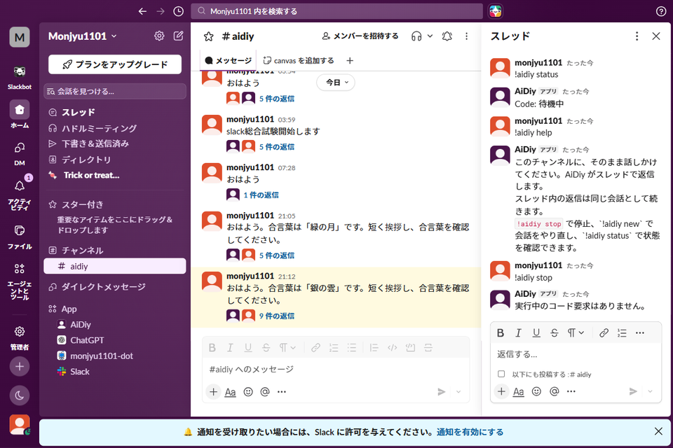

`!aidiy new`に、新しいコード会話を開始する案内が返りました。

**図504：会話のリセット**

### 単一起動

接続中に`aidiy_slack`をもう一度起動しました。同じパネルが表示され、ウィンドウIDとパネル1枚の維持を照合しました。

**図505：単一起動**

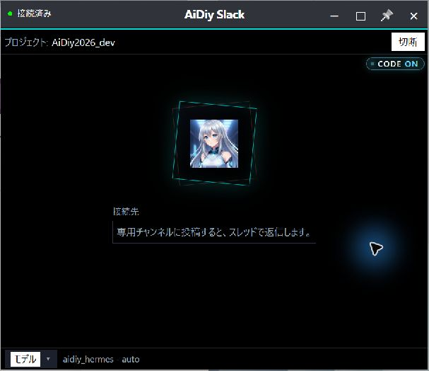

### 確認した条件

| ケース | 確認済みの結果 |
|---|---|
| SL-101 Diagミニ表示から起動 | Slackアイコンからパネルが開く |
| SL-102 自動接続 | 保存済み設定で接続し、接続済み・CODE ON・モデルを表示 |
| SL-103 二重起動の防止 | パネル・接続が増えず、既存パネルを表示 |
| SL-201 投稿への応答 | 「おはよう」へのAI回答をパネルとSlackで確認 |
| SL-202 スレッドでの継続 | Hermesの既定モデルで前の投稿を踏まえた回答 |
| SL-203 状態確認 | 同じスレッドのstatusに「Code: 待機中」と回答 |
| SL-301 接続中のモデル設定 | 接続を続けたまま設定欄と適用・取消を表示 |
| SL-302 適用して再接続 | 選択の保存と再接続を確認。現行の固定コード欄とautoの保存値を確認 |
| SL-303 切断と再接続 | 未接続の設定画面へ戻り、再び接続済みになる |
| SL-304 終了 | パネル・Bot・子プロセスを回収 |
| SL-305 接続中の終了確認 | 確認のキャンセルは接続継続、終了は全プロセスを回収。切断中は確認なしで終了 |
| SL-401 初回起動 | 保存値がない条件では設定画面で停止し、接続前に保存ファイルを作らない |
| SL-402 保存と起動 | 「接続」でaidiy_hermesとautoを保存し、終了後の起動で前回値の自動接続 |

### 通信方式と表示

**通常モード：3秒間隔。** 起動直後と会話直後は3秒ごとにポーリングします。**最後の会話から10分でアイドリングモード：6秒間隔。** 新しい会話を受信すると3秒へ戻ります。許可された利用者の投稿とBotの回答を会話として扱い、回答待ちの間も通常間隔を保ちます。通信失敗時は別の再試行待機を使います。

アイドリングの6秒間隔は、利用者指定により実時間待機の試験を省略しています。時計を進める隔離試験で境界と復帰を確認しました。アイコンの上下動は12秒周期、周囲の四角形は40秒で1回転し、動きを半分の速度にしています。

### 自動・隔離試験と限界

Nodeの82件、Pythonの14件、DiagのSlack起動7件が成功しました。型検査と配布画面の一致も確認しています。自動試験は合成通信や一時設定を含み、実サービスの確認は各章の投稿・AI回答・画面結果で判定します。

`codex_cli/…`では、スレッドの続きで前の投稿を参照しなかった参考結果があります。会話継続の合格はHermesの`auto`での確認です。Slack版には音声会話機能がありません。

VPN・社内プロキシ経由の実接続、Mac／Linux実機、長時間連続運転は未実施・判定対象外です。実行中の長いコード要求の中断は、実チャンネルでは未実施です。

### 終了時の状態

モデル設定は元の内容へ復元し、試験用パネルとBotを終了しました。Diagと共有サービスは継続稼働しています。試験投稿は専用チャンネルに残しています。ブラウザの元の下書きも復元しました。

### 長押しドラッグの実機確認（2026-11-02）

Windows実機で `mouse_long_press_drag`（保持0.8秒、移動0.6秒。Browser全画面は移動0.8秒）を使用。直前の画面から対象を同定し、移動後の実画面とOSの窓位置を照合します。入力欄・ボタンの除外判定は下記の実施対象に限定します。位置は画面座標の (x,y) です。

既存ランチャーの --no-connect で起動し、未接続の標準窓 (650,10) → (710,50) の背景移動を実機確認。ピンボタン上の長押しからボタン外へ移動・解放しても窓が移動せず、ピン状態も変わらない。Bot接続・投稿は未実施。

解放後にポインターを離して追従が残らないこと、通常UIが使えることを確認。Diag以外の今回起動した窓は通常UIで終了しました。1〜2pxの寸法丸めは補正を追加していません。全セルフテストの再実行や、未実施モードの合格を意味しません。
