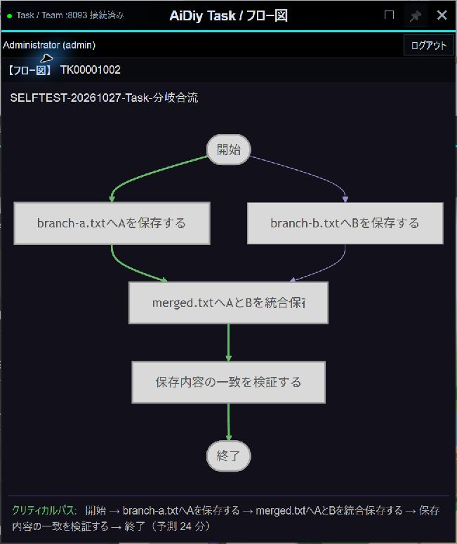
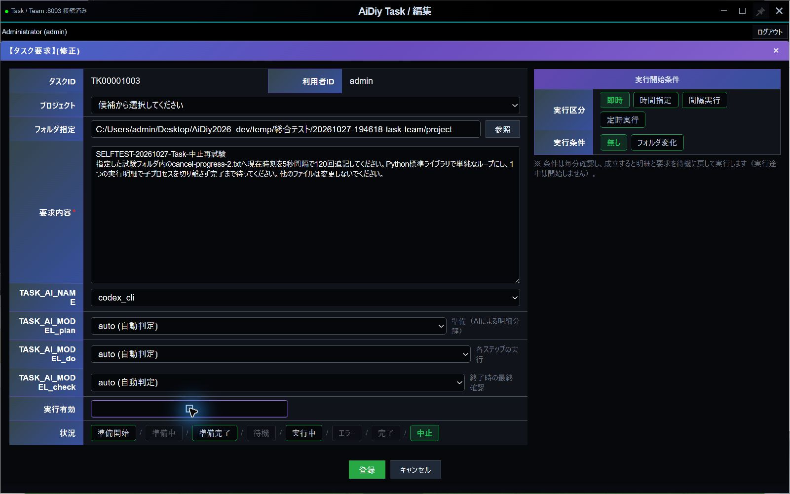
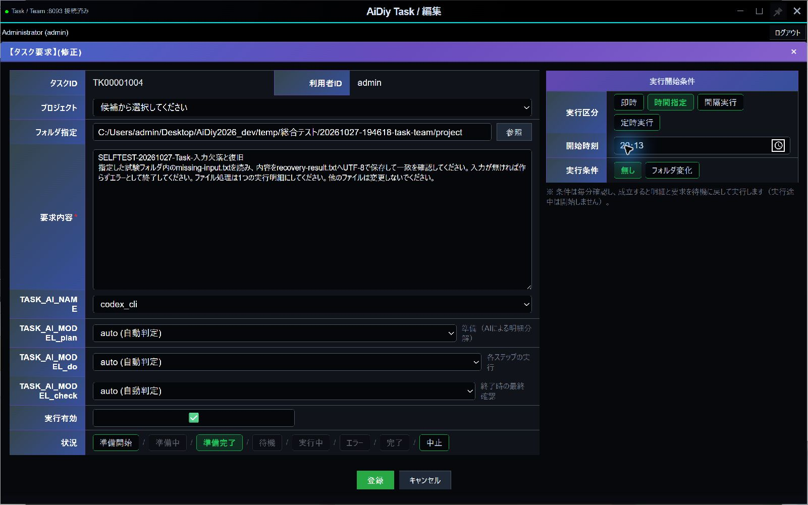
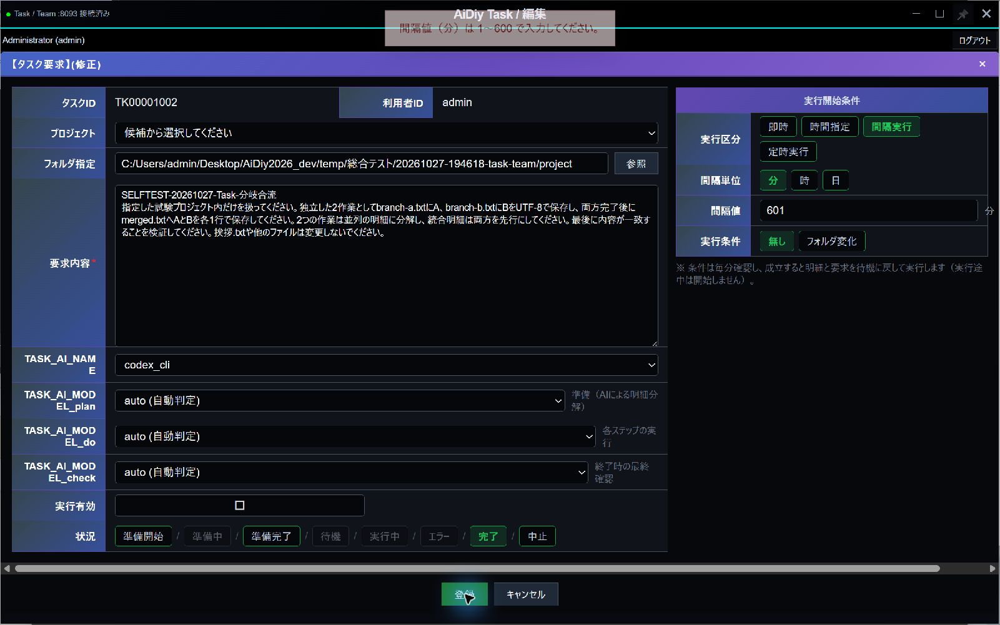
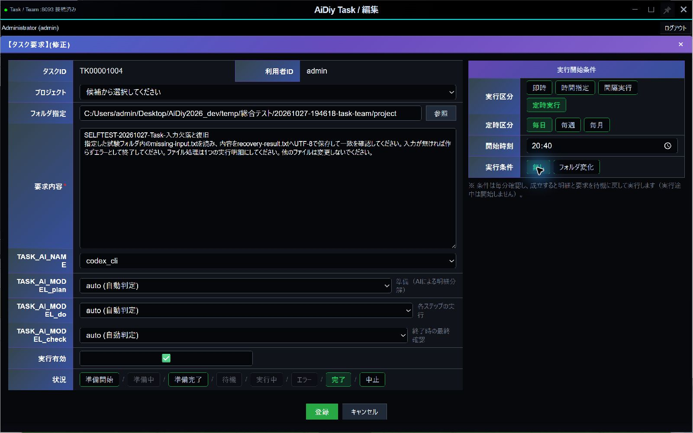
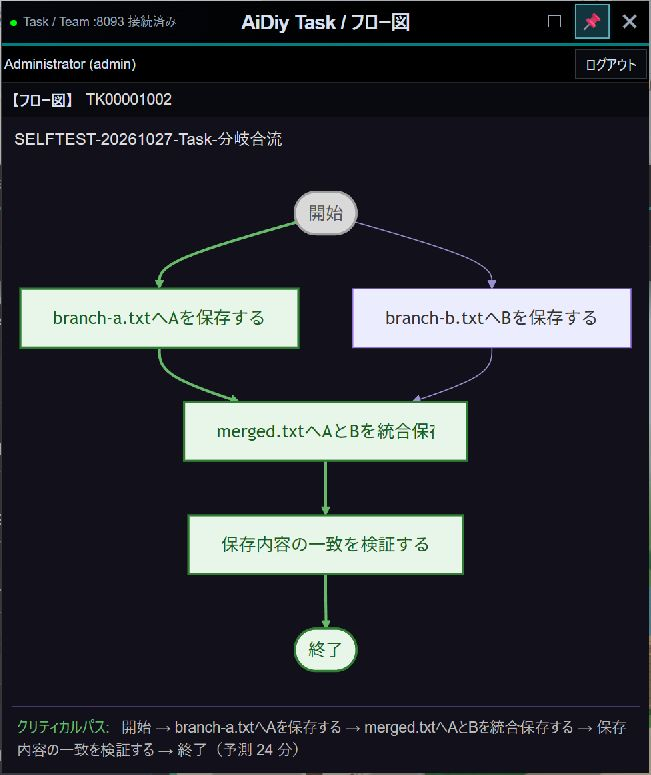
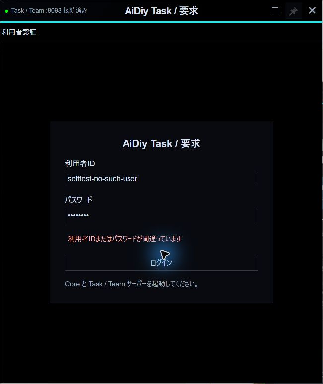
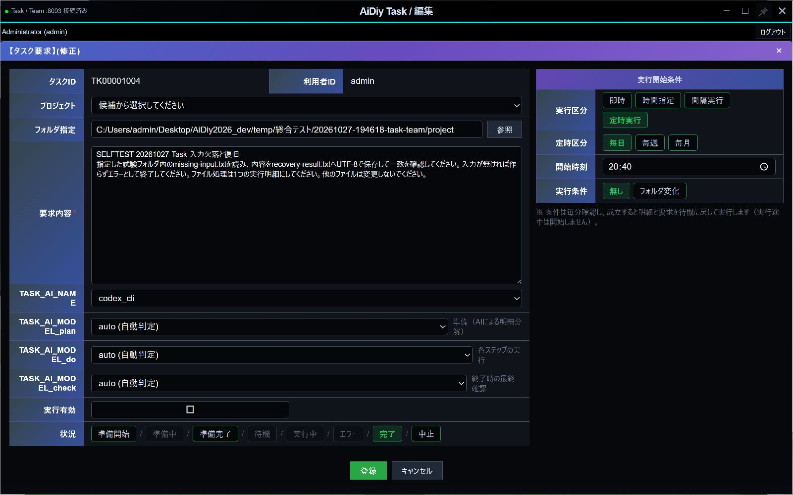

# AiDiy Task 操作編 — 操作ガイドとセルフテスト

> 文書: `セルフテスト,aidiy_task,操作編.md` | 実装: `frontend_ide/src/タスクチーム/`, `backend_taskteam/`

## 総合評価

2026年10月27日、Windowsの独立Electron版をComputer Useで操作しました。即時実行、並行分岐と合流、入力不足からの復旧、中止、時刻指定、間隔実行、フォルダ監視、各窓の📌、終了・再起動後の保存状態を確認しました。

AIはcodex_cli、plan・do・checkはautoを使用しました。画面操作の結果を、保存記録と試験フォルダの生成物でも照合しています。Mac／Linux実機、週・月をまたぐ実時間の定期運転、全プロバイダは今回の対象外です。

## 始める前に

[システム起動編](./セルフテスト,aidiy_diag,システム起動編.md)で必要なバックエンドを起動し、[アプリ起動編](./セルフテスト,aidiy_diag,アプリ起動編.md)からTaskを開きます。単独起動コマンドは `aidiy_task` です。TaskとTeamは同じTaskTeamサーバーを利用します。

AIが作業する場所には試験専用フォルダを指定します。今回の作業先は `temp/総合テスト/20261027-194618-task-team/project/`、監視先はその隣の `watch/` です。入力の `挨拶.txt` には合言葉「青い鳥」を用意しました。

## 1. 要求を登録する

1. Taskにログインし、「要求」「フロー図」「明細」の3窓を確認します。
2. 要求窓の「新規」を押し、プロジェクトのフォルダと要求内容を入力します。
3. TASK_AI_NAMEと、plan（準備）・do（実行）・check（最終確認）のモデルを選びます。
4. 実行有効と開始条件を確認して「登録」を押します。

要求欄には、対象ファイル、作る結果、変更してよい範囲を具体的に書きます。空欄のまま登録すると「要求内容を入力してください。」と表示されます。「キャンセル」で閉じた要求は登録されません。

一覧左端の選択ボタンで、フロー図と明細の対象も切り替わります。タスクIDは編集、応答内容は結果の確認に使います。横に長い表は下端のスクロールバー、または右上の最大化で確認します。

| 確認番号 | 操作・判定 |
|---|---|
| Task-101 | 空の要求を拒否し、取消で不要な要求が増えないことを確認しました。 |
| Task-102 | 専用フォルダとcodex_cli／autoを保存し、編集を開き直して一致を確認しました。 |
| Task-103 | 一覧の選択にフロー図・明細が追従し、別窓の編集対象も一致しました。 |

## 2. 実行と結果を確認する

登録後は準備、実行、完了の順に進みます。AIによる分解には時間がかかります。開始監視は約5秒、状態監視は約10秒、開始条件の確認は毎分です。まず15分を観測の目安にし、進捗が続く場合は[待ち時間の共通ルール](./セルフテスト,_説明資料の書き方.md#操作と待ち時間)に沿って確認を続けます。

フロー図は作業の順番を表します。「先行SEQ」が複数ある明細は、それらの完了を待ってから始まります。完了表示だけでなく、生成物の内容も依頼どおりか確認します。

今回の要求は、独立した `branch-a.txt` と `branch-b.txt` の作成後、`merged.txt` にA・Bを各1行でまとめる内容です。2つの作成明細が同時に始まり、両方の完了後に合流しました。最終ファイルの内容も一致しました（Task-201）。

分岐から合流、最後の確認までを表示しています。明細の先行SEQと矢印の接続が一致します。

入力ファイルがない要求では、理由を表示してエラー・実行有効OFFになりました。入力を用意し、同じ要求を「準備完了」に戻して有効化すると正常完了し、入力と出力が一致しました（Task-202）。再実行前に、失敗原因を解消していることを確認します。

## 3. 実行を中止する

1. 対象のタスクIDを開き、「中止」を選びます。
2. 繰り返しも止める場合は実行有効をOFFにし、「登録」で保存します。
3. 一覧の中止表示と、実際の処理・ファイル更新の停止を確認します。

Task-301では、5秒ごとに追記する試験処理を中止しました。中止後もファイルが増えず、別のTeam処理は継続しました。

「中止」と実行有効OFFを選んだ状態です。保存後の一覧と更新停止まで確認して判定します。

## 4. 開始条件を選ぶ

編集画面右側の「実行開始条件」で設定し、「登録」で保存します。準備が終わっている要求を条件に応じて実行します。

| 選択 | 操作と確認ポイント |
|---|---|
| 即時 | 準備後に実行します。 |
| 時間指定 | 開始時刻を入力します。指定前に開始せず、時刻到達後に始まることを確認します。 |
| 間隔実行 | 単位と間隔値を指定します。実行中の周期に次の周期を重ねません。 |
| 定時実行 | 日・週・月などの条件と開始時刻を指定します。 |
| フォルダ変化 | 監視フォルダを指定します。出力先と分けると、自分の生成物で次の実行が起きるのを避けられます。 |

Task-401では20:13を保存して開き直し、指定時刻後の開始を確認しました。時刻欄は入力後、表示値が意図どおりになったか確かめます。

Task-402では間隔の0と601を拒否し、2分の設定で複数周期が完了しました。実行途中に周期が重ならず、OFF後は次回予定時刻＋90秒を過ぎても再実行がありませんでした。

範囲外の値を入れると案内が表示され、保存されません。値を直してから登録します。

Task-403では監視フォルダを保存し、変化のない間は実行されないことを確認しました。試験ファイルを追加すると次の監視で起動し、完了後に変更しなければ再実行されませんでした。

Task-404では「定時実行・毎日・20:40」を保存しました。指定前には動かず、20:40以降に開始して正常完了し、次回日時が翌日の20:40になることを確認しました。翌日までの実時間観測は対象外です。

毎日の開始時刻を指定した画面です。監視条件を組み合わせない場合は「無し」を選びます。

## 5. 📌で最前面を維持する

窓の右上にある📌を押すと、その窓を最前面に保ちます。ONはピンク、OFFは灰色です。もう一度押すと解除します。要求・フロー図・明細・編集の各窓で個別に切り替えられます。

Task-501では4種類の窓でON／OFFを切り替え、別窓を操作してもONの窓が前面に残ること、解除後は通常の重なり順へ戻ることを確認しました。同じ最前面の窓同士は、選択した窓が上になります。

フロー図をピン留めした状態です。ボタンの色と「ピン留めを解除」の案内がONの目印です。

## 6. 認証と窓の開閉

ログイン失敗時は理由が表示され、要求窓1枚のままです。正しい情報でログインするとフロー図・明細が開きます（Task-601）。

誤った利用者IDを入力した確認画面です。拒否の理由が残り、入力を直して再度ログインできます。

1枚だけ閉じた窓は、残った窓の右上に表示される「要求」「フロー図」「明細」ボタンで戻せます。フロー図の再表示を確認しました。要求窓を先に閉じて明細からログアウトした場合も、要求のログイン窓が復元され、他のTask窓が閉じました。Teamのログイン状態には影響しません（Task-602）。

Task-603では全3窓を終了し、DiagからTaskを起動し直しました。再ログイン後も完了・中止の記録と実行有効OFFが残り、日次設定「毎日20:40」、モデル、フォルダが一致しました。これはアプリの終了・再起動による確認です。

再起動後に編集を開いた状態です。日次条件を保持し、実行有効はOFF、状態は完了になっています。

## 試験データと終了確認

| 対象 | 今回確認した内容 |
|---|---|
| TK00001002 | 即時の並行分岐・合流、2分間隔。完了・実行有効OFF。 |
| TK00001003 | 追記処理の中止。中止・実行有効OFF、更新停止。 |
| TK00001004 | 時刻指定、入力不足と復旧、フォルダ監視、毎日20:40。完了・実行有効OFF。 |
| TK00001001 | 既存テンプレートは完了・OFFのまま。実行や更新をしていません。 |

自動試験はTask関連12件、Task／Teamの起動・窓・セッション・UI関連44件、認証表示の回帰2件、共通ピン制御16件が成功しました。これらは実画面試験の補助です。定時計算や異常系の隔離試験を、長期間の実運転の結果には読み替えません。
