# AiDiy Task 操作編 — 操作ガイドとセルフテスト

## 総合評価

**総合評価：✅ OK（記載した確認範囲）。** ログイン、要求・フロー図・明細の3窓、要求登録、分岐・合流、中止、開始条件、保存状態と終了を確認しました。AI実行は `codex_cli`、plan・do・checkは `auto` の条件です。Mac／Linux実機、全プロバイダ、長期間の連続運転は確認範囲外です。

前半は起動から終了までの操作ガイド、最後の章は追加テストと確認範囲です。図番号は章番号と掲載順を表し、試験ケースIDとは区別します。

## 始める前に

[システム起動編](./セルフテスト,aidiy_diag,システム起動編.md)で必要なバックエンドを起動し、[ランチャー編](./セルフテスト,aidiy_diag,ランチャー編.md)からアプリを開きます。単独起動コマンドは `aidiy_task` です。TaskとTeamは別々にログインし、共通のTaskTeamサーバーを使います。

AIの作業先には専用の試験フォルダを指定しました。入力の `挨拶.txt` には合言葉「青い鳥」を用意しています。既存の目標・要求と試験データを区別します。

## 1. 起動してログインする

1. Diagまたは `aidiy_task` から起動します。
2. 利用者IDとパスワードを入力してログインします。
3. 要求・フロー図・明細の3窓が表示され、接続状態を確認できれば起動は完了です。

ログイン画面です。誤った認証情報では拒否理由が表示されます。

**図101：ログイン画面**

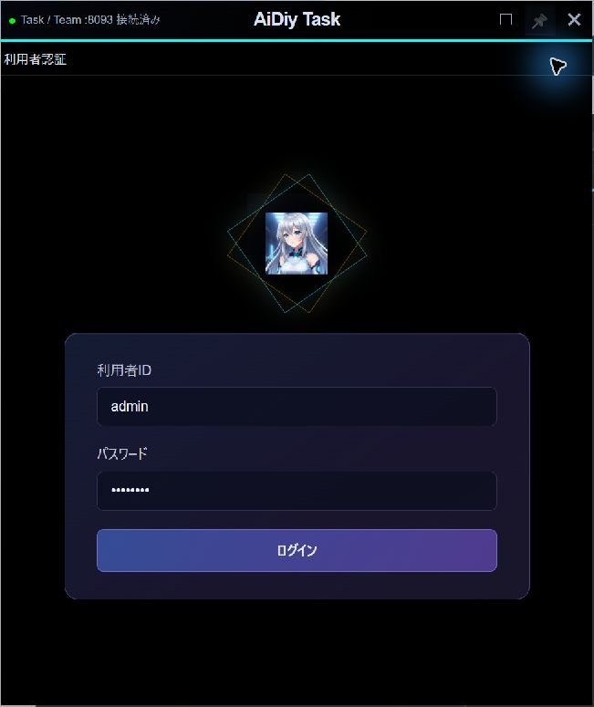

認証後の主画面です。各窓は個別に閉じ、操作ボタンから表示し直せます。

**図102：Task要求一覧**

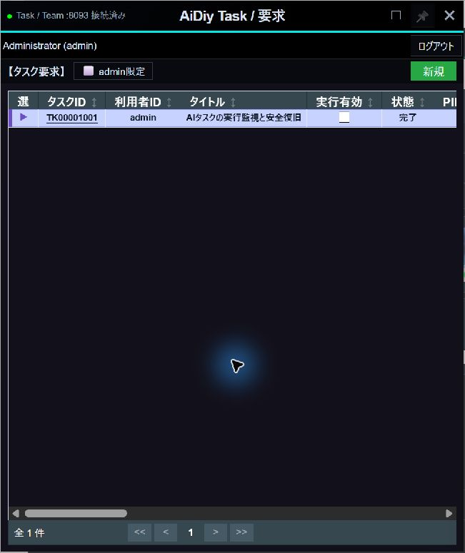

## 2. 要求を登録する

1. Taskにログインし、「要求」「フロー図」「明細」の3窓を確認します。
2. 要求窓の「新規」を押し、プロジェクトのフォルダと要求内容を入力します。
3. TASK_AI_NAMEと、plan（準備）・do（実行）・check（最終確認）のモデルを選びます。
4. 実行有効と開始条件を確認して「登録」を押します。

要求欄には、対象ファイル、作る結果、変更してよい範囲を具体的に書きます。空欄のまま登録すると「要求内容を入力してください。」と表示されます。「キャンセル」で閉じた要求は登録されません。

一覧左端の選択ボタンで、フロー図と明細の対象も切り替わります。タスクIDは編集、応答内容は結果の確認に使います。横に長い表は下端のスクロールバー、または右上の最大化で確認します。

## 3. 実行と結果を確認する

登録後は準備、実行、完了の順に進みます。AIによる分解には時間がかかります。開始監視は約5秒、状態監視は約10秒、開始条件の確認は毎分です。まず15分を観測の目安にし、進捗が続く場合は[待ち時間の共通ルール](./セルフテスト,_説明資料の書き方.md#操作と待ち時間)に沿って確認を続けます。

フロー図は作業の順番を表します。「先行SEQ」が複数ある明細は、それらの完了を待ってから始まります。完了表示だけでなく、生成物の内容も依頼どおりか確認します。

要求は、独立した `branch-a.txt` と `branch-b.txt` の作成後、`merged.txt` にA・Bを各1行でまとめる内容です。2つの作成明細が同時に始まり、両方の完了後に合流しました。最終ファイルの内容も一致しました（Task-201）。

分岐から合流、最後の確認までを表示しています。明細の先行SEQと矢印の接続が一致します。

**図301：分岐合流完了**

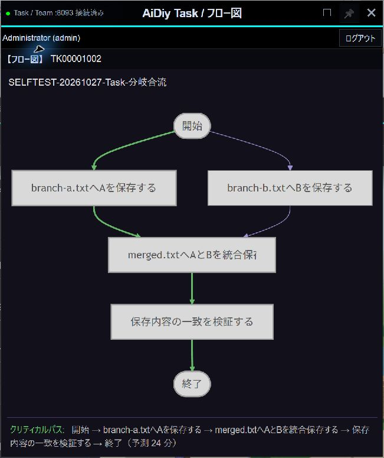

入力ファイルがない要求では、理由を表示してエラー・実行有効OFFになりました。入力を用意し、同じ要求を「準備完了」に戻して有効化すると正常完了し、入力と出力が一致しました（Task-202）。再実行前に、失敗原因を解消していることを確認します。

## 4. 実行を中止する

1. 対象のタスクIDを開き、「中止」を選びます。
2. 繰り返しも止める場合は実行有効をOFFにし、「登録」で保存します。
3. 一覧の中止表示と、実際の処理・ファイル更新の停止を確認します。

Task-301では、5秒ごとに追記する試験処理を中止しました。中止後もファイルが増えず、別のTeam処理は継続しました。

「中止」と実行有効OFFを選んだ状態です。保存後の一覧と更新停止まで確認して判定します。

**図401：中止設定**

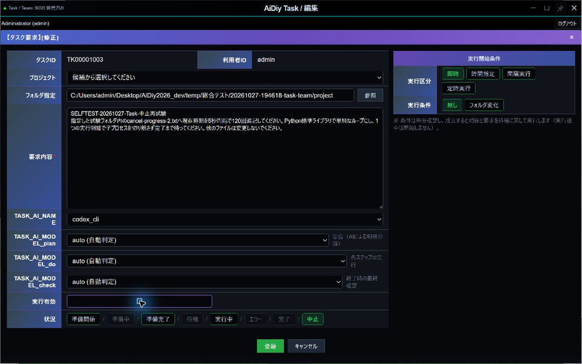

## 5. 開始条件を選ぶ

編集画面右側の「実行開始条件」で設定し、「登録」で保存します。準備が終わっている要求を条件に応じて実行します。

| 選択 | 操作と確認ポイント |
|---|---|
| 即時 | 準備後に実行します。 |
| 時間指定 | 開始時刻を入力します。指定前に開始せず、時刻到達後に始まることを確認します。 |
| 間隔実行 | 単位と間隔値を指定します。実行中の周期に次の周期を重ねません。 |
| 定時実行 | 日・週・月などの条件と開始時刻を指定します。 |
| フォルダ変化 | 監視フォルダを指定します。出力先と分けると、自分の生成物で次の実行が起きるのを避けられます。 |

Task-401では20:13を保存して開き直し、指定時刻後の開始を確認しました。時刻欄は入力後、表示値が意図どおりになったか確かめます。

**図501：時間指定**

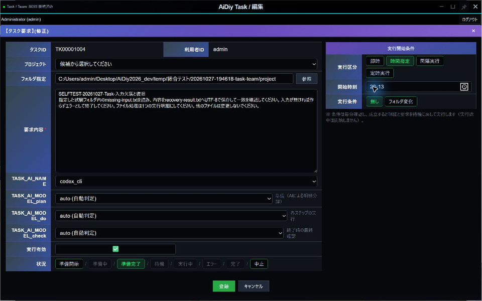

Task-402では間隔の0と601を拒否し、2分の設定で複数周期が完了しました。実行途中に周期が重ならず、OFF後は次回予定時刻＋90秒を過ぎても再実行がありませんでした。

範囲外の値を入れると案内が表示され、保存されません。値を直してから登録します。

**図502：間隔検証**

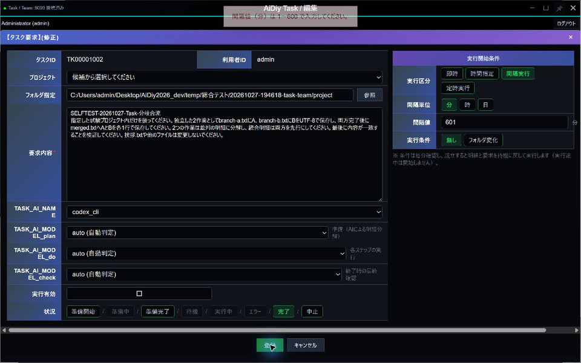

Task-403では監視フォルダを保存し、変化のない間は実行されないことを確認しました。試験ファイルを追加すると次の監視で起動し、完了後に変更しなければ再実行されませんでした。

Task-404では「定時実行・毎日・20:40」を保存しました。指定前には動かず、20:40以降に開始して正常完了し、次回日時が翌日の20:40になることを確認しました。翌日までの実時間観測は対象外です。

毎日の開始時刻を指定した画面です。監視条件を組み合わせない場合は「無し」を選びます。

**図503：定時実行**

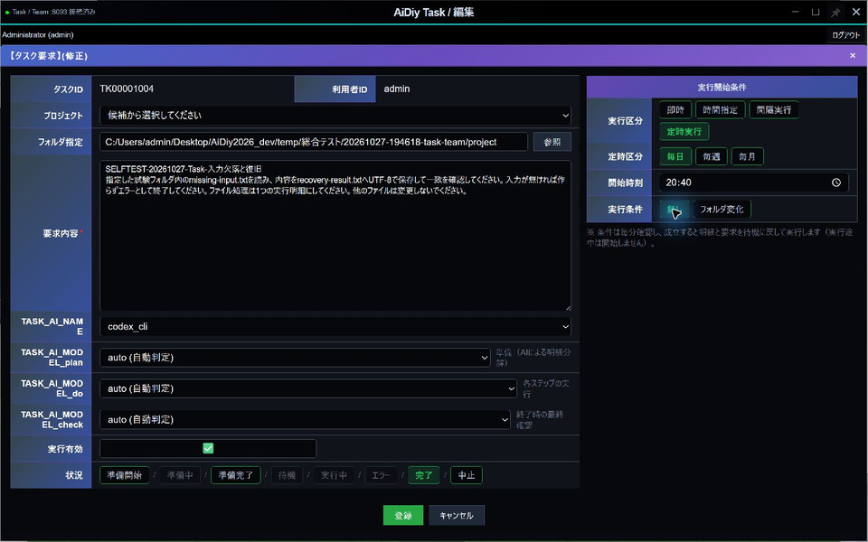

## 6. 📌で最前面を維持する

窓の右上にある📌を押すと、その窓を最前面に保ちます。ONはピンク、OFFは白寄りの灰色で、背景は透明です。もう一度押すと解除します。要求・フロー図・明細・編集の各窓で個別に切り替えられます。

Task-501では4種類の窓でON／OFFを切り替え、別窓を操作してもONの窓が前面に残ること、解除後は通常の重なり順へ戻ることを確認しました。同じ最前面の窓同士は、選択した窓が上になります。

フロー図をピン留めした状態です。ボタンの色と「ピン留めを解除」の案内がONの目印です。

**図601：最前面ピン**

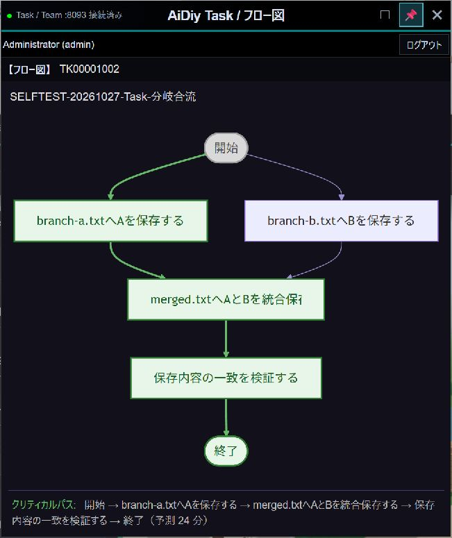

## 7. 窓の開閉・ログアウト・終了

認証を終了する場合は、画面上部の「ログアウト」を押します。アプリを終了する場合は要求・フロー図・明細の各窓を閉じます。窓を閉じることと、登録済み要求の中止・実行有効OFFは別の操作です。処理を止める場合は4章の手順で設定します。

ログイン失敗時は理由が表示され、要求窓1枚のままです。正しい情報でログインするとフロー図・明細が開きます（Task-601）。

ログイン前は用途の「/ 要求」を出さず、入力カード内の重複タイトルも表示しません。画面外周は1pxのグレーです。ログイン画面は1章を参照します。

1枚だけ閉じた窓は、残った窓の右上に表示される「要求」「フロー図」「明細」ボタンで戻せます。フロー図の再表示を確認しました。要求窓を先に閉じて明細からログアウトした場合も、要求のログイン窓が復元され、他のTask窓が閉じました。Teamのログイン状態には影響しません（Task-602）。

Task-603では全3窓を終了し、DiagからTaskを起動し直しました。再ログイン後も完了・中止の記録と実行有効OFFが残り、日次設定「毎日20:40」、モデル、フォルダが一致しました。これはアプリの終了・再起動による確認です。

再起動後に編集を開いた状態です。日次条件を保持し、実行有効はOFF、状態は完了になっています。

**図701：再起動後の保存設定**

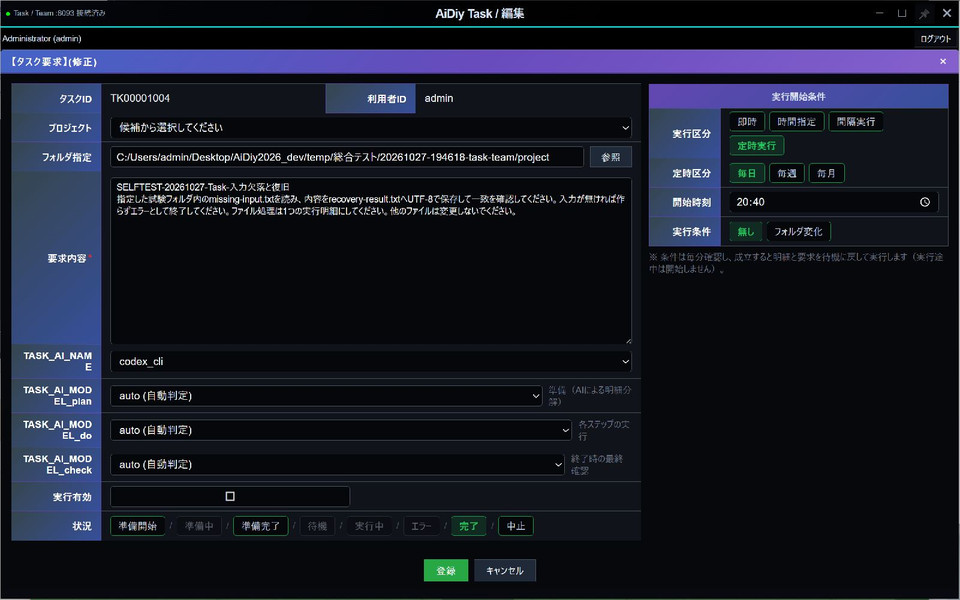

## 8. 追加テストと確認範囲

### 要求登録の確認結果

| 確認番号 | 操作・判定 |
|---|---|
| Task-101 | 空の要求を拒否し、取消で不要な要求が増えないことを確認しました。 |
| Task-102 | 専用フォルダとcodex_cli／autoを保存し、編集を開き直して一致を確認しました。 |
| Task-103 | 一覧の選択にフロー図・明細が追従し、別窓の編集対象も一致しました。 |

### 窓・認証・通信

Windowsの単独Electronで、要求・フロー図・明細の個別終了と再表示、連打時の重複防止、要求窓を閉じた状態からのログアウト復元、再ログイン、全終了を確認しました。空欄登録は拒否され、取消後の要求一覧は1件のままでした。既存テンプレートの分岐図・12明細・保存応答の表示確認では、実行有効をOFFに保ちました。

Node54件、Python隔離試験10件、Task／Teamの型チェックが成功しました。隔離試験は編集時の実行有効、日付計算、打切り時の中止状態、実行寿命と周期の重複抑止が対象です。画面の表示確認とAI実行結果は分けて判定します。

灰色タイトル、細い外枠、透明なタイトル操作ボタンとピンON／OFFを実画面で確認しました。ログイン画面は黒背景のアイコンと逆方向に回る二重四角形、青紫の入力カードです。時間を空けた観測で回転角度の変化を確認しました。

TaskTeam停止時は主画面が「未接続」と黒いバーになり、再起動後は「接続済み」に戻りました。認証・遅延応答の自動試験21件も成功しました。現在の401だけが該当セッションを終了し、古い401は新しいログインを消さず、403・500・通信失敗を認証切れと混同しません。これら6件は21件の内数です。実Coreの期限切れトークンと、APIクライアントの模擬応答を分けて確認しています。

### 起動経路

通常・ミニ・アイコン表示から起動し、認証と接続状態を確認しました。通常表示からの画面は1章に掲載しています。

ミニ表示から起動した認証後の画面です。

**図801：Taskミニ表示起動**

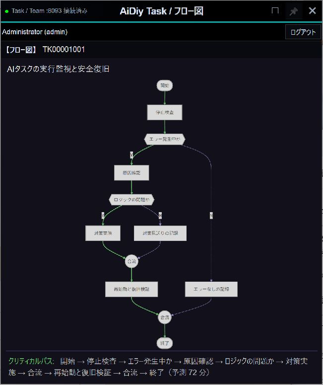

アイコン表示から起動した認証後の画面です。

**図802：Taskアイコン起動**

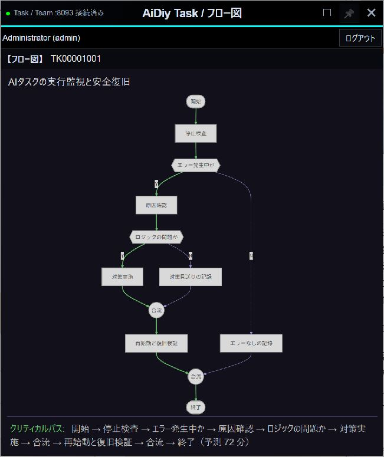

### 試験データと終了確認

実機試験では、要求・フロー図・明細をそれぞれ閉じ、残った窓のボタンを連打しても対象が1窓だけ再表示されることを確認しました。要求窓を閉じた後にフロー図からログアウトすると要求のログイン窓だけが復元され、再ログインで3窓へ戻りました。最後は明細→要求→フロー図の順で閉じ、プロセスが終了しました。試験専用プロファイルにはパスワード・認証トークンの永続保存がなく、業務データを変更していません。さらにTaskTeamを実停止・再起動し、要求・フロー図・明細の全3窓が「未接続」→「接続済み」へ追従することを確認しました。

TaskTeamをDiagから停止すると「未接続」と黒いバーになりました。期限切れJWTが実Coreで401となること、現在の401だけで認証を解除し、古い要求の401や通信失敗では新しい認証を消さないことを確認しています。後者は実APIクライアントを使う隔離試験で、長時間待って期限を迎える実機試験とは区別します。

| 対象 | 確認した内容 |
|---|---|
| TK00001002 | 即時の並行分岐・合流、2分間隔。完了・実行有効OFF。 |
| TK00001003 | 追記処理の中止。中止・実行有効OFF、更新停止。 |
| TK00001004 | 時刻指定、入力不足と復旧、フォルダ監視、毎日20:40。完了・実行有効OFF。 |
| TK00001001 | 既存テンプレートは完了・OFFのまま。実行や更新をしていません。 |

自動試験はTask関連12件、Task／Teamの起動・窓・セッション・UI関連44件、認証表示の回帰2件、共通ピン制御16件が成功しました。これらは実画面試験の補助です。定時計算や異常系の隔離試験を、長期間の実運転の結果には読み替えません。

補助試験には共通処理の結果が含まれるため、別の条件・別冊の件数を単純に合計しません。週・月をまたぐ実時間の定期運転は未確認です。
