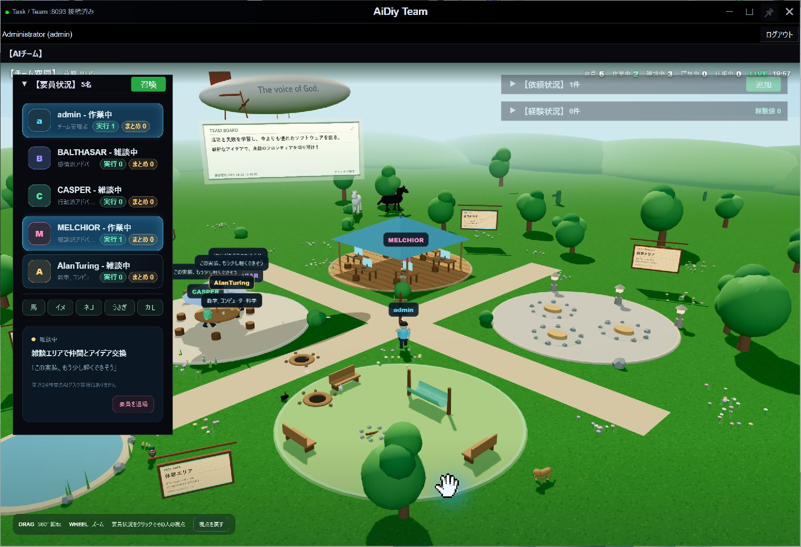
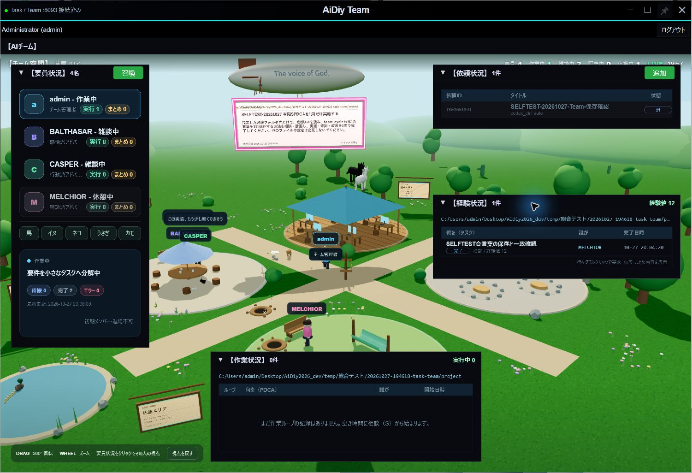
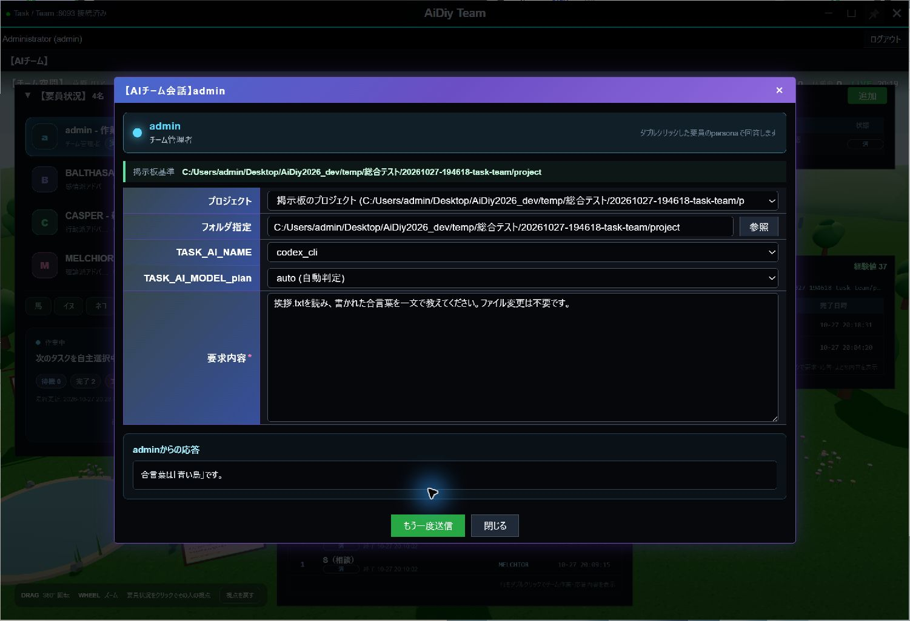
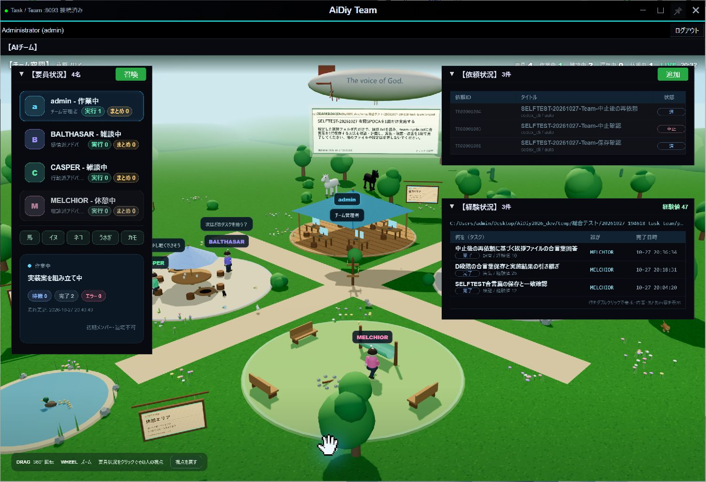
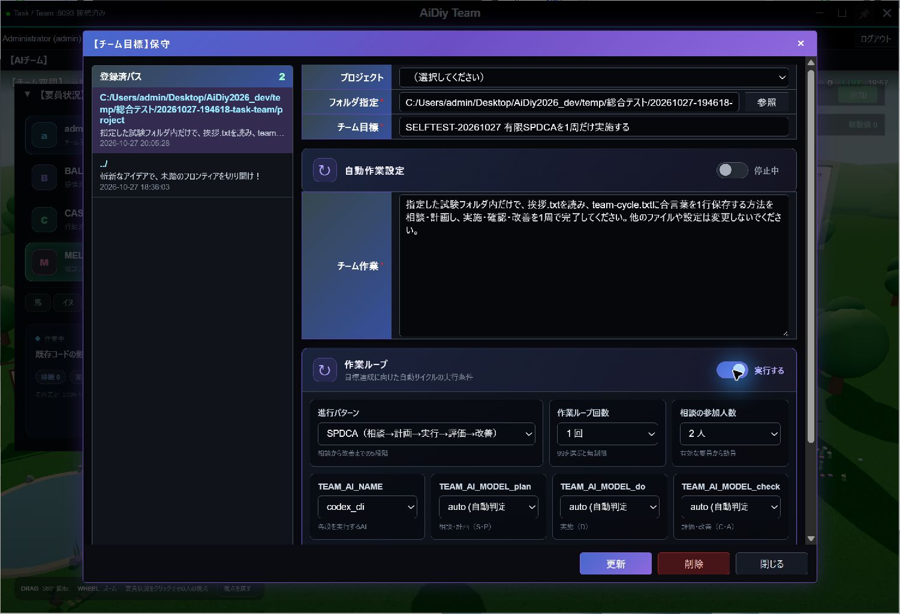
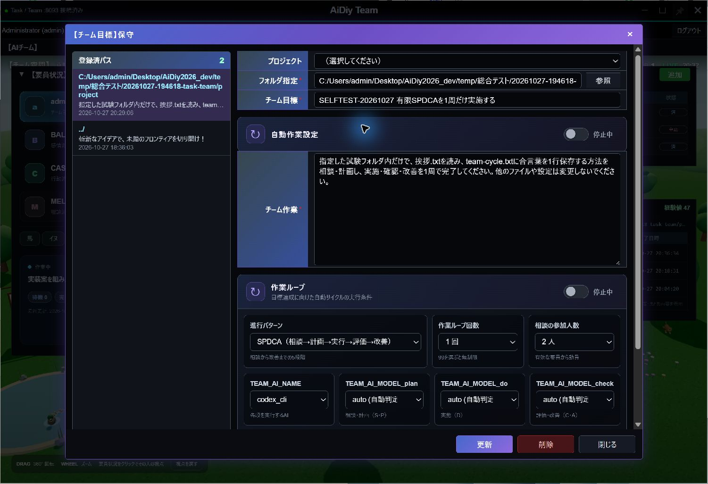
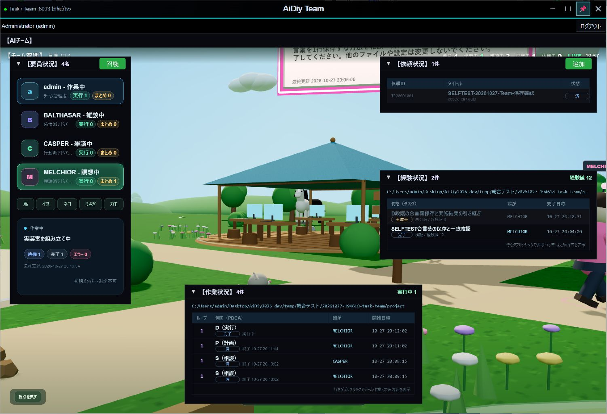
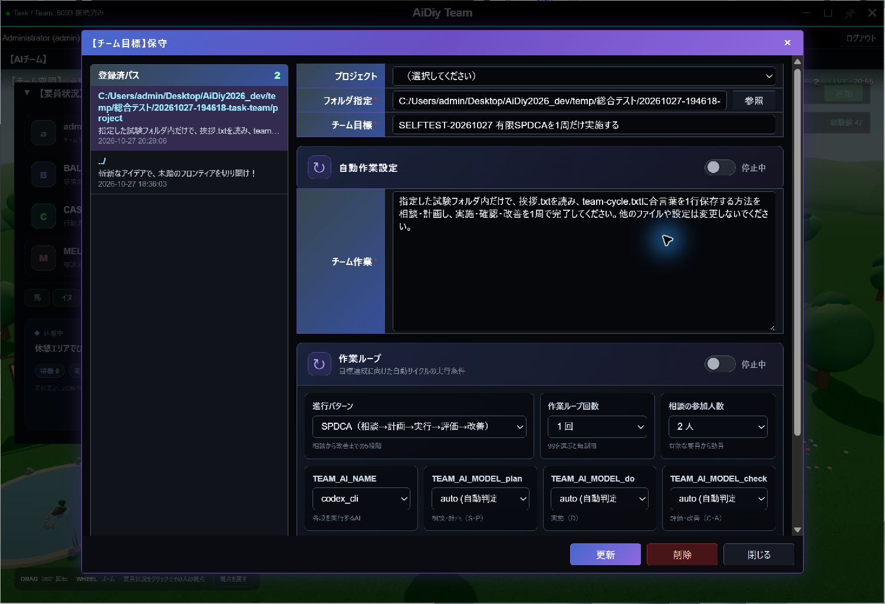

# AiDiy Team 操作編 — 操作ガイドとセルフテスト

> 文書: `セルフテスト,aidiy_team,操作編.md` | 実装: `frontend_ide/src/タスクチーム/`, `backend_taskteam/`

## 総合評価

2026年10月27日、Windowsの独立Electron版をComputer Useで操作しました。要員の召喚・退場、依頼と経験の記録、要員との会話、目標の保存、有限SPDCAの1周完了と自動停止、📌、中止後の再依頼、終了・再起動後の保存状態を確認しました。

TEAM／TASKともcodex_cli、plan・do・checkはautoを使用しました。依頼の受付、Taskの完了、Teamの経験記録、実ファイルの内容をそれぞれ確認しています。Mac／Linux実機、長時間の無限ループ、全プロバイダは対象外です。自動作業による連続的な依頼生成と、空の作業内容による自動会話は今回の実試験に含めていません。

## 始める前に

[システム起動編](./セルフテスト,aidiy_diag,システム起動編.md)でバックエンドを起動し、[アプリ起動編](./セルフテスト,aidiy_diag,アプリ起動編.md)からTeamを開きます。単独起動コマンドは `aidiy_team` です。TaskとTeamは別のアプリとしてログインし、共通のTaskTeamサーバーを利用します。

今回の試験先は `temp/総合テスト/20261027-194618-task-team/project/` です。入力の `挨拶.txt` に合言葉「青い鳥」を用意しました。既存の `../` の目標は、自動作業・ループともOFFのまま保持しています。

## 1. 要員と空間を見る

左の「要員状況」で要員をクリックすると、その要員の視点と状態を確認できます。空間のドラッグで向きを変え、ホイールで距離を変えます。「視点を戻す」で通常の表示へ戻します。

「召喚」から要員を選んで追加できます。不要になった試験要員は選択し、「要員を退場」で退場させます。初期メンバーのadminには退場できないことが表示されます。

Team-101ではAlan Turingを召喚して4名から5名へ増えること、役割が表示されることを確認しました。その後、試験要員を退場させて4名へ戻しました。

召喚後の要員一覧です。追加した要員の名前と役割を確認できます。

## 2. 依頼する・会話する

### チームへ仕事を依頼する

1. 右上の「依頼状況」で「追加」を押します。
2. プロジェクトのフォルダ、要求内容、TEAM／TASKのモデルを確認します。
3. 実行有効をONにして「登録」を押します。
4. 依頼状況が進み、経験状況に完了記録が追加されるまで確認します。

依頼行のシングルクリックは編集、ダブルクリックは要求・応答内容の表示です。経験行をダブルクリックすると、実行結果とまとめを確認できます。枠の見出しをドラッグすれば、一覧が重ならない位置へ移動できます。

Team-201では「挨拶.txtの合言葉をteam-result.txtへ1行保存し、一致を確認する」と依頼しました。MELCHIORへ担当が割り当てられ、Taskが完了した後、依頼は「済」、経験は「完了」になりました。実ファイルも「青い鳥」と一致しました。

依頼と経験を上下に並べた画面です。受付だけでなく、経験の完了と実際の成果物まで確認します。

### 要員へ質問する

左の要員をダブルクリックして会話を開きます。掲示板のプロジェクトが引き継がれるため、対象フォルダを確認してから要求を入力し、「送信」を押します。プロジェクト調査を伴う会話は最大360秒を目安に観測します。

Team-202ではadminへ「挨拶.txtを読み、合言葉を一文で教えてください。ファイル変更は不要です。」と質問し、「合言葉は『青い鳥』です。」という回答を確認しました。

モデル名、対象フォルダ、質問、実回答を同じ画面で確認できます。

### 依頼を中止する

依頼行を1回クリックして開き、「中止」と実行有効OFFを選んで登録します。Team側だけでなく、連携して作られたTaskも中止になっていることを確認します。

Team-203ではTR00001003を中止し、対応するTaskも中止・OFFになりました。その後、新しいTR00001004で挨拶.txtの読取を依頼し、合言葉の回答、依頼「済」、経験「完了」まで確認しました。中止した依頼は再開していません。

中止した依頼と、新しく正常完了した依頼が別々に記録されています。下の経験一覧でも再依頼の完了を確認できます。

## 3. 目標と有限サイクルを設定する

草原の掲示板をクリックすると、チーム目標を編集できます。プロジェクト、目標、チーム作業、モデル、自動作業、作業ループを確認して登録します。別プロジェクトを登録する場合は、既存目標を上書きしないようフォルダを確認します。

SPDCAは、S（相談）→P（計画）→D（実施）→C（評価）→A（改善）の順で進みます。回数を1にすれば1周で止まります。「自動作業設定」と「作業ループ」は別の設定です。

Team-301では試験用プロジェクトに目標を登録し、開き直して内容が一致することを確認しました。チーム作業は「合言葉をteam-cycle.txtへ保存する方法を相談・計画し、実施・確認・改善を1周で完了する」、動員2名、SPDCA、1周、自動作業OFFです。作業ループだけONにして開始しました。

有限サイクルの設定画面です。回数・パターン・2つのON／OFFを確認してから登録します。

SはCASPERとMELCHIOR、P以降はMELCHIORが担当しました。DからTaskが作成され、ファイル保存と検証が完了しました。C・Aまで終了した後、作業ループが自動でOFFになり、2周目が作られないことを確認しました（Team-302）。`team-cycle.txt` の内容は「青い鳥」です。

完了後に目標を開き直した画面です。自動作業と作業ループの両方が「停止中」になっています。

## 4. 📌で最前面を維持する

右上の📌を押すとTeam窓を最前面に保ちます。ONはピンク、OFFは灰色です。もう一度押すと解除します。

Team-401では、ONのままTaskを操作してもTeamが前面に残り、解除後は通常の重なり順へ戻ることを確認しました。別のピン留め窓もある場合は、選択した窓が上になります。

ピンクの📌が最前面維持の目印です。

## 5. ログインと終了・再起動

誤った利用者IDでは拒否理由が表示され、正しい情報で再ログインできました。TeamのログアウトはTaskのログイン状態に影響しません。

Team-501ではTeamを終了し、Diagから起動し直しました。再ログイン後も要員4名、依頼3件、経験3件と経験値47が表示されました。目標を開き、試験フォルダ、SPDCA・1回・2人、codex_cli／auto、自動作業・作業ループの両方が停止中であることを確認しました。

アプリを終了・再起動した後の目標です。保存した条件と停止状態が保持されています。

## 試験データと終了確認

| 対象 | 確認内容 |
|---|---|
| TR00001001 | 合言葉の保存。依頼「済」、Task「完了」、経験記録と実ファイルを照合。 |
| TR00001002 | 有限サイクルのDで作成されたTask。完了し、C・Aへ進みました。 |
| TR00001003 | 中止対象。対応するTaskも中止・OFF。 |
| TR00001004 | 中止後の新規読取依頼。依頼「済」、Task「完了」、経験「完了」。 |
| 試験目標 | 専用プロジェクト、SPDCA・1周。完了後にループ自動OFF。 |
| 既存目標・要員 | `../` の目標とadminを含む元の4名を保持。追加した試験要員だけ退場。 |

Team関連の自動試験10件、共通ピン制御16件が成功し、Task／Teamの型チェックも通りました。自動試験は実画面の結果を補うものです。終了時は試験用の自動作業・作業ループ・定期実行をOFFにし、実行中の処理がないことを確認しました。
