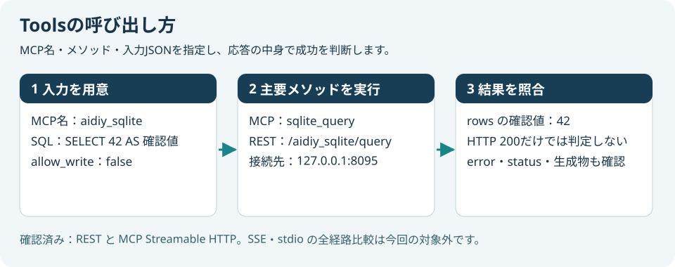
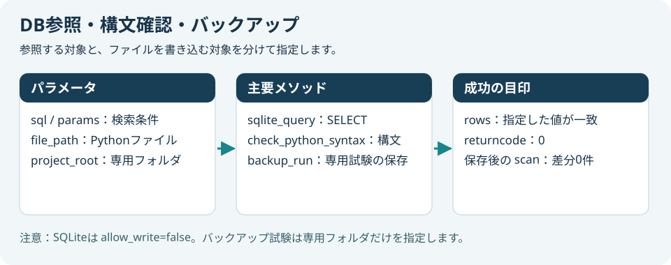
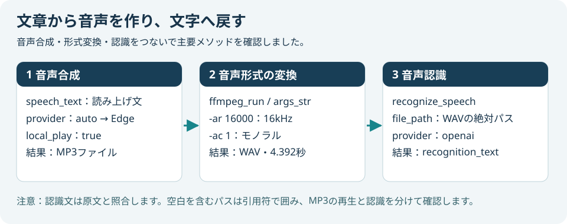
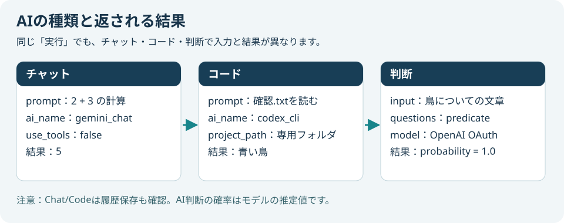
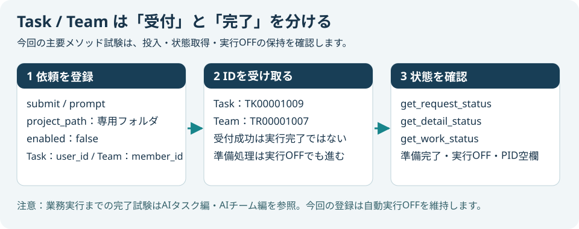
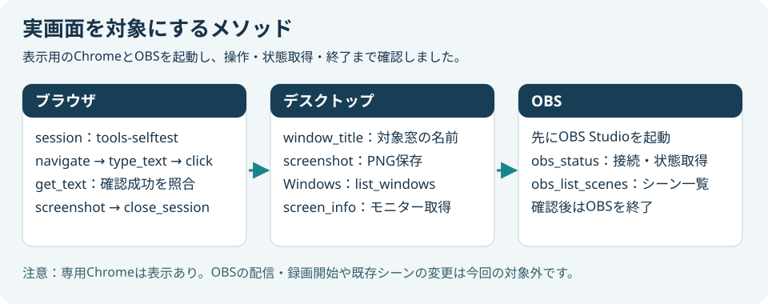
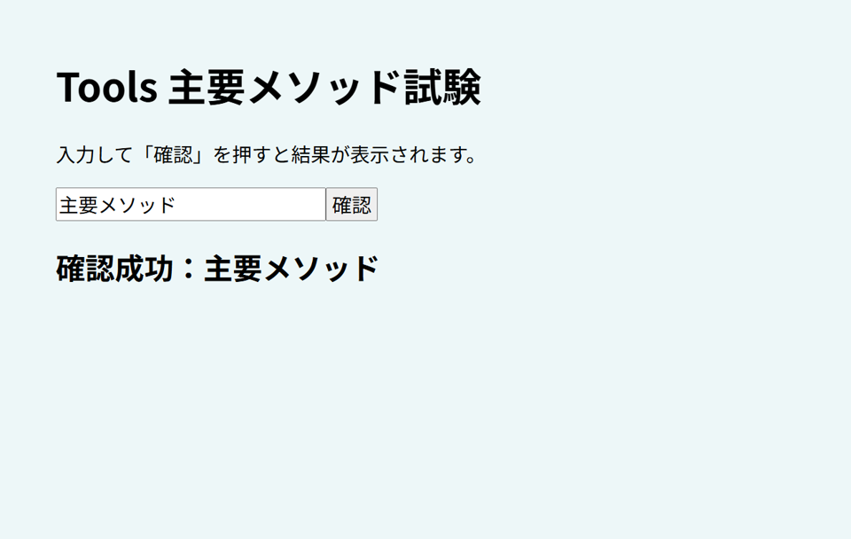
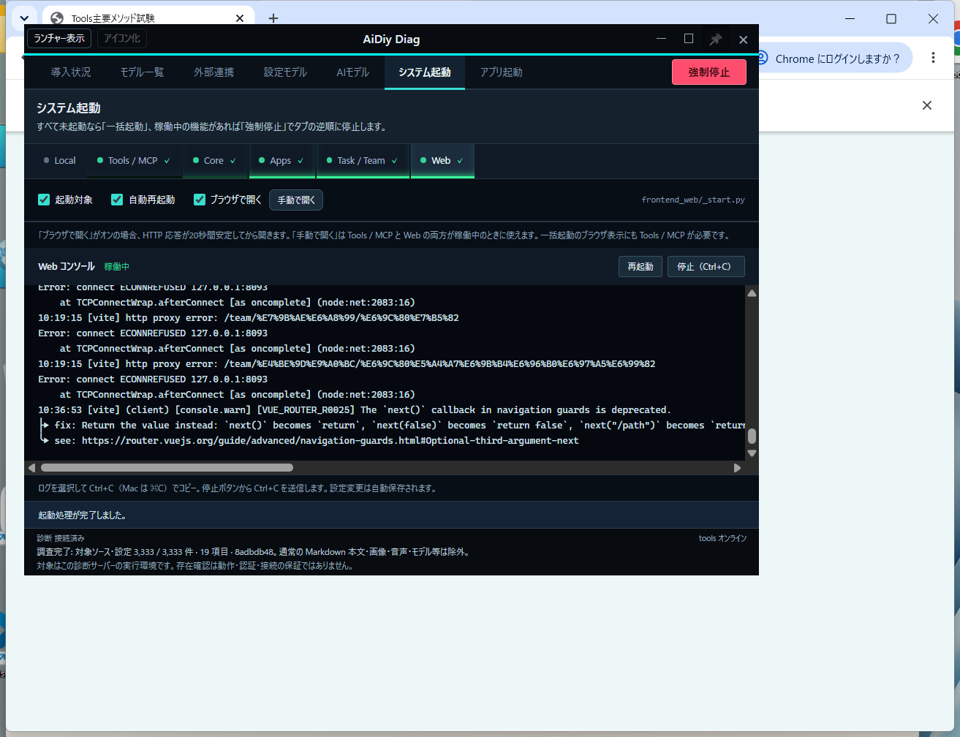
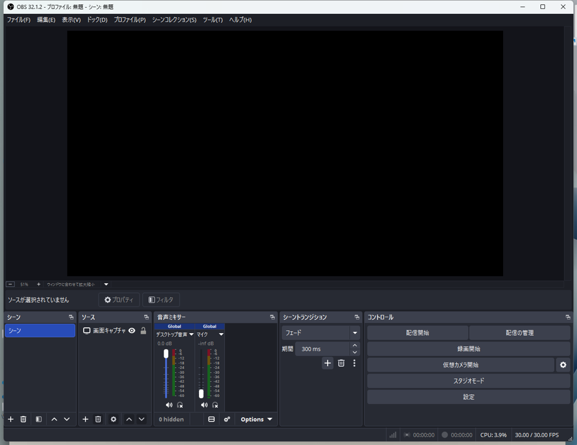
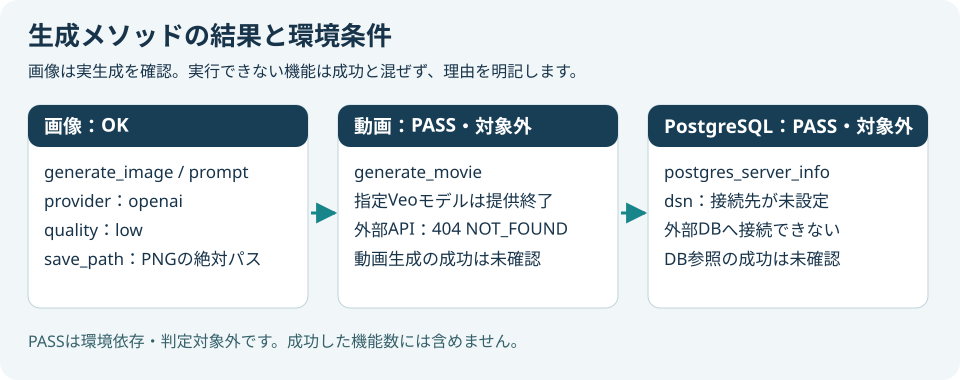

# backend_tools 主要メソッド編 — 操作ガイドとセルフテスト

> 本書はセルフテスト結果を、操作説明・解説書としても読みやすく整理しています。再テスト後は結果・注意書き・エビデンスを更新し、章立て・操作手順・図解の配置などの様式を維持します。

> 文書: `セルフテスト,backend_tools,主要メソッド編.md` | 実装: `backend_tools/tools_main.py`, `backend_tools/tools_proc/`

## 総合評価

再試験の実施順・変更後に確認する範囲は[共通の再試験準備](./セルフテスト,共通,確認結果.md#本日6時以降の更新に対する再試験準備)を参照します。以下の総合評価は記載した実施条件での結果です。画像番号は章と掲載順を表し、試験ケースIDとは区別します。


バックアップは2026年10月28日、隔離フォルダで初回保存、直後の差分0件、変更後の差分と再保存を確認しました。保存先は `.aidiy_backup` です。主要メソッド全体の実施日は10月26日です。

**総合評価：✅ OK（実行対象の主要メソッド）。2026年10月26日・Windowsで確認しました。** 20個のMCPすべての死活確認と仕様取得に成功し、うち18個で選定した主要メソッドの実動作を確認しました。PostgreSQLと動画生成の2個は **PASS（環境依存・判定対象外）** です。全メソッド・全モデルの網羅試験ではありません。

対象環境はWindowsです。Mac／Linux実機と長時間連続運転は **PASS（環境依存・判定対象外）** とし、今回は未実施です。実行成功とは区別し、NGには数えません。

実施方式は稼働中toolsへのREST呼び出しです。SQLiteはMCP Streamable HTTPの初期化・`tools/call`も確認しました。Chromeは専用セッションの実画面、OBSはcomputer-useで起動・終了し、API応答と画面を照合しました。SVGは処理の説明図であり、撮影画像と区別します。

## この冊子を使う場面

- MCPの主要メソッドを使い始めるとき。
- 入力パラメータ、結果の読み方、環境条件を確認するとき。
- 同じ条件で主要メソッドのセルフテストを行うとき。

## 1. 接続先と結果の読み方

1. [システム起動編](./セルフテスト,aidiy_diag,システム起動編.md)に従いToolsを起動します。Task／Teamを使う場合は統合サーバーも起動します。
2. `GET http://127.0.0.1:8095/`でMCP一覧、`GET /{MCP名}/list`で引数仕様を取得します。
3. 下表のRESTパスへJSONをPOSTします。MCPクライアントでは同じ行のMCPメソッド名を使います。両者は名前が異なる場合があります。
4. `error`の有無、`status`、返された値、保存ファイルを照合します。HTTP 200だけで成功にしません。

```python
import requests
response = requests.post(
    "http://127.0.0.1:8095/aidiy_sqlite/query",
    json={"sql": "SELECT ? AS 確認値", "params": ["主要メソッド確認"],
          "max_rows": 1, "allow_write": False},
    timeout=30,
)
response.raise_for_status()
result = response.json()
assert result["rows"][0]["確認値"] == "主要メソッド確認"
```

入力、呼び出し先、成功を確認する項目の対応です。



## 2. 実行した機能の一覧

MCP名は共通の `aidiy_` を省略しています。記載したメソッドだけを今回の合格範囲とします。

| MCP | 主要メソッド | 最終結果・成功の目印 |
|---|---|---|
| chrome_devtools | open_session、navigate、type_text、click、get_text、screenshot、close_session | ✅ OK：日本語入力・ボタン操作・「確認成功」の取得・画像保存・専用セッション終了 |
| desktop_capture | get_screen_info、screenshot | ✅ OK：モニター情報と、Chrome／OBSの対象ウィンドウ撮影 |
| sqlite | sqlite_list_tables、sqlite_query | ✅ OK：テーブル一覧、バインド値一致。MCP経由のSELECTも42を返す |
| logs | logs_list、logs_tail | ✅ OK：ログ一覧と末尾3行を取得 |
| code_check | check_python_syntax | ✅ OK：専用Pythonファイルの構文確認、returncode=0 |
| backup | backup_run、backup_diff_scan | ✅ OK：専用フォルダを保存し、直後の差分0件 |
| text_to_speech | synthesize_speech | ✅ OK：EdgeでMP3保存とローカル再生実行 |
| speech_to_text | recognize_speech | ✅ OK：OpenAI WhisperでWAVから日本語文字列を取得 |
| ffmpeg_control | ffmpeg_versions、ffmpeg_run、get_media_duration | ✅ OK：MP3→16kHzモノラルWAV、4.392秒、空白付きパスでも変換成功 |
| notification_sounds | play_notification_sound | ✅ OK：「開始」通知の再生成功応答 |
| code_agents | code_agents_run | ✅ OK：Codex CLIが専用ファイルを読み「青い鳥」と回答、履歴保存 |
| chat_llms | chat_llms_run | ✅ OK：Geminiが2+3に「5」と回答、履歴保存 |
| decisions_check | decisions_check | ✅ OK：OpenAI OAuthのpredicate判断、probability=1.0 |
| task_agents | task_agents_submit、get_request_status、get_detail_status | ✅ OK：要求投入・要求と明細取得、実行OFF・PID空欄 |
| team_agents | team_agents_submit、get_work_status、get_member_list | ✅ OK：依頼投入・状態と要員一覧取得、実行OFF・PID空欄 |
| windows_control | list_windows | ✅ OK：開いているウィンドウ一覧を取得 |
| obs_studio_control | obs_status、obs_list_scenes | ✅ OK：OBS起動後の接続、停止中の配信／録画状態とシーン一覧を取得。終了済み |
| image_generation | generate_image | ✅ OK：OpenAIで青い円のPNGを生成、ファイルと画像内容を確認 |

## 3. PASSにした機能・今回選定しない機能

| 機能 | 判定 | 理由・確認できた範囲 |
|---|---|---|
| PostgreSQL server_info／DB参照 | PASS（環境依存・判定対象外） | DSNが未設定。接続先を指定する案内を確認。外部DBへの接続成功は未確認 |
| 動画生成 generate_movie | PASS（環境依存・判定対象外） | Geminiの既定Veoモデルが提供終了し404を返す。動画ファイルの生成成功は未確認 |
| Mac／Linux・長時間運転 | PASS（環境依存・判定対象外） | 今回のWindows・短時間確認の範囲外 |

主要メソッドに絞るため、SSE／stdio全経路の比較、全プロバイダ・全モデル、TypeScript／ruff、実マイク録音、OBS配信・録画開始、Windowsの入力・プロセス終了、バックアップの全履歴比較は**未選定・未実施**です。これらを合格数には含めません。Task／Teamの業務実行完了は[AIタスク編](./セルフテスト,aidiy_task,操作編.md)・[AIチーム編](./セルフテスト,aidiy_team,操作編.md)を参照します。

## 4. DB・ログ・構文・バックアップ

| MCPメソッド → RESTパス（POST） | 主なパラメータ | 動作・結果 |
|---|---|---|
| sqlite_query → /aidiy_sqlite/query | sql：SELECT文、params：値の配列、max_rows：上限、allow_write=false | columns／rows／returnedを返す。SQL中の`?`にparamsを対応させる |
| logs_tail → /aidiy_logs/tail | server=mcp、lines=3、grep：省略可 | linesにログ末尾。今回は取得処理を確認し、ログ全体の無エラー判定は行わない |
| check_python_syntax → /aidiy_code_check/python_syntax | file_path：絶対パス、venv_project=backend_tools | 指定venvで構文確認。returncode=0を成功とする |
| backup_run → /aidiy_backup/save/run | project_root：専用試験フォルダ（REST指定） | .aidiy_backupへ保存。バックアップ件数を返す |
| backup_diff_scan → /aidiy_backup/save/scan | project_root：同じ専用フォルダ（REST指定） | 保存後に変更がなければcount=0 |

**注意：** `project_root`はREST側の指定です。MCPのbackup_run／backup_diff_scanにはこの引数がなく、既定のプロジェクトが対象になります。今回の専用フォルダ試験はREST経由です。既存の本体バックアップを参照・変更していません。

参照・構文確認・専用バックアップで指定するパラメータと結果です。



## 5. 音声・FFmpeg・通知

1. `synthesize_speech`（REST `/aidiy_text_to_speech/synthesize`）へ `speech_text`、`language=ja`、`provider=auto`、`voice=auto`、`save_path`、`local_play=true`を渡します。
2. `used_provider=edge`、保存ファイル、`local_play_executed=true`を確認します。今回のvoiceは`ja-JP-NanamiNeural`です。
3. `ffmpeg_run`（REST `/aidiy_ffmpeg_control/ffmpeg_run`）の`args_str`へ `-i "入力.mp3" -ar 16000 -ac 1 "出力.wav"`を指定します。`timeout_sec=60`です。
4. `recognize_speech`（REST `/aidiy_speech_to_text/recognize`）へ`file_path`、`provider=openai`、`model=auto`を渡します。`recognition_text`に日本語が返ることを確認します。
5. 通知音はREST `/aidiy_notification_sounds/play`へ`notification_type=開始`、`scene=auto`を渡します。

**注意：** STTの認識文は「音声のセルフテストです」「青い鳥」を含むことを確認しました。数詞・助詞の完全一致や認識精度全体を保証する試験ではありません。ローカル再生はAPIの実行結果で確認し、人による聴取評価とは区別します。FFmpegの空白付きパスの回帰試験3件も成功しました。

文章からMP3、WAV、認識文へ進む流れです。



[合成した音声](./images/セルフテスト,backend_tools,主要メソッド編/Tools_303_音声合成.mp3) ／ [認識に使ったWAV](./images/セルフテスト,backend_tools,主要メソッド編/Tools_304_音声認識入力.wav)

## 6. Chat・Code・AI判断

| MCPメソッド → RESTパス（POST） | 使用した主要パラメータ | 結果 |
|---|---|---|
| chat_llms_run → /aidiy_chat_llms/run | prompt：2+3、project_path：専用フォルダ、ai_name=gemini_chat、ai_model=auto、use_tools=false、resume=false、timeout_sec=120 | result=5、history_saved=true |
| code_agents_run → /aidiy_code_agents/run | prompt：確認.txtを一度読む、ai_name=codex_cli、ai_model=auto、max_turns=3、code_plan=off、code_verify=off、code_permissions=none、self_check_loop=0 | result=青い鳥、history_saved=true。選択モデルgpt-5.6-terra |
| decisions_check → /aidiy_decisions_check/check | input：青い鳥が三羽います、questions：type=predicate／name=鳥／instructions=鳥が登場するか、model=openai_oauth/gpt-6-luna、timeout_sec=120 | data.answersのprobability=1.0 |

**注意：** Codeへ渡す`project_path`は専用試験フォルダです。Chat/Codeの受付・実行結果と`history_saved`を別に確認します。履歴保存だけ失敗した場合に、AI実行を無条件に再送しません。

3種類のAIの入力例と、今回照合した最終結果です。



## 7. Task／Teamの非同期投入

1. `submit`へ`prompt`、`project_path`、`enabled=false`を指定します。Taskの`user_id`、Teamの`member_id`は`admin`です。試験ではプロバイダを`codex_cli`、各phaseモデルを`auto`としました。
2. Taskの`task_id`、Teamの`work_id`を受け取ります。HTTPの受付成功を業務実行完了と混同しません。
3. Taskは `/aidiy_task_agents/get_request_status` と `get_detail_status`へ`user_id`と`task_id`、Teamは `/aidiy_team_agents/get_work_status`へ`member_id`と`work_id`を渡します。
4. 最終状態が準備完了、実行有効OFF、PID空欄であることを確認しました。要員一覧は`get_member_list`の`include_disabled=false`で取得しました。

**注意：** `enabled=false`でも準備・明細分解やTeamからTaskへの登録は進みます。業務実行を有効化する指定とは区別します。今回はTask `TK00001009`、Team `TR00001007`、関連Task `TR00001007`を試験記録として残し、実行有効OFFを維持します。既存要員や既存要求は変更しません。

非同期APIの受付IDと、後から確認する状態の関係です。



## 8. Chrome・デスクトップ・OBS

Chromeは`session=tools-selftest`を全操作に指定します。`open_session(headless=false)`で表示し、`navigate(url)`で専用の日本語入力ページを開きました。`type_text(selector="#name", text="主要メソッド")`、`click(selector="#go")`、`get_text`の順に実行し、「確認成功：主要メソッド」を照合しました。

`screenshot(save_path)`で画像を保存し、`close_session`で専用Chromeを閉じます。デスクトップ側は`screenshot(window_title, save_path)`、Windows側は`list_windows`で対象窓を確認します。

OBSは先にアプリを起動し、REST `/aidiy_obs_studio_control/status`と`list_scenes`を呼びます。今回、OBS 32.1.2へ接続し、現在のシーンと配信・録画停止中の状態を取得できました。確認後にアプリを終了し、ウィンドウが残っていないことを確認しました。

**注意：** OBSのWebSocket設定とtoolsの接続先を一致させます。パスワードを図やエビデンスへ掲載しません。`startup_status`はtools起動時のキャッシュなので、OBSを後から起動した場合は現在の`status`を確認します。ブラウザで音声を再生する別試験では、必要に応じて画面上で手動の音声オン操作を行います。

実画面の対象指定と、操作・終了までの順序です。



専用Chromeで日本語を入力して確認ボタンを押し、成功表示を取得した画面です。



desktop_captureで取得したウィンドウ画像です。前面に重なったDiagも写るため、操作説明用に撮影するときは対象窓を前面に出します。



起動したOBSの画面です。シーンを取得でき、配信と録画は停止中です。



## 9. 画像・動画生成と環境条件

画像は`generate_image`（REST `/aidiy_image_generation/generate`）へ`prompt`、`provider=openai`、`model=auto`、`quality=low`、`save_path`を渡しました。PNGファイルの保存と青い円の画像を確認しました。`save_path`を指定した場合はbase64ではなくファイル参照が返ります。

動画は`generate_movie`（REST `/aidiy_movie_generation/generate`）へ`prompt`、`provider=gemini`、`duration_seconds=4`、`aspect_ratio=16:9`、`save_path`を渡します。今回の既定モデルは外部サービスで提供終了しており、**PASS（環境依存・判定対象外）**です。生成ファイルはありません。利用可能なモデルとAPI対応を確認してから実行対象に戻します。

PostgreSQLの`postgres_server_info`（REST `/aidiy_postgres/server_info`）には、引数`dsn`または環境変数の接続設定が必要です。今回DSN未設定のため、外部DBの参照は**PASS（環境依存・判定対象外）**です。

画像の成功条件と、動画・PostgreSQLを判定対象外にした環境条件です。



OpenAIへ「白い背景に青い円」を指定して生成したPNGです。


## 10. 終了時の確認

- 専用ChromeセッションとOBSは終了しました。
- Task／Teamの試験登録は実行有効OFF、PID空欄で保持します。
- 生成物と実画面は本冊専用のimagesフォルダへ保存しました。
- SVGは入力・メソッド・結果を説明する図です。API応答の原文を画像として偽装していません。
- アプリ本体の修正はFFmpegの引用符付き引数処理です。回帰試験3件と実APIの日本語・空白付きパス変換を確認しました。

再テスト時は同じ主要メソッドを選び、本文の結果、注意書き、エビデンスを更新します。未選定メソッドを実施済みへ置き換えません。
