# frontend_web AIタスク編 — 操作ガイドとセルフテスト

> 本書はセルフテスト結果を、操作説明・解説書としても読みやすく整理しています。再テスト後は結果・注意書き・エビデンスを更新し、章立て・操作手順・図解の配置などの様式を維持します。

> 文書: `セルフテスト,frontend_web,AIタスク編.md` | 実装: `frontend_web/src/components/AIタスク/`, `backend_taskteam/`

## 総合評価

**総合評価：✅ OK。記載したWindows試験は完了（2026年10月25〜26日）。** 即時・時刻指定・定時・間隔・フォルダ監視、分解・並行と合流、入力欠落からの復帰、中止後の更新停止、縦長表示を確認しました。将来日付は隔離した計算試験であり、月次等の長期実運用とは区別します。 準備中止・回数制約も確認しました。全条件の網羅ではなく、記載のない条件は未実施です。週・月をまたぐ実時間観測は **PASS（環境依存・判定対象外）** とし、今回は未実施です。

対象環境はWindowsです。Mac／Linux実機と長時間連続運転は **PASS（環境依存・判定対象外）** とし、今回は未実施です。実行成功とは区別し、NGには数えません。

試験日は各結果に記載しています。文書・画像名の整理日は2026年10月26日であり、試験の再実施日ではありません。
## この冊子を使う場面

- AIタスクの操作・進捗・完了結果を確認するとき。
- 関連機能を変更した後に、記載した条件で再試験するとき。

## 始める前に

試験用アカウントはadmin、パスワードはアスタリスク8文字です。[準備と終了の共通ルール](./セルフテスト,_説明資料の書き方.md#試験の準備と終了)に従い、[AiDiy編](./セルフテスト,frontend_web,AiDiy編.md)のログイン後に「AIタスク」を開きます。AIが変更する範囲は試験専用フォルダだけです。既存の要求・目標・実行設定を控え、試験用と混ぜません。試験後は自動実行を止めます。

ケースIDのWT番号は、既存の証跡との対応を保つため引き継ぎます。

## 試験データ

| 対象 | 試験用ID・名称 | 変更前の値 | 参照先 | 終了時の確認 |
|---|---|---|---|---|
| AIタスク | TK00001002 / SELFTEST-20261025-132200-web-avatar-即時試験 | 新規、codex_cli、plan/do/checkはauto、即時、条件無し | 専用projectフォルダ | 13:26:19完了、生成物照合済み、実行有効OFF確認済み |
| AIタスク | TK00001003 / SELFTEST-20261025-132200-web-avatar-分岐合流 | 新規、codex_cli、plan/do/checkはauto、時間指定13:37、条件無し | branch-a.txt・branch-b.txt→merged.txt | 13:38:49完了、生成物照合済み、実行有効OFF確認済み |
| AIタスク | TK00001004 / SELFTEST-20261025-132200-web-avatar-中止試験 | 新規、codex_cli/auto、即時、条件無し | cancel-progress.txtへの5秒間隔・24回追記 | 14:07:17中止、実行有効OFF。追記停止・対象プロセス残存なしを確認 |
| AIタスク | TK00001005 / 入力欠落と復旧試験 | 新規、codex_cli/auto、即時、条件無し | missing-input.txt→recovery-result.txt | 入力復旧後14:44:50完了・内容一致。2分間隔の2周期も完了し、OFF後16:17:30まで再実行なし |
| 専用フォルダ | temp/総合テスト/20261025-132200-web-avatar/project/ | 挨拶.txt「おはよう。総合テスト用です。」と日本語 フォルダ/確認.txtを新規作成 | TK00001002 | 生成物と入力ファイルを照合する。証跡として保持する |
| 既存要求 | TK00001001 / AIタスクの実行監視と安全復旧 | 完了表示、実行有効OFF、実行回数0の初期テンプレート | 既存の12明細とフロー図 | 読取りのみ。実行・更新しない |

## 1. AIタスク画面と入力

### 操作の流れ

1. 上部メニューの「AIタスク」を開き、要求一覧の「新規」を押します。
2. 「プロジェクト」で試験専用フォルダを選び、「要求内容」に依頼を書く前に作業先を確認します。
3. TASK_AI_NAMEとplan・do・checkのモデル、実行有効、開始条件を確認し、「登録」を押します。
4. 一覧に戻ったら登録したタスクIDを選び、要求内容と明細・フロー図の対象が一致することを確認します。

登録直後は準備開始です。登録できたことと、依頼の完了は別に確認します。

### セルフテスト項目

画面は「要求一覧 → 明細 → フロー図」の順に確認します。フロー図は作業の前後関係を示す図です。

| ID | 操作 | 期待結果 |
|---|---|---|
| WT-101 | AIタスクを開き、既存要求を選択・切替します。 | 要求・明細・図が同じタスクを示します。横長／縦長でも選択先が一致します。 |
| WT-102 | 新規要求を開き、必須欄を空にして保存します。取消も試します。 | 入力案内が表示され、不完全な要求や取消した要求が登録されません。 |
| WT-103 | 試験名と専用作業フォルダを設定し、即時の短い要求を登録します。 | 払い出されたIDを確認でき、要求内容・開始条件が再表示でも一致します。 |

要求例：「指定作業フォルダ内だけで、挨拶.txtを読み、task-result.txtに『確認済み』と1行書いてください。他の場所は変更しないでください。」

WT-102は確認済みです。要求内容を空欄で登録すると「要求内容を入力してください。」となり、取消後も既存1件のままでした。WT-103では上記専用フォルダを指定し、13:22:41にTK00001002を登録しました。開き直したフォルダ・要求内容・codex_cli/autoの設定が一致しました。

## 2. 分解、実行、完了

### 操作の流れ

1. 登録したタスクIDを選び、要求の状況を見ます。
2. 明細で処理内容と状況を、フロー図で先行する作業を確認します。
3. 完了表示になったら、専用フォルダの生成物を開いて依頼内容と照合します。

成功の目印は、要求・明細の完了と生成物の内容が一致することです。赤いエラーや実行中が残っていれば、完了扱いにしません。

### セルフテスト項目

要求の受付、AIによる分解、各明細の実行、生成物の確認を順に行います。

| ID | 操作 | 期待結果 |
|---|---|---|
| WT-201 | WT-103の進捗を観測します。要求と明細を開きます。 | 準備・実行・完了を追えます。表示された明細・ログと実行内容が対応します。 |
| WT-202 | 完了後、結果表示と実ファイルを確認します。再読み込みします。 | `task-result.txt`の内容が正しく、完了記録が残ります。受付だけでは合格にしません。 |
| WT-203 | 試験用の分岐・合流を持つタスクを表示します。先行SEQと図を照合します。 | 分岐と合流が一致します。固定データを使った場合は「図の表示試験」と明記します。 |
| WT-204 | 別の短い実要求で、独立した2ファイル作成と最後の統合を依頼します。 | AIが分岐を生成した場合、先行完了前に合流処理が走りません。直列分解なら実並行の合格にはせず、専用の分岐ケースを追加します。 |
| WT-205 | 専用フォルダ内の、存在しない入力ファイルを指定した要求を実行します。 | 失敗理由が見え、正常完了と混同しません。入力を用意した試験要求で復帰を確認します。 |
| WT-206 | 試験要求の実行中に中止を押します。 | 対象要求が中止となり、処理・ファイル更新が止まります。他の要求は巻き込みません。 |

観測の初期枠は15分とし、進捗が続く場合は[待ち時間の共通ルール](./セルフテスト,_説明資料の書き方.md#操作と待ち時間)に記載した実装上限を踏まえて延長します。途中打ち切りは完了とせず、その時点の状態・ログ・待機時間を残します。

WT-206は、HTTP接続切断時の実行先取消を含め、TK00001004で確認しました。14:06:18開始、14:07:00から追記を観測し、14:07:17に画面から中止・実行有効OFFへ変更しました。ファイルは588バイト、最終更新14:07:16で止まり、中止後も変化していません。対象タスクIDを持つ実行プロセスの残存はありません。他の要求は元の完了・OFFを保持しています。取消時の後処理完了と別処理への非干渉は自動テストでも確認しました。

中止後の要求と明細の画面です。ファイルの停止確認と合わせて判定します。

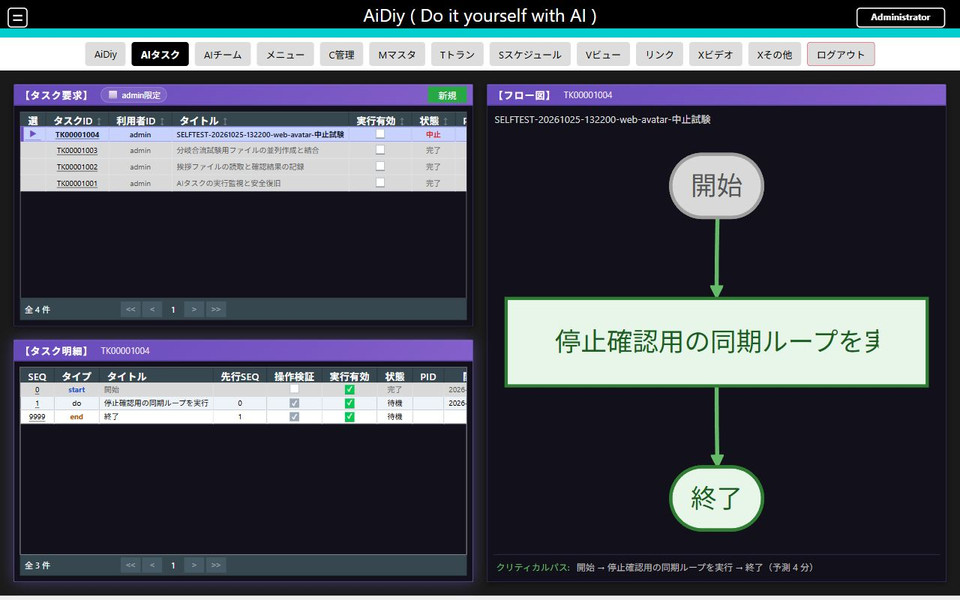

WT-201・202はTK00001002で確認済みです。13:22:41の登録後、7明細へ分解され、13:24:46から実行、13:26:19に完了しました。task-result.txtの実内容は「確認済み」の1行、挨拶.txtは元の「おはよう。総合テスト用です。」を保持していました。再表示後も完了記録があり、実行有効をOFFにしました。

**✅ OK（WT-205：入力欠落時の制御と復帰）**：TK00001005で確認しました。missing-input.txtがない状態では14:13:53に要求がエラー・実行有効OFFとなり、recovery-result.txtは存在しませんでした。入力に「入力を復旧しました。日本語の保存確認です。」とCRLFを用意し、同じ要求を準備完了へ戻して再実行すると14:44:50に完了しました。両ファイルのSHA256は一致し、正常復帰後に実行有効OFFを確認しました。

入力がなく、保存の処理目標を満たせない状態は要求全体のエラーとして表示されます。

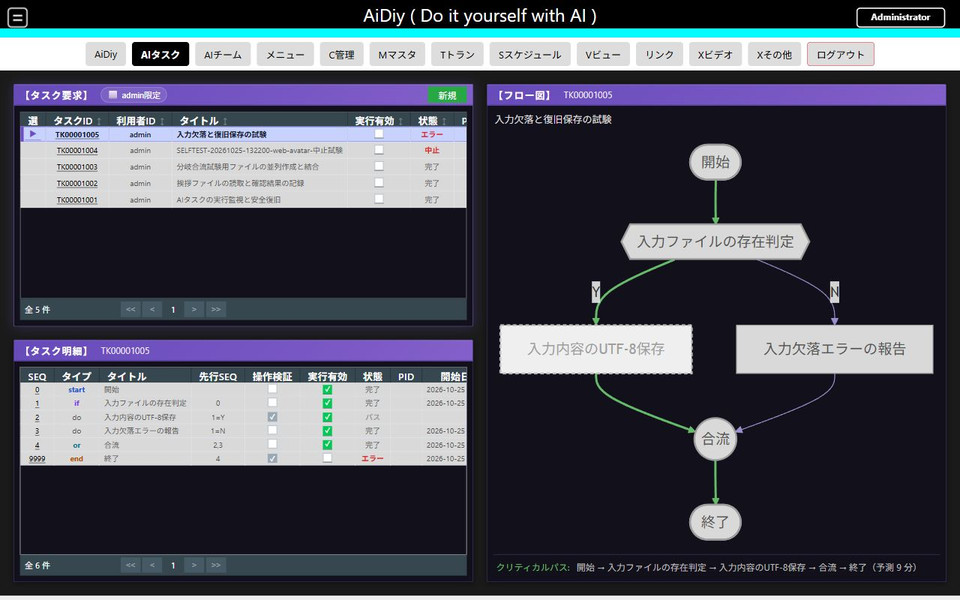

入力を補った後はY分岐を通り、保存・最終検証まで完了しました。

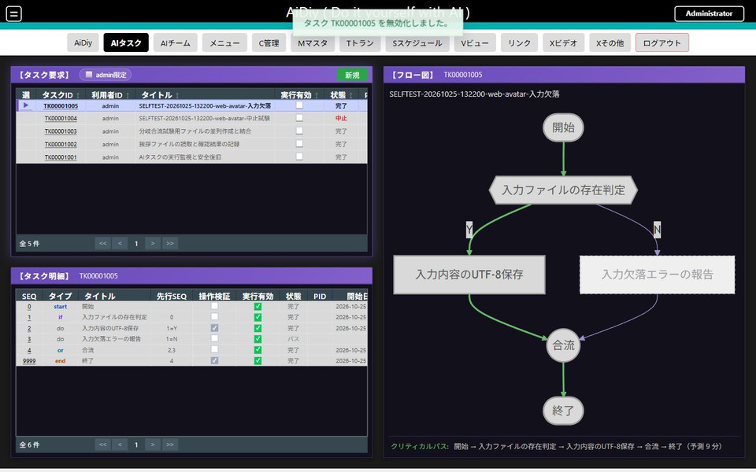

WT-203では実際に生成されたifのY/N分岐とor合流を確認しました。SEQ1の判定YからSEQ2→3へ進み、N側のSEQ4はパス、SEQ3完了後にSEQ5が合流しました。独立した2処理の並行実行はTK00001003で確認済みです（WT-204）。

完了した要求と明細・フロー図の画面です。受付だけでなく、実ファイルと照合しました。

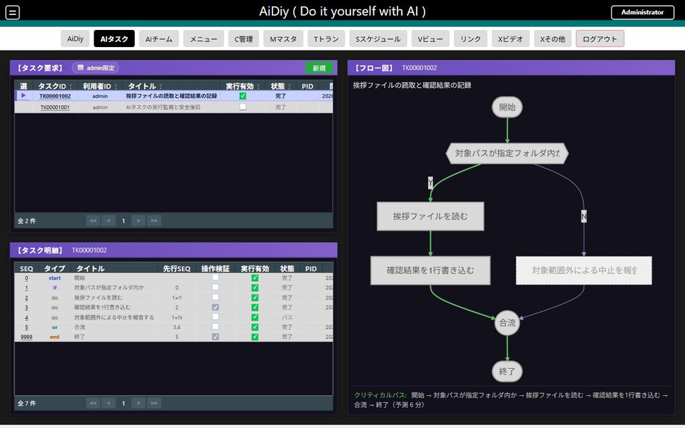

バックアップの除外判定は選択したプロジェクト内の相対パスに限定します。TK00001005の開始時（14:12:31）には同じ試験フォルダの7件が保存され、開始明細にバックアップ注意がないことを確認しました。保存内容そのものの全照合は別試験です。

## 3. 実行開始条件

### 操作の流れ

1. 要求を開いて「実行区分」を選び、表示された間隔・開始時刻・曜日などの欄を設定します。
2. 監視を使う場合は「監視フォルダ」も確認して登録し、開き直して保存値を見ます。
3. 指定時刻の前後で状況を確認し、繰り返し利用を終えるときは「実行有効」をOFFにします。

開始条件を保存しただけでは実行済みになりません。実際の開始と完了を確認します。

### セルフテスト項目

保存された条件と、実際に動き始める時刻を別に確認します。PCの時計は変更しません。

| ID | 操作 | 期待結果 |
|---|---|---|
| WT-301 | 時間指定、間隔、定時、曜日・日付、監視フォルダの入力欄を切り替えます。不正時刻・不正間隔も試します。 | 必要欄だけが有効になり、不正値を保存できません。正しい値は再表示で保持されます。対象ごとに枝番を付けます。 |
| WT-302 | 数分先の時間指定を、試験要求1件へ設定します。 | 分解後、指定時刻前は実行待ち、時刻到達後の毎分判定で実行されます。予定時刻・実開始時刻・完了を記録します。 |
| WT-303 | 短い間隔実行で2周期を確認し、すぐ実行有効をOFFにします。 | 初回は猶予2分を考慮し、その後は指定間隔で動きます。OFF後、次の予定時刻＋90秒まで新しい実行がありません。 |
| WT-304 | 試験専用の監視フォルダを指定します。初回の基準取得後、ファイルを1個追加します。 | 変化前には誤発火せず、毎分判定で変化を検出します。実行後に無変更でも繰り返し発火しません。 |
| WT-305 | 定時実行を当日の数分先に設定し、1周期を観測します。曜日・日付の将来条件は別の試験時計／隔離DBで計算を確認します。 | 当日条件では実発火します。月次などは実時間の長期運用と区別して記録し、計算試験だけを実発火済みとは書きません。 |

条件観測は予定時刻＋90秒までを最初の目安にし、実行完了は別に待ちます。間隔・定時ケースは観測後必ず無効化します。

WT-303は、前周期の実プロセス終了後に次周期を開始することを、TK00001005で確認しました。1周期目16:10:08〜16:12:11、2周期目16:14:10〜16:15:54に完了しました。2回目の完了直後に実行有効OFFへ切り替え、次回予定16:16:00から90秒後まで開始・終了日時の変化と再有効化がないことを監視スクリプトで確認しました。処理が2分を超えた場合は、終了処理の完了後に次の毎分判定へ進みます。

WT-305の将来日付計算は `scripts/checks/test_task_schedule_calendar.py` で実装の計算関数を隔離して確認しました。毎日・毎週の境界、月末31日の短い月への丸め、うるう年2月29日、12月から翌年への繰越、不正日付・曜日・時刻の計10条件を通過しました。PCの時計とDBは変更していません。実時間ではTK00001003を毎日17:52に設定し、予定前の待機、17:52:13開始、17:53:57完了、直後の実行有効OFFを確認しました。要求編集でOFFからONに変更した際、全5明細も有効になりました。要求の有効変更・無変更時の明細保持などは `scripts/checks/test_task_edit_enabled.py` の5項目でも確認しています。

定時実行の完了画面です。

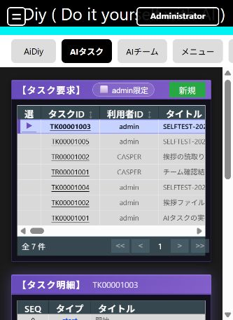

WT-304はTK00001005で確認しました。専用watchフォルダの基準取得は16:57:02、無変更の90秒間は開始・終了日時が変わりませんでした。16:58:33にファイル1個を追加し、16:59:05に開始、17:00:52に完了しました。その後150秒間の無変更で再発火しないことと、終了時の実行有効OFFを確認しました。監視フォルダは生成物の保存先projectとは分離しています。

予約・間隔・条件実行は毎分判定のため、設定時刻と開始時刻が秒単位で一致するとは限りません。

WT-301の画面切替部分を確認しました。時間指定は開始時刻、間隔実行は分・時・日と間隔値、毎週は曜日、毎月は日（1〜31）、フォルダ変化は監視フォルダが表示されました。試験入力は取消し、条件を新規保存していません。不正値・再表示・実発火の結果は本章の各ケースに記載しています。TK00001003では時間指定13:37を保存して開き直し、選択状態と時刻を確認しました。

WT-301の入力検証では、実行有効OFFの新規フォームに要求内容を入れたうえで、間隔0分・601分、開始時刻空欄、毎月32日、監視フォルダ空欄を登録しようとしました。各条件に対応する日本語の警告で保存が拒否され、取消後の要求一覧は元の3件のままでした。監視フォルダ空欄の拒否画面です。

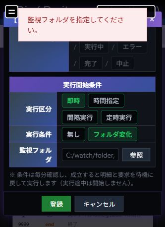

WT-302の開始条件は実時間で確認しました。13:34時点では準備完了・次回13:37で全明細が待機し、13:37:00の判定後、開始明細は13:37:05に開始しました。PCの時計は変更していません。

指定時刻前の待機と、2つの独立した明細から統合へつながるフロー図です。

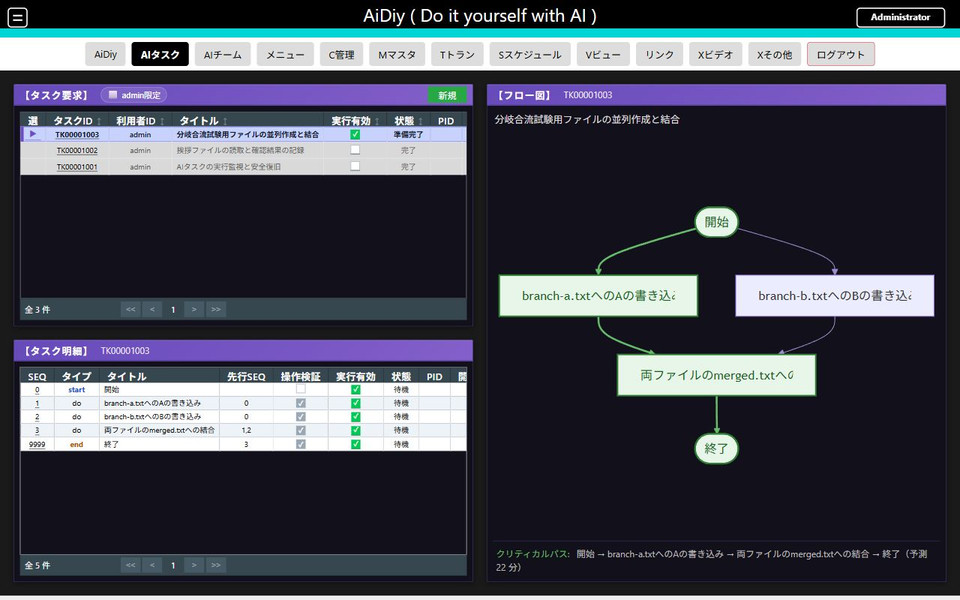

WT-204はTK00001003で実並行を確認しました。SEQ1・2はいずれも13:37:11に開始し、13:37:40と13:37:41に完了しました。両方を先行とするSEQ3は13:37:45に開始し、13:38:20に完了しています。実ファイルはbranch-a.txt=A、branch-b.txt=B、merged.txtはA・Bの2行で一致しました。最終検証を経て要求全体は13:38:49に完了しました。次回日時が翌日13:37と表示されたため、実行有効をOFFにして再実行を防ぎました。

両先行の完了後に統合し、最終検証まで完了した画面です。

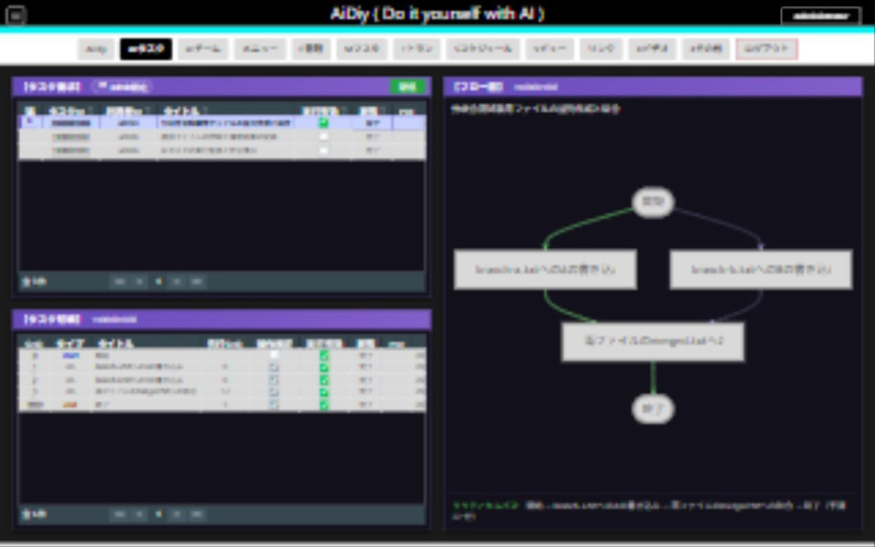

## 4. 表示と選択の整合

要求・明細・フロー図を表示して横長／縦長へ切り替え、選択したタスクが一致することと、編集ダイアログの入力・保存・取消へ到達できることを確認します（WT-101・601）。

WT-601の編集表示を1280×800と800×1000で確認しました。縦長でも要求・フォルダ・開始時刻・登録・キャンセルが表示され、取消できました。長いモデル項目名は折り返して全体が表示されます。縦長の一覧でTK00001004を選ぶと明細・図が中止試験となり、TK00001005へ戻すと両方が入力欠落試験へ切り替わりました。WT-101の選択整合も確認済みです。幅の一時設定は解除しました。

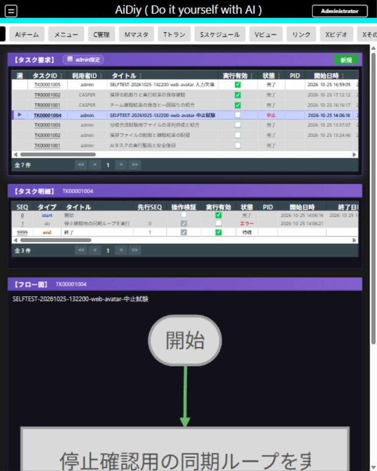

縦長で要求を再表示し、モデル項目名の全体を確認した画面です。

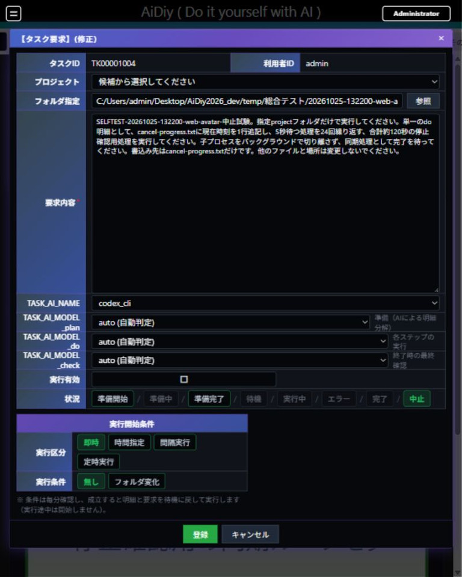

## 5. 準備中止と回数指定の最終確認

準備中止はAPIから試験要求を登録し、準備プロセスの開始後に中止へ変更しました。TK00001008は中止・実行有効OFF・PID空欄となり、60秒間の観測でも中止を保持し、明細の追加はありませんでした。実画面でも中止と明細0件を確認しました。遅れて到着する計画・失敗通知が中止を上書きしないことは、隔離DBの回帰試験でも確認しました。

回数指定は「保存を1回、読み戻して照合を1回だけ」と依頼します。完了後に要求を選択し、明細と応答を開きます。TK00001007は保存・照合の2実作業と開始・終了の計4明細で完了しました。保存は書込みAPIの正常終了、照合は読取り処理内の完全一致で確認し、終了処理は実行済み記録を参照しました。各段階の実行記録に、重複読込み・重複照合がないことを確認しています。この結果は今回のcodex_cli／autoでの試験結果です。

保存と照合が別の明細となり、両方が完了した画面です。試験後は実行有効をOFFにしました。

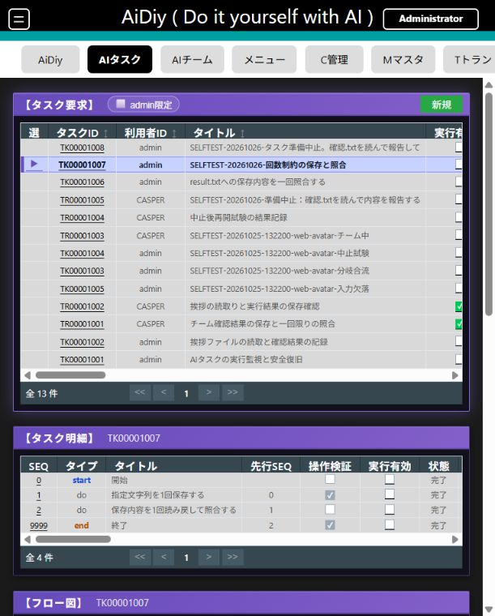

## 6. 終了状態と確認範囲

追加分を含む試験タスクは実行有効OFFです。中止後のファイル更新停止と対象実行プロセスの残存なしを確認し、試験生成物を証跡として保持しました。最終回帰のタスク10件は合格しています。

時刻指定・毎日・間隔・フォルダ変化は実時間で確認しました。毎週・毎月等の将来境界は計算関数の隔離試験であり、長期実発火の確認ではありません。バックアップの保存内容全体の照合は別試験です。

チームからの依頼、中止連携、有限SPDCAは[AIチーム編](./セルフテスト,frontend_web,AIチーム編.md)で扱います。

[PDF版](./セルフテスト,frontend_web,AIタスク編.pdf)
