# frontend_web AIチーム編 — 操作ガイドとセルフテスト

> 本書はセルフテスト結果を、操作説明・解説書としても読みやすく整理しています。再テスト後は結果・注意書き・エビデンスを更新し、章立て・操作手順・図解の配置などの様式を維持します。

> 文書: `セルフテスト,frontend_web,AIチーム編.md` | 実装: `frontend_web/src/components/AIチーム/`, `backend_taskteam/`

## 総合評価

**総合評価：✅ OK。記載したWindows試験は完了（2026年10月25〜26日）。** 要員召喚・退場、要員会話、依頼の完了、中止後の新規依頼、有限SPDCA、自動作業切替、空間表示、表示連動監視を確認しました。自動会話の実回答、準備中止とその後の停止維持も確認しました。共通タスク実行の回数指定はAIタスク編で確認しました。全条件の網羅ではなく、記載のない条件は未実施です。週・月をまたぐ実時間観測は **PASS（環境依存・判定対象外）** とし、今回は未実施です。

対象環境はWindowsです。Mac／Linux実機と長時間連続運転は **PASS（環境依存・判定対象外）** とし、今回は未実施です。実行成功とは区別し、NGには数えません。

試験日は各結果に記載しています。文書・画像名の整理日は2026年10月26日であり、試験の再実施日ではありません。
## この冊子を使う場面

- AIチームの操作・進捗・完了結果を確認するとき。
- 関連機能を変更した後に、記載した条件で再試験するとき。

## 始める前に

試験用アカウントはadmin、パスワードはアスタリスク8文字です。[準備と終了の共通ルール](./セルフテスト,_説明資料の書き方.md#試験の準備と終了)に従い、[AiDiy編](./セルフテスト,frontend_web,AiDiy編.md)のログイン後に「AIチーム」を開きます。AIが変更する範囲は試験専用フォルダだけです。既存の要求・目標・実行設定を控え、試験用と混ぜません。試験後は自動実行を止めます。

ケースIDのWT番号は、既存の証跡との対応を保つため引き継ぎます。

## 試験データ

| 対象 | 試験用ID・名称 | 変更前の値 | 参照先 | 終了時の確認 |
|---|---|---|---|---|
| 既存要員 | admin、BALTHASAR、CASPER、MELCHIOR | 画面上4名、依頼0・経験0 | チーム空間 | 既存4名を保持 |
| 試験要員 | AlanTuring | 未召喚 | チーム空間 | 召喚後5名、一致する役割と詳細を確認。退場後は既存4名 |
| チーム依頼 | TR00001001 / SELFTEST-20261025-132200-web-avatar-チーム保存試験 | 新規、codex_cli/auto | 専用projectのteam-result.txt | CASPERが実行、16:19:21完了、依頼は済。経験TE00001001は16:21:36完了 |

追加対象：TR00001002はSPDCA実行、TR00001003は中止、TR00001004は中止後の新規依頼です。専用フォルダは `temp/総合テスト/20261025-132200-web-avatar/project/`、表示切替だけの確認は `temp/総合テスト/20261026-switch-only/` を使いました。TW00001001〜6の既存履歴は保持しています。

## 1. AIチームの要員と依頼

### 操作の流れ

1. 上部メニューの「AIチーム」を開き、依頼先の要員とプロジェクトを確認します。
2. 依頼を登録し、依頼状況で自分の依頼を選択します。
3. 作業・結果を確認し、生成物がある場合は指定フォルダで開きます。
4. 要員と会話するときは要員名または空間上の要員をダブルクリックし、会話の対象プロジェクトを確認してから送信します。

成功の目印は、選んだ依頼と結果が対応し、指定プロジェクトに結果が残ることです。

### セルフテスト項目

`/AIチーム` を開きます。初期要員のadminは削除しません。

| ID | 操作 | 期待結果 |
|---|---|---|
| WT-401 | 要員・依頼・経験・作業・会話の各領域を開閉し、一覧を選択します。 | 選択と詳細が対応し、表示が更新されます。折り畳み中は10秒へ減速し、非表示・離脱時には監視が停止することを補助試験で確認します。 |
| WT-402 | 試験用要員を召喚し、役割と詳細を確認して退場させます。 | 試験要員だけに反映されます。adminは残り、保護動作を確認できます。現行画面に独立した要員編集機能はありません。 |
| WT-403 | 試験プロジェクトで短い依頼を登録します。 | 受付から完了まで追え、生成物または正式な結果を確認できます。経験・作業の記録と関連が一致します。 |
| WT-404 | 要員名／空間上の要員をダブルクリックし、プロジェクト会話で「挨拶.txtの内容を一文で教えてください。」と送ります。 | 指定先を調査した返答が最大360秒の観測内で確認できます。別プロジェクトの内容が混ざりません。 |
| WT-405 | 試験依頼を中止し、その後に新しい短い依頼を行います。 | 対象だけが止まり、次の依頼を正常に実行できます。 |

WT-402の召喚はAlanTuringで確認しました。既存4名を保持したまま5名となり、一覧・役割・選択詳細が一致しました。試験後に退場し、既存4名へ戻りました。退場は要員レコードを残して無効化する操作です。現行画面には独立した要員編集機能はありません。

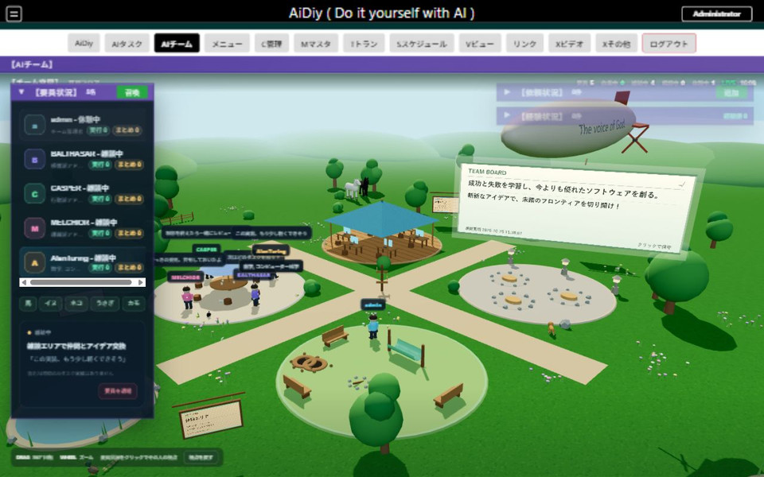

退場後は元の4名へ戻りました。

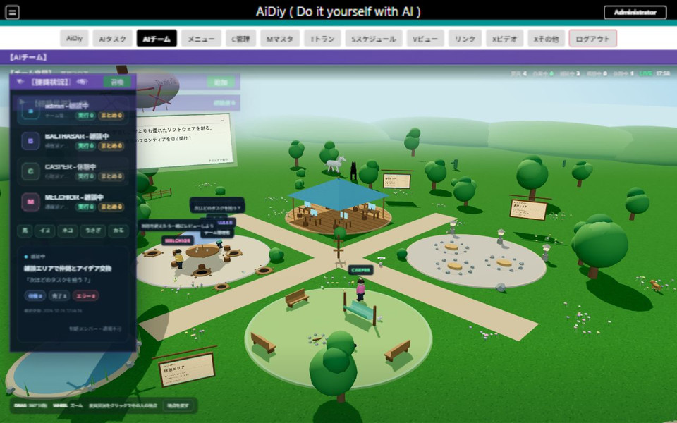

WT-405はTR00001003の中止とTR00001004の新規実行で確認しました。チーム依頼から有効化した関連タスクが実行され、18:42:04にteam-cancel-progress.txtへの実追記を観測しました。18:42:06の中止後、チーム依頼とAIタスクの両方が中止・実行有効OFFとなり、21バイトのファイルが60秒間変化しませんでした。チームからの制御経路6項目、停止後の明細をタイムアウト対象に含めない隔離SQLite試験も通過しています。中止後の新規依頼TR00001004は19:01:02に終了し、画面は済、team-restart-result.txtの本文は「中止後も実行できました」と一致しました。終了後に実行有効をOFFへ戻しました。

中止したチーム依頼の表示です。

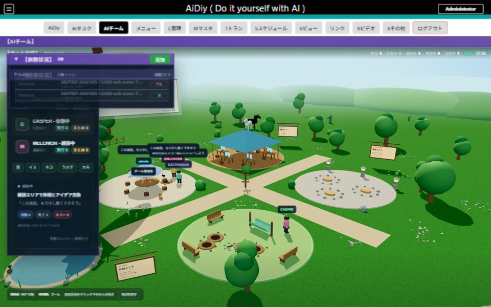

中止後に別の依頼を登録し、完了を確認しました。

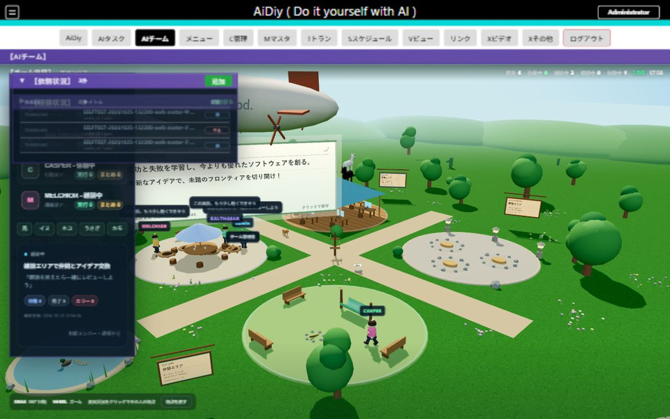

WT-403はTR00001001で受付から完了まで確認しました。担当CASPERの関連タスクは16:16:17〜16:19:21に実行し、team-result.txtはUTF-8（BOMなし）の「チーム確認済み」とCRLF、23バイトでした。依頼画面は「済」となりました。同じ依頼ID・タスクID・担当・専用プロジェクトを持つ経験TE00001001が16:21:36に完了し、経験値15であることをAPIで照合しました。経験パネルは掲示板プロジェクト「../」で絞るため、この専用フォルダの経験を表示しません。保存・照合の回数指定は、共通のタスク実行部を[AIタスク編](./セルフテスト,frontend_web,AIタスク編.md)で追加確認しています。

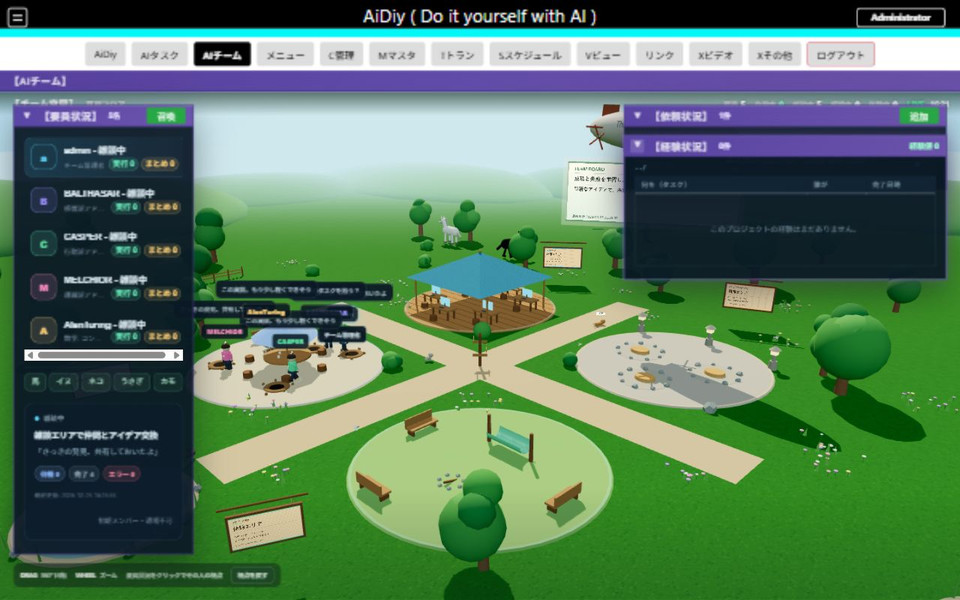

WT-401の一部を確認しました。要員4名、依頼0件、経験0件の初期状態から依頼・経験パネルを開くと、見出しと0件の案内が表示されました。召喚候補をAlanTuringで検索すると1候補へ絞られ、取消できました。既存adminには「初期メンバー・退場不可」の表示があり、削除は行っていません。召喚確定と依頼実行の結果はWT-402・403に記載しています。

WT-404はBALTHASARで確認済みです。一覧選択で詳細と視点が対象要員へ変わり、ダブルクリックで同じ要員の会話が開きました。フォルダ指定を専用projectへ変更して挨拶.txtの内容を質問すると「おはよう。総合テスト用です。」と返り、実ファイルと一致しました。360秒の枠内で応答し、終了後は会話を閉じ、視点を戻し、依頼・経験パネルも元の折りたたみ状態へ戻しました。

指定した試験フォルダと、その挨拶ファイルに一致する回答です。

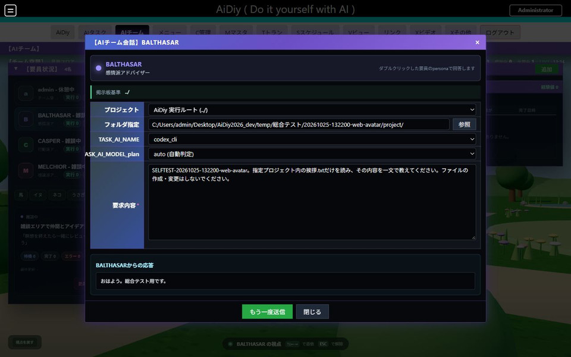

## 2. 目標と自動作業

### 操作の流れ

1. 目標の編集画面でプロジェクト・目標・作業内容を確認します。
2. まず自動作業をOFFにした状態で保存し、開き直して内容を確認します。
3. 1周期だけ確認するときは自動作業をOFFに保ち、回数を1回に制限して作業ループをONにします。自動作業ONは完了後に次の作業の協議へ戻るため、有限試験では別に扱います。
4. 作業の結果を確認してOFFへ戻します。画面を閉じただけで停止したとは判断せず、設定と実行状態を確認します。

### セルフテスト項目

既存目標の元値を保存してから、試験用の目標へ切り替えます。試験が終わったら元へ戻します。

| ID | 操作 | 期待結果 |
|---|---|---|
| WT-501 | 自動作業OFFで、短い目標と作業を保存・再表示します。 | 内容が保持され、OFFのまま勝手に開始しません。 |
| WT-502 | 自動作業OFF・SPDCA・1回で作業ループをONにします。 | S相談→P計画→D実行→C評価→A改善を記録で追えます。完了後にループがOFFへ戻り、継続しません。 |
| WT-503 | 自動作業をOFFにしてからONにします。ループのON／OFFも切り替えます。 | OFF→ON時の作業クリアと、ループ時の作業領域の表示が仕様と一致します。作業内容を先に証跡へ残します。 |
| WT-504 | 目標あり・自動作業ON・作業空の条件で会話領域を確認し、直後に自動作業をOFFへ戻します。 | 条件に対応した領域が表示されます。会話が発生した場合は実記録を確認します。表示だけで会話成功とはしません。 |

WT-501は専用projectパスで確認しました。既存「../」の目標を変更せず、新しい目標・作業を17:02:54に保存しました。再表示で本文、SPDCA、1回、自動作業OFF・作業ループOFFが一致しました。

WT-502は自動作業OFF・SPDCA・1回で確認済みです。TW00001001〜TW00001006はすべてループ1・済となりました。Sは2名で17:06:45〜17:07:40、Pは17:08:03〜17:08:46、Dは依頼TR00001002を実行して17:09:04〜17:18:32、Cは17:19:53〜17:20:54、Aは17:21:07〜17:22:00でした。終了処理で17:22:07に作業ループがOFFとなり、17:29以降の読み取り専用DB照合でも2周期目はありません。spdca-result.txtの本文は「自動作業確認済み」で、26バイトでした。画面の再表示でも自動作業・ループ両方のOFFを確認しました。

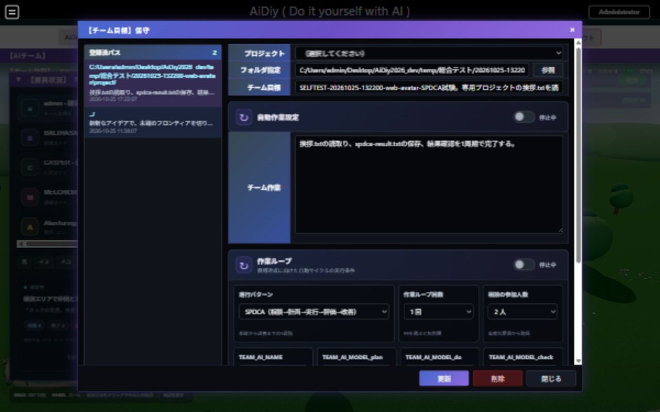

目標を開き直した画面です。自動作業と作業ループがOFFのままであることを確認します。

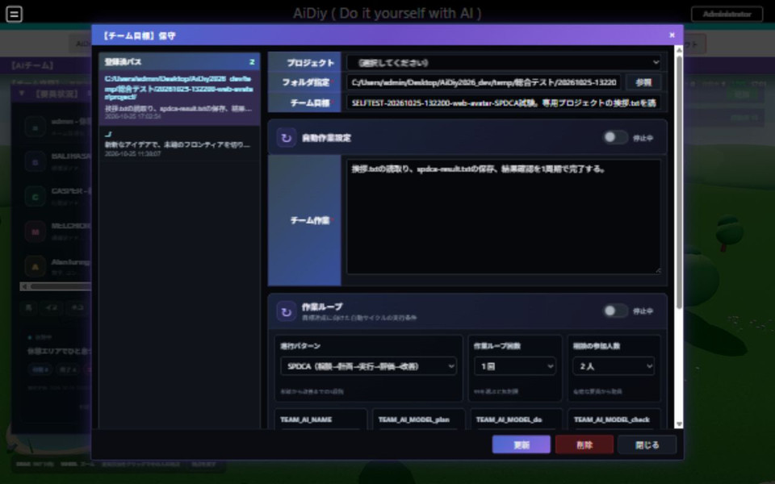

### 自動作業切替の最終確認

WT-503・504は履歴のない専用フォルダ `temp/総合テスト/20261026-switch-only/` で確認しました。入力した「切替前の試験作業」は自動作業ONで空になりました。目標あり・作業空・自動作業ON・ループONで、会話状況0件と作業状況0件を表示しました。OFFへ戻し、作業を「表示切替試験完了。実行しない。」として保存すると、両領域が消えました。新規の空履歴を使ったため、既存TW00001001〜6の履歴は削除していません。会話発生の成功試験ではなく、表示条件の試験です。

作業空の条件で会話・作業領域を表示した画面です。

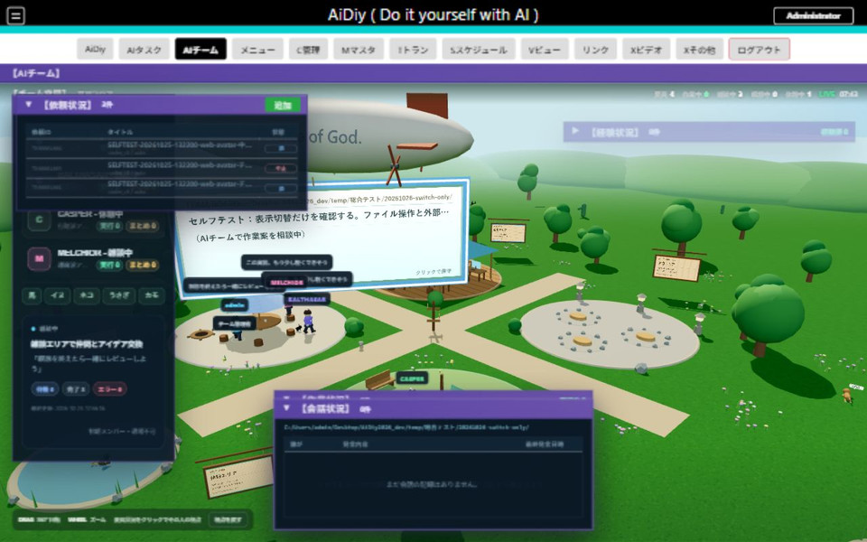

### 自動会話の実回答

専用プロジェクトに確認.txtを置き、目標に「ファイルを読み、合言葉を含めた一文で意見を述べる」と入力します。作業を空欄、自動作業をON、作業ループをOFFにして保存し、会話状況を待ちます。今回の登録はAPIで行い、会話本文を実画面で確認しました。

BALTHASARとMELCHIORの実回答に、指定ファイルの合言葉「青い鳥」が含まれることを確認しました。会話の要求本文も、設定した目標・プロジェクトと一致しました。確認後は自動作業をOFFにし、元の目標へ戻しました。

指定ファイルを読んだ回答が会話状況へ表示された画面です。

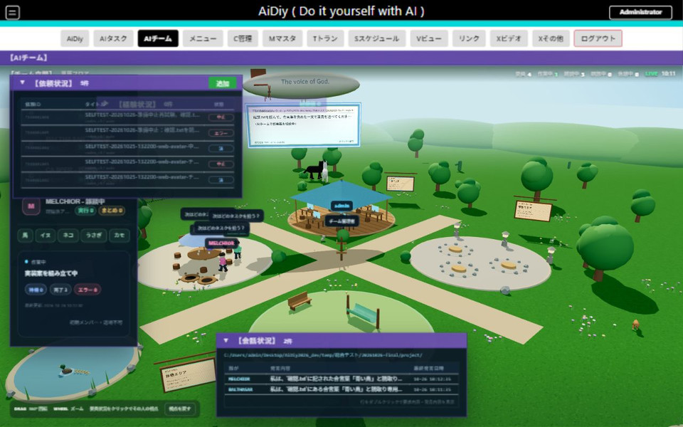

### 関連タスクができる前の中止

APIで試験依頼を登録し、準備中・関連タスク未登録の段階で中止へ変更しました。TR00001006は中止・実行有効OFF・PID空欄となり、準備プロセスの終了を確認しました。60秒間の観測で遅れたタスク登録や状態上書きはありません。停止と登録が競合する順序も隔離DBで検証しました。

編集画面でも、中止と実行有効OFFを確認しました。

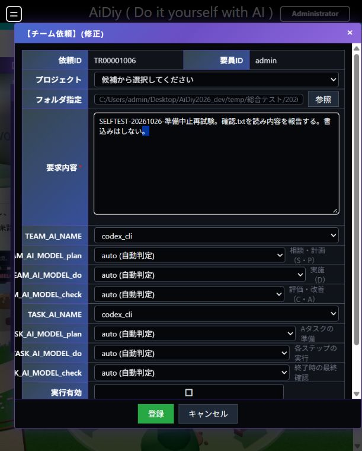

## 3. 表示と監視

WT-401では要員・依頼・経験・作業・会話の各領域の表示と開閉を確認します。実装のTypeScriptを読み込むタイマー試験で、開いた領域は5秒、折り畳みは10秒、非表示・非活性化・アンマウントでは停止することを確認済みです。再表示時の1回更新とタイマー重複なしも確認しました。

WT-602では空間表示と要員選択を照合し、連続観測で動きを確認します。静止画1枚だけをモーション合格の根拠にはしません。

WT-602の空間描画は実画面で確認しました。13:24:40と13:25:09の連続観測で飛行船と要員の位置が変わり、動いていることを確認しました。WT-404では一覧からBALTHASARを選択して詳細と視点が切り替わり、同じ要員との会話が開くことも確認しました。

13:24:40の空間表示です。

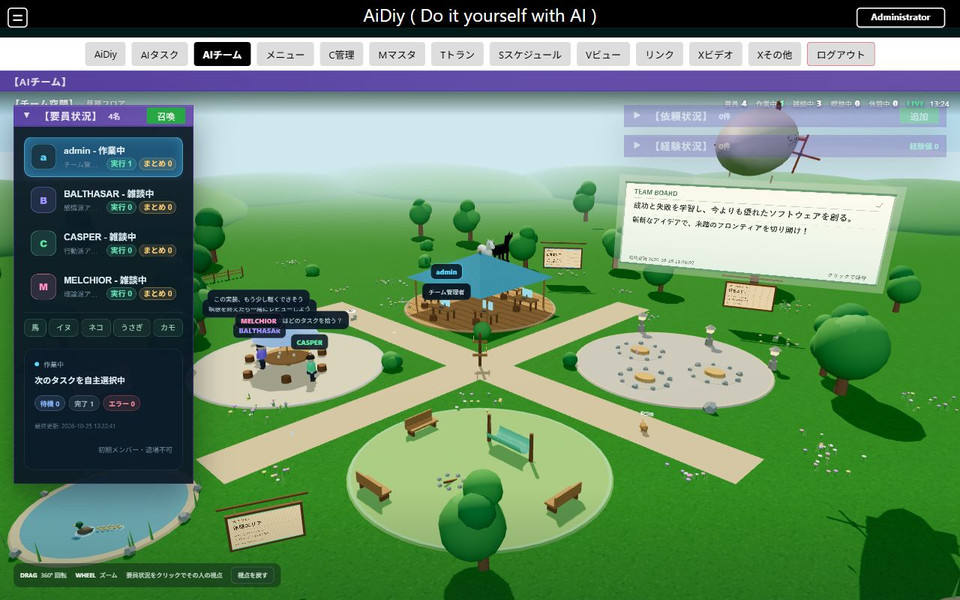

13:25:09には飛行船と要員の位置が変わっています。

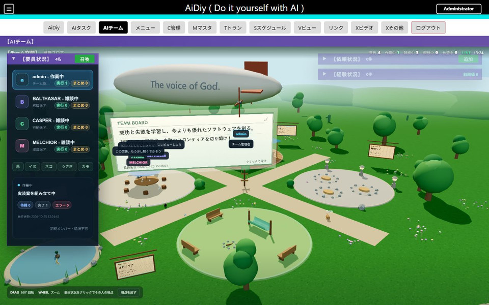

会話詳細を420×900の縦長表示で開き、本文のスクロールと閉じる操作を確認しました。確認後は通常の表示幅へ戻しました。

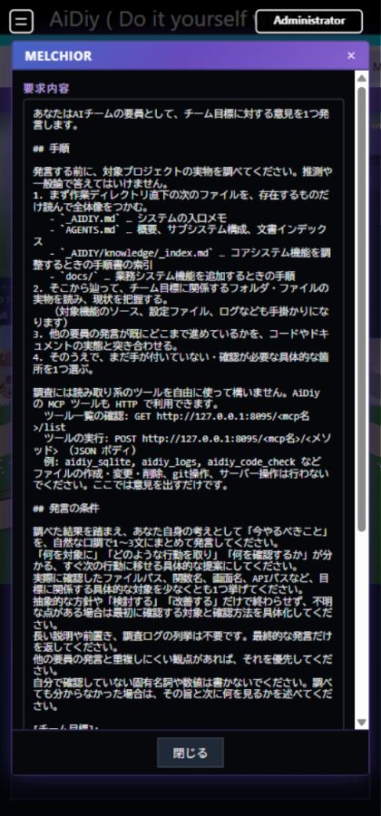

## 4. 終了状態と確認範囲

読み取り専用DB照合で全3目標の自動作業・作業ループがOFFであり、実行中要求がないことを確認しました。TR00001001・2を含む試験関連タスクは、完了確認後に実行有効OFFへ戻しました。試験要員AlanTuringは退場し、既存4名を保持しています。掲示板は元の「../」の目標表示へ戻しました。履歴と生成物は証跡として保持します。

最終回帰のチーム制御・自動会話・準備中止競合10件と、表示監視1件は合格しました。チームから呼び出すタスクの単独機能は[AIタスク編](./セルフテスト,frontend_web,AIタスク編.md)で扱います。

自動会話の実回答と準備中止は10月26日に追加確認しました。照合回数の最終結果は、同じタスク実行部を使うAIタスク編のTK00001007を参照します。

[PDF版](./セルフテスト,frontend_web,AIチーム編.pdf)
