# frontend_web AiDiy編 — 操作ガイドとセルフテスト

> 文書: `セルフテスト,frontend_web,AiDiy編.md` | 実装: `frontend_web/src/components/AiDiy/`, `frontend_web/src/stores/`

## 総合評価

**2026年10月24日・Windowsで再試験しました。ログイン、Chat、Code1〜6、Liveの文字応答、添付、設定ファイルへの保存、再接続、ログアウトは✅ OKです。** 画像は今回の操作で撮り直しました。

再接続でCode5・6が閉じる問題を修正し、2回繰り返して表示を維持できることを確認しました。履歴は置換して復元するよう修正し、同じ内容の別の発言は削除しません。関連自動テスト13件とWebの型チェックが成功しています。

本冊は通常Webの操作確認です。Codeによる実装変更、各Providerの全モデル、実マイク入力や音声の聴取、全ゲームの動作網羅は合格範囲に含めません。ブラウザが認識するマイクは0台のため、実マイク入力は **PASS（環境調整が必要・総合判定から除外）** です。BGMは一覧・操作欄を表示できましたが、今回の試行では再生開始を確認できていません。

## 始める前に

[システム起動編](./セルフテスト,aidiy_diag,システム起動編.md)に従い、WebとCoreを起動します。通常Webは `http://127.0.0.1:8090` です。Avatar WebはAvatar起動中の8092で、本冊とは別です。

試験用アカウントは[アプリ起動編](./セルフテスト,aidiy_diag,アプリ起動編.md#ローカル試験用の利用者)を参照します。今回のCode入力は挨拶だけで、ソース変更は依頼していません。ファイル操作を依頼する場合は、試験専用フォルダを指定します。

画像は縦横比を保って長辺960px以下にしています。パネルの説明用には1600×1000の表示領域を使用しました。小さい画面では必要なパネルだけ開くと本文を読みやすくなります。

## 1. ログインする

1. `/AiDiy` を開きます。未認証ならログイン画面になります。
2. 利用者IDとパスワードを入力して「ログイン」を押します。
3. 上部メニューから目的の機能へ進みます。

**✅ OK：** 未認証での保護URL、誤ったパスワードの理由表示、正しいログインを確認しました。ログイン後はAdministratorと13個のメニューが表示されました。C管理への移動とブラウザの戻る、再読み込み後の認証維持、直接URLのMマスタ9項目も確認しました。

パスワードが違うと理由が表示されます。入力を直してからログインします。

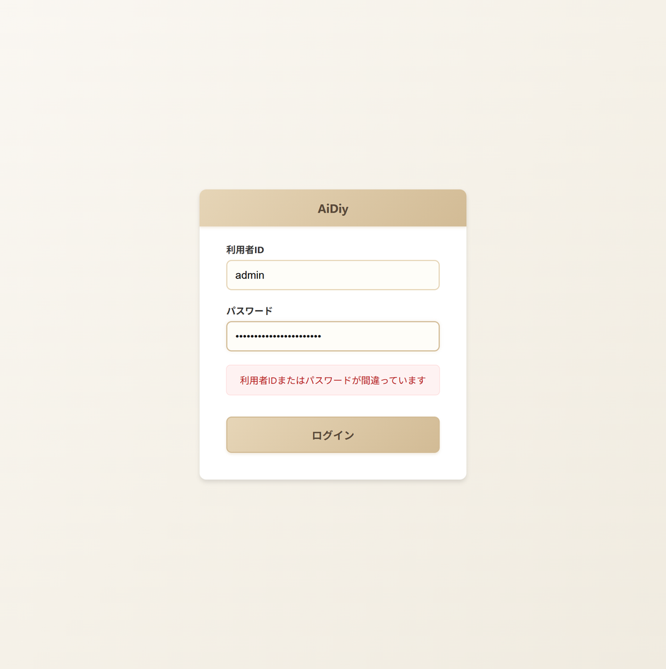

ログイン後のメニューです。利用者名を確認して目的の機能へ進みます。

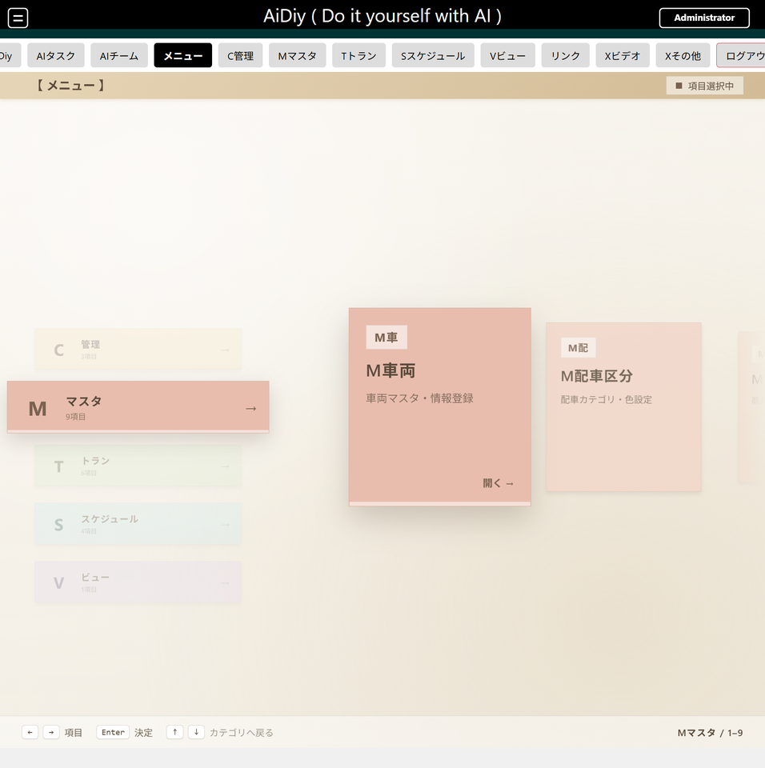

## 2. ChatとCodeで話しかける

1. 上部の「AiDiy」を開きます。
2. 右側の「0」でChat、1〜6でCodeを開きます。パネルの×で閉じられます。
3. Chatでは「Chat」を選択し、入力して送信します。Codeでは各パネルの入力欄から送信します。
4. 接続中の表示、準備完了の案内、正式な返答を確認します。Codeでは停止ボタンが無効になったことも確認します。

**✅ OK：** Chatに「おはよう」、続けて「先ほどの挨拶を短く言い換えて」と送り、文脈に合う返答を確認しました。別の新規会話では前の発言が引き継がれず、会話が分離されました。

Chatで挨拶に返答した画面です。通常の文章を入力して会話できます。

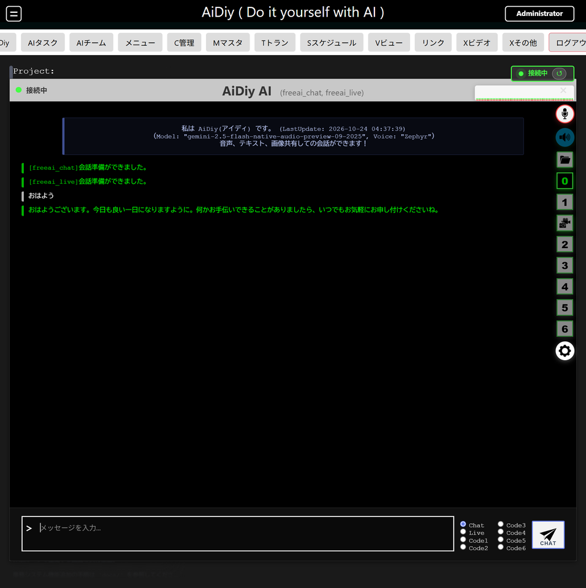

新規会話で直前の発言を尋ねた結果です。別の会話の内容は混ざっていません。

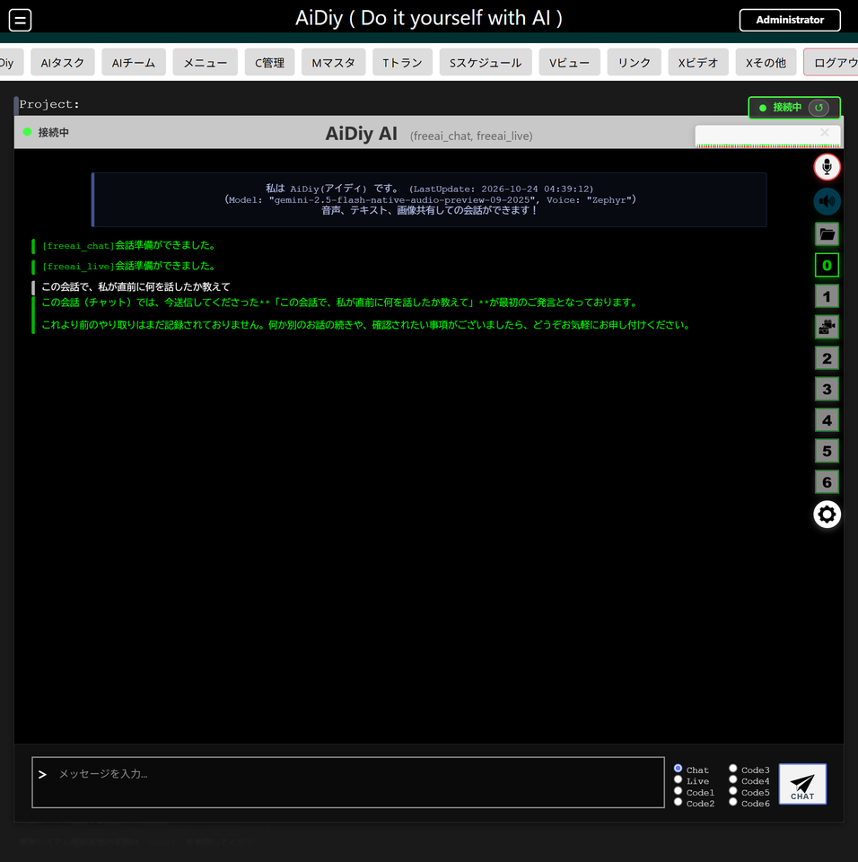

Code1〜6を順に追加し、それぞれ「おはよう」の正式な返答まで確認しました。今回の挨拶試験では検証を0回にしました。実装を依頼するときは必要な検証回数に戻します。再読み込み後は画面の初期値が1回になるため、画像と送信時の指定値を混同しません。

| パネル | 今回のProvider | 結果 |
|---|---|---|
| Code1 | codex_cli | ✅ 挨拶の返答と処理完了 |
| Code2 | copilot_cli | ✅ 挨拶の返答と処理完了 |
| Code3 | claude_cli | ✅ 挨拶と作業案内、処理完了 |
| Code4 | antigravity_cli | ✅ 挨拶と作業方針、処理完了 |
| Code5 | opencode_cli | ✅ 挨拶の返答と処理完了 |
| Code6 | aidiy_hermes | ✅ 挨拶の返答と処理完了 |

Code1とCode2の返答です。番号ごとにProviderと会話を確認できます。

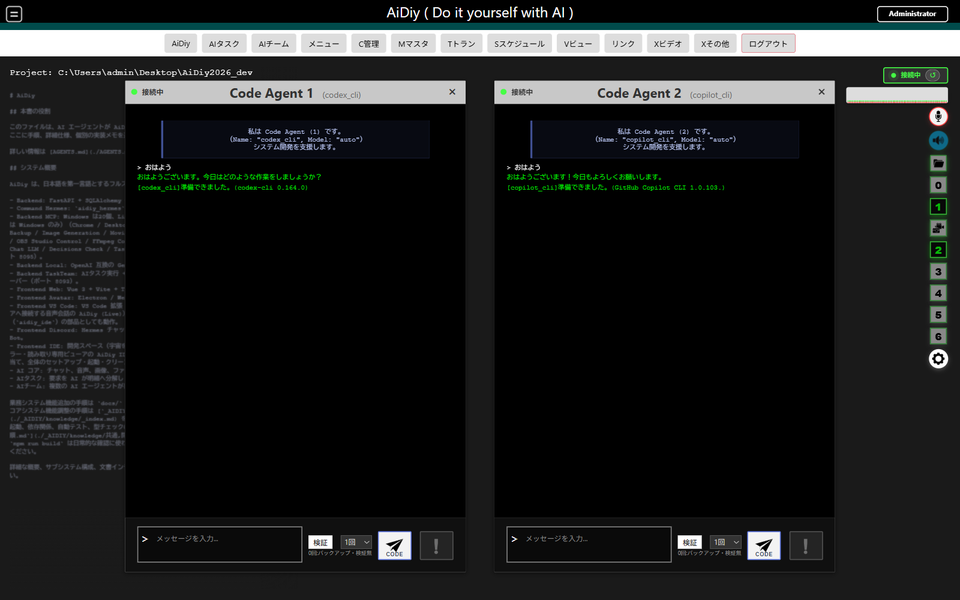

Code3とCode4の返答です。長い返答はパネル内をスクロールして読みます。

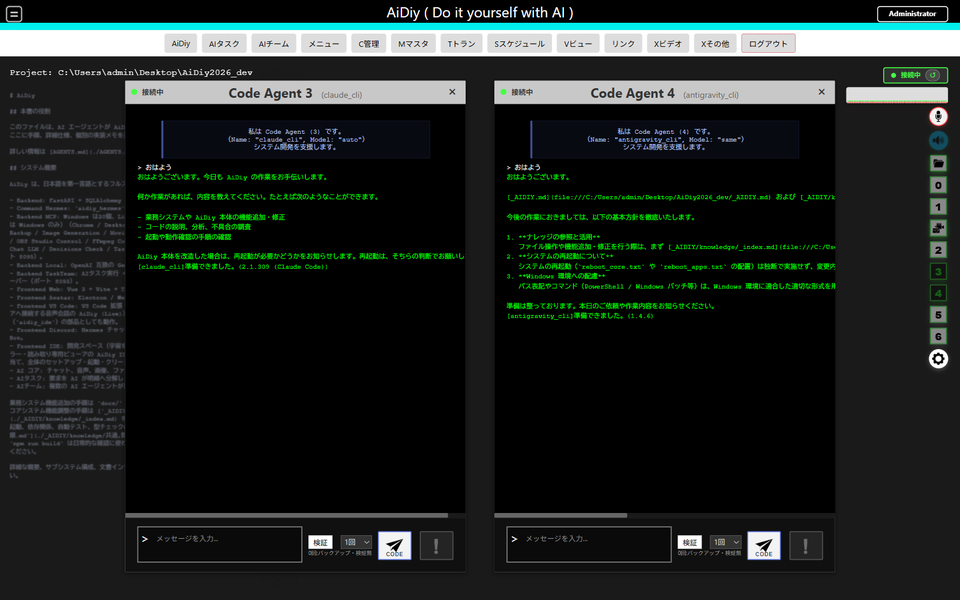

Code5とCode6の返答です。再接続後も各1回分の挨拶が残っています。

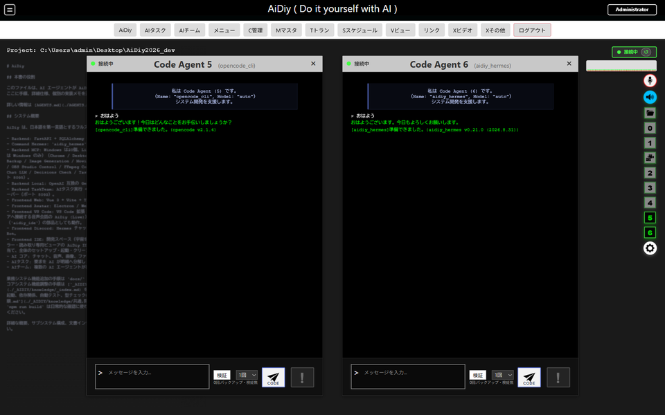

## 3. パネルを増やす・再接続する

右側のフォルダとカメラのアイコンで、File ManagerとLive Captureを追加できます。ChatとCode1〜6を合わせると9パネルです。狭いパネルで本文を読むときは不要なパネルを×で閉じます。表示するだけではファイルや画面をAIへ送信しません。

接続をやり直す場合は右上の↺を押します。**✅ OK：** 同じセッションIDを保ち、Code1〜6の挨拶が各1件のまま、9パネルが再接続後も表示されました。2回繰り返してCode5・6が消えないことを確認しています。

Liveの会話文脈は、サーバー側で接続しているLive APIの同じセッションが保持します。画面への履歴の保存・再表示は不要です。Webをリフレッシュしても、サーバー側のLiveセッションが維持されていれば会話を続けられることが確認点です。Core再起動後の新しい応答確認とは区別します。履歴が再表示されないことは不具合・残件に数えません。

再接続後の9パネルです。Code5・6を含め、開いたパネルが残ります。

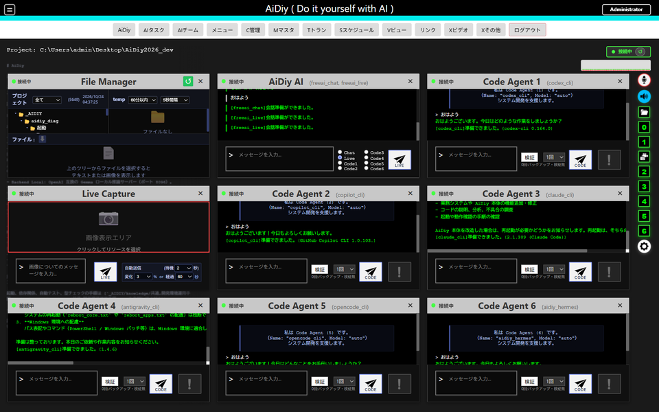

## 4. Liveで文字を送る

Chatパネルの「Live」を選び、準備完了を確認して15秒以上待ってから文字を送ります。今回は「おはよう」を1回送り、17秒後の確認で「おはようございます!いつもありがとうございます。今日も一日、よろしくお願いします。」という返答を確認しました。応答が遅いときに同じ文を連打しません。

**✅ OK：文字入力からのLive応答。** マイク入力・音声の聴取とは別の確認です。

Liveを選んで挨拶した結果です。入力モードと返答を確認します。

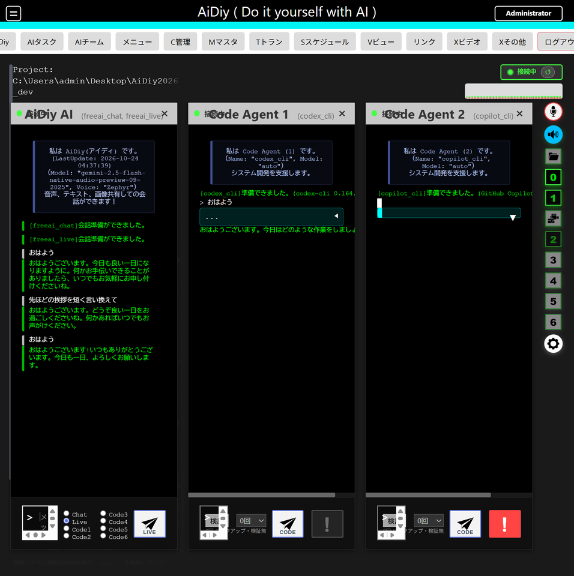

## 5. ファイルを添付する

Chatの入力欄へテキストやPNGをドラッグ＆ドロップします。「ファイル入力」とファイル名が表示され、画像ではサムネイルも表示されれば受信を確認できます。

**✅ OK：** 今回はドロップイベントで、日本語と空白を含む `確認 20261024.txt` と `青丸 20261024.png` を添付しました。保存されたテキストが元の内容と一致し、PNGのSHA-256も送信前と一致しました。PNGは2193バイトです。実ファイルをマウスでドラッグする操作とは区別し、受信・保存・表示を確認した結果です。

日本語のファイル名と青い丸のサムネイルが表示されています。

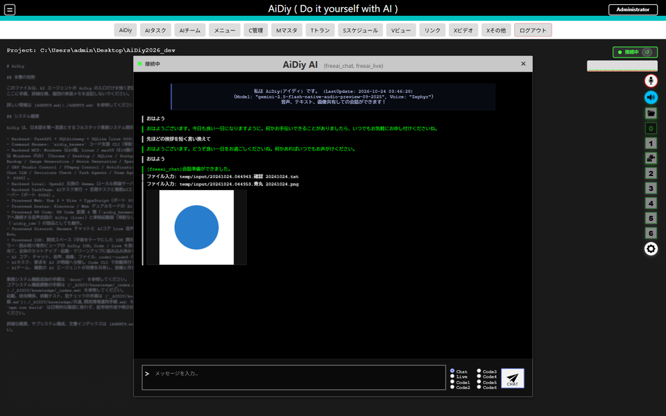

## 6. 設定を保存する

1. 右側の歯車を押してモデル設定を開きます。
2. 「フォルダ」など必要な項目を変更します。
3. 「保存(json書換)」は共通設定ファイルへの保存です。現在の会話の設定はそのままです。
4. 現在の会話に反映する操作とは分けて扱います。既存の作業中に不用意に作業先を切り替えません。

**✅ OK：** 試験フォルダを保存し、設定ファイルの `CODE_BASE_PATH` が入力値と一致しました。ダイアログを開き直すと現在の会話の値が表示される仕様も確認しました。試験後は元の `C:\Users\admin\Desktop\AiDiy2026_dev` に保存し直し、ファイル上の復元を確認しました。「保存後の再表示で新しいフォルダが適用される」とは説明しません。

フォルダを指定した設定画面です。「保存(json書換)」と「設定/再起動」を区別して使います。

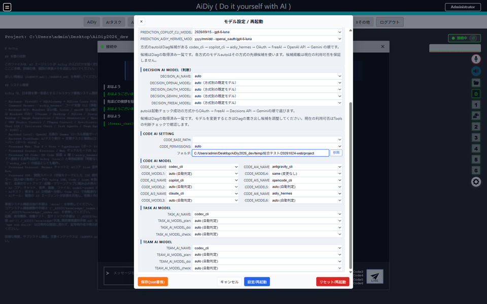

## 7. 管理画面とデモを開く

「C管理」から権限・利用者・採番を開きます。**✅ OK：** 権限5件、利用者5件、採番8件を表示しました。ここでは既存データを編集していません。

C管理の利用者一覧です。IDと名前を確認してから対象を選びます。

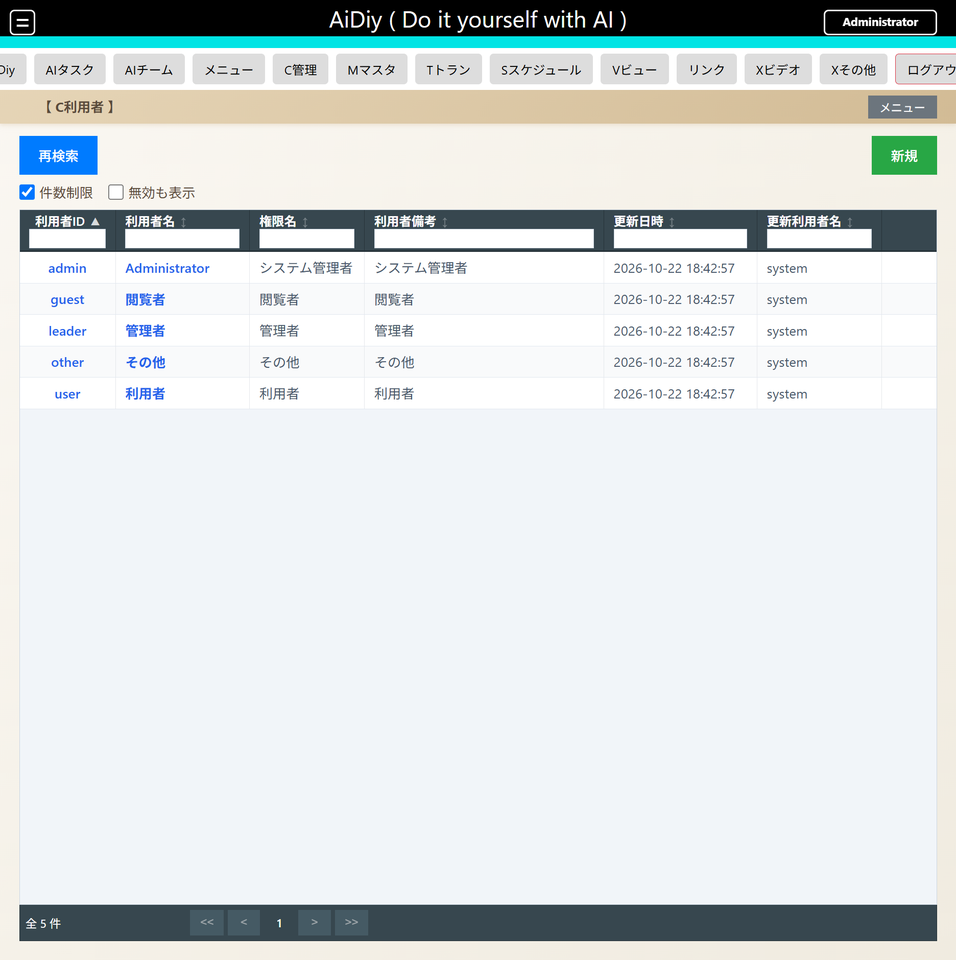

「Xその他」では紹介、映像、3D表示、ゲームの入口を選べます。今回は11画面を開き、以下の範囲を確認しました。起動表示とゲーム全体の合格は別です。

| 画面 | 今回確認した範囲 |
|---|---|
| 自己紹介 | 紹介本文とリンクの表示 |
| Xビデオ | 動画カテゴリと選択肢の表示 |
| アバター訓練中 | モデルの読み込み完了、00〜20・999の選択欄 |
| 世界の絶景 | バナウェ棚田の写真と説明、出典の表示 |
| 動画再生BGM | プレイリストと音量・切替欄。再生開始は未確認 |
| 太陽系 | 日付・速度・惑星表示の画面 |
| インベーダー／テトリス | ゲームの開始画面 |
| リバーシ／立体リバーシ | 初期盤面・得点・操作案内 |
| ドッグファイト | 自動操縦でMISSION 1開始の表示 |

自己紹介を開いた画面です。特徴や各機能の説明を読めます。

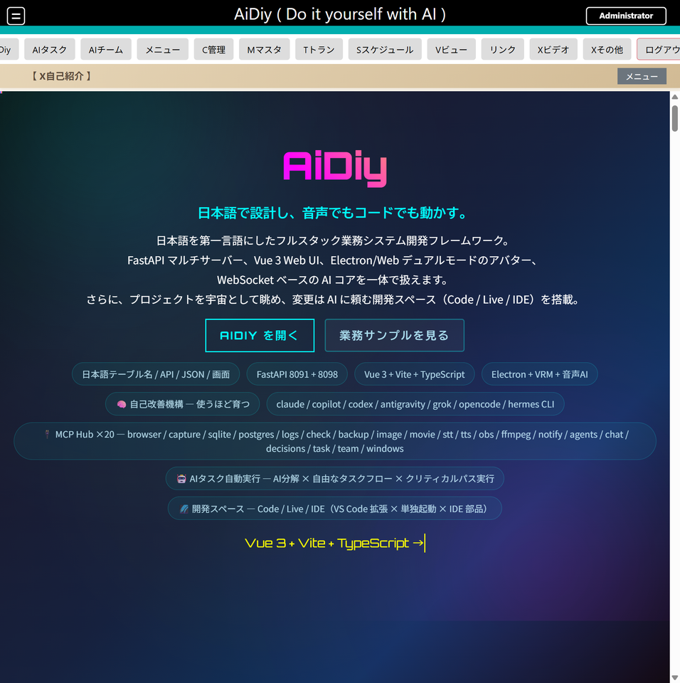

アバター訓練中の画面です。番号でモーション候補を選びます。

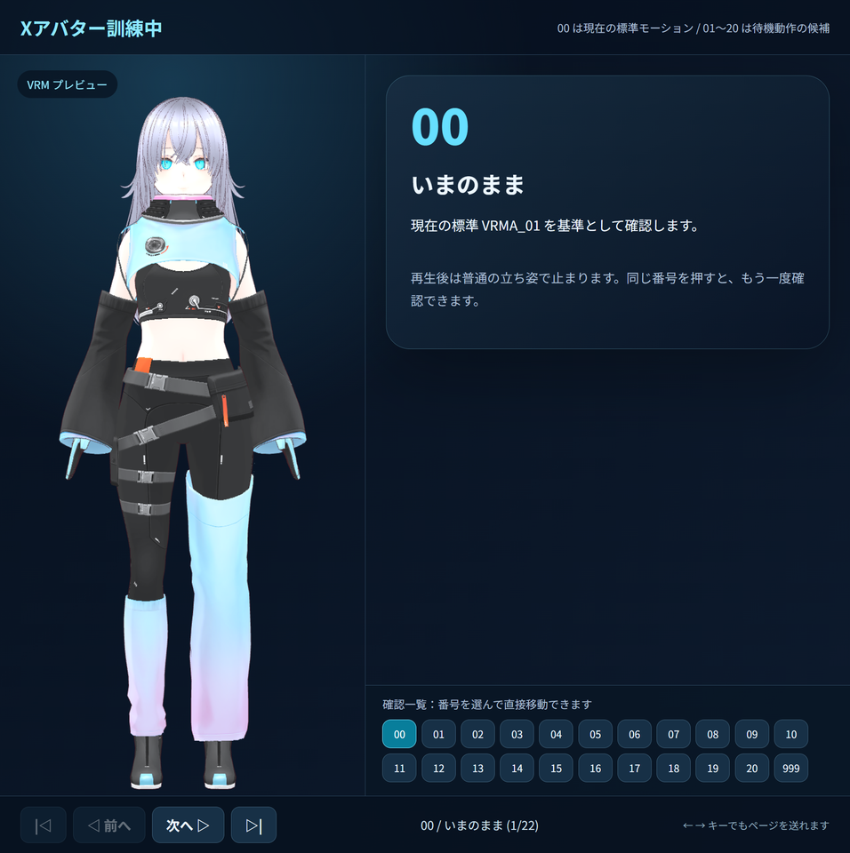

写真の読み込み後の世界の絶景です。出典と説明を確認できます。

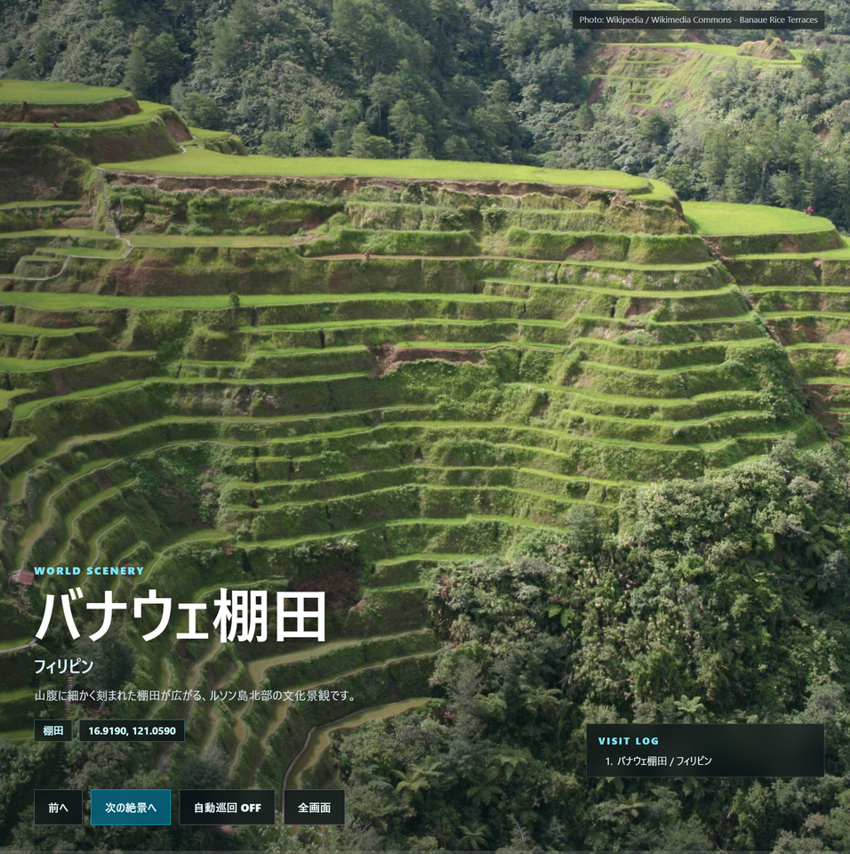

立体リバーシの初期画面です。ルールと置ける場所の案内があります。

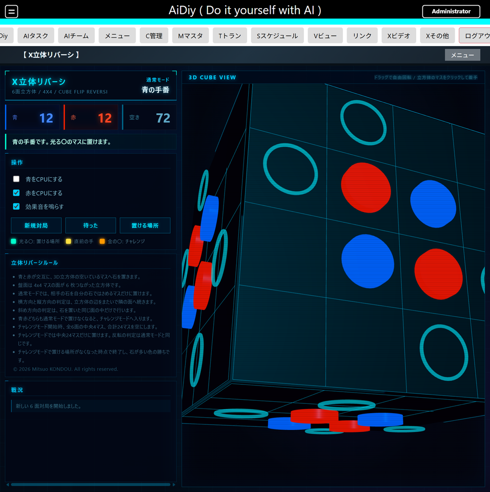

## 8. ログアウトして終了する

上部の「ログアウト」を押し、確認の「OK」を押します。確認を取り消しただけではログアウトしません。

**✅ OK：** OK後に認証情報が削除され、保護URL `/AiDiy` を直接開いてもログイン画面へ戻りました。無効な試験用トークンでも削除とログイン誘導を確認し、再ログインできました。Avatarの8092とは別の認証保存場所です。

ログアウト後に保護URLを開いた結果です。利用を再開するときはログインします。

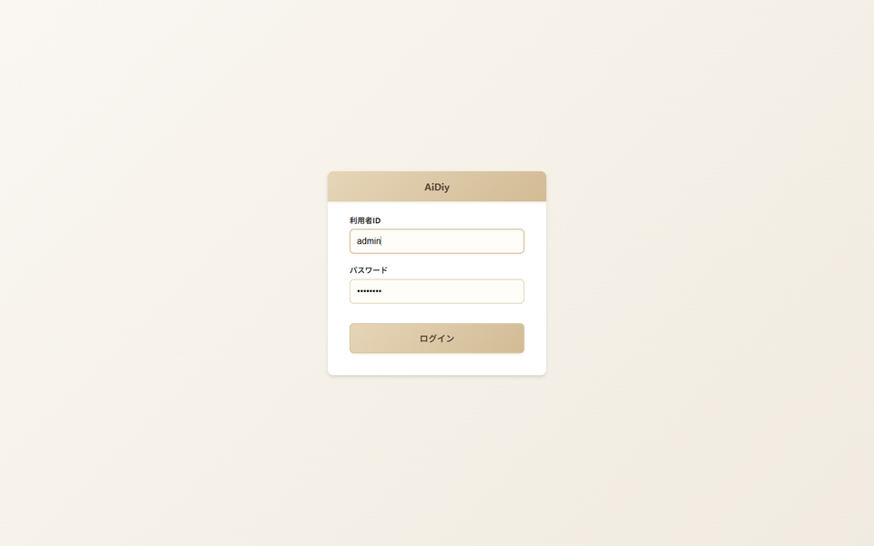

## 確認範囲

今回の結果は本冊に記載した操作の範囲です。以前のバックエンド自動試験件数や応答時間を、今回の結果として転記していません。Mac／Linuxは別途実機確認を推奨します。

AIタスク／チームは[taskteam編](./セルフテスト,frontend_web,taskteam編.md)、M／T／V／Sの登録・更新は[業務アプリ編](./セルフテスト,frontend_web,業務アプリ編.md)の別試験です。この2冊の未実施ケースを本冊の合格に含めません。

[PDF版](./セルフテスト,frontend_web,AiDiy編.pdf)は同じフォルダです。
