# frontend_web AiDiy編 — 総合テストと操作手順書素材

> 文書: `セルフテスト,frontend_web,AiDiy編.md` | 実装: `frontend_web/src/router/coreRouter.ts`, `frontend_web/src/components/AiDiy/`, `frontend_web/src/stores/`

## 総合評価

**総合評価：✅ OK (PASS 2件含む)。ログイン・画面遷移・AIコアの各パネルの表示と「おはよう」への応答を確認しました。**（2026年10月19日・Windows）

Webの画面（`http://127.0.0.1:8090`）で、ログインからAIコアの各パネル、ログアウトまでを確認する冊子です。「おはよう」への応答を中心に、会話の継続・分離、ファイル添付、設定保存も確認しました。全Providerの比較、Codeでのファイル作成・停止などの網羅的な確認は、本冊の合格範囲に含めません。

| 知りたいこと | 現在の結果 |
|---|---|
| ログインして各画面へ進める？ | ✅ OK：未認証の案内、誤入力の理由表示、ログイン、メニュー・戻る・再読み込み・直接URL、認証期限切れからの再ログインを確認しました。 |
| AIコアのパネルは使える？ | ✅ OK：Chat・Code1〜6を1枚ずつ増やした7段階で、追加した会話パネルが「おはよう」に応答しました。File Manager・イメージを加えた9画面ではCode1・Code6の応答を確認しました。パネル同士の重なりや画面外へのはみ出しはありませんでした。 |
| Liveやファイルは？ | ✅ OK：Liveは接続後15秒待って「おはよう」に返答しました。ファイルは日本語・空白を含むパスとPNGを受け取り、中身が元ファイルと一致しました。 |
| 設定と関連画面、ログアウトは？ | ✅ OK：AI設定の保存と再表示、C管理の3一覧、Xその他の11画面、ログアウト後の保護を確認しました。 |

**PASS (別途環境調整必要) は2件**です。マイク入力機器が0台のため実マイク入力、OpenRouterのクレジット不足のため `openrt_chat` の返答を、この判定にしました。どちらも製品の不具合を確認した結果ではありません。

この評価は記載した実画面試験の範囲に限ります。環境調整が必要なPASSを除き、完了済みの試験範囲に未解決の不具合はありません。Liveの初回送信は、準備完了確認後15秒待機・送信後最大60秒で✅ OKです（4章）。Codeの検証対象は7章に記載した仕様どおりです。copilot_cliはauto・検証0回で「おはよう」を送り、実画面で正常応答を確認しました（2章）。バックエンドの自動テストは277件すべて成功しました（7章）。

最終確認結果と利用上の条件は[7章](#7-最終確認結果と利用条件)にまとめています。Mac／Linuxは別途実機確認を推奨し、今回の完了条件には含めません。

[PDF版](./セルフテスト,frontend_web,AiDiy編.pdf)は、元のMarkdownと同じフォルダに保存しています。掲載画像は横幅960px以下とし、縦横比を保っています。

## この冊子の進め方

試験用の利用者IDは `admin`、パスワードは `********`（アスタリスク `*` を8文字）です。この開発PCの総合テスト用アカウントです。

試験用アカウントは[アプリ起動編](./セルフテスト,aidiy_diag,アプリ起動編.md#ローカル試験用の利用者)、試験データと記録方法は[説明資料の書き方](./セルテスト,_説明資料の書き方.md#試験の準備と終了)を参照します。

[システム起動編](./セルフテスト,aidiy_diag,システム起動編.md)の手順で、`aidiy_diag` から5機能を起動し、Diagをミニ表示に切り替えてから始めます。Webの画面は、Diagの「設定起動」で開いたChromeを使います。画面の大きさは1920×945です。

試験用の作業フォルダは `temp/総合テスト/<実施ID>/project/` です。AIの作業先を実装ソースにしないよう、5章の手順でAI設定のフォルダを先に切り替えます。

| 表示・用語 | 意味 |
|---|---|
| AIコア | `/AiDiy` の画面です。Chat・Code・ファイル・イメージなどのパネルを並べて使います。 |
| パネル | 右側のアイコンで開く小さな画面です。開いた枚数に合わせて並び方が変わります。 |
| 会話（セッション） | アドレス欄の `セッションID` ごとの会話です。パラメーターなしの `/AiDiy` を開くと新しい会話になります。 |
| Provider | AIを提供するサービスです。AI設定で、Chat・Code1〜6ごとに選びます。 |

AIタスク／チームは[taskteam編](./セルフテスト,frontend_web,taskteam編.md)、M／T／V／S系は[業務アプリ編](./セルフテスト,frontend_web,業務アプリ編.md)で確認します。**✅ OK** は確認済み、**⏸ 未実施** は未確認です。

## 1. ログインと基本操作

### 操作手順

1. Diagの「設定起動」で開いたChromeの画面（`http://127.0.0.1:8090`）を使います。ログインしていない状態で、アドレス欄に `http://127.0.0.1:8090/AiDiy` を入れて開きます。
2. ログイン画面へ移ったら、パスワード欄に誤った値を1回だけ入れて「ログイン」を押します。
3. 試験用アカウントを入れ直して「ログイン」を押します。
4. 上部の「C管理」を押し、ブラウザの「戻る」、再読み込みの順に操作します。最後にアドレス欄へ `/Mマスタ` を直接入れて開きます。
5. 認証期限切れを試す場合は、試験用のタブだけで保存済みの認証情報を無効な値に置き換え、`/AiDiy` を開きます。ログイン画面へ戻ったら、もう一度ログインします。

### 成功の見分け方

ログイン前は保護された画面が開かず、ログイン画面へ案内されます。ログイン後は右上に「Administrator」、上部に13個のメニューが並びます。メニュー・戻る・再読み込み・直接URLのどれでも、開いた画面とアドレス欄が一致し、ログインし直しを求められなければ正常です。

### 今回の結果と画面

**✅ OK（WA-101）**：ログイン前に `/AiDiy` を開くと、ログイン画面へ移りました。誤ったパスワードでは「利用者IDまたはパスワードが間違っています」と表示され、保護された画面には入れませんでした。

ログイン前に保護された画面を開いた結果です。ログイン画面へ案内されています。

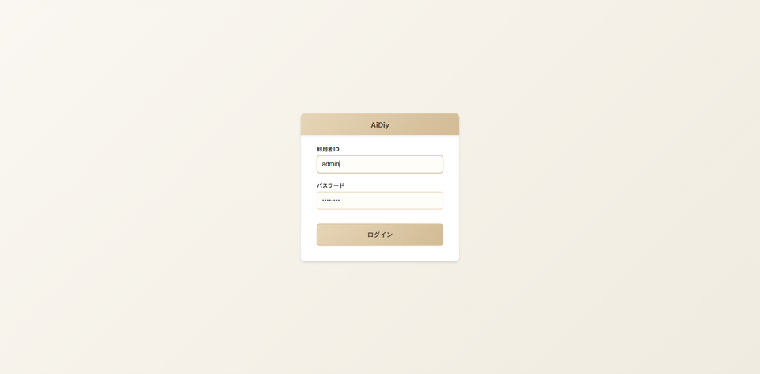

誤ったパスワードを入れた後です。理由が赤字で表示され、ログイン画面のままです。

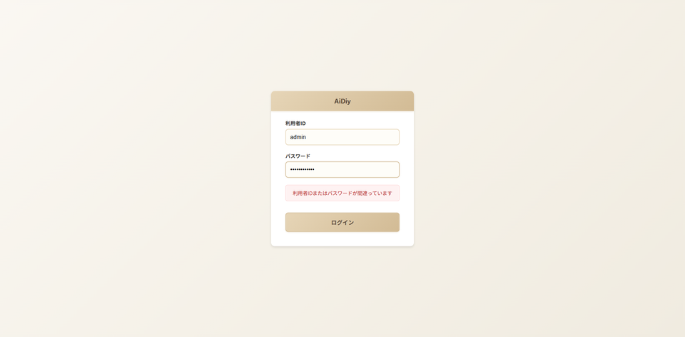

**✅ OK（WA-102）**：試験用アカウントでログインすると、メニュー画面へ進みました。右上に「Administrator」、上部に13個のメニューが表示され、エラーは残りませんでした。

ログイン後のメニュー画面です。利用者名と上部のメニューを確認できます。

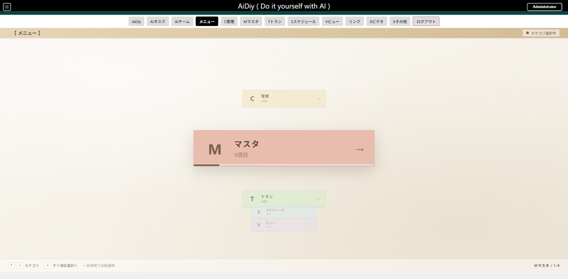

**✅ OK（WA-103）**：「C管理」へ移り、「戻る」でメニューへ戻りました。再読み込み後もログインは保たれ、直接URLの `/Mマスタ` ではマスタの9項目が表示されました。ブラウザのエラー記録は0件でした。

メニューの「C管理」を押した画面です。押したメニューが黒く強調されています。

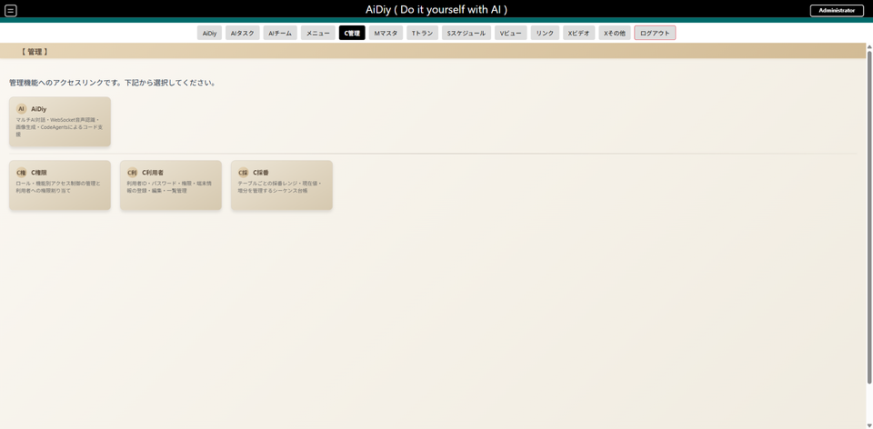

アドレス欄に `/Mマスタ` を直接入れて開いた画面です。ログインし直さずに9項目が表示されています。

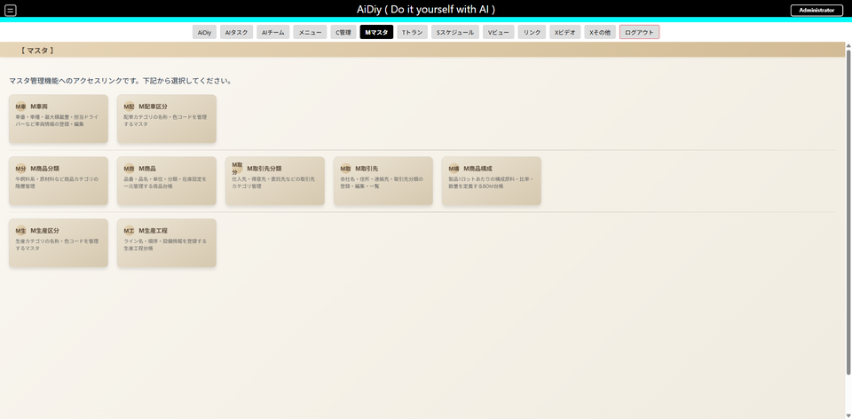

**✅ OK（WA-104）**：試験用タブの認証情報だけを無効な値に替えて `/AiDiy` を開くと、ログイン画面へ戻り、無効な認証情報は削除されました。もう一度ログインすると、メニュー画面へ復帰しました。Avatar（8092）は別の保存場所を使うため、影響を受けません。

無効な認証情報で開いた結果です。ログイン画面へ戻っています。

再ログイン後の画面です。メニュー画面へ戻り、続けて使えます。

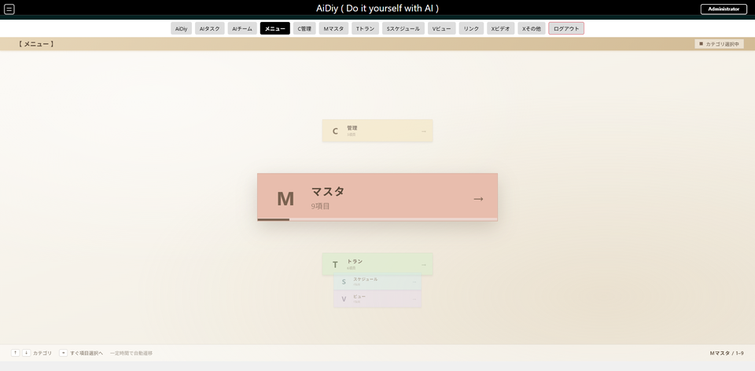

## 2. AIコアのパネルを開いて「おはよう」と話しかける

### 操作手順

1. 上部の「AiDiy」を押してAIコアを開きます。右上の「接続中」と、AiDiy AIパネルの「会話準備ができました」を確認します。
2. AiDiy AIパネル右下の「Chat」を選び、入力欄に「おはよう」と入れて送信します。
3. 右側の「1」を押してCode Agent 1を開き、その入力欄に「おはよう」と入れて「CODE」を押します。
4. 同じように「2」〜「6」を1つずつ開き、開いたパネルにだけ「おはよう」を送ります。開くたびにパネルの並び方が変わるので、重なりや切れがないかを見ます。
5. 最後に、右側のフォルダとカメラのアイコンでFile Managerとイメージも開き、9枚の状態でCode1とCode6に「おはよう」を送ります。

返答はすぐには出ません。Chatは十数秒、Codeは20〜50秒ほどかかりました。返答の前に「...」の進行表示が出て、終わると折りたたまれます。

### 成功の見分け方

「おはよう」の後に、緑の文字で返答が出れば正常です。`!` で始まる赤い行はエラーです。パネルは画面内に収まり、互いに重ならず、各パネルには自分の入力と返答だけが表示されます。

### 今回の結果と画面

**✅ OK（WA-201）**：AIコアを開くと「接続中」となり、AiDiy AIの見出しに `freeai_chat, freeai_live`、作業フォルダが表示されました。モードはChat・Live・Code1〜6の8つから選べます。

AIコアを開いた直後の画面です。中央のAiDiy AIパネルに、会話の準備完了が表示されています。

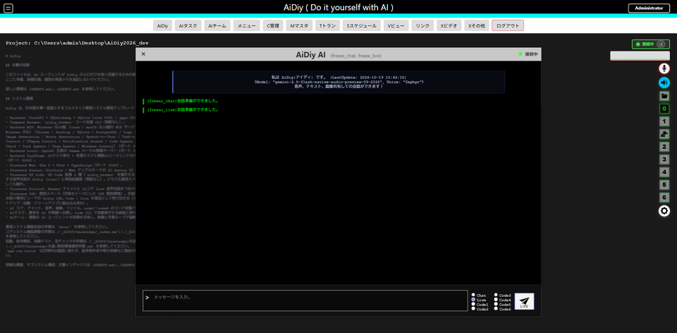

**✅ OK（WA-210）**：パネルを1枚ずつ増やし、新しく開いたパネルに「おはよう」を送りました。7段階とも返答があり、パネル同士の重なりと画面外へのはみ出しは0件でした。

| 画面数 | 開いたパネル（Provider） | 返答までの時間 | 結果 |
|---|---|---|---|
| 1 | Chat（freeai_chat） | 12.3秒 | ✅ OK：「おはようございます！今日も良い一日になりますように。…」 |
| 2 | Code1（codex_cli） | 24.6秒 | ✅ OK：「おはようございます。今日はどんな作業をしましょうか？」 |
| 3 | Code2（copilot_cli） | 21.5秒 | ✅ OK：「おはようございます。今日もよろしくお願いします。」 |
| 4 | Code3（claude_cli） | 18.4秒 | ✅ OK：「おはようございます。今日もよろしくお願いします。…」 |
| 5 | Code4（antigravity_cli） | 49.1秒 | ✅ OK：「おはようございます。…」 |
| 6 | Code5（opencode_cli） | 24.6秒 | ✅ OK：「おはようございます。今日もよろしくお願いします。」 |
| 7 | Code6（aidiy_hermes） | 最終確認では未計測 | ✅ OK：「おはようございます。今日は何をお手伝いしましょうか？」 |

1画面目です。Chatだけを開き、「おはよう」に返答がありました。

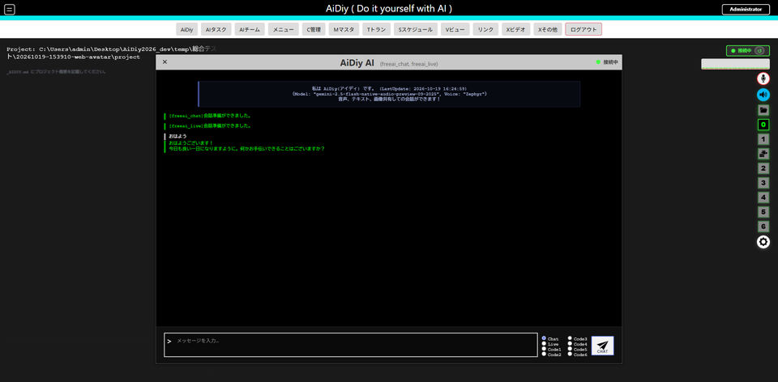

2画面目です。Code1を加えると左右2列に並び、Code1が返答しました。

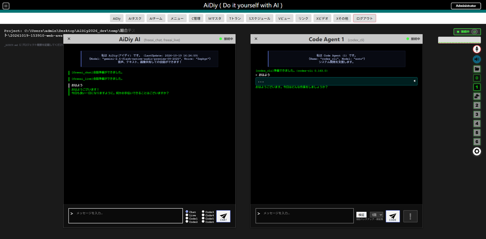

4画面目です。2行2列に並び替わり、新しく開いたCode3が返答しました。

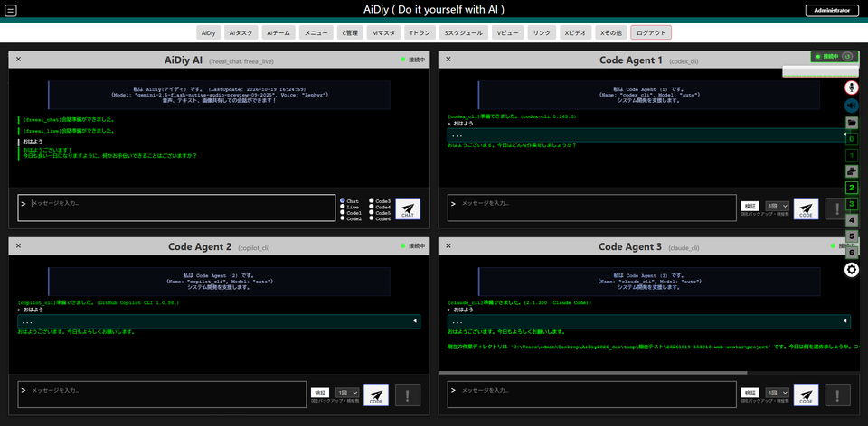

**✅ OK（WA-211）**：File Managerとイメージも開いた9画面では、3列3行に並び、Code1とCode6の返答を確認しました。パネルの最終配置・寸法と画像は[6章](#6-表示の確認)にまとめています。

### copilot_cliをautoで稼働確認する

1. Code Agent 2を開き、準備完了の表示が `copilot_cli`、モデルが `auto` であることを確認します。
2. 「検証」を「0回」にし、「おはよう」だけを送信します。ファイル更新や性能評価は依頼しません。
3. 赤いエラー行ではなく、挨拶への正式回答が出ることを確認します。

**✅ OK（WA-212）**：2026年10月19日・Windowsの実Web画面をBrowser Useで操作しました。入力は「おはよう」のみです。autoの選択モデルは画面の進行欄で `gpt-6-luna` と確認し、「おはようございます。今日もよろしくお願いします。」と正常に返答しました。今回の挨拶試験ではsolの利用エラーは出ていません。試験後、「検証」は試験前の1回へ戻しました。

> ※注意：copilot_cliでは、サブスクリプションの契約状況やモデルの利用許可によって、モデルをautoにしていても利用できないモデルが選択される場合があります。

本ケースはautoで会話が動くことを確かめる稼働試験です。ファイル更新依頼や、契約対象外モデルの拒否を強制再現する試験とは区別します。

送信前の画面です。Code Agent 2はcopilot_cli、モデルはautoで準備ができており、「検証」は0回です。

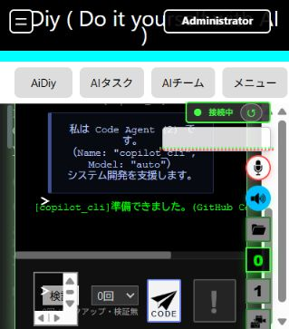

「おはよう」に正式回答が出た画面です。緑の文字で挨拶が返り、処理が終了しました。

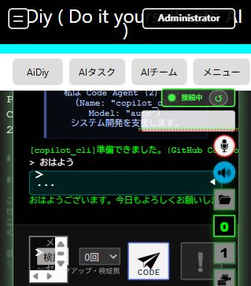

### 会話の継続・分離とコピー

**✅ OK（WA-202・WA-203）**：Chatの挨拶に返答があり、同じ会話で「先ほどの挨拶を短く言い換えて」と送ると前の挨拶を踏まえて答えました。パラメーターなしの `/AiDiy` で開いた新しい会話では「前回のやり取りが引き継がれておりません」と答え、2つの会話の履歴は混ざりませんでした。

同じ会話で言い換えを頼んだ画面です。前の返答を短くした答えが出ています。

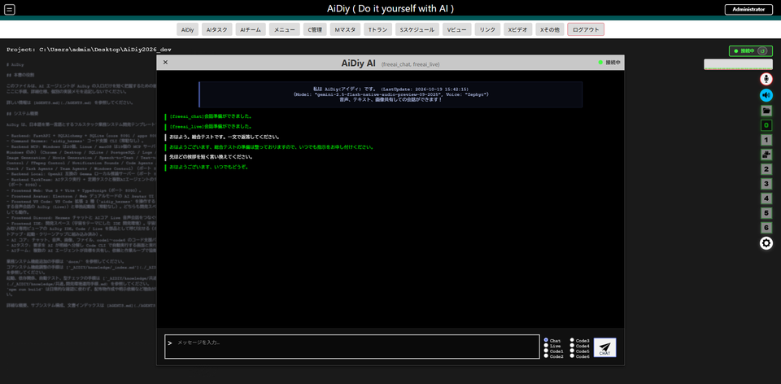

新しい会話で同じ依頼を送った画面です。前の会話を知らないと答えています。

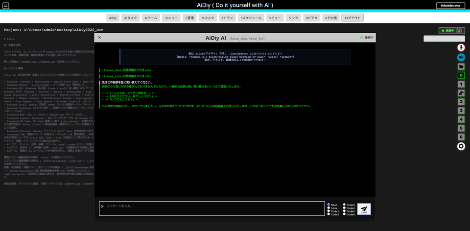

**✅ OK（WA-204）**：返答の行を押すと、その本文が入力欄へ入りました。本文を選んでCtrl+Cでコピーした内容も、表示と一致しました（空白を除いて照合）。Chatパネルには停止ボタンがないため、停止はCodeパネル側の操作として扱います。

返答を押して入力欄へ本文を入れた画面です。

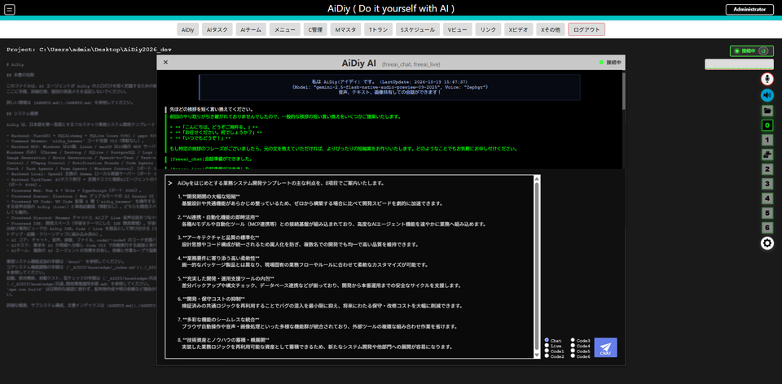

**✅ OK（WA-205）**：エラーの返答は、`!` で始まる赤い行として表示され、成功の返答とは区別されました。試験中に実際に出たエラー（OpenRouterのクレジット不足、copilot_cliのモデル選択失敗）で確認しています。接続が切れた場合は、約4秒で自動的に再接続し、続けて送った依頼に正常な返答がありました。

ChatのProviderを `openrt_chat` に切り替えた画面です。クレジット不足のエラーが `!` 付きで表示されています。

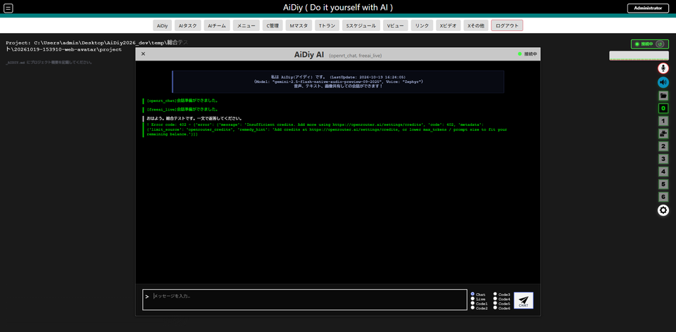

試験担当者向け：Chat Providerの確認結果

AI設定でChatのProviderを切り替え、新しい会話で挨拶を送りました。`freeai_chat`・`gemini_chat`・`openai_chat`・`openai_oauth` は10〜13秒で返答しました。`openrt_chat` はOpenRouterのクレジット不足（402）で、**PASS (別途環境調整必要)** です。試験後は `freeai_chat` に戻しています。

| Provider | 返答 |
|---|---|
| freeai_chat | ✅ OK：12.3秒 |
| gemini_chat | ✅ OK：10.2秒 |
| openai_chat | ✅ OK：12.3秒 |
| openai_oauth | ✅ OK：12.3秒 |
| openrt_chat | PASS：`! Error code: 402 … Insufficient credits` |

## 3. ファイルを渡す

### 操作手順

1. 右側のフォルダのアイコンを押し、File Managerを開きます。
2. エクスプローラーから、渡したいファイルをAiDiy AIパネルの入力欄へドラッグして離します。ファイルはすぐに送られ、`temp/input/` に保存されます。
3. File Managerの右側（temp）に届いたファイルが並びます。ファイル名を押すと、下の欄に中身が表示されます。
4. 画像について尋ねる場合は、File Managerで画像を選んだまま質問を送ります。同じファイル名をもう一度押すと、選択が解除されます。

ドロップしたファイルは、60秒以内に送った次のメッセージにも自動で添付されます。

### 成功の見分け方

チャット欄に「ファイル入力: temp/input/…」と表示され、画像はサムネイルが出ます。File Managerに表示した中身が元のファイルと同じなら正常です。選択を解除した後の送信には、ファイルが付きません。

### 今回の結果と画面

**✅ OK（WA-301）**：日本語と空白を含むパスの `日本語 フォルダ/確認.txt` と、小さなPNG画像をドロップしました。保存されたファイルは元のファイルとハッシュが一致し、File Managerに本文「日本語と空白を含むパスの確認用です。」が表示されました。画像を選んで質問すると「白い背景の中央に、青い円」と答え、選択を解除した後は「添付されていない」と答えました。

2つのファイルをドロップした画面です。チャット欄とFile Managerに届いたファイルが表示されています。

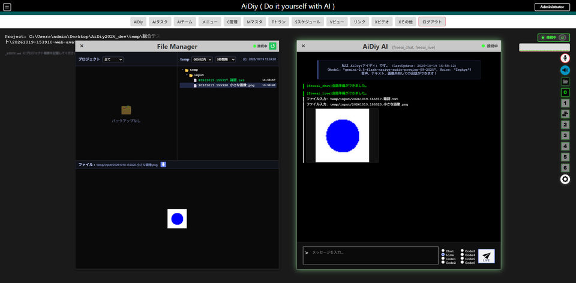

File Managerで確認.txtを押した画面です。下の欄に本文が表示されています。

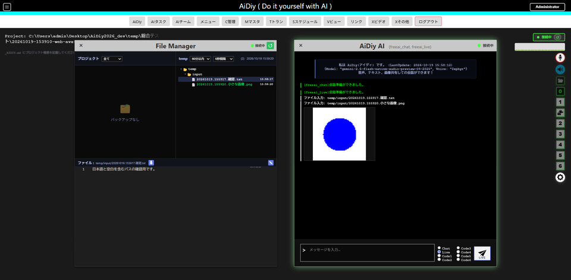

画像を選んだまま質問した画面です。青い円が描かれていると答えています。

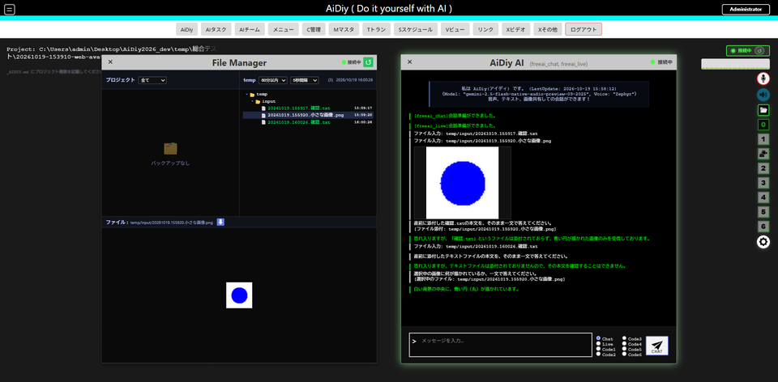

選択を解除した後に送った画面です。ファイルは添付されていないと答えています。

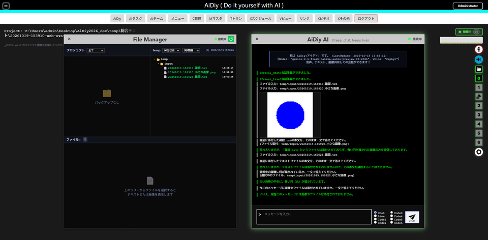

**✅ OK（WA-301）**：確認.txtをドロップして本文を尋ねると「日本語と空白を含むパスの確認用です。」と正しく答えました。

修正後に、添付したテキストの本文をChatが答えた画面です。

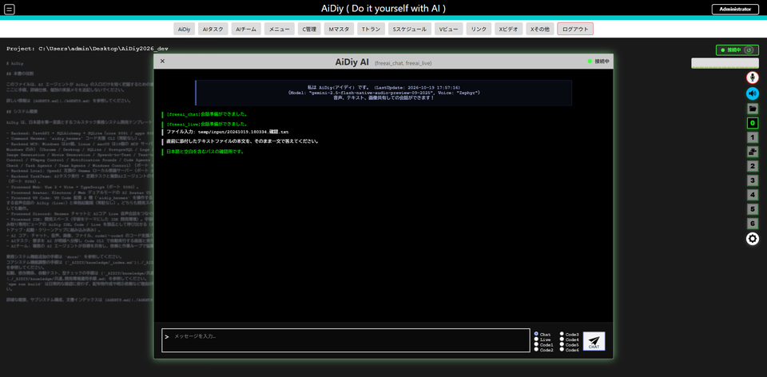

試験担当者向け：ドロップ操作の再現方法

ブラウザの操作ツールからは、OSのファイル選択画面を使えません。CDPの `Input.dispatchDragEvent` に実ファイルのパスを渡し、入力欄へドロップしました。保存先は `backend_server/temp/input/` で、確認.txtとPNGが元ファイルと一致することをハッシュで照合しました。

## 4. Liveで話しかける

### 操作手順

1. AiDiy AIパネルで「Live」を選びます。
2. 「[freeai_live]会話準備ができました。」を確認してから、15秒程度待ちます。
3. 入力欄に「おはよう」と入れて送信し、最大60秒待ちます。
4. 右側のマイクとスピーカーのアイコンで、入出力のON／OFFを切り替えられます。

### 成功の見分け方

送信後に緑の文字で返答が出れば正常です。スピーカーがONなら音声も再生されます。

### 最終結果と画面（2026年10月19日）

**✅ OK（WA-401-R2）**：新しく接続した会話で、準備完了表示を確認した後に15秒待機し、「おはよう」を1回だけ送信しました。送信後、約25秒以内に画面で返答を確認しました。観測上限は60秒で、再送はしていません。返答は「おはようございます！どのような作業を始めますか？」でした。

※注意:15s待機後送信しました。

接続成立から準備完了表示を確認するまでの総経過時間は計測していません。上の時間は、送信から画面で確認できた時点までの観測値で、応答生成時間の厳密な測定ではありません。15秒待機・60秒観測の運用条件で通過した結果です。

Providerは `freeai_live`、モデルは `gemini-2.5-flash-native-audio-preview-09-2025`、声は `Zephyr` です。実施IDは `20261019-205900-web-avatar`。ブラウザの実画面で入力欄・送信ボタンを操作しました。今回は文字による初回返答を確認し、音声の聴取は行っていません。

初回の送信文とLiveの返答が表示された画面です。

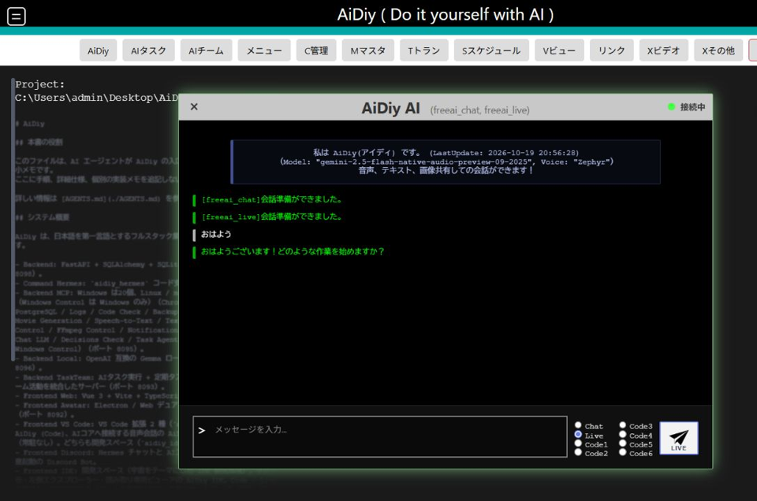

**PASS (別途環境調整必要)（WA-402）**：Windowsのマイク入力機器が0台のため、実マイクでの音声入力は確認していません。マイクを接続した環境で再確認します。人の耳での聴取も行っていません。

## 5. AI設定・関連画面・ログアウト

### 操作手順

1. AIコア右側の歯車を押して、AI設定を開きます。
2. 「フォルダ」欄に試験用の作業フォルダを入れ、「保存(json書換)」を押します。保存した値は、新しい会話から使われます。
3. 上部の「C管理」から権限・利用者・採番の一覧を開きます。値は変更しません。
4. 「Xその他」から各画面を開き、ブラウザの「戻る」で戻ります。
5. 上部の「ログアウト」を押し、「ログアウトしますか？」で「OK」を押します。

AI設定でCODE_AI1を変えると、CODE_AI2〜6にも同じ値がコピーされます（CODE_AI4は5・6へ）。個別に変える場合は、1から順に設定します。

### 成功の見分け方

設定を開き直しても保存した値が残り、新しい会話の作業フォルダ表示が変わっていれば正常です。ログアウト後は、会話のURLを開いてもログイン画面へ戻ります。

### 今回の結果と画面

**✅ OK（WA-501）**：フォルダを試験用に変えて保存すると「モデル情報を保存しました」と表示されました。開き直した設定にも値が残り、新しい会話の作業フォルダ表示が試験用フォルダになりました。試験の最後に同じ画面で元の値へ戻し、新しい会話の作業フォルダ表示も元に戻ったことを確認しました。

AI設定でフォルダを変えて保存した画面です。

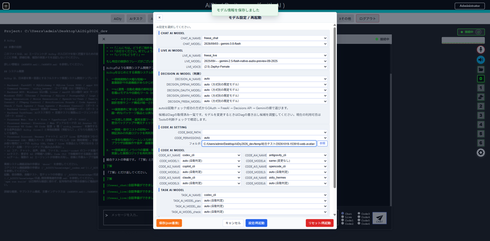

新しい会話の画面です。左上の作業フォルダが試験用フォルダになっています。

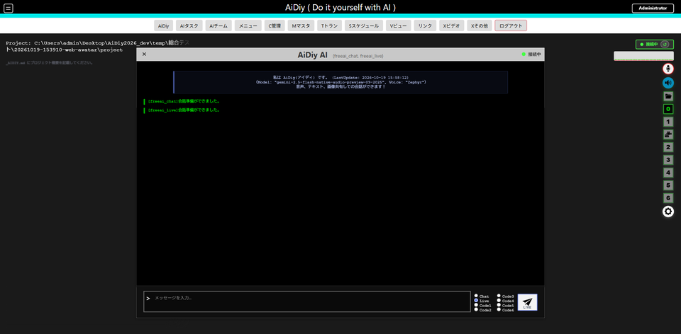

**✅ OK（WA-502・WA-503）**：C管理の権限・利用者・採番の一覧が開きました。Xその他の11画面（自己紹介・ビデオ・絶景・太陽系・ゲームなど）も開き、戻れました。リンク画面は外部サイトへのリンクだけのため、開いて表示を確認しました。

C管理の一覧です。権限・利用者・採番の3項目が表示されています。

Xその他の画面です。各画面へのボタンが並んでいます。

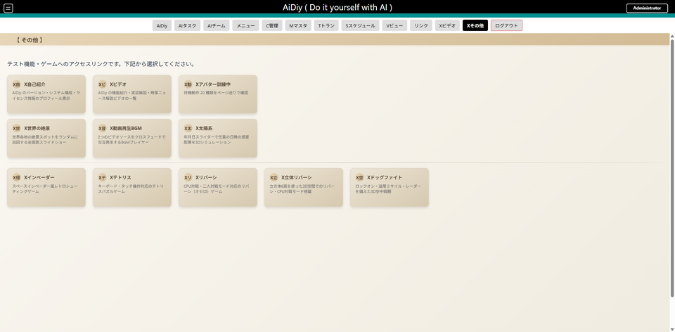

**✅ OK（WA-504）**：「ログアウト」で確認が出て、「OK」を押すとログイン画面へ戻り、認証情報が消えました。その後に会話のURLを開いても、ログイン画面へ戻りました。

ログアウトの確認です。

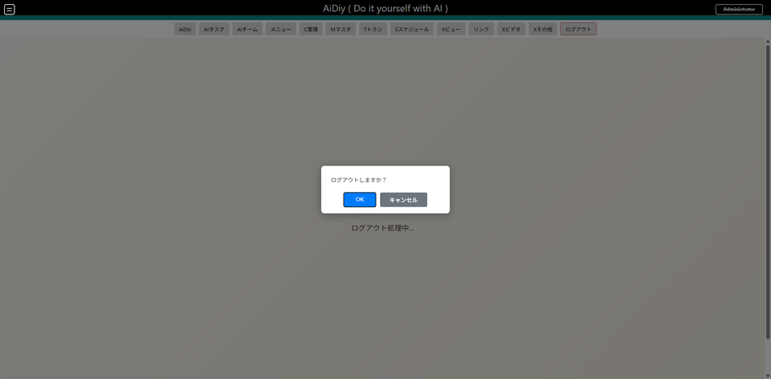

ログアウト後に会話のURLを開いた結果です。ログイン画面へ戻っています。

## 6. 表示の確認

**✅ OK（WA-601）**：1920×945で、パネルを1枚から9枚まで開いた各段階を確認しました（2章）。パネル同士の重なりと画面外へのはみ出しはありませんでした。縦長の画面は今回確認していません。

**✅ OK（WA-601）**：3画面・7画面・9画面とも、パネル同士・アイコン列との重なりとはみ出しが0件でした。

| 画面数 | 各パネルの大きさ | 結果 |
|---|---|---|
| 3 | 598×722 | ✅ OK |
| 7 | 598×236 | ✅ OK |
| 9 | 598×236（イメージのリソース選択 300×170 はパネル内） | ✅ OK |

修正後の9画面です。3行が同じ高さで並び、右端の列はアイコン列と重なっていません。左中のイメージでは、リソース選択がパネルの中に収まっています。

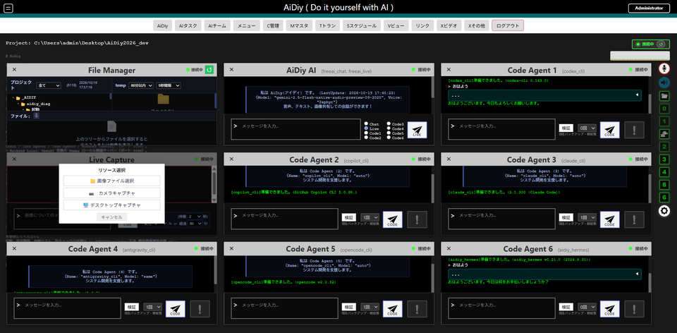

修正後の3画面です。右端のCode Agent 2の見出しと「接続中」が、アイコン列の左に表示されています。

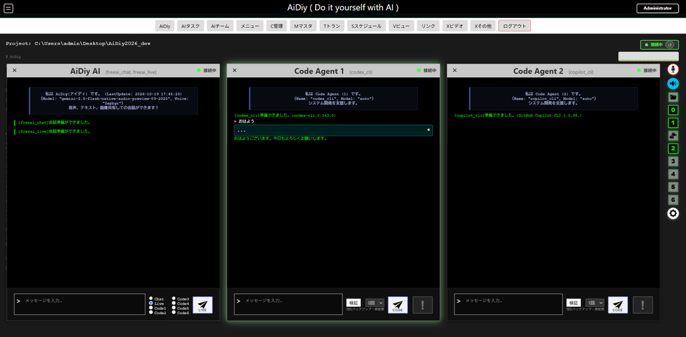

Web版の8090画面にはアバター表示がないため、WA-602はAvatar編で確認します。

## 7. 最終確認結果と利用条件

| 確認項目 | 最終結果 |
|---|---|
| パネルの配置 | ✅ OK：操作アイコンと見出しは重ならず、8枚以上でも行の高さが保たれました（6章）。 |
| イメージパネルのメニュー | ✅ OK：リソース選択のメニューがパネル内に収まりました（6章）。 |
| Code6の返答 | ✅ OK：「おはようございます。今日は何をお手伝いしましょうか？」と返答しました。 |
| Chatへのテキスト添付 | ✅ OK：確認.txtの本文を正しく回答しました（3章）。 |
| copilot_cliのauto | ✅ OK：検証0回で「おはよう」に正常応答しました。画面の選択モデルはgpt-6-lunaでした。契約状況・利用許可によるモデル選択の注意は2章を参照してください。 |
| Liveの初回送信 | ✅ OK：準備完了確認後15秒待機・送信後最大60秒で返答しました（4章）。 |
| バックエンド自動テスト | ✅ OK：277件すべて成功しました。失敗・エラーは0件です（2026年10月19日・Windows）。 |
| File Managerの選択 | 仕様：60分以内で最新のtempファイルが自動選択されます。不要なときは同じファイル名を押して解除します。 |
| Codeの検証 | 仕様（問題なし）：検証を有効にすると実行中に変わった他のファイルも対象になります。「おはよう」程度の稼働試験では、検証処理を行わないため「検証」を0回にします。 |

> ※注意：複数箇所で並行して作業する場合、検証作業が衝突することがあります。並行作業時は「検証」を0回にして実行し、並行作業の完了後に、検証だけを別途依頼することを推奨します。

Webの型チェックと、バックエンドの自動テスト全277件は成功しています。バックエンドは `backend_server` で `.venv\Scripts\python.exe -X utf8 -m unittest discover -s tests` を実行しました。Live・Code CLI・プロセス終了管理・バックアップなどを、外部AIへの実通信を使わずに確認する単体テストです。AIの稼働試験は「おはよう」程度の応答確認とし、性能評価は含めません。

試験担当者向け：今回の実施方法と、範囲外にした試験

実施IDは `20261019-153910-web-avatar` です。Diagの起動とミニ表示はWindows UI Automation、Webの画面は `aidiy_chrome_devtools` で実際のChromeを操作しました。操作方法と補助スクリプトは[実施記録と操作方法](#試験担当者向け実施記録と操作方法)にあります。

Code Providerの稼働試験は「おはよう」への返答で確認します。WA-302〜304（Code1〜6でのファイル読み取り・ファイル作成・続きの依頼・停止）、Chat Providerの全件比較、WA-403（画像生成）は、本冊の簡易試験の範囲外です。

最終判定に使う画像を各章に説明付きで掲載しています。

終了時は会話・Live接続を閉じます。AI設定（Chat・Code1〜6の割り当てと作業フォルダ）は試験後に元へ戻しました。PDFは[説明資料の書き方](./セルテスト,_説明資料の書き方.md#ファイル画像pdf)の手順で作成します。
## 試験担当者向け：実施記録と操作方法

実施IDごとの記録と、次回も同じ方法で操作するための補助スクリプトを開く

### 実施記録

| 実施ID | 期間 | 操作方式 | ビューポート | 主な記録 |
|---|---|---|---|---|
| `20261019-153910-web-avatar` | 2026年10月19日。Web AiDiyの記録は15:39〜18:20。Avatarの再接続・履歴の追加試験は同日18:36以降です。 | Diag・ElectronはUI Automation、Webは `aidiy_chrome_devtools` | Web：1920×945／Electron：1920×1080 | 各章の結果表・説明付き画像と、[Diagミニ表示](./images/セルフテスト,frontend_web,AiDiy編/共通-起動_001_Diagミニ表示で5機能稼働画面.png)。追加試験はAvatar各編の4章に記載しています。 |

実施ID `20261019-153910-web-avatar` の回はComputer Useを利用できない環境でした。Diagの「設定起動」「ミニ表示」「アプリ起動」、Avatarのログインと各窓は、Windows UI Automationで実画面のボタン・入力欄を操作しています。Web画面はDiagが開いたChrome（CDP 9222）を `aidiy_chrome_devtools` で操作し、クリック・入力・画面撮影をすべて実ブラウザで行いました。APIだけで画面操作を済ませたケースはありません。試験データは `temp/総合テスト/20261019-153910-web-avatar/project/` です。

#### 次回の手順（この順で迷わず進める）

1. `aidiy_diag` を起動し、`diag画面操作.ps1 -Button '設定起動'` で5機能を起動します。5ポートの待受を確認したら `-Button 'ミニ表示'` に切り替え、`窓撮影.ps1` でミニ表示を撮影します。
2. `chrome操作.mjs list_tabs` でDiagが開いた8090のタブIDを調べ、`prepare` で1920×945にそろえます。
3. Web AiDiy編を実施します。AI設定のフォルダを試験用に変えると新しい会話から反映されます。元の値は先に控えます。
4. Avatarを開くときは、Diagを `-Button '通常表示'`、`-Button 'アプリ起動'`、`-Button 'フォルダ選択'` の順に操作します。Windows標準のフォルダ選択ダイアログは、下部の「フォルダー:」欄をクリックしてパスを貼り付け、「フォルダーの選択」を押します（UI Automationでは欄が取れないため、実クリックと貼り付けを使います）。
5. `-Button 'ミニ表示'` → `-Button 'Avatar を起動'` でElectron版を開きます。Web版は同じChromeの新しいタブで `http://127.0.0.1:8092` を開きます。
6. Electron版は `electron窓一覧.ps1` でhwndを調べ、`electron窓操作.ps1` でログイン・送信します。後ろのChromeが透けるため、撮影時はChromeを最小化します。
7. 終了時はAI設定（Chat・Code1〜6の割り当て、作業フォルダ）を元へ戻します。CODE_AI1を画面で変えると2〜6へコピーされるため、1→2→…→6の順に戻します。

#### つまずいた点

| 場面 | 対処 |
|---|---|
| WebのAIコアで新しい会話を作る | 表示中の上部「AiDiy」リンクではセッションが変わりません。パラメーターなしの `/AiDiy` をアドレス欄から開きます。 |
| ログアウト | 確認ダイアログで「OK」を押すまでログアウトされません。 |
| Avatar Webのモード選択 | ラジオの名前は `avatar-chat-mode` です（8090は `mode`）。 |
| 画像の名前 | 最終結果を確認してから名前を決め、判定に使う画像だけを本文へ掲載します。 |
| 会話履歴DB | `_data/AiDiy/database.db-wal` は会話のたびに更新されます。実装ソースの変更検出から外します。 |
| Codeへの「おはよう」 | Codeの「検証」が1回以上なら、仕様として実行中にプロジェクト内で変わったファイルも検証・修正の対象になります。挨拶だけの稼働試験では、検証処理を行わないため「検証」を0回にして送ります。 |
| パネルの開閉と測定 | Chromeが他の窓の後ろにあると、パネルを開閉するアニメーションが止まります。測定前に `activate_tab` と `Page.bringToFront` でChromeを前面に出し、開閉後3秒待ちます。表示中のパネルは見出しで確かめ、アイコンは1回押したら状態が変わるまで待ちます。 |
| Avatarの再接続 | Avatarの見出しの「↺」は「再表示」で、再接続ではありません。Coreを再起動した後は、自動再接続で戻ります（2026年10月19日の修正後）。 |
| 画面外の作業 | 設定ファイルをシェルで直接書き換えると、エスケープの違いで壊れることがあります。設定はAI設定の画面から変えます。 |

### 補助スクリプト

`scripts/checks/総合テスト補助/` にあります。いずれも起点で実行します。

| ファイル | 用途 | 例 |
|---|---|---|
| `diag画面操作.ps1` | Diag窓（`-Title` で他の窓も可）のボタン一覧・押下。Invokeに対応しないタブは選択または実クリック | `.\scripts\checks\総合テスト補助\diag画面操作.ps1 -Button '設定起動'`、`-Button 'ミニ表示'`、`-List`、`-Title 'AiDiy Avatar' -Button 'ログイン'` |
| `窓撮影.ps1` | Diag等のElectron窓や画面全体の実画面撮影 | `.\scripts\checks\総合テスト補助\窓撮影.ps1 -Title 'AiDiy 診断' -Out <png>`、`-Full -Out <png>` |
| `electron窓一覧.ps1` | AvatarのElectron窓の名前・位置・hwndの一覧 | `.\scripts\checks\総合テスト補助\electron窓一覧.ps1` |
| `electron窓操作.ps1` | hwnd指定の窓で、ラジオ選択・入力・ボタン押下・文字の読み取り | `-Hwnd <hwnd> -Radio 'Chat'`、`-Text 'おはよう'`、`-Button '送信 CHAT'`、`-Read` |
| `chrome操作.mjs` | `aidiy_chrome_devtools` 呼び出し、1920×945の準備、撮影と結果の取得 | `node scripts/checks/総合テスト補助/chrome操作.mjs list_tabs '{}'`、`prepare '{"tab_id":"<タブID>"}'` |

`chrome操作.mjs` を使う場合は、環境変数 `RUN_ID`（実施ID）、`BOOK`（画像接頭辞、例 `frontend_web-AiDiy`）、`TAB`（対象タブID）を指定します。自動処理の詳細記録は作業用とし、確認した操作・判定は各章の本文へ記載します。JSONやログを説明資料へ追加せず、新しい画像は説明資料の書き方に沿って実施IDを付けて保存します。

Windowsの表示倍率が125%のため、最大化しただけではCSS上の幅は約1536になります。`prepare` は窓を最大化し、CDPでビューポートを1920×945・倍率1に固定します。ページを移動しても設定は残りますが、新しいタブを開いた場合は再実行します。

