# frontend_web 生産・在庫管理編 — 操作ガイドとセルフテスト

> 本書はセルフテスト結果を、操作説明・解説書としても読みやすく整理しています。再テスト後は結果・注意書き・エビデンスを更新し、章立て・操作手順・図解の配置などの様式を維持します。

> 文書: `セルフテスト,frontend_web,生産・在庫管理編.md` | 実装: `frontend_web/src/components/`, `backend_server/apps_main.py`

## 総合評価

**総合評価：✅ OK。Windowsで確認済み（実施日：2026年10月25〜26日）。** 商品・商品構成、生産と材料払出、入出庫・棚卸・在庫推移、日時検証、日／週予定、削除・復元を確認しました。 実測結果を業務別に整理した冊子です。全画面・全サイズの組合せを網羅した判定ではありません。週・月をまたぐ実時間観測は **PASS（環境依存・判定対象外）** とし、今回は未実施です。

対象環境はWindowsです。Mac／Linux実機と長時間連続運転は **PASS（環境依存・判定対象外）** とし、今回は未実施です。実行成功とは区別し、NGには数えません。

試験日は各結果に記載しています。文書・画像名の整理日は2026年10月26日であり、試験の再実施日ではありません。
## この冊子を使う場面

- 生産・在庫管理の登録・更新と画面間の整合性を確認するとき。
- 関連する一覧・入力・スケジュールの変更後に再確認するとき。

## 始める前に

試験用の利用者IDは `admin`、パスワードは `********`（アスタリスク8文字）です。[説明資料の書き方](./セルフテスト,_説明資料の書き方.md#試験の準備と終了)に従って準備し、専用IDの試験データだけを操作します。通常業務の既存データを変更しません。保存後は一覧・再表示と必要に応じてAPIの保存値を照合します。

ケースIDのWB番号は既存の証跡との対応を保つため引き継ぎます。両業務にまたがるケースは、本冊の対象だけを記載します。

## 試験データ

| 対象 | 試験用ID・名称 | 変更前の値 | 参照先 | 終了時の確認 |
|---|---|---|---|---|
| M生産区分 | ST1025 / セルフテスト1025生産 | 新規作成。配色枠・前景 #000000、背景 #ffffff | 後続の生産試験用 | 登録・備考更新・一覧値一致。無効化済み（2026-10-26） |
| M生産工程 | ST1025 / セルフテスト1025工程 | 新規作成 | 後続の生産試験用 | 登録・一覧値一致。無効化済み（2026-10-26） |
| M商品分類 | ST1025 / セルフテスト1025商品分類 | 新規作成 | 商品A・B | 登録・商品選択欄で利用済。無効化済み（2026-10-26） |
| M商品（完成品A） | ST1025A / セルフテスト1025完成品A | 新規作成、単位「個」、分類ST1025 | 商品構成・生産・在庫試験用 | 登録・ID検索・単位分類一致。無効化済み（2026-10-26） |
| M商品（材料B） | ST1025B / セルフテスト1025材料B | 新規作成、単位「個」、分類ST1025 | 商品構成・生産・在庫試験用 | 登録・ID検索・単位分類一致。無効化済み（2026-10-26） |
| M商品（在庫C） | ST1025C / セルフテスト1025在庫C | 新規作成、単位「個」、分類ST1025、初期在庫0 | 入庫・出庫・棚卸 | 在庫推移0→10→7→8を確認。無効化済み（2026-10-26） |
| M商品構成 | ST1025A / 明細SEQ 0・1 | 新規作成、ロット1、材料ST1025B、分子2・分母1・構成数量2 | 生産試験用 | 登録・一覧・再表示で2個を確認。無効化済み（2026-10-26） |
| T生産 | SE00010001 / セルフテスト1025生産伝票 | 新規作成、2026-10-26 11:00〜12:00、完成品ST1025Aを3個、材料ST1025Bを6個 | 生産払出・スケジュール試験用 | 登録・商品検索済。明細とともに無効化済み（2026-10-26） |
| T商品入庫 | HI00010001 / セルフテスト1025入庫10 | 新規作成、2026-10-26、商品ST1025Cを10個 | 在庫推移 | 一覧と推移で確認。無効化済み（2026-10-26） |
| T商品出庫 | HO00010001 / セルフテスト1025出庫3 | 新規作成、2026-10-27、商品ST1025Cを3個 | 在庫推移 | 一覧と推移で確認。無効化済み（2026-10-26） |
| T商品棚卸 | HT00010001 / セルフテスト1025実棚8 | 新規作成、2026-10-28、商品ST1025Cの実棚8個 | 在庫推移 | 一覧と推移で確認。無効化済み（2026-10-26） |

最終保存値は生産4・材料払出8・終了12:30、入庫12・出庫4・実棚9です。商品構成は最終的に材料B3・分母1の1行としてから無効化しました。ページ操作用の商品分類STP1026001〜STP1026101も無効化済みです。

## 1. マスタと商品構成

生産区分・工程・商品分類を先に登録し、完成品A・材料B・在庫試験商品Cを登録します。商品構成で完成品の材料と数量を設定し、保存後に開き直して照合します。

| ID | 操作 | 確認結果 |
|---|---|---|
| WB-101・102 | メニュー、一覧検索、行選択、編集、戻る | 生産区分・工程・商品分類・商品・商品構成の保存値と一致 |
| WB-201（生産） | 生産区分・工程の登録と備考更新 | 一覧・保存値が一致し、生産で利用可能 |
| WB-202（生産）・203 | 商品分類、完成品A・材料B・在庫Cを登録 | 分類・単位「個」・保存値が一致 |
| WB-204 | 構成の追加・変更・削除 | B2からB3・C1の2行へ変更し、再表示一致。1行へ削除保存可能。0行は保存拒否 |

完成品と材料を登録し、専用分類と単位を確認しました。

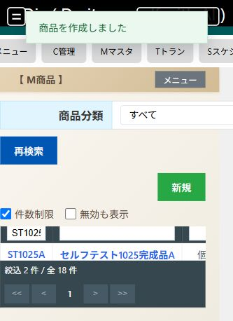

ロット1に対して材料B2個を使う構成の保存値を確認しました。

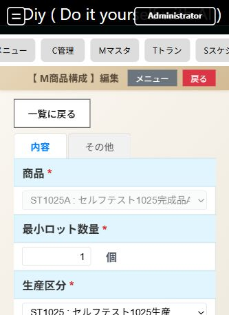

構成をB3・C1へ変更し、順序と数量を再表示で確認しました。

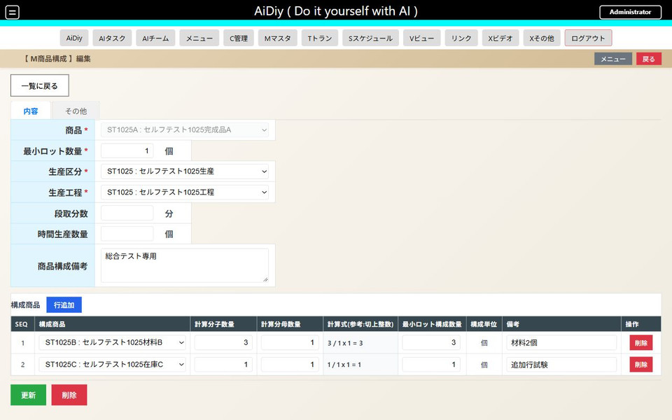

最終行を削除すると空行へ戻り、構成商品未選択の案内で保存が拒否されました。最低1明細が必要な現行仕様です。材料B3・分母1の1行を保存してから後片付けしました。

## 2. 生産と払出を確認する

### 操作の流れ

1. 「T生産」の一覧から新規登録へ進み、完成品・生産数量・工程・日付を入力します。
2. 材料明細の品目と数量を確認して保存します。構成からの必要量と、保存された明細の数量を照合します。
3. 「T生産払出」の一覧で同じ生産を検索し、払出の参照内容を確認します。

生産数量を変更した場合は、材料数量も意図どおりか再表示して確認します。

### セルフテスト項目

| ID | 操作 | 期待結果 |
|---|---|---|
| WB-401 | `/Tトラン/T生産/一覧` で完成品Aを3個、試験工程・日付で登録します。 | ヘッダーと材料明細を確認できます。材料Bの必要量は構成2×生産3＝6です。 |
| WB-402 | 生産数または明細を変更し、保存・再表示します。 | 再計算の有無を現行画面の操作に沿って確認し、保存数量と一覧が一致します。 |
| WB-403 | `/Tトラン/T生産払出/一覧` で試験生産を検索します。 | 払出の参照結果が、保存した生産明細と一致します。専用の編集ルートがあるとは扱いません。 |

生産の新規画面で完成品Aを選ぶと、専用の区分・工程と材料Bが構成から入りました。受入数量3で、計算式「2 / 1 × 3 = 6」と払出数量6を確認して登録し、一覧で伝票 `SE00010001`・受入数量3を確認しました。

材料所要量の計算を確認した新規入力画面です。

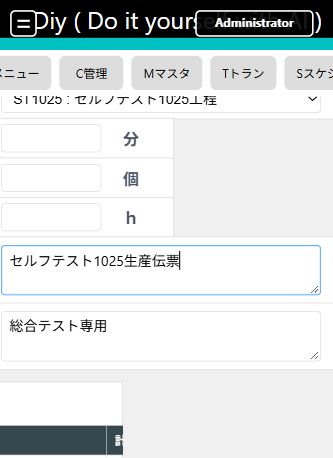

WB-401〜403は実画面で確認済みです。保存後に開き直して材料6個を確認し、受入数量を4へ更新すると材料8個に再計算されました。T生産払出で同じ伝票の受入4・払出8が一致しました。

更新後の払出一覧です。試験材料で絞り込み、保存値を照合しました。

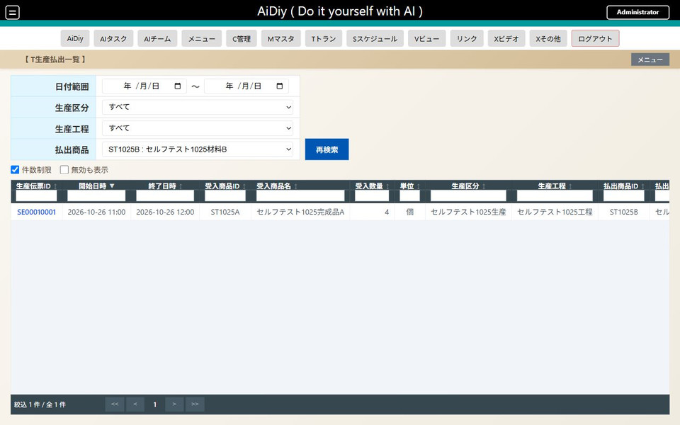

生産11:00開始に対して10:30終了は画面で保存を拒否しました。APIでも日時逆転・形式不正を拒否し、全保存項目が不変でした（WB-103）。

生産終了が開始より前の場合は保存されません。

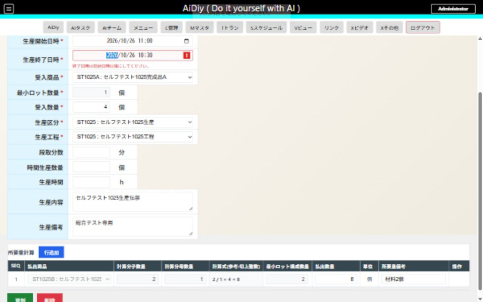

## 3. 入庫・出庫・棚卸と推移

### 操作の流れ

1. 「T商品入庫」で商品・日付・入庫数量を入力し、保存します。
2. 「T商品出庫」で同じ商品・対象日・出庫数量を入力して保存します。
3. 「T商品棚卸」では棚卸日を入力し、明細の商品ごとに「実棚数量」を入力します。ここには差分ではなく、実際に数えた数量を入れます。
4. 「V商品推移表」で同じ商品と対象期間を指定し、入庫・出庫・棚卸後の数量を確認します。

例では初期0→入庫10→出庫3で7、実棚数量8の棚卸後は8が期待値です。2026年10月25日の商品ST1025Cによる試験でも、この値と実測が一致しました。

### セルフテスト項目

ほかの試験の影響を避けるため、在庫用の新しい試験商品Cを作ります。初期在庫と対象期間を確認してから進めます。

| ID | 操作 | 期待結果 |
|---|---|---|
| WB-501 | T商品入庫で商品Cを10個登録します。 | 一覧と再表示で数量10を確認できます。推移上の増分も10です。 |
| WB-502 | T商品出庫で同じ商品を3個登録します。 | 増減の符号と残数が一致します。初期0なら残数7です。 |
| WB-503 | T商品棚卸の明細で「実棚数量」に8を入力して登録します。 | 棚卸後の残数が8です。「実棚数量」は差分ではないため、差の＋1を入力しません。 |
| WB-504 | `/Vビュー/V商品推移表` で商品Cと期間を選びます。 | 入庫・出庫・棚卸の順と最終残数を追えます。期間外の行が混ざりません。 |
| WB-505 | 入出庫と棚卸の試験行を1件ずつ変更・削除して再確認します。 | 一覧・明細・推移へ反映されます。各段階の期待残数を先に計算し、実値と照合します。 |

WB-501〜504の登録と推移照合を実施しました。商品Cの初期0を確認し、入庫HI00010001（10/26、10個）、出庫HO00010001（10/27、3個）、棚卸HT00010001（10/28、実棚8個）を作成しました。各一覧のID・商品・数量が一致し、分類ST1025で絞った推移は10/25から順に0・10・7・8でした。

在庫Cの入庫・出庫・棚卸後の残数を確認した画面です。

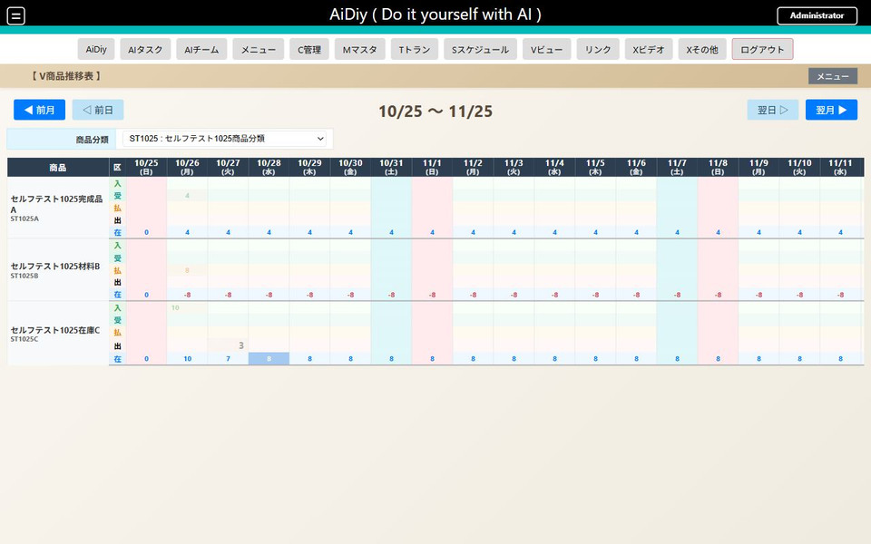

WB-505の変更部分を確認しました。入庫を12へ変更すると0→12→9→8、出庫を4へ変更すると0→12→8→8、実棚を9へ変更すると0→12→8→9となり、各一覧と推移が一致しました。各編集画面で元の保存数量10・3・8も確認済みです。翌月表示では期間外の入出庫が空欄となり、在庫9が繰り越されました。その後、棚卸・出庫・入庫の順に無効化し、各段階の在庫と復元を確認済みです。

3伝票の変更後に残数を照合した画面です。

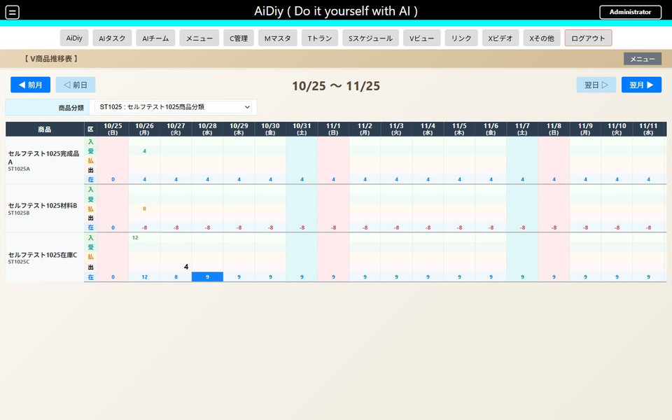

削除・復元の確認（WB-505）：変更後12→8→9に対し、棚卸の無効化で12→8→8、次に出庫の無効化で12→12→12、次に入庫の無効化で0→0→0になりました。各伝票の有効への復元と明細一致を確認後、再度無効化しています。

## 4. 生産スケジュール

S生産の週表示／日表示から試験日・工程の予定を確認し、予定をダブルクリックして同じ伝票を開きます。

| ID | 操作 | 確認結果 |
|---|---|---|
| WB-602 | 生産の日／週表示 | 11:00〜12:30・完成品4個の同じ予定と工程を確認 |
| WB-603（生産） | 翌週・前週、予定から編集 | 次週に試験予定がないこと、戻ると同じ予定があることを確認。SE00010001の終了を12:30へ更新し、両表示に反映 |

生産のドラッグ移動は本冊の実測結果に含めません。配車で確認した移動試験は[配車管理編](./セルフテスト,frontend_web,配車管理編.md)を参照してください。

予定から更新した終了12:30・数量4が日表示に反映されました。

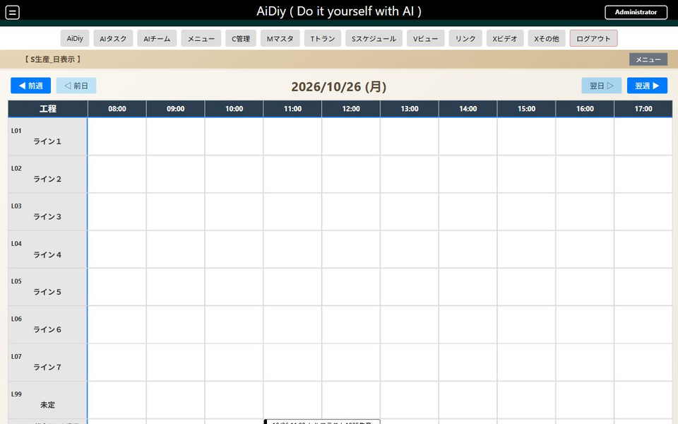

## 5. 表示の確認（機能試験の後）

### 操作の流れ

一覧から編集画面へ進み、長い名称や多数の明細でも対象行と入力欄の対応が分かるか確認します。縦長表示ではスクロールして保存・取消へ到達できるか確認し、見えないまま操作を確定しません。

### セルフテスト項目

| ID | 操作 | 期待結果 |
|---|---|---|
| WB-801 | 横長・縦長で一覧・編集・明細・スケジュールを開きます。 | 保存・取消・閉じると必要な列に到達できます。重なりや見切れがありません。 |
| WB-802 | 日本語の長い名称、0件、複数ページ、明細の多い試験データで操作します。 | 行と列の対応が分かり、選択・スクロール・コピーができます。 |

**WB-801の生産一覧：✅ OK（2026-10-25）。** 333×457で検索欄が折り返され、一覧を縦横にスクロールできます。SE00010001のリンクから編集へ進み、更新ボタンを操作して14:12に一覧へ戻りました。受入数量4・終了12:30を保持しています。追加の表示条件は以下に記載します。

狭幅の生産一覧を伝票IDで絞り込んだ画面です。明細リンクとページ操作へ到達できます。

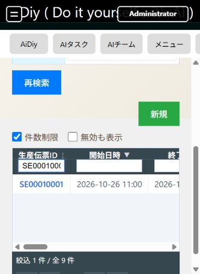

800×1000の縦長表示でも、同じ生産伝票を一覧から開き、所要量明細の入力欄と更新ボタンへ到達できました。

縦長表示で生産明細の数量欄へ移動した状態です。

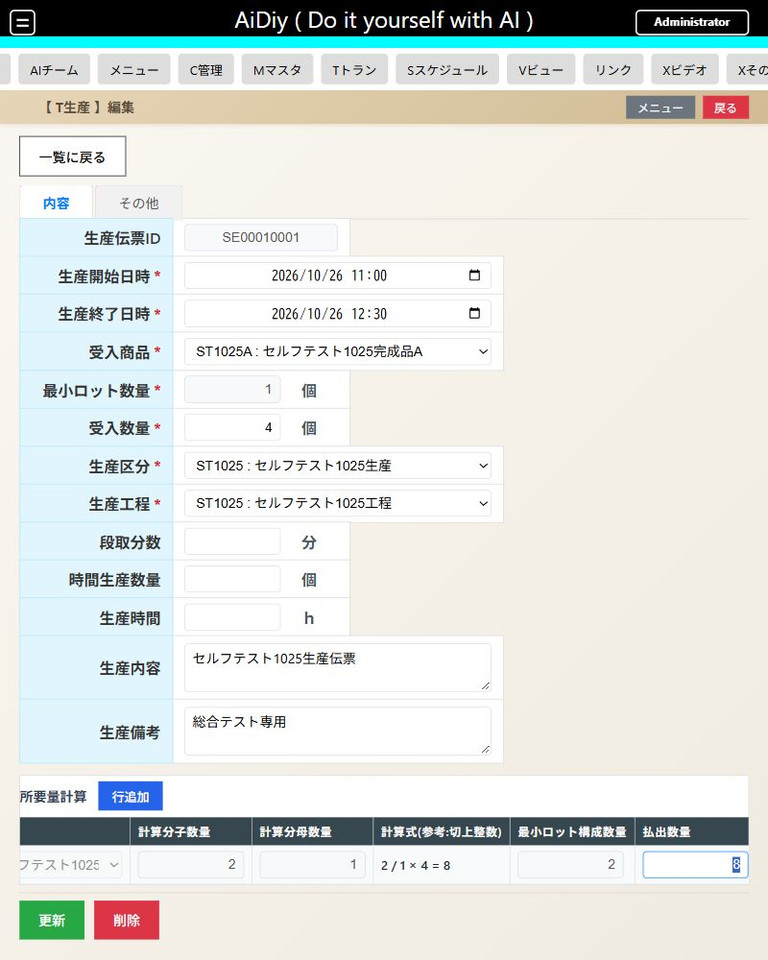

共通テーブルのページ操作は商品分類の専用101件で確認しました。2ページ目の101番を選択して編集値が一致し、420×900で検索・編集・取消と日本語名称のコピーができました。既存商品構成A001の4明細は変更せず縦長で確認しています。全一覧・全画面サイズ・大量明細の網羅試験ではありません。

101件の検索結果の2ページ目には101番だけが表示されます。

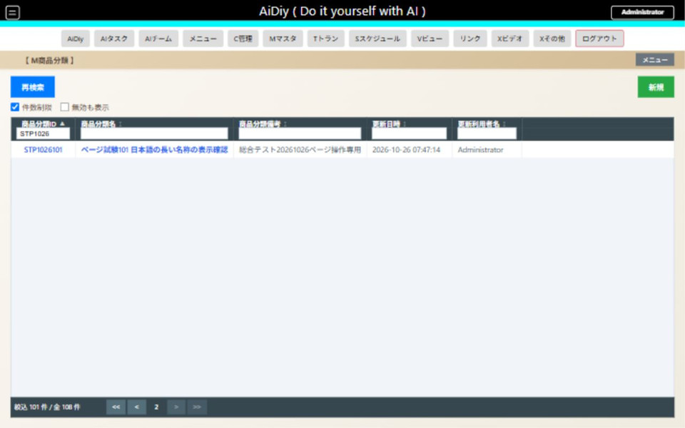

縦長の商品分類編集でも名称を確認して一覧へ戻れました。

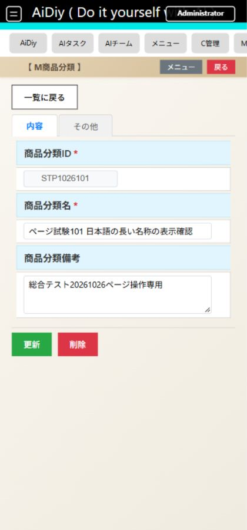

## 6. 後片付けと最終確認

WB-701〜703：生産・明細、入庫・出庫・棚卸、商品構成、商品、分類・区分・工程の順に試験IDだけを無効化しました。通常一覧・払出・在庫推移・生産の日／週表示へ反映され、既存予定は表示されます。無効な工程はスケジュールの行に表示されません。

生産は画面の削除後、「無効も表示」で再表示し、編集の「その他」から有効をONにして復元しました。受入4・払出8・日時が保持され、確認後に再び無効化しました。現行の削除は物理削除ではなく、有効フラグをOFFにする操作です。

既存行の照合は整理直前・直後の全項目比較です。試験開始前の全DBスナップショット比較ではありません。採番・監査履歴と復元用の無効データは正常に残ります。DBの削除・再構築は行っていません。

[PDF版](./セルフテスト,frontend_web,生産・在庫管理編.pdf)
