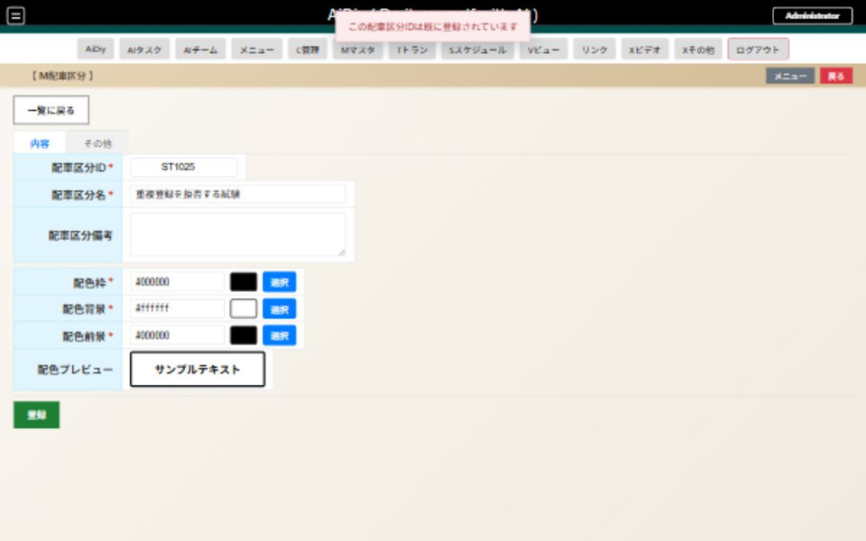
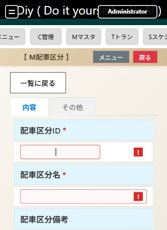
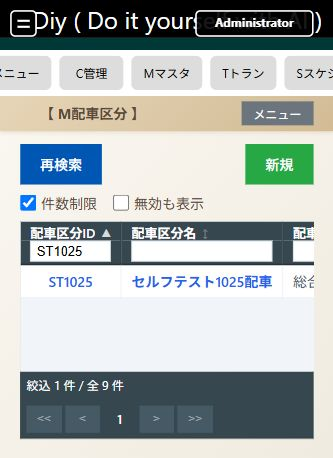
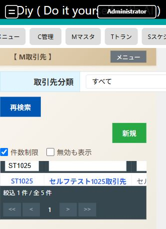
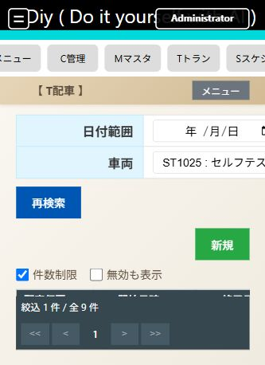
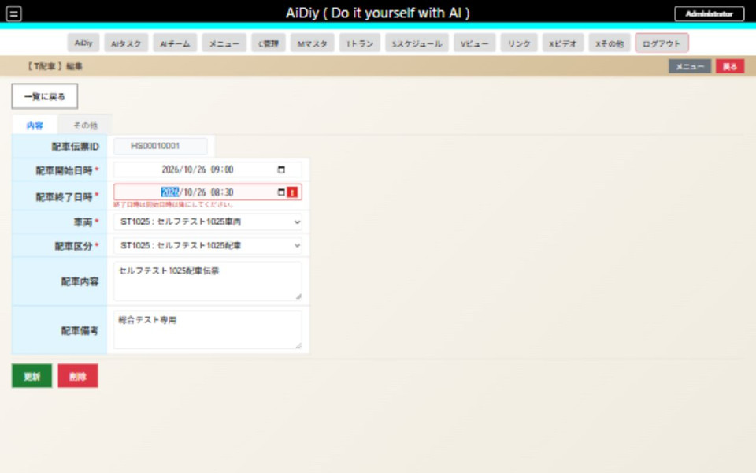
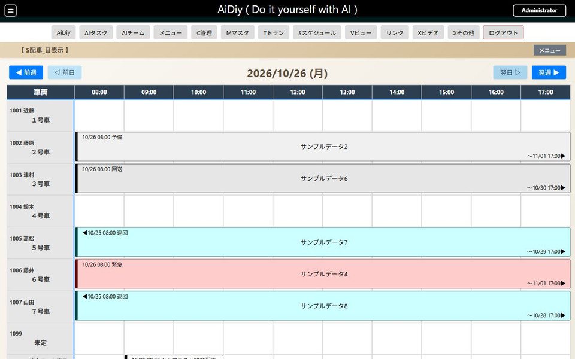
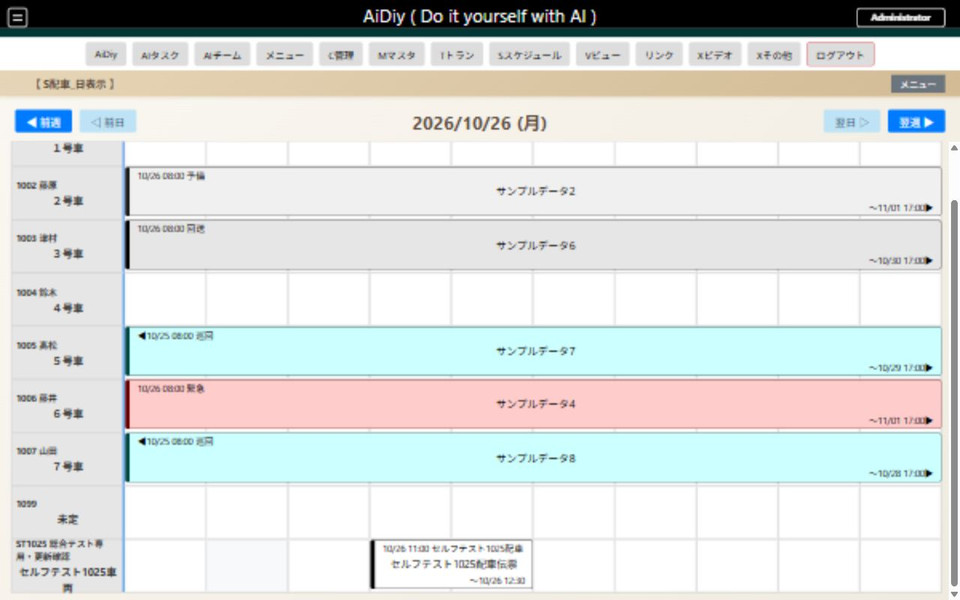

# frontend_web 配車管理編 — 操作ガイドとセルフテスト

> 本書はセルフテスト結果を、操作説明・解説書としても読みやすく整理しています。再テスト後は結果・注意書き・エビデンスを更新し、章立て・操作手順・図解の配置などの様式を維持します。

> 文書: `セルフテスト,frontend_web,配車管理編.md` | 実装: `frontend_web/src/components/`, `backend_server/apps_main.py`

## 総合評価

**総合評価：✅ OK。Windowsで確認済み（実施日：2026年10月25〜26日）。** 配車区分・車両、配車伝票、日時検証、日／週予定とドラッグ移動、後片付けを確認しました。 実測結果を業務別に整理した冊子です。全画面・全サイズの組合せを網羅した判定ではありません。週・月をまたぐ実時間観測は **PASS（環境依存・判定対象外）** とし、今回は未実施です。

対象環境はWindowsです。Mac／Linux実機と長時間連続運転は **PASS（環境依存・判定対象外）** とし、今回は未実施です。実行成功とは区別し、NGには数えません。

試験日は各結果に記載しています。
## この冊子を使う場面

- 配車管理の登録・更新と画面間の整合性を確認するとき。
- 関連する一覧・入力・スケジュールの変更後に再確認するとき。

## 始める前に

試験用の利用者IDは `admin`、パスワードは `********`（アスタリスク8文字）です。[説明資料の書き方](./セルフテスト,_説明資料の書き方.md#試験の準備と終了)に従って準備し、専用IDの試験データだけを操作します。通常業務の既存データを変更しません。保存後は一覧・再表示と必要に応じてAPIの保存値を照合します。

ケースIDのWB番号は既存の証跡との対応を保つため引き継ぎます。両業務にまたがるケースは、本冊の対象だけを記載します。

## 試験データ

| 対象 | ID | 確認内容・終了状態 |
|---|---|---|
| 配車区分・車両 | 各ST1025 | 登録・検索・備考更新後、無効化済み |
| 取引先分類・取引先 | 各ST1025 | 分類の選択・保存値を確認後、無効化済み。配車フォームからの選択は対象外 |
| 配車伝票 | HS00010001 | 2026-10-26 09:00〜10:30、車両・区分ST1025。移動試験後に時刻を復元し、無効化済み |
| 複製配車 | HS00010002 | APIで複製し、複製側だけ無効化。元伝票の全項目不変 |

## 1. 一覧と入力の基本操作

Mマスタから配車区分・車両を開き、ID検索、行選択、編集、一覧へ戻る操作を行います。Tトランで配車伝票、Sスケジュールで配車予定を確認します。

| ID | 操作 | 確認結果 |
|---|---|---|
| WB-101・102 | メニュー、検索、選択、編集、戻る | 配車区分・車両・取引先分類・取引先の保存値と一致。配車区分9件のID昇降順を確認 |
| WB-103 | 必須未入力・重複ID・取消 | 配車区分の必須未入力と重複ST1025を拒否。既存の名称・備考を保持。削除取消後も対象を保持 |
| WB-802 | 長い車両名を保存して再表示 | 日本語の長い名称を保持。試験後は「セルフテスト1025車両」へ復元 |

配車一覧の複数ページや全サイズを個別に網羅した試験ではありません。共通テーブルの101件試験は[生産・在庫管理編](./セルフテスト,frontend_web,生産・在庫管理編.md)の商品分類で確認しています。

重複する試験IDは登録されません。

必須欄を空にすると入力案内が表示されます。

## 2. 配車用のマスタ

配車区分と車両を先に登録し、専用IDで検索して保存値を確認します。取引先分類・取引先の関連選択も本冊で扱いますが、現行の配車フォームには取引先選択欄がありません。

| ID | 操作 | 確認結果 |
|---|---|---|
| WB-201（配車） | 配車区分を登録・更新 | 名称・備考が一覧と再表示で一致し、配車で選択可能 |
| WB-202（配車） | 車両、取引先分類、取引先を登録・更新 | ID検索・関連分類・保存値が一致。取引先の分類未選択は保存を拒否し、元の分類を保持 |

試験用の配車区分をIDで検索しました。

取引先に選択した分類名が一覧でも一致します。

## 3. 配車を登録・変更する

### 操作の流れ

1. 「Tトラン」から「T配車」の一覧を開き、新規登録へ進みます。
2. 開始・終了日時、区分・車両など画面の必須項目を入力し、対象を確認して保存します。
3. 一覧で登録したIDを探し、日付と名称を確認します。予定の見え方は4章のスケジュールでも確認できます。

### セルフテスト項目

| ID | 操作 | 期待結果 |
|---|---|---|
| WB-301 | `/Tトラン/T配車/一覧` で試験区分・車両と試験日を指定して登録します。 | 一覧に表示され、関連マスタの名称と日時が一致します。 |
| WB-302 | 数量や日時など編集可能な値を変更し、保存・再表示します。 | 変更が反映され、他の試験行や既存行は変わりません。 |
| WB-303 | 削除取消と、複製した試験行の削除確定を試します。 | 取消時は残り、確定した試験行だけが一覧から消えます。 |

2026年10月25日、配車伝票 `HS00010001` を登録し、専用車両で検索して開始・終了日時、区分名、配車内容を確認しました。現行の配車フォームには取引先選択欄がなく、車両と配車区分を指定します。WB-301はこの現行画面の項目で確認しました。

専用車両で絞り込み、試験伝票だけを表示した状態です。

終了時刻を10:00から10:30へ更新し、一覧・再表示で一致しました（WB-302）。09:00開始に対して08:30終了を入力すると保存を拒否します。APIでも逆転日時・形式不正を拒否し、全保存項目が変更前と一致しました（WB-103）。

WB-303ではHS00010001をAPIで複製し、HS00010002だけを無効化しました。元伝票の全項目が不変でした。画面に複製ボタンがあるとは扱いません。

終了が開始より前の場合は保存されません。

## 4. 配車スケジュール

S配車の週表示／日表示を開き、試験日へ移動します。車両・日時・予定を伝票と照合し、予定から編集画面へ進みます。

| ID | 操作 | 確認結果 |
|---|---|---|
| WB-601 | 配車の日／週表示 | 2026-10-26 09:00〜10:30の同じ伝票と車両を確認 |
| WB-603（配車） | 日表示のドラッグと詳細照合 | 11:00〜12:30へ移動し、編集値も一致。09:00〜10:30へ復元 |
| WB-603（配車） | 翌日・前日・翌週・前週 | 対象期間の切替を確認。絞り込み欄は現行画面にないため対象外 |

登録した配車を日表示で確認しました。

予定を空き時間へ移動し、この後に元の時刻へ戻しました。

## 5. 後片付けと最終確認

WB-701〜703：専用配車伝票を先に、続いて車両・取引先・分類・配車区分を無効化しました。通常一覧と配車の日／週表示に試験伝票・試験車両が残らず、既存予定は表示されます。現行の削除は有効フラグをOFFにする操作です。

既存行の照合は整理直前・直後の全項目比較です。試験開始前の全DBスナップショット比較ではありません。採番・監査履歴と復元用の無効データは正常に残ります。DBの削除・再構築は行っていません。

[PDF版](./セルフテスト,frontend_web,配車管理編.pdf)
