# Avatar Electron実行編 — 操作ガイドとセルフテスト

> 確認範囲：本文には過去の実機・自動試験結果と今回の追補を含みます。今回の実施状況は[確認結果](セルフテスト,共通,確認結果.md)の章別台帳を参照してください。今回の全章再実行・全条件合格を示すものではありません。

## 総合評価

**総合評価：✅ OK（記載した確認範囲）。** Windowsでログイン、VRM表示、Chat・Code1・Code6・Liveの文字応答、Core再起動後の自動再接続を確認しました。Mac／Linux実機・長時間連続運転は未実施です。入力機器が0台のため実マイク入力は環境制限で未テスト、人による音声聴取も未テストです。全機能・全プロバイダの合格を示すものではありません。

前半は起動から終了までの操作ガイド、最後の章は追加テストと確認範囲です。図番号は章番号と掲載順を表し、試験ケースIDとは区別します。

## 始める前に

[システム起動編](セルフテスト,aidiy_diag,システム起動編.md)で必要なバックエンドを起動し、[ランチャー編](セルフテスト,aidiy_diag,ランチャー編.md)からアプリを開きます。試験用アカウントは[ランチャー編](セルフテスト,aidiy_diag,ランチャー編.md#ローカル試験用の利用者)を参照します。

**8092はAvatar起動中だけ利用できます。** Web版は `http://127.0.0.1:8092` へ接続し、利用中は起動元のAvatarを終了しません。Task／Teamは独立した[Task操作編](セルフテスト,aidiy_task,操作編.md)・[Team操作編](セルフテスト,aidiy_team,操作編.md)で扱います。

## 1. ログインして操作ボタンを表示する

1. DiagのランチャーでAvatarを押し、「利用者認証」の窓が開くまで待ちます。
2. 利用者IDとパスワードを入力して「ログイン」を押します。
3. アバターのコア窓とチャット窓が開いたら、コア窓にポインターを入れて操作ボタンを表示します。

**✅ OK（AE-101）**：ログイン後に2つの窓が開きました。「接続中」と操作ボタンを確認しています。起動所要時間は計測していません。

Avatar起動直後です。利用者認証を済ませて会話画面へ進みます。

**図101：ログイン**

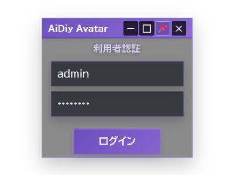

コア窓の右側から、ファイル・チャット・番号別のCode窓を開けます。

Task／Teamは独立アプリとして起動します。

認証後のAvatar本体とChat画面です。

**図102：Avatar認証後**

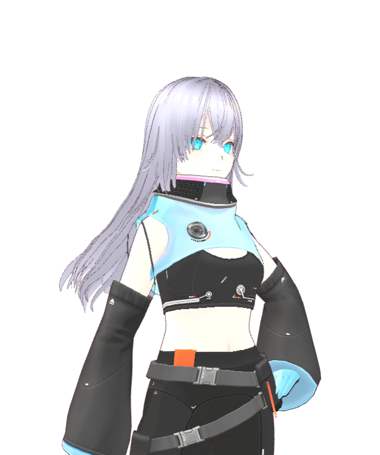

## 2. ChatとCodeで会話する

1. チャット窓の右下で「Chat」を選び、「おはよう」と入力して送信します。
2. コア窓の「1」「6」を押してCode1・Code6を開きます。
3. 挨拶だけの試験では「検証」を0回にし、それぞれ「おはよう」を入力して「CODE」を押します。
4. 進行表示が終わり、返答が表示されるまで待ちます。応答待ちの間は再送しません。

Chatだけを紹介する場合は、右下のラジオ選択と送信ボタンの「CHAT」を両方確認します。初期選択がLiveの場合もあるため、準備完了の表示だけで送信先を決めつけません。貼り付け後は本文の表示が落ち着くまで待ち、指定文が一度だけ入っていることを確認して送信します。白い自分の入力と、緑の回答を区別して読みます。

**✅ OK（AE-201〜203）**：Chat、Code1（codex_cli）、Code6（aidiy_hermes）がそれぞれ返答しました。Codeのモデルはautoです。異なる窓の返答を流用せず確認しました。

Chatを選んで送信した結果です。入力の下に返答が表示されています。

**図201：Chat応答**

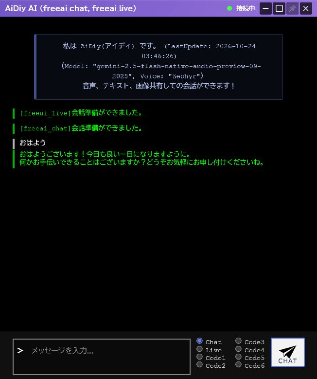

Code1の返答です。「今日はどんな作業をお手伝いしましょうか？」まで表示されています。

**図202：Code1応答**

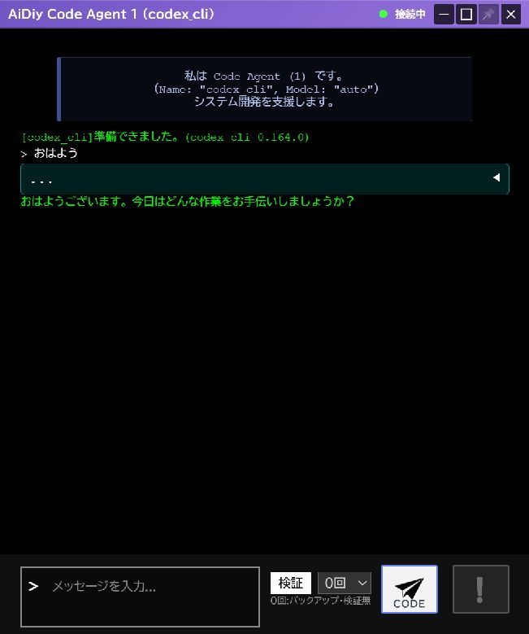

Code6の返答です。「今日は何をお手伝いしましょうか？」まで確認しました。

**図203：Code6応答**

ChatとLiveを選択できる画面です。

**図204：Chat表示**

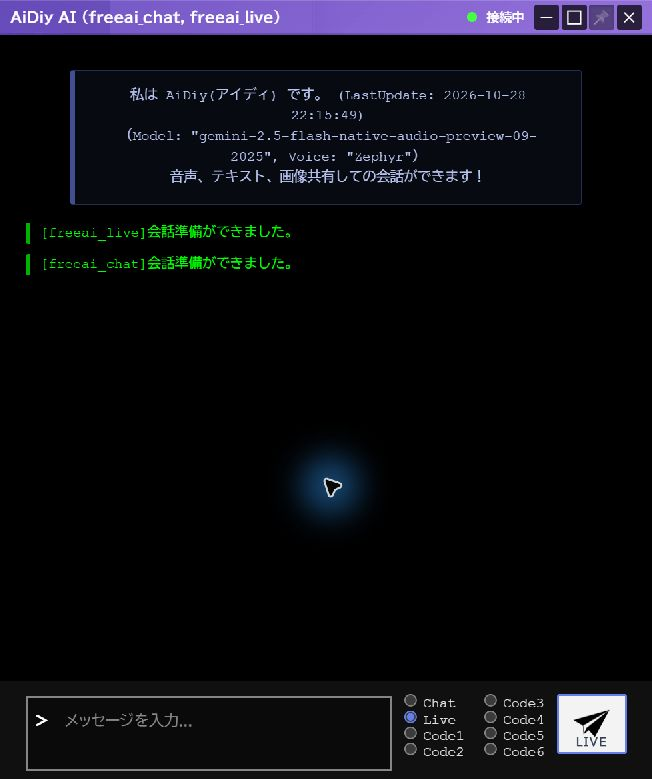

Code1の入力欄と接続状態です。この窓だけを閉じてもコア・Chat窓は残ります。

**図205：Code表示**

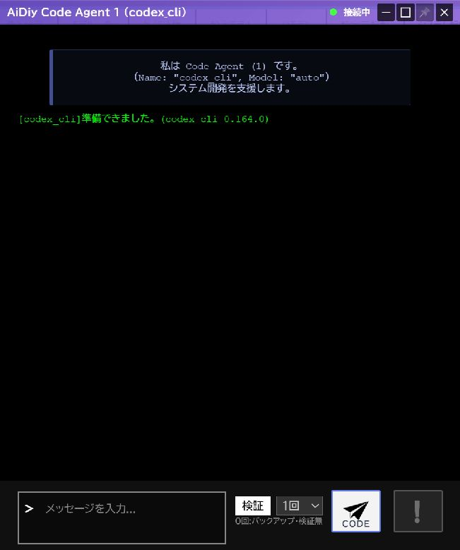

## 3. Liveで会話する

1. チャット窓の「Live」を選びます。
2. 「会話準備ができました。」を確認して、初回は15秒以上待ちます。
3. 「おはよう」を1回だけ送り、文字の返答を確認します。標準の観測枠は60秒です。

**✅ OK（AE-301）**：初回送信で「おはようございます!今日もよろしくお願いします。」と返答しました。※注意:15s以上待機後送信しました。初回の送信から応答までの厳密な時間は計測していません。Core再起動後の試験では、送信から19秒後の画面取得時に返答を確認しました。再送していません。

プロバイダはfreeai_live、画面に表示されたモデルはgemini-2.5-flash-native-audio-preview-09-2025、声はZephyrです。ここでは文字の応答を判定しています。

Liveでの初回応答です。ChatとLiveの入力は、それぞれ1回ずつです。

**図301：Live応答**

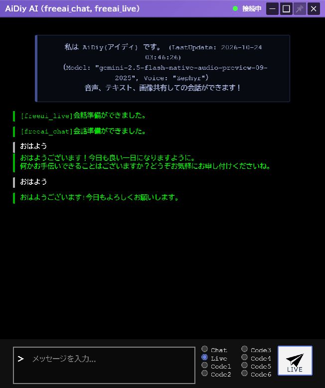

### 利用可能なLive方式でテキスト応答を確認する

FreeAIが利用枠などで応答しない場合は、OpenAIが利用可能なら設定画面で `openai_live` を選び、モデル・音声を確認して保存します。利用枠超過はエラー表示等で確認できた場合だけ確定原因として扱います。保存だけで既存会話に反映されない場合は、試験用Avatarを通常終了して起動し直し、新しい会話でOpenAIの接続・準備完了を確認します。サーバー全体の再起動は不要です。

「おはよう。挨拶を一文だけ返してください。」をテキストで1回送り、画面上の返信を確認します。マイク・カメラ・添付は不要です。結果不明時は連続送信せず接続状態を確認します。DB返信履歴の有無と画面への返信到達は別に判定してください。現在の確認済み設定・結果は後半のOpenAI切替試験を参照します。

## 4. ファイルを探して中身を見る

1. コア窓のフォルダボタンを押し、File Managerを開きます。
2. 一覧から確認したいファイルを選びます。フォルダをたどって対象を絞れます。
3. 画像ファイルを選ぶとプレビューを確認できます。

閲覧だけを紹介する素材には、既存の公開画像（例：`_icons/AiDiy.png`）を使えます。フォルダの三角で一覧を開き、画像の行を1回選択すると下段にプレビューが表示されます。一覧の選択行と、上下の境目にある「ファイル:」のパスが一致することを確認します。別のフォルダへ移るときは上の一覧から選び直します。閲覧にはダウンロード、添付、会話への送信は必要ありません。終了時はFile Managerと今回開いた会話窓を閉じ、コア窓を閉じて認証窓へ戻った場合は、その認証窓も閉じて残留を確認します。

**✅ OK（AE-401〜402）**：作業フォルダの一覧と、撮影したPNGのプレビューを確認しました。ファイルの編集・削除は行っていません。

File Managerの一覧です。作業フォルダ内のファイルを選んで閲覧します。

**図401：ファイル窓**

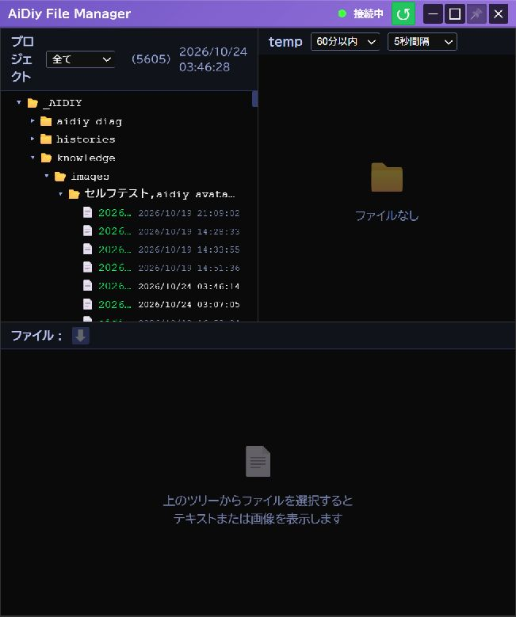

PNGを選択した結果です。撮影したログイン画面がプレビューに表示されています。

**図402：画像プレビュー**

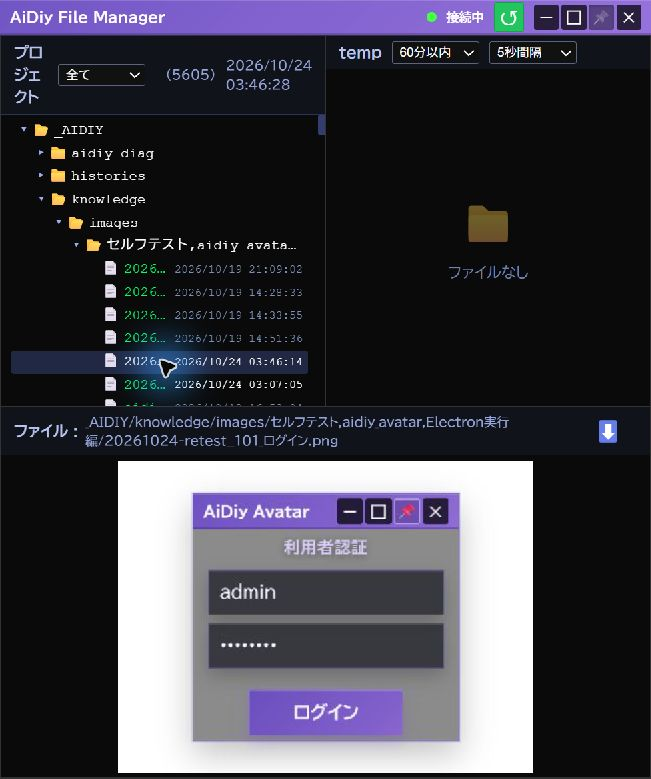

## 5. 接続が切れたときと終了

1. 送信を繰り返さず、Diagの「システム起動」でCoreの状態を確認します。
2. Coreが復帰したら、Avatarが自動で「接続中」に戻るまで待ちます。
3. 準備完了後に短い文を1回送り、新しい返答が出ることを確認します。

**✅ OK（AE-501）**：DiagからCoreを再起動し、Electronの接続復帰とLiveへの新しい返答を確認しました。Chatの履歴は重ねて追加されません。

Liveの会話文脈は、サーバー側で接続しているLive APIの同じセッションが保持します。画面への履歴の保存・再表示は不要で、復元されないことは不具合・残件ではありません。画面だけの再読み込みと、サーバー側のCore再起動は別の操作です。

Core再起動後です。接続中に戻り、新しいLiveの返答が1回表示されています。

**図501：再接続後Live応答**

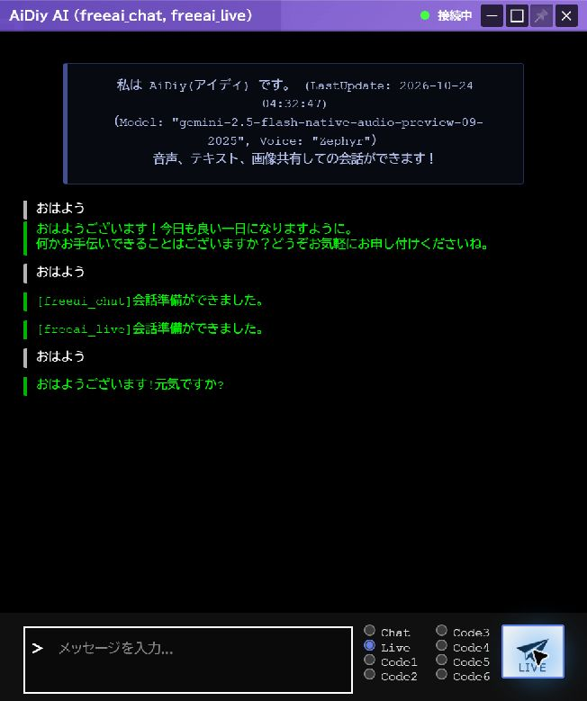

終了するときは応答待ちの処理がないことを確認し、使用中の8092のブラウザタブを先に閉じます。その後Avatarを終了します。Avatar終了で8092も停止するため、Web版利用中は終了しません。

## 6. 追加テストと確認範囲

### 準備完了後のChat応答

2026-11-02の音声解説では、通常ログイン後にfreeai_chatの準備完了を確認し、Chatを明示選択。「おはよう。挨拶を一文だけ返してください。」を1回送信して、「おはようございます、今日も清々しい良い一日になりますように。」という回答を実画面で確認しました。画像・ソース・個人情報の添付はしていません。入力反映が遅れた箇所は送信前に全文置換で指定文へ整え、再送していません。Chat、コア、戻った認証窓の順に通常終了しました。

freeai_chatの準備完了を確認して送信し、「おはようございます、本日もよろしくお願いいたします。」という実回答を受信しました。画面内の準備前エラーは成功判定に含めず、準備完了後の回答を確認しています。音声の聴取成功とは区別します。

**図601：Avatar準備完了後応答**

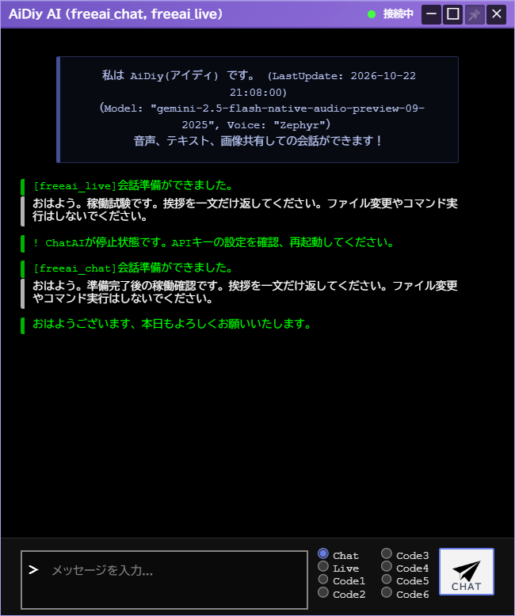

### 確認範囲

窓の移動・開始ズーム、表示選択、画像生成、設定保存、ファイル添付は、この冊子の実画面試験には含めません。接続処理の回帰テスト10件とAvatarの型チェックは成功しました。

透明部分へ別アプリが映り込まないよう、撮影用の白い背景窓を背面に置いて撮影しました。画面の内容を合成・修正せず、掲載用には縦横比を保って長辺960px以下へ縮小しています。

Web／Avatarのcleanup・依存復元、型チェック、起動制御、全終了と8092の解放を確認しました。起動・表示だけの確認を、AIの実応答確認とは区別します。

### 長押しドラッグの実機確認（2026-11-02）

Windows実機で `mouse_long_press_drag`（保持0.8秒、移動0.6秒。Browser全画面は移動0.8秒）を使用。直前の画面から対象を同定し、移動後の実画面とOSの窓位置を照合します。入力欄・ボタンの除外判定は下記の実施対象に限定します。位置は画面座標の (x,y) です。

既存依存だけで npm run build:electron を実行し終了コード0。dist-electron/main.js と preload.js を生成、package-lock は変更なし。公式 launch.mjs から通常起動し、利用者が指定した試験用認証で通常ログイン成功。認証前提はランチャー編の「ローカル試験用の利用者」を参照する。全12 WindowRole を実画面で確認したが、全窓の背景移動成功という意味ではない。

| 窓 | 実機結果 |
|---|---|
| 認証 | (760,366) → (820,406)。ID入力欄は除外。 |
| Core | (1240,258) → (1180,218)。ピン操作からは移動しない。 |
| Chat | (570,129) → (510,89)。メッセージ入力欄は除外。 |
| Code1 | (90,90) → (150,130)。入力欄は除外。 |
| Code2 | (150,150) → (210,190)。入力欄は除外。 |
| Code3 | (210,210) → (270,170)。入力欄は除外。 |
| Code4 | (270,258) → (330,218)。入力欄は除外。 |
| Code5 | (330,258) → (390,218)。入力欄は除外。 |
| Code6 | (390,258) → (450,218)。入力欄は除外。 |
| File | 本文背景2点では移動せず。AIファイル.vue の file-container 全体の tabindex=0 が共通除外に該当する。通常タイトルは (30,30) → (85,66) に移動。修正前は背景対応済みとは扱わない。追加修正で専用マーカーを付け、tabindexは維持したまま共通判定の対象を限定して許可。実機で背景 (30,30) → (90,70) の移動成功、選択欄では位置不変、解放後に通常終了できた。 |
| Image | リソース選択ポップアップの外側からの長押しは移動せず、通常クリック相当の選択取消で窓が非表示になる。.selection-popup は除外対象。撮影・素材選択後は未検証。AIイメージ.vueは画像選択直後の初回フレームをsubmit-imageへ送信し、経過切でも初回送信は止まらないため、外部AI送信禁止の今回範囲では素材を選ばない。 |
| 設定 | (501,151) のまま背景移動しない。role=dialog / aria-modal による除外と整合。キャンセルで閉じ、保存・再起動なし。 |

各Code窓で指示送信は行わず、確認後に1窓ずつ閉じた。Coreは通常ログイン後の接続状態で確認し、新しいメッセージや音声入力操作は行っていない。最後にCoreと戻った認証窓も通常UIで終了。Avatarの表示選択ごとの背景差、最大化の追加反復は未確認。

解放後にポインターを離して追従が残らないこと、通常UIが使えることを確認。Diag以外の今回起動した窓は通常UIで終了しました。1〜2pxの寸法丸めは補正を追加していません。全セルフテストの再実行や、未実施モードの合格を意味しません。

### Code1・Code6とLiveの追加確認（2026-11-02）

ルートを作業ディレクトリとして正式 `aidiy_avatar` を起動し、通常認証と準備完了後に確認しました。Code1（codex_cli）とCode6（aidiy_hermes）は検証を0回にし、「おはよう。挨拶を一文だけ返してください。ファイル操作やコマンド実行は不要です。」を各1回送信。双方で「おはようございます。今日もよろしくお願いします。」を実画面確認し、検証を元の1回へ戻して窓を閉じました。Code6の初期化待ちでも再送していません。

### OpenAI Liveへの切替と文字応答（2026-11-02）

設定画面で freeai_live から openai_live（gpt-realtime-2.1-mini、Marin）へ切り替え、「保存(json書換)」の完了を確認しました。保存のみは既存会話へ適用しない実装のため、試験用Avatarを通常終了し、ルートを作業ディレクトリとして正式CLI `aidiy_avatar` で起動し直しました。5常駐サーバーは再起動していません。

新しい会話でOpenAIのモデル・接続中・会話準備完了を実画面確認後、12:09:05 UTCに「おはよう。挨拶を一文だけ返してください。」をLiveへ1回送信。「おはようございます。今日も素敵な一日になるといいですね。」という返信を画面上で確認しました。マイク・カメラ・添付は使用せず、OpenAI設定は利用者の指定どおり保持しました。

入力履歴は新しいセッションで1件保存されました。SQLiteの返信履歴は0件でしたが、現行 `AIライブ.py` の出力処理はWebSocket送信で、そこで会話履歴保存を呼んでいません。したがってDBに返信がないことだけでは無応答の証拠になりません。今回のOpenAI実画面応答は成功です。FreeAIでは先の1回に画面返信を確認できませんでした。利用者は利用枠超過と推定していますが、ログによる確定ではありません。FreeAIの原因追及・再送は今回の残件にしません。Chat・Core・認証窓を通常終了しました。全モデル・音声入力・履歴保存の合格を意味しません。

### Avatar Electron Liveの実OS画像添付（2026-11-02）

公開試験画像shapes-731.png（赤円・青四角・緑三角、TEST 731）をExplorerから会話入力へ実OSドラッグしました。初回はCore窓との重なりで受付表示がなく、質問は送信せず窓を分離。次のドロップでファイル入力1件とプレビューを確認後、openai_live / gpt-realtime-2.1-miniへ色・形・文字を尋ねる質問を1回送信しました。実画面の返信は「赤い丸、青い四角、緑の三角」「TEST 731」で、添付認識は成功です。マイク・カメラは使用せず、追加質問・別ファイル送信なし。これはElectronのLive入力経路の確認で、Image窓・Web版・全モデルへ結果を流用しません。

## 証拠照合と残る確認

2026-11-03の既存証拠照合と、同日のImage窓追加確認です。

- **確認済み**：第1〜5章のログイン・Chat/Code1/Code6/Live・ファイル閲覧・Core復帰は本文と図の既存成功を維持します。2026-11-02のLive画像は[画像結果](evidence/_work_records/selftest-20261102/image-attachment-results.json)avatarの1画像/1質問・色形/TEST 731認識で確認済み。LiveのDB返信履歴不在を画面無応答と取り違えません。
- **Image窓の実機確認**：公開図形画像shapes-731.pngを通常ファイルダイアログで1回選択。初回の自動画像入力1件、赤円・青四角・緑三角とTEST 731のプレビューを確認しました。経過送信を「切」にし、追加画像入力がないことをログと照合しています。
- **返信確認**：Image入力欄から「この画像の図形の色と形、書かれた文字を簡潔に教えてください。」を1回送信。既存OpenAI Live／gpt-realtime-2.1-miniが赤い丸・青い四角・緑の三角形と「TEST 731」を回答し、通常会話窓とログで一致しました。画像だけの入力と返信を発火するテキスト質問は区別します。
- **証拠**：[Avatar-Electron_602 Image素材自動送信](evidence/.aidiy_cache/selftest/セルフテスト,aidiy_avatar,Electron実行編/Avatar-Electron_602_Image素材自動送信.json)。今回の観察キャプチャは成功。前回の部分確認を今回の1画像・1質問で補完しました。
- **範囲**：個人画像・実画面共有・マイク・カメラは使わず、設定保存・ソース変更なし。Image、会話、Coreと認証窓を通常終了しました。本ケースの表示・返信は確認済みですが、全モデル/全実行形態へ流用しません。

### OpenAI項目通知の確認

正常イベントconversation.item.added/doneを未知として警告する不整合を修正し、隔離5テストが成功しました。回答転送・実エラー通知・未知イベント警告は維持します。2026-11-03 18:46:51に正式reboot_core.txt経路でCore8091のみ再起動。18:47:07起動のPID22976/864へ交代しHTTP200、5系統HTTP200・Local停止を確認。修正ソースのハッシュ一致、Core仮想環境で隔離5件PASS。OpenAI Liveモジュールは接続時の遅延読込みのため、実接続での新規イベント受信は追加AI送信を避けて未実施。再起動前の旧プロセス問題は解消し、次の通常接続から修正を読み込む状態。Image窓の実機表示・返信は上記の別試験で確認済みです。

既存OpenAI切替記録では接続・文字送信・実画面返信が成功しています。該当時刻のログにERRORはなく、上記正常イベントの警告がありました。利用枠超過は推定であり、確定原因とは記載しません。警告修正の隔離試験は外部送信なしで実施し、Imageの実機送信・画面観察は上記の別試験で確認しています。

[通知処理と切替ログの照合](evidence/.aidiy_cache/selftest/セルフテスト,aidiy_avatar,Electron実行編/Avatar-Electron_602_OpenAI項目通知修正.json)。

### 現行の判定（文書順再照合）

- **確認済み**：Image表示・初回自動入力・1質問の認識返信済み。
- **本当に残る確認・範囲**：Core再起動・HTTP復帰と修正ソース一致、隔離5PASSを確認。Liveは接続時読込み。追加AI接続でのイベント再受信は行わず、次の通常接続へ適用。
- **証拠の扱い**：上記の本文・図・参照結果を照合。先行調査の未実施/拒否/準備失敗は当時の記録であり、後続の成功や実施不要指定を優先します。今回の文書整理を新しい実機PASSには数えません。
