# IDE 操作編 — 操作ガイドとセルフテスト

> 確認範囲：本文には過去の実機・自動試験結果と今回の追補を含みます。今回の実施状況は[確認結果](セルフテスト,共通,確認結果.md)の章別台帳を参照してください。今回の全章再実行・全条件合格を示すものではありません。

## 総合評価

**総合評価：✅ OK（記載した確認範囲）。** Windows ElectronとWebで、基本画面・検索・文書閲覧・比較・軌跡・アプリ起動・下書き連携・VR・終了を確認しました。環境による対象外と模擬条件は5章に記載します。

1〜4章は操作ガイド、5章は追加テストです。図番号は章番号＋章内の掲載順です。説明には専用プロジェクトを使用しています。第2章と第3章の個別画面は📌状態で掲載し、Webの操作例は本文で明記します。

## 始める前に

[システム起動編](セルフテスト,aidiy_diag,システム起動編.md)で必要なサービスを起動し、[ランチャー編](セルフテスト,aidiy_diag,ランチャー編.md)から作業フォルダを選んでIDEを開きます。単独起動コマンドは `aidiy_ide` です。

プロジェクト名を確認して「AiDiy接続利用」を押します。サービスを使わず閲覧する場合は「オフライン利用」を選びます。手動で読む間は右下の「自動探索」をOFFにします。

オフライン利用では、左上が「未接続」のままでもファイル閲覧を利用できます。読み込み後にフォルダやファイルが表示されることと、右下の自動探索がOFFになったことを別々に確認します。実演では、先に機密を含まない閲覧対象を決めておきます。

既存のIDE窓を再利用し、実演後は不要になった本体・独立パネルを確認します。本体の「×」で終了確認が出た場合は、対象が今回のIDEであることを確かめて「終了する」を選び、窓が残っていないことまで確認します。別作業の窓・未保存内容・Diagやサーバーは一括終了しません。

## 1. 基本画面とVR

窓の配置を整えるときは、通常のタイトルドラッグに加え、ボタンや入力欄のない背景を約0.5秒以上長押ししてから動かせます。例えば標準IDEのタイトル直下、プロジェクト名と起動ボタンの間の余白です。マウスを離して位置を決め、ポインターに窓が追従しないことと、メニューなどの通常操作ができることを確認します。入力欄・本文の選択・ボタンは移動用にせず、本来の操作に使います。対応する他のElectron画面でも共通の考え方で使えますが、全領域で移動できる意味ではありません。最大化中やVR等の個別条件・確認範囲は後半のテスト欄を参照してください。

### 3Dと2D

作者のコンセプトは、システムプロジェクトのフォルダ空間を銀河、ファイルを星々として捉え、楽しみながら探索や作業を進めるための小さな工夫です。銀河は単なる背景装飾ではありません。起動時の描写、当日変更したファイルの見つけやすさ、眺めていて楽しい3Dビューアであることを大切にしています。これは設計意図の説明であり、個々の変更表示の条件や確認済み範囲は、該当手順と実際の表示を照合します。

3Dではフォルダやファイルを宇宙の中から選びます。フォルダ名で階層を進み、パンくずから上の階層へ戻ります。ファイルを選ぶとビューアが開きます。

パネルを閉じた3Dの基本画面です。フォルダとファイルの配置を見渡せます。この図はWeb版です。

**図101：3D基本画面**

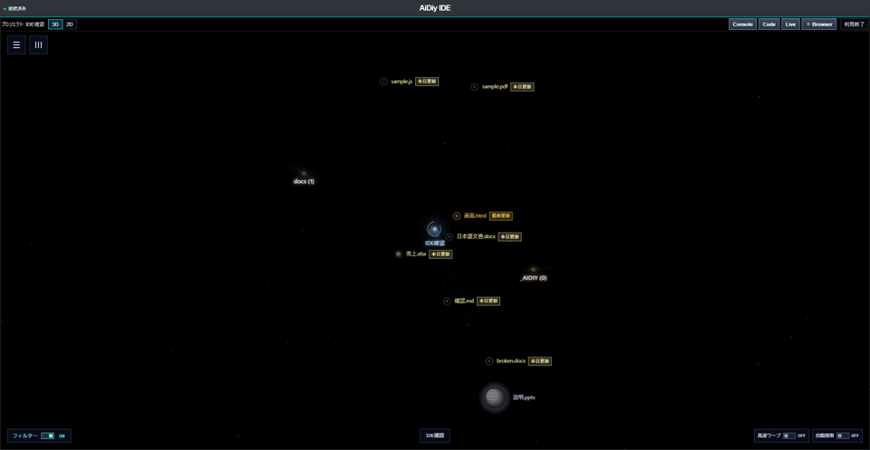

上部の「2D」で平面表示へ切り替えます。「3D」で戻れます。階層や選択を確認しながら、見やすい表示を選びます。

2Dでは上側にフォルダ、下側にファイルが並びます。上部のプロジェクト名と一覧の対象階層を見て、同じ作業場所を表示していることを確かめます。

比較するときは、先に既知のフォルダへ移動してから3D／2Dを切り替えます。3Dの現在地は下部、2Dのパンくずは一覧上部にあり、表示位置は同じではありません。自動探索ONで全景を見せた後、名前を読む場面ではOFFにします。2026-11-02の短編では `_AIDIY/knowledge` の3D→2D（1フォルダ・123ファイル）→3Dで現在地を保持することを実画面確認しました。件数はその時点の内容で変わります。

2Dの基本画面です。エクスプローラーとビューアを閉じ、ファイルとフォルダの一覧が見える状態にしています。

**図102：2D基本画面**

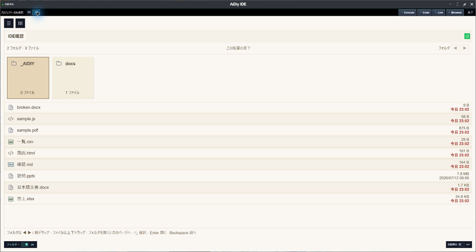

### VRで複数の画面を並べる

利用者の推奨は、2画面以上を使える環境では、一方に自動探索ONの銀河表示を置き、もう一方で作業しながらAIの作業・ファイル更新状況をリアルタイムに眺める使い方です。これは推奨する利用形態であり、今回の単一画面での実演が複数物理画面や全AI処理の即時反映を検証したことを意味しません。表示される更新と実際の処理結果は別に確認します。

1. 必要なパネルやアプリを開きます。画面内のエクスプローラー・軌跡・ビューアは📌で独立窓にできます。
2. 本体上部の「VR」を押すと宇宙表示が全画面に広がります。独立窓を読みやすい位置に配置します。
3. ピンONの窓は、本体を選んでも手前に残ります。
4. F11または復帰操作で通常画面へ戻り、現在地と閲覧ファイルを確認します。

銀河の景色と文書を同時に紹介するときは、まずエクスプローラーを左、機密を含まない文書のビューアを右に用意し、両方を📌で独立窓にします。中央を空けた配置なら、探す一覧・読む本文・フォルダのまとまりを同時に見られます。VRへ切り替えた後も両窓が手前に残ることを確認します。

動きのある全景を眺める場面では、右下の「自動探索」をONにします。個別文書を読む場面とは分け、不要なビューアを閉じてからON表示と視点の移動を確認します。今回の実画面では、時間経過により星群の位置と見える奥行きが変わりました。手動で文書を読む場面へ戻る場合はOFFを確認します。鑑賞と操作説明を切り替える際は、その目的も音声で伝えます。

エクスプローラー、検索軌跡、Markdownビューアを一斉に表示した例です。探す場所・検索理由・本文を同時に確認できます。

**図103：VRで閲覧と検索**

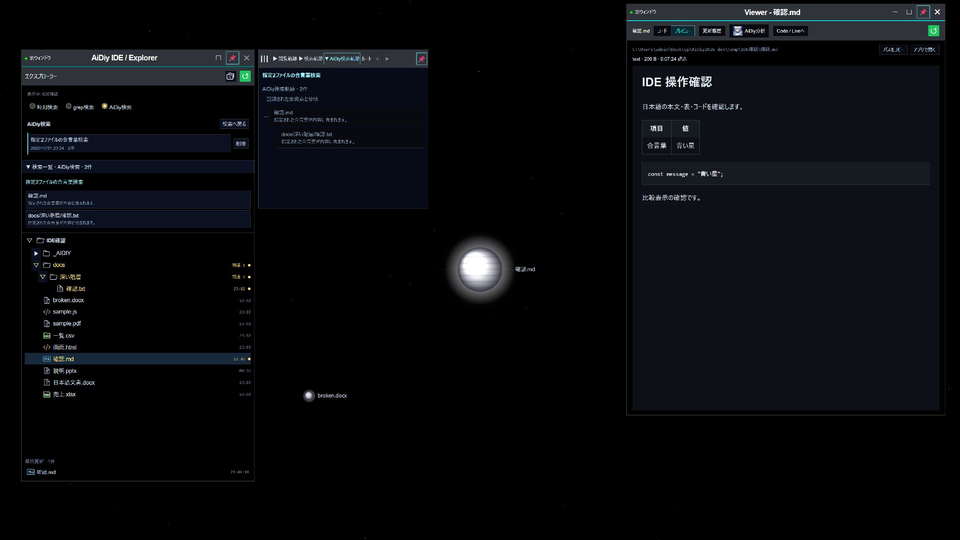

Code・Live・Consoleを並べた例です。同じプロジェクトの窓を使い、閲覧とAIへの依頼、端末操作を組み合わせられます。Liveは未接続で、マイクと音声出力はOFFです。

**図104：VRでCodeとLiveとConsole**

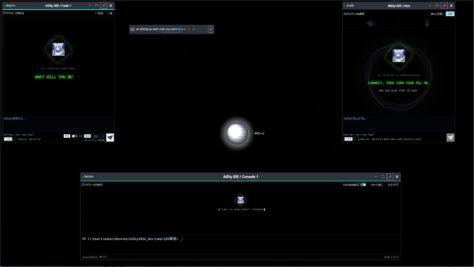

## 2. エクスプローラー

### ツリーを開いてファイルを選ぶ

1. 左上の横三本線でエクスプローラーを開き、📌で独立窓にします。
2. フォルダ横の三角で開閉し、名前を押してその場所へ移動します。
3. ファイル名を押してビューアを開きます。名前とパスが対象と一致すれば選択完了です。
4. 緑色の更新ボタンで一覧を取り込み、隣のボタンで展開したフォルダを閉じます。

ツリー内容の再取得・書き換えでは、選択中のファイルとビューアを保持します。選択の自動移動は、新しい最終更新を検知した時だけ、自動探索の条件に従って行います。同じ最終更新の再取得では移動を繰り返しません。更新した一覧に選択ファイルがない場合は新しい一覧で再確認し、削除が確認できた場合だけ表示を解除します。確認中の選び直し・手動の閉じる操作を優先し、取得失敗や走査上限では表示を保持します。

深い階層まで展開した独立窓です。検索欄とツリーを同じ窓で操作でき、タイトルバーのピンがONになっています。

**図201：エクスプローラー独立窓**

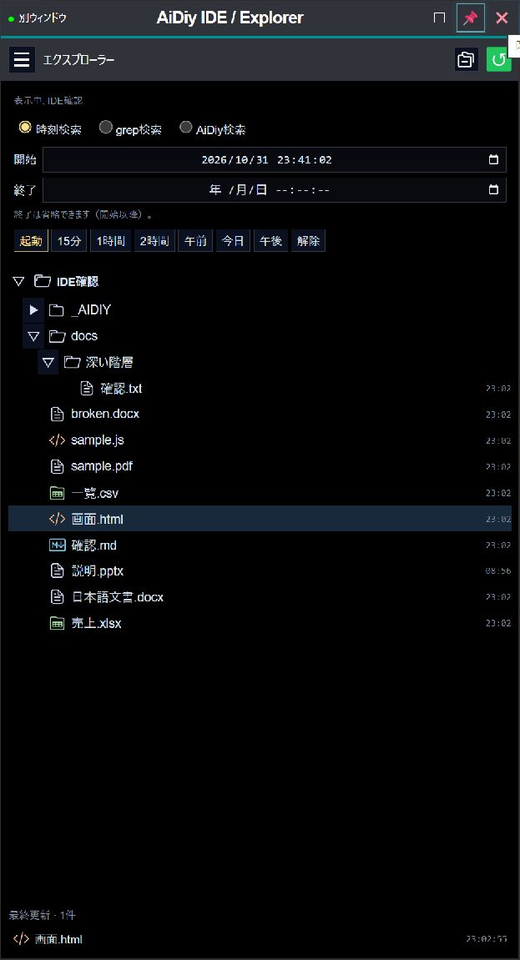

### 時刻検索

「時刻検索」を選び、起点や日時範囲を指定します。「今日」はその日の範囲を選ぶ例です。検索一覧の件数を確認し、行を選んで対象を読みます。

時刻軌跡の「<」「>」でも、指定範囲で見つかったファイルを前後に開けます。「15分」は選択時の15分前を開始にする例で、終了が空欄なら開始以降が対象です。現行実装の検索一覧は更新日時の降順ですが、軌跡は同じ並びとは限りません。前後ボタンの到達先は時刻軌跡に並ぶ順番で確認してください。今回の実演ではIDE操作編と共通ナレーション文書の2件を対象にし、共通文書→「<」→IDE操作編→「>」→共通文書の本文表示を確認しました。これは更新されたファイルの移動であり、過去版の比較ではありません。

「今日」を押したら、開始が当日の00:00:00、終了が23:59:59になったことを確認します。「検索一覧・時刻検索」の見出しが収納されていればクリックして開き、ファイルのパスと更新時刻を見比べます。件数は作業フォルダの状態で変わり、下の例の9件と一致する必要はありません。2026-11-01の実演では583件を表示し、結果から既知のHermes操作ガイドを選択して本文を確認しました。行選択後は銀河の移動が先に始まり、ビューアの本文表示まで間がありました。選択直後に開いたと判断せず、ビューアのファイル名・パス・本文まで確認します。

「今日」の範囲で9件を表示した例です。開始・終了時刻と検索一覧が同じ窓に表示されています。

**図202：時刻検索**

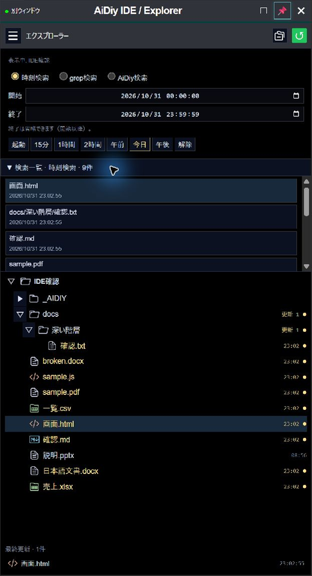

### grep検索

grep検索はファイル内の文字を探します。「grep検索」を選んで検索文字を入力し、検索を実行します。一覧にはファイル名と一致行が表示されます。見出しを押すと一覧を収納・展開できます。

「ファイル内容」欄へ探す語句を入力して「検索」を押し、「検索中…」から結果表示へ変わるのを待ちます。ファイル数と一致件数は別です。2026-11-01の実演では「システムプロジェクトのフォルダ空間」で2ファイル・4件を表示し、IDE操作編の23行目を選ぶと、右のコード表示で該当語句が強調されました。一覧のパス・行番号と本文を照合します。ログにも同じ語句が含まれる場合があるため、結果の全件を目的の文書とは扱いません。件数は検索時点の内容により変わります。 検索一覧が収納されている場合は「検索一覧・grep検索」の見出しを押して展開します。結果のパス末尾の行・列と、開いたビューアの「検索結果: ○行 ○列」および強調表示を照合してください。2026-11-02には「操作ガイドとセルフテスト」で24ファイル・26件を表示し、Browser操作編の1行23列と本文の強調表示の一致を確認しました。選択直後は本文読込が続くため、表示完了前に別の結果を続けて押さないようにします。

「IDEの選択確認」で検索した例です。深い階層のテキストから、1ファイル・1件の一致が見つかっています。

**図203：grep検索**

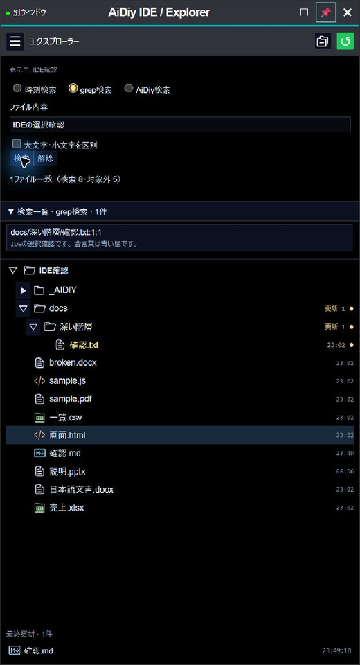

### AiDiy検索

意味や目的から探す場合は「AiDiy検索」を選び、探したい内容を書いて検索を依頼します。AiDiy接続利用が必要です。結果の理由を読み、関連ファイルを選びます。

実AIに指定2ファイルの合言葉「青い星」を探すよう依頼した結果です。保存した結果を表示し、Markdownと深い階層のテキストの2件を確認しています。ファイルを変更しない条件で依頼しました。

**図204：AiDiy検索**

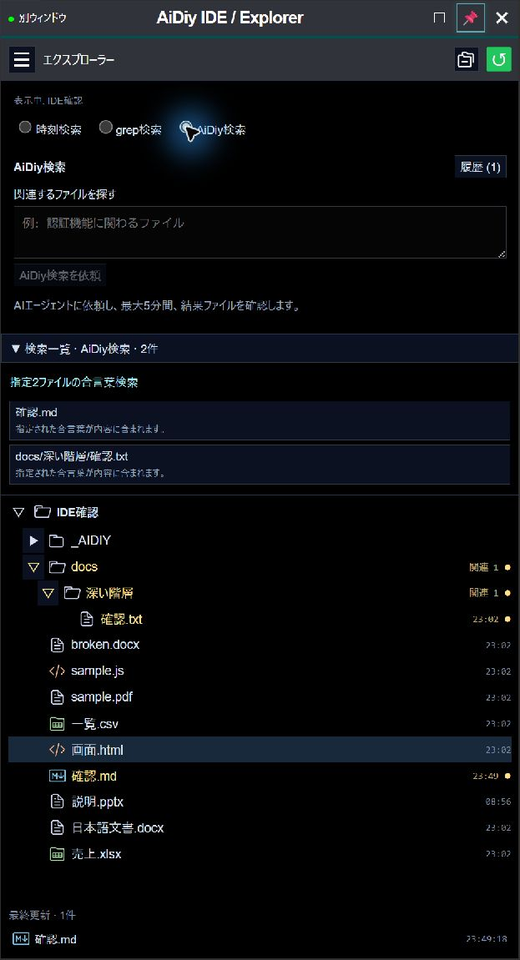

「履歴」を開いて保存された検索名を選ぶと、結果と理由を読み直せます。「検索へ戻る」で検索入力へ戻ります。

検索履歴から2件の結果を開いた例です。検索名と関連ファイルを照合できます。

**図205：検索履歴**

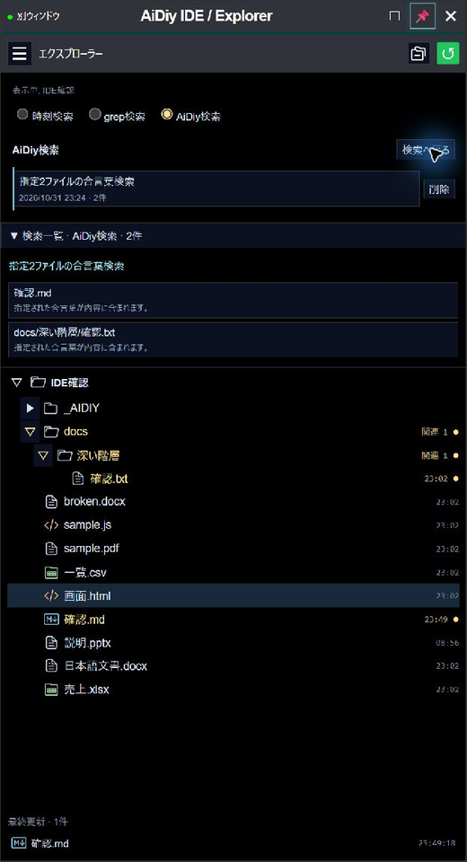

### ファイル操作

対象を右クリックし、作成・コピー・貼付け・複製・名前変更などを選びます。重複名のエラーでは名前と貼付け先を確認します。ゴミ箱へ移すときは確認画面の対象名を読み、取り消す場合はキャンセルします。

Markdownの「PDF化」は同じフォルダへ同名のPDFを作ります。既存PDFは確認なしで更新され、生成に失敗した場合は既存PDFを保持します。

Markdownを右クリックしたメニューです。「Code / Liveへ」から参照ファイルを下書きへ渡すこともできます。

**図206：ファイル操作メニュー**

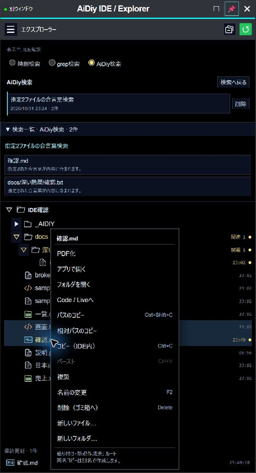

### チェックしてまとめて操作する

ファイル名の左のチェック欄で、操作する対象をまとめられます。最終選択は、宇宙とビューアに表示する場所です。チェック対象とは分けて操作できます。

| 操作 | 動作 |
|---|---|
| 通常の行クリック | その項目だけをチェックし、最終選択を移します。 |
| Ctrlを押しながら行クリック | 追加チェックして最終選択を移します。階層をまたいで追加できます。MacではCommandも使えます。 |
| Shiftを押しながら行クリック | 基点からの範囲をチェックします。同一階層の項目だけを対象にし、同じ基点から範囲を拡大・縮小できます。別階層ではクリックした項目だけに切り替えます。 |
| チェック欄を直接クリック | 最終選択を移さず、個別にチェックを付け外しします。階層をまたいで操作できます。 |
| Space | 一覧でカーソルのある項目のチェックを付け外しします。最終選択は移しません。 |
| Ctrl+A | カーソルと同じ階層の表示項目をチェックします。 |
| Esc／チェック解除 | Escは最終選択の1件を残して複数チェックを解除します。「チェック解除」は全チェックを外します。 |

2件以上をチェックしている間は、最終更新・一覧取得と自動追跡を停止します。取得中だった応答も反映せず、表示内容を維持します。1件以下に戻すと取得を再開します。コピーを完了しても、複数チェックを維持している間は一覧を更新しません。

選択だけを試す場合は、既知の安全な2項目のチェック欄を直接押し、1件→2件の件数と「最終更新・一覧取得を停止中」の表示を確認します。最初のチェックで件数欄が現れて行の位置が下がるため、続けて押す項目を見直してください。最後に「チェック解除」で全チェックと件数欄が消え、更新ボタンが元の表示へ戻ることを確認します。フォルダでも確認でき、一括コピー・削除へ進む必要はありません。

`a.txt` と `b.txt` をチェックしたWeb別窓です。`b.txt` が最終選択で、2件のチェックと「取得を停止中」の表示を確認できます。

**図207：複数チェック**

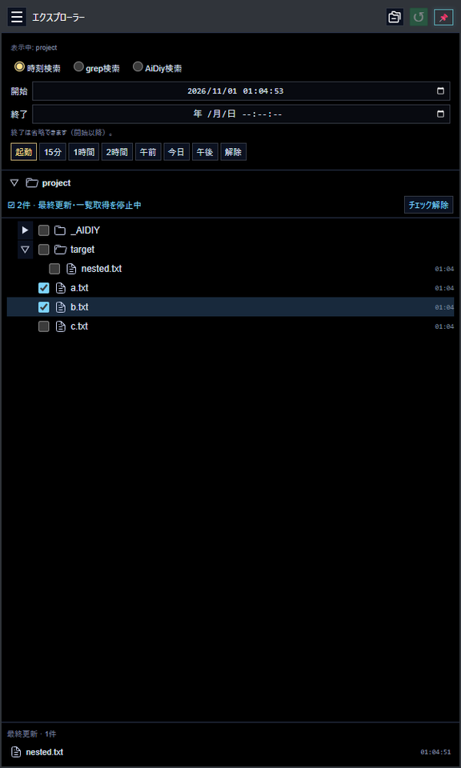

右クリックして、**「☑︎全てを」** が太字で付いた操作を押します。コピー・複製・パスコピー・削除などがチェック対象全件に適用されます。ファイルだけならCode / Liveへの参照追加、MarkdownだけならPDF化もまとめられます。太字の表示がない操作は右クリックした項目が対象です。

2件を対象にしたメニューです。「コピー（IDE内）」を選び、貼り付け先のフォルダを右クリックして「ペースト」を押します。同じ2件をもう一度コピーして貼り付けると、既存内容を上書きせず「コピー」を付けた別名になります。

**図208：一括操作メニュー**

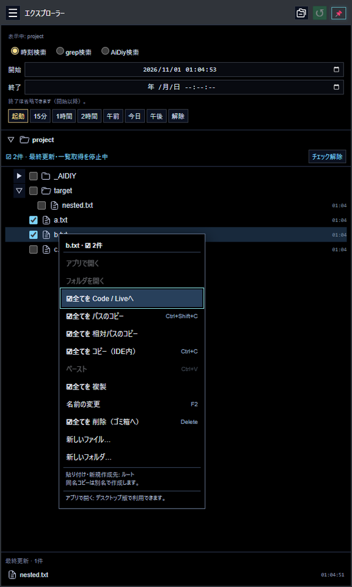

削除は確認画面の対象一覧を読んでから「ゴミ箱へ移動」を押します。キャンセルでは移動しません。フォルダは「フォルダ全体」と明示します。親フォルダとその配下の項目が同時に含まれる場合は一括操作を拒否し、どちらを対象にするかチェックの整理を案内します。

2ファイルの削除確認です。試験では専用の一時フォルダへの模擬移動を使い、取消では0件、確定ではこの2件だけが移動し、対象外ファイルとフォルダが残ることを確認しています。

**図209：一括削除確認**

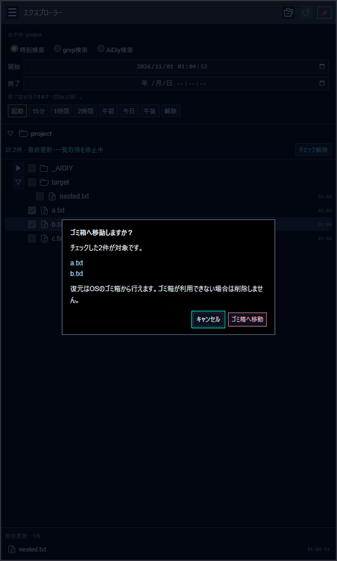

## 3. 各ウィンドウ

### ビューア

ファイルを選んで開いたビューアの📌を押すと、独立した窓になります。内容は読み取り専用です。独立ビューアは表示対象を固定して読めるので、別のファイルと並べて確認できます。

Markdownは「プレビュー」と「コード」、HTML・SVGは「表示」と「コード」で切り替えます。更新を反映する場合は再読込を押します。Electronの「アプリで開く」から外部アプリも利用できます。

SVGは「表示」で図形、「コード」で行番号付きのSVG記述を確認し、再び「表示」で同じ図形へ戻れます。切り替え前後でファイル名とパスが同じことを確認します。小さなアイコンは表示領域いっぱいに拡大されるとは限りません。実演素材には、外部参照・スクリプトを含まない既知のローカルSVGを選び、開く経路も事前に確認してください。

HTMLは「表示」で整えられたページ、「コード」でHTMLタグやスタイルの記述を確認できます。例えば既存の`docs/開発ガイド/_index.html`をエクスプローラーから開き、見出し・説明枠・一覧を表示した後、コード内の同じ見出しや一覧と照合し、表示へ戻ります。開いた直後がコード表示なら、先に「表示」を選んでください。切り替え前後のファイル名とパスを確認し、ページ内リンクを開く操作とは区別します。実演前に素材のソースを読み、スクリプト・外部リソース・送信処理がないことと、UIで実際に開ける経路を確認します。

Markdownの「プレビュー」は見出しや箇条書きを整えた表示、「コード」は行番号とMarkdown記号を含む本文表示です。切り替え前後で上部のファイル名とパスが同じことを確認します。「コード」を選んでも読み取り専用です。 比較するときは自動探索をOFFにし、同じファイルの先頭見出しを目印にします。プレビューの見出しとコード先頭の `#` を含む同じ見出し、復帰後の表示を確認すると、別ファイルへの移動と表示形式の切替を区別できます。

日本語、表、コードを含むMarkdownの独立ビューアです。ファイル名とピンONを確認できます。

**図301：ビューア独立窓**

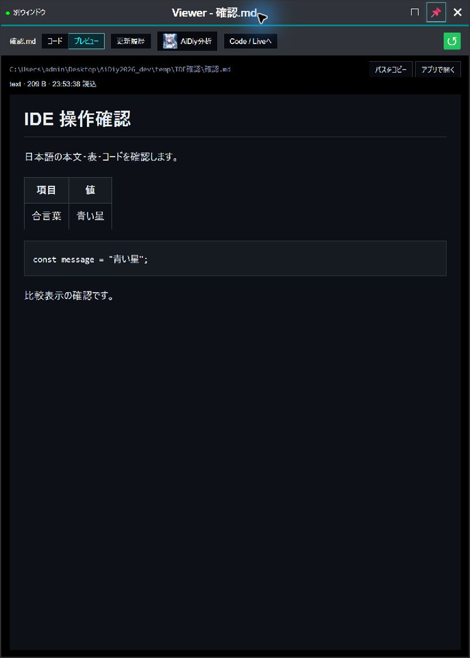

### 比較表示

ファイルの履歴から保存版を選び、現在の内容との比較を開きます。比較画面も📌で独立窓にできます。左右の版と変更箇所を確認し、同期スクロールで同じ位置を読みます。

対象ファイルをビューアで開き、上部の「更新履歴」から比較画面へ進みます。「旧版」の保存日時、左の旧版・右の現在のファイル、右上の変更箇所数を確認します。既存の保存版が必要で、保存版がない場合は比較の実演を省略し、作成や復元を閲覧手順に混ぜません。

比較画面右上の📌で独立窓にすると、専用タイトルバーが付きます。対象パス・旧版の保存日時・左右の本文を確認し、窓の端をドラッグして本体の一覧と並べます。今回のElectron実演では、ピンONの比較窓は本体の一覧側を選んでも手前に残りました。長い行は窓幅で見切れるため、本文を読む幅も確保します。独立窓を閉じた後は本体へ戻り、不要な窓が残っていないことを確認してください。

右側の追加行に色が付き、左側の対応位置には空きが表示される場合があります。追加後は左右の行番号が異なるため、番号の一致ではなく見出しと前後の本文で対応を確認します。本体内の比較画面で右側を下へ、左側を上へスクロールし、反対側も対応箇所へ動くことを確認しました。今回の素材は本書の2026/11/01 20:48:10保存版と現在版で、7か所の変更のうち時刻検索の追記を表示しました。保存版の新規作成・復元・削除は行っていません。

左が保存版、右が現在の内容です。右に加わった「比較表示の確認です。」の1か所を差分として表示しています。比較画面も読み取り専用です。

**図302：比較表示独立窓**

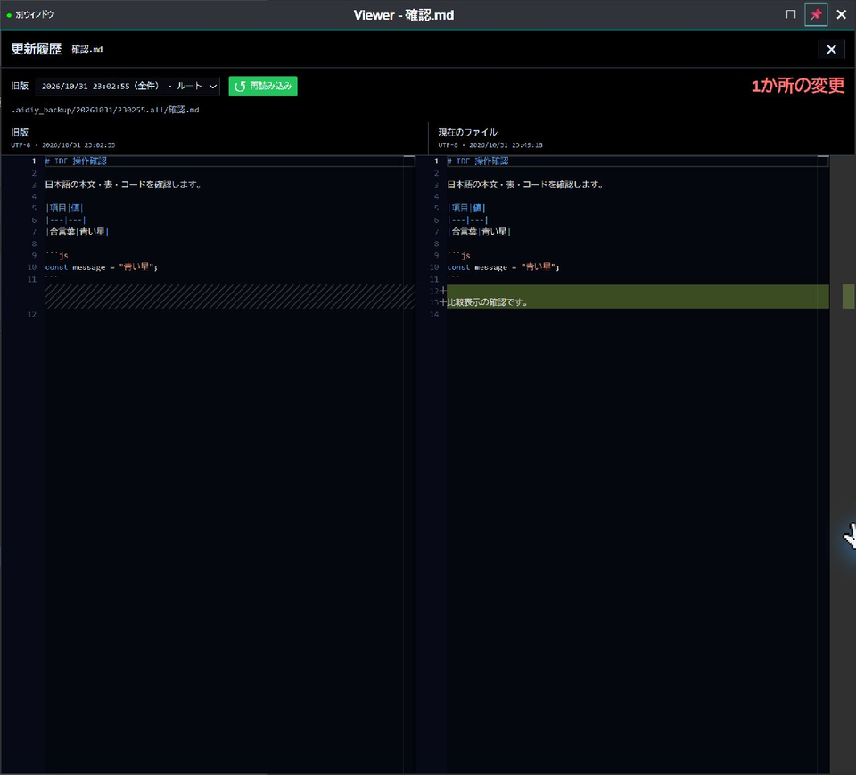

「旧版」の選択欄から別の既存保存版へ切り替えられます。選択後は旧版の日時と変更箇所数を読み直し、右側が同じ現在ファイルであることを確認します。今回の実画面では20:48:10版から19:01:23版へ切り替え、変更箇所数が8から12へ変わりました。この数は現在ファイルの更新により変わるため、固定の期待値にはしません。

比較窓をピンONで残したまま、本体のビューアで別の安全な文書を開いて並べられます。今回、右側に共通ナレーション方法の本文を表示し、本文をクリックしてからスクロールすると、左の比較日時・差分を保ったまま説明の続きを読めました。窓の境界と本文内のスクロールバーを区別し、比較と参照文書の双方の見出しが読める幅を先に整えます。

### 軌跡

左上の軌跡バーを開いて📌にし、「閲覧軌跡」「検索軌跡」「AiDiy検索軌跡」を選びます。各見出しで一覧を開き、項目または前後ボタンから対象へ戻ります。

前後ボタンだけを使う場合は、軌跡バーを開いた本体内の状態でも操作できます。安全な資料A、資料Bを順に開いて本文まで確認し、「閲覧軌跡」の「<」でA、「>」でBへ戻ることを、ビューア上部のファイル名・パスと本文の見出しで照合します。今回の実画面ではIDE操作編→Live操作編を開き、この往復を確認しました。エクスプローラーの名前を押してチェック選択だけが変わった場合は、ファイル種別アイコンから本文を開けることを確認してください。チェックが付いただけでは閲覧完了としません。

閲覧軌跡にはフォルダの出発点・到着点とファイルの項目が並ぶため、目的のファイルが下にある場合は軌跡内をスクロールします。安全なMarkdownを一度開いてビューアを閉じ、閲覧軌跡の同じパスを選ぶと本文を開き直せます。検索軌跡では検索語と一致ファイルを確認して選びます。今回のIDE操作編では、閲覧軌跡からは本文のプレビュー、grep検索軌跡からは検索語を強調したコードの該当行へ戻ることを確認しました。再訪時はファイル名・パスと表示内容を照合してください。

閲覧したファイルの一覧です。HTML・Markdown・Wordの3件が表示されています。

**図303：閲覧軌跡**

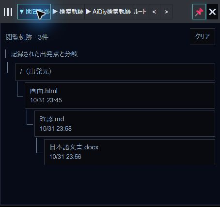

文字検索の軌跡です。検索文字と一致ファイルを確認して、検索した場所へ戻れます。

検索軌跡の「<」「>」は、現在の検索結果に含まれる前・次のファイルを開きます。異なる検索語の履歴を切り替えるボタンではありません。複数ファイルが一致する検索を準備し、検索軌跡の一覧で隣り合う安全な2件を確認してから往復します。今回のgrep検索では「操作ガイドとセルフテスト」で見つかったBrowser操作編とCode操作編を使い、一覧の選択・ファイル名・本文1行目の検索語強調が切り替わることを確認しました。本文読込が終わるまで、候補が選択されたことだけで表示完了と判断しません。

**図304：検索軌跡**

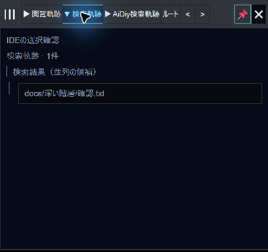

AiDiy検索の軌跡です。2件の関連ファイルと理由を一覧から確認できます。

**図305：AiDiy検索軌跡**

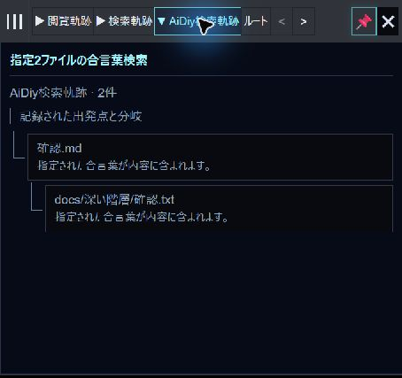

### Console

本体上部の「＋ Console」で開きます。タイトルの所属とプロジェクト名を確認します。端末は選んだ作業フォルダを起点に起動します。

実PowerShellのプロンプトと「Tools オンライン」が表示された独立窓です。この画面ではコマンド入力を行っていません。

**図306：Console独立窓**

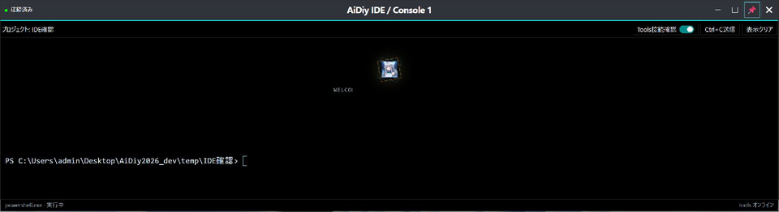

### Code

「＋ Code」で開きます。同じプロジェクトと接続状態を確認してから、モデルを選んで依頼を書きます。ファイルを渡す場合は、ビューアや右クリックメニューの「Code / Liveへ」で連携先を選び、「下書きへ追加」を押します。既存入力を保持して追加し、送信はCode側で行います。

IDE所属のCode 1を📌にした起動画面です。プロジェクト名、接続済み、選択モデルを確認しています。

**図307：Code独立窓**

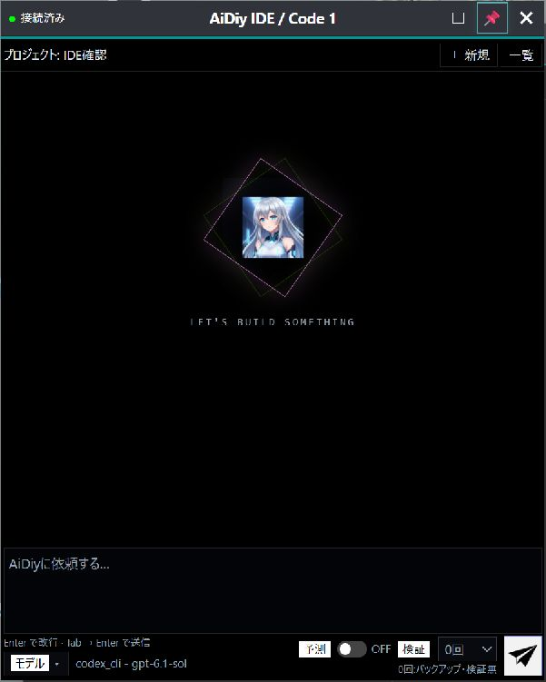

### TASK／TEAM連携

起動から確認する手順（Windows Electron版）:

1. IDEで対象のプロジェクトを選び、「AiDiy接続利用」で利用を開始します。Tools・Core・TaskTeamが利用可能であることを事前に確認します。オフライン利用ではTASK／TEAMの起動ボタンは表示されません。この手順だけを試すためにDBを新規作成したり、サービスを無断で起動したりしません。
2. IDE本体上部の「＋ TASK」を押します。起動中の表示が終わってから、「AiDiy IDE / TASK」、📌、IDEと同じ固定プロジェクトを確認します。起動直後はメインパネルのみで、フロー図・明細・編集窓は自動で開きません。
3. 同じ起動欄の「＋ TEAM」を押し、「AiDiy IDE / TEAM」、📌、固定プロジェクトを確認します。IDE連携では内部認証を利用します。認証に失敗した場合は正常起動とは扱わず、接続状態を確認します。
4. IDE本体を選び直しても連携窓が背面へ沈まないことを確認します。「＋ TASK」「＋ TEAM」を再度押したときは、それぞれ既存窓が前面へ戻り、窓が増えないことを確認します。TASKとTEAMは同時に利用できます。
5. VRの各画面用起動欄にも同じ「＋ TASK」「＋ TEAM」があります。こちらの導線を試す場合は、操作した画面と起動先を確認します。通常画面の成功だけでVR側も実機確認済みとは扱いません。
6. フォルダ変更不可の確認は、既存表示または保存せずに取り消せる編集画面で行います。AI実行・登録は不要です。終了時は今回開いた連携窓を閉じ、IDE終了を試す場合はユーザーの別作業がないことを確認します。

オンライン利用中に「＋ TASK」「＋ TEAM」を押すと、IDEの現在のプロジェクトに固定した別窓が📌状態で開きます。タイトルは「AiDiy IDE / TASK」「AiDiy IDE / TEAM」。既存の内部連携認証を使うため、単独起動のログイン画面は表示しません。フォルダ欄は変更不可です。TASKは最初にメインパネルだけを開き、フロー図・明細は各ボタンから表示します。

同じIDEで再度押すと既存窓を前へ出し、重複して作りません。IDEの終了では同じIDEから開いた連携窓も閉じます。別のIDEセッションや単独起動は独立して扱います。単独起動の「AiDiy TASK」「AiDiy TEAM」は通常ログインとフォルダ選択を維持します。

### Live

「＋ Live」で開きます。文字入力や参照ファイルの下書き連携ができます。会話や音声を使う場合はLive側で接続し、必要な音声操作を行います。

IDE所属のLiveを📌にした起動画面です。ここでは未接続で、音声出力・マイクはOFFです。本冊では音声入力を実施していません。

**図308：Live独立窓**

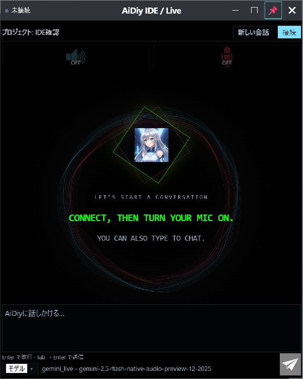

### Browser

「＋ Browser」で開き、表示するページへ移動します。タイトルでIDE所属の窓であることを確認できます。

Googleのページを表示したBrowserの独立窓です。ピンONの状態で、ページとアドレス欄が見えています。

**図309：Browser独立窓**

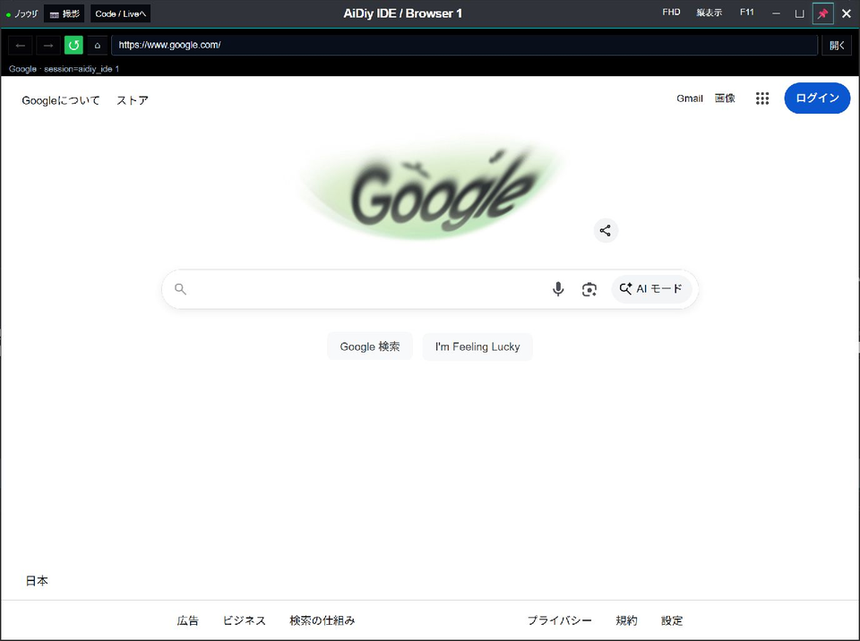

会話・音声・端末・ページの詳しい操作は、[Code操作編](セルフテスト,aidiy_code,操作編.md)・[Live操作編](セルフテスト,aidiy_live,操作編.md)・[Console操作編](セルフテスト,aidiy_console,操作編.md)・[Browser操作編](セルフテスト,aidiy_browser,操作編.md)を参照します。

### Office文書

Word・PDF・PowerPointは上部のページ番号と倍率、Excelは下部のシート名で切り替えます。Excelは保存済みの計算値を表示します。 Wordの文字が小さい場合は倍率を選び、拡大後の横スクロールも確認します。Excelの右側の列が見えない場合は表下部の横スクロールで確認し、シートを切り替えたらシート名と本文を照合します。

PowerPointでは、上部の「<」「>」でページを移動し、ページ番号とスライド本文の両方を確認します。「表示」の「幅に合わせる」は一枚の構成を見渡す表示です。倍率を指定するとパネル内に収まらない部分が生じるため、縦横のスクロールバーも確認してください。「幅に合わせる」に戻すと全体を確認できます。既存の `AiDiy概要.pptx` では、1/9から2/9への移動、100%への拡大、幅に合わせるへの復帰、1/9への戻りを読み取り専用表示で確認しました。

実演前には素材の本文・画像・外部参照を確認し、公開してよいページだけを使います。資料に書かれた古い構成や数値を、現行アプリの仕様として説明しないでください。初回読込を終え、対象ページを表示してから閲覧機能の説明に入ります。

日本語Word文書を独立ビューアで開いた例です。全2ページのうち1ページ目が表示されています。

**図310：Word独立窓**

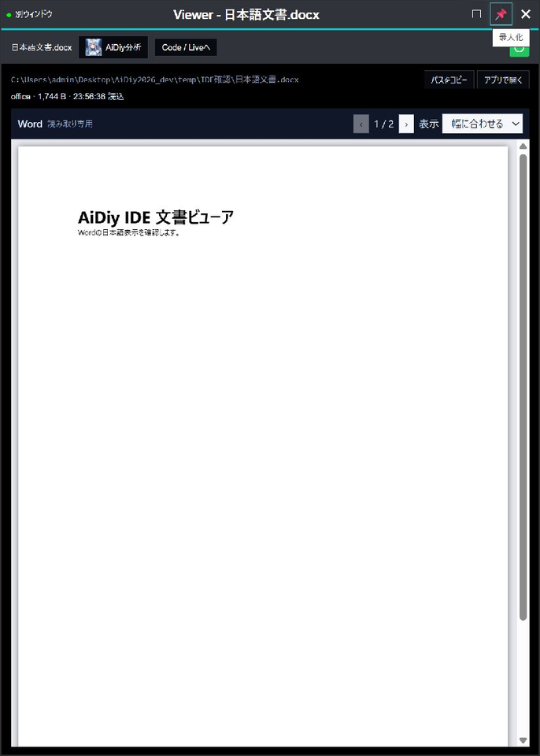

## 4. 終了

1. 画面内の「終了」（Webでは「利用終了」）を押すと、IDE所属の子窓を閉じて利用開始画面へ戻ります。
2. IDE本体を閉じる場合はタイトルバーの×を押します。確認画面の「キャンセル」で作業を続け、「終了する」でIDE全体を終了します。
3. システム全体の停止は[システム起動編](セルフテスト,aidiy_diag,システム起動編.md)を参照します。

利用中の終了確認です。取消では作業を続けられます。利用終了ではIDE所属の子窓を回収し、共有サービスは稼働を続けます。

**図401：終了確認**

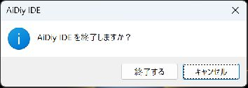

## 5. 追加テストと確認範囲

### 実施結果

| 対象 | 結果・確認方法 |
|---|---|
| Node自動試験 | `frontend_ide/checks/*.test.mjs` と `frontend_ide/viewer/checks/*.test.mjs` を実行。**1,161件成功、失敗0件、取消0件。** 列挙1,169件のうち8件はスキップ。別途リンク権限を要する9件を実行対象から除外しています。 |
| 環境による対象外 | リンク作成権限不足14件（除外9件＋スキップ5件）、Linux専用2件。実行成功には数えません。既定でスキップされた実Electron PDF描画1件は、下記の専用実行で確認しました。 |
| Markdown PDF | `AIDIY_TEST_PDF_RENDER=1` で `markdown-pdf.test.mjs` を実行し、9件成功。日本語・表・相対画像の実Electron描画、失敗時の既存PDF保持、同名フォルダ拒否を確認。全体試験と重複するため件数を合算しません。 |
| Office | `check-office.mjs` 成功。Wordの日本語・2ページ、Excelの保存済み値3600・3シート・結合セル・205行・CSV、PDF／PowerPointのページ・倍率・縦横、破損文書から正常文書への復帰を確認。 |
| HTML・SVG | `check-preview.mjs` 成功。相対画像・CSS・モジュール・外部SVG参照、IDEからの分離、コード切替、再読込を確認。 |
| ファイル操作 | `check-explorer-menu.mjs` 成功。作成・コピー・貼付け・複製・改名・重複名拒否・削除の取消と確定。ゴミ箱は専用一時フォルダへの移動で模擬しています。 |
| Explorer操作シナリオ | `check-explorer-multi.mjs` 成功。Web別窓で通常クリック、Ctrl追加、同一階層のShift範囲の拡大・縮小、親から下位ファイルへのShift、チェック欄・Spaceでの付け外し、チェック欄からのCtrl+C、取得停止と再開を確認。同じ2件を2回コピー・貼り付けし、別名と本文を照合。2件削除の取消と確定、対象外ファイルと親フォルダの保持、階層をまたぐCtrl追加とコピーも確認。ゴミ箱は専用一時フォルダへの模擬移動です。 |
| Explorer関連自動試験 | 操作・一覧・移動・更新監視・実Vue部品・窓の寿命・パス境界の関連試験214件成功、失敗0件。Linux専用2件は未実施。階層をまたぐ個別ファイルのコピー・削除、親子重複の拒否、部分成功時の結果表示、一括PDFと下書き参照も確認。全体試験とは件数を合算しません。 |
| 更新時の選択保持 | `space-mode`・`navigation-parity`・`explorer-navigation`・`folder-monitor` の関連試験129件成功。ツリー書換えによる追跡通知がなく、新しい最終更新だけを通知すること、同じ更新の重複通知がないことを確認。2D／3Dの一時欠落・削除確認、確認中の選び直し・閉じる、取得失敗、走査上限での保持も確認。全体試験と重複するため件数は合算しません。 |
| Web別窓 | `check-panel-pins.mjs` 成功。80件の検索結果、条件・スクロール・未送信入力を保持。窓を開けない場合の元表示保持、再読込・復帰・再分離、連打で1窓、親終了時の子窓終了を確認。 |
| 接続断・復帰 | `check-connection.mjs` 成功。隔離した接続先で10秒周期の確認、切断検出、セッションを保持した再接続を確認。共有サービスを停止した試験ではありません。 |
| 検索 | 時刻検索で9件を表示。grepは「IDEの選択確認」の1ファイル1件と、別条件の2ファイル3行を確認。実AIへの依頼から結果保存まで成功し、指定したMarkdownと深い階層のテキストを取得。検索一覧の収納・展開、検索履歴の表示も確認。 |
| 版比較 | `check-file-history.mjs` 成功。読込失敗からの再試行、版切替、左右差分、両方向の同期スクロール、縦長表示、読み取り専用、終了時の解放を確認。10分の保持期限は模擬時計で確認しています。 |
| 下書き連携 | 実WebのCodeとLiveで既存入力の保持と参照ファイルの追加に成功。AIへ自動送信しないことを確認。連携先選択・競合・配送拒否はNode試験に含みます。 |
| Electron起動・終了 | Code・Live・Console・BrowserをIDEから起動。プロジェクト、Consoleの実PowerShell、Browserのページ表示を確認。終了取消で作業継続、利用終了で子窓を回収、開始画面から本体終了を確認。 |
| VR・表示切替 | 実ElectronでExplorer・軌跡・Viewerの3窓、Code・Live・Consoleの3窓をVR中に表示。本体を選び直してもピンONの窓を手前に維持し、F11で復帰。Electronの2D基本画面、Webの3D基本画面と2D／3D切替・ファイル保持も確認。 |

### 対象外・未確認

必須対象はWindowsです。Mac／Linux実機と長時間連続運転は **PASS（環境依存・判定対象外）** とし、未実施です。自動試験の成功件数には含めません。

複数物理画面、全ファイル形式・全AIモデルは未確認です。音声入力は本冊の確認範囲外です。Liveの会話と音声の判定はLive操作編を参照します。

### 長押しドラッグの実機確認（2026-11-02）

Windows実機で `mouse_long_press_drag`（保持0.8秒、移動0.6秒。Browser全画面は移動0.8秒）を使用。直前の画面から対象を同定し、移動後の実画面とOSの窓位置を照合します。入力欄・ボタンの除外判定は下記の実施対象に限定します。位置は画面座標の (x,y) です。

標準窓、独立Explorer・Viewer・軌跡バーの移動を実機確認。Viewerのコード本文、Explorerの日時入力では窓が動かない。軌跡バーの閲覧軌跡ボタンは実装上の移動許可対象で、長押し移動ではクリックしない。通常 mouse_drag のタイトル移動も成功。最大化中の背景長押しでは移動せず、復元で (20,25,1885,988) に戻る。VR中は本体外枠を固定したまま銀河中心が約 (60,40) 移動し、F11で元の窓位置・寸法へ復帰。比較独立窓はタイトルへの長押し入力で (40,124) → (58,88) に移動。本文・再読込ボタンでは移動しない。修正前はファイル履歴の role="dialog" により比較背景全体が除外されていた。非モーダルの独立比較sectionだけを明示的な移動面とし、修正後は背景 (40,124) → (80,164) の長押し移動に成功。版選択欄とMonaco本文では位置不変を確認し、解放後の通常終了も成功した。実際のモーダルと操作部品の除外は維持する。タイトル移動とは別に背景移動を確認した。VR子窓は Explorer (40,124) → (100,164)、軌跡 (525,124) → (585,164)、独立Viewer (1023,10) → (963,50) と移動。日時入力・コード本文・ピンボタンでは移動せず、解放後にF11で通常表示へ戻り、全子窓と本体を通常UIで終了。複数物理画面は機器前提がなく未実施。

解放後にポインターを離して追従が残らないこと、通常UIが使えることを確認。Diag以外の今回起動した窓は通常UIで終了しました。1〜2pxの寸法丸めは補正を追加していません。全セルフテストの再実行や、未実施モードの合格を意味しません。

### IDE連携・単独起動の追加確認（2026-11-02）

再確認用チェック（下記の過去結果と、今回実施する結果を分けて記録）:

| 確認対象 | 操作・期待結果 |
|---|---|
| 実際の起動導線 | IDE上部の「＋ TASK」「＋ TEAM」から各窓を開く。直接コマンド起動だけではこの項目を完了にしない。VRの起動欄は別に確認する。 |
| 起動状態 | TASKはメインパネルのみ。両方とも指定のIDE連携タイトル、📌、内部認証による表示となる。単独起動の通常ログインと混同しない。 |
| プロジェクト固定 | IDEのプロジェクトと一致し、フォルダ欄・参照操作から変更できない。IPC/APIの更新拒否は関連fixtureで確認し、UI試験だけで保証しない。 |
| 窓の再利用と前後関係 | 起動ボタンの連打・再押下・最小化後の再押下で同じ窓を使用。TASKとTEAMは互いを妨げず、IDE本体の選択後も背面に沈まない。 |
| 終了と分離 | IDEの終了で所属する連携窓を閉じる。別IDE・別プロジェクト・単独起動を黙って流用せず、他の作業を終了しない。 |

2026-11-02のsetup後の再実演では、利用者承認後に5サーバーを起動し、DiagミニのIDEボタン→「AiDiy接続利用」→IDE上部の「＋ TASK」「＋ TEAM」の実操作で起動しました。両窓の内部連携・接続済み、指定タイトル、📌、同じプロジェクトの「変更不可」表示を確認。TASKはメイン1窓のみで開始しました。IDE本文を選択しても両窓は手前に残り、各起動ボタンの再押下では同じOS窓ハンドルを再利用しました。今回の確認は再押下であり、連打・VR起動欄・IPC/APIからの変更拒否は再検証していません。新規編集・登録・AI依頼は行っていません。終了時はTEAM・TASK・IDEを通常UIで閉じ、Diagミニだけが残ったことと5サーバーのHTTP 200を確認しました。

IDE連携TASK／TEAMの内部認証、指定タイトル、📌開始、起動元プロジェクト固定、起動ボタン連打で同じ窓の再利用をWindows実機で確認。TASKは初期メインのみ、TEAMは通常空間表示。両方の新規編集で固定フォルダとモデル一覧を確認し、登録せず取消した。TASKのreadonly欄への貼り付けで値は不変。TEAMの最小化後も起動ボタンで同じ窓を復帰。IDE本文を選択しても連携窓は背面に沈まず、IDE終了で所有する両窓が閉じた。

単独TASK／TEAMは通常ログイン、正しい単独タイトル、同じプロジェクトへの再起動要求で既存窓を再利用することを確認。単独TASKのログイン後はメイン1窓、編集のフォルダ選択・参照は有効。内部サービス主体をadminに置換しない。内部トークンは画面・URL・storageへ渡さない。

関連fixture46件成功（窓所有/終了確認9、Task窓10、プロジェクト/資格情報3、proxy8、UI8、pin8）。Core認証は36実行中33成功・POSIX3スキップ、TaskTeam認証9成功。型確認と局所buildは終了コード0。複数IDE・異なるプロジェクトの分離と不正なフォルダ更新拒否はfixture確認で、実データ登録・AI実行は今回未実施。

2026-11-02 09:09 JST 最終確認: IDE終了確認は📌TEAMより前へ表示。取消でIDEのピンOFFとTEAMの前面状態を復元し、再度終了で両窓が閉じた。自分のTASK/TEAM/IDE試験窓は全て通常終了。Diagミニとユーザー別作業を維持。09:09:28に5サーバー全てTCP OK/HTTP200。

### 異なるIDEプロジェクトのTASK分離（2026-11-02追加実機）

ルートcwdから `aidiy_ide --project "C:\Users\admin\Desktop\AiDiy2026_dev"` と同じコマンドの `docs` サブフォルダ指定で別IDEを起動し、双方の実際の「＋ TASK」を操作しました。内部接続済み・📌・メインのみのTASKが別窓となり、固定フォルダはそれぞれルート／docs（変更不可）で一致。ルートIDE PID2472・TASK hwnd5702808、docs IDE PID2040・TASK hwnd10095244でした。docs IDEの通常終了でdocs TASKのみ閉じ、最小化中のルートIDEとルートTASKが残ることを窓一覧と画面で確認。ルートIDEを復元して通常終了し、所属TASKも終了しました。登録・AI送信・設定保存はありません。docs側TASK再押下も行いましたが、再押下直後のハンドル再採取はなく、その部分の追加証拠にはしません。TEAMの複数IDE分離は今回未実施です。Nanami1.2の開始／結果／整理音声を直列再生しました。

### 複数IDEのTEAM分離（2026-11-02追加実機）
ルートcwdからルートとdocsをそれぞれ--project指定して正式aidiy_ideを起動。双方の「＋ TEAM」から接続済み・📌・変更不可の固定先を実画面確認しました。rootはPID20220/hwnd18550284、docsはPID20552/hwnd11340582で独立。docs側の再押下後も両ハンドルと窓数は不変。docs IDEだけを通常終了するとdocs TEAMだけ閉じ、root TEAMを復元して接続とroot固定先の保持を確認しました。その後root IDEの通常終了で所有TEAMも回収。登録・送信・既存データ変更なし。Nanami1.2の説明を事前合成し直列再生。これは窓/固定先/所有終了の確認で、別プロジェクト間の全DBデータ隔離を保証する試験ではありません。

### IDE連携ブラウザの追加実機確認（2026-11-02）

プロジェクトルートを作業ディレクトリとして `aidiy_ide --browser --project C:\Users\admin\Desktop\AiDiy2026_dev` を起動。ルートの frontend_ide/viewer/launch.mjs 経由でChromeアプリ窓が開き、Electronではないことを確認しました。プロジェクト表示、AiDiy接続利用後の接続済み、Codeの画面内タブと接続済み、Liveの画面内タブと同一プロジェクト・未接続・マイクOFFを目視確認。Code→Liveの再選択で新しい独立窓を作らず切り替わりました。

利用終了で未接続の利用開始画面へ復帰し、ブラウザを通常終了。ブラウザ終了後に残った今回専用のIDEホストPID25016のみを停止しました。追加AI送信・Live接続・マイク利用なし。この結果は画面内連携と終了の試験で、Live会話応答の新たなPASSではありません。5サーバーはTCP接続可・HTTP200、Diagミニを維持しました。

### Word・Excelの追加実機閲覧（2026-11-02）

既存JSZip/SheetJSで個人情報・マクロ・外部参照なしの試験素材2点をtempに作成し、ルートcwdから正式CLI `aidiy_ide --project "C:\Users\admin\Desktop\AiDiy2026_dev\temp\office-review-20261102"` で起動しました。IDEのオフライン利用を選び、実マウスでファイルを開いて確認しました。Wordは日本語見出し・本文、1/2→2/2→1/2、幅に合わせる・150%・75%の表示を確認。Excelは日本語の一覧と数量3/2・単価120/150・金額360/300、横スクロール、集計シートの合計660、一覧への復帰を確認しました。

WordからExcelへの切替、ビューアを閉じる、利用終了、IDE本体終了まで実施。Office本体や新規ソフトの導入、外部への文書送信、AI依頼、既存ユーザー資料の変更はしていません。Nanami速度1.2の4音声を直列再生しました。これは最小素材の閲覧試験で、数式再計算・全Office形式・大容量文書の合格を意味しません。再現用の2ファイルは結果台帳のtest-assets/officeへ保持しました。

### コピー・ごみ箱・一括PDFの追加実機確認（2026-11-02）

ルートcwdの正式CLIから、今回作成したtemp内の専用素材フォルダを指定してIDEをオフライン起動しました。実マウス／キーボードでTXTをコピー・貼付けし、元と「コピー」付き別名の内容・SHA-256一致を確認。削除確認のキャンセルではコピーが残り、再確認後の「ゴミ箱へ移動」ではコピーだけが消え、Windowsごみ箱の同名・同じ元フォルダの試験項目1件を確認しました。元ファイルは保持。完全削除へ切り替えない実装も事前確認しました。

専用出力フォルダ内のMarkdown2件をチェックし、「全てPDF化」を1回実行。2件生成の表示と同フォルダのPDF2件を確認し、IDEビューアーで各1ページ、日本語の見出し・本文・箇条書き、表の数量3・合計660を目視しました。最初のチェックで件数欄が挿入されるため、2件目の行位置を再確認します。準備中の自己フォルダコピーは拒否され、対象ファイルを再同定して進めました。

Nanami速度1.2の4音声を直列再生後、ビューアー・利用セッション・今回のIDEを通常終了しました。既存ユーザーファイル、業務データは変更せず、外部AI送信もありません。最小素材と結果は結果台帳のtest-assets/explorerおよびexplorer-file-results.jsonに保持。この結果は専用素材の実機試験であり、過去の模擬ごみ箱試験や全ファイル操作の合格とは区別します。

### 通常のAiDiy検索と参照照合

プロジェクトルートを作業ディレクトリにして `aidiy_ide --project C:/Users/admin/Desktop/AiDiy2026_dev` を起動し、「AiDiy接続利用」から検索しました。検索内容は「IDEからTASK／TEAMを起動する手順が載ったセルフテスト文書」。プロジェクト全体と通常の共有文脈・利用者プロフィールの利用を承認された条件で、通常のHermes経路を使用しました。ソース・認証設定は変更していません。

検索依頼は1回です。方式は `aidiy_hermes` → `openai-codex`、実モデルは `gpt-6.1-terra`。エージェント内部のモデル呼出しは7回でした。関連するIDE・TASK・TEAM操作編の3件が返り、パスと選定理由を元文書に照合しました。IDE操作編を結果から開き、「TASK／TEAM連携」の固定プロジェクト、指定タイトル、📌開始の記載を確認。「履歴」の検索名を選び、同じ3件を再表示できました。

確認結果は、依頼受付・3件の結果表示・参照先と理由の一致・本文表示・履歴再表示が成功です。プロジェクト全体のファイル走査にはタイムアウトがあり、全ファイルを網羅した検索の合格とはしません。通常の単発実行では一部のスクリプトコマンドが保護機能で拒否されましたが、保護設定は変更せず、結果ファイルの保存と表示は完了しました。検索結果が得られたことと、走査の網羅性を分けて判断します。

Nanami速度1.2の4音声を事前生成して直列再生しました。検索の待ち時間は約4分。結果の保存を待ち、同じ依頼を再送しません。試験IDEを通常終了し、Diagミニと5サーバーを維持します。これはこの検索条件の実機確認であり、全85章の合格を意味しません。

## 証拠照合と残る確認

2026-11-03の文書・既存証拠照合です。新しい実機試験ではありません。

- **確認済み**：第5章の実機・隔離試験表と各図を維持します。後続のOfficeは[結果](evidence/_work_records/selftest-20261102/office-view-results.json)、コピー・ごみ箱・一括PDFは[結果](evidence/_work_records/selftest-20261102/explorer-file-results.json)、通常AI検索は[IDE_204](evidence/.aidiy_cache/selftest/セルフテスト,aidiy_ide,操作編/IDE_204_AiDiy検索.json)で確認済み。TASK/TEAMのUI起動・固定プロジェクト・複数IDE分離、--browser画面内タブは後半の2026-11-02記録を採用します。
- **残る確認・限界**：検索結果3文書の参照整合は成功で、走査タイムアウトによる全件網羅は未確認です。網羅性を理由に正しいソースを変更しません。リンク作成権限不足14件・Linux専用2件は第5章の環境制約で、成功数に含めません。複数物理画面・全形式・全モデルは本来の限界で、新規の必須組合せにしません。

### 現行の判定（文書順再照合）

- **確認済み**：Office閲覧、コピー/ごみ箱/一括PDF、通常AI検索参照一致、TASK/TEAM連携済み。
- **本当に残る確認・範囲**：検索全件網羅は走査タイムアウトで未確認。リンク権限不足14件・Linux専用2件は環境制約。追加網羅試験は作らない。
- **証拠の扱い**：上記の本文・図・参照結果を照合。先行調査の未実施/拒否/準備失敗は当時の記録であり、後続の成功や実施不要指定を優先します。今回の文書整理を新しい実機PASSには数えません。
