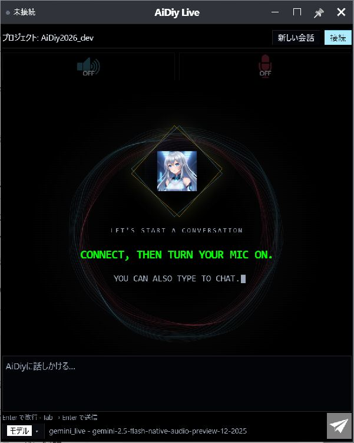
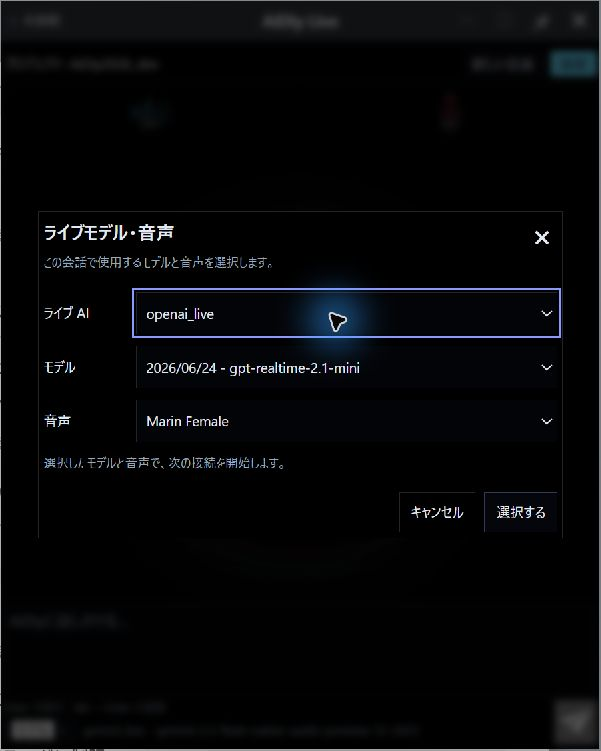
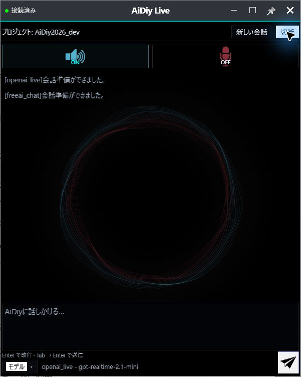
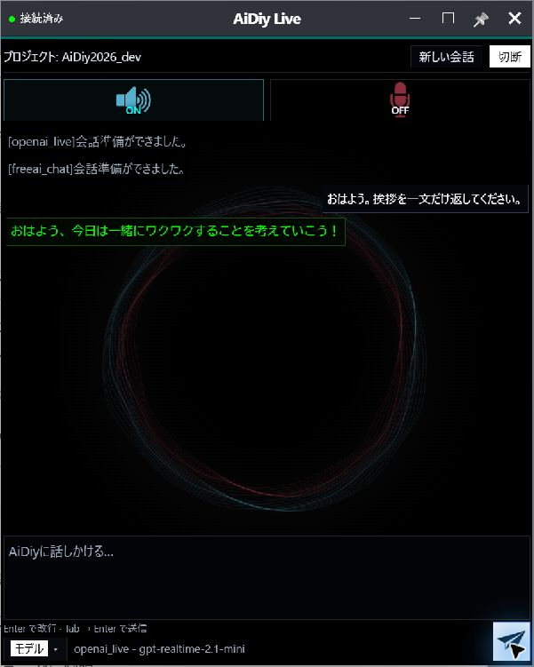
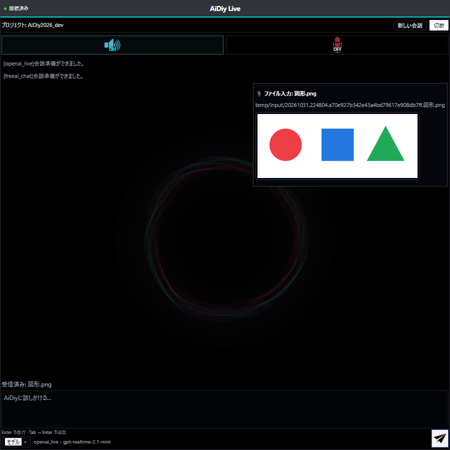
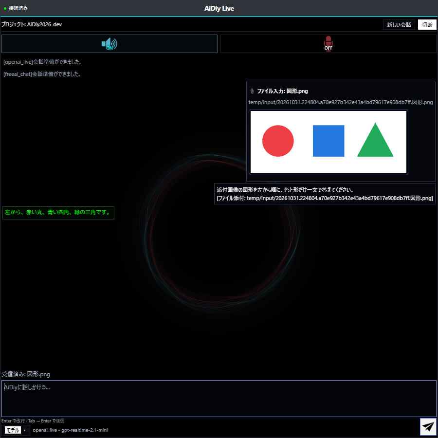
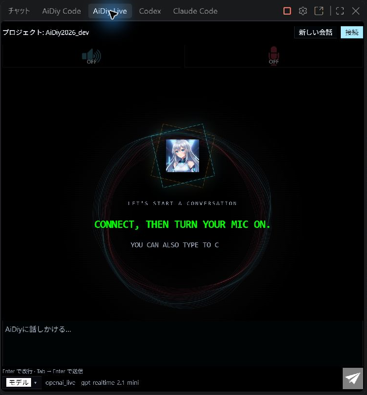
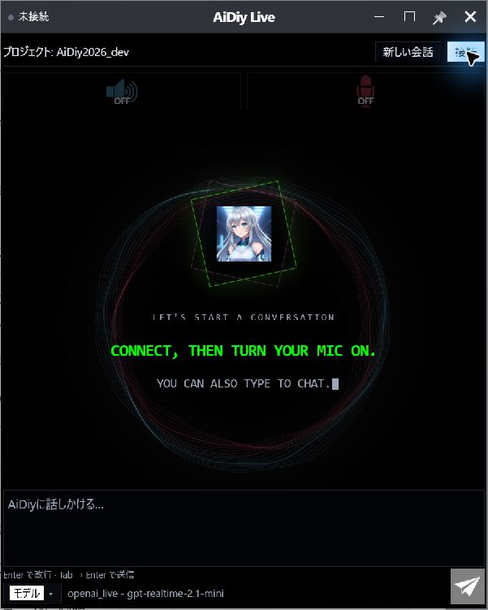

# Live 操作編 — 操作ガイドとセルフテスト

> 確認範囲：本文には過去の実機・自動試験結果と今回の追補を含みます。今回の実施状況は[確認結果](セルフテスト,共通,確認結果.md)の章別台帳を参照してください。今回の全章再実行・全条件合格を示すものではありません。

## 総合評価

**総合評価：✅ OK（記載した確認範囲）。** Gemini・OpenAIの挨拶への実回答と音声データ、OpenAIの画像添付を確認しました。FreeAIの実応答とGemini／FreeAIの画像認識は成功未確認ですが、全providerの追加試験を必須残件にはしません。実マイク入力と人による音声聴取は未テストです。

前半は起動から終了までの操作ガイド、最後の章は追加テストと確認範囲です。図番号は章番号と掲載順を表し、試験ケースIDとは区別します。

## 始める前に

[システム起動編](セルフテスト,aidiy_diag,システム起動編.md)で必要なバックエンドを起動し、[ランチャー編](セルフテスト,aidiy_diag,ランチャー編.md)からアプリを開きます。単独起動コマンドは `aidiy_live` です。接続先と作業フォルダを確認します。音声を使う場合は入力・出力機器も確認します。

### 単独ブラウザ版（--browser）の前提と起動

Electron窓ではなく通常のブラウザへ同じ単独アプリを表示する方式です。通常Webの8090、Avatar Webの8092、VS Code拡張、IDE連携とは別に確認します。Node.js、frontend_ideのVue配布物、hostのCode／Live配布物、対象の実在フォルダ、通常のCore接続・内部認証の準備が必要です。認証値をURLへ手入力したり表示したりしません。

PowerShellで最初に作業ディレクトリを指定し、その下の起動コマンドのどちらか一方を実行します。登録済みコマンドの解決先もこのチェックアウトのhost入口であることを確認します。

```powershell
Set-Location "C:\Users\admin\Desktop\AiDiy2026_dev"
aidiy_live --browser --project "C:\Users\admin\Desktop\AiDiy2026_dev"
node frontend_ide/launch.mjs --app live --browser --project "C:\Users\admin\Desktop\AiDiy2026_dev"
```

位置引数でもフォルダを指定でき、省略時は実行したフォルダを使います。ポートは自動割当で、起動時に表示されたURLを使います。8090／8092を代入しません。WindowsではChrome／Edgeのアプリ表示になる場合もあります。`aidiy_browser`（Electron専用の閲覧アプリ）を起動する指定ではありません。

根拠は `frontend_ide/launch.mjs`、`viewer/launch-options.mjs`、`viewer/panels.mjs` と `host/aidiy_live/launch.mjs` です。2026-11-02の文書整備では現在の `aidiy_live --help` で引数を確認しました。実機試験の結果と未確認範囲は末尾の --browser実機試験に記載します。

## 1. 起動・モデル選択・会話

1. Diagの「アプリ起動」でLiveを開き、プロジェクト名を確認します。
2. 下部の「モデル」を押し、「ライブ AI」「モデル」「音声」を選びます。未接続の状態で「選択する」を押します。
3. 「接続」を押し、「会話準備ができました。」の表示を待ちます。
4. 準備完了から15秒待ち、「おはよう。挨拶を一文だけ返してください。」と入力して送信します。返答は最大60秒を目安に確認します。

単独Electronの起動画面です。接続前はマイク・スピーカーともOFFで、プロジェクト名と文字入力欄を確認できます。

接続前の画面確認では、左上の「未接続」、上部のプロジェクト名、スピーカー・マイクの「OFF」を読みます。下部の「モデル」から「ライブモデル・音声」を開くと、「ライブ AI」「モデル」「音声」の3項目を確認できます。変更しない場合は「キャンセル」で戻り、未接続と音声OFFが維持されていることを確認します。設定画面を開くことと、「接続」で会話を始めることは別の操作です。

「ライブ AI」は利用方式、「モデル」は会話に使うモデル、「音声」はその会話用の声です。操作ガイドを読むナレーションの声とは別設定です。VS Code版では、対象フォルダを開いてから同じ3項目を確認できます。キャンセル後はプロジェクト名、「接続」ボタン、スピーカー・マイクのOFFを目印にし、会話開始と取り違えません。

テキストだけで応答を確認する場合は、接続後にもスピーカーとマイクの状態を確認します。接続時にスピーカーがONになる場合は、送信前にOFFへ戻します。2026-11-02のVS Code版実機では、`gemini_live / gemini-2.5-flash-native-audio-preview-12-2025`へ接続し、「おはよう。挨拶を一文だけ返してください。」を1回送信して「おはようございます。」の確定表示を確認しました。マイク・スピーカーOFFでのテキスト応答確認であり、音声の試聴テストではありません。

短い会話の確認では「おはよう」だけでも送信できます。Enter単独は改行なので、右下の紙飛行機ボタン、または画面に表示されたTab → Enterで送信します。スピーカーON・マイクOFFを確認し、会話欄の自分の入力と実回答を見比べます。2026-11-01の実演では、既存のGemini Live接続で「おはよう」を1回送信し、挨拶とプロジェクトについての問いかけが返ることを実画面で確認しました。回答文は毎回同じとは限りません。ナレーションの段取りは[共通手順](共通,セルフテスト解説・ナレーション方法.md)を参照します。

**図101：Live起動画面**



ライブ AIを `openai_live`、モデルを `gpt-realtime-2.1-mini`、音声を `marin` に選びました。

**図102：OpenAIモデル選択**



接続済みと準備完了の表示を確認しました。スピーカーON・マイクOFFで文字を送信します。

**図103：接続準備完了**



「おはよう、今日は一緒にワクワクすることを考えていこう！」という正式回答を確認しました。送信から60秒以内に回答を表示し、マイクはOFFのままです。

**図104：OpenAI初回応答**



### --browserでの画面・接続・短い応答の確認

1. 専用端末から前述のコマンドを実行し、表示されたURL、対象プロジェクト名、Code／Liveの種類を照合します。既存ブラウザの別作業は閉じません。
2. モデル情報・接続状態を確認します。単独版ホストは既存の内部認証を利用します。通常Webのログイン成功やVS Codeの成功を、この形態の認証成功へ読み替えません。認証できない場合は送信せず、表示と接続先を確認します。
3. モデル・会話用音声を確認して「接続」。準備完了後15秒待ち、マイク・スピーカーをOFFにして、送信が許可された試験でのみ「おはよう。挨拶を一文だけ返してください。」を1回送ります。確定した文字回答を確認し、実マイク・音声聴取の成功とは分けます。
4. 応答が不明な場合は再送せず、接続表示と会話欄を確認します。第4章の終了手順までを同じ実行形態で記録します。

## 2. 画像を添付する

1. OpenAIのLiveへ接続し、準備完了から15秒待ちます。
2. 画像を入力欄へドラッグ＆ドロップします。ドロップした時点でCoreへ送信されます。
3. 会話欄の「ファイル入力」、画像プレビューと「受信済み」の表示を確認します。
4. 画像の内容について質問し、正式回答を画像と照合します。

Web版で `openai_live / gpt-realtime-2.1-mini / marin` に接続し、PNGのドロップイベントから通常の添付処理を確認しました。OSの窓間ドラッグは確認範囲に含めません。

**図201：OpenAI画像添付（Web版）**



「添付画像の図形を左から順に、色と形だけ一文で答えてください。」と依頼し、「左から、赤い丸、青い四角、緑の三角です。」という回答を確認しました。画像の色と形が一致しています。

**図202：OpenAI画像への実回答（Web版）**



画像認識は確認済みのOpenAI経路を利用できます。FreeAIが利用枠等で応答しない場合、OpenAIが利用可能なら通常設定で切り替え、必要な再接続後にテキストで確認します。利用枠超過は利用者の推定で、確定原因とはしません。Gemini／FreeAI画像の追加再現調査を必須残件として引き継ぎません。「未対応」や成功とも断定しません。

## 3. VS Code拡張で使う

VS Codeでは、先にプロジェクトフォルダを開きます。未選択時は入力欄のすぐ上に赤字で「先にプロジェクトフォルダを開いてください」と表示され、入力・送信・接続・モデル操作を無効にします。「フォルダを開く」から実在するローカルフォルダを選ぶと、案内が消え、通常の認証・接続条件を再評価します。単一ファイルを開くだけでは対象フォルダの選択になりません。フォルダを閉じると再び操作を抑止し、切替時は古い接続を引き継ぎません。単独Electron版の起動方法は変わりません。

VS CodeのLiveビューを開き、プロジェクト・モデルと入力領域を確認します。CodeとLiveを導入した構成で表示を切り替え、実Webviewの外周枠と操作領域を確認しました。下の画面では未接続で、マイク・スピーカーをOFFにしています。拡張からの音声入力・AIの実回答を確認した画面ではありません。

Live拡張の入力・接続操作ができる画面です。

表示の入口は `Ctrl+Shift+P` → `AiDiy Live` →「AiDiy Live: ライブ会話を開く」です。「専用ウィンドウで開く」とは別の導線で、VS Codeの右側にビューを表示します。画面を開いたことと、会話接続が成功したことを区別します。

2026-11-02の表示紹介では、プロジェクト未選択の空ウィンドウでLiveビューと入力領域、マイク・スピーカーOFFを確認しました。一方で「ローカル Core の内部認証を利用できません」という案内が出たため、正常接続の実演とは扱いません。接続ボタン、音声入力、メッセージ送信は操作せず終了しました。同時点のCoreを含む5サーバーはTCP接続・HTTP 200で、サーバー停止とは区別しています。現行の内部認証処理は拡張配置先とワークスペースを探索起点にするため、空ウィンドウでの結果を、対象プロジェクトを開いた状態の結果へ一般化しません。

同日の切り分けでは、対象の `AiDiy2026_dev` フォルダをVS Codeで開くと、内部認証エラーが消え、プロジェクト名とモデル名が表示されました。サーバー再起動・設定変更・鍵の変更は不要でした。紹介前に対象フォルダをワークスペースとして開きます。単一ファイルを開くだけではワークスペースフォルダになりません。この確認はモデル情報の取得までで、Live会話の接続・音声送受信の成功を意味しません。

**図301：VSCodeLive**



## 4. 切断して終了する

会話を終えたら「切断」を押します。モデルを替える場合は切断後にモデルを選び直し、接続します。単独版では窓を閉じます。

単独ElectronとWeb版で切断を確認しました。切断後は「未接続」になり、接続ボタンへ戻ります。スピーカー・マイクともOFFです。切断では会話表示が初期画面へ戻るため、必要な回答は切断前に確認します。

**図401：切断後画面**



確認後はモデル・音声を試験前の選択に戻し、試験用のWeb画面・単独窓・VS Codeを終了しました。接続中の「変更して再接続」は確認対象に含めません。

### --browserの終了確認

応答待ちでないことを確認し、Liveは先に「切断」して未接続へ戻します。今回開いたブラウザ窓／タブだけを閉じ、起動に使った専用端末でCtrl+Cを入力して、この単独版の配信プロセスを終了します。ブラウザを閉じただけで現行の外側配信プロセスも停止するとは断定しません。起動時の自動割当ポートが閉じたことと、Core等の共有サーバーが維持されることを確認します。別端末やサーバーへCtrl+Cを送らないでください。

## 5. 追加テストと確認範囲

### モデルと実行方式

| 対象 | 結果と条件 |
|---|---|
| OpenAI・単独Electron | モデル選択、接続、準備完了後15秒待機、文字による初回送信と正式回答、切断・終了を確認しました。 |
| OpenAI・Web版 | マイクOFFでPNGを送信し、図形の色と形に合う実回答を確認しました。 |
| Gemini・補助確認 | 実Electronで `gemini_live / gemini-2.5-flash-native-audio-preview-12-2025 / Zephyr` を選択し、準備完了から15秒待機して初回送信しました。「おはようございます。」の実回答と音声データを確認しています。 |
| FreeAI | Liveの実応答は未確認です。別のモデルの成功をFreeAIの成功へ読み替えません。 |
| VS Code | Liveのみ・Codeのみ・両方の3構成で外周枠と操作領域を確認しています。図301は両拡張導入時の未接続画面です。 |

OpenAIの応答経路には `conversation.item.added` / `conversation.item.done` の未知イベント警告が記録される条件があり、文字応答の成立と分けて確認する対象です。

### 音声データと再生

| 対象 | 結果と条件 |
|---|---|
| Liveの正式回答と音声出力（406） | 通常AIコアへ本番のLiveConnectionで接続し、正式回答と43音声パケット（156,800バイト）を受信。さらに実Electronで本番LiveAudioを用い、133パケット（329,600バイト）を再生し、Analyser出力レベルの最大値1を確認。人による聴取確認ではなく、実再生APIと出力信号の確認。 |
| 実マイク入力（406） | WinMMの入力デバイス0台、出力デバイス1台。実入力・音声認識は環境制限のため未テスト・判定対象外です。マイクOFFのまま文字入力で確認しています。模擬入力の成功と混同しません。 |

### 共通処理と未確認項目

Code／Live添付16件、共通添付9件、入力ファイル保存8件の成功結果を共用し、両冊子で二重集計しません。他形式・上限・送信途中切断・Web再表示時のマイク状態をすべて実画面で確認した判定ではありません。

次の表は確認条件と期待結果です。405全体の合格を示す表ではなく、406の実結果は上記の機器条件・再生結果に限ります。音声入力は環境制限のため未テストです。

### 接続・入力の確認項目

| ID | 操作 | 期待結果 |
|---|---|---|
| 405 | Liveのモデル再接続失敗と復旧、Webパネル非表示・再表示 | 再接続失敗で会話・下書きを失わない。非表示時のマイク停止と再表示時の状態を確認し、意図せず録音を再開しない。 |
| 406 | 現在の入力機器で音声入力し、音声応答を確認 | 入力・返答を別々に確認する。音声認識、再生API、人の聴取のどれで確認したか明記する。機器不足を合格済みにしない。 |

### 長押しドラッグの実機確認（2026-11-02）

Windows実機で `mouse_long_press_drag`（保持0.8秒、移動0.6秒。Browser全画面は移動0.8秒）を使用。直前の画面から対象を同定し、移動後の実画面とOSの窓位置を照合します。入力欄・ボタンの除外判定は下記の実施対象に限定します。位置は画面座標の (x,y) です。

未接続の標準窓 (1303,10) → (1103,50) の背景移動、入力欄での移動抑止を実機確認。マイク・音声接続・AIへの送信なし。接続後状態は今回未確認。

解放後にポインターを離して追従が残らないこと、通常UIが使えることを確認。Diag以外の今回起動した窓は通常UIで終了しました。1〜2pxの寸法丸めは補正を追加していません。全セルフテストの再実行や、未実施モードの合格を意味しません。


### VS Codeのフォルダ未選択ガード

| 操作・条件 | 期待結果 |
|---|---|
| 空ウィンドウで拡張を開く | 入力欄直上の赤字案内を表示し、入力・送信・接続・モデル操作を無効化。「フォルダを開く」は利用可能。 |
| 実在するローカルフォルダを開く | 赤字案内が消え、選択プロジェクトの認証・接続条件で操作を再評価。 |
| フォルダを閉じる・切り替える | 古い接続を終了。未選択なら操作を拒否し、別フォルダでは古い認証・会話へ送信しない。 |
| 不在パス・ファイル・仮想URI | 操作対象のフォルダとして扱わない。 |

自動テストは隔離した通信・保存のfixtureで、未選択時の要求拒否、フォルダ変更と古い要求の抑止、実ディレクトリ判定、赤字案内・入力無効化を確認します。実際のAI送信とは区別します。

2026-11-02の実機確認では、空のVS Code窓で赤字案内、入力・モデル操作の抑止を確認。対象フォルダを通常UIで開くと案内が消え、閉じた後に再表示されました。Liveの接続も未選択時は無効です。モデル情報の表示までで、AI送信・音声会話は行っていません。別フォルダへの切替と古い要求の拒否は隔離自動テストで確認し、実機の多ルート操作は未確認です。

### 実行形態別の判定（2026-11-02 文書照合）

| 形態 | 既存記録と今回の範囲 | 残る確認 |
|---|---|---|
| 単独Electron | 本文の既存応答試験と今回の長押し実機確認を区別 | 全モデル・全章を今回通した結果ではない |
| 単独 --browser | ルートcwdの正式起動入口から接続・挨拶1返信・専用窓と配信終了を実機確認。以前のWeb添付結果とは別記録 | 第1・4章のブラウザ基本経路は確認済み。添付・実マイク・全モデル・異常復旧は未確認 |
| VS Code拡張 | フォルダ未選択ガードと今回の短い文字応答を該当箇所に記録 | 複数フォルダ実機・添付・全モデルは未確認 |
| IDE連携 | IDEガイドの起動・プロジェクト・窓管理記録を参照 | 連携形態での各章・全会話試験を単独版から流用しない |
| 通常Web8090／Avatar Web8092 | それぞれ別ガイド | この冊子の単独 --browser 合格には数えない |

実演・実機試験・隔離自動試験・過去結果の全体照合は[共通確認結果](セルフテスト,共通,確認結果.md#electron系の章別照合2026-11-02)を参照します。文書整備後に、後掲の単独ブラウザ実機試験を追加しました。全テストの再実行ではありません。PDFは今回再生成していません。

### --browser実機試験（2026-11-02）

リポジトリルートをcwdにして `aidiy_live --browser --project "C:\Users\admin\Desktop\AiDiy2026_dev"` を実行。登録コマンドが同チェックアウトのhost入口へ解決することを確認しました。自動割当51788の通常ブラウザ窓で対象プロジェクトと未接続を確認し、通常UIで接続。マイク・スピーカーともOFF、gemini_live / gemini-2.5-flash-native-audio-preview-12-2025で短い挨拶を1回送信し、正式回答「おはようございます。」を実画面で確認しました。切断後は未接続・音声OFFへ戻り、専用窓を通常終了。起動端末だけをCtrl+Cとバッチ終了確認Yで終了し、TCP51788の閉鎖を確認しました。第1・4章のこの基本経路を実機PASSとし、添付、実マイク、全モデル、異常復旧を含む章全体の合格とはしません。5サーバーのHTTP200とDiagミニ維持、不要窓なしを確認。Nanami1.2の事前音声を直列再生しました。


### VS Code複数フォルダと閉じた後のガード（2026-11-02実機）
専用ワークスペースのdocsとknowledgeで確認。Codeは会話開始時のdocsを保持し、knowledgeの文書を開いて「新規」を押すとknowledgeへ切り替わりました。Liveもknowledgeを表示。ワークスペースを通常終了して両ビューを開くと、入力欄直上に赤字のフォルダ案内、接続・モデル・送信等の無効表示を確認。両入力欄へguard-testの実キー入力を試して文字が入らないことを確認しました。AI送信・実マイク操作なし、試験用VS Codeは通常終了。Nanami1.2の開始・結果・整理音声を直列再生しました。章全体の添付・全認証異常・全マルチルート条件の合格ではありません。


### Live単独Electronの実OS画像添付（2026-11-02）

公開試験画像shapes-731.pngをExplorerから入力欄へ実マウスで1回ドロップし、画像プレビューと受信済み表示を確認。openai_live / gpt-realtime-2.1-miniへ色・形・文字を尋ねる質問を1回送信し、「左から、赤い丸、青い四角、緑の三角です。下に書いてある文字は『TEST 731』です。」の返信を実画面で確認しました。マイク・スピーカーはOFF。再送せず通常終了。VS Code・--browser・Avatarの添付試験へは結果を流用しません。

## 証拠照合と残る確認

2026-11-03の文書・既存証拠照合です。新しい実機試験ではありません。

- **確認済み**：第2章のWeb OpenAI画像認識は図201/202で確認済み。2026-11-02の単独Electron実OS添付は[画像結果](evidence/_work_records/selftest-20261102/image-attachment-results.json)のliveに1画像・1質問・TEST 731認識PASS。単独--browserのGemini文字返信・切断終了、VS Codeのフォルダガードは後半の実機記録で確認済みです。
- **残る確認・限界**：Web／単独Electronの画像認識を未実施へ戻しません。VS Code／--browser全組合せの再添付は必須とする根拠を確認できません。実マイクは本文で未テスト、利用機器・送信先・取得範囲が必要です。ケース405は下記の隔離17件と復旧5件で確認済み。故障前提の実機試験は利用者指定で実施不要です。通常の接続・返信成功とは区別します。Gemini／FreeAI画像の全組合せ追加試験は必須とせず、上記OpenAI確認経路を採用します。

- **モデル切替・復帰の読取監査（2026-11-03）**：第1章は「未接続で選択→接続→返信」、第5章ケース405は「モデル再接続失敗と復旧、非表示・再表示」の条件です。接続中に特定モデルへ変更して元へ戻す同条件の実機PASSは、今回照合した文書・結果JSONには見つかりません。接続中切替→元値復帰を独立した必須ケースとして全実行形態へ追加する根拠も確認できませんでした。当時はケース405の証拠が未確認でしたが、現在は下記の隔離試験を採用しています。当時、失敗を発生させる具体的操作・切替先・元値復帰手順は未定義で、勝手な障害注入や設定変更で補いません。
- **現在値と実施範囲**：`~/.aidiy/aidiy_live_model.json` の保存値は `gemini_live / gemini-2.5-flash-native-audio-preview-12-2025 / Zephyr`。稼働中接続のモデルを示す証拠とは区別します。通常操作で再試験するなら、対象実行形態・利用可能な切替先・ケース405の再接続失敗条件を先に具体化し、会話・下書き保持と元設定復帰を照合する必要があります。現状では未定義の条件を満たす最小実機操作を確定できません。今回の接続変更・モデル保存・AI送信・画像再送は0回、ソース・サービス変更なし。OpenAI画像認識の既済結果を未実施へ戻していません。

- **今回の条件再照合**：ケース405の期待結果（会話・下書き保持、非表示時マイク停止）は当初から定義されています。`frontend_ide/checks/panel-recovery.test.mjs` の96〜177行には、models取得・socket・sessionModels取得の失敗、初期化済みinput/0ソケットの切断を使う隔離試験の具体的定義があります。現行`ライブパネル.vue`207〜225行は設定保存後`disconnect(false)`→`connect(true)`、243〜248行は非表示時に音声停止・mic=falseです。これは仕様・自動試験定義の確認であり、今回の実行や過去PASSの証明ではありません。同ファイルの隔離試験は下記Live_405で確認済み。同条件の実機成功は未確認です。実機の失敗誘発操作・切替モデル・復帰条件は未定義のままなので、プロセス停止や設定変更を後付けしません。 [条件照合記録](evidence/_work_records/selftest-20261102/code-live-condition-review.json)。今回のAI送信・接続変更・新試験は0回です。

### ケース405の既存隔離テスト結果

2026-11-03、既存手順のNodeテストランナーで `node --test --test-reporter=tap frontend_ide/checks/panel-recovery.test.mjs` の1ファイルだけを実行し、17件PASS・失敗0・skip0・終了コード0でした。Vue実部品をコンパイルしますが、API・モデル保存・ソケット・音声・fetchはメモリ内fixtureです。実サービスへの通信、AI送信、ユーザーデータ・設定・ソース変更、依存導入はありません。

| TAP番号 | 確認できた条件 |
|---|---|
| 1〜3 | models取得・socket接続・sessionModels取得失敗でも会話と下書きを保持。マイク等の状態をOFFにし、エラーを表示して資源を終了 |
| 5〜6 | 実protocolに模擬socketを接続し、初期化途中のinput/0切断でも会話・下書きを保持、全socket終了 |
| 15 | パネル非表示でマイク停止、会話・下書き保持、再表示でマイクを勝手に再開しない |
| 4・7・8 | 通常の新規接続失敗と、再接続成功後の通常切断処理の回帰 |
| 14 | Live下書き追記と古い宛先・上限の拒否 |
| 9〜13・16〜17 | 同一ファイル内の解析保存・Code下書き回帰。Live実機合格には流用しない |

[Live_405 結果と範囲](evidence/.aidiy_cache/selftest/セルフテスト,aidiy_live,操作編/Live_405_再接続隔離試験.json)、[TAP実行ログ](evidence/.aidiy_cache/selftest/セルフテスト,aidiy_live,操作編/Live_405_再接続隔離試験.tap.txt)。ケース405の隔離条件はPASSです。実機の外部サービス失敗・復旧、実マイク、OS窓操作は今回の対象外であり、実機全条件の合格とはしません。

### 実機の再接続失敗を誘発する条件の確認（2026-11-03）

現行の通常UIでは、モデル変更を保存した後に `disconnect(false)` → `connect(true)` で再接続します。通常の「切断」は失敗経路とは異なり、その成功をケース405の失敗・復旧PASSにしません。CLIの `--port` はローカル画面の配信ポートで、障害を起こすCore接続先の指定ではありません。

**実施不要指定前の調査記録（現行残件ではありません）。** 稼働サービス・既存作業を妨げず、当初定義された通常操作だけで失敗を確実に誘発する手順は確認できませんでした。共有Core停止、通信遮断、無効な認証/モデル保存は実施せず、専用通信ブロック等の新しい障害注入も追加していません。機器不足による実施不能と断定せず、失敗誘発条件の未確定として残します。

既存隔離試験 **17PASS・0失敗・0skip**（models/socket/sessionModels失敗時の会話・下書き保持、初期化途中切断の資源終了、非表示時mic停止等）は有効です。成功済みの通常接続・返信・切断、OpenAI画像認識も維持し、再送しません。今回の新試験・AI送信・設定保存・ソース変更・サービス操作は0。Nanami1.2で開始と結果を案内しました。[実機条件照合](evidence/.aidiy_cache/selftest/セルフテスト,aidiy_live,操作編/Live_405_実機再接続条件照合.json)。

### 残件の実施範囲と判断の更新（2026-11-03）

利用者が実機再接続失敗試験を「実施必要なし」と指定したため、当該実機試験を残件から除外します。実機PASSへの変更ではありません。隔離17PASSと通常接続等の既済結果は維持し、失敗・復旧を新たに実行していません。

[限定照合記録](evidence/_work_records/selftest-20261102/remaining-safe-review-20261103.json)。

### 失敗を解消した後の復旧確認（2026-11-03）

「実機未確認」は「復旧できない」という意味ではありません。既存17件は失敗時の保持と成功経路を別々に確認していたため、同じVue部品と既存fixtureを用い、失敗→原因解除→通常の接続を連続させた追加隔離5件を実行し、**5PASS・0失敗・0skip**でした。models/socket/sessionModelsの失敗後、connected=true・error空・busy=false・mic=falseへの復帰を確認。実protocolもinput/0の初期化途中切断後、正常な新socket3本で接続でき、通常終了で全socketを閉じました。

失敗時は会話・下書きを保持します。その後、通常の「接続」（connect(false)）で再開すると会話表示を初期化し、下書きは保持します。これは継続セッションの全履歴復元を保証する試験ではありません。初回probeの3失敗は下書きも空になるという追加試験側の誤期待で、実装を確認して保持へ訂正後に5件合格。製品ソースは変更していません。外部通信・AI送信・実設定変更0。実サービス障害の実機試験は利用者指定により実施不要です。

[復旧結果](evidence/.aidiy_cache/selftest/セルフテスト,aidiy_live,操作編/Live_405_失敗後復旧隔離試験.json)・[TAP](evidence/.aidiy_cache/selftest/セルフテスト,aidiy_live,操作編/Live_405_失敗後復旧隔離試験.tap.txt)・[再現用fixture記録](evidence/.aidiy_cache/selftest/セルフテスト,aidiy_live,操作編/Live_405_失敗後復旧隔離試験.fixture.txt)。

### 現行の判定（文書順再照合）

- **確認済み**：接続・返信・画像、再接続隔離17PASSと失敗解除後復旧5PASSを採用。
- **本当に残る確認・範囲**：故障前提の実機失敗/復旧は利用者指定で実施不要。実マイクは未確認。全provider組合せは対象外。
- **証拠の扱い**：上記の本文・図・参照結果を照合。先行調査の未実施/拒否/準備失敗は当時の記録であり、後続の成功や実施不要指定を優先します。今回の文書整理を新しい実機PASSには数えません。
