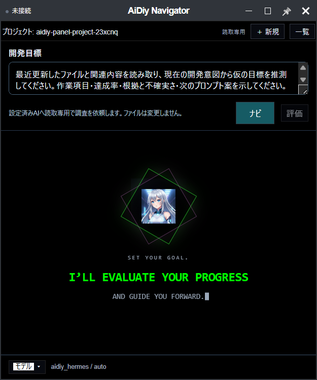
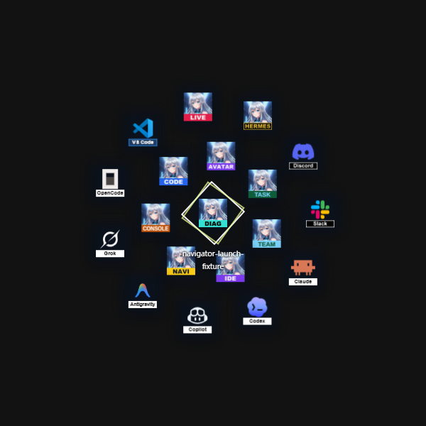
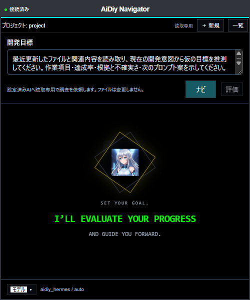
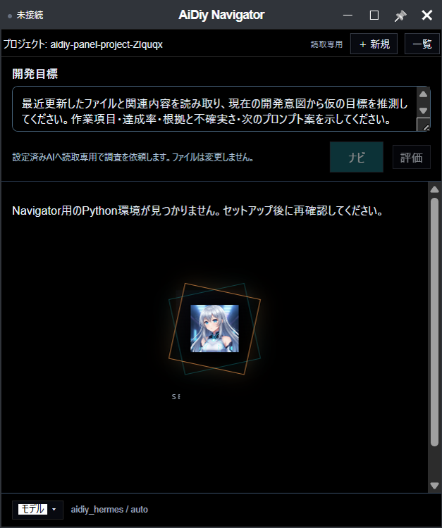
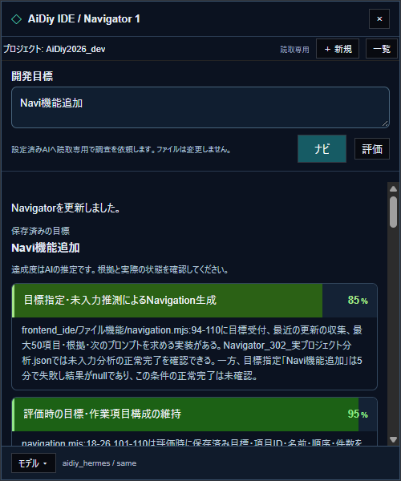
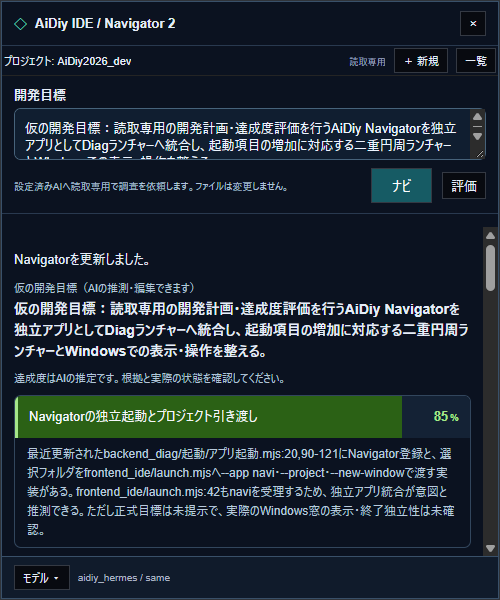
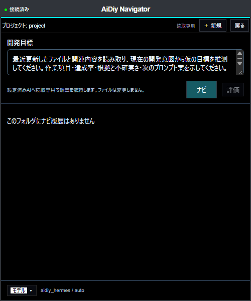
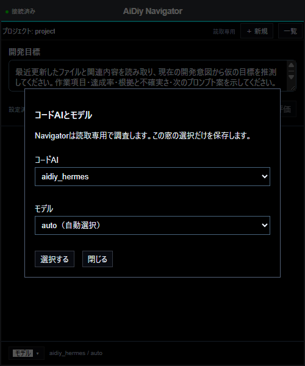
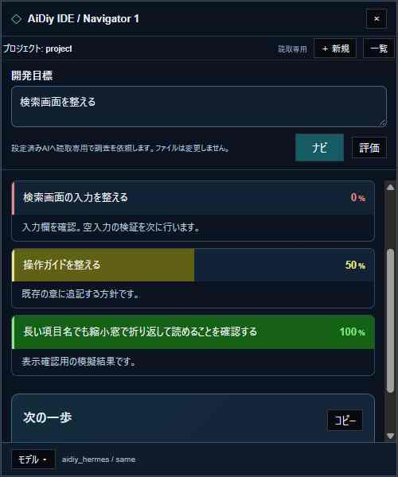

# Navigator 操作編 — 操作ガイドとセルフテスト

## 総合評価

**Navi基本操作セルフテスト：✅ OK**（2026年11月4日）。Diag・IDE・単独起動、複数窓、VR復帰、履歴、モデル切替、Hermesによるナビ作成・再評価、および関連回帰テストを確認しました。Codex CLIのread-only対応は専用フォルダでの確認結果を末尾に追記しています。実機・隔離試験の範囲は末尾の追加確認を参照してください。

計画を以下の章順で管理します。既存の実機・隔離試験の証拠を照合し、同条件の成功を繰り返しません。専用資料によるナビ・評価は確認済みです。実プロジェクトのデフォルト分析と目標指定「Navi機能追加」は成功しました。全条件合格ではありません。達成率はagentの推定であり、テスト合格率ではありません。

## 始める前に

既存term・ユーザー作業は維持し、専用フォルダと試験窓を使います。ナビ・評価は明示ボタン操作時のみ実行します。読取専用はファイルの変更を制限し、資料を読むコマンドは利用できます。agentが読んだ本文・検索結果は外部モデルへ送られます。許可された資料以外を送信しません。実プロジェクト分析は今回の利用者承認範囲で行いました。

常駐Toolsの8095を経由せず、セットアップ済みPythonからCodeAgents／CodeAgent／読取専用CLIを呼びます。Toolsの起動を本試験のために変更しません。

## 1. IDEとDiagから起動する

1. IDE左下の「＋ Navigator」を押します。Consoleの手前にあります。
2. 別窓の「AiDiy IDE / Navigator 1」とプロジェクト名を確認します。もう1窓を開き番号2と入力の独立を確認します。
3. Diagでは専用フォルダを選び、黄色のNAVIアイコンを押します。「AiDiy Navigator」が開けば単独起動です。

期待結果：正しいプロジェクトを表示し、別窓の目標・モデル・実行状態が混ざらず、既存termは維持されます。IDE実Electronの2窓・VR復帰は既存試験結果を採用。Diagは実ボタンからのElectron起動と画面を確認済みです。

Diagから開くNavigatorと共通の画面です。画像は現行UIを専用ブラウザで表示したもので、Diagからの実Electron起動は起動導線の証拠JSONで確認済みです。

現在の共通外枠は単独Electronで確認しました（起動導線の既存検証とは区別）。



NAVIを含む18アイコンの二重円を専用ブラウザで確認しました。中心間隔70px、内半径81px・外半径151pxで、48pxのクリック領域の間隔を確保します。この配置はユーザー確認済みとして採用しました。追加の配置調整は行いません。



## 2. 単独起動とVR・終了

```powershell
Set-Location "C:\Users\admin\Desktop\AiDiy2026_dev"
aidiy_navi --project "専用試験フォルダの絶対パス"
```

1. タイトル「AiDiy Navigator」、プロジェクト名、下部モデル欄を確認します。
2. IDEからの窓は既存のピン・VR操作で配置します。VRから戻っても2窓の入力が残ることを確認します。
3. 片方を通常終了し、もう片方とIDEが維持されることを確認します。

実Electronの単独画面・IDE複数窓・VR復帰は既存確認済み。登録済み aidiy_navi.cmd から専用フォルダを指定して実Electron起動し、タイトル確認後にその窓だけ通常終了しました。AI送信はありません。

現行の単独共通画面を専用ブラウザで撮影しました。登録コマンドによる実Electron起動は上記の別証拠で確認済みです。目標入力、ナビ・評価ボタン、下部のモデル選択を確認できます。結果未作成のため評価は無効です。



背景を約0.5秒長押しして移動し、離すと終了します。Escapeでも解除できます。実Electron入力とOS窓位置で移動・サイズ維持を確認し、目標入力欄では移動しないことを確認しました（カーソル位置とフォーカスのみ試験用固定）。撮影時はcleanup後のためAI用Python環境未準備・未接続で、ナビ・評価は実行していません。



## 3. ナビを作り評価する

1. 許可された専用資料のフォルダで目標を入力し「ナビ」を1回押します。
2. 項目・推定達成率・根拠・次のプロンプト案を確認します。
3. 「評価」を1回押し、目標・項目ID・名前・順序・件数が変わらず、採点と根拠・次の案だけが更新されることを確認します。
4. 前後のファイル一覧・内容を照合します。結果不明時に再送しません。

専用の赤・青資料ではHermes経由OpenAI gpt-6.1-solによるナビ・評価各1要求が成功し、項目維持とファイル不変を確認済みです。内部モデル呼出し回数とは区別します。実プロジェクトの実装確認結果ではありません。

上部の入力欄は明細をスクロールしても表示され、処理中も次の目標を編集できます。実行中はナビ・評価の再開始を防ぎます。入力が保存済みの目標と異なる間は評価が無効です。同じ目標へ戻すか、現在の入力でナビが成功すると評価できます。失敗時には前回の結果と編集中の入力を保持します。履歴を選ぶと、その履歴の目標を入力欄へ戻します。

### 実プロジェクト分析と初期表示

2026年11月4日（日本時間）、Windowsの専用Web窓で実プロジェクトをread-only分析しました。aidiy_hermes / sameはopenai_oauth/gpt-6.1-solへ解決されました。承認済みの目標指定「Navi機能追加」は13項目の正常結果を取得しました。別窓の未入力ナビは成功し、仮目標・10項目・根拠・次のプロンプトを表示しました。内部モデル呼出し数は未計測で、累計依頼3回（目標指定2回・未入力1回）と同じ数とは断定しません。照合した6ソースの内容は分析前後で一致しました。全ファイル不変を測定したという意味ではありません。

目標指定で13項目・達成率・根拠・次のプロンプトを表示しました。AIの根拠には分析開始時に存在した古い未確認記録も含まれます。今回の成功を評価へ遡って反映した数値ではありません。



未入力時は最近の変更から仮目標を推測し、項目別の推定達成率と根拠を表示しました。下へスクロールすると全10項目と次のプロンプトを読めます。agentが未確認とした箇所は、既存のセルフテスト合格を取り消す判定ではありません。



結果原文と判定は[実プロジェクト分析](evidence/.aidiy_cache/selftest/セルフテスト,aidiy_navi,操作編/Navigator_302_実プロジェクト分析.json)に保存しました。初期画面はCodeと同じ開始表示部品を使用し、AiDiyマークと回転する二重四角を表示します。結果作成・履歴選択後は結果へ切り替わります。

モデル候補はDiagがCode一覧から生成する navi_models_info.json を参照し、Naviはread-only対応を確認したHermes・Codex CLI・Copilot CLIだけを許可します。Hermesから編集可能な外部CLIへ転送する候補は除外します。Codeの全方式に対応したという意味ではありません。Code本体・認証設定は変更しません。Copilotを含むread-onlyの許可ツール・変更禁止・取消し等の隔離23テストも成功しました。今回の操作セルフテストの実AI確認は利用可能な方式で行い、各方式の認証や利用枠は判定対象に含めません。

## 4. 履歴とプロジェクト分離

「一覧」で過去のナビを選び、目標・項目・モデルを復元します。「＋ 新規」で新しい目標へ進みます。別プロジェクトの履歴が混ざらず、他窓の選択を変更しないことが期待結果です。履歴の保存・復元・評価による同一履歴更新は隔離試験、一覧操作は実ブラウザで確認済みです。OS再起動を伴う確認はしていません。



## 5. モデルを選択する

最下部の「モデル」を押し、Codeと共通のダイアログで選択します。未保存時は aidiy_hermes とCode共通設定 CODE_AIDIY_HERMES_MODEL（省略時auto）を使い、保存済みの窓別選択を優先します。保存・再読込・別窓との独立を確認します。ナビと評価は開始時の選択を使い、実行中は変更できません。読取専用対応providerだけを表示し、Codeの編集権限は引き継ぎません。



## 6. 達成率の表示

0%・50%・100%の模擬結果を表示します。項目名の背景の幅と数値が一致し、赤→黄→緑が連続変化することを確認します。0%は赤い数値・枠、未評価は数値0と区別した表示です。320px幅で長い項目名を折り返し、複数窓の表示を確認します。

500×600で上部入力固定・項目別表示を確認しました。入力変更→評価無効、元の目標へ戻す→評価有効、空入力の定期読込み保持、失敗→再実行、実行中編集保持、履歴切替、複数窓の独立を模擬AI5要求の実ブラウザで確認済みです。外部AI送信はありません。0・50・100%、320pxの横はみ出しなしも確認済み。欠損値の未評価表示は実装確認であり、欠損したAI回答を正常保存する意味ではありません。

専用ブラウザの実画面で、3項目の背景バー・数値・次のプロンプト案を確認しました。以下は表示確認用の模擬結果であり、実プロジェクトの評価ではありません。



## 7. 固定JSON・失敗・read-only

模擬AIで不正JSON、必須値欠落、重複ID、0〜100以外の値、別依頼ID、評価時の追加・削除・改名・並替を返します。期待結果は拒否と前回正常結果の保持です。タイムアウト、連打、窓終了、プロジェクト利用状態の変化でも古い結果を保存しないことを確認します。

固定形式は requestId / goal / items（id,name,progress,reason）/ nextPrompt。保存は専用状態領域で行い、AIにプロジェクト内のJSON作成を依頼しません。31件の隔離回帰試験を確認済み。読取専用CLIは通常実行へフォールバックしません。

## 証拠照合と残る確認

| 順番・項目 | 判定と根拠 | 次の具体的な確認 |
|---|---|---|
| 1 IDE／Diag | 実機確認済み：[起動導線](evidence/.aidiy_cache/selftest/セルフテスト,aidiy_navi,操作編/Navigator_101_起動導線.json) | 同条件の再実行なし |
| 2 単独／VR | 単独Electron・IDE VRは確認済み、登録cmdのhelp確認済み | 登録cmd起動・通常終了を実機確認。再実行なし |
| 3 ナビ／評価 | 専用資料で実AI成功：[結果](evidence/.aidiy_cache/selftest/セルフテスト,aidiy_navi,操作編/Navigator_301_ナビ評価.json) | デフォルト・目標指定とも成功。実プロジェクト評価の追加送信なし |
| 4 履歴 | 隔離試験・実ブラウザで確認済み | OS再起動試験を後付けしない |
| 5 モデル | 実画面・保存／復元回帰試験で確認済み | 全providerの実AI網羅は対象外 |
| 6 色付きバー | 実ブラウザで確認済み：[表示](evidence/.aidiy_cache/selftest/セルフテスト,aidiy_navi,操作編/Navigator_601_達成率表示.json) | 未評価の描画は実装確認と区別 |
| 7 JSON／read-only | 隔離試験・実AIファイル照合：[実装確認](evidence/.aidiy_cache/selftest/セルフテスト,aidiy_navi,操作編/Navigator_701_実装確認.json) | 読取り内容の外部送信禁止とread-onlyを混同しない |

実プロジェクト分析の累計依頼は3回です。内部モデル呼出し回数とは区別します。既存term・サービスを維持します。PDFはこの本文と同じ確認範囲で生成します。

### 実行依存が利用できない場合

Navigatorの起動と履歴閲覧は常駐サービスの稼働で制限しません。Python・選択CLIの実行環境がない場合は理由を表示し、ナビと評価だけを無効にします。5秒ごとに再確認し、復帰後は実行できます。実行入口でも依存を再確認します。履歴・前回結果は保持されます。外部AIの認証・利用枠・通信障害は送信を伴う事前診断をせず、実行時に失敗として表示します。

### 現在の検証範囲

依存停止・復帰は模擬依存を使った実ブラウザで確認済みです。停止中も結果表示を保持し、ナビ・評価を無効化、復帰後に再操作可能となりました。実サービスを停止する試験は行っていません。目標指定の正常結果を確認済みです。実プロジェクトでの評価ボタンは今回追加実施していません。PDFは全ページを画像化して目視確認し、文字や図表の重なり・欠けはありません。

### 初期サイズの確認

単独・IDEの新規Navigatorは500×600論理ピクセルで開きます。小さい画面ではCode同様に作業領域へ収めます。既存窓の手動サイズは変更しません。実Electronで単独502×601、IDE500×602（Windows DPI丸め）を確認し、手動540×640へ変更後のVR移行・復帰でも寸法保持を確認しました。AI送信なし。配置試験の不足fixtureを補い、Code等の既存配置14件とNavigator寸法1件の全15件が成功しました。製品動作の変更はありません。

ナビ結果は目標に応じた作業項目の配列で、各行に名前・達成率・背景バー・判断根拠を表示します。評価は同じ項目構成を維持し、数値・根拠・次のプロンプトを更新します。例示のバックエンド／フロントエンド等を固定生成しません。

AIへの出力指示には、バックエンド調整100%・フロントエンド70%・セルフテスト0%の3項目JSONを形式例として含めます。実際は目標に合わせて生成し、評価には保存済み項目全体のJSON例を渡します。例追加後のデフォルト分析で実AIの固定JSON・10項目表示を確認しました。今回の実AI評価は行っていません。


### Navi専用モデル一覧

Diagのモデル情報書出し時に、Code用一覧を変更せず `_AIDIY/aidiy_diag/navi_models_info.json` を同じ保存先へ生成します。Hermesの外部CLI転送候補を除き、直接のCopilot CLIは利用できます。これは候補一覧であり、認証成功やモデル利用枠の保証ではありません。実行時のread-only制約は一覧とは別に強制します。

一覧が欠損・破損・旧形式の場合は案内を表示し、same/autoと明示入力を残します。古い候補でモデルが利用できない場合は実行エラーとして扱い、前回結果を保持します。Toolsへの接続は一覧取得に不要です。モデル情報生成・Code不変・一覧の負例を含む関連65テストが成功しました。新しい一覧経由の実AI送信は行っていません。

### Codeと共通のタイトル・初期案内・実行表示

タイトルは中央、最小化以降の窓操作は右端に配置し、Codeと同じ31pxのタイトル行を使います。Navigator固有のヘッダースタイルが共通タイトル行へ適用される不整合を修正しました。単独500×600とIDEの2窓で高さ・右端配置・番号・独立性・VR復帰を実Electronで確認しました。

初期画面はNAVI文字帯のないCode共通マークと二重四角を使い、「SET YOUR GOAL. / I’LL EVALUATE YOUR PROGRESS / AND GUIDE YOU FORWARD.」と案内します。DiagランチャーのNAVI文字帯は保持します。

ナビ・評価中は表示エリア上下でCode共通のシアンと白の往復バーが動きます。成功・失敗で解除し、窓終了時も破棄します。専用ブラウザの模擬AIで開始・成功・失敗・実行中の窓終了と他窓の非表示を確認しました。外部AI送信0回。関連56テストと配布ビルドが成功しました。

### 現行の入力と接続表示

開発目標には、最近の作業から仮目標・項目・達成率・根拠・次のプロンプトを提案する既定指示を実値として表示します。いつでも編集でき、空欄でナビを押すと入力を促しAIを呼びません。過去の未入力分析記録は当時の仕様での実AI結果です。現在は既定指示を明示して送ります。

タイトル下のシアン接続バーは既存Tools pingの状態と同期します。これはナビ・評価中に表示エリア上下を動くシアン／白の往復バーとは別です。Tools表示が切断しても窓と履歴は残り、復帰時に表示が戻ります。本文と入力欄はCode同様の黒、外枠はタイトルと同色の1px、モデルラベルは白地・黒文字です。

同一DPI・500×600のCode／Navigatorを実ブラウザで比較し、タイトル高さ31px・文字14pxの一致を確認しました。模擬Toolsのオンライン→停止→復帰で接続バーが同期し、窓は維持されました。既定指示の表示、空欄拒否（AI送信なし）、モデルラベル白地・黒文字、本文黒・外枠1pxを確認しました。


### Console参照との追加照合

Consoleの参照をソース・起動/配布・テスト・文書から照合しました。Navigatorのsetup/cleanup順序、単独ランチャー、IDE/Diag起動、タイトル、500×600、アイコン配布、モデル情報、履歴、固定JSON、read-onlyの既存実装を維持しています。

- 補完：長押し移動のmain/rendererの対象一覧、setup時の共有依存使用中保護、登録結果一覧の整列、ナレッジ索引。
- 模擬確認：setup/cleanup 14件、共有依存保護10件、長押し/ピン/VR/アイコン44件、Diagカタログ5件が成功。実サービスやユーザーtermは操作していません。
- 対象外：ConsoleのPTY・シェル権限・CLI自動実行はNavigatorに不要です。全体startの自動起動一覧へは追加していません。過去の診断インベントリ・実機結果は今回の成功へ書き換えていません。
- 依存復旧後の確認：既存lockfileで共通UI・viewerを復旧し再ビルド。起動ヘルプ6件PASS、実Electronで長押し移動・Escape解除・入力欄保護PASS。試験窓終了、AI送信0。実cleanupは実行していません。

### 2026年11月4日 実画面と回帰の追加確認

- **セルフテスト ✅ OK**：以下の範囲のNavi基本操作・回帰を確認。Codex CLIの読み取り失敗については末尾の追加確認を参照。
- 登録済み `C:\Users\admin\.local\bin\aidiy_navi.cmd` を専用試験フォルダ指定で実行し、単独Electronにそのフォルダ名が表示された。試験窓の×で通常終了し、当該Electronプロセスの終了を確認した。既存の実プロジェクト用Naviは維持した。
- Naviの専用モデル一覧から `codex_cli / gpt-6.1-terra` を選択し、実プロジェクトの保存済み項目を再評価できた（総合96%、AIの推定）。修正後の実画面で指定ガイドを読んだ結果として記録する。候補から選択したモデルの実AI呼び出しの確認であり、全候補の利用可能性を保証するものではない。
- この操作セルフテストはモデル選択と利用可能な方式での実AI応答を対象とする。各プロバイダーの当日の認証・利用枠や、すべてのモデルの利用可否は対象外であり、未確認の方式を成功とは扱わない。
- 保存済み評価に残っているCopilot実AIエラーは、当日Copilotを利用できないとの利用者申告のもとで発生した別途試行の記録であり、原因は未特定。今回の「モデル候補と選択状態の確認」の対象は、候補表示・選択・復元と、利用可能なCodexによる実AI応答までとする。Copilot個別エラーの解決や当日の利用可否は、この操作セルフテストの達成条件に含めない。
- 上記の実施結果と対象範囲を記載後、保存済み項目を `codex_cli / gpt-6.1-terra` で再評価し、全6項目と総合評価が100%となった。これは記録に基づくAIの推定であり、対象外の全モデル利用可否や全ファイルの不変性の証明ではない。
- この作業コピーでDiagのNAVIボタンから単独Navigatorを起動し、プロジェクト名を確認した。既存の旧形式履歴に案内が出たため「＋ 新規」で新しい目標を作成した。DiagのIDEボタンからIDEを起動し、オフライン利用の「＋ Navigator」で別窓「AiDiy IDE / Navigator 1」「Navigator 2」を確認した。
- `navigation.test.mjs`、`navigation-recovery.test.mjs`、`navigation-draft.test.mjs`、`navigation-standalone.test.mjs`、`navigation-layout.test.mjs`、`navigation-size.test.cjs`、Diagの`navi-models.check.mjs`、Pythonの`test_navigation_readonly.py`は成功。復旧テストはWindowsのCRLFに対応し、サイズテストは現行の4行入力と総合評価の配置に合わせた。
- `check-navigation.mjs`は模擬AIで2窓のモデル・結果・再評価・終了の独立性を確認。`check-navigation-desktop.mjs`は実Electronで2窓、VR復帰、片方の終了を確認。Diagの`navigator-launch-browser.mjs`と`navigator-orbit-browser.mjs`も成功した。これらの隔離試験と実際のDiag操作は区別する。
- 実プロジェクトを対象にHermesでナビを1回作り、同じ項目を`codex_cli / gpt-6.1-terra`で2回再評価した。2回とも0%と表示し、起動結果を直接確認できないことを根拠に挙げた。2回目はこの記録の初版を保存後に実行したが、表示上の評価は変わらなかった。数値はAIの推定であり、テストの成否ではない。
- 一覧から今回の履歴を選び、目標・選択モデル・0%の結果が復元されることを実画面で確認した。
- IDE実窓でVRへ移行し復帰した後、IDEとNavigator 1・2の同一ウィンドウが残り、両Navigatorの位置とサイズが移行前と一致した。別の試験用目標を2窓へ入力してVR移行・復帰し、両窓の異なる目標とHermes / auto表示が前後で保たれたことを画面で確認した。結果表示の保持は試していない。
- README 1ファイルだけの新規専用フォルダでHermes / autoによる実AIナビを実行。READMEのTask A完了・Task B保留を根拠に総合50%を表示し、実行前後のフォルダ一覧はREADMEだけ、SHA-256も一致した。この専用フォルダの検証を実プロジェクト全体の不変証明とは扱わない。
- Hermes / autoで追加確認後に実プロジェクトを再評価し、70%から78%へ更新された。再評価前に控えた10項目のID・名前・順序と目標は再評価後も一致した。数値はAIの推定であり、合格率ではない。
- 更新後の別IDE実窓で履歴から78%の結果を開き、VR移行・復帰の前後で同じ目標、Hermes / auto、総合評価78%、おすすめ表示を確認した。
- 追加確認の記録後、Hermes / autoで同じナビを再評価し、総合90%となった。再評価前後の目標と10項目のID・名前・順序は一致した。AIが残りの10%として挙げた実プロジェクト全ファイルの不変測定は、Naviの操作セルフテストの対象外と判断した。数値はAIの推定であり、試験の完了率ではない。
- 基本操作セルフテストを「✅ OK」と記載してからNaviで再評価した結果も90%。AIはOKと対象外の記載を認識したが、再評価では保存済み項目を削除できないため、対象外の全ファイル測定を0%のまま保持した。
- 実プロジェクト全ファイルの不変性は測定していない。読み取り専用経路の隔離試験・専用フォルダの前後照合とは区別する。既存の隔離・実機証拠と混同しない。

### Codex CLI の読み取り専用対応

- **Codex CLI のread-only：✅ OK（このWindows環境の専用フォルダで確認）**。読み取り専用sandboxと承認なしの設定に、Windowsでは `features.prefer_mxc=true` を指定する。従来のsandboxでは読み取りコマンドが拒否されたが、この設定で `codex_cli / gpt-6.1-terra` がNaviと同じAI呼び出し経路から専用READMEの内容を読み取れた。
- 同じ設定のsandboxで既存ファイルの変更と新規ファイル作成が拒否され、既存ファイルのハッシュが変わらなかった。検証範囲は専用フォルダに限る。他のWindows環境でも別途確認が必要。
- 修正前のプロンプトに残ったコマンド実行禁止の文言により、Codexが資料を読まず0%と評価する事象が再現した。文言を外しNaviを新たに起動して同じ項目を `codex_cli / gpt-6.1-terra` で再評価したところ、このガイドの実施記録を根拠に総合90%を表示した。これはAIの推定値であり、100%達成を確認したものではない。
