# AiDiy Task 操作編 — 操作ガイドとセルフテスト

> 確認範囲：本文には過去の実機・自動試験結果と今回の追補を含みます。今回の実施状況は[確認結果](セルフテスト,共通,確認結果.md)の章別台帳を参照してください。今回の全章再実行・全条件合格を示すものではありません。

## 総合評価

**総合評価：✅ OK（記載した確認範囲）。** ログイン、要求・フロー図・明細の3窓、要求登録、分岐・合流、中止、開始条件、保存状態と終了を確認しました。AI実行は `codex_cli`、plan・do・checkは `auto` の条件です。Mac／Linux実機、全プロバイダ、長期間の連続運転は確認範囲外です。

前半は起動から終了までの操作ガイド、最後の章は追加テストと確認範囲です。図番号は章番号と掲載順を表し、試験ケースIDとは区別します。

## 始める前に

[システム起動編](セルフテスト,aidiy_diag,システム起動編.md)で必要なバックエンドを起動し、[ランチャー編](セルフテスト,aidiy_diag,ランチャー編.md)からアプリを開きます。単独起動コマンドは `aidiy_task` です。単独起動のTaskとTeamは別々にログインし、共通のTaskTeamサーバーを使います。IDEからの起動・固定プロジェクトは[IDE操作編](セルフテスト,aidiy_ide,操作編.md#taskteam連携)を参照してください。

AIの作業先には専用の試験フォルダを指定しました。入力の `挨拶.txt` には合言葉「青い鳥」を用意しています。既存の目標・要求と試験データを区別します。

## 1. 起動してログインする

1. Diagまたは `aidiy_task` から起動します。
2. 利用者IDとパスワードを入力してログインします。
3. 要求のメインパネルだけが表示され、接続状態を確認できれば起動は完了です。フロー図・明細は自動では開きません。

ログイン画面です。誤った認証情報では拒否理由が表示されます。

**図101：ログイン画面**

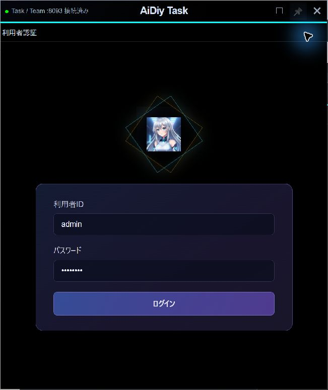

認証後の主画面です。各窓は個別に閉じ、操作ボタンから表示し直せます。 起動直後は要求のメインだけです。「フロー図」「明細」を開くと、選択中の要求の図と明細が別窓で表示されます。既存要求がある場合はタスクIDの一致を確認し、閲覧だけなら「新規」や編集・登録には進みません。各窓の×で明細、フロー図、最後にメインを閉じられます。

**図102：Task要求一覧**

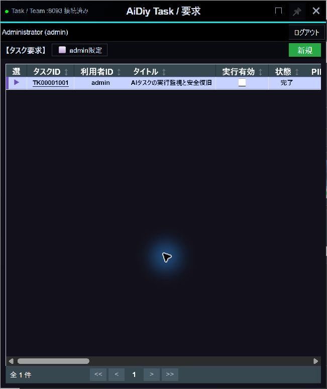

## 2. 要求を登録する

1. Taskにログインし、要求窓の「フロー図」「明細」を必要に応じて押して3窓を確認します。
2. 要求窓の「新規」を押し、プロジェクトのフォルダと要求内容を入力します。
3. TASK_AI_NAMEと、plan（準備）・do（実行）・check（最終確認）のモデルを選びます。
4. 実行有効と開始条件を確認して「登録」を押します。

要求欄には、対象ファイル、作る結果、変更してよい範囲を具体的に書きます。空欄のまま登録すると「要求内容を入力してください。」と表示されます。「キャンセル」で閉じた要求は登録されません。

一覧左端の選択ボタンで、フロー図と明細の対象も切り替わります。タスクIDは編集、応答内容は結果の確認に使います。横に長い表は下端のスクロールバー、または右上の最大化で確認します。

短い挨拶で登録を練習する場合は、要求に「おはよう。挨拶を一文だけ返してください。」と書き、応答テキストだけを求める範囲を明示します。1回の実行は開始条件「即時」「無し」で確認し、間隔・定時・フォルダ変化を選びません。登録後は新しく付いたタスクIDを目印に同じ行を追います。

## 3. 実行と結果を確認する

登録後は準備、実行、完了の順に進みます。AIによる分解には時間がかかります。開始監視は約5秒、状態監視は約10秒、開始条件の確認は毎分です。まず15分を観測の目安にし、進捗が続く場合は[待ち時間の共通ルール](../../_AIDIY/knowledge/セルフテスト,_説明資料の書き方.md#操作と待ち時間)に沿って確認を続けます。

フロー図は作業の順番を表します。「先行SEQ」が複数ある明細は、それらの完了を待ってから始まります。完了表示だけでなく、生成物の内容も依頼どおりか確認します。

文字応答を確認するときは「明細」を開き、タイプ`do`の行の「応答内容」を読みます。窓を最大化すると列をまとめて確認できます。要求一覧には最後の終了処理の応答が表示される場合があるため、実行明細の返信と分けて読みます。

要求は、独立した `branch-a.txt` と `branch-b.txt` の作成後、`merged.txt` にA・Bを各1行でまとめる内容です。2つの作成明細が同時に始まり、両方の完了後に合流しました。最終ファイルの内容も一致しました（Task-201）。

分岐から合流、最後の確認までを表示しています。明細の先行SEQと矢印の接続が一致します。

**図301：分岐合流完了**

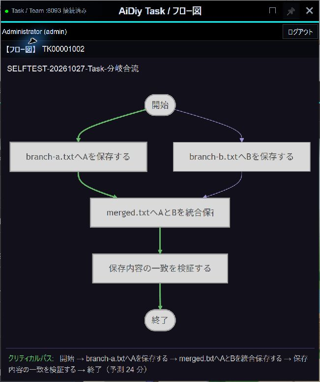

入力ファイルがない要求では、理由を表示してエラー・実行有効OFFになりました。入力を用意し、同じ要求を「準備完了」に戻して有効化すると正常完了し、入力と出力が一致しました（Task-202）。再実行前に、失敗原因を解消していることを確認します。

## 4. 実行を中止する

1. 対象のタスクIDを開き、「中止」を選びます。
2. 繰り返しも止める場合は実行有効をOFFにし、「登録」で保存します。
3. 一覧の中止表示と、実際の処理・ファイル更新の停止を確認します。

Task-301では、5秒ごとに追記する試験処理を中止しました。中止後もファイルが増えず、別のTeam処理は継続しました。

「中止」と実行有効OFFを選んだ状態です。保存後の一覧と更新停止まで確認して判定します。

**図401：中止設定**

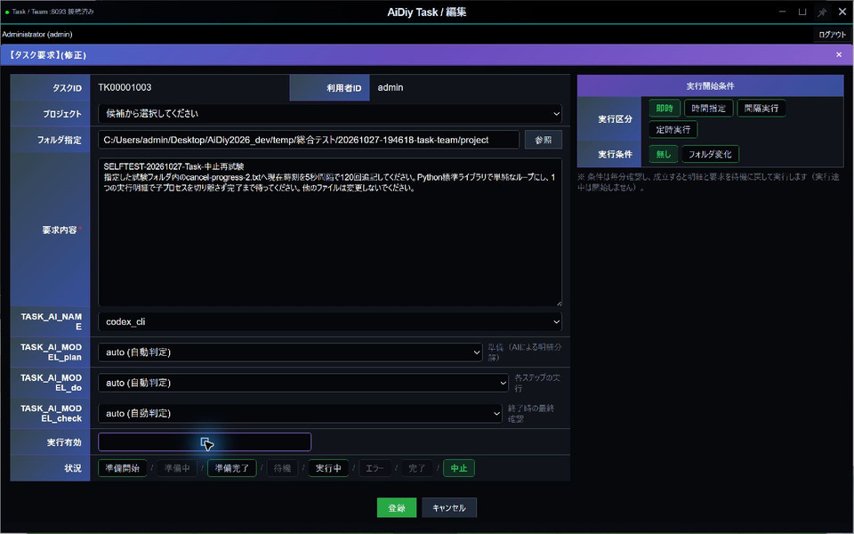

## 5. 開始条件を選ぶ

編集画面右側の「実行開始条件」で設定し、「登録」で保存します。準備が終わっている要求を条件に応じて実行します。

画面では「実行区分」（即時・時間指定・間隔実行・定時実行）と、その下の「実行条件」（無し・フォルダ変化）を分けて読みます。時間指定は開始時刻、間隔実行は単位と値、定時実行は毎日・毎週・毎月と開始時刻を表示します。毎週を選ぶと実行曜日が加わります。フォルダ変化は実行区分とは別の選択で、監視フォルダ欄を表示します。

選び方だけを練習する場合は、通常ログイン後に「新規」を開き、プロジェクト候補とフォルダ指定が対象と一致することを確認します。要求内容は空欄のまま条件を切り替え、入力場所を見たら下部の「キャンセル」で戻ります。「登録」や状況の変更は行いません。条件欄が増えると下側の位置も変わるので、操作前に対象を見直してください。この練習は保存後のスケジュール実行試験とは別です。

| 選択 | 操作と確認ポイント |
|---|---|
| 即時 | 条件「無し」では準備後に実行します。「フォルダ変化」を組み合わせた場合は変化を待ちます。 |
| 時間指定 | 開始時刻を入力します。指定前に開始せず、時刻到達後に始まることを確認します。 |
| 間隔実行 | 単位と間隔値を指定します。実行中の周期に次の周期を重ねません。 |
| 定時実行 | 日・週・月などの条件と開始時刻を指定します。 |
| フォルダ変化 | 監視フォルダを指定し、初回の状態を基準にして以後の変化を待ちます。出力先と分けると、自分の生成物で次の実行が起きるのを避けられます。準備のAI呼出しと、条件成立後の実行は別です。 |

Task-401では20:13を保存して開き直し、指定時刻後の開始を確認しました。時刻欄は入力後、表示値が意図どおりになったか確かめます。

**図501：時間指定**

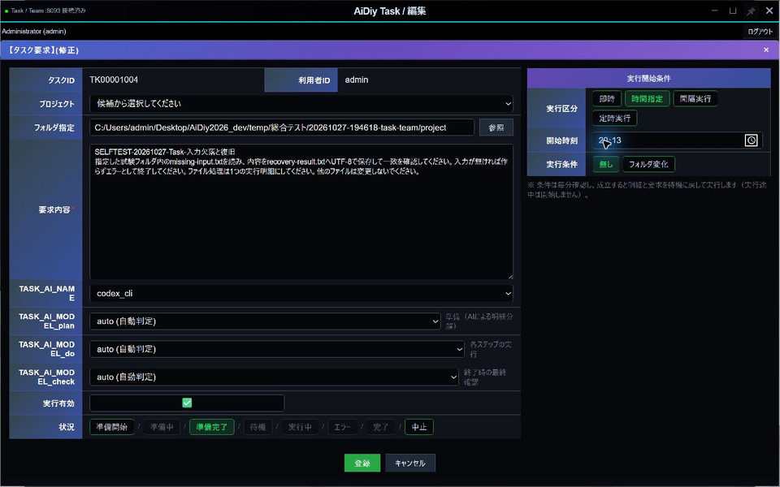

Task-402では間隔の0と601を拒否し、2分の設定で複数周期が完了しました。実行途中に周期が重ならず、OFF後は次回予定時刻＋90秒を過ぎても再実行がありませんでした。

範囲外の値を入れると案内が表示され、保存されません。値を直してから登録します。

**図502：間隔検証**

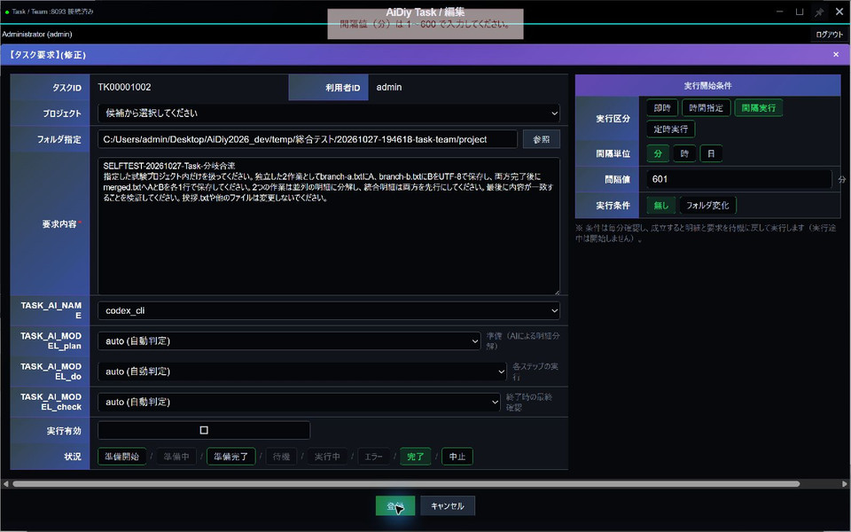

Task-403では監視フォルダを保存し、変化のない間は実行されないことを確認しました。試験ファイルを追加すると次の監視で起動し、完了後に変更しなければ再実行されませんでした。

Task-404では「定時実行・毎日・20:40」を保存しました。指定前には動かず、20:40以降に開始して正常完了し、次回日時が翌日の20:40になることを確認しました。翌日までの実時間観測は対象外です。

毎日の開始時刻を指定した画面です。監視条件を組み合わせない場合は「無し」を選びます。

**図503：定時実行**

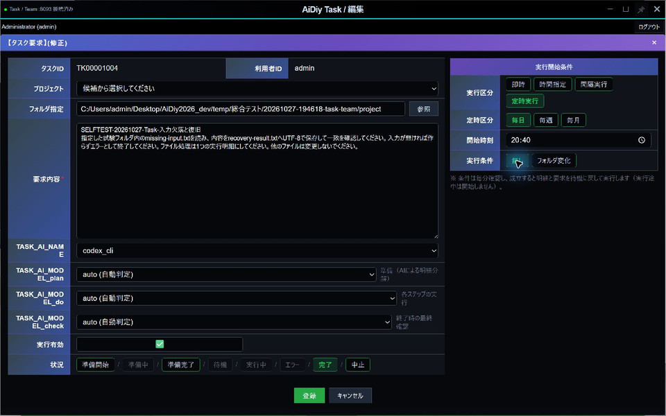

## 6. 📌で最前面を維持する

違いを確認するときは、要求とフロー図を少し重ね、両方のタイトルが選べるように配置します。フロー図の📌をONにしてから要求のタイトルを1回押し、重なった部分でもフロー図が手前に残ることを確認します。📌をOFFにして同じ要求タイトルを選ぶと、今度は要求が手前になります。登録や編集をせず、実演用の2窓だけで確認できます。終了前にピンを解除します。

窓の右上にある📌を押すと、その窓を最前面に保ちます。ONはピンク、OFFは白寄りの灰色で、背景は透明です。もう一度押すと解除します。要求・フロー図・明細・編集の各窓で個別に切り替えられます。

Task-501では4種類の窓でON／OFFを切り替え、別窓を操作してもONの窓が前面に残ること、解除後は通常の重なり順へ戻ることを確認しました。同じ最前面の窓同士は、選択した窓が上になります。

フロー図をピン留めした状態です。ボタンの色と「ピン留めを解除」の案内がONの目印です。

**図601：最前面ピン**

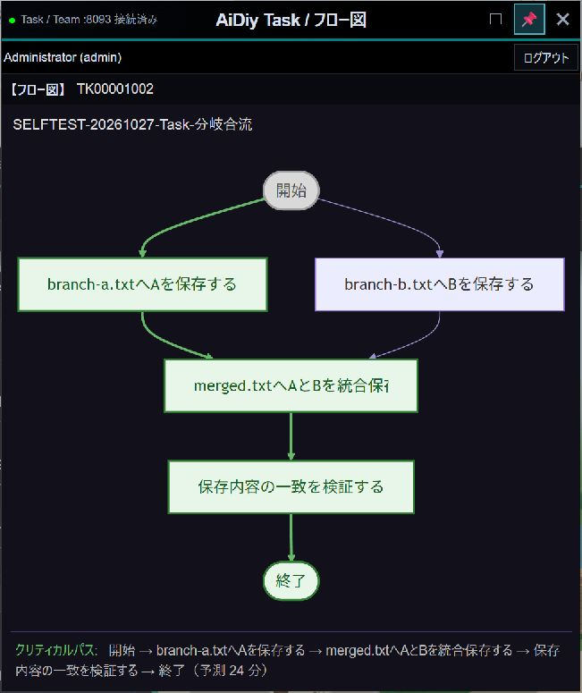

## 7. 窓の開閉・ログアウト・終了

認証を終了する場合は、画面上部の「ログアウト」を押します。アプリを終了する場合は要求・フロー図・明細の各窓を閉じます。窓を閉じることと、登録済み要求の中止・実行有効OFFは別の操作です。処理を止める場合は4章の手順で設定します。

ログイン失敗時は理由が表示され、要求窓1枚のままです。現行の初期表示は要求窓だけで、フロー図・明細は各ボタンから開きます（初期表示は1章参照）。

ログイン前は用途の「/ 要求」を出さず、入力カード内の重複タイトルも表示しません。画面外周は1pxのグレーです。ログイン画面は1章を参照します。

1枚だけ閉じた窓は、残った窓の右上に表示される「要求」「フロー図」「明細」ボタンで戻せます。 再表示を試すときは要求窓を残し、フロー図だけを×で閉じます。要求窓の右上に現れる「フロー図」を押し、閉じる前と同じタスクID・タイトル・図が戻ることを確認します。全窓を閉じる操作やログアウトとは分けて行ってください。フロー図の再表示を確認しました。要求窓を先に閉じて明細からログアウトした場合も、要求のログイン窓が復元され、他のTask窓が閉じました。Teamのログイン状態には影響しません（Task-602）。

Task-603では全3窓を終了し、DiagからTaskを起動し直しました。再ログイン後も完了・中止の記録と実行有効OFFが残り、日次設定「毎日20:40」、モデル、フォルダが一致しました。これはアプリの終了・再起動による確認です。

再起動後に編集を開いた状態です。日次条件を保持し、実行有効はOFF、状態は完了になっています。

**図701：再起動後の保存設定**

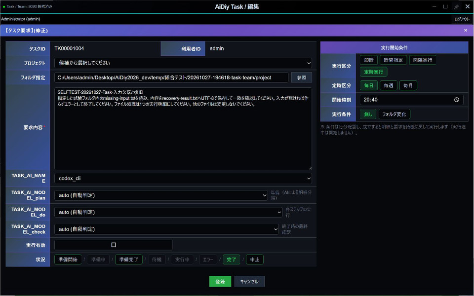

## 8. 追加テストと確認範囲

### 開始条件の未登録画面による解説

2026-11-02の追加解説では通常ログイン後、AiDiy2026_devを選んだ新規画面で、即時・時間指定（開始時刻09:00）・間隔実行（分／時／日と値）・定時実行（毎日／毎週／毎月、毎週の曜日欄）・フォルダ変化（監視フォルダ欄）を確認しました。要求内容と監視先は未入力のままキャンセルし、一覧が開始前と同じ3件であることを確認。登録・準備・実行・既存要求変更は行っていません。定時実行の毎月の詳細入力・保存検証・実時刻到達後の実行は今回の実演範囲外です。既存のTask-401〜404の結果とは区別します。

### 要求登録の確認結果

2026-11-02の解説練習では`TK0001002`を1件登録。対象フォルダは`AiDiy2026_dev`、`codex_cli`、plan/do/checkは`auto`、開始条件は即時・無しです。挨拶を一文で返し、ファイル操作・コマンド実行・反復は不要と指定しました。実行回数1、状態「完了」、明細SEQ1（do）の応答「おはようございます。」を実画面で確認。実行は14:41:00〜14:41:21、要求と結果は保持し、定期実行・追加実行は行っていません。

| 確認番号 | 操作・判定 |
|---|---|
| Task-101 | 空の要求を拒否し、取消で不要な要求が増えないことを確認しました。 |
| Task-102 | 専用フォルダとcodex_cli／autoを保存し、編集を開き直して一致を確認しました。 |
| Task-103 | 一覧の選択にフロー図・明細が追従し、別窓の編集対象も一致しました。 |

### 窓・認証・通信

Windowsの単独Electronで、要求・フロー図・明細の個別終了と再表示、連打時の重複防止、要求窓を閉じた状態からのログアウト復元、再ログイン、全終了を確認しました。空欄登録は拒否され、取消後の要求一覧は1件のままでした。既存テンプレートの分岐図・12明細・保存応答の表示確認では、実行有効をOFFに保ちました。

Node54件、Python隔離試験10件、Task／Teamの型チェックが成功しました。隔離試験は編集時の実行有効、日付計算、打切り時の中止状態、実行寿命と周期の重複抑止が対象です。画面の表示確認とAI実行結果は分けて判定します。

灰色タイトル、細い外枠、透明なタイトル操作ボタンとピンON／OFFを実画面で確認しました。ログイン画面は黒背景のアイコンと逆方向に回る二重四角形、青紫の入力カードです。時間を空けた観測で回転角度の変化を確認しました。

TaskTeam停止時は主画面が「未接続」と黒いバーになり、再起動後は「接続済み」に戻りました。認証・遅延応答の自動試験21件も成功しました。現在の401だけが該当セッションを終了し、古い401は新しいログインを消さず、403・500・通信失敗を認証切れと混同しません。これら6件は21件の内数です。実Coreの期限切れトークンと、APIクライアントの模擬応答を分けて確認しています。

### 起動経路

通常・ミニ・アイコン表示から起動し、認証と接続状態を確認しました。通常表示からの画面は1章に掲載しています。

ミニ表示から起動した認証後の画面です。

**図801：Taskミニ表示起動**

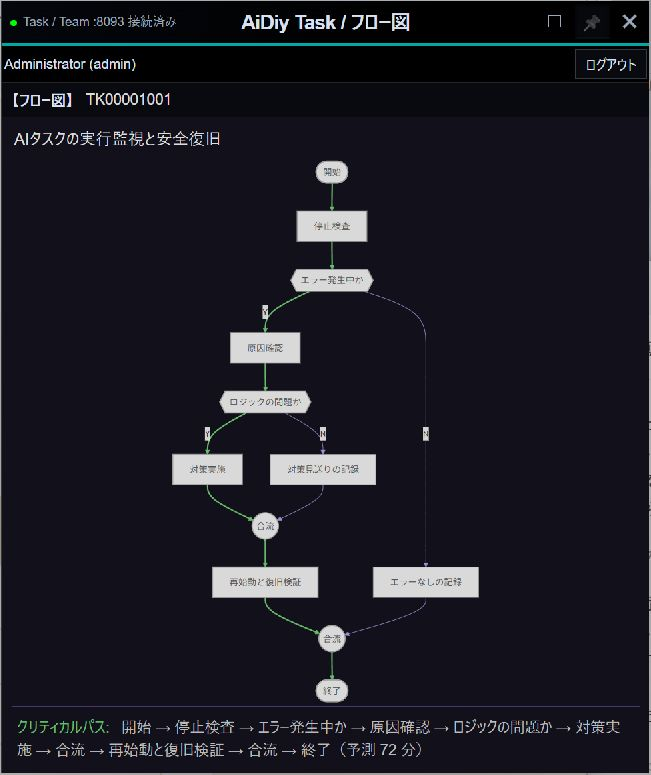

アイコン表示から起動した認証後の画面です。

**図802：Taskアイコン起動**

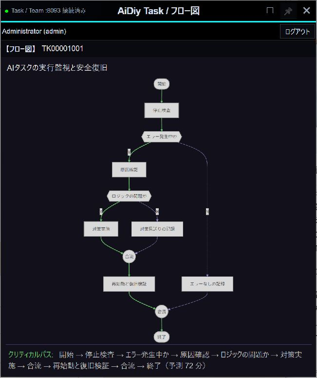

### 試験データと終了確認

実機試験では、要求・フロー図・明細をそれぞれ閉じ、残った窓のボタンを連打しても対象が1窓だけ再表示されることを確認しました。要求窓を閉じた後にフロー図からログアウトすると要求のログイン窓だけが復元され、再ログインで3窓へ戻りました。最後は明細→要求→フロー図の順で閉じ、プロセスが終了しました。試験専用プロファイルにはパスワード・認証トークンの永続保存がなく、業務データを変更していません。さらにTaskTeamを実停止・再起動し、要求・フロー図・明細の全3窓が「未接続」→「接続済み」へ追従することを確認しました。

TaskTeamをDiagから停止すると「未接続」と黒いバーになりました。期限切れJWTが実Coreで401となること、現在の401だけで認証を解除し、古い要求の401や通信失敗では新しい認証を消さないことを確認しています。後者は実APIクライアントを使う隔離試験で、長時間待って期限を迎える実機試験とは区別します。

| 対象 | 確認した内容 |
|---|---|
| TK00001002 | 即時の並行分岐・合流、2分間隔。完了・実行有効OFF。 |
| TK00001003 | 追記処理の中止。中止・実行有効OFF、更新停止。 |
| TK00001004 | 時刻指定、入力不足と復旧、フォルダ監視、毎日20:40。完了・実行有効OFF。 |
| TK00001001 | 既存テンプレートは完了・OFFのまま。実行や更新をしていません。 |

自動試験はTask関連12件、Task／Teamの起動・窓・セッション・UI関連44件、認証表示の回帰2件、共通ピン制御16件が成功しました。これらは実画面試験の補助です。定時計算や異常系の隔離試験を、長期間の実運転の結果には読み替えません。

補助試験には共通処理の結果が含まれるため、別の条件・別冊の件数を単純に合計しません。週・月をまたぐ実時間の定期運転は未確認です。

### 長押しドラッグの実機確認（2026-11-02）

Windows実機で `mouse_long_press_drag`（保持0.8秒、移動0.6秒。Browser全画面は移動0.8秒）を使用。直前の画面から対象を同定し、移動後の実画面とOSの窓位置を照合します。入力欄・ボタンの除外判定は下記の実施対象に限定します。位置は画面座標の (x,y) です。

認証前の標準窓 (13,20) → (613,60) と利用者ID入力欄の除外を確認後、利用者が指定した試験用認証で通常ログイン成功。認証前提はランチャー編の「ローカル試験用の利用者」1か所を参照する。要求 (13,20) → (43,60)、フロー図 (678,20) → (708,60)、明細 (1243,20) → (1213,60) の背景移動に成功。ページボタン・ピンでは窓が動かない。要求編集窓は入力欄・内部見出しから移動しない。外側背景は .dialog-overlay の除外対象で、通常クリック・保持だけ・長押し移動で編集内容が見えなくなる事象を再現。ただし追加確認で、マウスを本文へ戻すだけ、またはDevToolsで表示幅が変わると内容が復帰し、明示キャンセルは正常に窓を閉じた。取消で空窓が残ったという初期判断は訂正。表示問題として未解決であり、効果のなかった終了経路の試行変更は撤回した。通常タイトルの移動 (153,20) → (180,29) は成功したが、背景長押し成功には数えない。既存要求を保存せず閉じ、実行有効や状態は変更していない。既存要求のSEQ0から明細編集と要求・応答内容を開き、背景・入力欄・本文で窓が移動しないこと、本文選択が維持されることを確認。保存・実行は行わず終了した。

解放後にポインターを離して追従が残らないこと、通常UIが使えることを確認。Diag以外の今回起動した窓は通常UIで終了しました。1〜2pxの寸法丸めは補正を追加していません。全セルフテストの再実行や、未実施モードの合格を意味しません。

### IDE連携・単独起動の追加確認（2026-11-02）

IDE連携TASK／TEAMの内部認証、指定タイトル、📌開始、起動元プロジェクト固定、起動ボタン連打で同じ窓の再利用をWindows実機で確認。TASKは初期メインのみ、TEAMは通常空間表示。両方の新規編集で固定フォルダとモデル一覧を確認し、登録せず取消した。TASKのreadonly欄への貼り付けで値は不変。TEAMの最小化後も起動ボタンで同じ窓を復帰。IDE本文を選択しても連携窓は背面に沈まず、IDE終了で所有する両窓が閉じた。

単独TASK／TEAMは通常ログイン、正しい単独タイトル、同じプロジェクトへの再起動要求で既存窓を再利用することを確認。単独TASKのログイン後はメイン1窓、編集のフォルダ選択・参照は有効。内部サービス主体をadminに置換しない。内部トークンは画面・URL・storageへ渡さない。

関連fixture46件成功（窓所有/終了確認9、Task窓10、プロジェクト/資格情報3、proxy8、UI8、pin8）。Core認証は36実行中33成功・POSIX3スキップ、TaskTeam認証9成功。型確認と局所buildは終了コード0。複数IDE・異なるプロジェクトの分離と不正なフォルダ更新拒否はfixture確認で、実データ登録・AI実行は今回未実施。

09:09時点ではTask編集本文の表示欠けは未解決（後掲09:26の修正結果で更新）。単独起動の新規要求編集で、画面座標(1500,650)→(1550,680)を保持0.8秒・移動0.6秒で操作後、窓外(1820,650)へ移すと本文だけ黒く見える。窓位置は不変、本文へ戻ると表示が復帰する。登録・取消・データ消失の成功と混同しない。position/z-index変更と本文の合成レイヤー分離は効果がなく撤回した。根本原因は未確定であり、長押し関連を全件解消とは判定しない。

### 追加回帰：独立編集本文の黒表示（2026-11-02 09:26 JST）

単独TASKおよびIDE連携TASKの新規要求編集を開き、右側の操作部品がない背景で `mouse_long_press_drag`（保持0.8秒・移動0.6秒）を実行してから窓外へポインターを移す。本文・フッターが表示され続けること、背景と入力欄の操作で窓が誤移動しないこと、取消で編集窓だけ閉じることを確認する。座標は現在画面で取り直し、登録は押さない。

修正前は本文だけ黒表示となったが、DOMの存在、親要素の可視性・座標・スクロール、窓の透明度は不変だった。一時的なソフトウェア描画では再現せず、GPU描画経路との関連を確認した。GPU内部の根本原因・他機種での発生までは未確定。

独立編集面 `.task-editor-window` に `contain:paint` を指定し、描画範囲を自身へ限定した。GPU無効化・透明度変更・入力イベント変更は残していない。通常GPUで単独起動の背景往復、入力欄の長押し、取消、メイン背景の移動を実機確認。IDE連携でも同じ再現操作後に本文を維持し、内部認証・固定プロジェクト・指定タイトル・ピン留め・取消を確認した。関連自動テスト30件（desktop-session 9、task-windows 10、taskteam-project 3、taskteam-ui 8）成功、frontend_ideのbuild終了コード0。黒表示の合格判定は自動テストではなく、この実画面観察による。

要求新規編集の再現条件は修正済み。明細・応答の全データ条件と他GPU環境の網羅確認は今回の結果に含めない。業務データ登録・AI実行なし。テスト用Task／IDEは通常終了し、09:26:41 JSTに5サーバー全てTCP OK／HTTP 200、Diagミニ維持を確認した。

### 既定プロジェクトの修正反映後の実機結果（2026-11-02）

TaskTeamのみ正規トリガーで再起動（19:15 JST、監視元PID13984維持、サーバーPID23200→1316）。新規TR00001002を通常UIで1回登録。TEAM表示../に対し、連携TASKはC:\Users\admin\Desktop\AiDiy2026_devへ解決されました。担当BALTHASAR、TASK/TEAMとも完了、終了日時19:20:55、実行回数1。経験欄の完了・経験値3を実画面で確認。

Task明細SEQ1（do）の実機表示で「おはようございます。」、状態完了、実行回数1を確認。SEQ0・9999も完了。要求の最終応答は「操作検証対象のファイル操作がないため、終了処理を完了しました。」であり、挨拶本文とは区別します。既存TR00001001を再送・編集していません。失敗反映は隔離SQLite回帰で検証し、本番に意図的な失敗要求は投入していません。

Team窓通常終了、Task明細通常終了、Task本体ログアウト→利用者認証→通常終了を確認。Nanami1.2の説明・追加結果説明・整理音声を直列再生。自動作業・作業ループは有効化していません。全章・全モデル合格を意味しません。

### 専用タスクの単発実行と応答照合（2026-11-03）

Windowsの単独Electronをプロジェクトルートから通常起動し、通常ログイン後、新しい試験専用要求 `TK00001003` を1件だけ登録しました。「おはよう。挨拶を日本語一文だけ返してください」を即時・繰り返し無しで実行し、要求と3明細が完了、実行回数1、次回実行日時が空であることを画面と保存記録で確認しました。

挨拶本文は実施明細（SEQ1）の「おはようございます。」です。要求一覧の最終応答は終了明細の「操作検証対象のファイル操作がないため、終了処理を完了しました。」であり、挨拶本文とは表示箇所が異なります。既存4要求と関連明細・条件は変更前後で一致しました。

方式はOpenAIの `codex_cli`。準備2段階は `gpt-6.1-sol`、挨拶実施は `gpt-6-luna` でした。利用者の依頼・タスク実行は各1回ですが、通常の内部処理ではCLI起動3回、モデル応答の利用量記録4件を確認しています。これは通信内部の再試行数の測定ではありません。準備時のタスク定義JSON生成と、実施時の利用者ファイル操作は区別します。後者は行っていません。

通常のプロジェクトCLI文脈と短い依頼を利用し、ファイル添付やHermes利用者プロフィールの読込みはありません。ソース・認証設定は変更していません。Nanami速度1.2の5音声を直列再生し、実演窓を通常終了。5サーバーのTCP/HTTP正常、Diagミニ、Local停止を確認しました。中止・時刻指定・繰り返し・監視・全モデルや複雑なDAGは今回の確認範囲に含めません。

### 専用要求の有限待機による中止確認（2026-11-03）

単独Electronの専用要求 `TK00001005` を1件登録し、通常のCodeエージェントにPython標準ライブラリ `time.sleep(90)` の待機を1回だけ依頼しました。実行中の画面・保存状態と待機プロセスを確認し、対象IDを照合して「中止」、実行有効OFF、「登録」の順に操作しました。

09:29:12 JSTに中止が保存され、要求は中止・実行有効OFF・実行回数1を保持。実施明細と未着手の終了明細は待機・PID空、開始明細は完了でした。09:28:17に開始した90秒待機の自然終了予定より前の09:29:28に、Task実行プロセスとAI側待機を含む記録済み8プロセスすべてが終了したことを照合しました。その後も完了へ上書きされず、再実行されていません。**今回の有限条件で、中止受理・関連処理停止・保存状態の整合を確認しました。**

既存6要求と関連明細・条件は変更前後で一致。試験窓を通常終了し、5サーバー・Diagミニ・Local停止を維持しました。方式はOpenAI `codex_cli`、準備2段階が `gpt-6.1-sol`、実施が `gpt-6.1-terra`。今回の追加依頼・実行は各1回、CLI起動3回、モデル応答利用量記録7件です。通信再試行数は未測定で、前回の完了先行試行と合算しません。

待機以外の利用者ファイル操作、継続ループ、監視は実施せず、ソース・認証・権限も変更していません。中止対象の実行時間と操作に必要な時間を事前に確認し、編集画面の古い状態表示だけで判断しないことがポイントです。時刻指定・反復・監視・他モデルの中止を一括合格にする結果ではありません。

### 専用要求の時間指定とフォルダ変化

単独Electronの専用要求で、準備完了後に開始時刻を5分後へ設定し、指定前の未実行と指定後の1回完了を確認してOFFにしました。フォルダ変化は別の専用要求・空フォルダを使用。初回の基準化と変更前の未実行を確認し、公開テキストを1個追加すると次の監視で開始、do明細が「おはようございます。」と回答しました。完了後2監視周期でも実行回数1を保持し、最後に実行有効をOFFにしました。

開始条件の確認では、準備処理の呼出し回数とdo明細の実行回数を分けます。実行方式codex_cli、plan/do/checkはauto、実モデルgpt-6.1-solとgpt-6-lunaです。時間指定・フォルダ変化とも専用要求1件につきCLI呼出し3回・モデル応答記録6件でした。関連の隔離回帰19件とPython構文確認が成功しています。Ruffは既存環境に未導入のため実施していません。バックアップ中止の注意は開始明細に残っており、本試験はバックアップ機能の成功を意味しません。間隔・毎週・毎月や長時間監視はこの確認に含めません。

## 証拠照合と残る確認

2026-11-03の文書・既存証拠照合です。新しい実機試験ではありません。

- **確認済み**：本文第8章には過去の並行分岐/合流・2分間隔・毎日時刻・中止・監視成功があり、その判定を維持します。後続2026-11-03は[Task_302](evidence/.aidiy_cache/selftest/セルフテスト,aidiy_task,操作編/Task_302_単発実行照合.json)、[Task_403](evidence/.aidiy_cache/selftest/セルフテスト,aidiy_task,操作編/Task_403_有限待機中止.json)、[Task_504](evidence/.aidiy_cache/selftest/セルフテスト,aidiy_task,操作編/Task_504_時間指定発火.json)、[Task_505](evidence/.aidiy_cache/selftest/セルフテスト,aidiy_task,操作編/Task_505_フォルダ変化発火.json)で単発・途中中止・時刻・監視修正後の1回発火と2周期再発火なしを確認済みです。旧データと新データの同じIDを同一実行と混同しません。
- **残る確認・限界**：間隔実行を丸ごと未実施とした整理を訂正します。週/月をまたぐ実時間は第8章で未確認ですが、長期運転は冒頭で確認範囲外です。下記の固定時計試験を採用し、実時間の週/月待ちを必須残件へ追加しません。バックアップ対象0件の別問題は下記の54テストと通常Tools経路で修正確認済みです。監視修正の19テストとは別件です。

### バックアップ対象0件の修正確認（2026-11-03）

正常な対象0件が中断と同じNoneになっていたため、空の正常結果と「対象なし」を返すよう修正しました。読取不能を空対象へ読み替えず、失敗・上限・不存在・中断は失敗のままです。Taskの警告判定は変更していません。

専用一時素材による関連54テストと構文確認が成功。Tools8095だけ正式再起動後、通常HTTPバックアップで空対象（ok=true、対象なし=true、コピー0、保存先なし）、公開テキスト1件保存、別試験先への復元内容一致、差分なしを確認しました。[Tools_901_空対象バックアップ](evidence/.aidiy_cache/selftest/セルフテスト,backend_tools,主要メソッド編/Tools_901_空対象バックアップ.json)を参照。AI送信0、既存データ操作なし、5サーバーTCP/HTTP200、Local停止。TaskのAI実行を再投入する試験は行っていません。Teamの原文引継ぎ修正は別件として実機確認まで完了し、Team操作編に結果を記載しています。

- **週・月条件の証拠照合（2026-11-03）**：[既存試験結果](evidence/_work_records/selftest-20261102/watch-fix-tests.json) の10:57:59記録に `test_task_schedule_calendar.py` の2テスト、exit 0／OKがあります。現行 `tasks_watcher.py` の暦計算関数をASTで取り出し、固定日時を渡す試験です。日次の指定前・同時刻から翌日/年越し、週次の曜日選択・同曜日同時刻から翌週、月次31日指定の平年2月28日・閏年2月29日・12月から翌年1月、32日・不正曜日・25時の拒否を確認済みです（正常7条件・不正3条件、テストメソッド数2）。OS時計・DB・AIは使わない計算試験で、実時間でのAI定期実行とは区別します。
- **残件の整理**：同時刻以下の候補を翌周期へ進める計算は上記で確認済みですが、長期運転での実処理重複抑止全体の合格とはしません。週/月を実際に待つ記録は未確認で、冒頭の長期間運転範囲外という定義から追加必須の根拠はありません。専用時刻指定1回・修正後フォルダ監視1回と2周期再発火なし・単発・中止の既済は保持します。本文に定義済みで具体的な未実施の暦計算ケースは今回見つかりませんでした。新規予約・時計変更・AI送信・試験再実行・ソース変更0回です。

### 現行の判定（文書順再照合）

- **確認済み**：単発・中止・時刻・監視修正後1回/2周期再発火なし・暦計算・空対象バックアップ済み。
- **本当に残る確認・範囲**：追加必須残件なし。週/月の実時間長期運転は対象外、実時間PASSにはしない。
- **証拠の扱い**：上記の本文・図・参照結果を照合。先行調査の未実施/拒否/準備失敗は当時の記録であり、後続の成功や実施不要指定を優先します。今回の文書整理を新しい実機PASSには数えません。
