# AiDiy Team 操作編 — 操作ガイドとセルフテスト

> 確認範囲：本文には過去の実機・自動試験結果と今回の追補を含みます。今回の実施状況は[確認結果](セルフテスト,共通,確認結果.md)の章別台帳を参照してください。今回の全章再実行・全条件合格を示すものではありません。

## 総合評価

**総合評価：✅ OK（記載した確認範囲）。** 要員の召喚・退場、依頼・会話・中止、有限SPDCAの1周完了と自動停止、保存状態、ログイン・終了を確認しました。AI実行は `codex_cli`、plan・do・checkは `auto` の条件です。Mac／Linux実機、全プロバイダ、長期間の連続運転は確認範囲外です。

前半は起動から終了までの操作ガイド、最後の章は追加テストと確認範囲です。図番号は章番号と掲載順を表し、試験ケースIDとは区別します。

## 始める前に

[システム起動編](セルフテスト,aidiy_diag,システム起動編.md)で必要なバックエンドを起動し、[ランチャー編](セルフテスト,aidiy_diag,ランチャー編.md)からアプリを開きます。単独起動コマンドは `aidiy_team` です。単独起動のTaskとTeamは別々にログインし、共通のTaskTeamサーバーを使います。IDEからの起動・固定プロジェクトは[IDE操作編](セルフテスト,aidiy_ide,操作編.md#taskteam連携)を参照してください。

AIの作業先には専用の試験フォルダを指定しました。入力の `挨拶.txt` には合言葉「青い鳥」を用意しています。既存の目標・要求と試験データを区別します。

## 1. 起動してログインする

1. Diagまたは `aidiy_team` から起動します。
2. 利用者IDとパスワードを入力してログインします。
3. 要員とチームの主画面が表示され、接続状態を確認できれば起動は完了です。

ログイン画面です。誤った認証情報では拒否理由が表示されます。

**図101：ログイン画面**

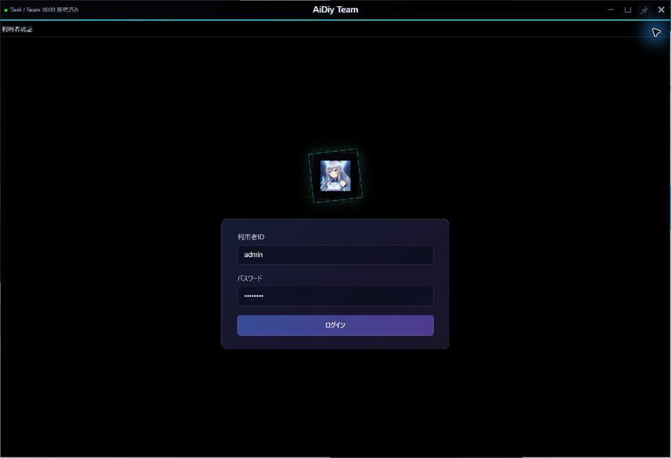

認証後の主画面です。Taskのログイン状態に影響されずにTeamを利用できます。

**図102：Teamログイン後**

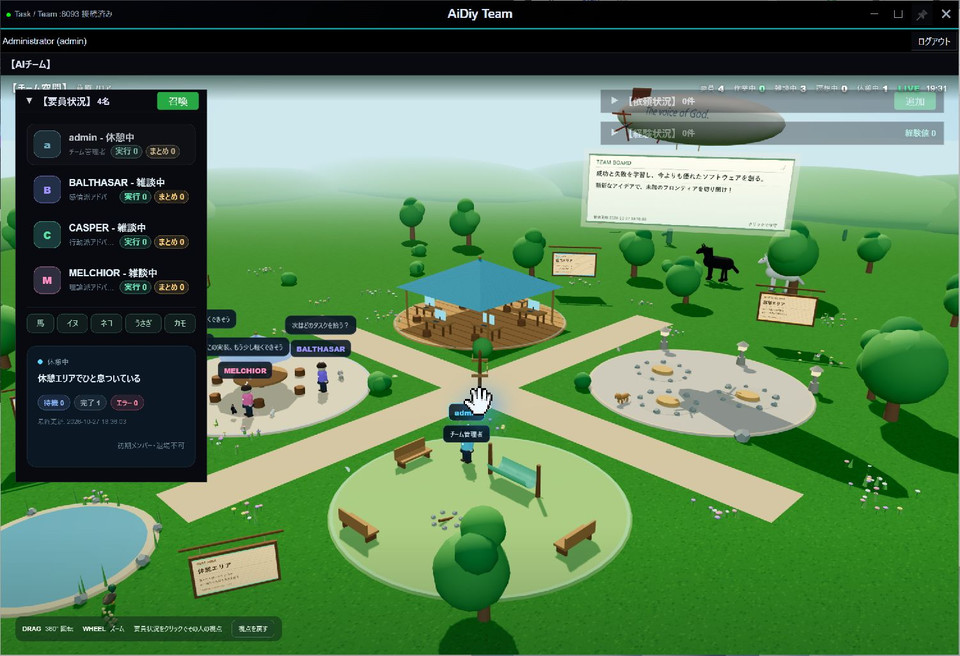

## 2. 要員と空間を見る

要員のシングルクリックはその人の視点、ダブルクリックは会話です。閲覧だけを紹介するときは一度だけ押し、下部の「○○の視点」と左の選択枠を確認します。一人称表示では「視点を戻す」が左下へ移るため、その場の位置を確認して全景へ戻します。空間の回転・ホイールによる距離調整は全景へ戻ってから行い、最後に「視点を戻す」で全体を見渡せることを確認します。召喚・退場・依頼・掲示板の編集とは分けて操作してください。

左の「要員状況」で要員をクリックすると、その要員の視点と状態を確認できます。空間のドラッグで向きを変え、ホイールで距離を変えます。「視点を戻す」で通常の表示へ戻します。

「召喚」から要員を選んで追加できます。不要になった試験要員は選択し、「要員を退場」で退場させます。初期メンバーのadminには退場できないことが表示されます。

Team-101ではAlan Turingを召喚して4名から5名へ増えること、役割が表示されることを確認しました。その後、試験要員を退場させて4名へ戻しました。

召喚後の要員一覧です。追加した要員の名前と役割を確認できます。

**図201：要員召喚**

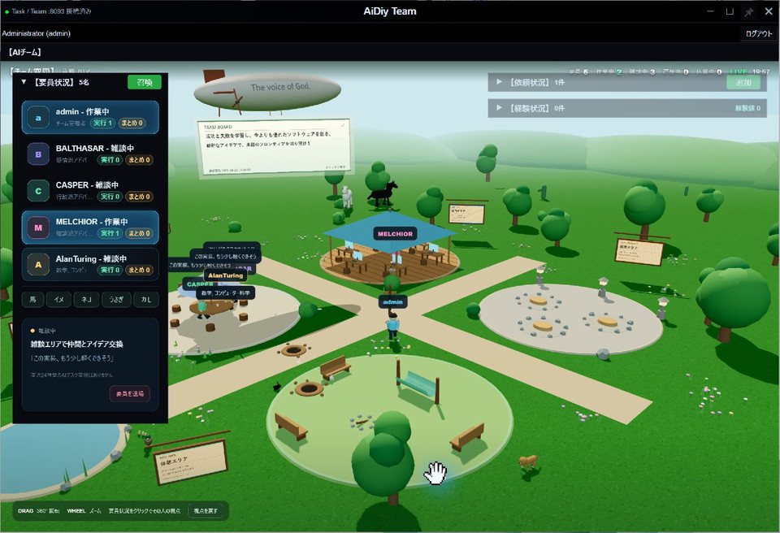

## 3. 依頼する・会話する

### チームへ仕事を依頼する

1. 右上の「依頼状況」で「追加」を押します。
2. プロジェクトのフォルダ、要求内容、TEAM／TASKのモデルを確認します。
3. 実行有効をONにして「登録」を押します。
4. 依頼状況が進み、経験状況に完了記録が追加されるまで確認します。

短い挨拶の実演でも、登録前に作業フォルダの指定を確認します。既定の「AiDiy 実行ルート（../）」は呼出側で_config基準の絶対パスへ解決します（相対パス受渡しの修正後、2026-11-02に新規依頼1件で確認）。TEAM側の「準備完了」「AIタスク投入済み」は回答完了ではありません。結果が出ない場合は同じ依頼IDの連携先を確認し、重ねて登録しません。要求の最終応答が終了処理の説明の場合、実作業の返信はTaskの同じIDの明細で、タイプdoの応答内容を読みます。

依頼行のシングルクリックは編集、ダブルクリックは要求・応答内容の表示です。経験行をダブルクリックすると、実行結果とまとめを確認できます。枠の見出しをドラッグすれば、一覧が重ならない位置へ移動できます。

Team-201では「挨拶.txtの合言葉をteam-result.txtへ1行保存し、一致を確認する」と依頼しました。MELCHIORへ担当が割り当てられ、Taskが完了した後、依頼は「済」、経験は「完了」になりました。実ファイルも「青い鳥」と一致しました。

依頼と経験を上下に並べた画面です。受付だけでなく、経験の完了と実際の成果物まで確認します。

**図301：依頼と経験完了**

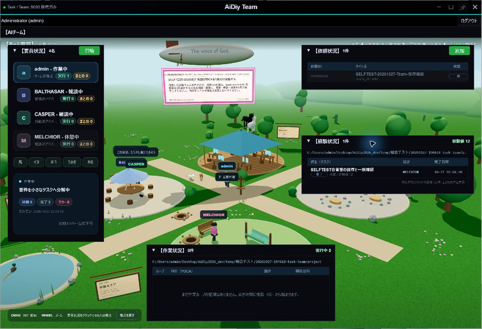

### 要員へ質問する

左の要員をダブルクリックして会話を開きます。掲示板のプロジェクトが引き継がれるため、対象フォルダを確認してから要求を入力し、「送信」を押します。プロジェクト調査を伴う会話は最大360秒を目安に観測します。

Team-202ではadminへ「挨拶.txtを読み、合言葉を一文で教えてください。ファイル変更は不要です。」と質問し、「合言葉は『青い鳥』です。」という回答を確認しました。

モデル名、対象フォルダ、質問、実回答を同じ画面で確認できます。

**図302：要員会話**

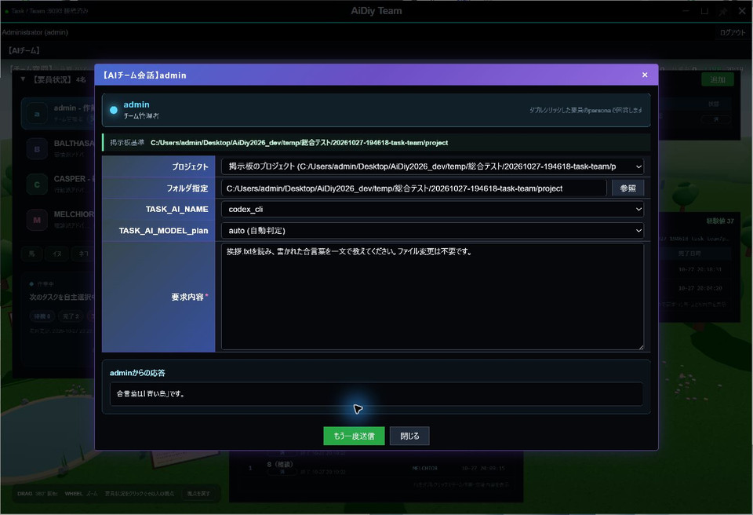

### 依頼を中止する

依頼行を1回クリックして開き、「中止」と実行有効OFFを選んで登録します。Team側だけでなく、連携して作られたTaskも中止になっていることを確認します。

Team-203ではTR00001003を中止し、対応するTaskも中止・OFFになりました。その後、新しいTR00001004で挨拶.txtの読取を依頼し、合言葉の回答、依頼「済」、経験「完了」まで確認しました。中止した依頼は再開していません。

中止した依頼と、新しく正常完了した依頼が別々に記録されています。下の経験一覧でも再依頼の完了を確認できます。

**図303：中止後の再依頼完了**

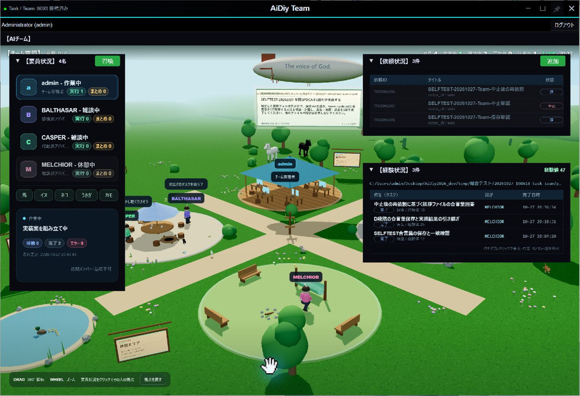

## 4. 目標と有限サイクルを設定する

草原の掲示板をクリックすると、チーム目標を編集できます。プロジェクト、目標、チーム作業、モデル、自動作業、作業ループを確認して登録します。別プロジェクトを登録する場合は、既存目標を上書きしないようフォルダを確認します。

SPDCAは、S（相談）→P（計画）→D（実施）→C（評価）→A（改善）の順で進みます。回数を1にすれば1周で止まります。「自動作業設定」と「作業ループ」は別の設定です。

画面を読むときは、上から「チーム目標」「自動作業設定」「チーム作業」「作業ループ」の順に見ます。自動作業設定は、目標に沿った「今やるべきこと」の意見を集めてチーム作業へ取りまとめるための設定です。作業ループは、その作業を進めるサイクルの設定で、進行パターン・回数・相談の参加人数を確認します。PlanDoは計画→実行、SPDCAは相談から改善までの流れです。回数欄の99は無制限なので、有限回数と区別します。

説明だけを行う場合は、掲示板の内容が公開可能であることを確認してから開き、両スイッチの現在表示を読みます。スイッチ・値・プロジェクトを変更せず、下部の「閉じる」で戻れます。「更新／登録」「削除」は押しません。画面の設定を読めたことと、保存・自動生成・サイクル完了を検証したことは別です。

Team-301では試験用プロジェクトに目標を登録し、開き直して内容が一致することを確認しました。チーム作業は「合言葉をteam-cycle.txtへ保存する方法を相談・計画し、実施・確認・改善を1周で完了する」、動員2名、SPDCA、1周、自動作業OFFです。作業ループだけONにして開始しました。

有限サイクルの設定画面です。回数・パターン・2つのON／OFFを確認してから登録します。

**図401：有限サイクル設定**

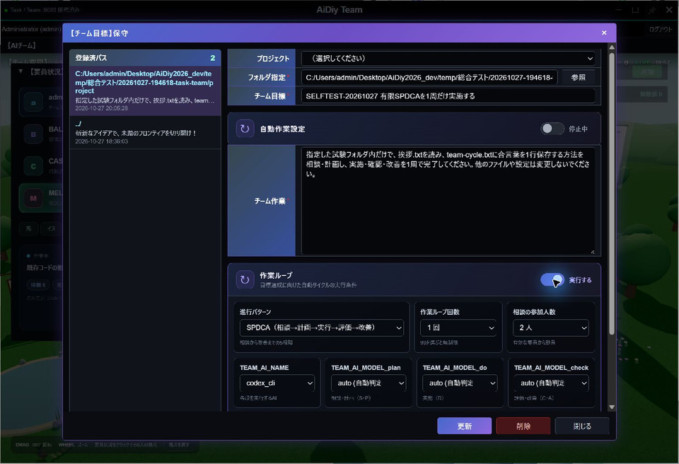

SはCASPERとMELCHIOR、P以降はMELCHIORが担当しました。DからTaskが作成され、ファイル保存と検証が完了しました。C・Aまで終了した後、作業ループが自動でOFFになり、2周目が作られないことを確認しました（Team-302）。`team-cycle.txt` の内容は「青い鳥」です。

完了後に目標を開き直した画面です。自動作業と作業ループの両方が「停止中」になっています。

**図402：一周完了後OFF**

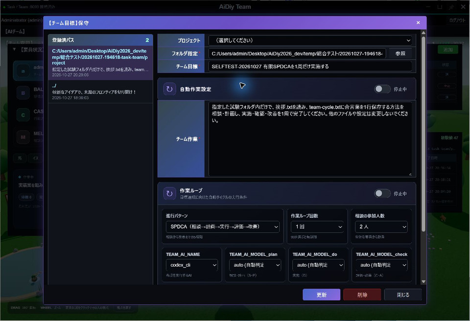

## 5. 📌で最前面を維持する

右上の📌を押すとTeam窓を最前面に保ちます。ONはピンク、OFFは白寄りの灰色で、背景は透明です。もう一度押すと解除します。

Team-401では、ONのままTaskを操作してもTeamが前面に残り、解除後は通常の重なり順へ戻ることを確認しました。別のピン留め窓もある場合は、選択した窓が上になります。

ピンクの📌が最前面維持の目印です。

**図501：最前面ピン**

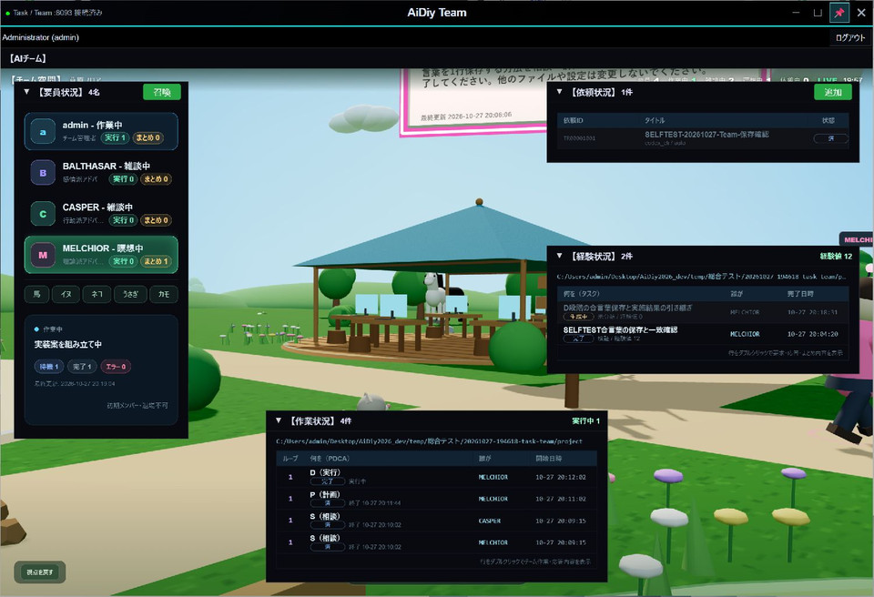

## 6. ログアウト・終了・再起動

認証を終了する場合は、画面上部の「ログアウト」を押します。アプリを終了する場合はTeamの窓を閉じます。依頼や自動作業・作業ループを止める場合は、3・4章の設定を先に確認します。アプリの窓を閉じる操作とは区別します。

誤った利用者IDでは拒否理由が表示され、正しい情報で再ログインできました。TeamのログアウトはTaskのログイン状態に影響しません。

Team-501ではTeamを終了し、Diagから起動し直しました。再ログイン後も要員4名、依頼3件、経験3件と経験値47が表示されました。目標を開き、試験フォルダ、SPDCA・1回・2人、codex_cli／auto、自動作業・作業ループの両方が停止中であることを確認しました。

アプリを終了・再起動した後の目標です。保存した条件と停止状態が保持されています。

**図601：再起動後の停止設定**

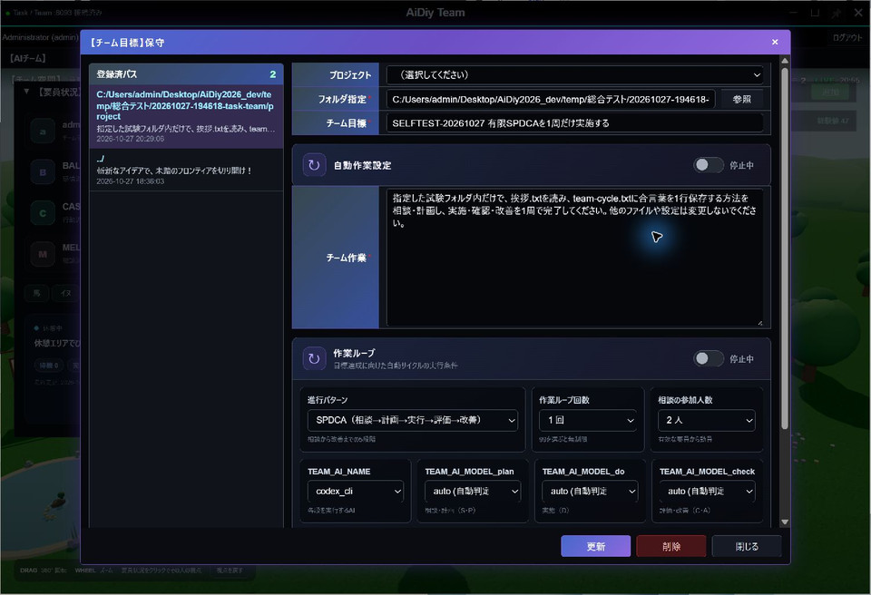

## 7. 追加テストと確認範囲

### 目標設定の読み取り解説

2026-11-02の解説では、通常ログインから既定の掲示板を開き、自動作業設定・作業ループがともに「停止中」、進行パターンPlanDo、回数1、相談の参加人数2の表示を確認しました。役割と入力位置を紹介し、スイッチ・値・プロジェクトを変更せず「閉じる」で戻り、実演用Team窓を通常終了しました。保存・更新・削除・有効化・AI実行は行っていません。この確認はTeam-301〜302のサイクル実行試験とは別で、既報の依頼パス受け渡し・状態反映問題の修正確認でもありません。

2026-11-02のナレーション実演では、挨拶一文のみ・ファイル操作とコマンド実行不要の依頼を1件登録しました。TEAM/TASKはcodex_cli、各モデルauto、目標の自動作業・作業ループは変更していません。依頼 `TR00001001` は15:03:08に投入、実行回数1。「準備完了／AIタスク投入済み」の表示を確認しましたが、同IDのTaskは15:03:38に実行回数1でエラー終了しました。読取専用の状態照合で「第1ステップ（タスク分解）に失敗しました: ! プロジェクトパスは絶対パスで指定してください。」を確認。経験0件、挨拶回答は未取得です。二重登録・再実行・既存依頼編集はせず、実演用Teamを通常終了しました。この条件を成功扱いにせず、相対パスの引渡しとTEAM側状態反映を別途確認する必要があります。

Windowsの単独Electronで、要員4名と3D空間、adminの退場不可表示、依頼フォームの空欄拒否、取消後の依頼0件維持、目標設定の表示、ログアウトと終了を確認しました。目標設定の表示確認では保存せず、自動作業・作業ループとも停止中を維持しました。

Python隔離試験10件は、一時DBと模擬API・プロセス停止・AI会話でTask制御を確認しています。共通認証・通信・画面構成・ピンのNode36件も成功しました。型チェックはTaskと共用します。

灰色タイトル、細い外枠、透明なタイトル操作ボタンとピンON／OFFを実画面で確認しました。ログイン画面は黒背景のアイコンと逆方向に回る二重四角形、青紫の入力カードです。時間を空けた観測で回転角度の変化を確認しました。

TaskTeam停止時は主画面が「未接続」と黒いバーになり、再起動後は「接続済み」に戻りました。認証・遅延応答の自動試験21件も成功しました。現在の401だけが該当セッションを終了し、古い401は新しいログインを消さず、403・500・通信失敗を認証切れと混同しません。これら6件は21件の内数です。実Coreの期限切れトークンと、APIクライアントの模擬応答を分けて確認しています。

### 起動経路

通常・ミニ・アイコン表示から起動し、認証と接続状態を確認しました。通常表示からの画面は1章に掲載しています。

ミニ表示から起動した認証後の画面です。

**図701：Teamミニ表示起動**

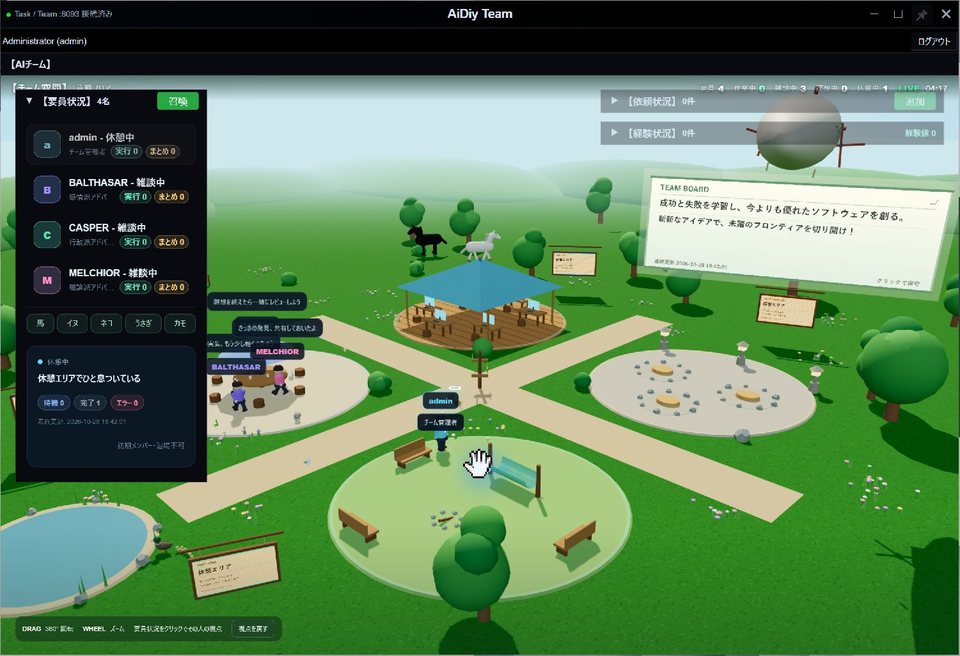

アイコン表示から起動した認証後の画面です。

**図702：Teamアイコン起動**

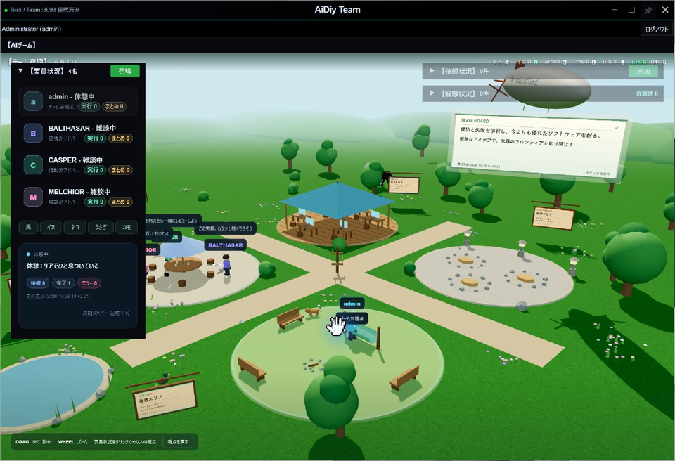

### 試験データと終了確認

| 対象 | 確認内容 |
|---|---|
| TR00001001 | 合言葉の保存。依頼「済」、Task「完了」、経験記録と実ファイルを照合。 |
| TR00001002 | 有限サイクルのDで作成されたTask。完了し、C・Aへ進みました。 |
| TR00001003 | 中止対象。対応するTaskも中止・OFF。 |
| TR00001004 | 中止後の新規読取依頼。依頼「済」、Task「完了」、経験「完了」。 |
| 試験目標 | 専用プロジェクト、SPDCA・1周。完了後にループ自動OFF。 |
| 既存目標・要員 | `../` の目標とadminを含む元の4名を保持。追加した試験要員だけ退場。 |

Team関連の自動試験10件、共通ピン制御16件が成功し、Task／Teamの型チェックも通りました。自動試験は実画面の結果を補うものです。終了時は試験用の自動作業・作業ループ・定期実行をOFFにし、実行中の処理がないことを確認しました。

補助試験には共通処理の結果が含まれるため、別の条件・別冊の件数を単純に合計しません。自動作業による連続的な依頼生成と、空の作業内容による自動会話は実試験に含めません。

### 長押しドラッグの実機確認（2026-11-02）

Windows実機で `mouse_long_press_drag`（保持0.8秒、移動0.6秒。Browser全画面は移動0.8秒）を使用。直前の画面から対象を同定し、移動後の実画面とOSの窓位置を照合します。入力欄・ボタンの除外判定は下記の実施対象に限定します。位置は画面座標の (x,y) です。

認証前の標準窓 (203,10) → (143,10) と利用者ID入力欄の除外を確認後、利用者が指定した試験用認証で通常ログイン成功。認証前提はランチャー編の「ローカル試験用の利用者」を参照する。認証後の3D画面 (203,10) → (143,10)、依頼状況パネル展開中 (143,10) → (173,10) の背景移動に成功。「視点を戻す」ボタンの長押し移動では窓移動・ボタン実行とも起きない。依頼は0件のため依頼内容・応答の表示は前提不足。要員・依頼の作成やAI実行は行わず、通常UIで終了した。

解放後にポインターを離して追従が残らないこと、通常UIが使えることを確認。Diag以外の今回起動した窓は通常UIで終了しました。1〜2pxの寸法丸めは補正を追加していません。全セルフテストの再実行や、未実施モードの合格を意味しません。

### IDE連携・単独起動の追加確認（2026-11-02）

IDE連携TASK／TEAMの内部認証、指定タイトル、📌開始、起動元プロジェクト固定、起動ボタン連打で同じ窓の再利用をWindows実機で確認。TASKは初期メインのみ、TEAMは通常空間表示。両方の新規編集で固定フォルダとモデル一覧を確認し、登録せず取消した。TASKのreadonly欄への貼り付けで値は不変。TEAMの最小化後も起動ボタンで同じ窓を復帰。IDE本文を選択しても連携窓は背面に沈まず、IDE終了で所有する両窓が閉じた。

単独TASK／TEAMは通常ログイン、正しい単独タイトル、同じプロジェクトへの再起動要求で既存窓を再利用することを確認。単独TASKのログイン後はメイン1窓、編集のフォルダ選択・参照は有効。内部サービス主体をadminに置換しない。内部トークンは画面・URL・storageへ渡さない。

関連fixture46件成功（窓所有/終了確認9、Task窓10、プロジェクト/資格情報3、proxy8、UI8、pin8）。Core認証は36実行中33成功・POSIX3スキップ、TaskTeam認証9成功。型確認と局所buildは終了コード0。複数IDE・異なるプロジェクトの分離と不正なフォルダ更新拒否はfixture確認で、実データ登録・AI実行は今回未実施。

### TEAM連携のパス・準備失敗の隔離回帰（2026-11-02）

設定由来の相対プロジェクトは、Task/Team内部HTTP呼出側で `_config` 基準の絶対パスにしてToolsへ渡します。要求辞書・保存済みDB値は変更せず、Toolsの絶対パス検証と認証は維持します。タスク準備失敗時は同一トランザクションで関連TEAM依頼・作業のエラー、応答、終了時刻を反映します。中止済みTASKの状態は上書きしません。

新規fixture回帰3件成功。内部HTTP既存回帰は10件成功、シンボリックリンク作成1件はWindows特権不足（WinError1314）で前提不足。追加のASGI認証回帰は先頭テストが終了せず専用試験プロセスだけ中断し、成功数へ含めていません。実DB・実AI・既存要求は変更していません。状態反映コードをロードするTaskTeam(8093)の反映再起動と実機再試験は保留中です。全章PASSではありません。

追記: ASGI認証回帰の停止はsandbox内のasyncio socketpair作成前待機。実サービスを使わない同一fixtureを通常実行環境・25秒上限で再確認し、9件すべて成功（exit0）。OS設定は変更していない。承認後にTaskTeamだけ正規rebootトリガーで再起動し、PID交代とHTTP200を確認。新規試験TR00001002を通常UIで1件登録し、TEAMの../が連携TASKでは対象ルート絶対パスになったことを読み取り確認。最終結果は観測中。

### 既定プロジェクトの修正反映後の実機結果（2026-11-02）

TaskTeamのみ正規トリガーで再起動（19:15 JST、監視元PID13984維持、サーバーPID23200→1316）。新規TR00001002を通常UIで1回登録。TEAM表示../に対し、連携TASKはC:\Users\admin\Desktop\AiDiy2026_devへ解決されました。担当BALTHASAR、TASK/TEAMとも完了、終了日時19:20:55、実行回数1。経験欄の完了・経験値3を実画面で確認。

Task明細SEQ1（do）の実機表示で「おはようございます。」、状態完了、実行回数1を確認。SEQ0・9999も完了。要求の最終応答は「操作検証対象のファイル操作がないため、終了処理を完了しました。」であり、挨拶本文とは区別します。既存TR00001001を再送・編集していません。失敗反映は隔離SQLite回帰で検証し、本番に意図的な失敗要求は投入していません。

Team窓通常終了、Task明細通常終了、Task本体ログアウト→利用者認証→通常終了を確認。Nanami1.2の説明・追加結果説明・整理音声を直列再生。自動作業・作業ループは有効化していません。全章・全モデル合格を意味しません。

### 複数IDEのTEAM分離（2026-11-02追加実機）
ルートcwdからルートとdocsをそれぞれ--project指定して正式aidiy_ideを起動。双方の「＋ TEAM」から接続済み・📌・変更不可の固定先を実画面確認しました。rootはPID20220/hwnd18550284、docsはPID20552/hwnd11340582で独立。docs側の再押下後も両ハンドルと窓数は不変。docs IDEだけを通常終了するとdocs TEAMだけ閉じ、root TEAMを復元して接続とroot固定先の保持を確認しました。その後root IDEの通常終了で所有TEAMも回収。登録・送信・既存データ変更なし。Nanami1.2の説明を事前合成し直列再生。これは窓/固定先/所有終了の確認で、別プロジェクト間の全DBデータ隔離を保証する試験ではありません。

### 専用プロジェクトでの召喚・会話と有限SPDCA

単独Electronで公開personaのAlanTuringを1名召喚し、専用プロジェクトから挨拶を1回送信、「おはようございます。」を確認してその要員だけ退場しました。既存4名は保持し、退場の監査行を残しています。codex_cliの実モデルはgpt-6-luna、CLI呼出し1回・モデル応答記録2件です。

別の専用目標では自動作業OFF・SPDCA・1周・相談1名を保存し、S→P→D→C→Aの全段「済」、作業ループの自動OFF、次の2周目がないことを確認しました。既存目標と4名は保持しました。Pは相談結果1件の引継ぎで、追加のAI計画呼出しはありません。Dの連携Taskは挨拶を1回返し、経験記録も完了しています。

修正前の試験では、Cは引継ぎに挨拶原文がなく文数を判断できず、Aは原文を引き継ぐ改善案を返しました。修正後の確認は末尾に記載します。したがって有限ループの進行・停止は確認済みですが、Cの内容評価が成功したとは扱いません。ソースや既存目標の変更、追加ループは行っていません。1回のサイクル要求に対し内部CLI呼出し10回・モデル応答記録28件で、gpt-6.1-sol／gpt-6-luna／gpt-6.1-terraを使用しました。

## 証拠照合と残る確認

2026-11-03の文書・既存証拠照合と、その後の限定修正・実機確認を分けて記録しています。

- **確認済み**：本文第7章の過去TR00001003中止・関連Task OFF、TR00001004再依頼、有限SPDCAは確認済みです。後続2026-11-03の[Team_203](evidence/.aidiy_cache/selftest/セルフテスト,aidiy_team,操作編/Team_203_召喚会話退場.json)、[Team_404](evidence/.aidiy_cache/selftest/セルフテスト,aidiy_team,操作編/Team_404_有限SPDCA.json)で公開要員1名の召喚/会話/退場、1周・自動OFF・2周目なしを確認。既存4名/目標保持も照合済みです。
- **原文引継ぎ修正の確認（2026-11-03）**：[Team_405](evidence/.aidiy_cache/selftest/セルフテスト,aidiy_team,操作編/Team_405_D原文引継ぎ.json)。原因は、Dのまとめ／Task最新ステップ表示だけをCへ渡し、do明細の実回答を渡していなかったことです。Team側の取得・引継ぎ2ファイルだけを修正し、同一依頼・同一プロジェクトに紐づくdo明細のSEQ・状態・原文を要約とは別枠で渡します。Taskの表示仕様は維持し、開始・終了・分岐通知を実回答にしません。原文が無い場合も明示します。
- **自動試験**：SQLiteの単一／複数明細、失敗・パス、通知除外、別依頼・別プロジェクト、空原文、Cプロンプトへの受渡し等11件と既存回帰13件、計24件成功。3ファイルの構文確認成功。既存のシンボリックリンク負例1件はWindows権限不足で未確認、権限は変更していません。
- **実機結果**：単独Electronの専用目標で12:12:11に1回開始。相談1名・自動作業OFF・SPDCA1周、TW00001006〜01010、D連携TR00001004。SEQ2の「おはようございます。穏やかな朝になりますように。」がCの実送信入力と完全一致し、Cは原文を引用して「二文・一文条件未達」と評価しました。原文引継ぎはPASS、挨拶内容の一文条件は未達と区別します。Cに成功と言わせる試験ではありません。
- **終了と範囲**：12:24:08にループ自動OFF、12:26:57まで2周目なし。既存4名・退場済み試験要員・元目標を保持し、試験窓は通常終了。1サイクル開始に対し内部codex_cli呼出し11回・モデル応答利用量記録28件、実モデルはgpt-6.1-sol／gpt-6.1-terra／gpt-6-luna。各段の新規プロセスへ反映し、サービス再起動なし。Nanami1.2の状況音声を直列再生しました。
- **残る確認・限界**：この原文欠落は修正・実機確認済みです。中止機能や全persona・全パターンを新たな必須試験に戻しません。AIの回答品質・副作用全般を保証するものではなく、今回は原文受渡しと根拠付き評価・有限停止を確認しました。

### 現行の判定（文書順再照合）

- **確認済み**：召喚会話退場・有限SPDCA・D原文→C引継ぎ24試験/実機確認済み。
- **本当に残る確認・範囲**：Windows権限不足のシンボリックリンク負例1件は未確認。一文指定に二文回答した品質限界は不具合修正PASSと区別。
- **証拠の扱い**：上記の本文・図・参照結果を照合。先行調査の未実施/拒否/準備失敗は当時の記録であり、後続の成功や実施不要指定を優先します。今回の文書整理を新しい実機PASSには数えません。
