# frontend_web AiDiy編 — 操作ガイドとセルフテスト

> 確認範囲：本文には過去の実機・自動試験結果と今回の追補を含みます。今回の実施状況は[確認結果](セルフテスト,共通,確認結果.md)の章別台帳を参照してください。今回の全章再実行・全条件合格を示すものではありません。

> 本書はセルフテスト結果を、操作説明・解説書としても読みやすく整理しています。再テスト後は結果・注意書き・エビデンスを更新し、章立て・操作手順・図解の配置などの様式を維持します。

> 文書: `セルフテスト,frontend_web,AiDiy編.md` | 実装: `frontend_web/src/components/AiDiy/`, `frontend_web/src/stores/`

## 総合評価

再試験の実施順・変更後に確認する範囲は[共通の再試験準備](セルフテスト,共通,確認結果.md#本日6時以降の更新に対する再試験準備)を参照します。以下の総合評価は記載した実施条件での結果です。画像番号は章と掲載順を表し、試験ケースIDとは区別します。

実画面の最終確認は2026年10月28日です。ログイン、Chat／Code／Live入口、配車・生産一覧の読取、ログアウト、旧URLでTask／Teamを開かないことを確認しました。AIの文字応答・添付・設定保存は10月24日の結果です。

**総合評価：✅ OK。2026年10月24日・Windowsで確認しました。ログイン、Chat、Code1〜6、Liveの文字応答、添付、設定ファイルへの保存、再接続、ログアウトは✅ OKです。** 結果は記載した日時・条件の記録であり、現行版の全機能を再試験した結果ではありません。

対象環境はWindowsです。Mac／Linux実機と長時間連続運転は **PASS（環境依存・判定対象外）** とし、今回は未実施です。実行成功とは区別し、NGには数えません。

再接続を2回繰り返してCode5・6の表示を維持できることを確認しました。履歴は置換して復元し、同じ内容の別の発言は削除しません。関連自動テスト13件とWebの型チェックが成功しています。

本冊は通常Webの操作確認です。Codeによる実装変更、各プロバイダの全モデル、実マイク入力や音声の聴取、全ゲームの動作網羅は合格範囲に含めません。ブラウザが認識するマイクは0台のため、実マイク入力は **PASS（環境依存・判定対象外）** です。BGMの再生は **✅ OK** です。

**注意：** Chromeでは音声の自動再生が制限されます。画面上で手動のクリック操作により音声をオンにしてから再生します。computer-useで確認する場合も、この音声オン操作が必要です。

## 始める前に

Task／Teamは独立コマンドを使います。`/AIタスク`／`/AIチーム` の直接URLでは専用画面を表示せず、共通メニューだけが残ります。Webの型チェック・依存探索・構成試験は成功しています。直近の起動・表示試験では業務データや設定を変更せず、AIへの依頼も送信していません。

現行のAiDiy画面です。Chat／Code／Liveの入口を維持し、Task／Team用の操作ボタンはありません。

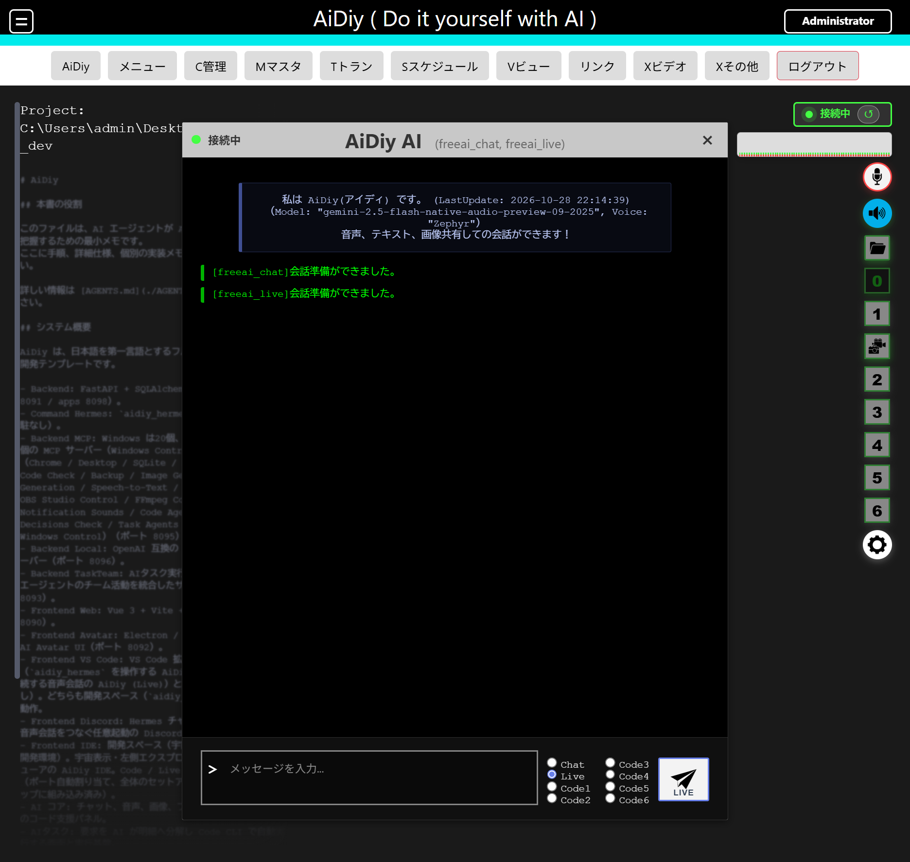

独立HTMLデモは各ページのimportmapを使うため、Viteの依存探索は `index.html` を入口にします。空の専用キャッシュから依存探索が完了することも確認しました。

[システム起動編](セルフテスト,aidiy_diag,システム起動編.md)に従い、WebとCoreを起動します。通常Webは `http://127.0.0.1:8090` です。Avatar WebはAvatar起動中の8092で、本冊とは別です。

試験用アカウントは[ランチャー編](セルフテスト,aidiy_diag,ランチャー編.md#ローカル試験用の利用者)を参照します。今回のCode入力は挨拶だけで、ソース変更は依頼していません。ファイル操作を依頼する場合は、試験専用フォルダを指定します。

画像は縦横比を保って長辺960px以下にしています。パネルの説明用には1600×1000の表示領域を使用しました。小さい画面では必要なパネルだけ開くと本文を読みやすくなります。

## 1. ログインする

1. `/AiDiy` を開きます。未認証ならログイン画面になります。
2. 利用者IDとパスワードを入力して「ログイン」を押します。
3. 上部メニューから目的の機能へ進みます。

**✅ OK：** 未認証での保護URL、誤ったパスワードの理由表示、正しいログインを確認しました。ログイン後の利用者表示を確認しました。C管理への移動とブラウザの戻る、再読み込み後の認証維持、直接URLのMマスタ9項目も確認しました。

パスワードが違うと理由が表示されます。入力を直してからログインします。

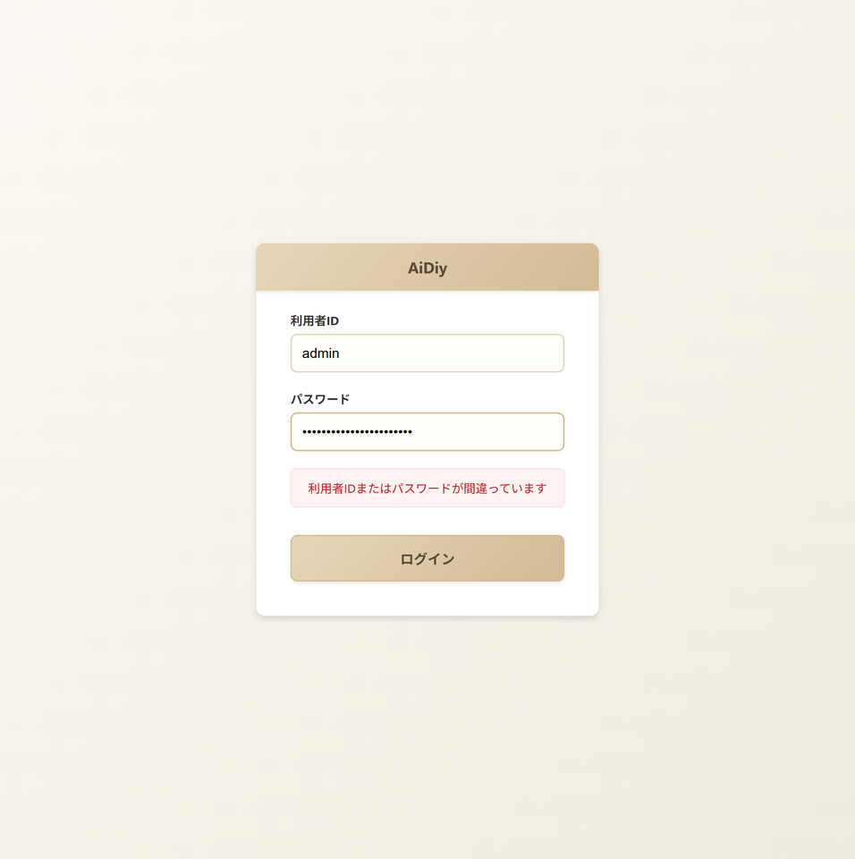

現行の上部メニューはAiDiy、メニュー、C管理、Mマスタ、Tトラン、Sスケジュール、Vビュー、リンク、Xビデオ、Xその他、ログアウトの11項目です。ソース上の構成を確認しています。AIタスク／AIチームの入口はありません。2026-11-02の専用セッションでも上部11項目を実画面で確認しました。記録画像の再撮影は行っていません。

2026-11-02の通常Web紹介では、専用InPrivateから通常ログインし、メニュー画面、右上Administrator、上部11項目、C管理の入口までを確認しました。利用者一覧・業務データは開いていません。文書整備を優先する指示で音声解説はこの地点で中断しました。後片付けでは「ログアウト」→「OK」→ログイン画面へ戻ることを確認して専用窓を終了。第8章の音声解説まで完了した結果ではありません。既存セッションと区別して、閲覧用の専用セッションを使います。

## 2. ChatとCodeで話しかける

1. 上部の「AiDiy」を開きます。
2. 右側の「0」でChat、1〜6でCodeを開きます。パネルの×で閉じられます。
3. Chatでは「Chat」を選択し、入力して送信します。Codeでは各パネルの入力欄から送信します。
4. 接続中の表示、準備完了の案内、正式な返答を確認します。Codeでは停止ボタンが無効になったことも確認します。

**✅ OK：** Chatに「おはよう」、続けて「先ほどの挨拶を短く言い換えて」と送り、文脈に合う返答を確認しました。別の新規会話では前の発言が引き継がれず、会話が分離されました。

Chatで挨拶に返答した画面です。通常の文章を入力して会話できます。

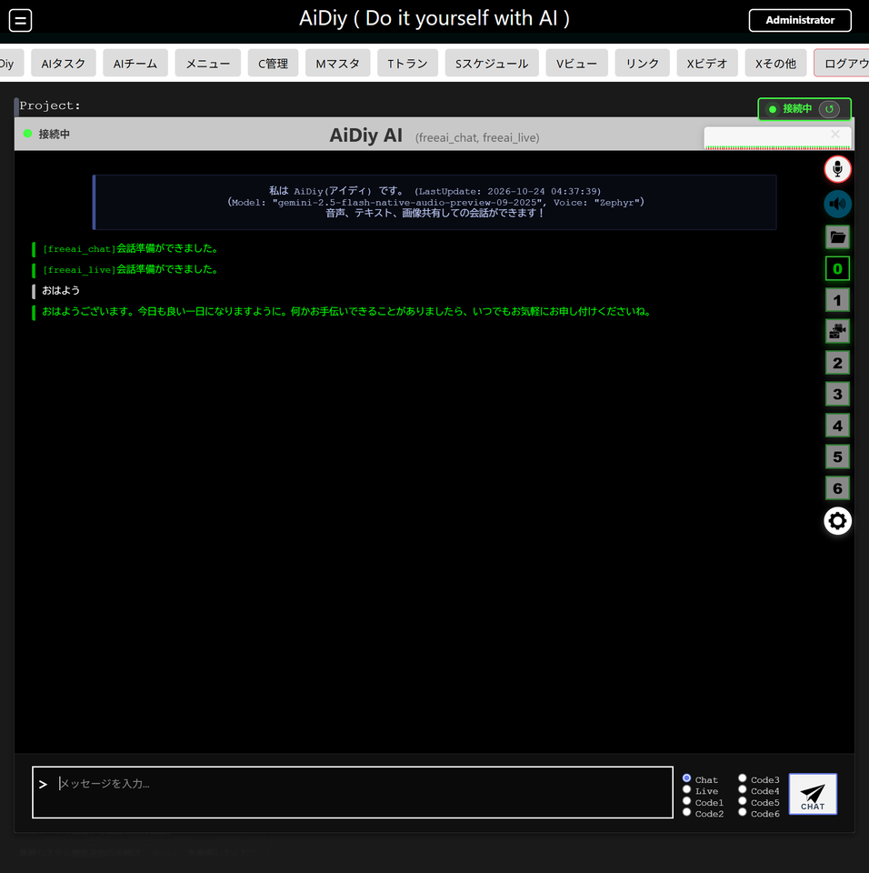

新規会話で直前の発言を尋ねた結果です。別の会話の内容は混ざっていません。

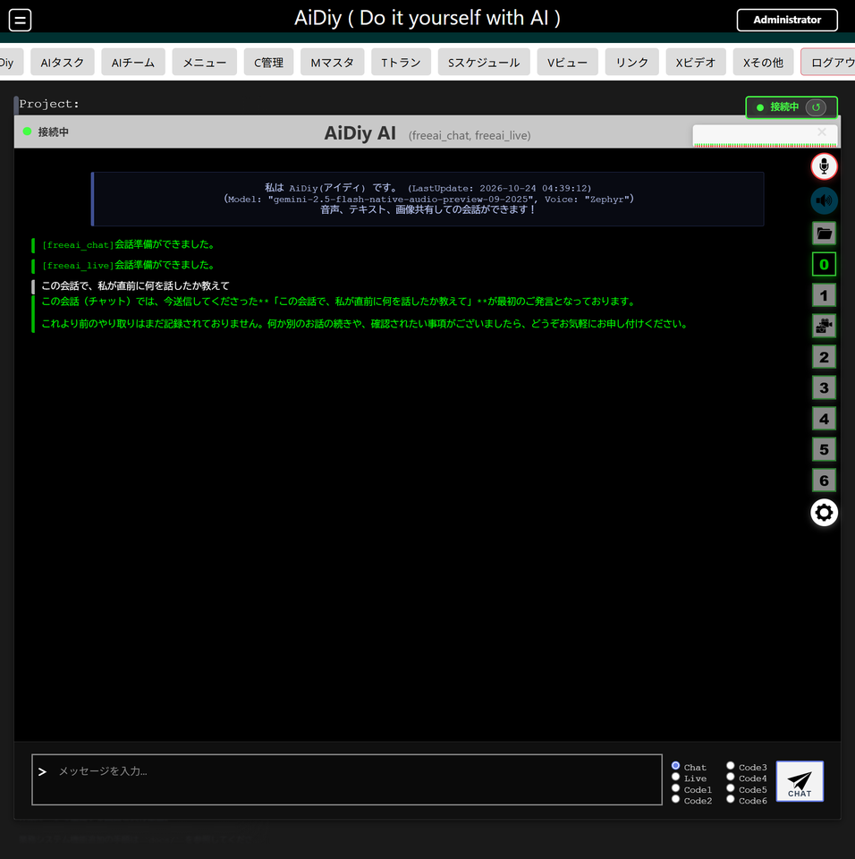

Code1〜6を順に追加し、それぞれ「おはよう」の正式な返答まで確認しました。今回の挨拶試験では検証を0回にしました。実装を依頼するときは必要な検証回数に戻します。再読み込み後は画面の初期値が1回になるため、画像と送信時の指定値を混同しません。

| パネル | 今回のプロバイダ | 結果 |
|---|---|---|
| Code1 | codex_cli | ✅ OK：挨拶の返答と処理完了 |
| Code2 | copilot_cli | ✅ OK：挨拶の返答と処理完了 |
| Code3 | claude_cli | ✅ OK：挨拶と作業案内、処理完了 |
| Code4 | antigravity_cli | ✅ OK：挨拶と作業方針、処理完了 |
| Code5 | opencode_cli | ✅ OK：挨拶の返答と処理完了 |
| Code6 | aidiy_hermes | ✅ OK：挨拶の返答と処理完了 |

Code1とCode2の返答です。番号ごとにプロバイダと会話を確認できます。

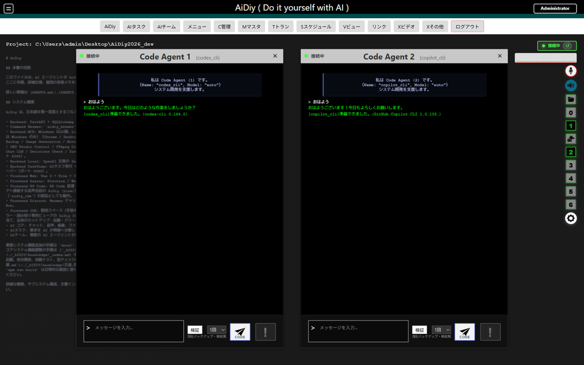

Code3とCode4の返答です。長い返答はパネル内をスクロールして読みます。

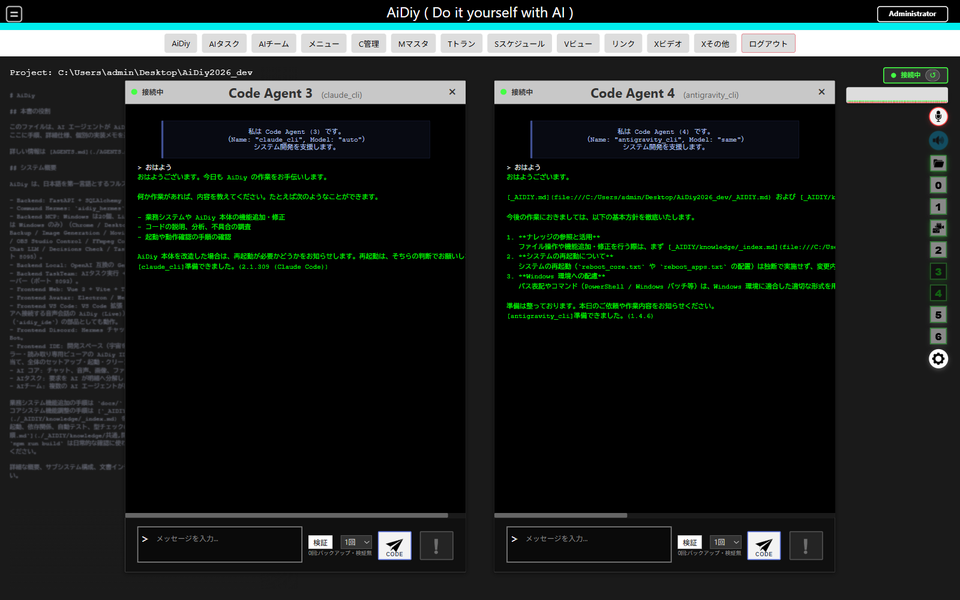

Code5とCode6の返答です。再接続後も各1回分の挨拶が残っています。

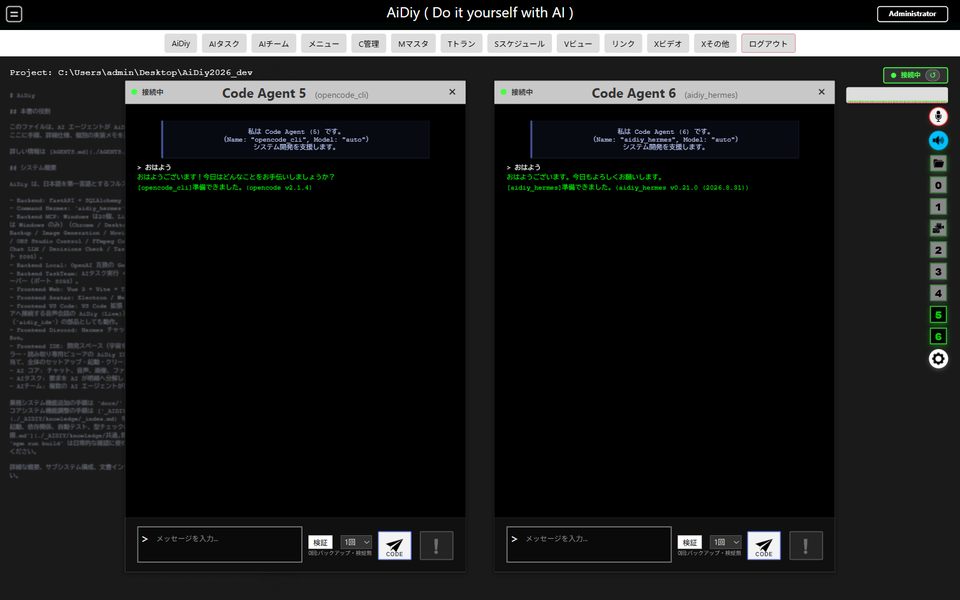

## 3. パネルを増やす・再接続する

右側のフォルダとカメラのアイコンで、File ManagerとLive Captureを追加できます。ChatとCode1〜6を合わせると9パネルです。狭いパネルで本文を読むときは不要なパネルを×で閉じます。表示するだけではファイルや画面をAIへ送信しません。

接続をやり直す場合は右上の↺を押します。**✅ OK：** 同じセッションIDを保ち、Code1〜6の挨拶が各1件のまま、9パネルが再接続後も表示されました。2回繰り返してCode5・6が消えないことを確認しています。

Liveの会話文脈は、サーバー側で接続しているLive APIの同じセッションが保持します。画面への履歴の保存・再表示は不要です。Webをリフレッシュしても、サーバー側のLiveセッションが維持されていれば会話を続けられることが確認点です。Core再起動後の新しい応答確認とは区別します。履歴が再表示されないことは不具合・残件に数えません。

再接続後の9パネルです。Code5・6を含め、開いたパネルが残ります。

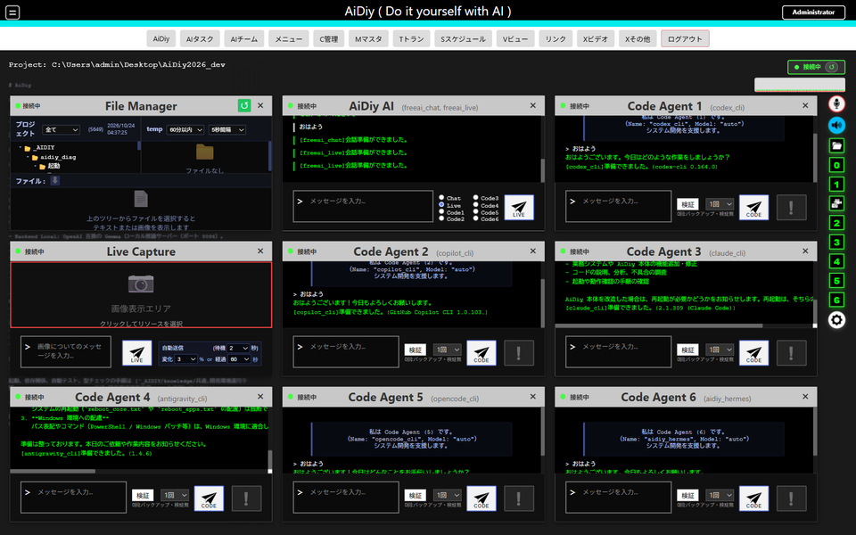

## 4. Liveで文字を送る

Chatパネルの「Live」を選び、準備完了を確認して15秒以上待ってから文字を送ります。今回は「おはよう」を1回送り、17秒後の確認で「おはようございます!いつもありがとうございます。今日も一日、よろしくお願いします。」という返答を確認しました。応答が遅いときに同じ文を連打しません。

**✅ OK：文字入力からのLive応答。** マイク入力・音声の聴取とは別の確認です。

Liveを選んで挨拶した結果です。入力モードと返答を確認します。

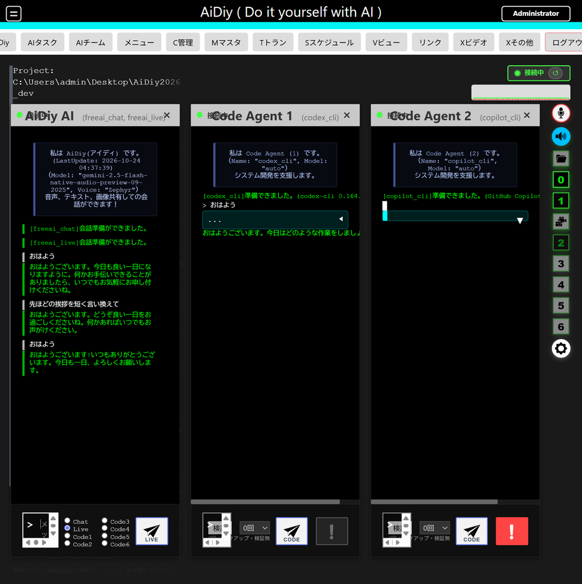

## 5. ファイルを添付する

Chatの入力欄へテキストやPNGをドラッグ＆ドロップします。「ファイル入力」とファイル名が表示され、画像ではサムネイルも表示されれば受信を確認できます。

**✅ OK：** 今回はドロップイベントで、日本語と空白を含む `確認 20261024.txt` と `青丸 20261024.png` を添付しました。保存されたテキストが元の内容と一致し、PNGの保存内容も送信前と一致しました。実ファイルをマウスでドラッグする操作とは区別し、受信・保存・表示を確認した結果です。

日本語のファイル名と青い丸のサムネイルが表示されています。

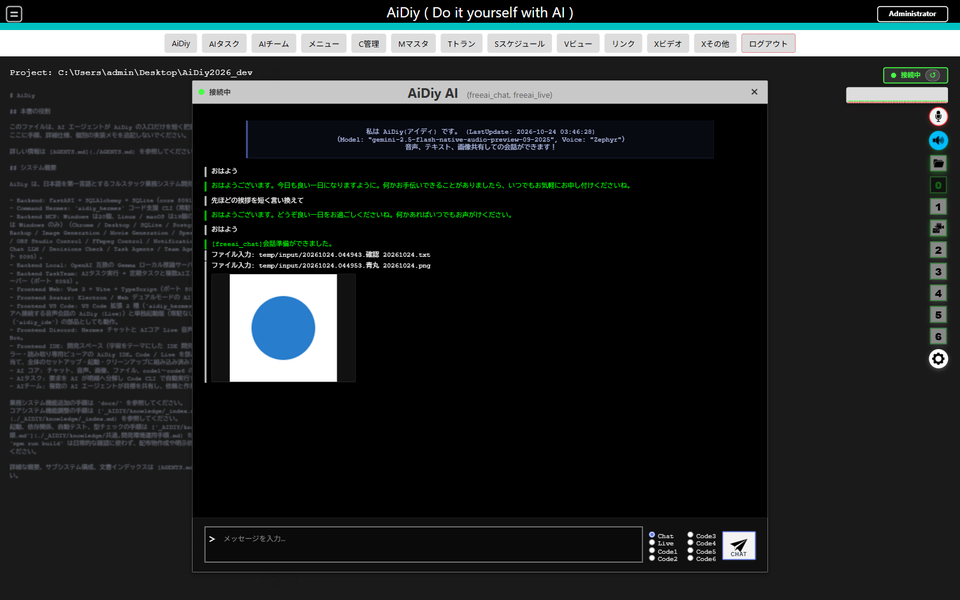

## 6. 設定を保存する

1. 右側の歯車を押してモデル設定を開きます。
2. 「フォルダ」など必要な項目を変更します。
3. 「保存(json書換)」は共通設定ファイルへの保存です。現在の会話の設定はそのままです。
4. 現在の会話に反映する操作とは分けて扱います。既存の作業中に不用意に作業先を切り替えません。

**✅ OK：** 試験フォルダを保存し、設定ファイルの `CODE_BASE_PATH` が入力値と一致しました。ダイアログを開き直すと現在の会話の値が表示される仕様も確認しました。試験後は元の `C:\Users\admin\Desktop\AiDiy2026_dev` に保存し直し、ファイル上の復元を確認しました。「保存後の再表示で新しいフォルダが適用される」とは説明しません。

フォルダを指定した設定画面です。「保存(json書換)」と「設定/再起動」を区別して使います。

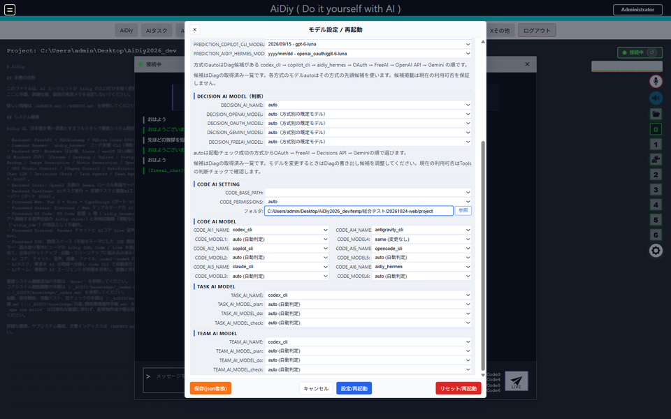

## 7. 管理画面とデモを開く

「C管理」から権限・利用者・採番を開きます。**✅ OK：** 権限5件、利用者5件、採番8件を表示しました。ここでは既存データを編集していません。

C管理の利用者一覧です。IDと名前を確認してから対象を選びます。

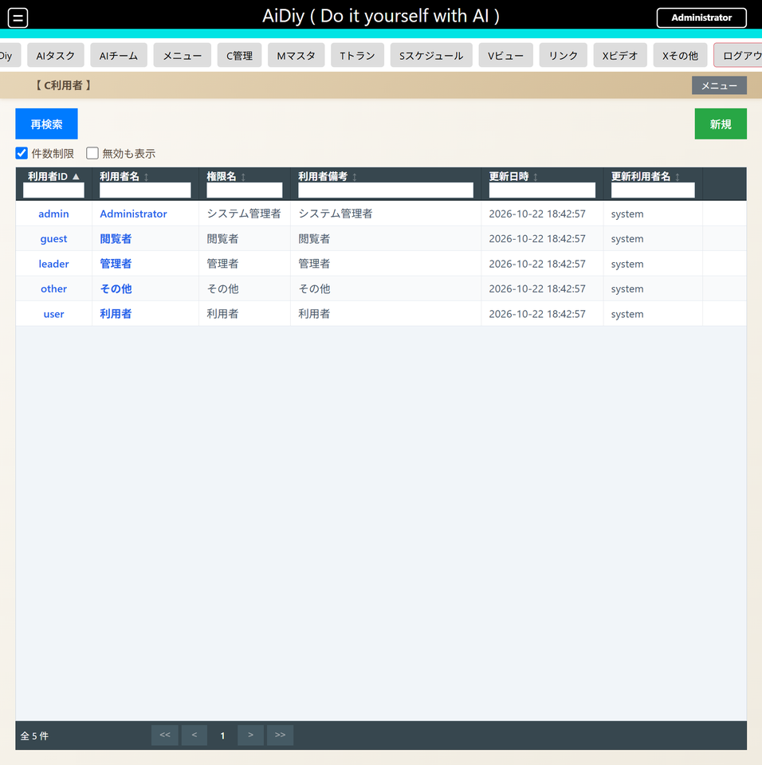

「Xその他」では紹介、映像、3D表示、ゲームの入口を選べます。今回は11画面を開き、以下の範囲を確認しました。起動表示とゲーム全体の合格は別です。

| 画面 | 今回確認した範囲 |
|---|---|
| 自己紹介 | 紹介本文とリンクの表示 |
| Xビデオ | 動画カテゴリと選択肢の表示 |
| アバター訓練中 | モデル読込、00→18→20の番号・説明・プレビュー切替、00への復帰 |
| 世界の絶景 | 写真・説明・出典、ランダムな次の場所と直前の場所への移動 |
| 動画再生BGM | ✅ OK：プレイリストと音量・切替欄の表示、音声オン後の再生を確認 |
| 太陽系 | 日付・速度・惑星表示。速度0／+60日/秒と再読込での初期化を実画面確認 |
| インベーダー／テトリス | インベーダーは左右移動・射撃・P停止／再開。テトリスは左右移動・回転・ハードドロップ・一時停止／再開を確認 |
| リバーシ／立体リバーシ | 平面版は合法手・一手の反転・CPU応手後の手番、立体版は回転と青の一手による反転を確認 |
| ドッグファイト | 自動飛行と手動開始、Vで操縦席／追尾視点、Dで短いロール、Pで停止／再開 |

ドッグファイトは「MISSION START」で手動飛行を始めます。Vで操縦席と追尾視点、Pで停止と再開を切り替えます。Dを短く押すと右ロールし、翼・地平線・中央の姿勢目盛りの変化を見比べられます。停止中の視点切替では表示枠が先に変わり、カメラ位置の補間は再開後に進むため、視点が落ち着いてから再び停止して説明します。操作しないと自動飛行に移るので、準備中も現在のPLAYER／DEMO FLIGHT表示を確かめます。

最高得点はブラウザのlocalStorageへ保存されます。通常利用の記録を保持する実演では、既存のInPrivate窓がないことを確認し、新しいInPrivateセッションを使います。今回の手動実演では、MISSION 1の操縦席から追尾視点へ移り、Dを0.5秒押した姿勢変化とP停止を確認、操縦席へ戻しました。手動射撃は行わず、最後はSCORE 0・HULL 100%でした。準備中の自動飛行による得点もこの一時セッション内だけです。表示用Three.jsは同梱ファイル、敵の動作はローカル処理で、外部対戦・AI送信はありません。終了時に実演窓を通常終了しました。

太陽系は左上の日付・速度と、右下の「惑星の状況」を中央の3D表示と見比べます。速度スライダーの中央「0」は日付の進行を止めますが、自動の視点移動は続きます。右へ動かすと日付が進み、惑星の位置と一覧の角度が変わります。初期値は当日を起点とする「+1日/秒」です。ページ再読込でこの初期状態へ戻せます。OSの日付・時刻は変更しません。

2026-11-02の音声実演では、初回観察時は既に11月16日（+1日/秒）まで進行していました。速度0で11月26日の表示が保たれ、視点が動き続けることを確認。+60日/秒へ変更後に2027年4月7日と惑星角度の変化を確認し、終了前の再読込で2026年11月2日「今日」・+1日/秒へ戻しました。初回観察時の経過日ではなく、ページの開始状態へ戻した確認です。表示だけの操作で、AI送信・業務データ変更はありません。

自己紹介を開いた画面です。特徴や各機能の説明を読めます。

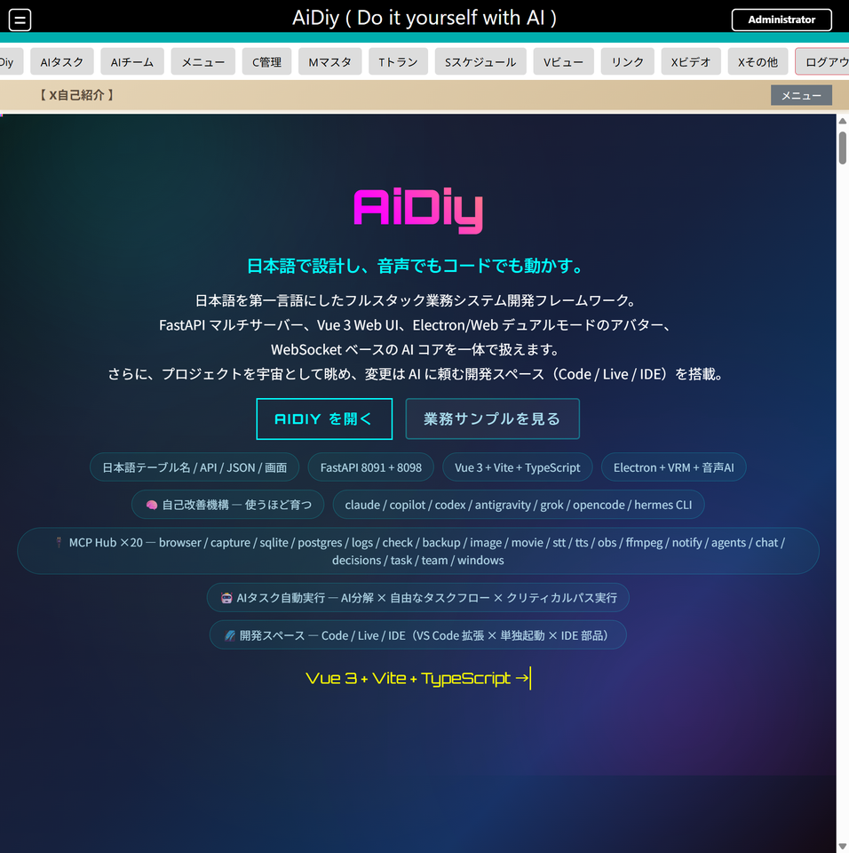

アバター訓練中は既存VRMとVRMAを表示するプレビューです。学習処理やデータ送信を開始する画面ではありません。00は標準モーション、01〜20は待機動作の候補、999は確認終了です。右の番号一覧から選ぶと、説明と左のプレビューが連動して切り替わります。「前へ」「次へ」や左右キーでも移動でき、左下の「最初へ」で00へ戻れます。同じ番号を押すと再生し直せます。

2026-11-02の解説では、既存素材の存在とモデル読込を確認後、00から18「小さく一回うなずく」、20「小さくおじぎする」を選択しました。番号・説明・プレビューの連動、20の上半身の姿勢変化と再生後の立ち姿への復帰を確認。18の厳密な動作回数や全候補の動作品質は今回の確認対象外です。終了前は「最初へ」で00へ戻します。素材生成・学習・AIへの送信は行いません。描画ライブラリはCDNから読み込むため、完全なオフライン動作を意味しません。

アバター訓練中の画面です。番号でモーション候補を選びます。

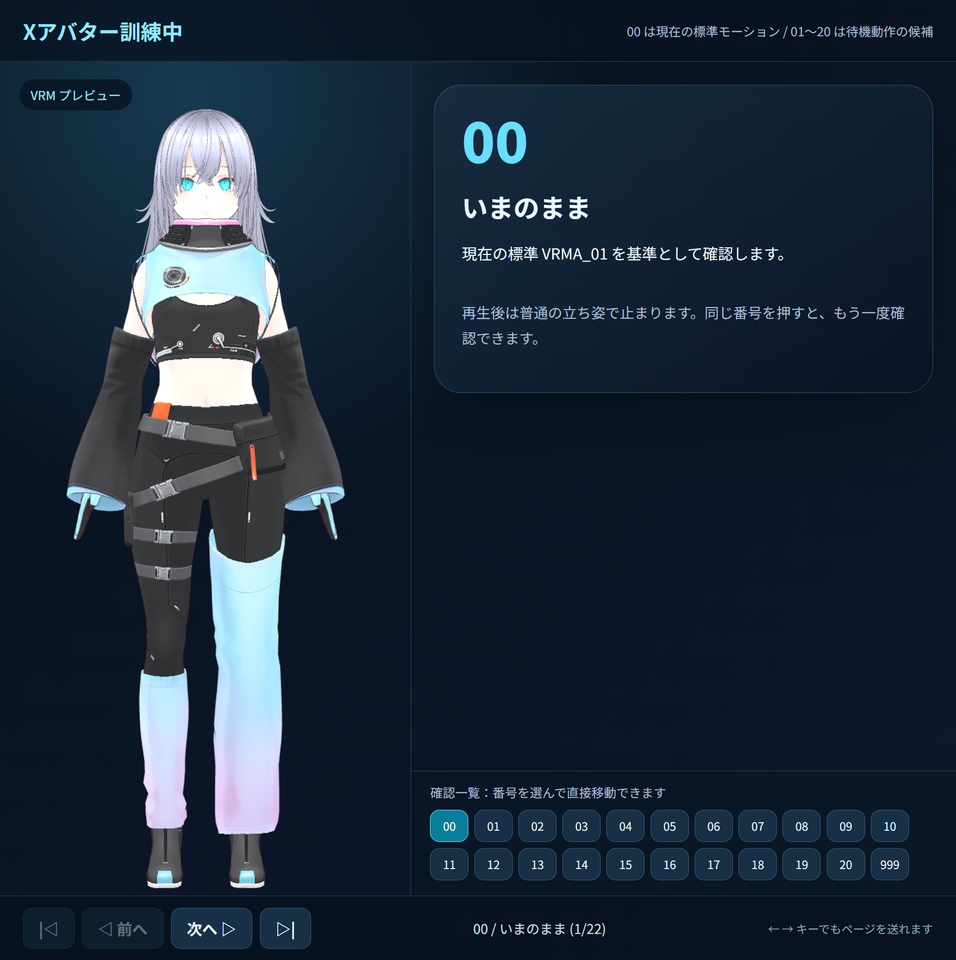

インベーダーはSTARTで開始し、画面下の緑色の自機を左右キーで動かします。スペースで薄緑色の弾を発射、Pキーで一時停止／再開します。停止時は中央のPAUSEDとPRESS P TO RESUMEを目印にします。キーを押しただけで成功とせず、自機の位置・弾・停止表示を画面で確認してください。

今回の実演は新規ページ内で左移動、1発射撃、右移動、P停止／再開を確認。撮り直し後はSCORE 0・WAVE 1・LIVES 3で終了し、撃破・次ウェーブは実演していません。ゲームの保存・対戦送信処理は確認されず、jQueryの公開CDN読込とブラウザ内WebAudio効果音を使用します。既存の対局は開き直さず、実演用の新しい窓だけ終了します。

テトリスは新しい閲覧窓で開き、中央の盤面・右のNEXT・下部の操作ボタンを先に確認します。STARTで開始、左右キーで移動、上キーで回転、スペースでハードドロップ。PAUSEで停止し、RESUMEで再開します。正方形のピースは回転しても見た目が変わらないため、回転紹介には別の形を使います。停止メッセージは一時表示なので、停止状態はRESUMEの文字と落下が止まった盤面でも確かめます。

今回の解説では新規ページ内で正方形を左へ2マス動かして1回落下、次のL形を回転して右へ1マス動かし一時停止しました。得点36、LINES 0を確認し、列消去や終局は実演していません。ゲーム状態の永続保存・送信処理は確認されず、jQueryの公開CDN読込はあります。盤面下部と操作ボタンの重なりは後半の追加確認で修正済みです。小さな画面ではゲーム枠内を縦にスクロールしてボタンへ進みます。

世界の絶景は左下の場所名・説明と、右上の写真出典を見比べます。説明を読むときは「自動巡回 OFF」にし、「次の絶景へ」でランダムな場所、「前へ」で直前の場所へ戻ります。地図から写真へ段階的に切り替わるため、`Photo: loading...` の間は写真表示完了と扱いません。写真・出典・操作ボタンがそろってから次へ進みます。

2026-11-02の解説では、アンテロープキャニオン→カイラス山→「前へ」でアンテロープキャニオンを確認しました。両方の写真と `Photo: Wikipedia / Wikimedia Commons` の出典表示を確認。Google Maps、Wikipediaの概要API、公開画像の読み取り通信を伴いますが、アップロード・共有・AI送信はしていません。アプリ内の訪問履歴と写真キャッシュはメモリ内で、業務DBへの保存ではありません。画面の出典表示を確認した範囲であり、個々の写真の再利用許諾確認とは区別します。

写真の読み込み後の世界の絶景です。出典と説明を確認できます。

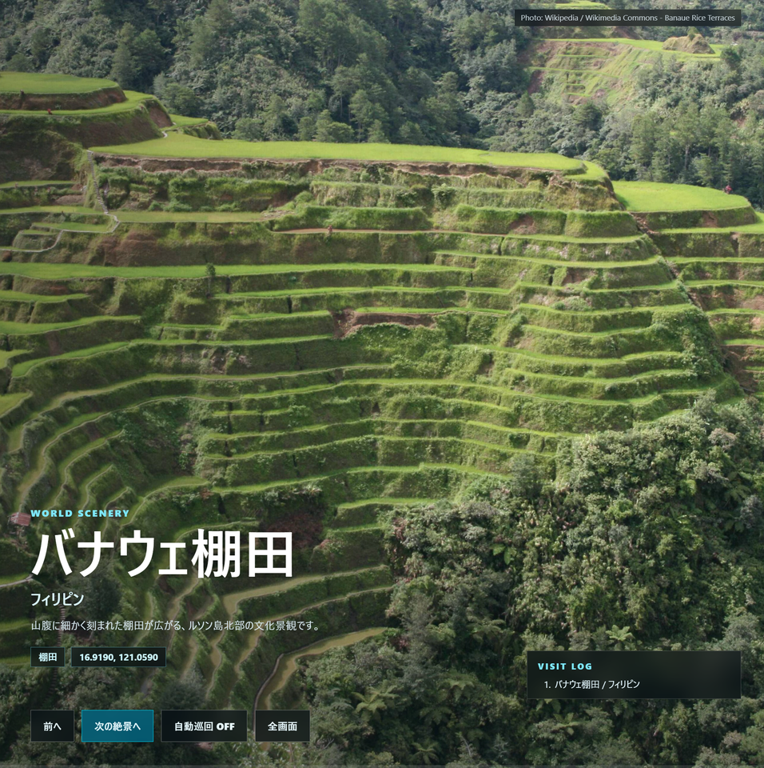

平面リバーシは黒がHUMAN、白がページ内のCPUです。水色の丸が置ける場所、右下の数字が裏返せる枚数を示します。初期状態の中央の白い石の一つ上（上から3行・左から4列）をクリックすると、縦に1枚をはさんで裏返せます。CPUは自動で応手するため、自分の一手直後の枚数とCPU応手後の枚数を区別して見ます。

今回の新規ページ実演では黒2・白2から、人のクリック1回で黒4・白1、A.I. PROCESSINGへ変化。その後、ローカルCPUの1手で黒3・白3とHUMAN TURNへの復帰、合法手の更新を確認しました。追加の着手・リセット・終局は行っていません。CPUはページ内JavaScriptの評価関数で、外部AI送信や対局の永続保存処理はありません。公開CDNのjQuery読込はあります。

立体リバーシは4×4の面を6枚つないだ盤面です。右の立方体をドラッグして回転し、光る〇をクリックすると現在の手番の石を置けます。横・縦の反転判定は辺をまたいで隣の面へ続き、斜めは同じ面の中で判定します。まず回転を終えてから置く場所を選び、左の手番・枚数と盤面を照合します。

2026-11-02の解説では、新しいローカルページで青12・赤12・空き72から開始。赤CPUと効果音をそのページだけOFFにし、ドラッグで向きだけ変わり枚数が変わらないことを確認しました。青が左面2-1へ1回着手すると赤1枚が反転し、青14・赤11・空き71、赤の手番になりました。外部AI・対戦サービスへの送信はありません。辺をまたぐ反転・チャレンジモード・終局はルール説明のみに留め、今回の実演済み範囲には含めません。

立体リバーシの初期画面です。ルールと置ける場所の案内があります。

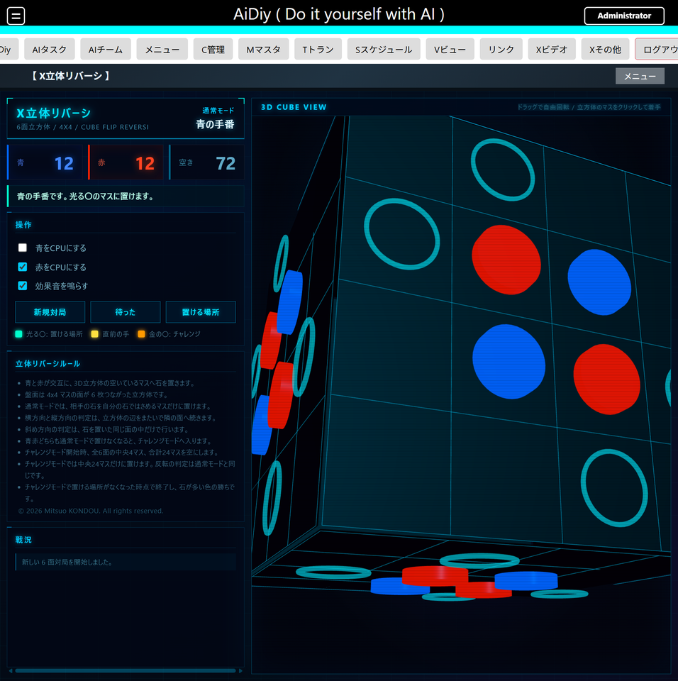

## 8. ログアウトして終了する

上部の「ログアウト」を押し、確認の「OK」を押します。確認を取り消しただけではログアウトしません。

**✅ OK：** OK後に認証情報が削除され、保護URL `/AiDiy` を直接開いてもログイン画面へ戻りました。無効な試験用トークンでも削除とログイン誘導を確認し、再ログインできました。Avatarの8092とは別の認証保存場所です。

ログアウト後に保護URLを開いた結果です。利用を再開するときはログインします。

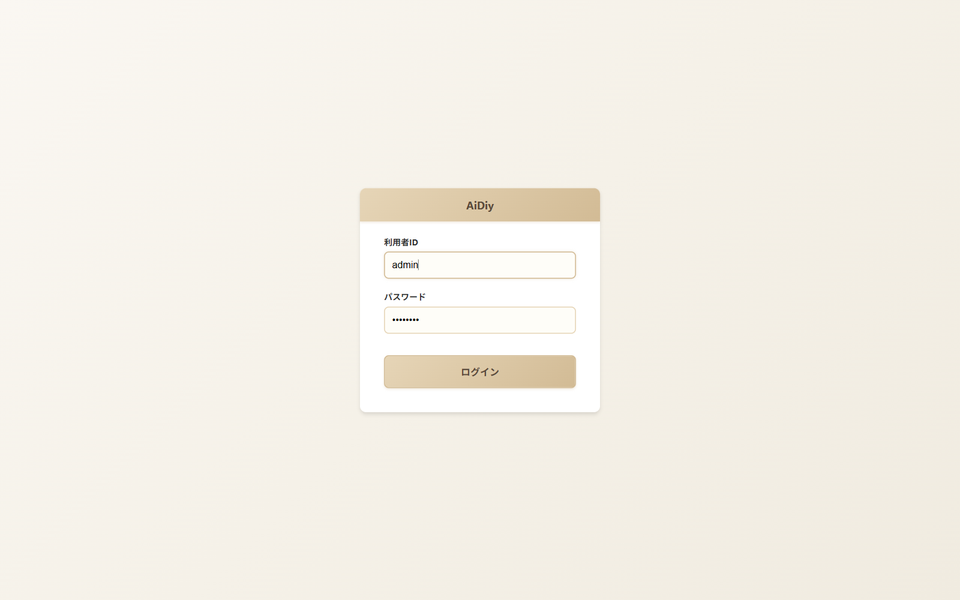

## 確認範囲

今回の結果は本冊に記載した操作の範囲です。以前のバックエンド自動試験件数や応答時間を、今回の結果として転記していません。

Task／TeamはWeb内の機能ではなく、単独の `aidiy_task`・`aidiy_team` で使用します。操作と試験は[AIタスク編](セルフテスト,aidiy_task,操作編.md)、[AIチーム編](セルフテスト,aidiy_team,操作編.md)、M／T／V／Sの登録・更新は[配車管理編](セルフテスト,frontend_web,配車管理編.md)、[生産・在庫管理編](セルフテスト,frontend_web,生産・在庫管理編.md)の別試験です。これらの冊子の未実施ケースを本冊の合格に含めません。

PDF版はこの作業ツリーに未配置です。本文は本Markdownを参照してください。

## 追加実機確認（2026-11-02、通常Web8090）

専用InPrivateの通常ログインからAiDiyを開き、対象プロジェクトを確認しました。Code1はcodex_cli、画面のモデルautoから実行時gpt-6-lunaが選択され、検証0回で挨拶を1回送信。正式回答「おはようございます。今日もよろしくお願いします。」と停止ボタン無効への復帰を確認しました。第2章のCode1基本経路を実機PASSとし、Code2〜6や全モデルへ広げません。

第4章はfreeai_live（画面モデルgemini-2.5-flash-native-audio-preview-09-2025、Zephyr）、準備完了から15秒以上経過後、Live選択で挨拶1回を送信。「おはようございます！今日も一日、よろしくお願いします。」の正式返信を確認しました。マイクを操作せず、スピーカーは専用セッションでOFFにし、実マイク入力・聴取試験はしていません。

第8章は通常のログアウト→確認OK→ログイン画面復帰を確認して専用ブラウザ窓を終了。5本の事前音声と整理音声をNanami1.2で直列再生しました。通常Webの結果であり、Avatar Web8092や単独--browserへ流用しません。添付、設定保存、業務データ操作、全章通しは今回の範囲外です。

### 管理一覧の読み取り確認（2026-11-02）

専用InPrivateセッションで公開初期データのC権限一覧5件を表示し、権限ID4の検索で「閲覧者」1件を確認。C採番一覧9件は採番ID「T」の検索で業務5件へ絞り込みました。利用者詳細は開かず、登録・更新・削除なし。専用セッションをログアウトしログイン画面への復帰後、ブラウザを通常終了しました。管理設定の変更や全権限でのアクセス試験とは区別します。

### テトリスの盤面と操作欄の配置（2026-11-02）

既存の盤面200セルとNEXT16セルを配置し、1536×740、1280×720、800×600、600×800、390×844の5 CSSサイズでボタン領域との重なりを再現しました。原因は `.game-content` の `flex: 1; min-height: 0` による親の縮小で、盤面が親の下へはみ出すことでした。`flex: 1 0 auto` へ変更し、既存のゲーム枠内スクロールで高さ不足を扱います。ゲームロジックは変更していません。

`node scripts/checks/Xテトリス表示.mjs` は5サイズ全てで、盤面・最終セル・情報欄が操作欄より上にあることと、スクロール後RESETボタンへ到達できることを確認しました。これは合成セルによるCSS配置試験です。別途、Windows125%のEdge専用InPrivate実窓（横長約1300×1000、縦長730×920物理px）で実ゲームの盤面下端・情報欄・3ボタンの非重複を目視確認しました。STARTせず、既存対局や記録は変更せず専用窓を通常終了。Nanami1.2の2音声は直列再生完了。全ゲームロジック・全端末の試験ではありません。

## 証拠照合と残る確認

2026-11-03の文書・既存証拠照合です。新しい実機試験ではありません。

- **確認済み**：2026-10-24のChat/Code1〜6/Live/添付/設定保存・復元、10-28の現行入口・認証・読取・ログアウトは本文の結果を維持。11-02のCode1/Live返信、管理一覧、X系11画面の限定操作とテトリス配置修正は追補と図で確認済みです。第5章の添付を新規残件へ戻しません。
- **残る確認・限界**：X系の辺をまたぐ反転・チャレンジ・終局、全ゲームロジックは本文で実演対象外と記載されており、新たな必須試験に拡大しません。音声解説の中断と機能未テストを混同しません。実マイク・他OS・全モデルは本冊の確認範囲外。元の試験条件を超える再送/設定保存は別判断です。

### 現行の判定（文書順再照合）

- **確認済み**：Web認証・会話/添付・共通ナビ・X画面の既存結果を採用。
- **本当に残る確認・範囲**：追加必須残件なし。実マイク・他OS・全ゲームロジック等は当初対象外。
- **証拠の扱い**：上記の本文・図・参照結果を照合。先行調査の未実施/拒否/準備失敗は当時の記録であり、後続の成功や実施不要指定を優先します。今回の文書整理を新しい実機PASSには数えません。
